# 4-Images: 11 - Using Modern Image Formats (4:30)

**ไฟล์ต้นทาง:** `11-Using_Modern_Image_Formats.mp4`

▶️ **[เปิดวิดีโอต้นฉบับ](../../../HTML-CSS-2/4-Images/11-Using_Modern_Image_Formats.mp4)**

---

## ภาพรวมคลิปนี้

คลิปนี้สอนเรื่อง**รูปแบบไฟล์ภาพสมัยใหม่ (Modern Image Formats)** โดยเน้นไปที่ **WebP** ซึ่งเป็นฟอร์แมตที่พัฒนาโดย Google และมีประสิทธิภาพการบีบอัดที่ดีกว่า JPEG/PNG/GIF มาก สอนวิธีแปลงไฟล์ภาพเป็น WebP ด้วยเครื่องมือออนไลน์ฟรี ตรวจสอบการรองรับของเบราว์เซอร์ และที่สำคัญที่สุดคือการใช้แท็ก **`<picture>`** เพื่อสร้างระบบ**สำรอง (fallback)** ให้เบราว์เซอร์รุ่นเก่าที่ยังไม่รองรับ WebP สามารถแสดงผลภาพได้อย่างถูกต้องเช่นกัน

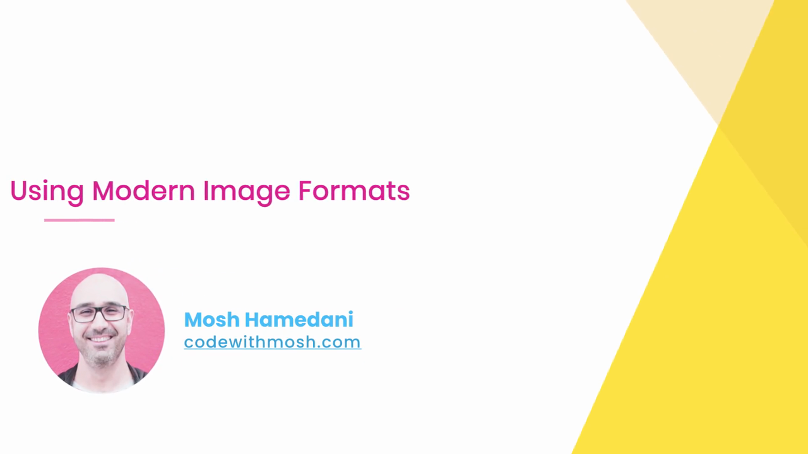

---

## 1. ทบทวน Raster Image Formats ที่เรียนมาก่อนหน้านี้

Mosh เปิดสไลด์ **"RASTER IMAGE FORMATS"** เพื่อทบทวนตารางเปรียบเทียบคุณสมบัติของฟอร์แมตภาพแบบ Raster ที่เคยเรียนมาแล้ว (JPEG, GIF, PNG, WebP) โดยแบ่งเป็น 3 คอลัมน์หลัก:

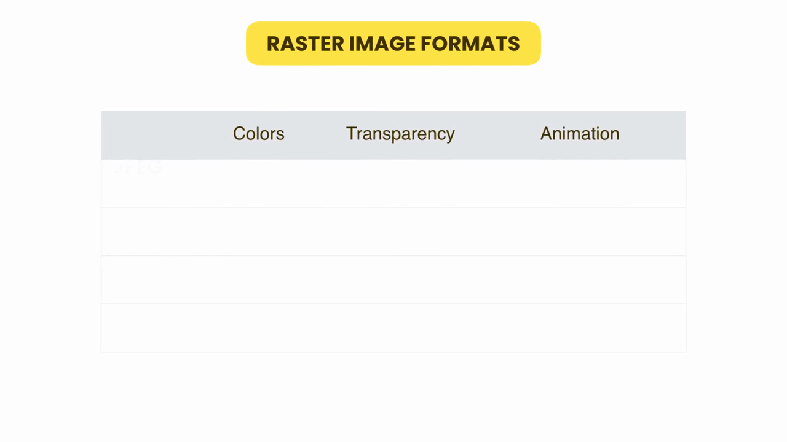

> **สรุปทบทวนคุณสมบัติของแต่ละฟอร์แมต (Colors / Transparency / Animation):**
> - **JPEG** — รองรับสีจำนวนมาก (Full color) แต่**ไม่รองรับความโปร่งใสและแอนิเมชัน** เหมาะกับภาพถ่าย
> - **GIF** — รองรับสีจำกัด (256 สี) รองรับความโปร่งใสแบบพื้นฐานและ**รองรับแอนิเมชัน**
> - **PNG** — รองรับสีจำนวนมากและ**ความโปร่งใสแบบเต็มรูปแบบ (alpha transparency)** แต่ไม่รองรับแอนิเมชัน (ยกเว้น APNG)
> - **WebP** — ฟอร์แมตสมัยใหม่ที่**รองรับทั้งสีจำนวนมาก ความโปร่งใส และแอนิเมชันในไฟล์เดียว** พร้อมขนาดไฟล์ที่เล็กกว่ามาก

---

## 2. วิธีการแปลงไฟล์เป็น WebP

Mosh เปิดสไลด์ **"CONVERSION TO WEBP"** แนะนำวิธีแปลงไฟล์ภาพเป็น WebP:

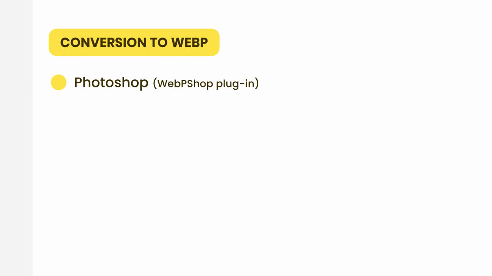

> **วิธีที่ 1: Photoshop** — ใช้ปลั๊กอิน **WebPShop** (ปลั๊กอินฟรีจาก Google) ติดตั้งเพิ่มเข้าไปใน Photoshop เพื่อให้สามารถ Export/Save As เป็นไฟล์ `.webp` ได้โดยตรงจากโปรแกรม
>
> **วิธีที่ 2 (ที่ Mosh สาธิตในคลิปนี้): ใช้เว็บไซต์แปลงไฟล์ออนไลน์** ซึ่งสะดวกกว่าสำหรับผู้ที่ไม่มีปลั๊กอิน Photoshop ติดตั้งไว้

---

## 3. แปลงไฟล์ด้วย CloudConvert (เว็บไซต์แปลงไฟล์ออนไลน์ฟรี)

Mosh เปิดเว็บไซต์ **cloudconvert.com**:

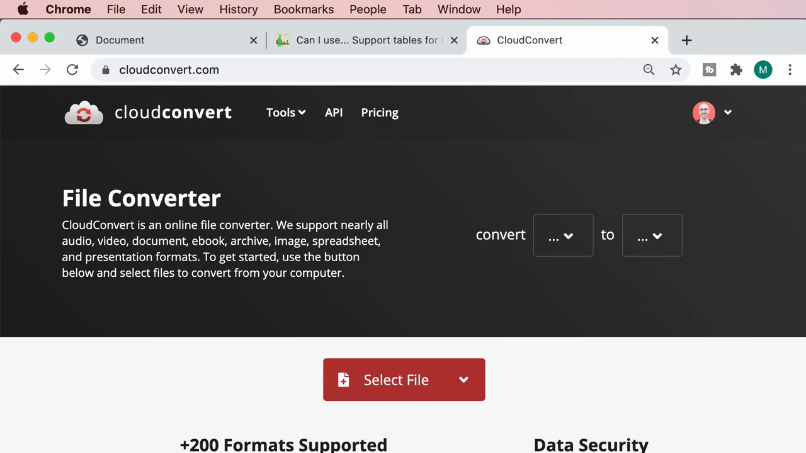

> คำอธิบายจากเว็บไซต์: *"CloudConvert is an online file converter. We support nearly all audio, video, document, ebook, archive, image, spreadsheet, and presentation formats."* — เป็นเครื่องมือแปลงไฟล์ออนไลน์ที่รองรับไฟล์มากกว่า 200 ฟอร์แมต

คลิกปุ่ม **"Select File"** เพื่อเลือกไฟล์ `meal.jpg` จากโฟลเดอร์ `images` ของโปรเจกต์:

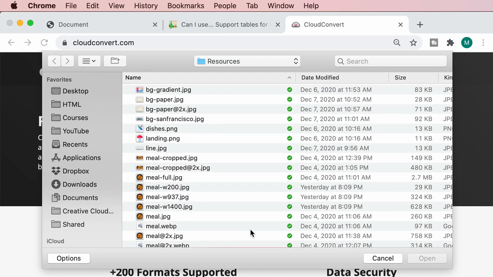

หลังเลือกไฟล์ ระบบตรวจพบว่าเป็นไฟล์ JPG โดยอัตโนมัติ และแสดงหน้า **"JPG Converter"**:

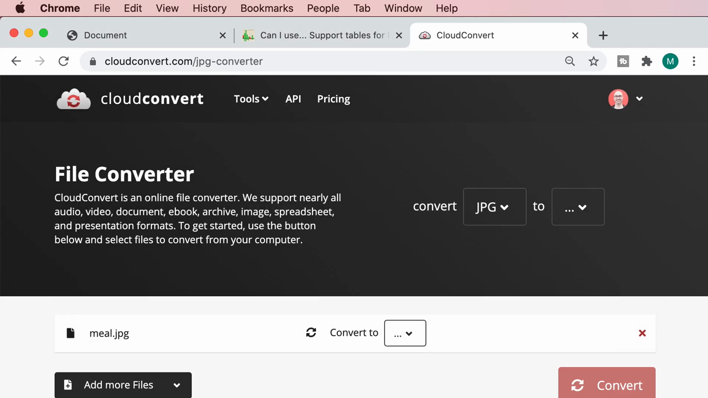

คลิกที่ dropdown ช่อง **"to"** เพื่อเลือกฟอร์แมตปลายทาง ระบบแสดงตัวเลือกฟอร์แมตภาพที่รองรับทั้งหมด (BMP, EPS, GIF, ICO, JPG, ODD, PNG, PS, PSD, TIFF, **WEBP**):

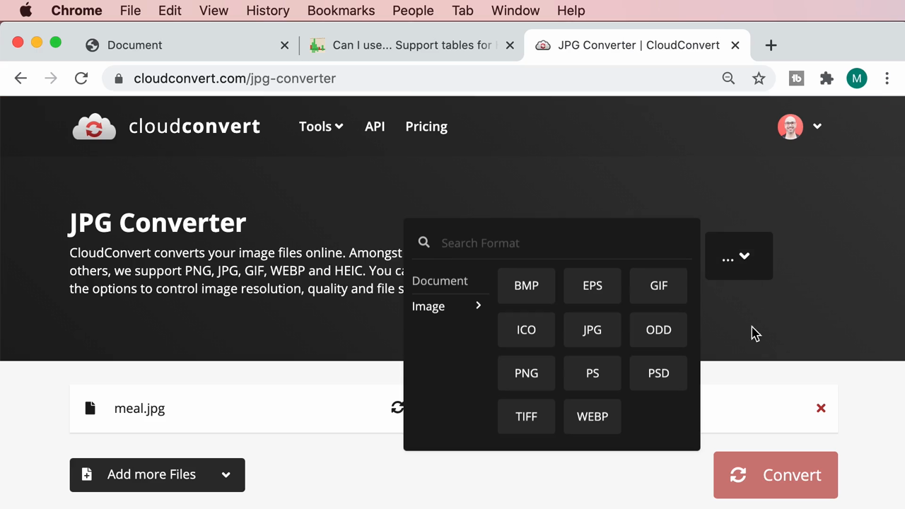

เลือก **WEBP** — หน้าเว็บเปลี่ยนเป็น **"JPG to WEBP Converter"** พร้อมไฟล์ `meal.jpg` ที่ตั้งค่า "Convert to WEBP" ไว้แล้ว:

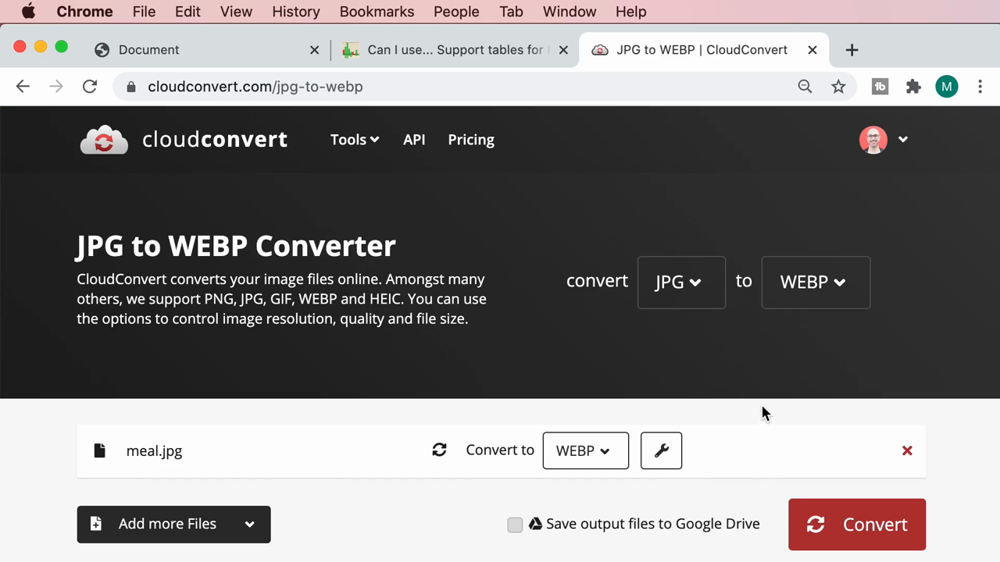

คลิกปุ่ม **"Convert"** ระบบจะอัปโหลดและแปลงไฟล์ให้อัตโนมัติ เมื่อเสร็จแล้วจะแสดงตัวอย่างไฟล์ผลลัพธ์ **`meal.webp`** พร้อมปุ่มดาวน์โหลด:

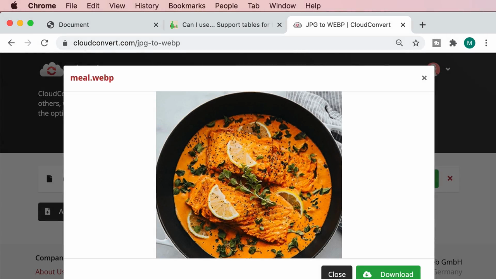

หลังดาวน์โหลดและย้ายไฟล์ไปไว้ในโฟลเดอร์ `images` ของโปรเจกต์ (เคียงข้างไฟล์ต้นฉบับ) Finder แสดงไฟล์ทั้งสอง:

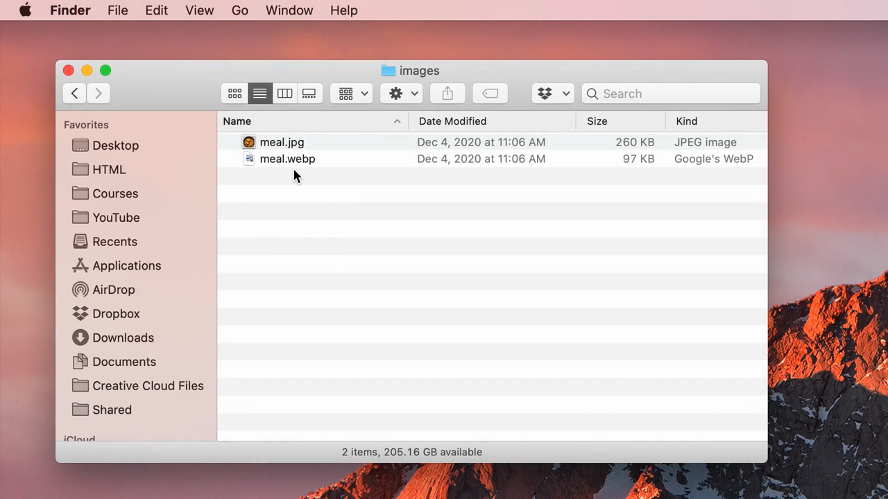

| ไฟล์ | ขนาด | ประเภท |
|---|---|---|
| `meal.jpg` | 260 KB | JPEG image |
| `meal.webp` | **97 KB** | Google's WebP |

> **ผลลัพธ์ที่สำคัญ:** ไฟล์ WebP มีขนาดเล็กกว่าไฟล์ JPEG เดิมถึง**ประมาณ 63%** (จาก 260KB เหลือเพียง 97KB) โดยที่คุณภาพของภาพยังคงดูใกล้เคียงกันมาก — นี่คือเหตุผลหลักที่ทำให้ WebP เป็นฟอร์แมตที่ได้รับความนิยมมากขึ้นเรื่อยๆ สำหรับเว็บไซต์ที่ต้องการความเร็วในการโหลด

---

## 4. นำไฟล์ WebP มาใช้ในโค้ด และเปรียบเทียบผลลัพธ์

กลับไปที่ VS Code Mosh แก้ไข `src` ของ `` จาก `images/meal.jpg` เป็น **`images/meal.webp`**:

```html

```


จากนั้นเพิ่ม `` อีกแท็กหนึ่งที่ยังคงใช้ `images/meal.jpg` เดิม เพื่อวางเทียบกันดูในเบราว์เซอร์:

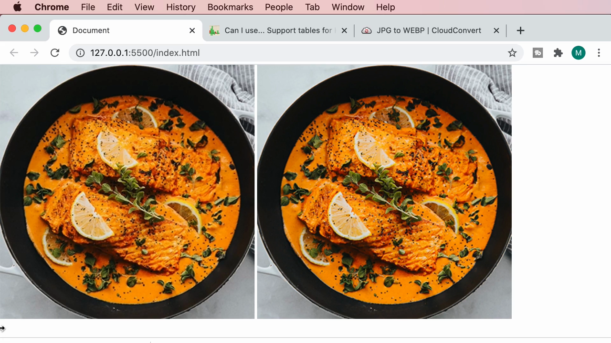

> **ผลลัพธ์:** ภาพทั้งสองฝั่ง (WebP ทางซ้าย, JPEG ทางขวา) มองด้วยตาเปล่า**แทบแยกไม่ออกเลยว่าต่างกัน** ทั้งที่ไฟล์ WebP มีขนาดเล็กกว่าไฟล์ JPEG มาก — พิสูจน์ว่า WebP สามารถประหยัด bandwidth ได้จริงโดยไม่กระทบต่อคุณภาพที่ผู้ใช้มองเห็น

---

## 5. ตรวจสอบการรองรับเบราว์เซอร์ด้วย caniuse.com

ก่อนจะนำ WebP ไปใช้งานจริง Mosh ตรวจสอบการรองรับผ่าน **caniuse.com** ค้นหาคำว่า "webp":

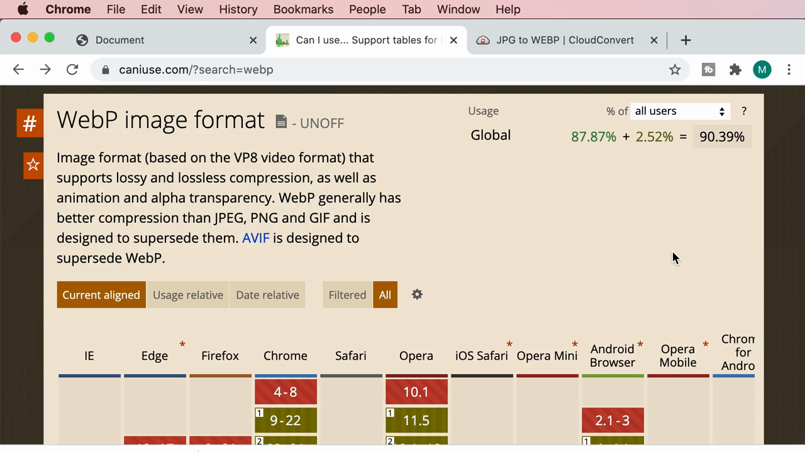

> คำอธิบายจากเว็บไซต์: *"Image format (based on the VP8 video format) that supports lossy and lossless compression, as well as animation and alpha transparency. WebP generally has better compression than JPEG, PNG and GIF and is designed to supersede them. AVIF is designed to supersede WebP."*
>
> **สรุป Usage Global:** รองรับรวม **90.39%** (87.87% รองรับแบบเต็ม + 2.52% รองรับบางส่วน/ต้องเปิดใช้งานเอง)

เลื่อนดูตารางรายละเอียดแต่ละเบราว์เซอร์:

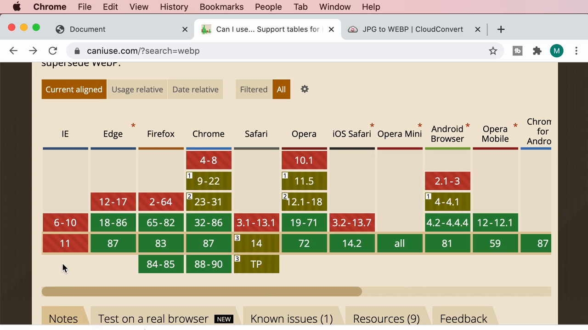

> **ข้อสังเกตสำคัญ:** แม้เบราว์เซอร์หลักอย่าง Chrome, Firefox, Edge, Opera, Android Browser จะรองรับ WebP มาอย่างยาวนานแล้ว (แถบสีเขียว) แต่ **Safari รองรับ WebP ตั้งแต่เวอร์ชัน 14 เป็นต้นไปเท่านั้น** (เวอร์ชันก่อนหน้านั้นเป็นแถบสีแดง = ไม่รองรับ) ซึ่งหมายความว่า**ผู้ใช้ Safari รุ่นเก่าหรืออุปกรณ์ iOS รุ่นเก่าจะไม่สามารถแสดงผลไฟล์ WebP ได้เลย** — นี่คือปัญหาที่ต้องแก้ไขด้วยกลไก fallback

---

## 6. ใช้แท็ก `<picture>` เพื่อสร้างระบบ Fallback

เนื่องจากไม่ใช่ทุกเบราว์เซอร์รองรับ WebP Mosh จึงแนะนำแท็ก **`<picture>`** ซึ่งช่วยให้สามารถระบุไฟล์ภาพหลายฟอร์แมตพร้อมกัน โดยเบราว์เซอร์จะเลือกไฟล์แรกที่ตนเองรองรับ

Mosh เริ่มพิมพ์โครงสร้าง `<picture>` พร้อมแท็ก `<source>` ข้างใน (ระหว่างพิมพ์มีบางจุดที่พิมพ์ซ้ำหรือผิดพลาดเล็กน้อยก่อนแก้ไข):

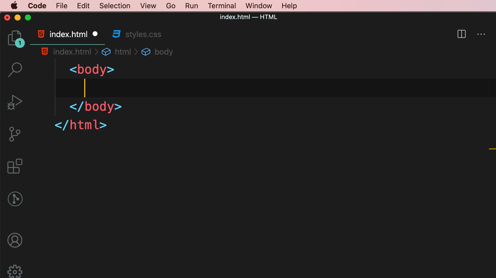

```html
<picture>
  <source type="image/webp" srcset="images/meal.webp 1x, images/meal@2x.webp 2x" />
</picture>
```

ระหว่างการพิมพ์ มีจุดหนึ่งที่ Mosh พิมพ์ `<source>` สองแท็กโดยทั้งคู่มี `type="image/webp"` ซ้ำกัน (ยังไม่ได้แก้ไขเป็น `image/jpeg` สำหรับแท็กที่สอง):

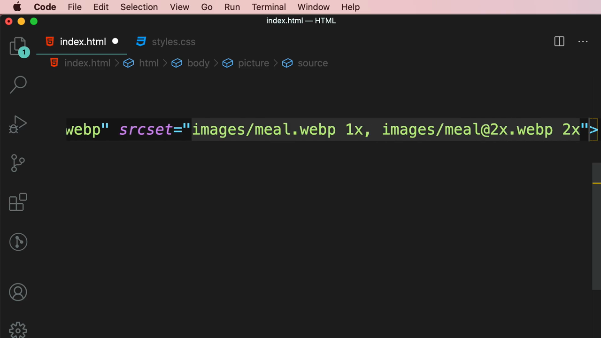

> **หลักการทำงานของ `<picture>` และ `<source>`:**
> - **`<picture>`** เป็น container ที่ครอบ **`<source>`** หลายแท็ก ตามด้วย **``** ปกติหนึ่งแท็กเป็นตัวสุดท้ายเสมอ
> - แต่ละ **`<source>`** มี attribute **`type`** ระบุ MIME type ของไฟล์ (เช่น `image/webp`, `image/jpeg`) และ **`srcset`** ระบุไฟล์ที่จะใช้
> - เบราว์เซอร์จะอ่าน `<source>` **จากบนลงล่างตามลำดับ** และเลือกใช้ไฟล์จาก `<source>` แรกที่ตน **"เข้าใจ" ค่า `type` นั้น** (รองรับฟอร์แมตนั้น) — หากไม่มี `<source>` ใดที่รองรับเลย เบราว์เซอร์จะ**ใช้ `` ตัวสุดท้ายเป็นค่าสำรอง (fallback)** เสมอ

### 6.1 แก้ไขให้ถูกต้อง — เพิ่ม Fallback สำหรับ JPEG และ ``

Mosh แก้ไขโค้ดให้ถูกต้องสมบูรณ์ โดยมี `<source>` สำหรับ WebP ก่อน ตามด้วย `<source>` สำหรับ JPEG เป็นตัวสำรอง และปิดท้ายด้วย `` ธรรมดา:

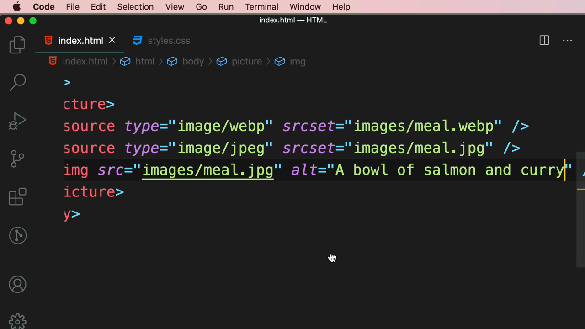

```html
<picture>
  <source type="image/webp" srcset="images/meal.webp" />
  <source type="image/jpeg" srcset="images/meal.jpg" />
  
</picture>
```

> **อธิบายลำดับการทำงานของโค้ดนี้:**
> 1. เบราว์เซอร์เจอ `<source type="image/webp">` ก่อน — ถ้าเบราว์เซอร์นั้นรองรับ WebP (เช่น Chrome, Firefox, Edge) จะใช้ไฟล์ `meal.webp` ทันที และ**หยุดอ่านแท็กที่เหลือทั้งหมด**
> 2. ถ้าเบราว์เซอร์ไม่รองรับ WebP (เช่น Safari รุ่นเก่า) จะข้ามไปเจอ `<source type="image/jpeg">` ซึ่งรองรับแน่นอน (JPEG เป็นฟอร์แมตมาตรฐานที่ทุกเบราว์เซอร์รองรับ) จึงใช้ไฟล์ `meal.jpg` แทน
> 3. **``** ตัวสุดท้ายทำหน้าที่สองอย่าง: (ก) เป็น**ตัวสำรองสุดท้าย**สำหรับเบราว์เซอร์รุ่นเก่ามากๆ ที่ไม่รู้จักแท็ก `<picture>` เลย (เบราว์เซอร์เหล่านั้นจะมองข้าม `<picture>` และ `<source>` ไปเลย แต่ยังคงแสดงผล `` ได้ตามปกติ) และ (ข) เป็นที่ที่ต้องใส่ **`alt`** text ที่จำเป็นสำหรับ accessibility เสมอ (attribute `alt` ใส่ไว้ที่ `` เท่านั้น ไม่ใส่ใน `<source>`)

รีเฟรชหน้าเว็บ ภาพแสดงผลได้ตามปกติ (เบราว์เซอร์ Chrome ที่ใช้ทดสอบรองรับ WebP อยู่แล้ว จึงเลือกใช้ไฟล์ `meal.webp` โดยอัตโนมัติ):

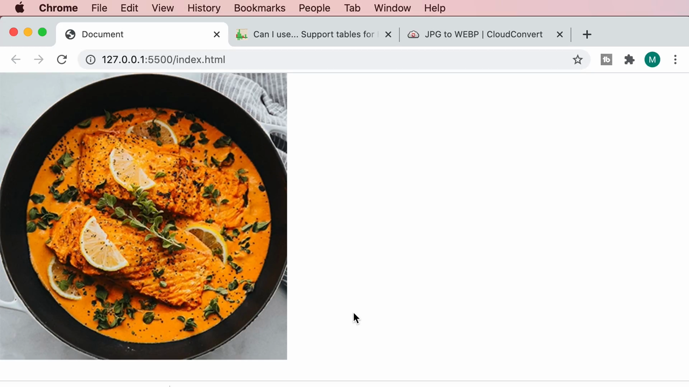

---

## สรุปภาพรวมของคลิปนี้

| หัวข้อ | รายละเอียด |
|---|---|
| **ฟอร์แมตหลักที่เรียน** | WebP — บีบอัดดีกว่า JPEG/PNG/GIF, รองรับสี, ความโปร่งใส และแอนิเมชันในไฟล์เดียว |
| **เครื่องมือแปลงไฟล์** | cloudconvert.com — อัปโหลดไฟล์ JPG แล้วแปลงเป็น WEBP ได้ฟรีในไม่กี่คลิก |
| **ผลการทดสอบ** | `meal.jpg` (260KB) → `meal.webp` (97KB) ลดขนาดลง ~63% โดยคุณภาพไม่ต่างกันมาก |
| **การรองรับเบราว์เซอร์** | Global 90.39% — Chrome/Firefox/Edge รองรับมานาน, **Safari รองรับตั้งแต่เวอร์ชัน 14** |
| **วิธีแก้ปัญหาเบราว์เซอร์เก่า** | ใช้ `<picture>` + `<source type="...">` หลายตัว เรียงจากฟอร์แมตใหม่สุดไปเก่าสุด ปิดท้ายด้วย `` fallback |

**แนวคิดสำคัญที่ได้จากคลิปนี้:**

1. **WebP เป็นฟอร์แมตภาพที่คุ้มค่าที่สุดสำหรับเว็บสมัยใหม่** เพราะให้คุณภาพใกล้เคียงเดิมแต่ขนาดไฟล์เล็กกว่ามาก ช่วยให้เว็บโหลดเร็วขึ้นอย่างชัดเจน
2. **ไม่จำเป็นต้องมีโปรแกรมกราฟิกเพื่อแปลงไฟล์เป็น WebP** — เว็บไซต์แปลงไฟล์ออนไลน์ฟรีอย่าง CloudConvert ก็เพียงพอสำหรับงานส่วนใหญ่
3. **ต้องตรวจสอบ Browser Support ทุกครั้งก่อนใช้ฟอร์แมตหรือฟีเจอร์ใหม่ๆ เสมอ** โดยเฉพาะเมื่อยังมีเบราว์เซอร์หรือเวอร์ชันเก่าที่ผู้ใช้จำนวนหนึ่งยังใช้งานอยู่ (เช่นกรณี Safari กับ WebP)
4. **แท็ก `<picture>` คือวิธีมาตรฐานในการรองรับฟอร์แมตภาพใหม่ๆ อย่างปลอดภัย** โดยไม่ทิ้งผู้ใช้เบราว์เซอร์รุ่นเก่าไว้ข้างหลัง — เบราว์เซอร์จะเลือกไฟล์แรกที่ตนรองรับได้เองโดยอัตโนมัติ ไม่ต้องเขียน JavaScript ตรวจสอบเอง
5. **`` ตัวสุดท้ายใน `<picture>` มีความสำคัญเสมอ** ทั้งในฐานะ fallback สุดท้ายและในฐานะที่ต้องมี `alt` text สำหรับ accessibility — ไม่ควรมองข้ามแม้จะรู้สึกว่า "ซ้ำซ้อน" กับ `<source>` ที่มีอยู่แล้ว

---

*หมายเหตุ: คลิปนี้เป็นส่วนหนึ่งของบท "4-Images" จากคอร์ส The Ultimate HTML and CSS Course โดย Mosh Hamedani (codewithmosh.com) — คลิปที่ 11 ของบทนี้*
