# 4-Images: 12 - Art Direction (2:34)

**ไฟล์ต้นทาง:** `12-Art_Direction.mp4`

▶️ **[เปิดวิดีโอต้นฉบับ](../../../HTML-CSS-2/4-Images/12-Art_Direction.mp4)**

---

## ภาพรวมคลิปนี้

คลิปสั้นแต่สำคัญ — สอนเทคนิคที่เรียกว่า **Art Direction** ซึ่งเป็นการใช้แท็ก `<picture>` ในอีกรูปแบบหนึ่ง (ต่างจาก 2 คลิปก่อนหน้า) โดยครั้งนี้ไม่ได้เปลี่ยนแค่**ความละเอียด**หรือ**ฟอร์แมต**ของภาพ แต่เปลี่ยน**องค์ประกอบภาพ/การครอบตัด (crop/composition) ทั้งหมด** ให้เหมาะสมกับขนาดหน้าจอที่แตกต่างกัน

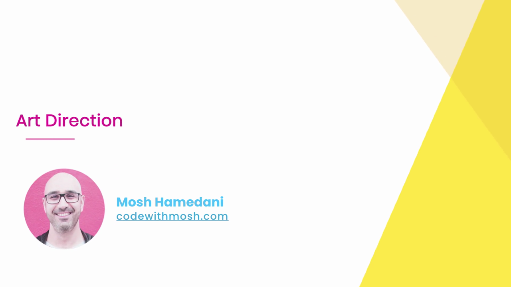

---

## 1. ตัวอย่างจริงจากเว็บไซต์ Earls (earls.ca)

Mosh เปิดเว็บไซต์จริงของร้านอาหาร **Earls Kitchen + Bar** (earls.ca) เพื่อยกตัวอย่าง Art Direction ที่ใช้งานจริงในโลกจริง:

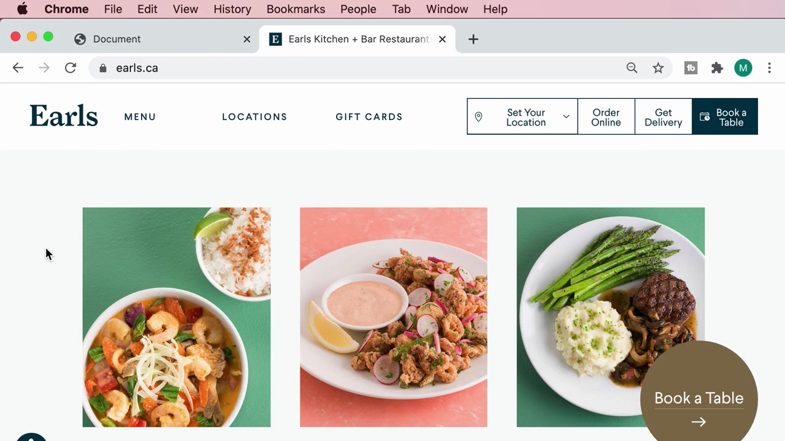

หน้าเว็บแสดงภาพอาหาร 3 จานเรียงกันในแนวนอน (บนหน้าจอกว้าง/Desktop) — Mosh คลิกเข้าไปที่ภาพ **"Thai Prawn Curry Bowl"** แล้วค่อยๆ **ลดขนาดหน้าต่างเบราว์เซอร์ให้แคบลง** เพื่อสังเกตพฤติกรรมของภาพ:

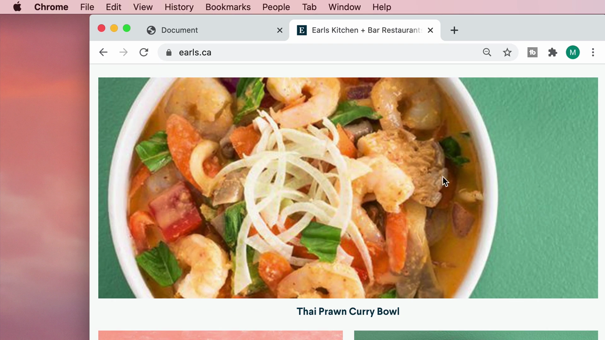

เมื่อขยายหน้าต่างกลับมาให้กว้างขึ้นอีกครั้ง ภาพจะกลับไปแสดงผลแบบเดิม (จัดเรียง 3 ภาพในแนวนอน):

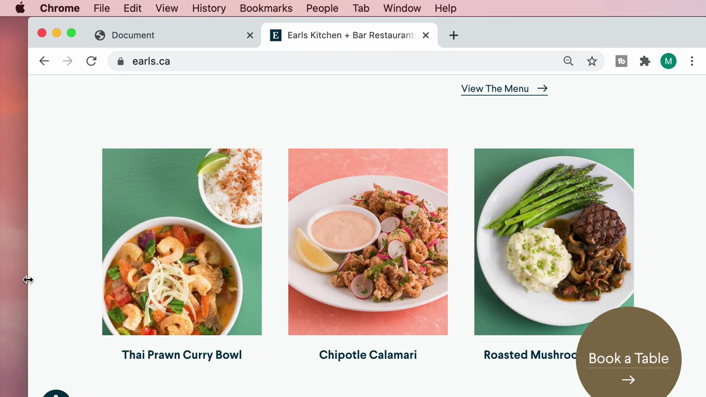

> **ข้อสังเกตสำคัญที่ Mosh ต้องการชี้ให้เห็น:** เมื่อหน้าจอแคบลง เว็บไซต์นี้**ไม่ได้แค่ย่อภาพเดิมให้เล็กลง** แต่เปลี่ยนไปใช้ **ภาพที่มีองค์ประกอบ/การครอบตัดต่างออกไปโดยสิ้นเชิง** เพื่อให้จุดเด่นของภาพ (ตัวอาหาร) ยังคงเห็นชัดเจนและสวยงามแม้พื้นที่แสดงผลจะเล็กลงมาก — นี่คือแนวคิดหลักของ **Art Direction**

---

## 2. Art Direction คืออะไร และต่างจากเทคนิคก่อนหน้าอย่างไร

> **สรุปความแตกต่างระหว่าง 3 เทคนิคที่เรียนมาในบทนี้:**
> 1. **Supporting High-density Screens (คลิปที่ 9)** — เปลี่ยนไฟล์ตาม**ความหนาแน่นของพิกเซล (DPR)** โดยภาพทุกเวอร์ชันมีองค์ประกอบเดียวกันทุกประการ เพียงแค่ความละเอียดต่างกัน
> 2. **Resolution Switching (คลิปที่ 10)** — เปลี่ยนไฟล์ตาม**ขนาดพื้นที่แสดงผล (viewport)** โดยภาพทุกเวอร์ชันก็ยังคงมีองค์ประกอบเดียวกันทุกประการเช่นกัน เพียงแค่ขนาดไฟล์ต่างกัน
> 3. **Art Direction (คลิปนี้)** — เปลี่ยนไฟล์ตาม**ขนาดพื้นที่แสดงผลเช่นกัน แต่คราวนี้ภาพแต่ละเวอร์ชันมีองค์ประกอบ/การครอบตัดที่แตกต่างกันโดยตั้งใจ** เช่น ภาพสำหรับจอกว้างอาจแสดงทั้งฉาก (wide shot) ในขณะที่ภาพสำหรับมือถือเป็นภาพที่ครอบตัดให้เห็นแค่จุดสำคัญ (close-up/cropped) เพื่อให้ยังคงสวยงามและสื่อความหมายได้ชัดเจนแม้พื้นที่จะเล็กลงมาก

---

## 3. กลับสู่ VS Code — ตรวจสอบไฟล์ภาพที่เตรียมไว้แล้ว

Mosh เปิด Finder ตรวจสอบโฟลเดอร์ `images` ของโปรเจกต์ พบว่ามีไฟล์ที่เตรียมไว้ล่วงหน้าสำหรับ Art Direction อยู่แล้ว:

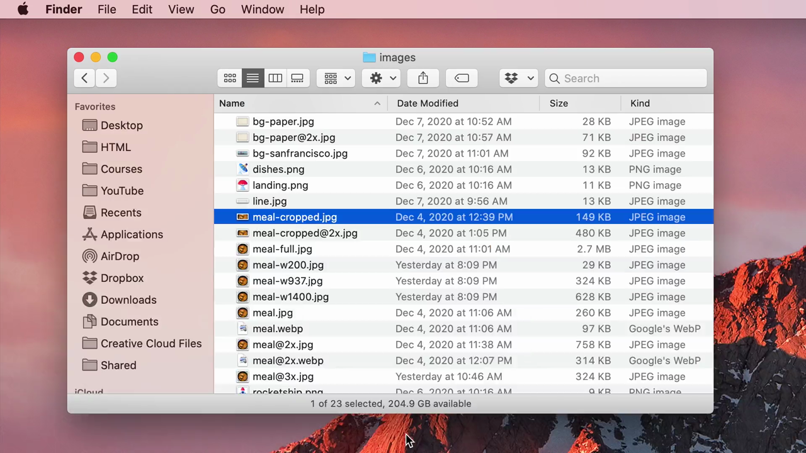

| ไฟล์ | ขนาด | คำอธิบาย |
|---|---|---|
| `meal-cropped.jpg` | 149 KB | เวอร์ชัน**ครอบตัด**ให้เห็นเฉพาะจุดเด่นของจาน (สำหรับหน้าจอแคบ) |
| `meal-cropped@2x.jpg` | 480 KB | เวอร์ชันครอบตัด ความละเอียดสูงสำหรับจอ Retina |
| `meal.jpg` | 260 KB | เวอร์ชันเต็ม แสดงองค์ประกอบทั้งหมดของภาพ (สำหรับหน้าจอกว้าง) |

---

## 4. เขียนโค้ด `<picture>` พร้อม `media` Attribute

Mosh เริ่มพิมพ์แท็ก `<picture>` โดยใช้ **Emmet abbreviation** ของ VS Code (พิมพ์ `pic` หรือ `picture` แล้วกด Tab เพื่อขยายเป็นแท็กเต็มอัตโนมัติ):

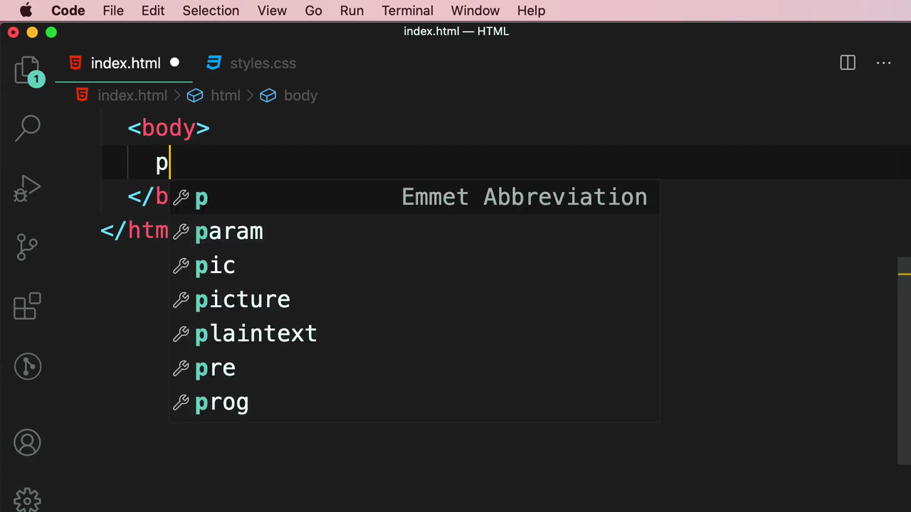

ภายในเพิ่มแท็ก `<source>` (ใช้ Emmet abbreviation เช่นกัน โดยพิมพ์ `s` แล้วเลือกจากรายการ):

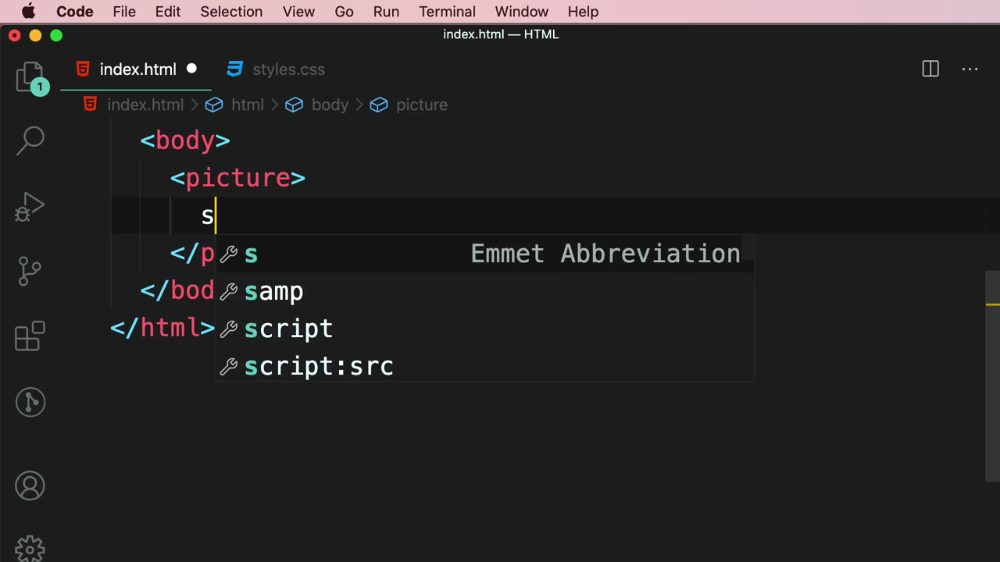

พิมพ์ `<source>` แท็กแรก พร้อม attribute **`media`** กำหนดเงื่อนไข media query และ **`srcset`** ชี้ไปยังไฟล์ที่ครอบตัดแล้ว:

```html
<source media="(max-width: 500px)" srcset="images/meal-cropped.jpg" />
```

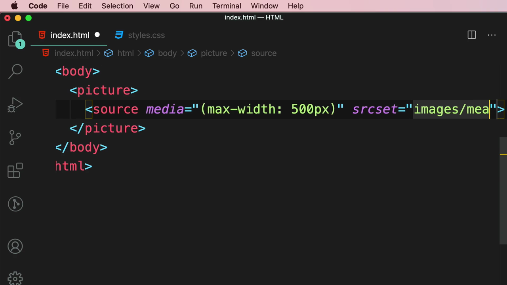

เพิ่ม `<source>` แท็กที่สอง สำหรับกรณีหน้าจอกว้าง โดยใช้ไฟล์เวอร์ชันเต็ม:

```html
<source media="(min-width: 501px)" srcset="images/meal.jpg" />
```

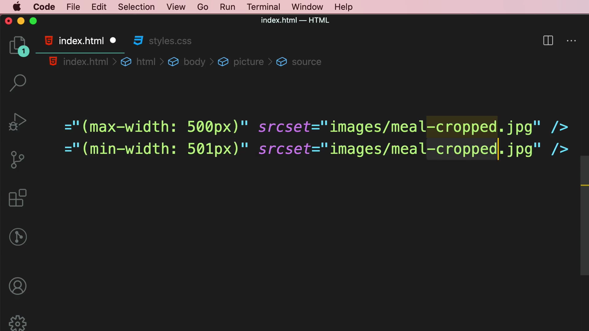

ปิดท้ายด้วย `` เป็นค่าสำรอง (fallback) ตามหลักการเดียวกับคลิปก่อนหน้า:

```html
<picture>
  <source media="(max-width: 500px)" srcset="images/meal-cropped.jpg" />
  <source media="(min-width: 501px)" srcset="images/meal.jpg" />
  
</picture>
```

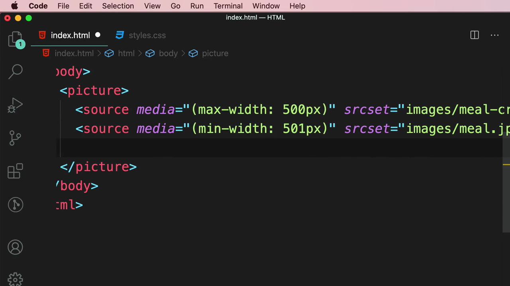

> **ความแตกต่างสำคัญของ attribute ที่ใช้ในแต่ละคลิป:**
> - คลิปที่ 11 (Using Modern Image Formats) ใช้ **`type`** เพื่อบอก**ฟอร์แมต**ไฟล์ที่เบราว์เซอร์รองรับหรือไม่
> - คลิปนี้ใช้ **`media`** เพื่อบอก**เงื่อนไขขนาดหน้าจอ (media query)** คล้ายกับที่ใช้ใน CSS `@media` — เบราว์เซอร์จะเลือก `<source>` แรกที่เงื่อนไข `media` เป็นจริงตามขนาดหน้าจอปัจจุบัน

---

## 5. ทดสอบผลลัพธ์จริงในเบราว์เซอร์

เปิดหน้าเว็บที่ `127.0.0.1:5500/index.html` ในสถานะหน้าต่างกว้าง (มากกว่า 500px) — แสดงภาพเวอร์ชันเต็มตามเงื่อนไข `(min-width: 501px)`:

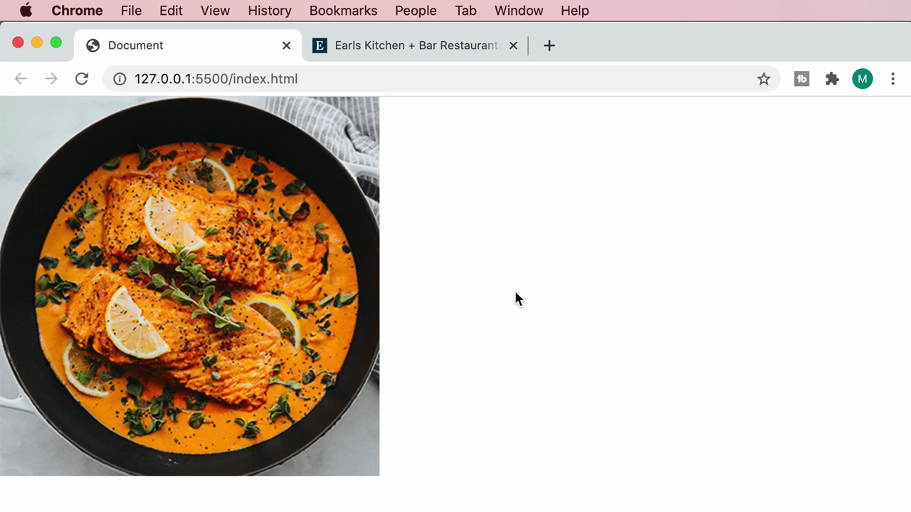

วางหน้าต่าง VS Code และเบราว์เซอร์ไว้เคียงข้างกันเพื่อดูโค้ดและผลลัพธ์พร้อมกัน:

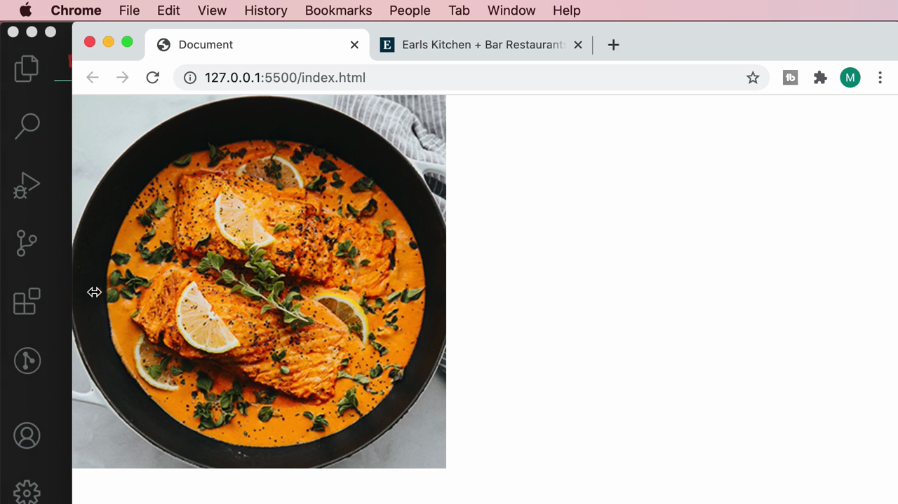

ทดลองปรับขนาดหน้าต่างเบราว์เซอร์ให้แคบลงกว่า 500px:

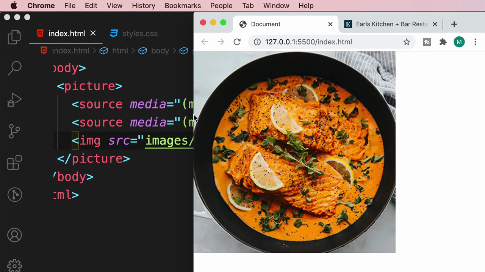

> **ผลลัพธ์ที่สำคัญ:** เมื่อหน้าต่างเบราว์เซอร์แคบกว่า 500px เบราว์เซอร์จะเปลี่ยนไปใช้ไฟล์ `meal-cropped.jpg` โดยอัตโนมัติทันที (ตามเงื่อนไข `(max-width: 500px)`) และเมื่อขยายกลับมากว้างกว่า 500px ก็จะสลับกลับไปใช้ `meal.jpg` เวอร์ชันเต็มทันทีเช่นกัน — พิสูจน์ว่าเทคนิคนี้ทำงานได้จริงโดยไม่ต้องพึ่งพา JavaScript ใดๆ เลย เป็นความสามารถของ HTML ล้วนๆ

---

## สรุปภาพรวมของคลิปนี้

| หัวข้อ | รายละเอียด |
|---|---|
| **แนวคิด** | Art Direction — ให้เบราว์เซอร์เลือกไฟล์ภาพที่มี**องค์ประกอบ/การครอบตัดต่างกัน**ตามขนาดหน้าจอ ไม่ใช่แค่ขนาดไฟล์หรือฟอร์แมต |
| **Attribute หลัก** | `media="(max-width: ...)"` / `media="(min-width: ...)"` บน `<source>` |
| **ตัวอย่างจริง** | earls.ca — เปลี่ยนภาพอาหารเป็นเวอร์ชันครอบตัดเมื่อหน้าจอแคบลง |
| **โครงสร้างโค้ด** | `<picture>` → `<source media="...">` (หลายตัว เรียงจากแคบไปกว้าง) → `` fallback |
| **ผลการทดสอบ** | ปรับขนาดหน้าต่างผ่านจุด 500px แล้วสังเกตว่าไฟล์ภาพที่แสดงเปลี่ยนไปทันที |

**แนวคิดสำคัญที่ได้จากคลิปนี้:**

1. **Art Direction แก้ปัญหาที่ต่างจากการปรับความละเอียด/ขนาดไฟล์เพียงอย่างเดียว** — บางครั้งภาพที่ดูดีบนจอกว้างอาจดูไม่ดีเมื่อถูกบีบให้เล็กลงบนมือถือ (เช่น รายละเอียดสำคัญเล็กเกินไปจนมองไม่เห็น) การครอบตัดภาพใหม่ให้เหมาะกับแต่ละขนาดจอจึงช่วยรักษาคุณภาพการสื่อสารด้วยภาพได้ดีกว่า
2. **`media` attribute บน `<source>` ทำงานเหมือน media query ใน CSS** ทำให้ควบคุมได้อย่างแม่นยำว่าไฟล์ไหนจะถูกใช้ที่ขนาดหน้าจอใด
3. **เว็บไซต์มืออาชีพจริงๆ (เช่น earls.ca) ใช้เทคนิคนี้กันอย่างแพร่หลาย** โดยเฉพาะเว็บไซต์ที่เน้นภาพสวยงามอย่างร้านอาหารหรือแบรนด์สินค้า
4. **ทั้งสามเทคนิคในบทนี้ (Density switching, Resolution switching, Art direction) ล้วนใช้แท็ก `<picture>`/`srcset` เหมือนกัน** แต่ต่าง attribute และเจตนาที่ใช้ — ควรเลือกใช้ให้เหมาะกับปัญหาที่ต้องการแก้ ไม่ใช่ใช้แบบเดียวกันทุกสถานการณ์
5. **เทคนิคนี้ทำงานได้ในระดับ HTML ล้วนๆ โดยไม่ต้องใช้ JavaScript** ทำให้เบราว์เซอร์จัดการโหลดไฟล์ที่เหมาะสมได้อย่างมีประสิทธิภาพตั้งแต่ต้น ไม่ต้องรอ JavaScript ทำงานก่อนแล้วค่อยสลับภาพทีหลัง

---

*หมายเหตุ: คลิปนี้เป็นส่วนหนึ่งของบท "4-Images" จากคอร์ส The Ultimate HTML and CSS Course โดย Mosh Hamedani (codewithmosh.com) — คลิปที่ 12 ของบทนี้*
