# 4-Images: 13 - Scalable Vector Graphics (2:16)

**ไฟล์ต้นทาง:** `13-Scalable_Vector_Graphics.mp4`

▶️ **[เปิดวิดีโอต้นฉบับ](../../../HTML-CSS-2/4-Images/13-Scalable_Vector_Graphics.mp4)**

---

## ภาพรวมคลิปนี้

คลิปนี้เปลี่ยนหัวข้อจากภาพแบบ **Raster** (JPEG, PNG, WebP ที่เรียนมาตลอดบทนี้) ไปสู่ภาพแบบ **Vector** โดยเจาะลึกฟอร์แมต **SVG (Scalable Vector Graphics)** อธิบายหลักการทำงาน ข้อดีเรื่องความคมชัดไม่ว่าจะขยายขนาดแค่ไหน และแนะนำเว็บไซต์ทรัพยากรฟรีสำหรับดาวน์โหลดพื้นหลัง SVG มาใช้งาน

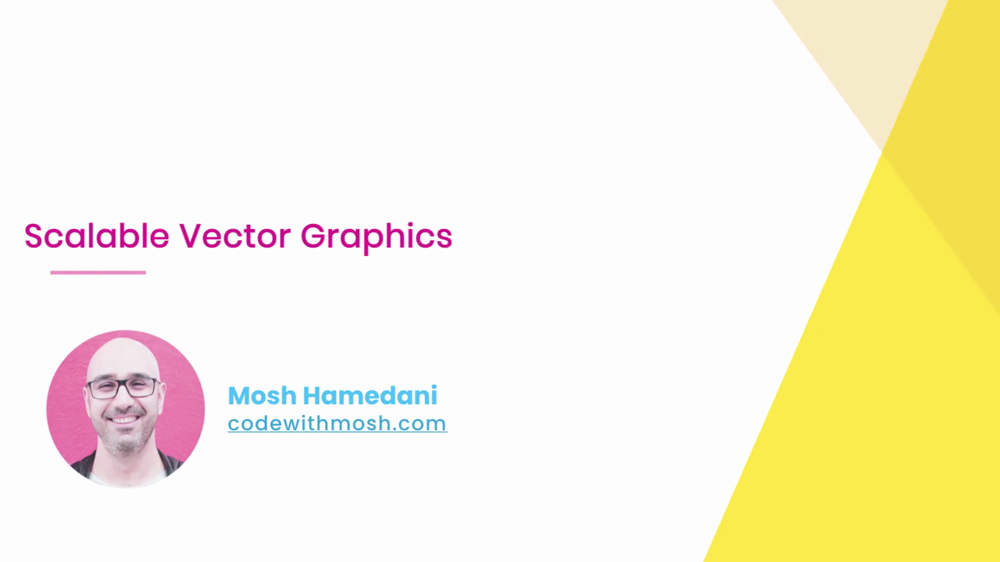

---

## 1. Vector คืออะไร

Mosh เปิดสไลด์ **"VECTOR"** พร้อมภาพประกอบตัวอย่าง (ภาพประกอบพระอาทิตย์ตกแบบเวกเตอร์):

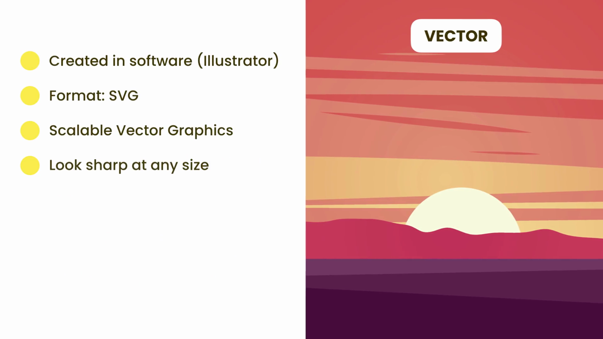

> **คุณสมบัติของภาพแบบ Vector:**
> - **Created in software (Illustrator)** — สร้างขึ้นด้วยโปรแกรมออกแบบกราฟิกแบบเวกเตอร์ เช่น Adobe Illustrator (ต่างจากภาพ Raster ที่มักถ่ายด้วยกล้องหรือแก้ไขด้วย Photoshop)
> - **Format: SVG** — ฟอร์แมตไฟล์หลักสำหรับเวกเตอร์บนเว็บคือ **SVG (Scalable Vector Graphics)**
> - **Scalable Vector Graphics** — ชื่อเต็มของฟอร์แมตบ่งบอกคุณสมบัติเด่นในตัวเองอยู่แล้ว คือ "ปรับขนาดได้" (Scalable)
> - **Look sharp at any size** — คุณสมบัติที่สำคัญที่สุด: **ภาพจะยังคงคมชัดไม่ว่าจะขยายหรือย่อขนาดไปเท่าใดก็ตาม** เพราะภาพ Vector ถูกวาดขึ้นจาก**สมการทางคณิตศาสตร์ (paths/shapes)** ไม่ใช่จากกริดพิกเซลแบบภาพ Raster จึงไม่มีปัญหาเรื่อง**ภาพแตกเป็นเม็ดพิกเซล (pixelation)** เมื่อขยายภาพ ซึ่งต่างจากภาพ JPEG/PNG ที่จะเบลอหรือแตกเมื่อขยายเกินขนาดจริงของไฟล์

---

## 2. สาธิตความคมชัดของ SVG เมื่อขยายขนาดใหญ่มาก

Mosh สาธิตโดยการเพิ่ม `` ที่ชี้ไปยังไฟล์ `ufo.svg` (ไอคอนยานอวกาศ UFO ที่เคยใช้ในคลิป Data URLs ก่อนหน้านี้) โดย**ยังไม่ได้กำหนดขนาดใดๆ** ทำให้ภาพแสดงผลใหญ่เต็มขนาดต้นฉบับ:

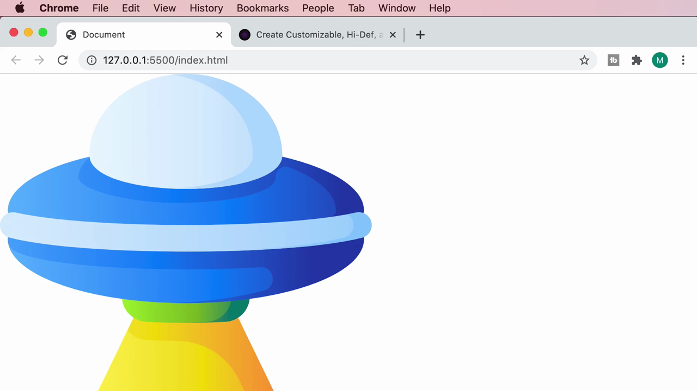

```html

```

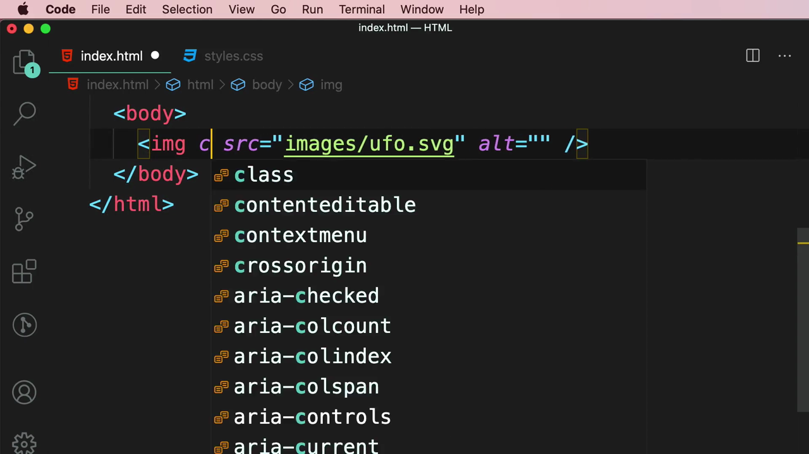

> **ผลลัพธ์ที่สำคัญ:** แม้จะแสดงผลภาพ UFO ในขนาดใหญ่มากเต็มหน้าจอ **เส้นขอบและรายละเอียดของภาพยังคงคมชัดสมบูรณ์แบบ ไม่มีรอยหยักหรือความเบลอใดๆ เลย** ต่างจากภาพ JPEG/PNG ที่หากขยายเกินขนาดจริงจะเห็นเม็ดพิกเซลและความเบลอทันที — นี่คือข้อได้เปรียบที่สำคัญที่สุดของฟอร์แมต SVG

---

## 3. ปรับขนาดภาพด้วย CSS

Mosh เพิ่ม `class="ufo"` ให้กับ ``:

```html

```

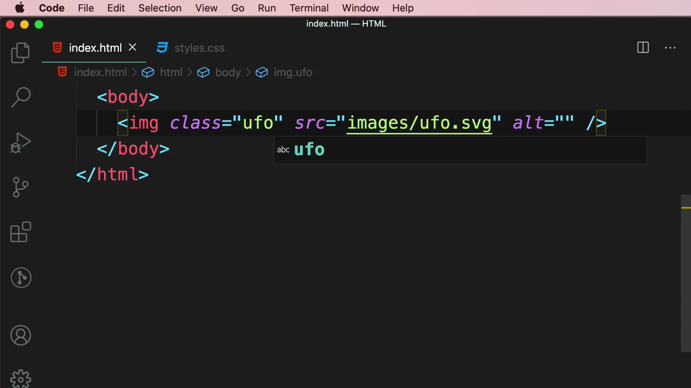

รีเฟรชหน้าเว็บ ภาพ UFO แสดงผลในขนาดเล็กลงตามปกติ (ยังไม่ได้ใส่ CSS จำกัดขนาด แต่ขนาดต้นฉบับของไฟล์ SVG นี้เล็กพอดี):

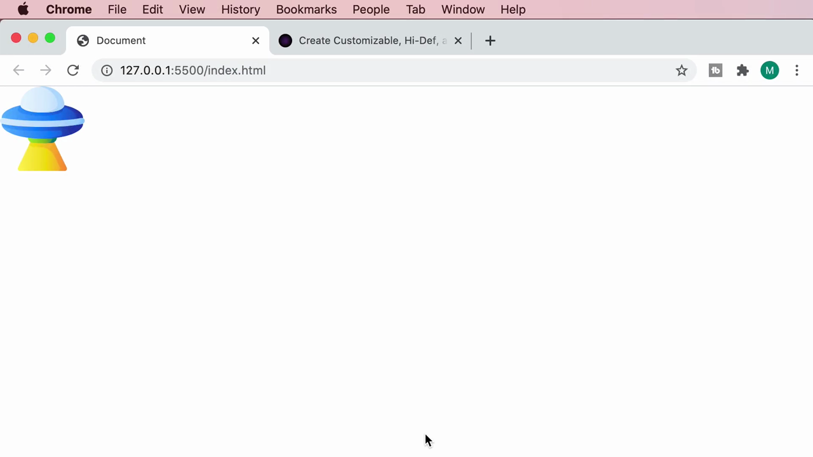

---

## 4. แหล่งดาวน์โหลด SVG ฟรี: svgbackgrounds.com

Mosh แนะนำเว็บไซต์ **svgbackgrounds.com** ซึ่งเป็นแหล่งรวมพื้นหลัง SVG ฟรีที่สามารถปรับแต่งได้:

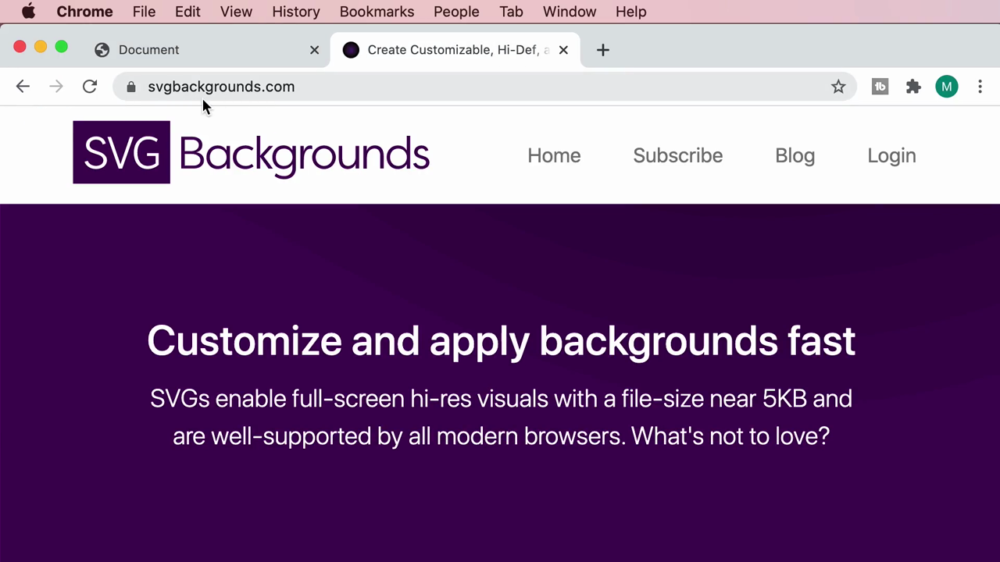

> คำอธิบายจากเว็บไซต์: *"SVGs enable full-screen hi-res visuals with a file-size near 5KB and are well-supported by all modern browsers. What's not to love?"*
>
> สรุปใจความ: ไฟล์ SVG สามารถสร้างพื้นหลังความละเอียดสูงเต็มหน้าจอได้ โดยมีขนาดไฟล์เพียง**ประมาณ 5KB เท่านั้น** (เล็กกว่าภาพ Raster มาก) และได้รับการรองรับเป็นอย่างดีจากเบราว์เซอร์สมัยใหม่ทุกตัว

เว็บไซต์มีลวดลายพื้นหลังให้เลือกมากมาย พร้อมแผงควบคุมด้านซ้ายสำหรับปรับแต่งสี ความทึบแสง และรูปแบบต่างๆ แบบเรียลไทม์ ตัวอย่างเช่นลวดลาย **"Protruding Squares"** โดย Matt Lipman:

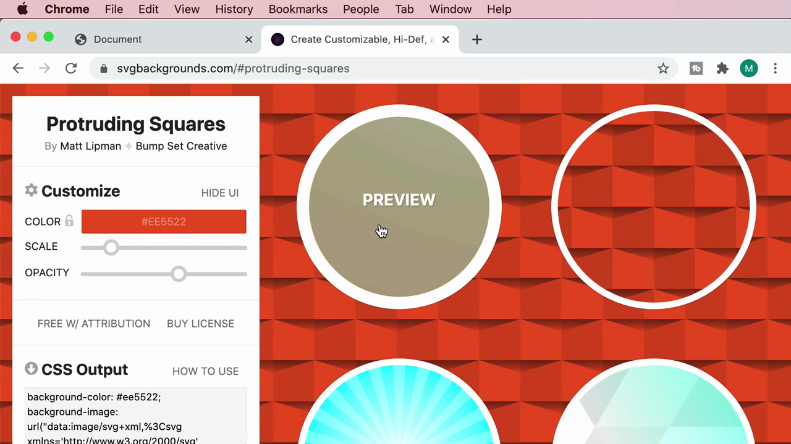

ลวดลาย **"Liquid Cheese"** (ไล่เฉดสีเหลือง-ส้มแบบ blob):

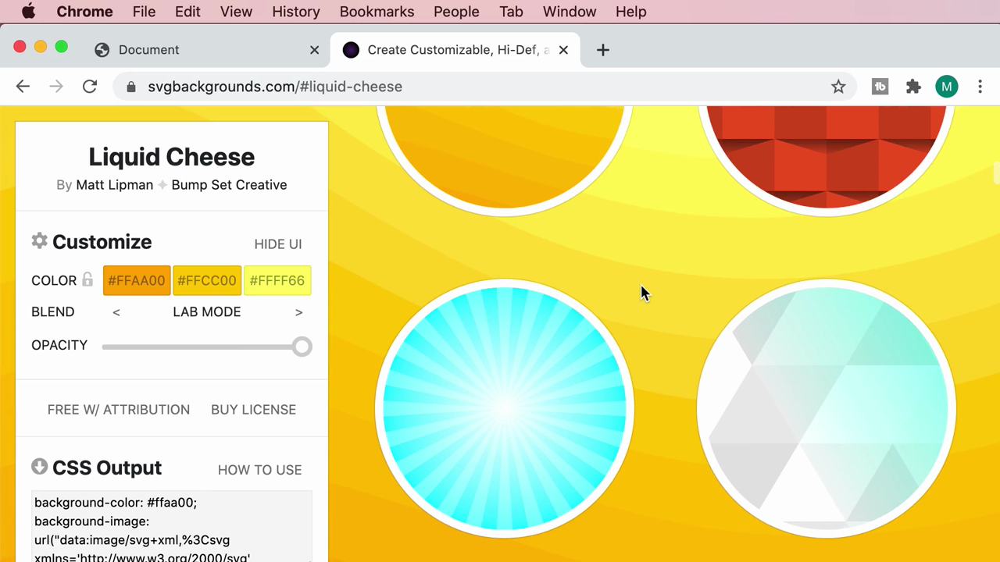

และลวดลาย **"Wintery Sunburst"** (แสงพุ่งจากจุดศูนย์กลางโทนสีฟ้า) พร้อมตัวเลื่อนปรับ Opacity และ Radial:

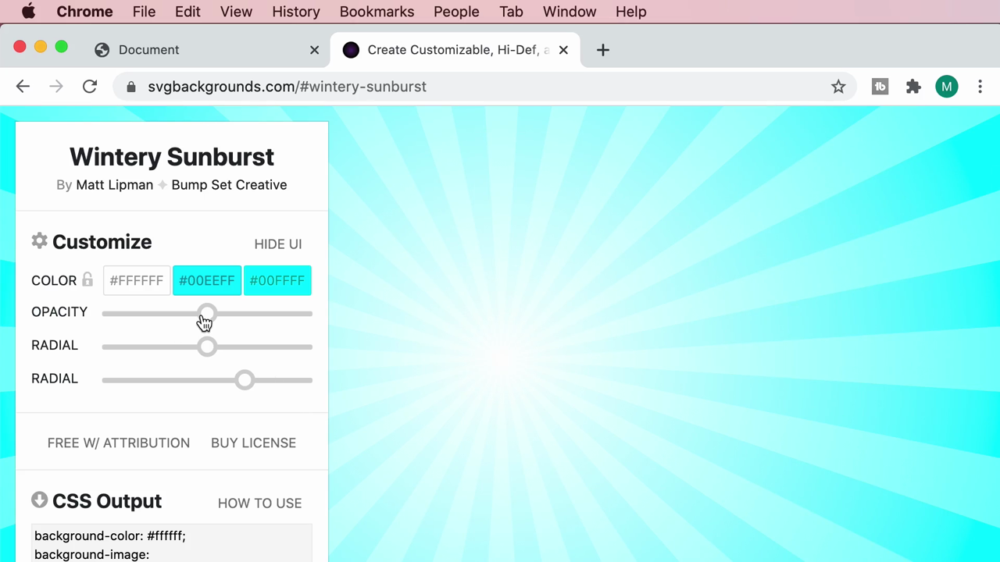

> แต่ละลวดลายมีส่วน **"CSS Output"** ที่สร้างโค้ด CSS พร้อมใช้งานให้อัตโนมัติ ในรูปแบบ `background-image: url("data:image/svg+xml,...")` (คล้ายกับเทคนิค Data URL ที่เรียนไปก่อนหน้านี้ในบทนี้) พร้อมปุ่ม **"FREE W/ ATTRIBUTION"** (ใช้ฟรีแต่ต้องให้เครดิตผู้สร้าง) หรือ **"BUY LICENSE"** (ซื้อสิทธิ์ใช้งานแบบไม่ต้องให้เครดิต)

---

## 5. นำไฟล์ SVG มาใช้เป็นพื้นหลังของหน้าเว็บ

กลับมาที่ VS Code Mosh เพิ่ม CSS กำหนดขนาดให้ `.ufo`:

```css
.ufo {
  width: 100px;
}
```

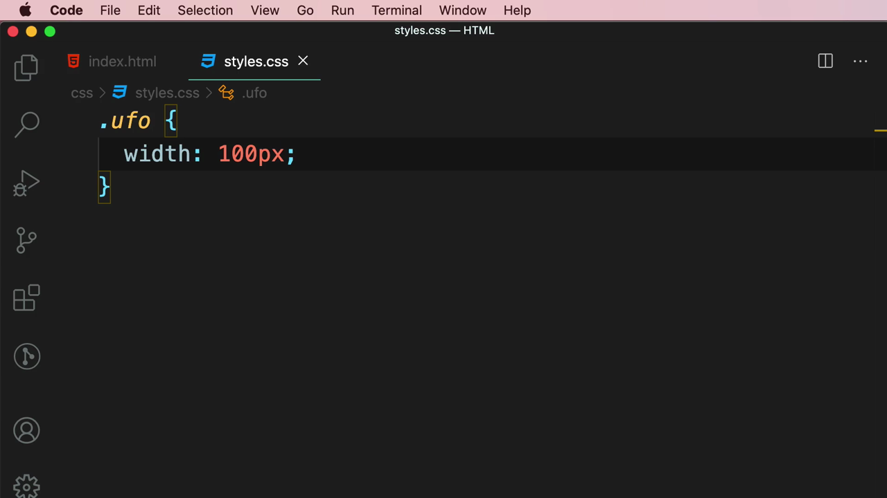

จากนั้นเพิ่ม CSS ให้ `body` มี background เป็นไฟล์ SVG ที่ดาวน์โหลดมา (ตั้งชื่อว่า `constellation.svg`) โดยพิมพ์ path แล้วให้ IntelliSense ของ VS Code แสดงรายการไฟล์ในโฟลเดอร์ `images` ให้เลือก:

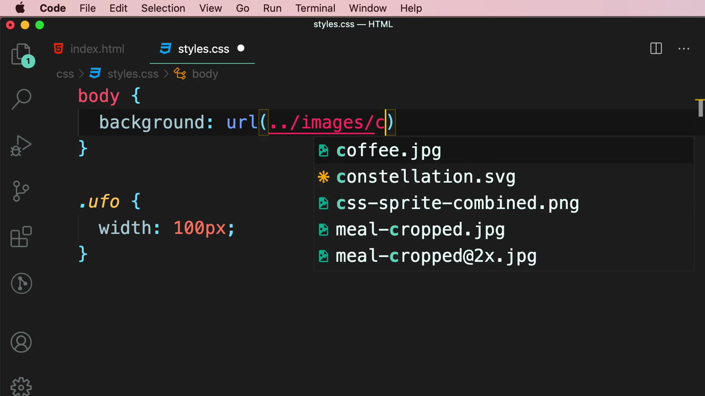

โค้ด CSS สมบูรณ์:

```css
body {
  background: url(../images/constellation.svg);
}

.ufo {
  width: 100px;
}
```

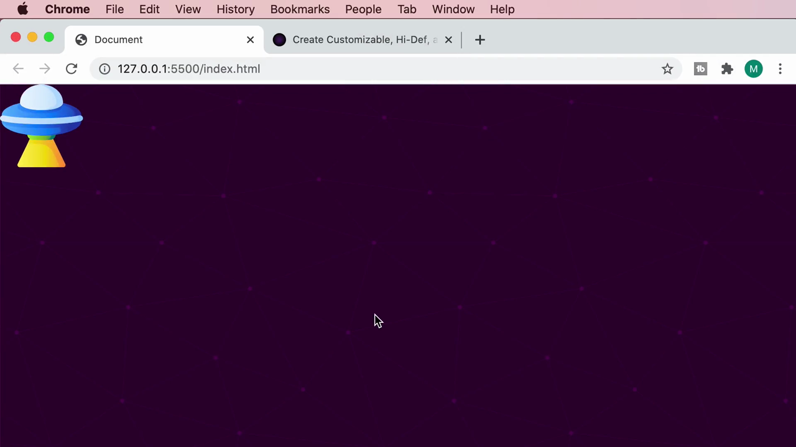

รีเฟรชหน้าเว็บ — ภาพ UFO ขนาดเล็ก (100px) แสดงผลอยู่บนพื้นหลังสีม่วงเข้มที่มีลวดลายจุดดาวกระจายคล้ายกลุ่มดาว (constellation) ซึ่งเป็นไฟล์ SVG ที่ดาวน์โหลดมาจาก svgbackgrounds.com:

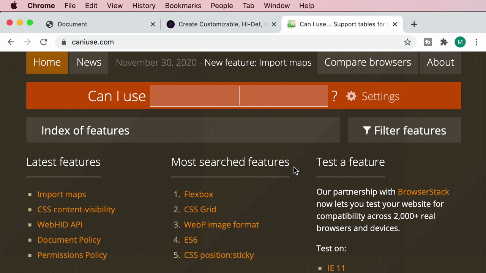

> **ข้อสังเกต:** พื้นหลัง SVG นี้ดูคมชัดเต็มหน้าจอโดยที่ไฟล์มีขนาดเล็กมาก (หลัก KB เท่านั้น) ตรงตามคำโฆษณาของเว็บไซต์ svgbackgrounds.com — หากใช้ภาพ JPEG/PNG ความละเอียดสูงเพื่อให้ได้ผลลัพธ์แบบเดียวกัน ไฟล์จะมีขนาดใหญ่กว่านี้มาก

---

## 6. ตรวจสอบการรองรับเบราว์เซอร์ของ SVG

Mosh ตรวจสอบผ่าน **caniuse.com** ค้นหาคำว่า "svg":

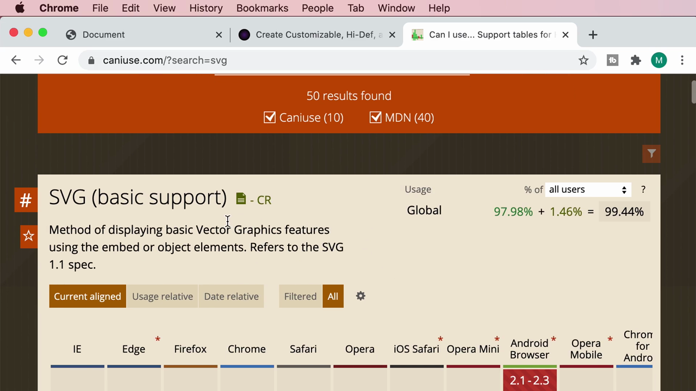

> **ผลลัพธ์:** **"SVG (basic support)"** — วิธีการแสดงผล Vector Graphics พื้นฐานผ่าน `<embed>` หรือ `<object>` (อ้างอิงตามสเปก SVG 1.1) รองรับ Global รวม **99.44%** (97.98% รองรับแบบเต็ม + 1.46% รองรับบางส่วน) ซึ่งถือว่า**สูงมาก** แทบทุกเบราว์เซอร์และอุปกรณ์ในปัจจุบันรองรับ SVG ได้อย่างสมบูรณ์

---

## สรุปภาพรวมของคลิปนี้

| หัวข้อ | รายละเอียด |
|---|---|
| **ฟอร์แมตที่เรียน** | SVG (Scalable Vector Graphics) — ภาพแบบ Vector สร้างจากสมการทางคณิตศาสตร์ ไม่ใช่กริดพิกเซล |
| **ข้อดีหลัก** | คมชัดไม่ว่าจะขยายขนาดแค่ไหน (ไม่มีปัญหา pixelation) และไฟล์มีขนาดเล็กมาก |
| **สร้างด้วย** | โปรแกรมออกแบบกราฟิกแบบเวกเตอร์ เช่น Adobe Illustrator |
| **แหล่งดาวน์โหลดฟรี** | svgbackgrounds.com — พื้นหลัง SVG ปรับแต่งสี/ความทึบแสงได้ พร้อมโค้ด CSS สำเร็จรูป |
| **การใช้งานในโค้ด** | ใช้ได้ทั้งเป็น `` และเป็น CSS `background: url(...svg)` เหมือนไฟล์ภาพทั่วไป |
| **การรองรับเบราว์เซอร์** | Global 99.44% — รองรับกว้างขวางแทบไม่มีข้อจำกัด |

**แนวคิดสำคัญที่ได้จากคลิปนี้:**

1. **SVG เหมาะที่สุดสำหรับภาพประเภทโลโก้ ไอคอน ภาพประกอบ (illustration) และลวดลายพื้นหลัง** ที่ต้องการความคมชัดในทุกขนาดหน้าจอ ไม่เหมาะกับภาพถ่ายจริง (ภาพถ่ายยังคงต้องใช้ฟอร์แมต Raster เช่น JPEG/WebP)
2. **ขนาดไฟล์ SVG มักเล็กกว่าภาพ Raster มาก** เพราะเก็บข้อมูลเป็นคำสั่งวาดรูปทรงทางคณิตศาสตร์ ไม่ใช่ข้อมูลสีของทุกพิกเซล
3. **ไม่จำเป็นต้องออกแบบ SVG เองเสมอไป** — มีเว็บไซต์ทรัพยากรฟรีอย่าง svgbackgrounds.com ที่ให้ดาวน์โหลดพร้อมใช้งานได้ทันที (บางแบบต้องให้เครดิตผู้สร้างหากใช้ฟรี)
4. **SVG ใช้งานได้เหมือนไฟล์ภาพทั่วไปทั้งใน `` และ CSS `background`** ไม่ต้องเรียนรู้วิธีการใช้งานใหม่ ทำให้นำไปใช้แทนที่ภาพ Raster ได้ง่ายในหลายสถานการณ์
5. **การรองรับเบราว์เซอร์ของ SVG สูงมากเกือบ 100%** ทำให้สามารถใช้งานได้อย่างมั่นใจโดยแทบไม่ต้องกังวลเรื่อง fallback เหมือนกับฟอร์แมตใหม่ๆ อย่าง WebP ที่เรียนไปในคลิปก่อนหน้า

---

*หมายเหตุ: คลิปนี้เป็นส่วนหนึ่งของบท "4-Images" จากคอร์ส The Ultimate HTML and CSS Course โดย Mosh Hamedani (codewithmosh.com) — คลิปที่ 13 ของบทนี้*
