# 4-Images: 14 - Font Icons (5:20)

**ไฟล์ต้นทาง:** `14-Font_Icons.mp4`

▶️ **[เปิดวิดีโอต้นฉบับ](../../../HTML-CSS-2/4-Images/14-Font_Icons.mp4)**

---

## ภาพรวมคลิปนี้

คลิปสุดท้ายของบท "4-Images" — สอนเรื่อง **Icon Fonts (Font Icons)** ซึ่งเป็นเทคนิคการแสดงไอคอนบนเว็บโดย**ใช้ฟอนต์แทนไฟล์ภาพ** ทำให้สามารถปรับแต่งไอคอนด้วย CSS ธรรมดา (สี ขนาด ฯลฯ) ได้เหมือนกับข้อความทั่วไป สอนตั้งแต่การสมัครใช้งาน **Font Awesome** (ไลบรารีไอคอนฟอนต์ที่ได้รับความนิยมที่สุด) สร้าง "Kit" ส่วนตัว ไปจนถึงการนำไอคอนมาใช้และปรับแต่งด้วย CSS

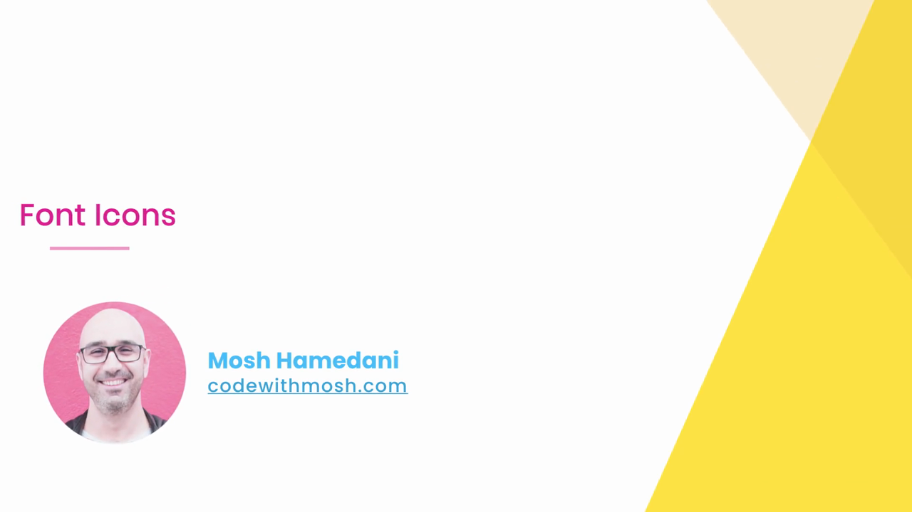

---

## 1. Icon Fonts คืออะไร

Mosh เปิดสไลด์ **"ICON FONTS"** แสดงตัวอย่างไอคอนจำนวนมากพร้อมชื่อกำกับแต่ละตัว (เช่น `arrow-alt-circle-left`, `arrow-down`, `asterisk`, `at`) ซึ่งเป็นตัวอย่างไอคอนจากไลบรารี **Font Awesome**:

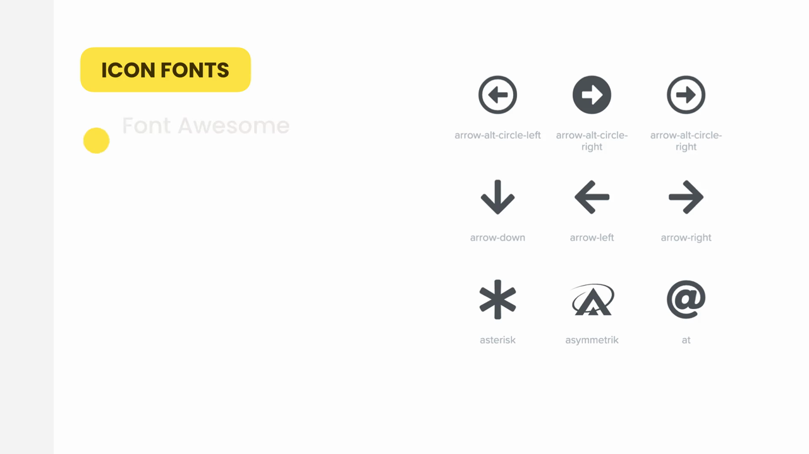

> **หลักการของ Icon Fonts:** แทนที่จะเป็นไฟล์ภาพ (PNG/SVG) แยกต่างหากสำหรับแต่ละไอคอน ไอคอนทั้งหมดถูกออกแบบให้เป็น**ตัวอักษรพิเศษภายในไฟล์ฟอนต์เดียว** (คล้ายกับที่ตัวอักษร A-Z ถูกออกแบบไว้ในฟอนต์ปกติ) เมื่อเบราว์เซอร์โหลดฟอนต์นี้มา ก็สามารถแสดงผล "ตัวอักษร" เหล่านี้เป็นรูปไอคอนได้ และเนื่องจากมันคือฟอนต์ จึงสามารถใช้ CSS property ที่ใช้กับข้อความทั่วไปได้ทันที เช่น `color`, `font-size`

---

## 2. Font Awesome — ไลบรารีไอคอนฟอนต์ที่ได้รับความนิยมสูงสุด

Mosh เปิดเว็บไซต์ **fontawesome.com**:

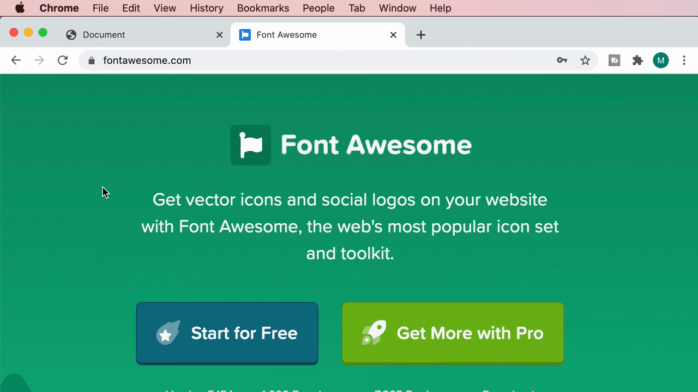

> คำอธิบายจากเว็บไซต์: *"Get vector icons and social logos on your website with Font Awesome, the web's most popular icon set and toolkit."*

ข้อมูลสถิติของไลบรารี:

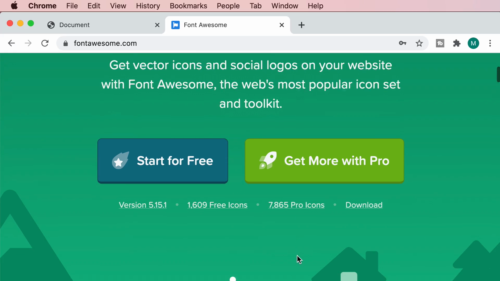

| รายการ | ค่า |
|---|---|
| **Version** | 5.15.1 |
| **Free Icons** | 1,609 ไอคอน |
| **Pro Icons** | 7,865 ไอคอน |

> ไอคอนฟรีก็มีให้เลือกใช้จำนวนมากเพียงพอสำหรับโปรเจกต์ทั่วไปแล้ว ส่วนไอคอน Pro (ต้องเสียเงิน) จะมีสไตล์เพิ่มเติม เช่น Regular, Light, Duotone

---

## 3. สร้าง "Kit" ส่วนตัวเพื่อใช้งาน Font Awesome

Mosh ไปที่หน้า **"Start"** (fontawesome.com/start) ซึ่งแนะนำวิธีที่ง่ายและเร็วที่สุดในการติดตั้ง Font Awesome บนเว็บไซต์ — การใช้ **"Kit"**:

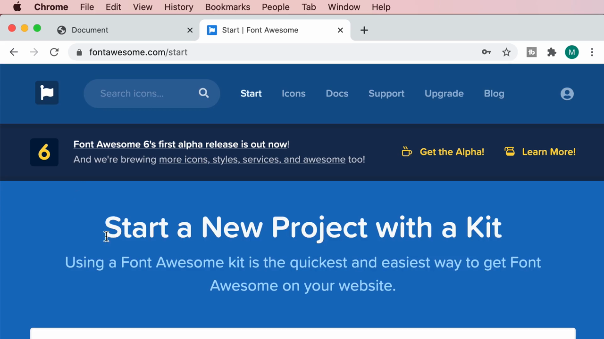

พิมพ์ชื่อโปรเจกต์ (หรือปล่อยว่างให้ระบบสุ่มชื่อให้) แล้วกด **"Create & Use This Kit"**:

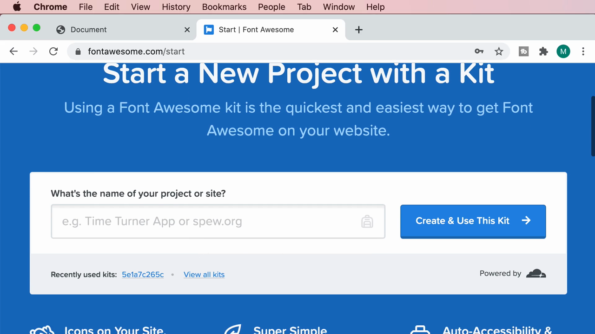

ระบบสร้าง Kit ใหม่พร้อมรหัสเฉพาะ (ในตัวอย่างคือ `5e1a7c265c`) และพาไปยังหน้า **Settings** ของ Kit นั้น:

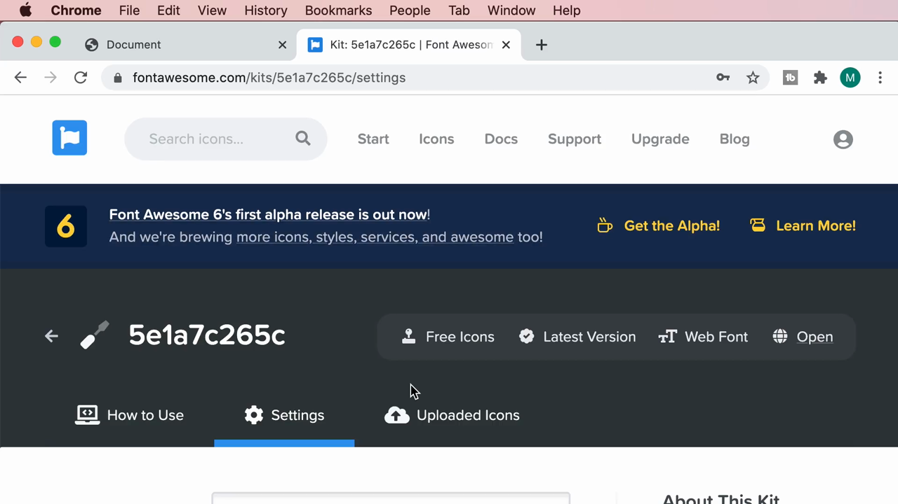

---

## 4. ตั้งค่า Kit

### 4.1 Kit Name และ Icons (Free/Pro)

ตั้งชื่อ Kit และเลือกว่าจะใช้ไอคอนแบบ **Free** หรือ **Pro**:

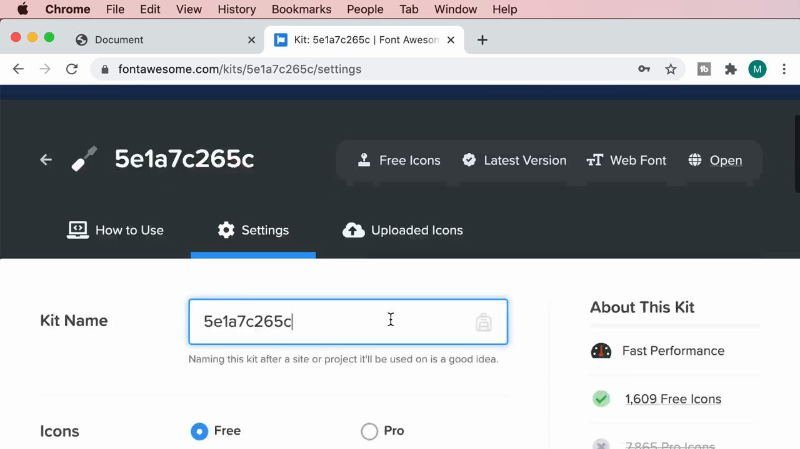

### 4.2 Technology: Web Font vs SVG

เลือกเทคโนโลยีที่จะใช้ในการส่งไอคอนไปแสดงผล:

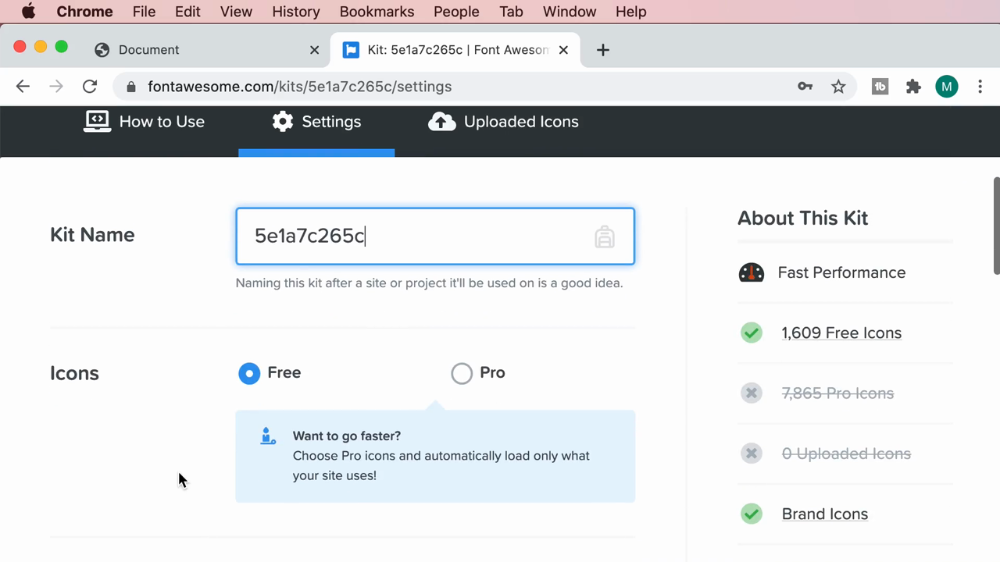

> **ตัวเลือกที่มี:**
> - **Web Font** — วิธีดั้งเดิม ใช้ไอคอนเป็นตัวอักษรในไฟล์ฟอนต์ (ตามที่อธิบายไว้ข้างต้น) — เว็บไซต์ระบุว่า **"Generally speaking, Web Font is easier"**
> - **SVG** — วิธีใหม่กว่า แปลงไอคอนแต่ละตัวเป็น SVG แล้วฝังเข้าไปในหน้าผ่าน JavaScript — เว็บไซต์ระบุว่า **"SVG is more powerful"** (ยืดหยุ่นกว่าแต่ซับซ้อนกว่าเล็กน้อย)
>
> Mosh เลือกใช้ **Web Font** (ค่าเริ่มต้น) เพราะเข้าใจง่ายกว่าสำหรับผู้เริ่มต้น

### 4.3 Domains — จำกัดขอบเขตการใช้งาน

ส่วน **"Domains"** แสดงว่า Kit นี้ยังเป็นแบบ **"Open"** (ใครก็ใช้ได้ ไม่จำกัดโดเมน):

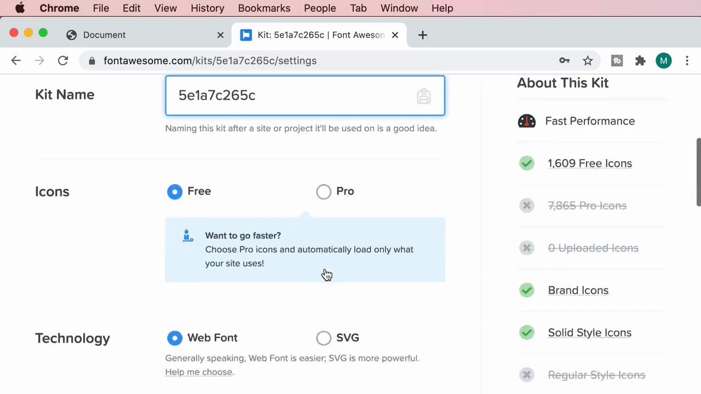

> สามารถกด **"Add a domain"** เพื่อจำกัดให้ Kit นี้ใช้ได้เฉพาะบนเว็บไซต์ของตัวเองเท่านั้น เพื่อความปลอดภัยในการใช้งานจริง (production) แต่สำหรับการฝึกฝนหรือทดลอง ปล่อยเป็นแบบ Open ก็เพียงพอ

### 4.4 Version และ Features

เลื่อนลงมาดูส่วน **Version** (ตั้งเป็น "Latest" เพื่อให้ใช้เวอร์ชันล่าสุดเสมอ) และ **Features**:

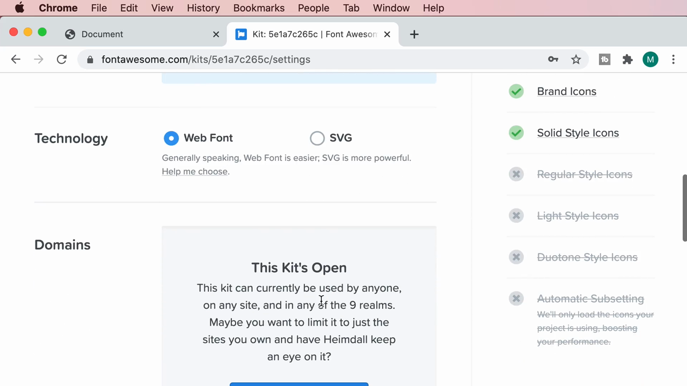

> **Features ที่เปิดใช้งานอยู่:**
> - **Auto-Accessibility** ✅ — ระบบจะช่วยจัดการเรื่อง accessibility ให้อัตโนมัติ เพียงใส่ title ที่มีความหมายให้ไอคอน ระบบจะใส่ attribute ที่เหมาะสมให้เอง
> - **Enable Version 4 Compatibility** ✅ — ให้ใช้ syntax แบบเวอร์ชัน 4 เก่าได้โดยไม่ต้องกังวลเรื่อง breaking changes
> - **Conflict Detection** ☐ — ปิดไว้ (ใช้ตรวจสอบเมื่อมีการติดตั้ง Font Awesome หลายเวอร์ชันซ้อนกันในโปรเจกต์เดียว)

กด **"Save Changes"** เพื่อบันทึกการตั้งค่า:

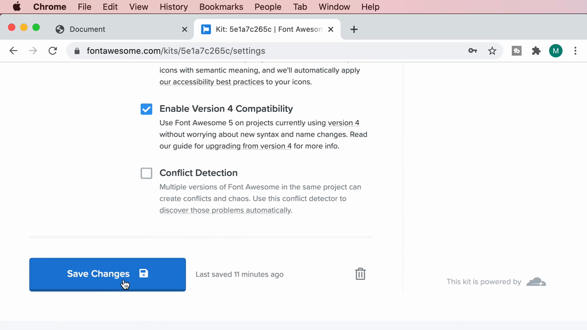

---

## 5. นำ Kit Code มาใช้ในโปรเจกต์

ไปที่แท็บ **"How to Use"** ขั้นตอนที่ 1 คือ **"Add Your Kit's Code to a Project"** — คัดลอกโค้ด `<script>` ที่ระบบสร้างให้เฉพาะสำหรับ Kit นี้:

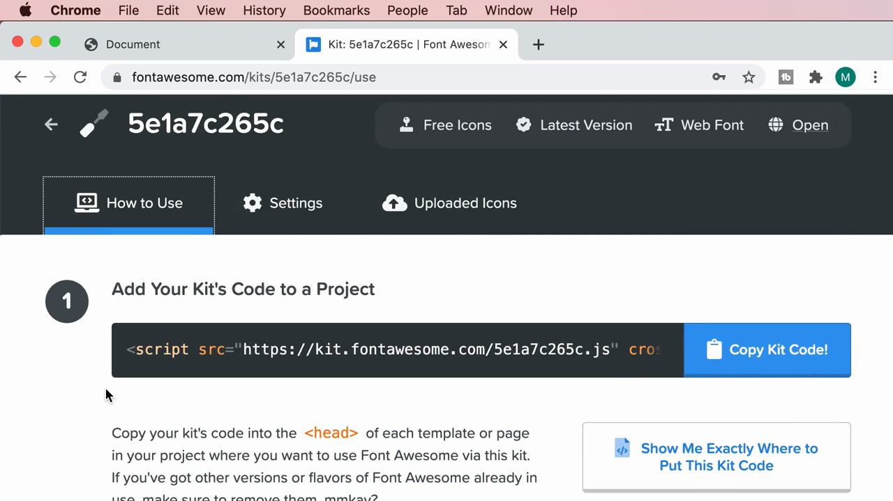

```html
<script src="https://kit.fontawesome.com/5e1a7c265c.js" crossorigin="anonymous"></script>
```

นำไปวางไว้ใน `<head>` ของ `index.html`:

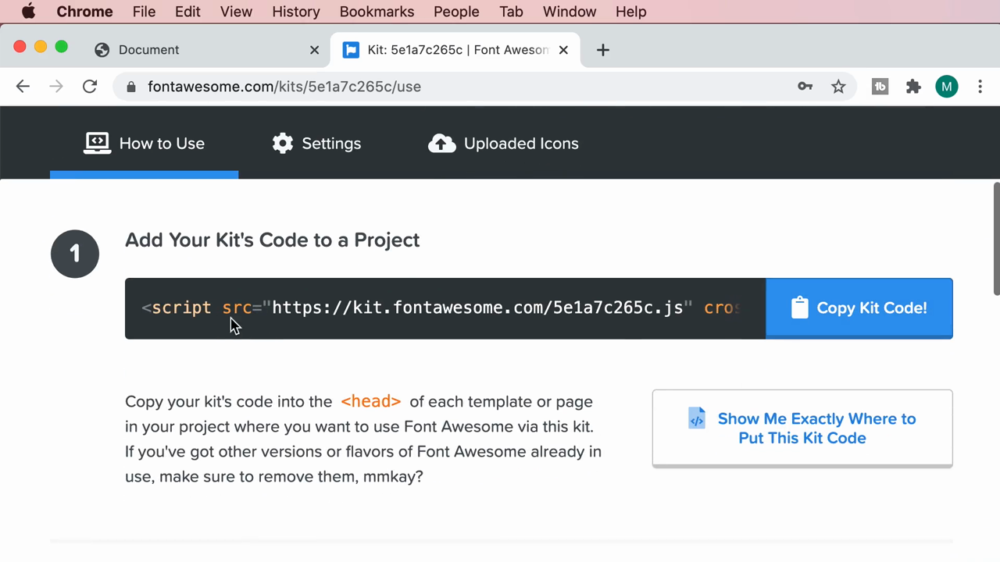

> **หมายเหตุ:** โค้ดนี้ทำหน้าที่โหลดฟอนต์ไอคอนทั้งหมดของ Font Awesome ที่ตั้งค่าไว้ในหน้านี้ (พร้อมกับความสามารถ auto-accessibility ที่เปิดไว้ในขั้นตอนก่อนหน้า) โดยไม่ต้องดาวน์โหลดไฟล์ฟอนต์มาเก็บไว้เองในโปรเจกต์

---

## 6. เลือกและใช้งานไอคอน

ขั้นตอนที่ 2 คือ **"Add Any of Our Free Icons to a Project"** — สามารถเรียกดูไอคอนตามหมวดหมู่ (Space, Sci-Fi, Household, Sports, Medical, Autumn, Weather, Vehicles, Travel, Users, Objects, Food) หรือค้นหาโดยตรง:

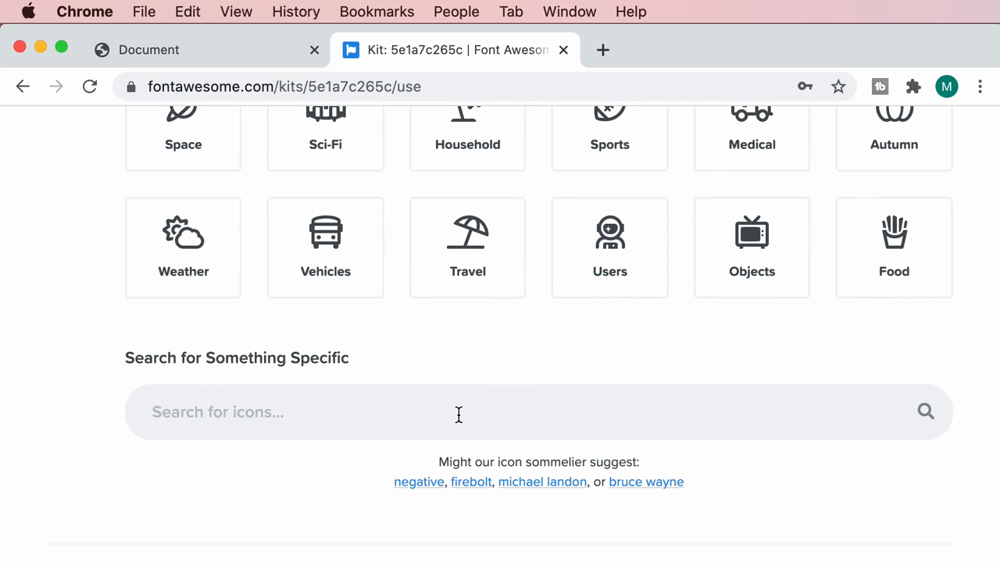

ค้นหาคำว่า **"user"** พบ **565 matching results** (รวมทั้งไอคอนฟรีและ Pro):

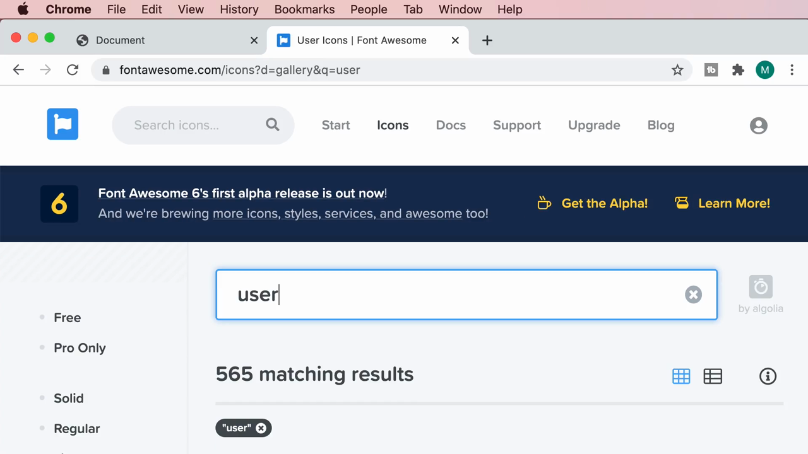

กรองด้วย checkbox **"Free"** เหลือ **108 matching results** (เฉพาะไอคอนที่ใช้ได้ฟรี):

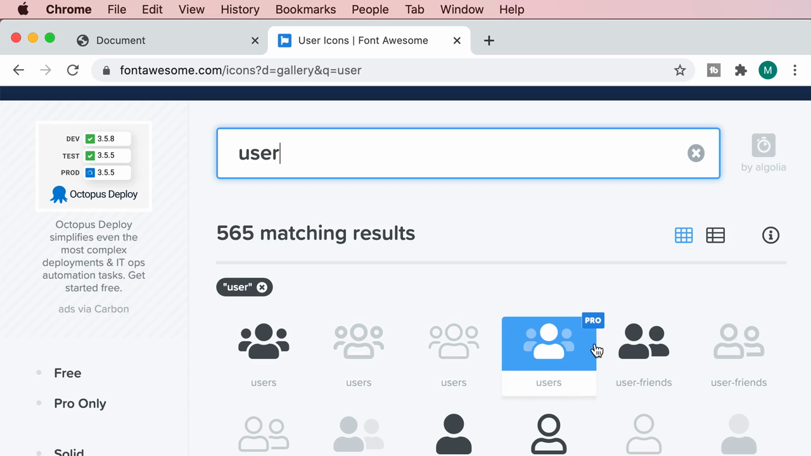

เลือกไอคอน **"user-friends"** เข้าไปที่หน้ารายละเอียดของไอคอนนั้น:

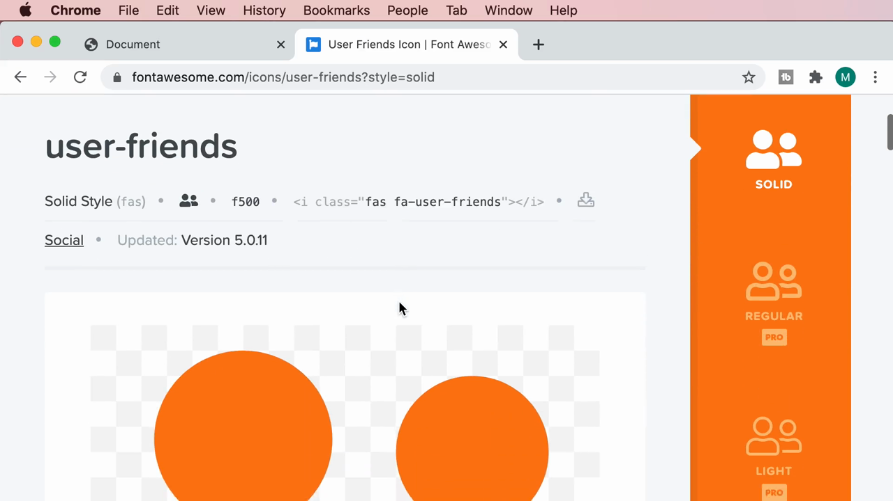

> หน้ารายละเอียดแสดงโค้ดสำหรับสไตล์ **Solid** (`fas`) ที่ใช้ได้ฟรี: `<i class="fas fa-user-friends"></i>` ส่วนสไตล์อื่นๆ อย่าง **Regular, Light, Duotone** ล้วนมีป้าย **"PRO"** กำกับ (ต้องสมัคร Pro เพื่อใช้งาน):

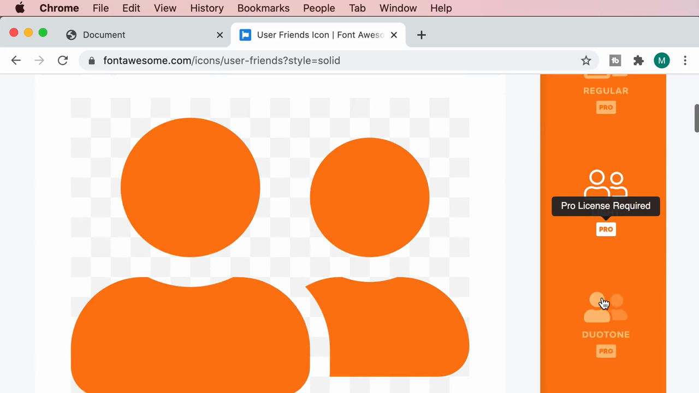

เลื่อนลงไปด้านล่าง กดปุ่ม **"Start Using This Icon"**:

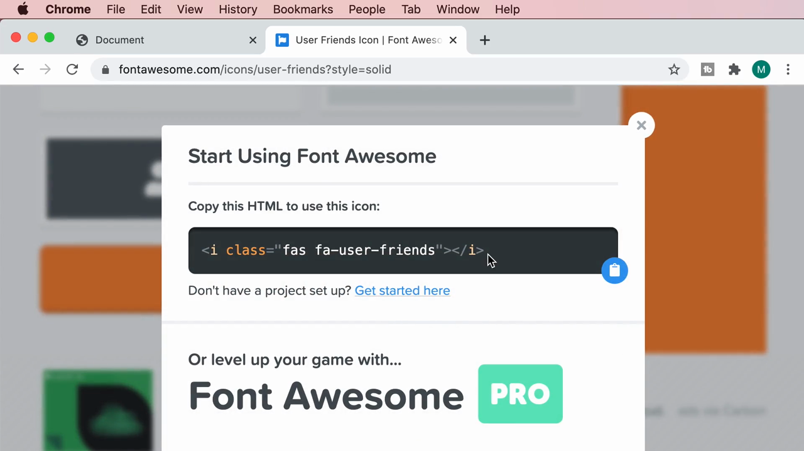

หน้าต่างป็อปอัปแสดงโค้ดพร้อมใช้งาน:

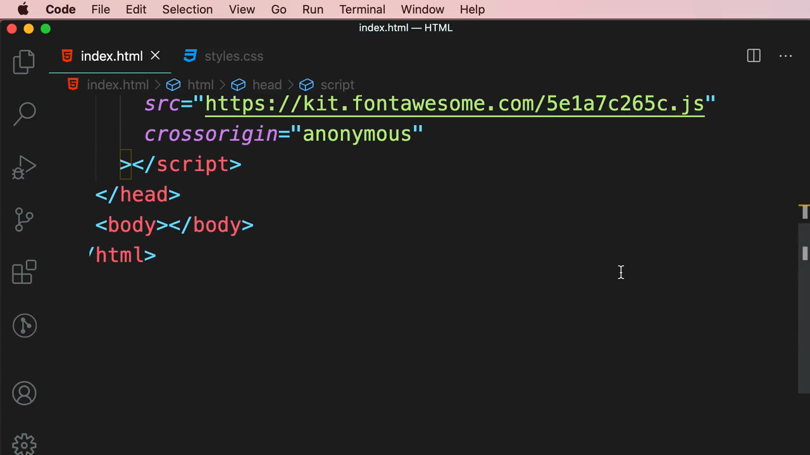

```html
<i class="fas fa-user-friends"></i>
```

> **โครงสร้างของ class name:** `fas` ย่อมาจาก **"Font Awesome Solid"** (บอกสไตล์/น้ำหนักของไอคอน) ส่วน `fa-user-friends` คือชื่อเฉพาะของไอคอนนั้นๆ — แต่ละไอคอนจะมีชื่อ class เฉพาะตัวที่ไม่ซ้ำกัน

---

## 7. นำไอคอนมาแสดงผลและปรับแต่ง

นำโค้ด `<i>` ไปวางใน `<body>`:

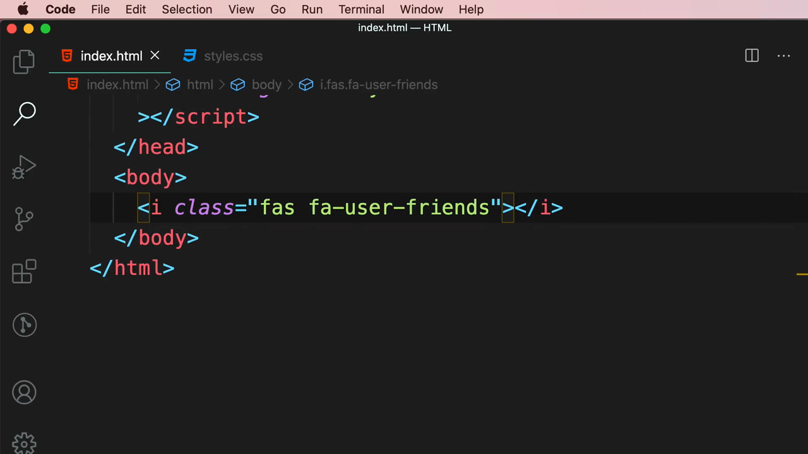

รีเฟรชหน้าเว็บ ไอคอนกลุ่มคนแสดงผลเป็นสีดำขนาดเล็กที่มุมบนซ้าย:

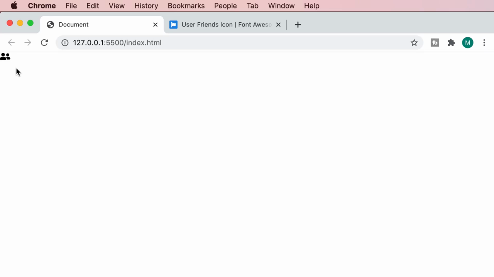

### 7.1 สลับไอคอนได้ง่ายๆ เพียงเปลี่ยนชื่อ Class

Mosh สาธิตให้เห็นว่าการเปลี่ยนไอคอนทำได้ง่ายมาก เพียงแก้ชื่อ class เป็นไอคอนอื่น เช่น `fa-bell` (กระดิ่งแจ้งเตือน):

```html
<i class="fas fa-bell"></i>
```

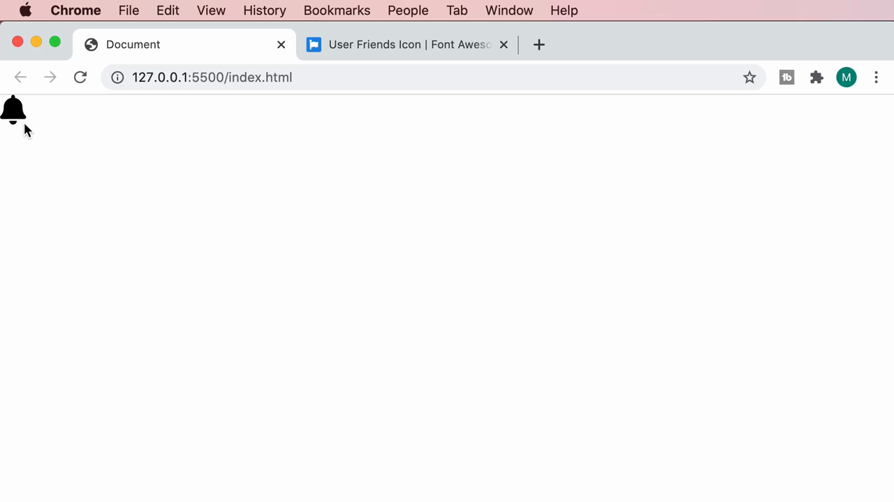

ผลลัพธ์: ไอคอนกระดิ่งแสดงผลแทนทันที:

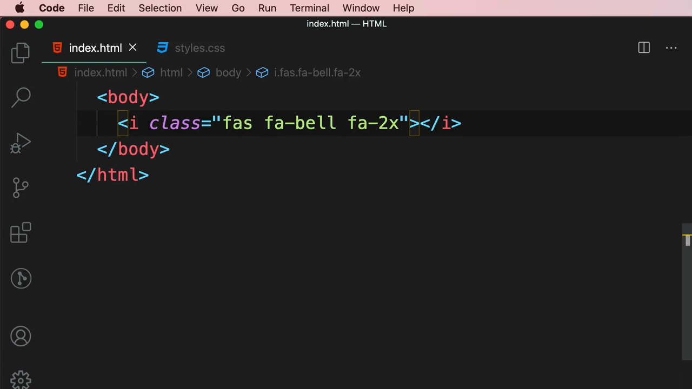

### 7.2 ปรับขนาดด้วย Utility Class ของ Font Awesome เอง

Font Awesome มี utility class สำเร็จรูปสำหรับปรับขนาดไอคอนโดยไม่ต้องเขียน CSS เอง เช่น **`fa-2x`** (ขยาย 2 เท่า):

```html
<i class="fas fa-bell fa-2x"></i>
```

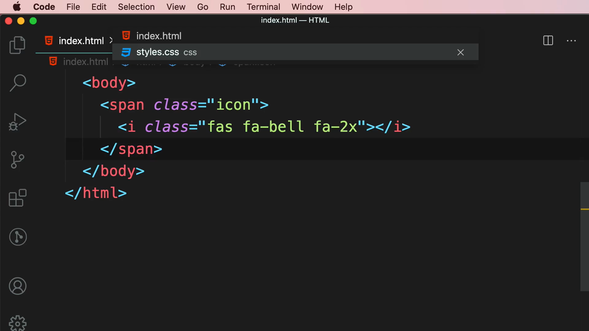

### 7.3 ห่อด้วย `<span>` เพื่อเตรียมปรับแต่งด้วย CSS ของตัวเอง

Mosh ห่อ `<i>` ด้วย `<span class="icon">` เพื่อให้สามารถกำหนด CSS เพิ่มเติมของตัวเองได้สะดวก:

```html
<span class="icon">
  <i class="fas fa-bell fa-2x"></i>
</span>
```

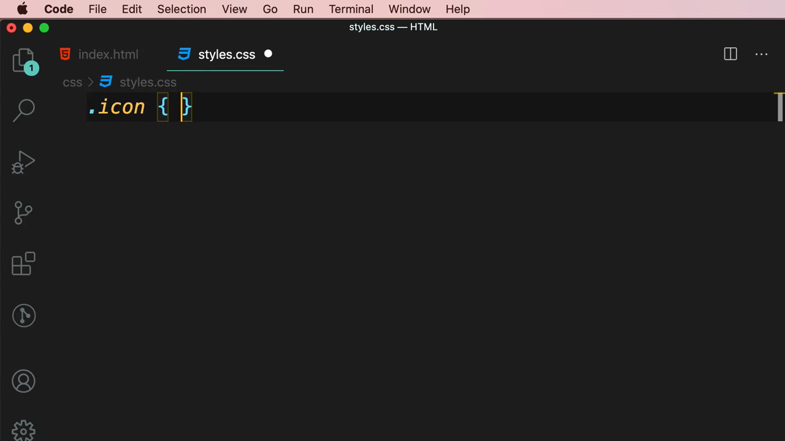

สลับไปที่ `styles.css` สร้าง selector `.icon` แล้วกำหนด `font-size` และ `color` (ใช้ชื่อสีมาตรฐานของ CSS โดย IntelliSense ของ VS Code แสดงตัวอย่างสีให้เลือกพร้อมรหัสสี hex):

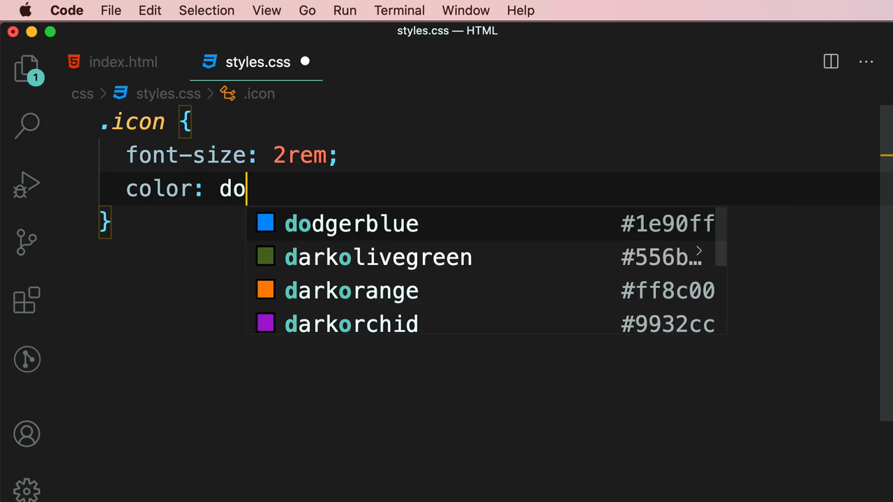

```css
.icon {
  font-size: 2rem;
  color: dodgerblue;
}
```

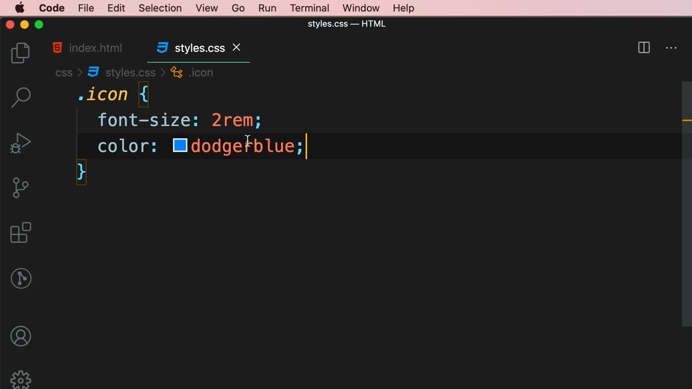

รีเฟรชหน้าเว็บ ไอคอนกระดิ่งแสดงผลเป็น**สีน้ำเงิน (dodgerblue) ขนาดใหญ่ขึ้น**:

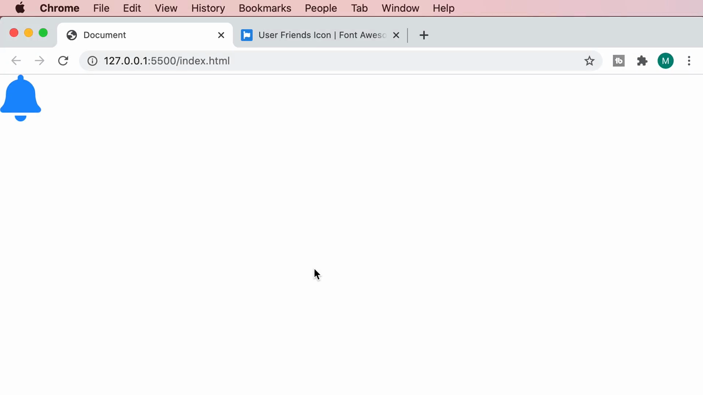

> **ผลลัพธ์ที่สำคัญที่สุดของคลิปนี้:** สามารถปรับ**สีและขนาด**ของไอคอนได้ด้วย CSS property ธรรมดาที่สุด (`color`, `font-size`) เหมือนกับกำลังจัดสไตล์ข้อความทั่วไป **ไม่ต้องเปิดโปรแกรมกราฟิกใดๆ เลยเพื่อเปลี่ยนสีไอคอน** ต่างจากไฟล์ภาพ (PNG/JPEG) ที่ต้องแก้ไขผ่านโปรแกรมแก้ไขภาพหากต้องการเปลี่ยนสี — นี่คือข้อได้เปรียบหลักของ Icon Fonts

---

## สรุปภาพรวมของคลิปนี้

| หัวข้อ | รายละเอียด |
|---|---|
| **แนวคิด** | Icon Fonts — ไอคอนที่ถูกออกแบบเป็นตัวอักษรในไฟล์ฟอนต์ ปรับแต่งได้ด้วย CSS เหมือนข้อความ |
| **ไลบรารีที่ใช้** | Font Awesome (fontawesome.com) — 1,609 ไอคอนฟรี, 7,865 ไอคอน Pro |
| **วิธีติดตั้ง** | สร้าง "Kit" ส่วนตัว แล้ววาง `<script>` ที่ได้ลงใน `<head>` |
| **วิธีใช้ไอคอน** | `<i class="fas fa-ชื่อไอคอน"></i>` — หนึ่งบรรทัดต่อหนึ่งไอคอน |
| **ปรับขนาดแบบเร็ว** | Utility class สำเร็จรูป เช่น `fa-2x`, `fa-3x` |
| **ปรับแต่งเอง** | ใช้ CSS ปกติ (`color`, `font-size`) กับ `<i>` หรือ container ที่ห่ออยู่ |

**แนวคิดสำคัญที่ได้จากคลิปนี้:**

1. **Icon Fonts เหมาะที่สุดสำหรับไอคอน UI ทั่วไป** (เมนู, ปุ่ม, โซเชียลมีเดีย, การแจ้งเตือน) เพราะปรับสีและขนาดได้ง่ายมากด้วย CSS โดยไม่ต้องพึ่งโปรแกรมกราฟิก
2. **Font Awesome เป็นตัวเลือกที่ได้รับความนิยมสูงสุดในวงการ** เพราะมีไอคอนให้เลือกหลากหลาย มีระบบ Kit ที่ติดตั้งง่าย และมีเอกสารประกอบที่ครบถ้วน
3. **ระบบ "Kit" ช่วยให้ติดตั้งและจัดการ Font Awesome ได้ง่ายกว่าเดิมมาก** เมื่อเทียบกับการดาวน์โหลดไฟล์ฟอนต์มาเก็บเองในสมัยก่อน เพียงวาง `<script>` เดียวก็พร้อมใช้งานทันที
4. **การเลือกใช้ Free หรือ Pro, Web Font หรือ SVG ควรพิจารณาจากความต้องการของโปรเจกต์จริง** — ไอคอนฟรีสไตล์ Solid มักเพียงพอสำหรับโปรเจกต์ส่วนใหญ่ ในขณะที่ Pro จะให้ทางเลือกสไตล์เพิ่มเติม (Regular, Light, Duotone) และไอคอนที่หลากหลายกว่า
5. **การห่อไอคอนด้วย `<span>` หรือ container อื่นๆ เป็นแนวทางปฏิบัติที่ดี** เพราะช่วยแยกการปรับแต่ง CSS ของตัวเองออกจาก class ที่มาจากไลบรารีภายนอก ทำให้โค้ดดูแลรักษาง่ายขึ้นในระยะยาว

---

## สรุปภาพรวมของทั้งบท "4-Images"

คลิปนี้เป็นคลิปสุดท้าย (คลิปที่ 14 จากทั้งหมด 14 คลิป) ของบท "4-Images" ซึ่งครอบคลุมเนื้อหาการทำงานกับรูปภาพบนเว็บอย่างครบถ้วน ตั้งแต่พื้นฐาน (ประเภทไฟล์ภาพ, ``, `background-image`) ไปจนถึงเทคนิคขั้นสูง (CSS Sprites, Data URLs, Clipping, Filters), การรองรับหน้าจอความละเอียดสูงและขนาดต่างๆ (Density Switching, Resolution Switching, Art Direction), ฟอร์แมตภาพสมัยใหม่ (WebP), ภาพเวกเตอร์ (SVG) และปิดท้ายด้วย Icon Fonts

---

*หมายเหตุ: คลิปนี้เป็นส่วนหนึ่งของบท "4-Images" จากคอร์ส The Ultimate HTML and CSS Course โดย Mosh Hamedani (codewithmosh.com) — คลิปที่ 14 ของบทนี้ (คลิปสุดท้ายของบท)*
