# 4-Images: 02 - Image Types and Formats (3:50)

**ไฟล์ต้นทาง:** `2-Image_Types_and_Formats.mp4`

▶️ **[เปิดวิดีโอต้นฉบับ](../../../HTML-CSS-2/4-Images/2-Image_Types_and_Formats.mp4)**

---

## ภาพรวมคลิปนี้

คลิปแรกที่มีเนื้อหาจริงของบท "4-Images" — เป็นคลิปแบบสไลด์ล้วน (ไม่มีการเขียนโค้ด) ที่ปูพื้นฐานสำคัญก่อนเริ่มใช้งานรูปภาพบนเว็บ ครอบคลุมความแตกต่างระหว่าง **Raster** กับ **Vector** และตารางเปรียบเทียบ **รูปแบบไฟล์ภาพแบบ Raster** ที่ใช้กันทั่วไป (JPEG, GIF, PNG, WebP)

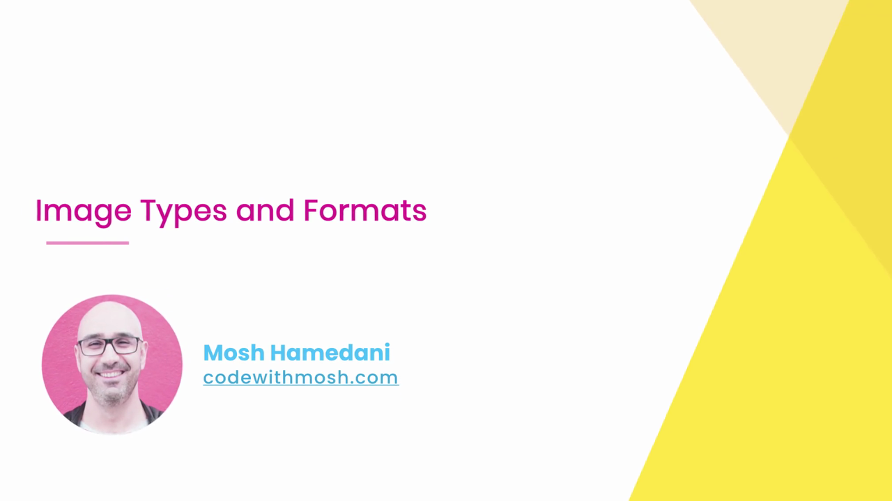

---

## 1. สองประเภทหลักของภาพดิจิทัล: Raster vs Vector

Mosh เปิดด้วยภาพเปรียบเทียบสองภาพวางคู่กัน — ด้านซ้ายเป็นภาพถ่ายป่าไม้ (ภาพจริง) และด้านขวาเป็นภาพประกอบพระอาทิตย์ตกแบบวาดด้วยรูปทรงเรขาคณิต (ภาพกราฟิก):

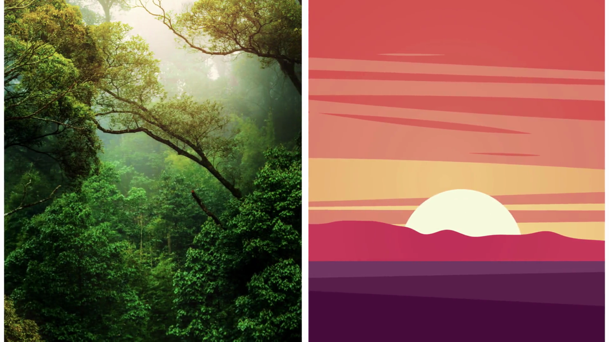

### 1.1 Raster (ภาพแบบพิกเซล)

Mosh ติดป้าย **"RASTER"** บนภาพถ่ายป่าไม้ (ด้านซ้าย) พร้อมอธิบายคุณสมบัติ:

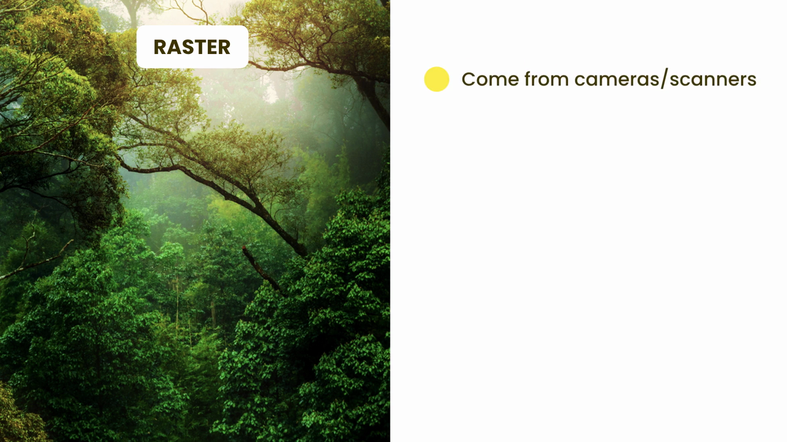

> - **มาจากกล้องถ่ายรูปหรือเครื่องสแกน (Come from cameras/scanners)**
> - ประกอบขึ้นจาก **พิกเซล (pixel)** จำนวนมากเรียงต่อกัน แต่ละพิกเซลเก็บค่าสีของตัวเอง
> - เมื่อขยายภาพให้ใหญ่ขึ้นเรื่อยๆ จะเริ่มเห็นเป็นตารางพิกเซล (แตก/เบลอ) เพราะจำนวนพิกเซลมีจำกัดตายตัว

### 1.2 Vector (ภาพแบบเวกเตอร์)

จากนั้น Mosh ติดป้าย **"VECTOR"** บนภาพประกอบพระอาทิตย์ตก (ด้านขวา):

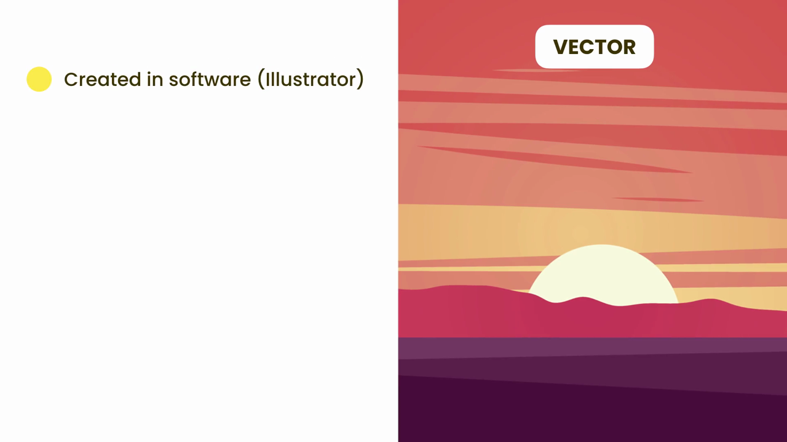

> - **สร้างขึ้นด้วยซอฟต์แวร์ (Created in software เช่น Illustrator)**
> - ภาพถูกอธิบายด้วย**สมการทางคณิตศาสตร์** (จุด เส้น รูปทรง) แทนที่จะเป็นพิกเซล
> - สามารถ**ขยายหรือย่อขนาดได้ไม่จำกัดโดยไม่สูญเสียความคมชัด** เพราะเบราว์เซอร์คำนวณรูปทรงใหม่ทุกครั้งตามขนาดที่ต้องการ

---

## 2. สาธิตความแตกต่างด้วยโลโก้ HTML5

เพื่อให้เห็นภาพชัดเจนยิ่งขึ้น Mosh ใช้โลโก้ HTML5 สองตัว (ตัวหนึ่งเป็นไฟล์ raster และอีกตัวเป็นไฟล์ vector) วางเทียบกันในขนาดเท่ากันก่อน:

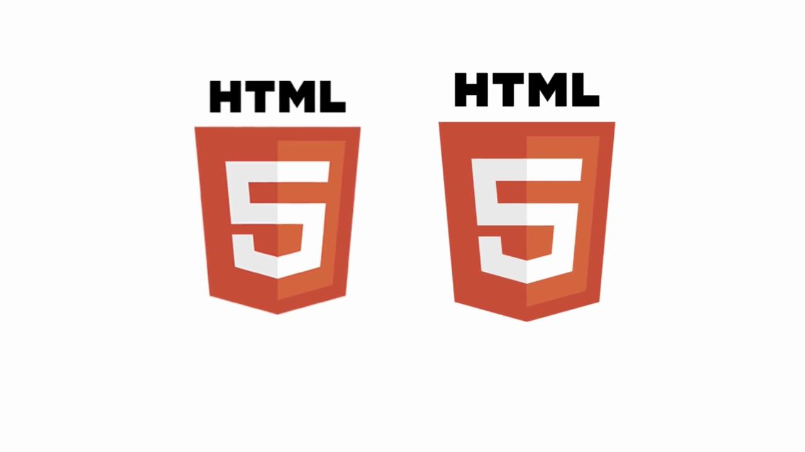

จากนั้นขยายโลโก้ทั้งสองให้ใหญ่ขึ้นพร้อมกัน:

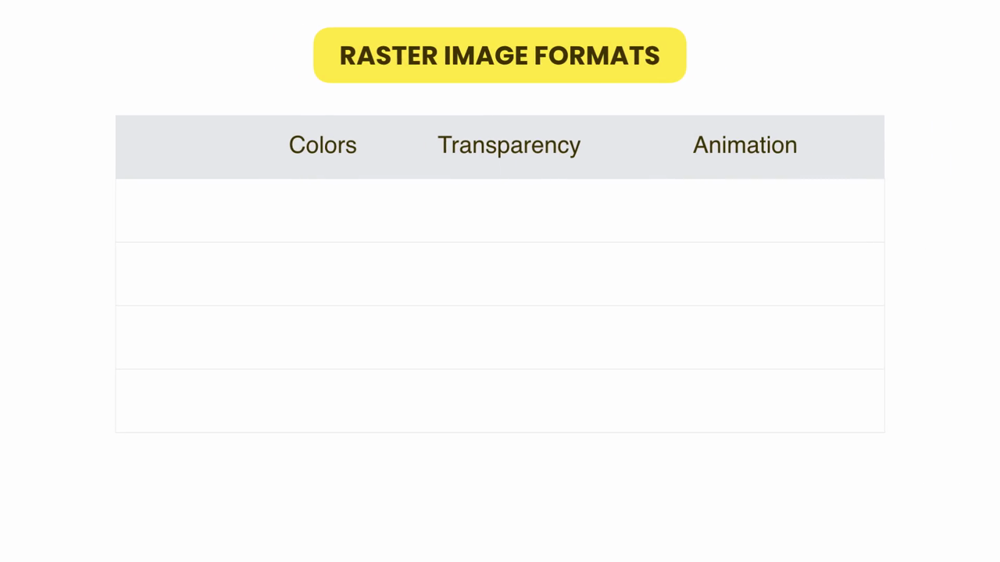

> **ผลลัพธ์ที่สำคัญ:** เมื่อขยายขนาดขึ้น โลโก้ฝั่ง **raster** (ซ้าย) เริ่มแตกเป็นเม็ดพิกเซล ขอบภาพไม่คมชัด ในขณะที่โลโก้ฝั่ง **vector** (ขวา) ยังคงความคมชัดเท่าเดิมทุกประการไม่ว่าจะขยายไปเท่าไหร่ — นี่คือเหตุผลสำคัญที่โลโก้ ไอคอน หรือกราฟิกที่ต้องปรับขนาดบ่อยๆ (เช่น responsive design) มักนิยมใช้ไฟล์ประเภท **SVG** (ซึ่งเป็น vector) แทนไฟล์ raster

---

## 3. ตารางเปรียบเทียบรูปแบบไฟล์ภาพ Raster

Mosh แสดงตารางเปล่าหัวข้อ **"RASTER IMAGE FORMATS"** เปรียบเทียบ 3 คุณสมบัติ: **Colors** (จำนวนสีที่รองรับ), **Transparency** (รองรับพื้นหลังโปร่งใสหรือไม่), **Animation** (รองรับภาพเคลื่อนไหวหรือไม่):

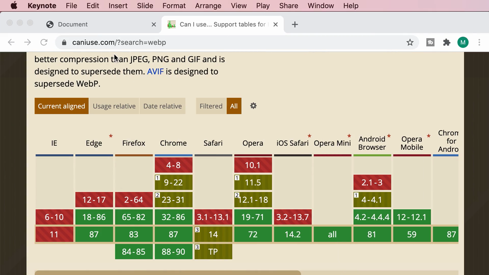

### 3.1 ตรวจสอบการรองรับเบราว์เซอร์ของ WebP ผ่าน caniuse.com

ก่อนเติมข้อมูลแถว **WebP** Mosh เปิดเว็บไซต์ **caniuse.com** เพื่อตรวจสอบว่าเบราว์เซอร์ต่างๆ รองรับไฟล์ประเภทนี้มากน้อยแค่ไหน:

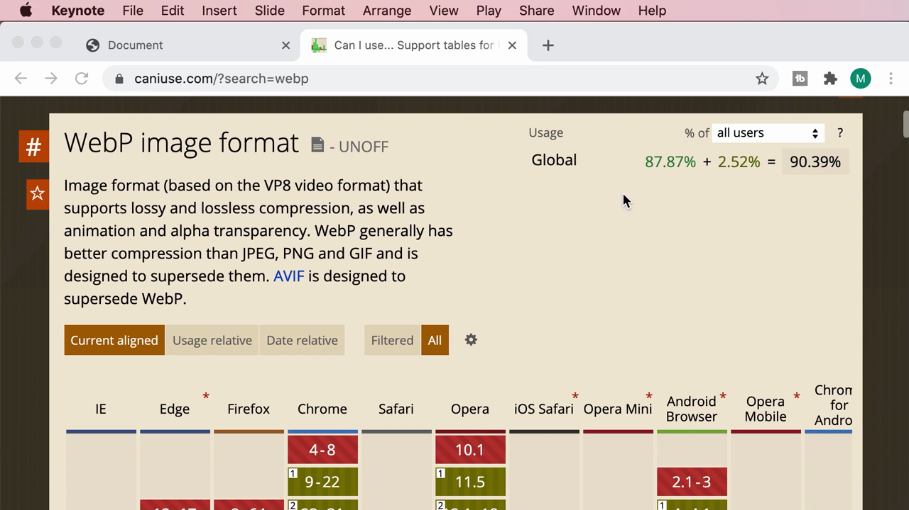

> คำอธิบายจากเว็บไซต์: *"WebP image format... supports lossy and lossless compression, as well as animation and alpha transparency. WebP generally has better compression than JPEG, PNG and GIF and is designed to supersede them. AVIF is designed to supersede WebP."*

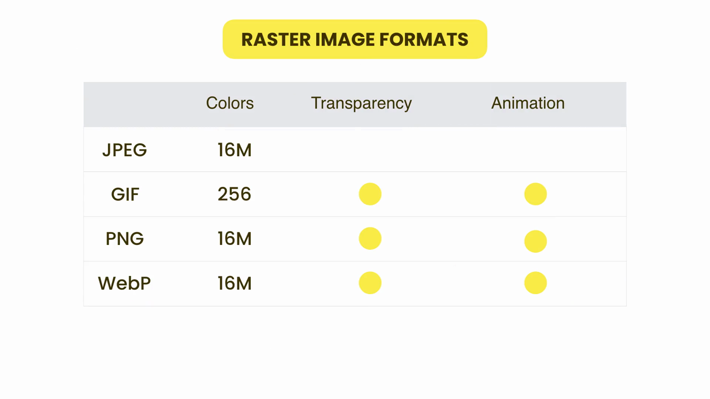

> ข้อมูล ณ ตอนที่บันทึกคลิป: เบราว์เซอร์รองรับ WebP รวมกันแล้วสูงถึง **90.39%** ของผู้ใช้ทั่วโลก (87.87% รองรับเต็มรูปแบบ + 2.52% รองรับบางส่วน) — Chrome, Opera, Android Browser, และเบราว์เซอร์สมัยใหม่ส่วนใหญ่รองรับแล้ว

### 3.2 ตารางฉบับเต็ม

หลังเติมข้อมูลครบทุกแถว ได้ตารางสรุปดังนี้:

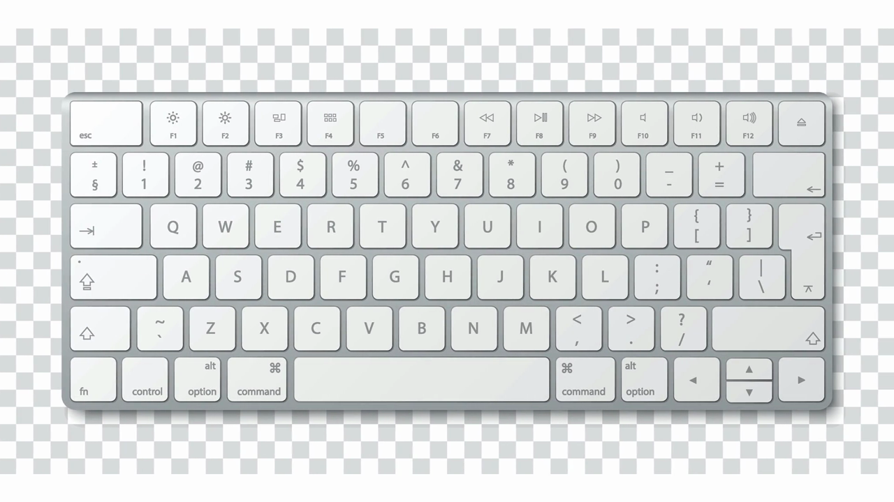

| รูปแบบไฟล์ | จำนวนสี (Colors) | รองรับพื้นหลังโปร่งใส (Transparency) | รองรับภาพเคลื่อนไหว (Animation) |
|---|---|---|---|
| **JPEG** | 16 ล้านสี (16M) | ❌ ไม่รองรับ | ❌ ไม่รองรับ |
| **GIF** | 256 สี | ✅ รองรับ | ✅ รองรับ |
| **PNG** | 16 ล้านสี (16M) | ✅ รองรับ | ✅ รองรับ |
| **WebP** | 16 ล้านสี (16M) | ✅ รองรับ | ✅ รองรับ |

> **ข้อสังเกตสำคัญ:**
> - **JPEG** เหมาะกับภาพถ่ายทั่วไปที่มีสีสันซับซ้อน (สี 16 ล้านสี) แต่**ไม่รองรับพื้นหลังโปร่งใสและภาพเคลื่อนไหว**
> - **GIF** มีข้อจำกัดเรื่องจำนวนสีเพียง 256 สี (จึงไม่เหมาะกับภาพถ่ายที่มีสีไล่เฉดละเอียด) แต่ขึ้นชื่อเรื่องการรองรับภาพเคลื่อนไหว (GIF animation ที่คุ้นเคย)
> - **PNG** รองรับทั้งสีเยอะและพื้นหลังโปร่งใส เหมาะกับโลโก้ ไอคอน หรือภาพที่ต้องการพื้นหลังใส
> - **WebP** เป็นรูปแบบไฟล์ที่ใหม่กว่าและ**ได้คุณสมบัติครบทุกด้าน** (สีเยอะ + โปร่งใส + เคลื่อนไหวได้) พร้อมขนาดไฟล์ที่เล็กกว่าเมื่อเทียบกับคุณภาพเท่ากัน — เป็นตัวเลือกที่ทันสมัยและแนะนำให้ใช้เมื่อรองรับได้ (จะเรียนลึกเรื่องนี้ในคลิป "Using Modern Image Formats" ถัดๆ ไปของบทนี้)

---

## 4. ตัวอย่างพื้นหลังโปร่งใสของ PNG

เพื่อสาธิตคุณสมบัติ **Transparency** ให้เห็นภาพจริง Mosh แสดงตัวอย่างภาพคีย์บอร์ดที่บันทึกเป็นไฟล์ PNG โดยมีพื้นหลังโปร่งใส (มองเห็นเป็นลายตารางหมากรุกสีเทา-ขาวตามธรรมเนียมของโปรแกรมกราฟิก ซึ่งหมายถึง "ไม่มีสี/โปร่งใส"):

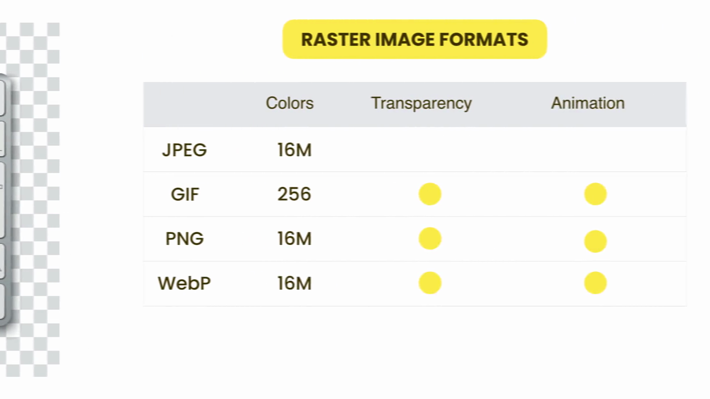

> ต่างจากไฟล์ JPEG ที่จะต้องมีพื้นหลังเป็นสีทึบเสมอ (มักเป็นสีขาวหรือสีดำ) ไฟล์ PNG (และ GIF/WebP) สามารถ**ตัดพื้นหลังออกได้จริง** ทำให้นำภาพไปวางซ้อนบนพื้นหลังสีใดก็ได้ของเว็บไซต์โดยไม่มีกรอบสี่เหลี่ยมมารบกวน

---

## สรุปภาพรวมของคลิปนี้

| หัวข้อ | รายละเอียด |
|---|---|
| **Raster** | ภาพจากกล้อง/สแกนเนอร์ ประกอบด้วยพิกเซล ขยายแล้วแตก |
| **Vector** | ภาพจากซอฟต์แวร์ ประกอบด้วยสมการคณิตศาสตร์ ขยายได้ไม่จำกัดโดยไม่แตก |
| **JPEG** | 16M สี, ไม่รองรับโปร่งใส/เคลื่อนไหว — เหมาะกับภาพถ่าย |
| **GIF** | 256 สี, รองรับโปร่งใส/เคลื่อนไหว — เหมาะกับภาพเคลื่อนไหวง่ายๆ |
| **PNG** | 16M สี, รองรับโปร่งใส/เคลื่อนไหว — เหมาะกับโลโก้/ไอคอน |
| **WebP** | 16M สี, รองรับโปร่งใส/เคลื่อนไหว, บีบอัดดีกว่า — รองรับเบราว์เซอร์แล้ว ~90% |

**แนวคิดสำคัญที่ได้จากคลิปนี้:**

1. **เลือกใช้ Vector (เช่น SVG) สำหรับโลโก้และไอคอน** เพราะต้องปรับขนาดบ่อยและต้องคมชัดในทุกความละเอียดหน้าจอ
2. **เลือกใช้ Raster (เช่น JPEG) สำหรับภาพถ่ายจริง** ที่มีรายละเอียดสีสันซับซ้อนเกินกว่าจะวาดด้วยรูปทรงเรขาคณิตได้
3. **การเลือกรูปแบบไฟล์ที่เหมาะสมส่งผลโดยตรงต่อ performance ของเว็บไซต์** — เลือกผิดอาจทำให้ไฟล์ใหญ่เกินจำเป็นหรือขาดคุณสมบัติที่ต้องการ (เช่น อยากได้พื้นหลังโปร่งใสแต่ดันเลือก JPEG)
4. **WebP คือทางเลือกสมัยใหม่ที่ควรพิจารณาใช้แทน JPEG/PNG/GIF** เมื่อรองรับได้ เพราะได้คุณสมบัติครบและไฟล์เล็กกว่า
5. **การตรวจสอบ Browser Support ผ่าน caniuse.com เป็นขั้นตอนสำคัญ** ก่อนตัดสินใจใช้เทคโนโลยีหรือรูปแบบไฟล์ใหม่ๆ ในโปรเจกต์จริง

---

*หมายเหตุ: คลิปนี้เป็นส่วนหนึ่งของบท "4-Images" จากคอร์ส The Ultimate HTML and CSS Course โดย Mosh Hamedani (codewithmosh.com) — คลิปที่ 2 ของบทนี้*
