# 4-Images: 03 - Content Images (3:41)

**ไฟล์ต้นทาง:** `3-Content_Images.mp4`

▶️ **[เปิดวิดีโอต้นฉบับ](../../../HTML-CSS-2/4-Images/3-Content_Images.mp4)**

---

## ภาพรวมคลิปนี้

คลิปแรกที่เริ่มลงมือเขียนโค้ดจริงในบท "4-Images" — สอนพื้นฐานการแสดงภาพบนหน้าเว็บด้วยแท็ก **``** พร้อมทำความเข้าใจความสำคัญของ attribute **`alt`** อย่างลึกซึ้ง (ทั้งกรณีที่ควรใส่ข้อความบรรยายและกรณีที่ควรปล่อยว่าง) และปิดท้ายด้วยการจัดสไตล์ภาพเบื้องต้นด้วย CSS

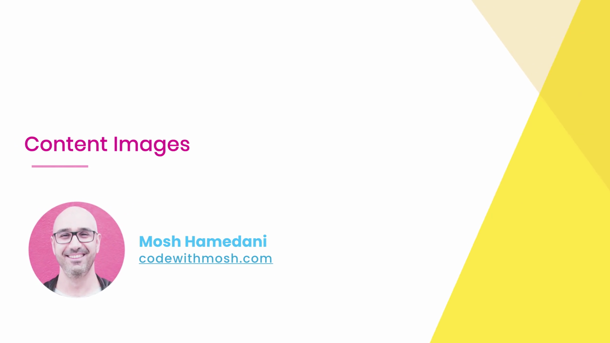

---

## 1. เตรียมโปรเจกต์และไฟล์ภาพที่จะใช้ตลอดทั้งบท

Mosh เริ่มจากไฟล์ `index.html` เปล่าที่มีโครงสร้างพื้นฐาน (เชื่อมโยง `normalize.css` และ `styles.css`) ยังไม่มีเนื้อหาใน `<body>`:

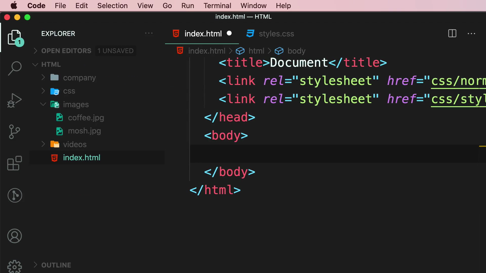

จากนั้นลาก **ไฟล์ภาพจำนวน 13 ไฟล์**จาก Finder เข้ามาวางในโฟลเดอร์ `images` ของโปรเจกต์ในครั้งเดียว:

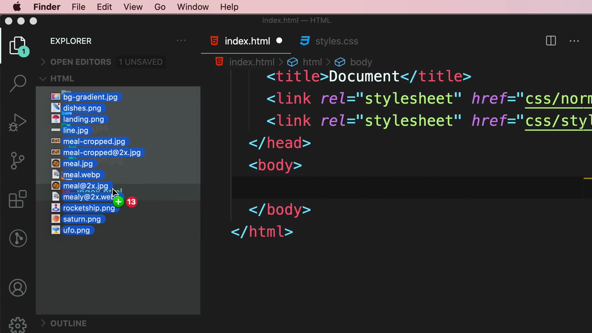

รายชื่อไฟล์ภาพทั้งหมดที่เตรียมไว้ (จะถูกใช้ในคลิปต่างๆ **ตลอดทั้งบท 4-Images** ไม่ใช่แค่คลิปนี้):

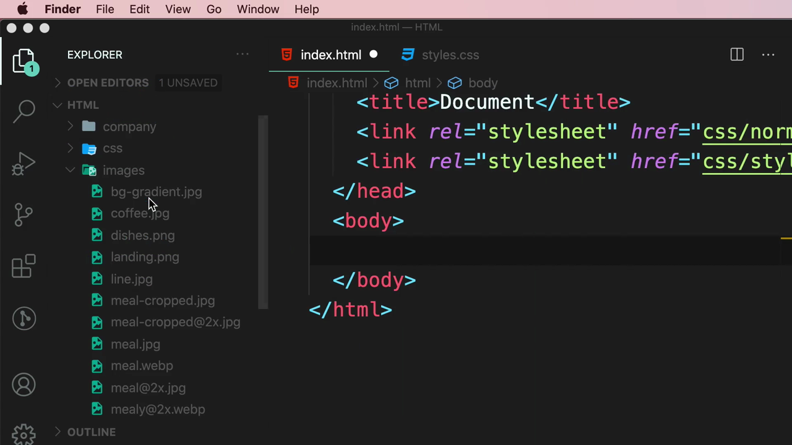

> `bg-gradient.jpg`, `coffee.jpg`, `dishes.png`, `landing.png`, `line.jpg`, `meal-cropped.jpg`, `meal-cropped@2x.jpg`, `meal.jpg`, `meal.webp`, `meal@2x.jpg`, `mealy@2x.webp`, `rocketship.png`, `saturn.png`, `ufo.png`
>
> สังเกตว่าไฟล์บางชื่อมี **`@2x`** ต่อท้าย (เช่น `meal@2x.jpg`) — นี่คือไฟล์ภาพความละเอียดสูงสำรองไว้สำหรับคลิป "Supporting High-density Screens" ที่จะเรียนถัดไปในบทนี้ ส่วนไฟล์ `.webp` เตรียมไว้สำหรับคลิป "Using Modern Image Formats"

---

## 2. แท็ก `` พื้นฐาน: `src` และ `alt`

Mosh พิมพ์ `img` ในแท็ก body แล้วให้ IntelliSense แนะนำ snippet ของแท็ก `` ที่มีทั้ง `src` และ `alt` มาให้พร้อมกัน:

```html

```

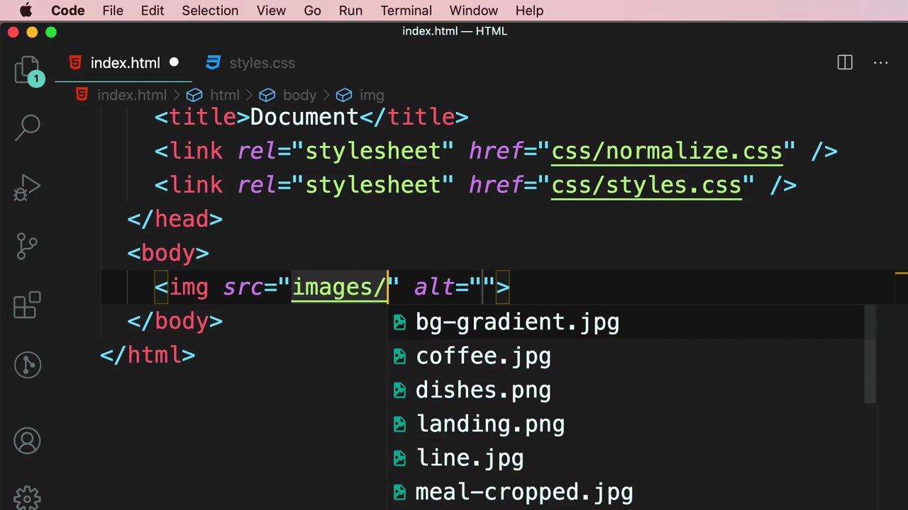

เลือกไฟล์ `meal.jpg` จากรายการ autocomplete:

```html

```

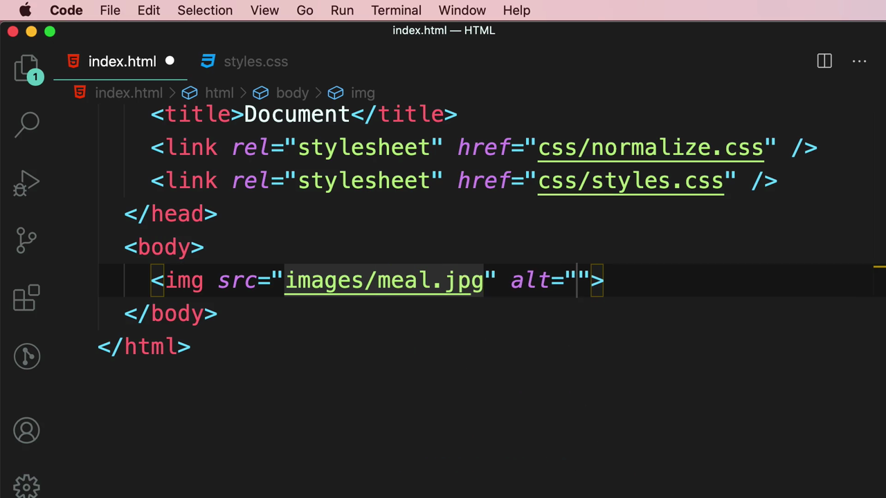

### 2.1 เติมข้อความบรรยายภาพใน `alt`

Mosh เติมข้อความบรรยายเนื้อหาของภาพลงใน `alt`:

```html

```

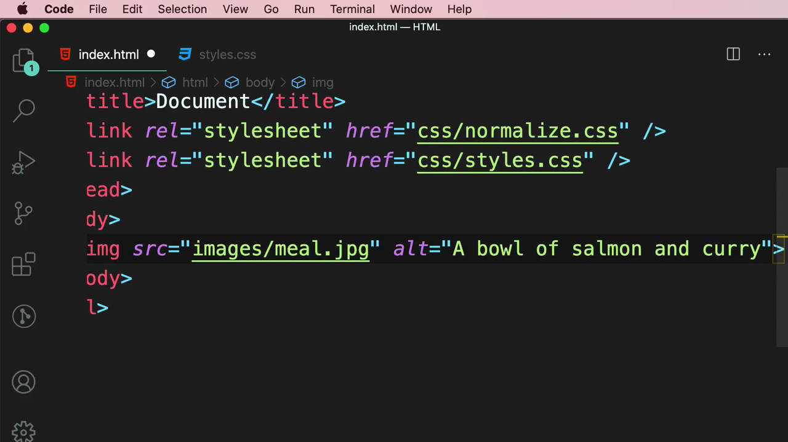

ผลลัพธ์ในเบราว์เซอร์ — ภาพอาหาร (ปลาแซลมอนในซอสแกงกะหรี่) แสดงเต็มความกว้างตามขนาดจริงของไฟล์ภาพ:

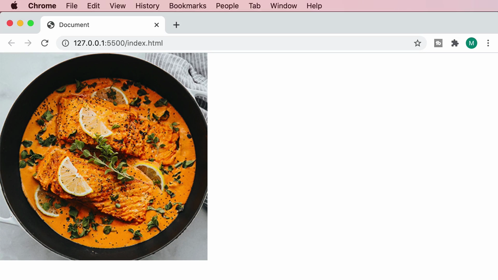

> **`alt` (alternative text) มีความสำคัญ 2 ด้าน:**
> 1. **การเข้าถึง (Accessibility):** โปรแกรมอ่านหน้าจอ (screen reader) สำหรับผู้พิการทางสายตาจะอ่านข้อความใน `alt` ออกมาแทนภาพ ทำให้ผู้ใช้เข้าใจเนื้อหาของภาพได้
> 2. **กรณีภาพโหลดไม่สำเร็จ:** หากไฟล์ภาพเสียหรือโหลดไม่ขึ้น เบราว์เซอร์จะแสดงข้อความใน `alt` แทนที่ภาพ

---

## 3. เมื่อไหร่ควรใส่ `alt=""` (ปล่อยว่าง)

Mosh สาธิตกรณีตรงข้าม โดยเปลี่ยน `src` เป็น `images/line.jpg` (ภาพเส้นคั่นตกแต่งที่มีหัวลูกศรสองด้าน) แต่ยังคงข้อความ `alt` เดิม ("A bowl of salmon and curry") ค้างอยู่:

```html

```

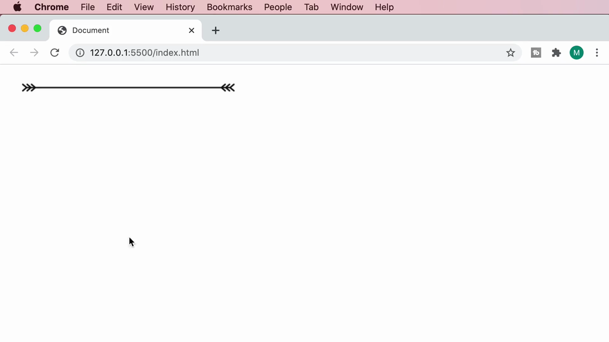
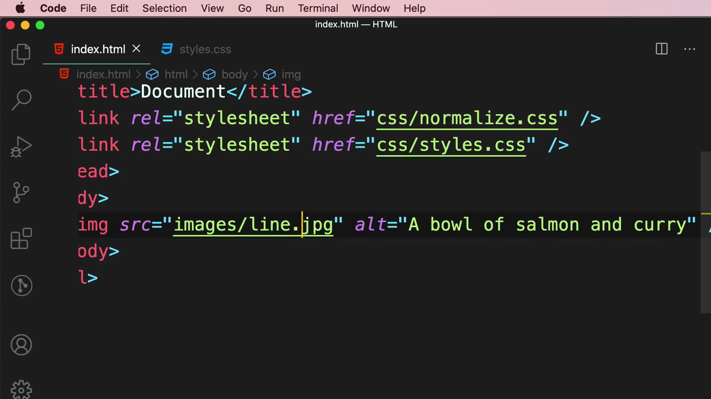

> **ปัญหาที่เห็นชัด:** ตอนนี้ `alt` บอกว่าเป็น "ชามอาหาร" แต่ภาพจริงเป็นแค่เส้นคั่นตกแต่ง — นี่คือตัวอย่างของการเขียน `alt` ที่ผิดหรือไม่ตรงกับเนื้อหาจริง ซึ่งจะทำให้ผู้ใช้ screen reader สับสน

จากนั้น Mosh ลบข้อความใน `alt` ออกจนว่างเปล่า และเปลี่ยน `src` กลับไปเป็น `images/meal.jpg`:

```html

```

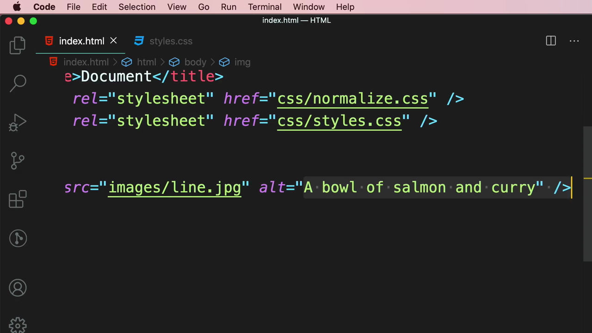

> **หลักการสำคัญ: เมื่อไหร่ควรใช้ `alt=""` (ค่าว่าง):**
> ใช้ `alt=""` เมื่อภาพนั้นเป็นเพียง **ภาพตกแต่ง (decorative image)** ที่ไม่ได้สื่อความหมายหรือข้อมูลสำคัญใดๆ เพิ่มเติมจากเนื้อหาข้อความที่มีอยู่แล้วในหน้า (เช่น เส้นคั่นตกแต่ง, ไอคอนประดับ) — การใส่ `alt=""` (ไม่ใช่การไม่ใส่ `alt` เลย) จะบอกให้ screen reader **ข้ามภาพนี้ไปโดยไม่ต้องอ่านอะไรออกมา** เพราะรู้ว่าเป็นภาพตกแต่งโดยเจตนา ต่างจากการไม่ใส่ attribute `alt` เลย ซึ่งอาจทำให้ screen reader อ่านชื่อไฟล์หรือพฤติกรรมที่คาดเดาไม่ได้ออกมาแทน

---

## 4. จัดสไตล์ภาพด้วย CSS: ทำให้ภาพเต็มความกว้างหน้าจอ

เพื่อให้ควบคุมภาพผ่าน CSS ได้ Mosh เพิ่ม `class="meal"` ให้กับแท็ก `` (พิมพ์ `c` แล้วเลือก `class` จาก IntelliSense):

```html

```

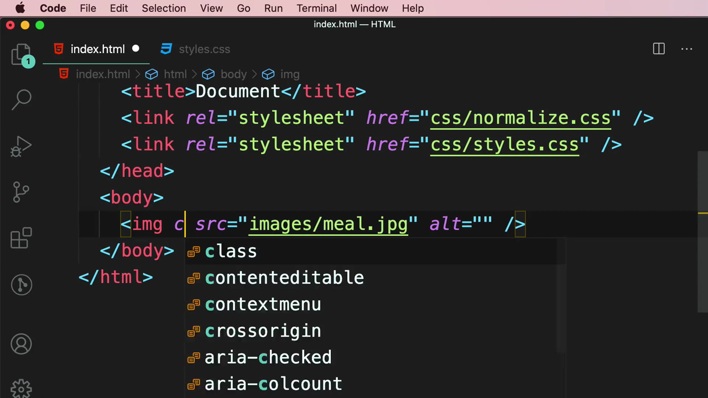
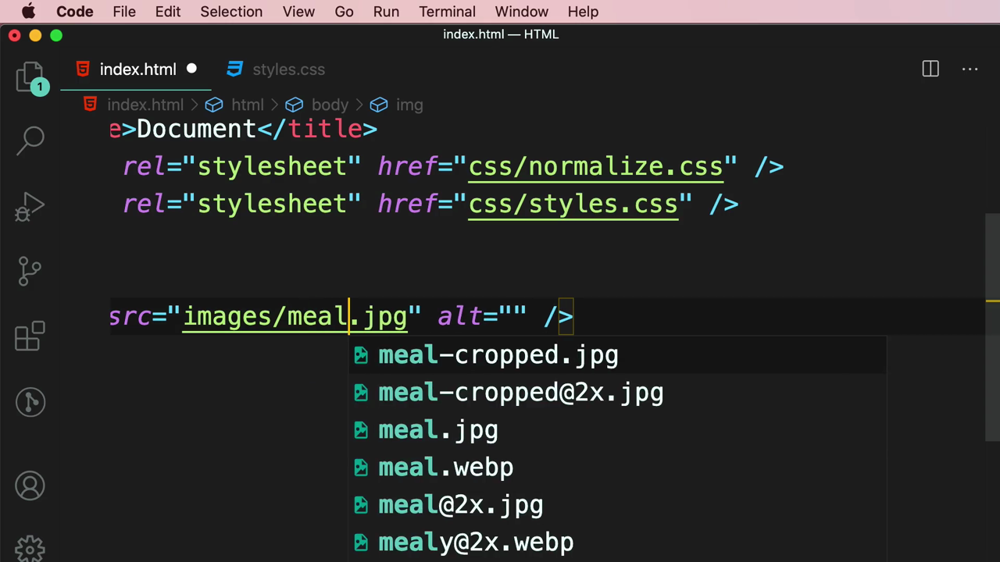

จากนั้นสลับไปที่ `styles.css` และสร้าง selector `.meal` ขึ้นมาใหม่:

```css
.meal {
}
```

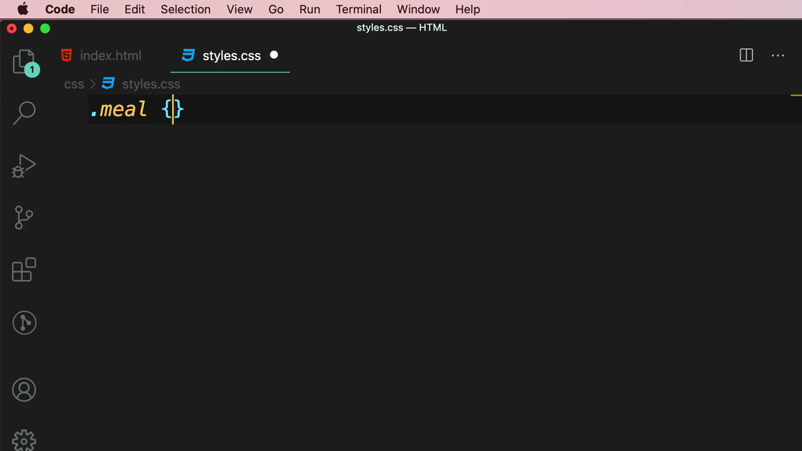

เพิ่ม property `width` และพิมพ์ `100v` ให้ IntelliSense แนะนำหน่วยที่เกี่ยวข้อง (`100vh`, `100vmax`, `100vmin`, `100vw`):

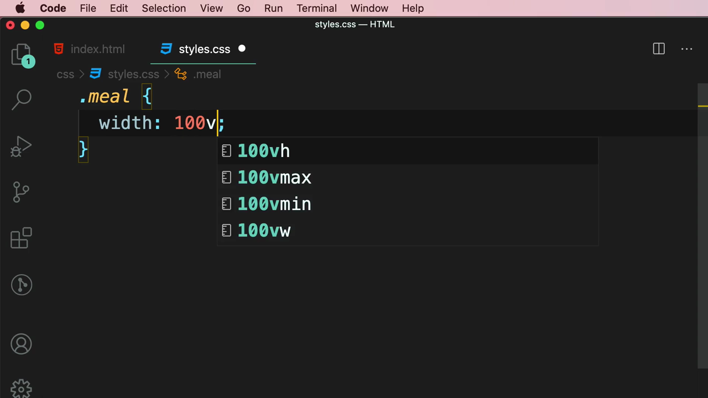

เลือกใช้ `100vw`:

```css
.meal {
  width: 100vw;
}
```

ผลลัพธ์: ภาพขยายเต็มความกว้างของหน้าจอ (viewport) พอดี ไม่ว่าจะปรับขนาดหน้าต่างเบราว์เซอร์อย่างไรก็ตาม:

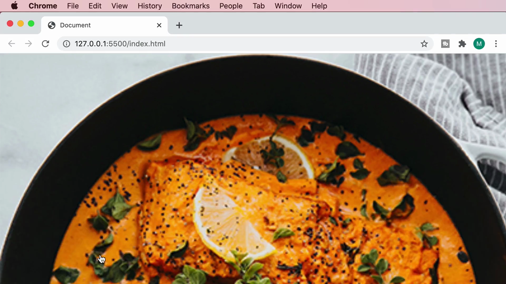

> **`vw` (viewport width) คือหน่วยที่อ้างอิงจากความกว้างของหน้าจอเบราว์เซอร์** — `100vw` หมายถึง "เต็มความกว้างของ viewport พอดี 100%" เป็นเทคนิคที่ใช้บ่อยสำหรับภาพพื้นหลังแบบ hero image หรือภาพที่ต้องการให้เต็มจอโดยไม่มีขอบขาวด้านข้าง

---

## สรุปภาพรวมของคลิปนี้

| หัวข้อ | รายละเอียด |
|---|---|
| **แท็กพื้นฐาน** | `` |
| **`alt` มีข้อความ** | ใช้เมื่อภาพสื่อความหมายสำคัญ — screen reader จะอ่านออกมา, เบราว์เซอร์แสดงแทนเมื่อภาพโหลดไม่ขึ้น |
| **`alt=""` (ว่าง)** | ใช้เมื่อภาพเป็นแค่การตกแต่ง (decorative) — screen reader จะข้ามไปโดยไม่อ่าน |
| **`class` + CSS** | ใช้ `class` เชื่อมกับ CSS selector เพื่อจัดสไตล์ภาพ |
| **`100vw`** | หน่วยความกว้างที่อ้างอิงจาก viewport ทำให้ภาพเต็มความกว้างหน้าจอพอดี |

**แนวคิดสำคัญที่ได้จากคลิปนี้:**

1. **`alt` ไม่ใช่แค่ "รายละเอียดเสริม" แต่เป็นเรื่อง Accessibility ที่สำคัญมาก** ควรพิจารณาทุกครั้งว่าภาพนั้นสื่อความหมายอะไร แล้วเขียน `alt` ให้ตรงกับเนื้อหาจริง
2. **การเลือกระหว่างใส่ข้อความใน `alt` กับปล่อยว่าง (`alt=""`) ขึ้นอยู่กับว่าภาพนั้นสำคัญต่อเนื้อหาหรือเป็นแค่การตกแต่ง** — นี่คือหลักการที่นักพัฒนา Front End มืออาชีพต้องเข้าใจและนำไปใช้จริงในทุกโปรเจกต์
3. **การลาก asset จำนวนมากเข้าโปรเจกต์ตั้งแต่ต้นคลิปเป็นการเตรียมพร้อมสำหรับหลายคลิปถัดไป** ในบทนี้ (Retina/`@2x`, WebP) — สังเกตชื่อไฟล์ให้ดีจะช่วยคาดเดาเนื้อหาคลิปถัดไปได้
4. **`100vw` เป็นหน่วยที่มีประโยชน์มากสำหรับภาพที่ต้องการให้เต็มความกว้างหน้าจอพอดี** โดยไม่ขึ้นกับขนาดของ container ที่ภาพอยู่ภายใน

---

*หมายเหตุ: คลิปนี้เป็นส่วนหนึ่งของบท "4-Images" จากคอร์ส The Ultimate HTML and CSS Course โดย Mosh Hamedani (codewithmosh.com) — คลิปที่ 3 ของบทนี้*
