# 4-Images: 04 - Background Images (7:02)

**ไฟล์ต้นทาง:** `4-Background_Images.mp4`

▶️ **[เปิดวิดีโอต้นฉบับ](../../../HTML-CSS-2/4-Images/4-Background_Images.mp4)**

---

## ภาพรวมคลิปนี้

คลิปยาวและสำคัญมากของบท "4-Images" — สอนการใช้ภาพเป็น**พื้นหลัง (background)** ด้วย CSS ครอบคลุมทุก property ที่เกี่ยวข้อง: `background`/`background-image`, `background-repeat`, `background-position`, `background-size` (รวมถึงค่าพิเศษ `cover`) และ `background-attachment` ปิดท้ายด้วยเทคนิคยอดนิยมสำหรับทำ hero section แบบเต็มจอ

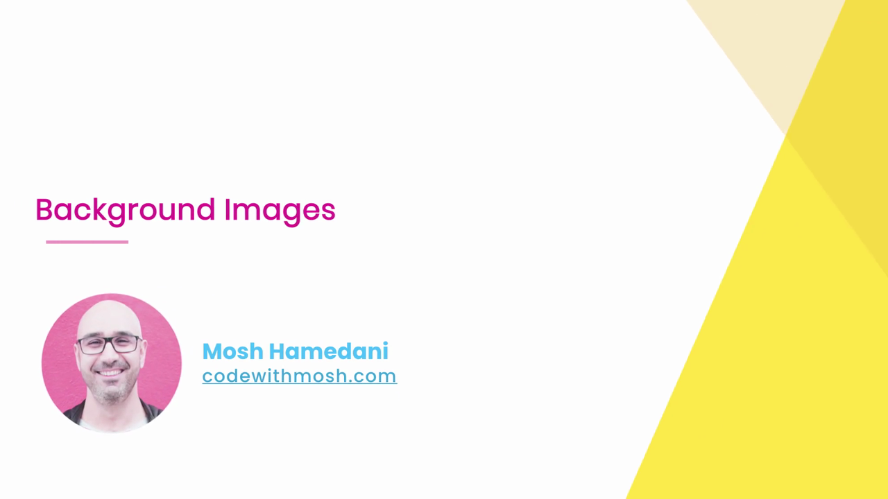

---

## 1. `background-image`: กำหนดภาพพื้นหลัง

Mosh เริ่มจาก `body` เปล่า แล้วพิมพ์ `ba` ให้ IntelliSense แนะนำ property ที่เกี่ยวข้องกับ background:

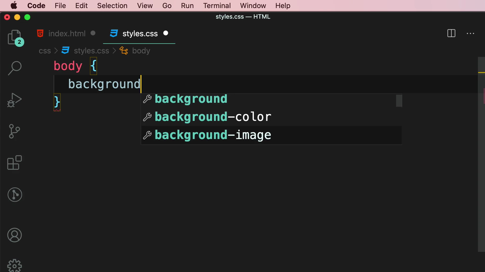

เลือกใช้ shorthand `background` (แทนที่จะเขียน `background-image` แยก) แล้วใช้ฟังก์ชัน `url()`:

```css
body {
  background: url();
}
```

เมื่อพิมพ์ `../` ภายใน `url()` VS Code จะแสดงรายการโฟลเดอร์/ไฟล์ให้เลือกแบบ autocomplete:

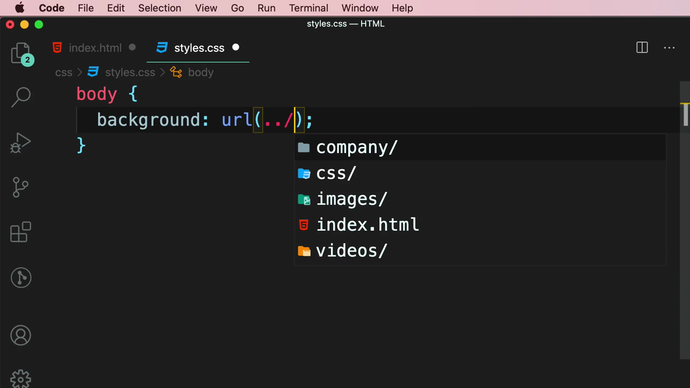

เลือกไฟล์ `bg-paper.jpg` ได้โค้ดที่สมบูรณ์:

```css
body {
  background: url(../images/bg-paper.jpg);
}
```

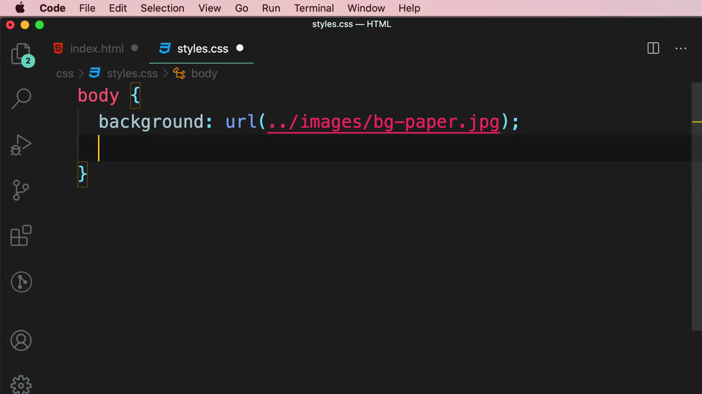

ผลลัพธ์เริ่มต้น: ภาพพื้นผิวกระดาษถูกนำมาปูซ้ำ (tile) เต็มทั้งหน้าจอโดยอัตโนมัติ:

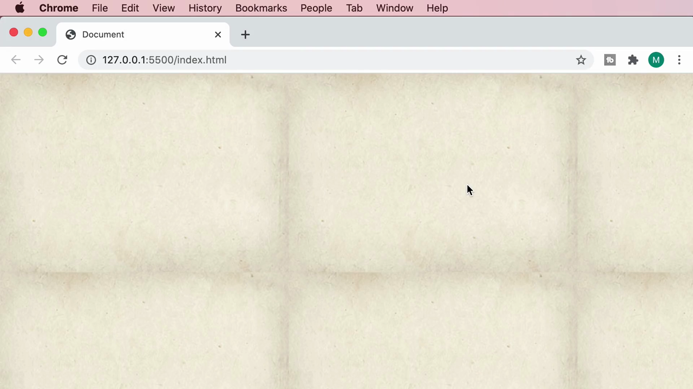

> **หมายเหตุเรื่อง path:** เนื่องจากไฟล์ `styles.css` อยู่ในโฟลเดอร์ `css/` การอ้างอิงไปยังโฟลเดอร์ `images/` ที่อยู่ระดับเดียวกับ `css/` จึงต้องขึ้นต้นด้วย `../` (ถอยกลับไปหนึ่งระดับก่อน) ต่างจากการอ้างอิงใน `index.html` ที่ไม่ต้องมี `../` เพราะไฟล์ HTML อยู่ที่ระดับบนสุดของโปรเจกต์อยู่แล้ว

---

## 2. `background-repeat`: ควบคุมการปูซ้ำของภาพ

Mosh พิมพ์ `background-repeat` ให้ IntelliSense แนะนำค่าที่เป็นไปได้:

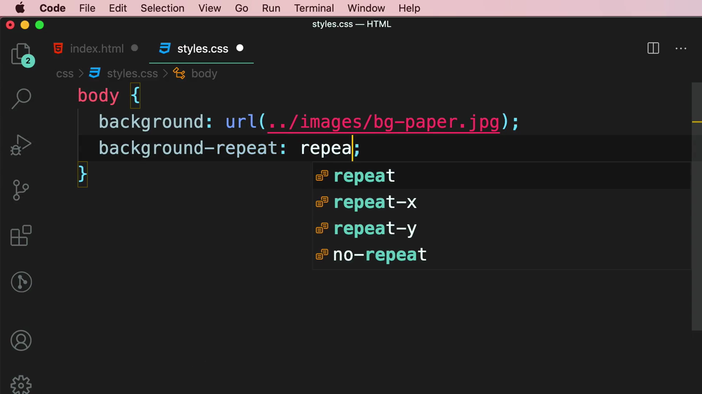

> **ค่าที่ปรากฏ:** `repeat` (ค่าเริ่มต้น — ปูซ้ำทั้งแนวนอนและแนวตั้ง), `repeat-x`, `repeat-y`, `no-repeat`

### 2.1 `repeat-x`

```css
background-repeat: repeat-x;
```

ผลลัพธ์: ภาพปูซ้ำ**เฉพาะแนวนอน**เท่านั้น (แถวเดียวแต่ยาวเต็มความกว้าง):

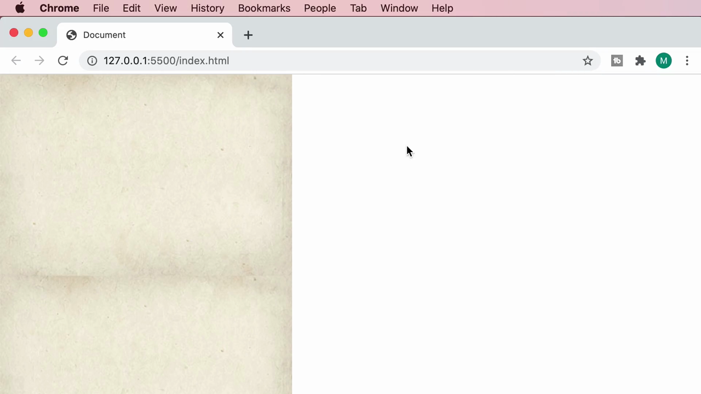

### 2.2 `repeat-y`

```css
background-repeat: repeat-y;
```

ผลลัพธ์: ภาพปูซ้ำ**เฉพาะแนวตั้ง**เท่านั้น (คอลัมน์เดียวแต่ยาวเต็มความสูง):

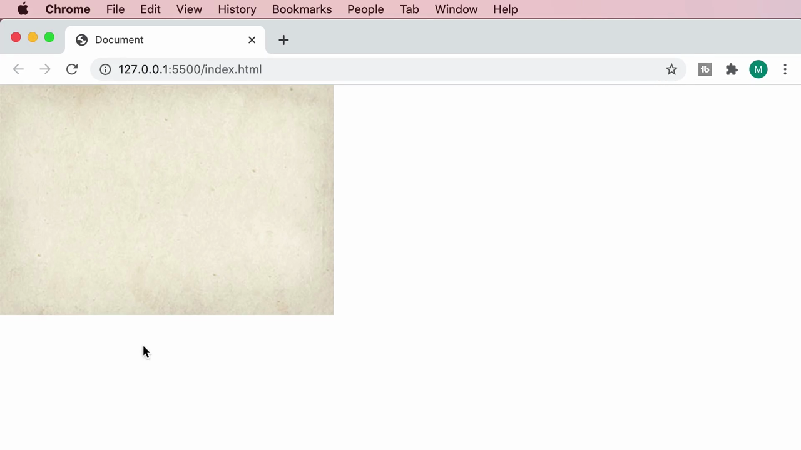

### 2.3 `no-repeat`

```css
background-repeat: no-repeat;
```

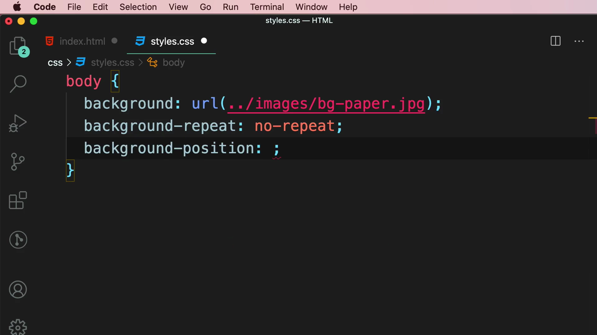

ผลลัพธ์: ภาพแสดงเพียง**ครั้งเดียว**ที่มุมบนซ้าย ไม่ปูซ้ำเลย ตามขนาดจริงของไฟล์ภาพ:

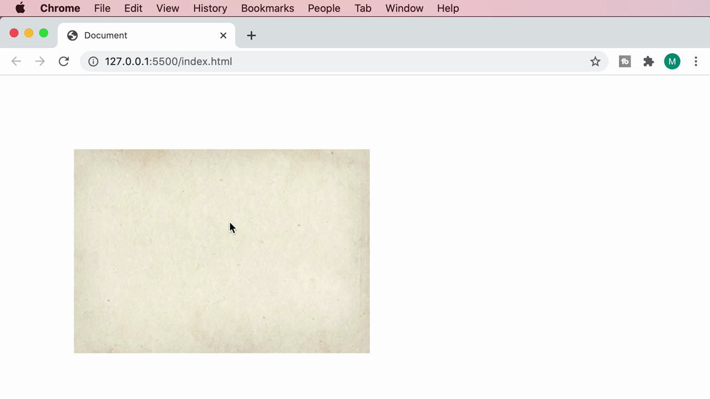

---

## 3. `background-position`: กำหนดตำแหน่งของภาพพื้นหลัง

Mosh เพิ่ม property ใหม่ (โดยยังคง `no-repeat` ไว้):

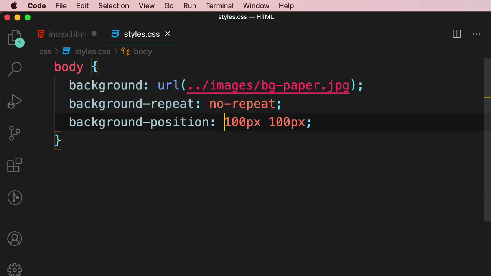

### 3.1 ค่าพิกเซล (`px px`)

```css
background-position: 100px 100px;
```

ค่าแรกคือระยะจากขอบซ้าย (แกน X) ค่าที่สองคือระยะจากขอบบน (แกน Y) — ภาพเลื่อนเข้ามา 100px จากทั้งสองด้าน:

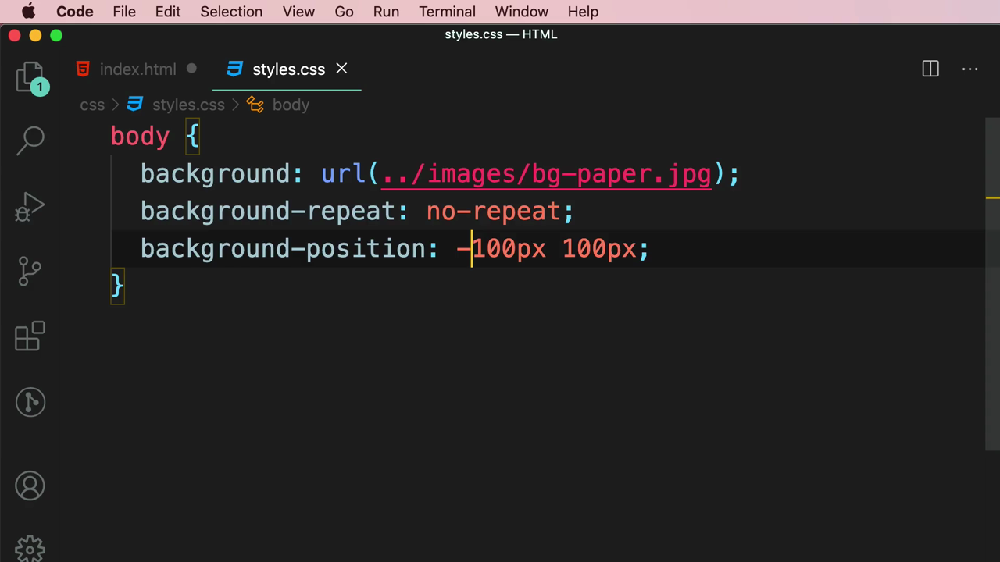

### 3.2 ค่าติดลบ

```css
background-position: -100px 100px;
```

ค่าติดลบในแกน X ทำให้ภาพเลื่อน**ออกนอกกรอบไปทางซ้าย** (มองไม่เห็นส่วนที่เลื่อนออกไป):

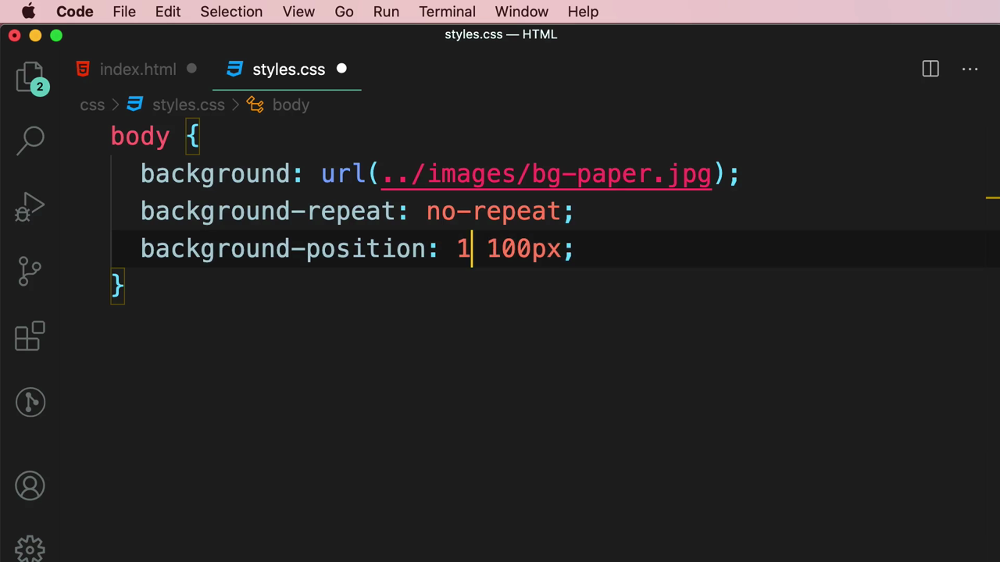

### 3.3 ค่าเปอร์เซ็นต์ผสมกับพิกเซล

```css
background-position: 100% 100px;
```

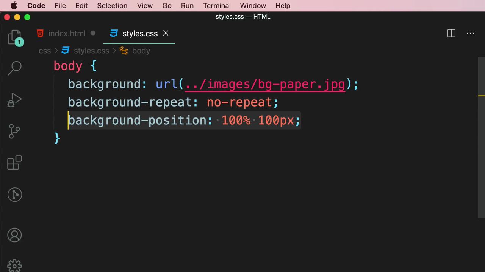

ผลลัพธ์: `100%` ในแกน X หมายถึง**ชิดขอบขวาสุด**พอดี (ไม่ใช่ระยะทาง 100% ของความกว้างภาพ แต่คำนวณจากพื้นที่ว่างที่เหลือระหว่างภาพกับ container) ส่วนแกน Y ยังคงเป็น 100px จากขอบบน:

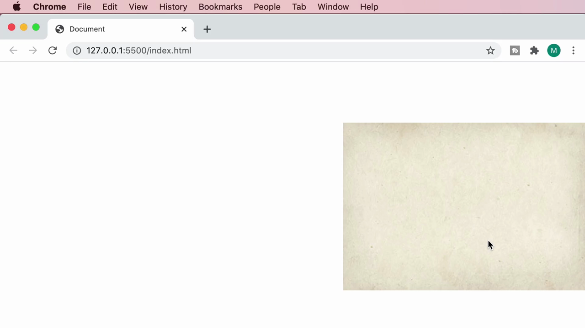

> **หลักการสำคัญของค่าเปอร์เซ็นต์ใน `background-position`:** `0%` หมายถึงชิดขอบซ้าย/บน, `100%` หมายถึงชิดขอบขวา/ล่าง, `50%` หมายถึงกึ่งกลาง — คำนวณจากพื้นที่ว่างที่เหลือ (container ลบด้วยขนาดภาพ) ไม่ใช่ขนาดของภาพเอง

---

## 4. `background-size`: กำหนดขนาดของภาพพื้นหลัง

Mosh พิมพ์ `background-size` ให้ IntelliSense แนะนำ:

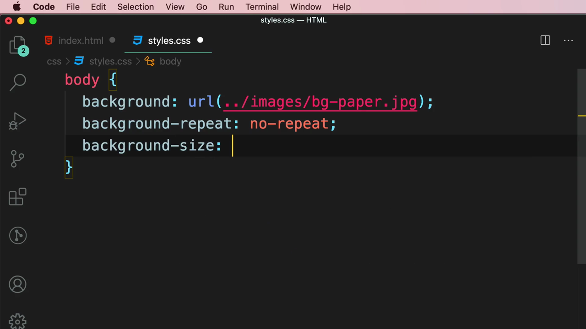

### 4.1 กำหนดขนาดตายตัว (`px px`)

```css
background-size: 200px 200px;
```

ภาพถูกบังคับให้มีขนาด 200×200 พิกเซลพอดี (อาจทำให้สัดส่วนภาพผิดเพี้ยนถ้าไม่ตรงกับอัตราส่วนจริง):

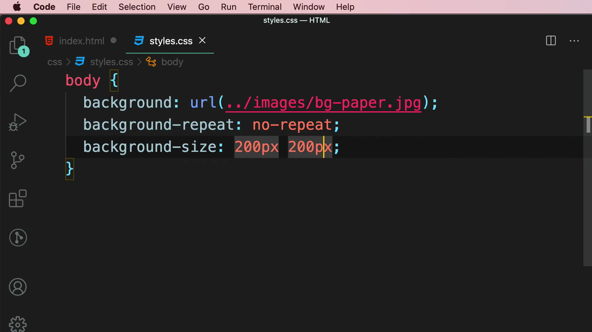
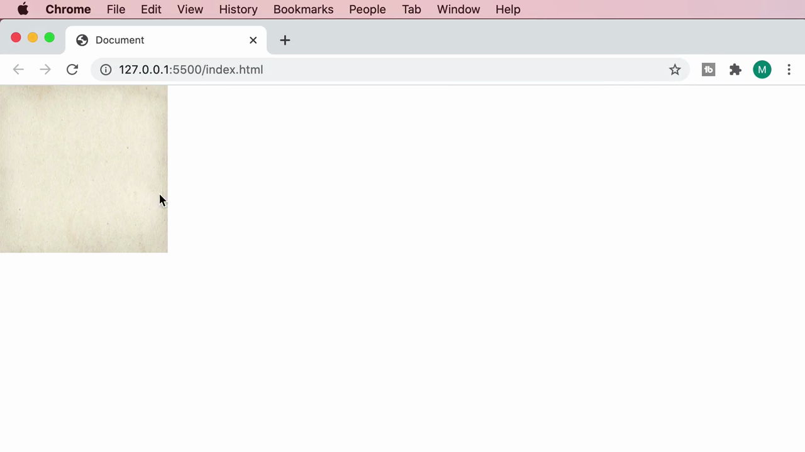

### 4.2 ผสมเปอร์เซ็นต์กับพิกเซล

```css
background-size: 100% 200px;
```

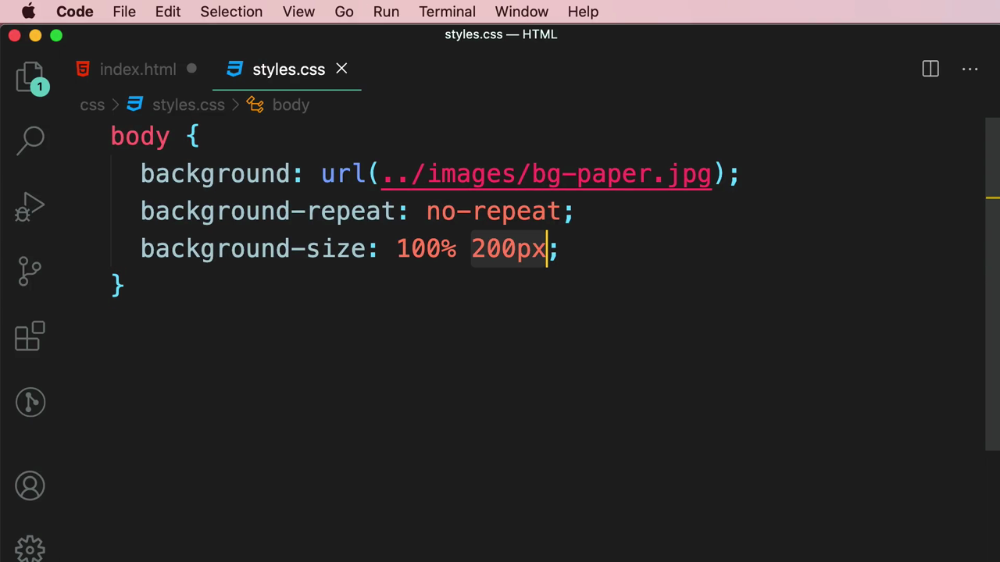

### 4.3 เปอร์เซ็นต์ทั้งสองแกน (พร้อม `height: 100vh`)

```css
body {
  background: url(../images/bg-paper.jpg);
  background-repeat: no-repeat;
  background-size: 100% 100%;
  height: 100vh;
}
```

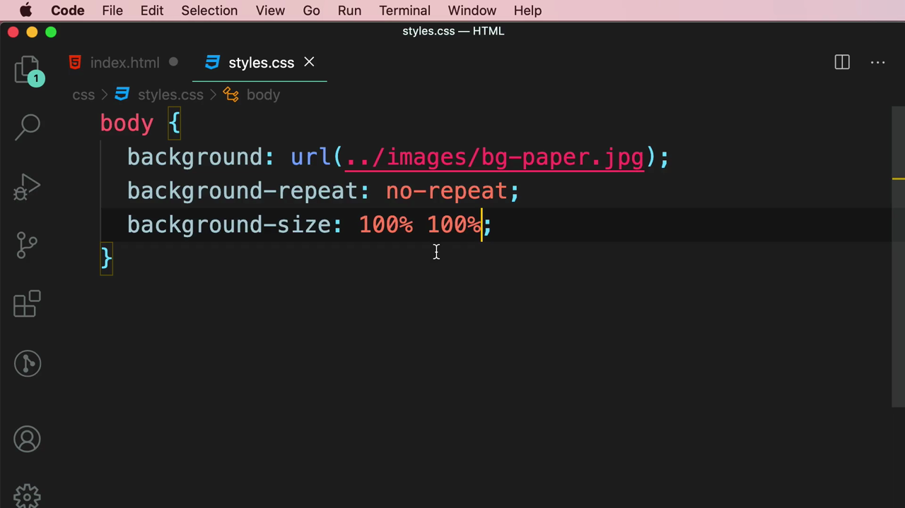

ผลลัพธ์: ภาพถูกยืด/บีบให้พอดีกับทั้งความกว้างและความสูงของ container พอดี (`100vh` ทำให้ `body` สูงเท่าจอ) — แต่สัดส่วนภาพอาจผิดเพี้ยนถ้าอัตราส่วนของ container ไม่ตรงกับภาพต้นฉบับ:

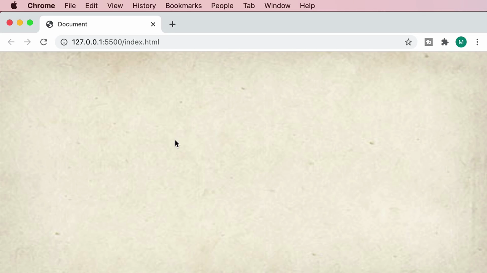

### 4.4 ค่าพิเศษ `cover` — คำตอบที่ดีที่สุดสำหรับ Hero Background

```css
background-size: cover;
```

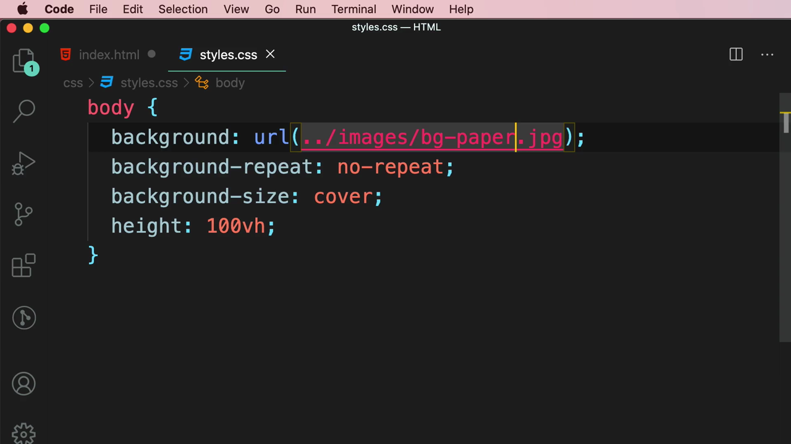

ผลลัพธ์: ภาพขยาย/ย่อโดย**รักษาสัดส่วนเดิมไว้เสมอ** พร้อมครอบคลุมพื้นที่ทั้งหมดของ container (ส่วนที่เกินขอบเขตจะถูกครอบตัดออกไปอัตโนมัติ — ไม่มีพื้นที่ว่างเหลือ ไม่มีภาพยืดเพี้ยน):

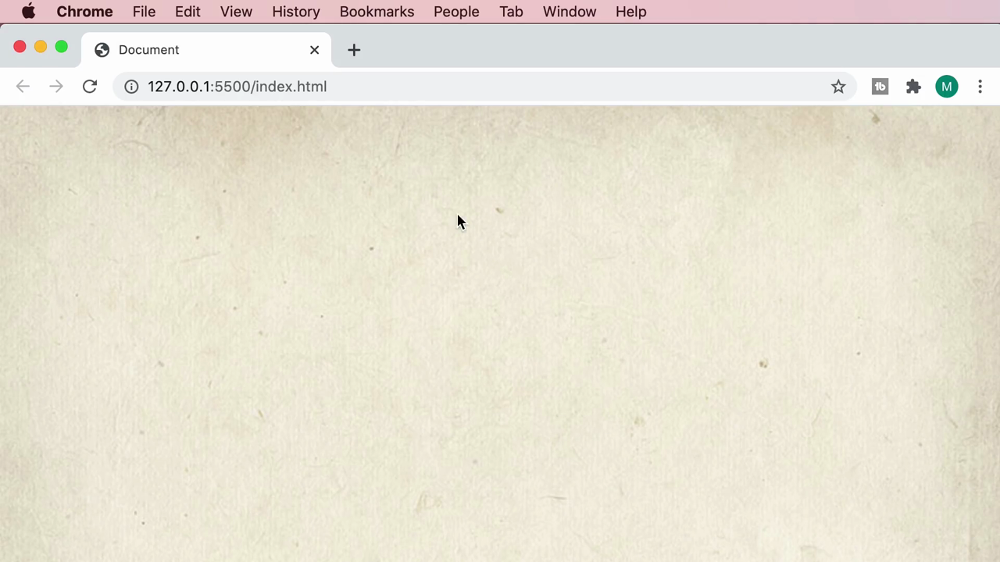

จากนั้น Mosh เปลี่ยนภาพเป็น `bg-sanfrancisco.jpg` (ภาพถ่ายสะพาน Golden Gate) เพื่อให้เห็นผลของ `cover` กับภาพถ่ายจริงที่สวยงามชัดเจนยิ่งขึ้น:

```css
background: url(../images/bg-sanfrancisco.jpg);
```

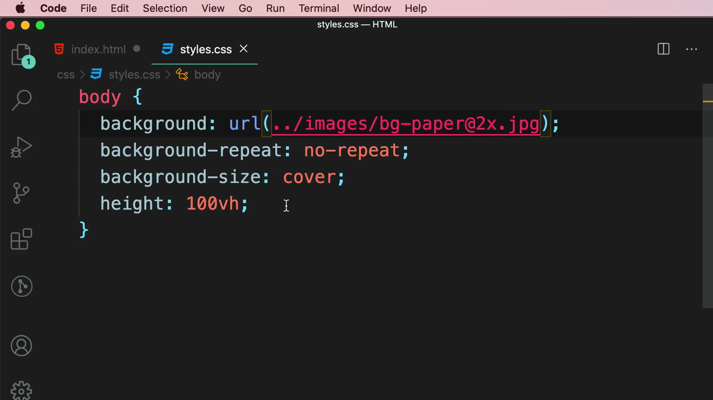
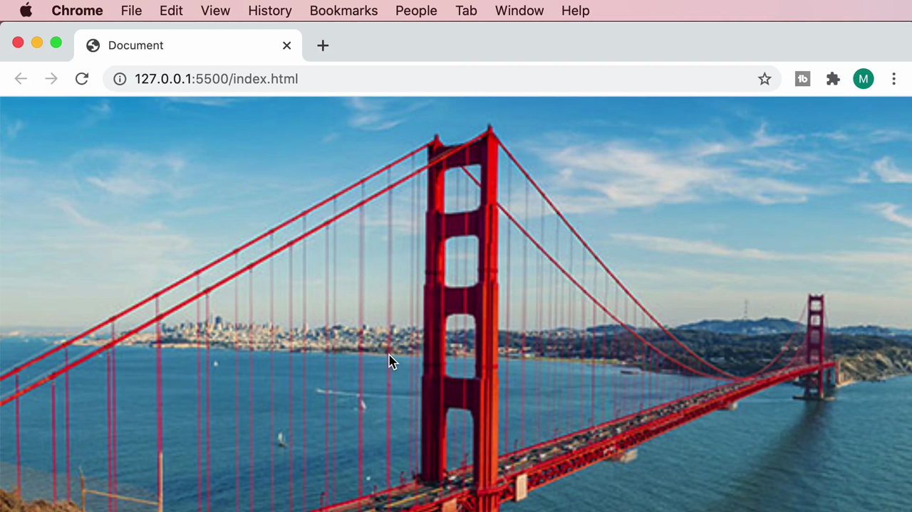

> **`cover` คือค่าที่ใช้บ่อยที่สุดในโลกจริงสำหรับภาพพื้นหลังแบบ hero section** เพราะรับประกันว่าภาพจะเต็มพื้นที่เสมอโดยไม่มีพื้นที่ว่างเหลือ (ต่างจาก `contain` ซึ่งจะแสดงภาพทั้งหมดโดยอาจเหลือพื้นที่ว่าง — ไม่ได้สาธิตในคลิปนี้แต่ควรรู้จักไว้)

---

## 5. เพิ่มข้อความทับบนภาพพื้นหลัง (Hero Section ทั่วไป)

Mosh เพิ่ม `<h1>My Heading</h1>` ลงใน `<body>` ของ `index.html`:

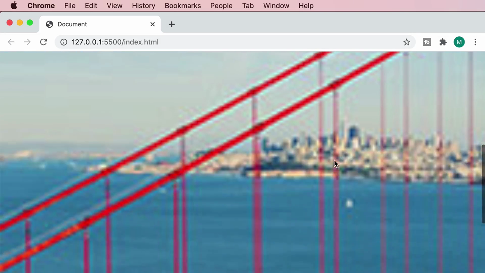

ผลลัพธ์: ข้อความหัวข้อปรากฏซ้อนทับอยู่บนภาพพื้นหลัง มุมบนซ้ายของหน้า — เป็นรูปแบบพื้นฐานของ hero section ที่พบได้ทั่วไปในเว็บไซต์จริง (ภาพพื้นหลังเต็มจอ + ข้อความ/ปุ่มซ้อนทับด้านบน):

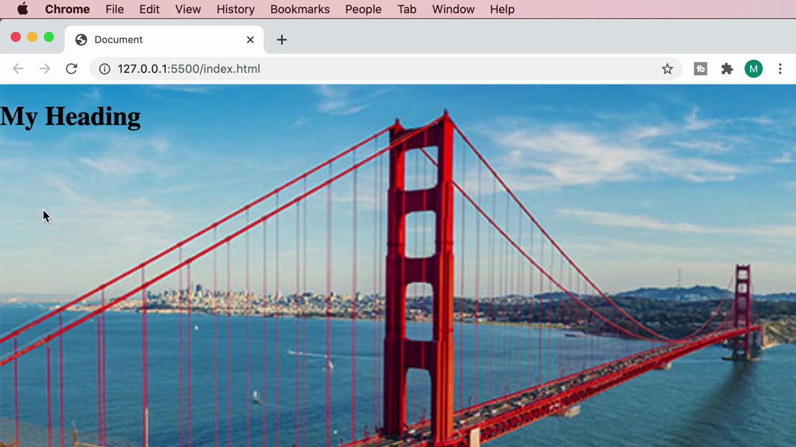

---

## 6. ข้อควรระวังของ `cover`: ภาพเบลอเมื่อ container สูงเกินไป

Mosh ทดลองเปลี่ยน `height` จาก `100vh` เป็น `300vh` (สูงกว่าจอถึง 3 เท่า) โดยยังคง `background-size: cover;` ไว้:

```css
body {
  background: url(../images/bg-sanfrancisco.jpg);
  background-repeat: no-repeat;
  background-size: cover;
  height: 300vh;
}
```

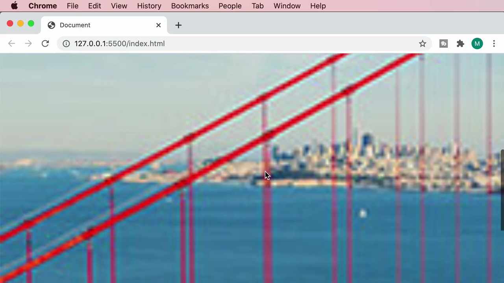

ผลลัพธ์: เมื่อเลื่อนหน้าจอลงมา ภาพเริ่ม**เบลอ/แตกเป็นพิกเซล**อย่างเห็นได้ชัด:

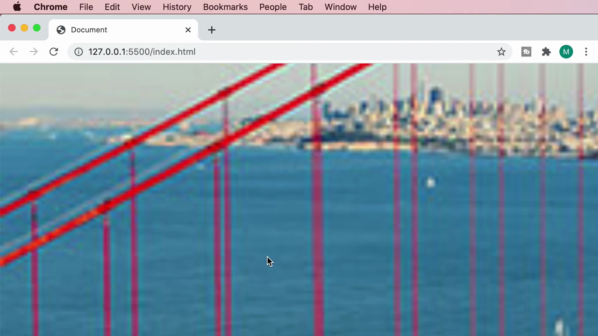

> **สาเหตุของปัญหา:** เพราะ `cover` ต้องขยายภาพให้ครอบคลุมพื้นที่ทั้งหมดของ container (ซึ่งตอนนี้สูงถึง 300vh) เมื่อ container มีอัตราส่วนที่แตกต่างจากภาพต้นฉบับมาก เบราว์เซอร์จำเป็นต้อง**ขยายภาพเกินขนาดพิกเซลจริงของไฟล์** ทำให้คุณภาพลดลงจนเห็นเป็นภาพเบลอ/แตก

---

## 7. `background-attachment: fixed` — แก้ปัญหาและสร้างเอฟเฟกต์ Parallax

Mosh พิมพ์ property ใหม่ `background-attachment` ให้ IntelliSense แนะนำค่าที่เป็นไปได้ (`fixed`, `local`, `scroll`, `inherit`, `initial`, `unset`):

```css
background-attachment: fixed;
```

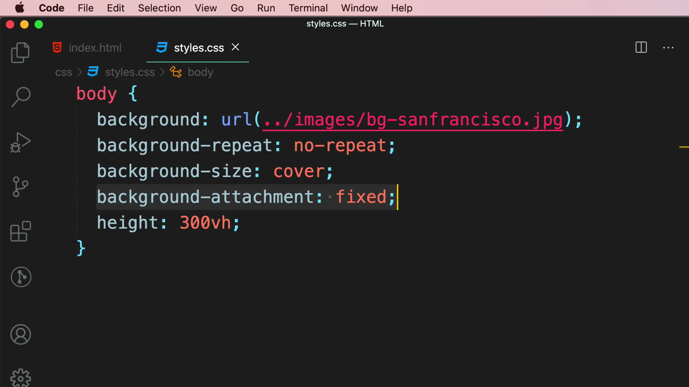

ผลลัพธ์: เมื่อเลื่อนหน้าจอลง ภาพพื้นหลัง**อยู่นิ่งกับที่ (fixed) เทียบกับหน้าจอ ไม่เลื่อนตามเนื้อหา** — และที่สำคัญคือภาพกลับมา**คมชัดไม่เบลออีกต่อไป** เพราะตอนนี้เบราว์เซอร์คำนวณขนาด `cover` โดยอิงจาก**ขนาดของ viewport** (ซึ่งคงที่) แทนที่จะอิงจากความสูงทั้งหมดของ `body` ที่ยาวถึง 300vh:

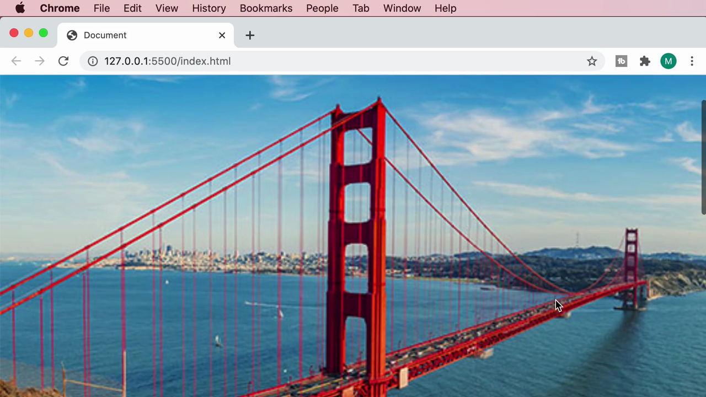

> **`background-attachment: fixed` คือเทคนิคเบื้องหลังเอฟเฟกต์ที่เรียกว่า "Parallax Scrolling"** ที่พบเห็นได้บ่อยในเว็บไซต์สมัยใหม่ — ภาพพื้นหลังอยู่นิ่งกับที่ ในขณะที่เนื้อหาด้านหน้าเลื่อนผ่านไป สร้างความรู้สึกมีมิติ (depth) ให้กับหน้าเว็บ และยังช่วยแก้ปัญหาภาพเบลอจาก `cover` ในกรณีที่ container สูงมากๆ ไปในตัวด้วย

---

## สรุปภาพรวมของคลิปนี้

| Property | หน้าที่ | ค่าที่สาธิต |
|---|---|---|
| `background` / `background-image` | กำหนดไฟล์ภาพพื้นหลังด้วย `url()` | `url(../images/bg-paper.jpg)` |
| `background-repeat` | ควบคุมการปูซ้ำ | `repeat` (default), `repeat-x`, `repeat-y`, `no-repeat` |
| `background-position` | กำหนดตำแหน่งภาพ | ค่าพิกเซล, ค่าติดลบ, ค่าเปอร์เซ็นต์ |
| `background-size` | กำหนดขนาดภาพ | พิกเซลตายตัว, เปอร์เซ็นต์, `cover` |
| `background-attachment` | ควบคุมพฤติกรรมขณะเลื่อนหน้าจอ | `fixed` (parallax) |

**แนวคิดสำคัญที่ได้จากคลิปนี้:**

1. **`background-size: cover` คือค่าที่ควรใช้เป็นค่าเริ่มต้นสำหรับภาพพื้นหลังแบบเต็มจอ (hero image)** เพราะรักษาสัดส่วนภาพและเติมเต็มพื้นที่เสมอโดยไม่มีพื้นที่ว่างเหลือ
2. **ระวังปัญหาภาพเบลอเมื่อใช้ `cover` กับ container ที่มีอัตราส่วนต่างจากภาพต้นฉบับมาก** โดยเฉพาะ container ที่สูงมากๆ
3. **`background-attachment: fixed` แก้ปัญหาภาพเบลอและสร้างเอฟเฟกต์ parallax ไปพร้อมกัน** เพราะเปลี่ยนกรอบอ้างอิงของ `cover` จากขนาด container ทั้งหมด มาเป็นขนาด viewport ที่มองเห็นจริง
4. **สูตรพื้นฐานสำหรับทำ Hero Section ด้วย CSS ล้วน** คือการรวม 4 property เข้าด้วยกัน: `background: url(...)`, `background-repeat: no-repeat`, `background-size: cover`, และ `height: 100vh` (หรือมากกว่า พร้อม `background-attachment: fixed`)
5. **ค่าเปอร์เซ็นต์ใน `background-position` คำนวณจากพื้นที่ว่างที่เหลือ** ไม่ใช่ขนาดของภาพหรือ container โดยตรง — ต้องเข้าใจหลักการนี้เพื่อจัดตำแหน่งภาพได้อย่างแม่นยำ

---

*หมายเหตุ: คลิปนี้เป็นส่วนหนึ่งของบท "4-Images" จากคอร์ส The Ultimate HTML and CSS Course โดย Mosh Hamedani (codewithmosh.com) — คลิปที่ 4 ของบทนี้*
