# 4-Images: 05 - CSS Sprites (7:24)

**ไฟล์ต้นทาง:** `5-CSS_Sprites.mp4`

▶️ **[เปิดวิดีโอต้นฉบับ](../../../HTML-CSS-2/4-Images/5-CSS_Sprites.mp4)**

---

## ภาพรวมคลิปนี้

คลิปนี้สอนเทคนิค **CSS Sprites** — วิธีการรวมไอคอน/ภาพขนาดเล็กหลายภาพเข้าเป็น**ไฟล์ภาพเดียว** แล้วใช้ CSS ควบคุมให้แสดงเฉพาะส่วนที่ต้องการ เพื่อลดจำนวน HTTP request ที่เบราว์เซอร์ต้องส่งไปขอไฟล์ภาพจากเซิร์ฟเวอร์ ซึ่งช่วยเพิ่มความเร็วในการโหลดหน้าเว็บ

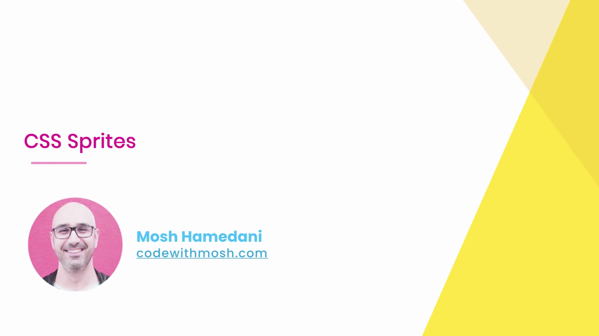

---

## 1. ปัญหาที่ CSS Sprites แก้ไข: ไอคอนหลายไฟล์ = หลาย Request

Mosh เริ่มต้นด้วยการเปิดเว็บไซต์ **flaticon.com** ซึ่งเป็นแหล่งดาวน์โหลดไอคอนแบบ vector ฟรีที่มีให้เลือกมากกว่า 3.7 ล้านไอคอน (เพื่อเป็นตัวอย่างแหล่งที่มาของไอคอนที่จะใช้ในคลิปนี้):

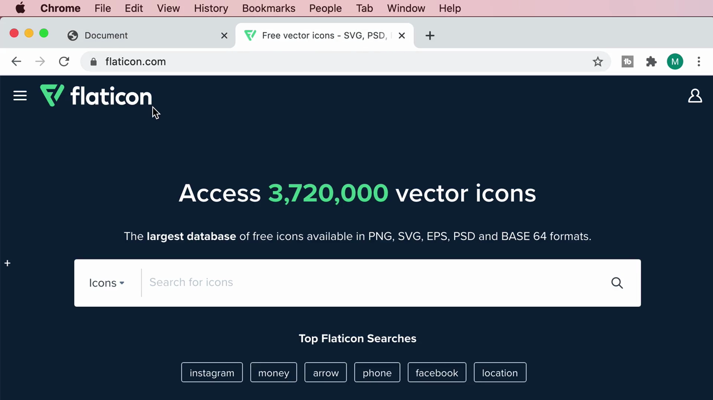

จากนั้นเพิ่ม `` จำนวน 5 รูป (ไอคอนธีมอวกาศ: จานดาวเทียม, ร่มชูชีพ, จรวด, ดาวเสาร์, ยูเอฟโอ) ลงในหน้าเว็บ:

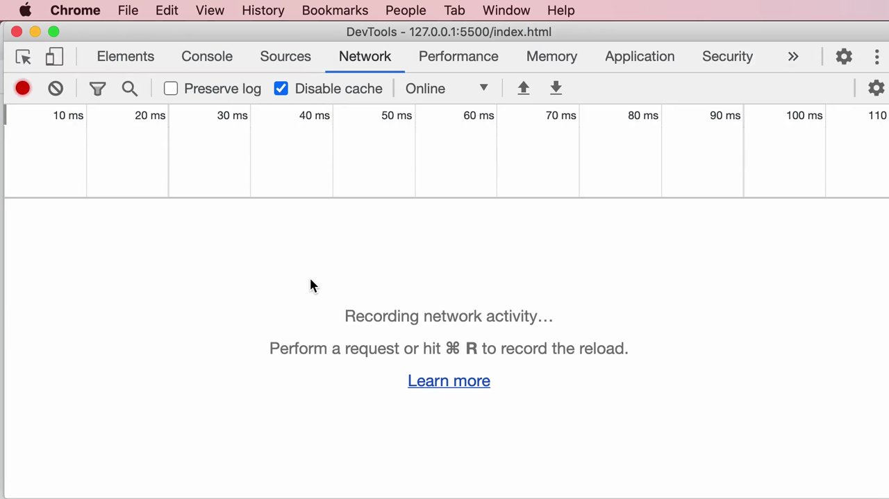

### 1.1 ตรวจสอบจำนวน Request ด้วย DevTools Network Tab

Mosh เปิด DevTools แท็บ **Network** เพื่อดูว่าเบราว์เซอร์ส่ง HTTP request ไปกี่ครั้งเมื่อโหลดหน้านี้:

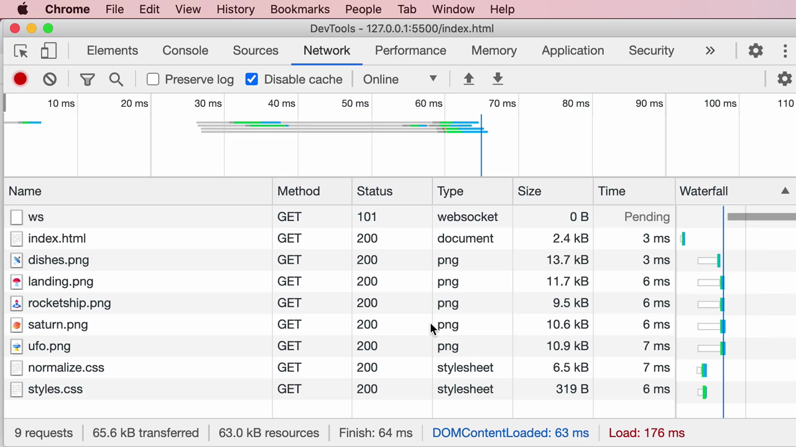

รีเฟรชหน้าเว็บแล้วดูรายการ request ทั้งหมด:

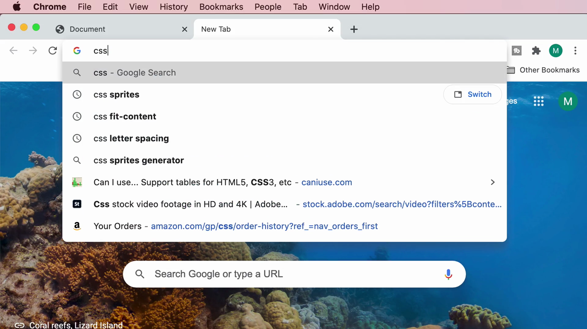

กรองด้วยปุ่ม **Img** เพื่อดูเฉพาะ request ที่เป็นรูปภาพ:

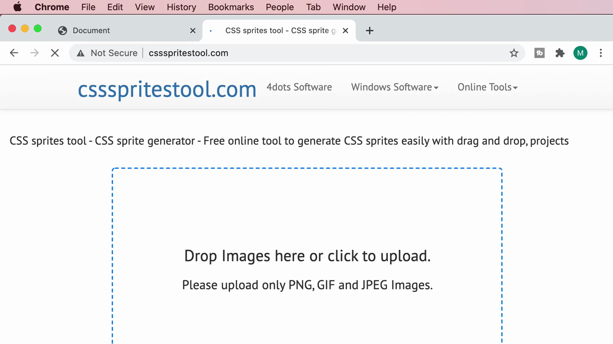

> **ปัญหาที่เห็นชัดเจน:** ไอคอน 5 ไฟล์ (`dishes.png`, `landing.png`, `rocketship.png`, `saturn.png`, `ufo.png`) ทำให้เกิด **5 HTTP request แยกกัน** แต่ละ request มี overhead ของตัวเอง (การเชื่อมต่อ, DNS lookup, handshake ฯลฯ) ยิ่งมีไอคอนเยอะ ยิ่งมี request เยอะ ยิ่งทำให้หน้าเว็บโหลดช้าลง โดยเฉพาะบนเครือข่ายที่ความเร็วต่ำ

---

## 2. สร้าง CSS Sprite ด้วยเครื่องมือออนไลน์

### 2.1 ค้นหาเครื่องมือสร้าง Sprite

Mosh เปิดแท็บใหม่และค้นหา **"css sprites generator"** ใน Google:

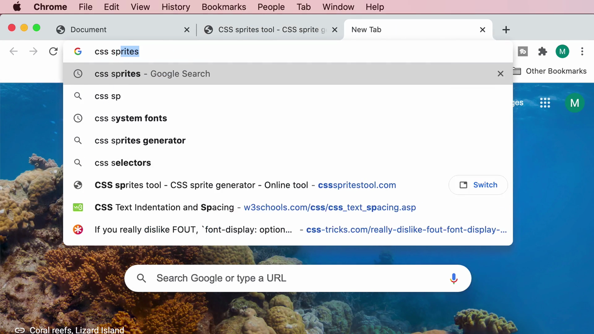

### 2.2 อัปโหลดไอคอนทั้ง 5 ไฟล์

เลือกใช้เว็บไซต์ **csssspritestool.com** ซึ่งเป็นเครื่องมือฟรีที่รองรับการลาก-วางไฟล์ภาพเข้าไปรวมเป็น Sprite:

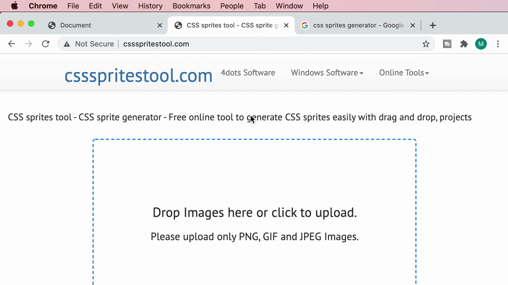

ลากไฟล์ไอคอนทั้ง 5 ไฟล์เข้าไปในกล่องอัปโหลด:

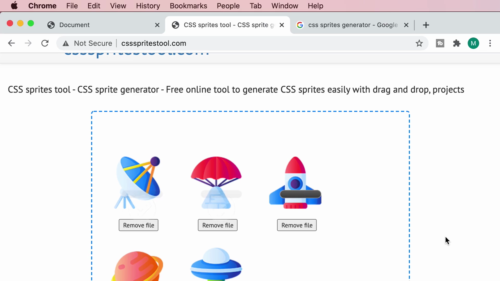

### 2.3 ตั้งค่าตัวเลือกก่อนสร้าง Sprite

เลื่อนลงมาดูตัวเลือกการตั้งค่า:

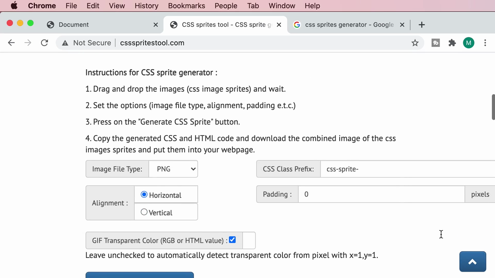

> **ตัวเลือกสำคัญ:**
> - **Image File Type:** PNG (รองรับพื้นหลังโปร่งใส)
> - **Alignment:** Horizontal (เรียงไอคอนตามแนวนอน) หรือ Vertical (แนวตั้ง)
> - **Padding:** ระยะห่างระหว่างไอคอนแต่ละตัวในภาพรวม (ตั้งเป็น 0)
> - **CSS Class Prefix:** คำนำหน้าที่จะใช้ตั้งชื่อคลาส CSS ให้กับแต่ละไอคอน

Mosh เปลี่ยนค่า **CSS Class Prefix** จากค่าเริ่มต้น `css-sprite-` เป็น **`bg-`** (สั้นและสื่อความหมายว่าเป็น background):

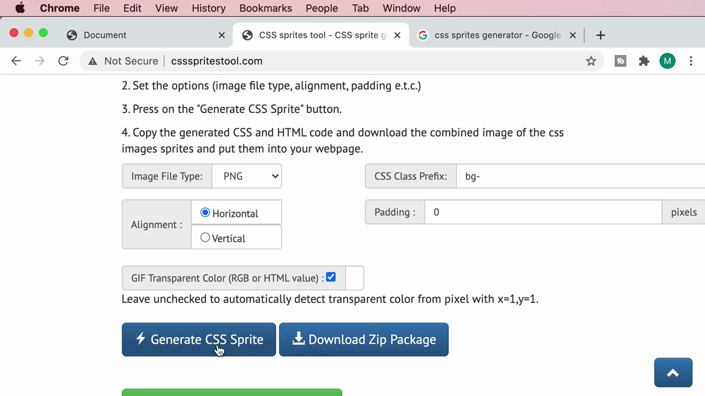

กดปุ่ม **"Generate CSS Sprite"** แล้วดาวน์โหลดไฟล์ที่ได้:

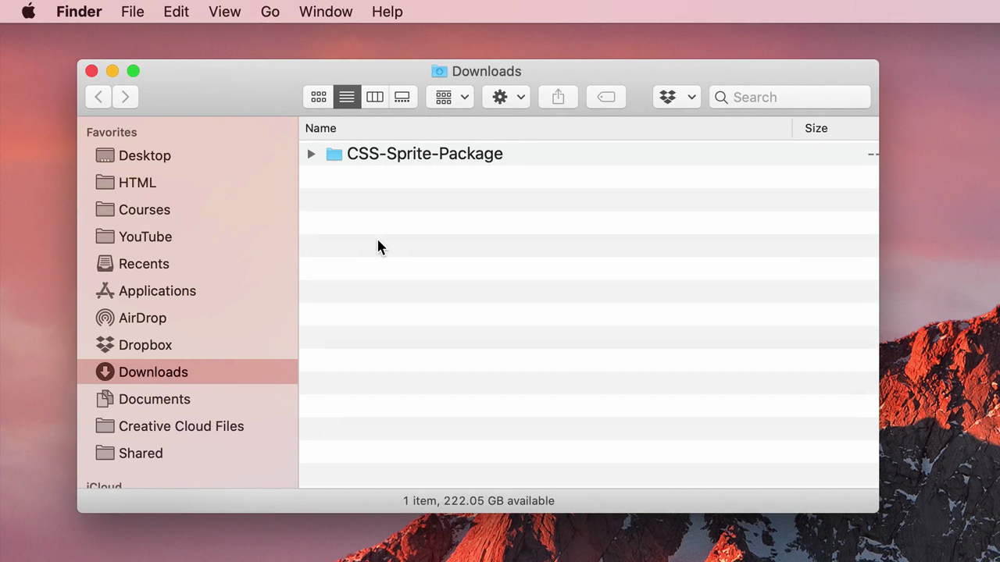

เปิดดูไฟล์ทั้งหมดในแพ็กเกจที่ดาวน์โหลดมา:

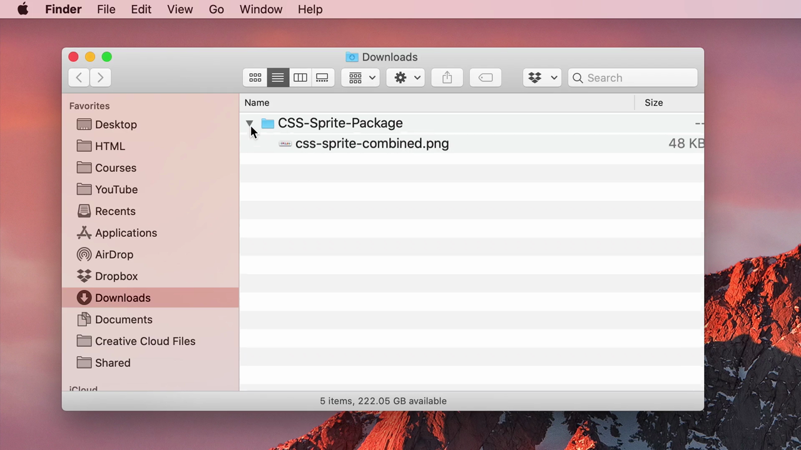

> ไฟล์ที่ได้: `css-sprite-combined.png` (ไฟล์ภาพรวมที่รวมทั้ง 5 ไอคอนไว้ในไฟล์เดียว), `css-sprites.css` (CSS ที่สร้างให้อัตโนมัติ), `css-sprites-demo.html` (ตัวอย่างการใช้งาน), `Project.cssproj.zip`

เปิดดูไฟล์ `css-sprite-combined.png` — เห็นว่าไอคอนทั้ง 5 ถูกวางเรียงต่อกันในแนวนอนภายในไฟล์ภาพเดียว:

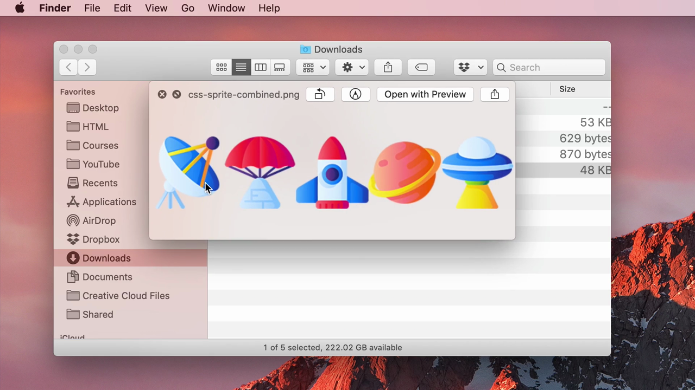

---

## 3. นำ Sprite ที่สร้างไว้มาใช้ในโปรเจกต์

### 3.1 ลากไฟล์ภาพรวมเข้าโปรเจกต์

ลากไฟล์ `css-sprite-combined.png` จาก Finder เข้าไปในโฟลเดอร์ `images` ของโปรเจกต์:

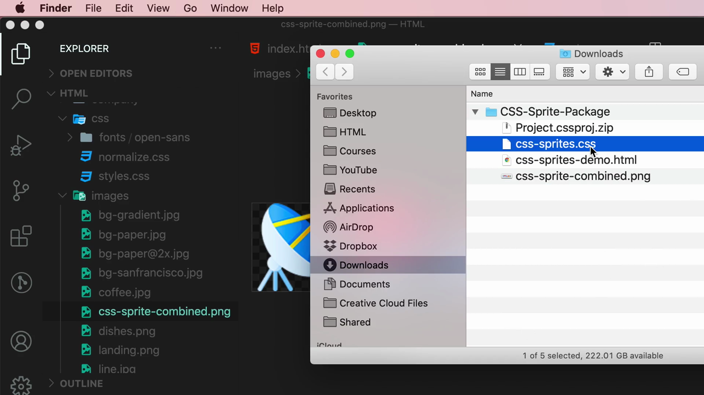

### 3.2 ดูโครงสร้างของ CSS ที่ถูกสร้างอัตโนมัติ

เปิดไฟล์ `css-sprites.css` ที่ได้จากเครื่องมือ ดูโครงสร้างของแต่ละคลาส:

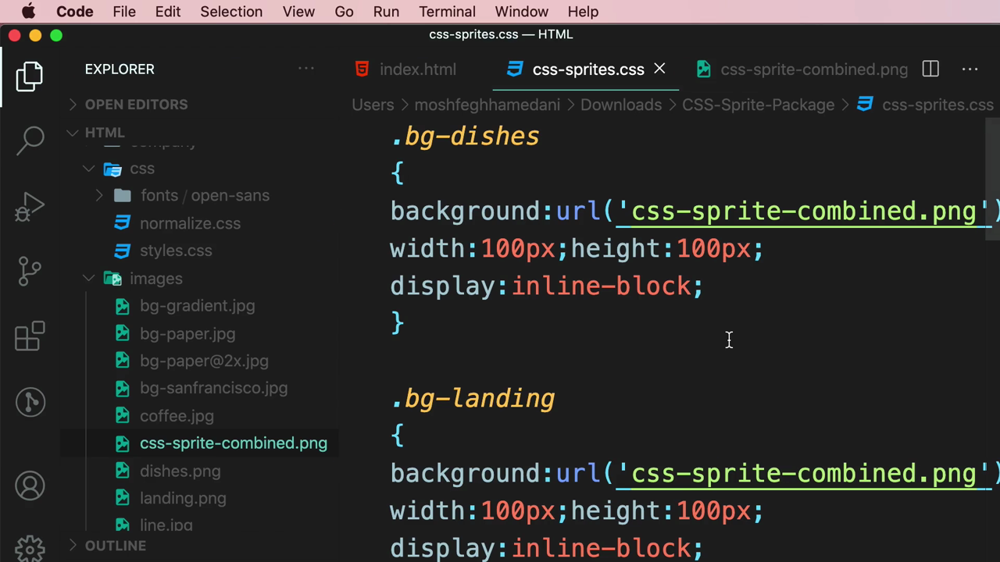

```css
.bg-dishes {
  background: url('css-sprite-combined.png') 0px -0px;
  width: 100px;
  height: 100px;
  display: inline-block;
}
```

Mosh อธิบายรูปแบบของค่า `background` แบบ shorthand ที่มีตัวเลขสองค่าต่อท้าย `url()`:

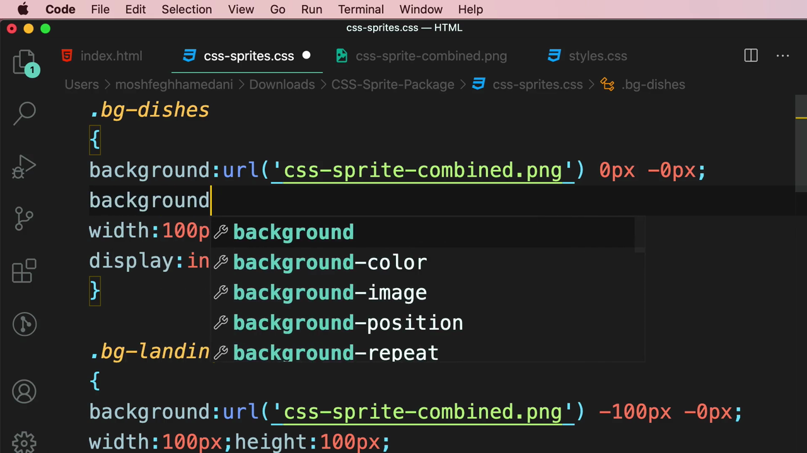

> **หลักการทำงานของ CSS Sprite:** ตัวเลขสองค่าหลัง `url()` คือค่า **`background-position`** (แกน X และ Y ตามลำดับ) ที่บอกให้เบราว์เซอร์**เลื่อนภาพพื้นหลังไปด้านซ้าย/ขึ้นด้านบน** เพื่อให้เฉพาะส่วนของไอคอนที่ต้องการปรากฏอยู่ในกรอบที่กำหนดด้วย `width`/`height` (100×100px) เท่านั้น — ส่วนที่เหลือของภาพรวมจะถูกซ่อนไว้นอกกรอบมองไม่เห็น

ดูคลาสของไอคอนตัวอื่นๆ ที่ถูกสร้างต่อเนื่องกัน — สังเกตว่าค่าตำแหน่งแกน X ขยับไปทีละ 100px ตามลำดับไอคอนในภาพรวม:

```css
.bg-landing    { background: url('css-sprite-combined.png') -100px -0px; ... }
.bg-rocketship { background: url('css-sprite-combined.png') -200px -0px; ... }
.bg-saturn     { background: url('css-sprite-combined.png') -300px -0px; ... }
.bg-ufo        { background: url('css-sprite-combined.png') -400px -0px; ... }
```

### 3.3 คัดลอก CSS ทั้งหมดไปไว้ในโปรเจกต์จริง

คัดลอก CSS ทั้ง 5 คลาสไปวางไว้ใน `styles.css` ของโปรเจกต์:

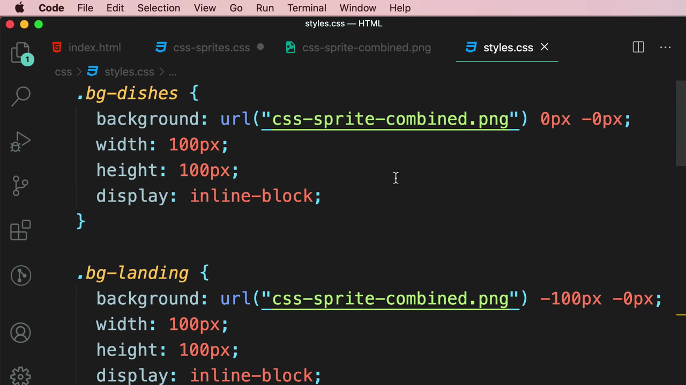

แก้ไข path ของ `url()` ให้ถูกต้องตามตำแหน่งจริงของไฟล์ (เติม `../` เพราะ `styles.css` อยู่ในโฟลเดอร์ `css/`):

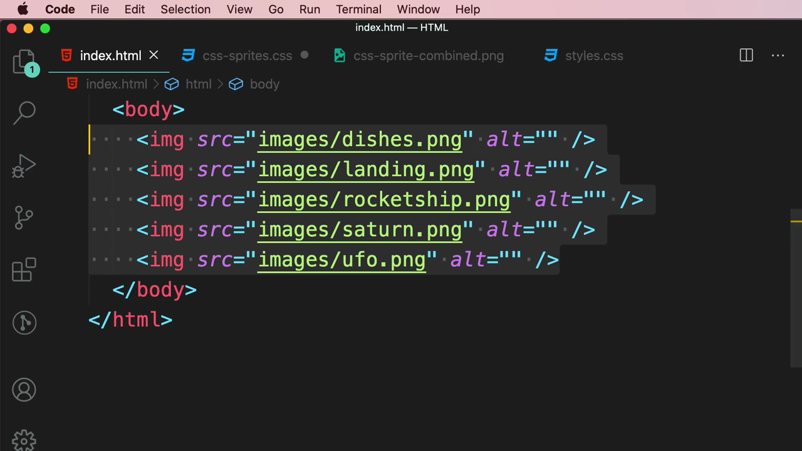

เปิดดูภาพรวมของไฟล์ sprite อีกครั้งในตัว preview ของ VS Code เพื่อยืนยันว่าไฟล์ถูกต้อง:

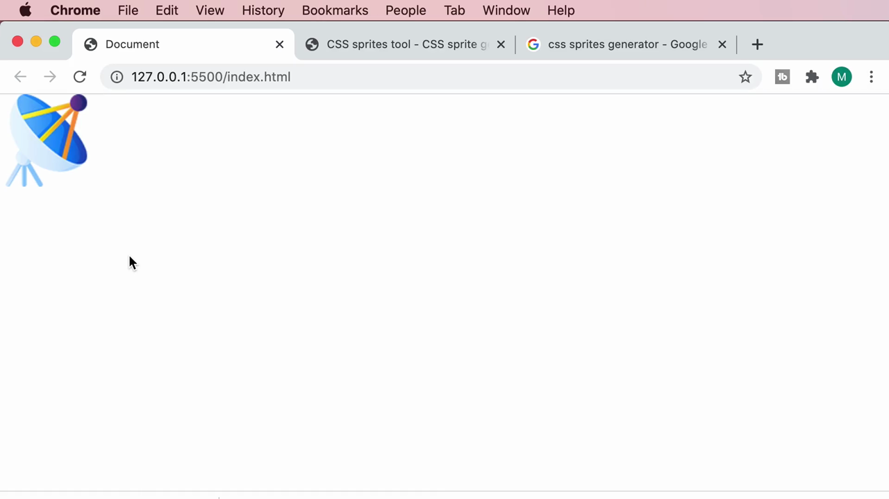

### 3.4 เปลี่ยนจาก `` เป็น `<span>` + `class`

แทนที่จะใช้ `` แบบเดิม Mosh เปลี่ยนมาใช้ `<span>` เปล่าที่มี `class` ตรงกับชื่อไอคอนที่ต้องการ:

```html
<span class="bg-dishes"></span>
<span class="bg-landing"></span>
<span class="bg-rocketship"></span>
<span class="bg-saturn"></span>
<span class="bg-ufo"></span>
```

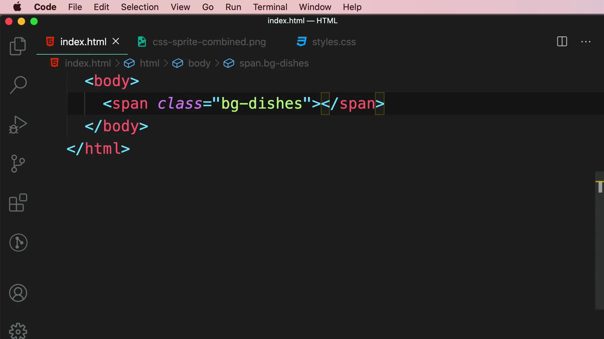

> **ทำไมต้องใช้ `<span>` แทน ``:** เพราะตอนนี้ภาพไม่ได้มาจาก attribute `src` ของ `` อีกต่อไป แต่มาจาก `background` ใน CSS ผ่านคลาสที่กำหนด — จึงใช้ element เปล่าอย่าง `<span>` (พร้อม `display: inline-block;` เพื่อให้กำหนด `width`/`height` ได้) แทน

---

## 4. ผลลัพธ์: ภาพเหมือนเดิม แต่เหลือแค่ 1 Request

รีเฟรชหน้าเว็บ — ไอคอนทั้ง 5 ยังคงแสดงผลถูกต้องเหมือนเดิมทุกประการ:

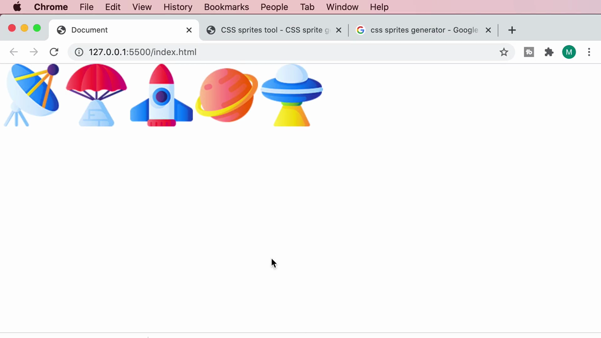

ตรวจสอบ Network tab อีกครั้ง:

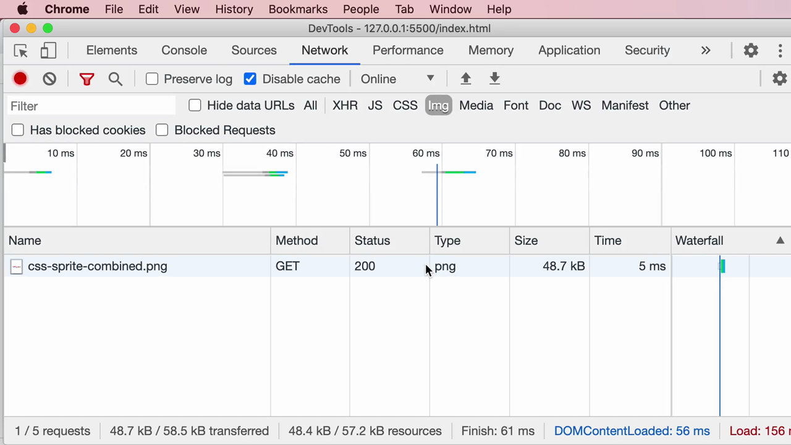

> **ผลลัพธ์ที่สำคัญที่สุดของคลิปนี้:** จากเดิมที่มี **5 HTTP request แยกกัน** (หนึ่งต่อหนึ่งไอคอน) ตอนนี้เหลือเพียง **1 request เดียว** (`css-sprite-combined.png`) สำหรับไอคอนทั้ง 5 ตัว — ลดจำนวน request ลงถึง 80% โดยที่ผลลัพธ์ภาพที่ผู้ใช้เห็นไม่เปลี่ยนแปลงเลย

---

## 5. ข้อจำกัดของ CSS Sprites

ก่อนจบคลิป Mosh พูดถึงข้อเสียของเทคนิคนี้ที่ควรพิจารณา:

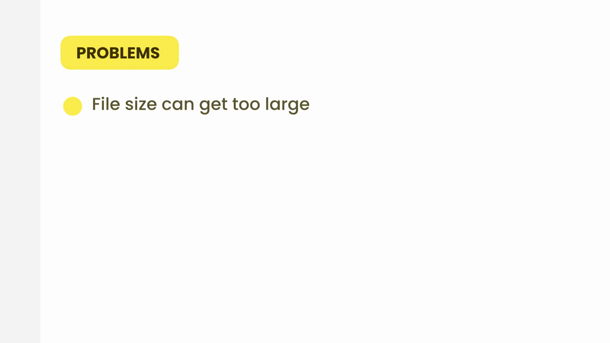

> **ปัญหา (Problems):**
> - **File size can get too large (ขนาดไฟล์อาจใหญ่เกินไป):** เมื่อรวมไอคอนจำนวนมากเข้าไว้ในไฟล์เดียว ไฟล์ภาพรวมอาจมีขนาดใหญ่ขึ้นเรื่อยๆ ซึ่งแม้จะลดจำนวน request แต่ก็ต้องดาวน์โหลดข้อมูลทั้งหมดในครั้งเดียว (แม้จะใช้แค่ไอคอนเดียวในหน้านั้นๆ ก็ต้องโหลดทั้งไฟล์)
> - การดูแลรักษา (maintenance) ยากขึ้นเมื่อไอคอนมีจำนวนมากหรือเปลี่ยนแปลงบ่อย เพราะต้องสร้าง sprite ใหม่และคำนวณตำแหน่งใหม่ทุกครั้ง

---

## สรุปภาพรวมของคลิปนี้

| หัวข้อ | รายละเอียด |
|---|---|
| **ปัญหาที่แก้** | หลายไฟล์ภาพ = หลาย HTTP request = โหลดหน้าเว็บช้า |
| **วิธีแก้** | รวมภาพหลายไฟล์เป็นไฟล์เดียว (sprite sheet) แล้วใช้ `background-position` เลือกแสดงเฉพาะส่วนที่ต้องการ |
| **เครื่องมือ** | เว็บไซต์สร้าง CSS Sprite ออนไลน์ (เช่น csssspritestool.com) |
| **HTML ที่ใช้** | `<span class="...">` แทน `` |
| **CSS ที่ใช้** | `background: url(...) Xpx Ypx;`, `width`, `height`, `display: inline-block;` |
| **ผลลัพธ์** | ลด HTTP request จาก 5 เหลือ 1 โดยภาพที่แสดงผลเหมือนเดิมทุกประการ |
| **ข้อเสีย** | ไฟล์ภาพรวมอาจมีขนาดใหญ่, ดูแลรักษายากขึ้นเมื่อไอคอนเปลี่ยนแปลงบ่อย |

**แนวคิดสำคัญที่ได้จากคลิปนี้:**

1. **CSS Sprites เป็นเทคนิคเพื่อ performance โดยเฉพาะ** ไม่ได้เปลี่ยนสิ่งที่ผู้ใช้เห็นเลย แต่ลดภาระการโหลดของเบราว์เซอร์อย่างมีนัยสำคัญ
2. **หลักการเบื้องหลังคือการใช้ `background-position` ร่วมกับ `width`/`height` ที่ตายตัว** เพื่อ "ครอบตัด" ให้เห็นเฉพาะส่วนของภาพรวมที่ต้องการ
3. **ไม่จำเป็นต้องคำนวณตำแหน่งเอง** เพราะมีเครื่องมือออนไลน์ที่สร้างทั้งไฟล์ภาพรวมและ CSS ให้อัตโนมัติ
4. **เทคนิคนี้เหมาะกับไอคอนขนาดเล็กจำนวนมากที่ใช้ซ้ำบ่อย** เช่น ไอคอนโซเชียลมีเดีย ไอคอนเมนู มากกว่าภาพถ่ายขนาดใหญ่
5. **ในโลกปัจจุบัน CSS Sprites เริ่มถูกแทนที่ด้วยเทคนิคใหม่ๆ** เช่น SVG icon fonts, inline SVG, หรือ HTTP/2 ที่จัดการหลาย request ได้มีประสิทธิภาพกว่าเดิม แต่ยังคงเป็นความรู้พื้นฐานที่สำคัญให้เข้าใจหลักการเบื้องหลัง

---

*หมายเหตุ: คลิปนี้เป็นส่วนหนึ่งของบท "4-Images" จากคอร์ส The Ultimate HTML and CSS Course โดย Mosh Hamedani (codewithmosh.com) — คลิปที่ 5 ของบทนี้*
