# 4-Images: 06 - Data URLs (3:40)

**ไฟล์ต้นทาง:** `6-Data_URLs.mp4`

▶️ **[เปิดวิดีโอต้นฉบับ](../../../HTML-CSS-2/4-Images/6-Data_URLs.mp4)**

---

## ภาพรวมคลิปนี้

คลิปนี้สอนเทคนิค **Data URLs** (หรือ Data URI) — วิธีการ**ฝังข้อมูลของไฟล์ภาพลงไปในโค้ด HTML/CSS โดยตรง** แทนที่จะอ้างอิงไปยังไฟล์ภาพภายนอกด้วย path ปกติ ทำให้ไม่ต้องส่ง HTTP request แยกไปขอไฟล์ภาพเลย พร้อมชี้ให้เห็นข้อดีข้อเสียของเทคนิคนี้เทียบกับ CSS Sprites ที่เรียนไปในคลิปก่อนหน้า


---

## 1. เครื่องมือแปลงภาพเป็น Data URI

Mosh เปิดเว็บไซต์ **cssportal.com/image-to-data/** ซึ่งเป็นเครื่องมือออนไลน์ฟรีสำหรับแปลงไฟล์ภาพให้เป็นข้อความ **Base64** ที่ฝังลงในโค้ดได้โดยตรง:

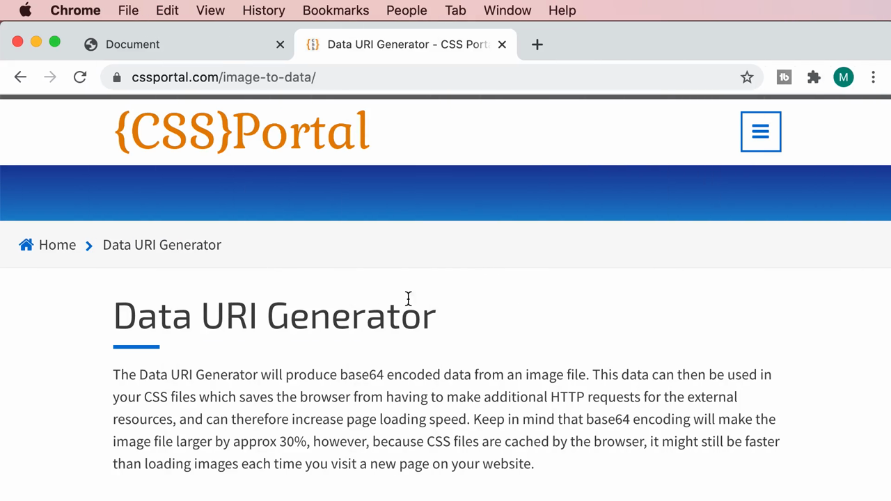

> คำอธิบายจากเว็บไซต์: *"The Data URI Generator will produce base64 encoded data from an image file. This data can then be used in your CSS files which saves the browser from having to make additional HTTP requests for the external resources... Keep in mind that base64 encoding will make the image file larger by approx 30%, however, because CSS files are cached by the browser, it might still be faster than loading images each time you visit a new page on your website."*
>
> สรุปใจความสำคัญ: การแปลงเป็น Base64 จะทำให้**ขนาดข้อมูลใหญ่ขึ้นประมาณ 30%** จากไฟล์ต้นฉบับ แต่แลกมาด้วยการไม่ต้องส่ง HTTP request แยกต่างหากสำหรับภาพนั้น

ลากไฟล์ `ufo.png` เข้าไปในกล่องอัปโหลด:

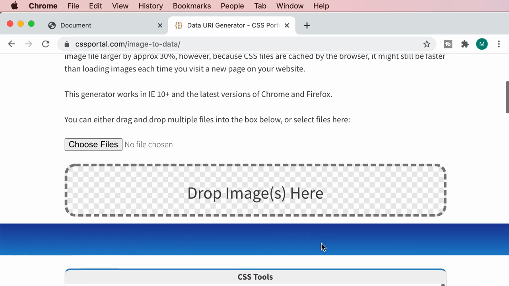

ผลลัพธ์: ระบบแสดงตัวอย่างภาพที่อัปโหลดพร้อมข้อมูลสรุป:

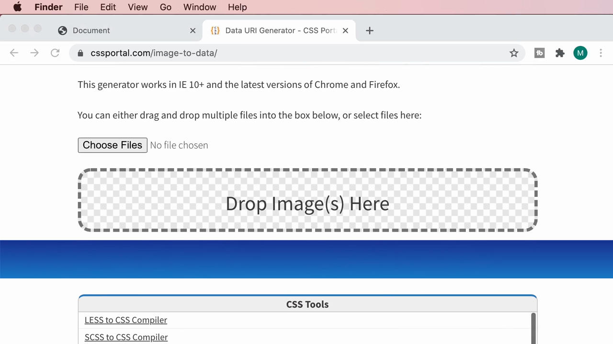

---

## 2. ผลลัพธ์การแปลง: Data URI, Image Tag, และ Background-image

เลื่อนลงมาดูข้อมูลที่ระบบสร้างให้:

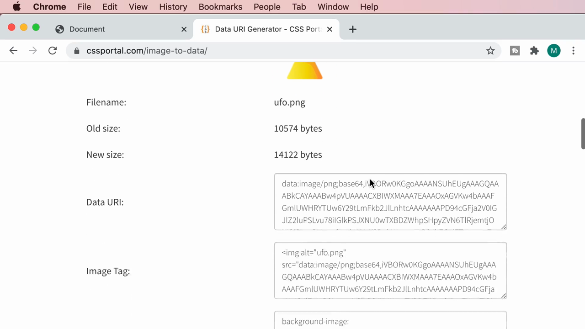

| รายการ | ค่า |
|---|---|
| **Filename** | `ufo.png` |
| **Old size (ขนาดไฟล์เดิม)** | 10,574 bytes |
| **New size (ขนาดหลังแปลงเป็น Base64)** | 14,122 bytes |
| **เพิ่มขึ้น** | ประมาณ 34% — ตรงกับที่เว็บไซต์เตือนไว้ (~30%) |

ระบบเตรียมโค้ดสำเร็จรูปไว้ 3 แบบให้เลือกคัดลอก:
1. **Data URI** — สตริง `data:image/png;base64,...` เปล่าๆ
2. **Image Tag** — แท็ก `` ที่มี `src` เป็น Data URI พร้อมใช้งานทันที
3. **background-image** — โค้ด CSS พร้อมใช้งานทันที

---

## 3. นำ Data URI มาใช้แทนไฟล์ภาพจริง

Mosh คัดลอกส่วน **Image Tag** ทั้งหมด:

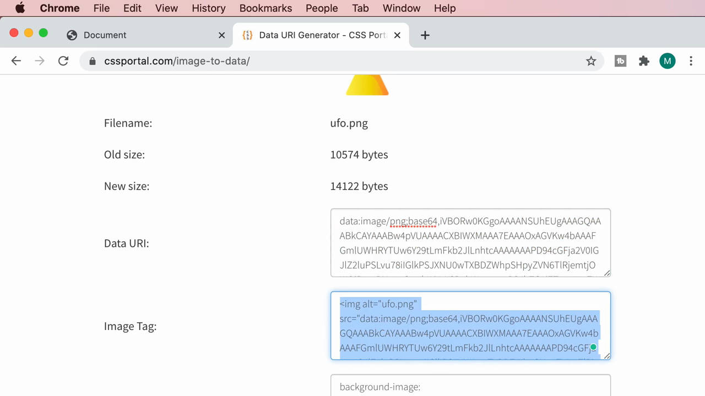

แล้ววางลงใน `index.html` โดยตรง (แทนที่จะมี `` แบบเดิม):

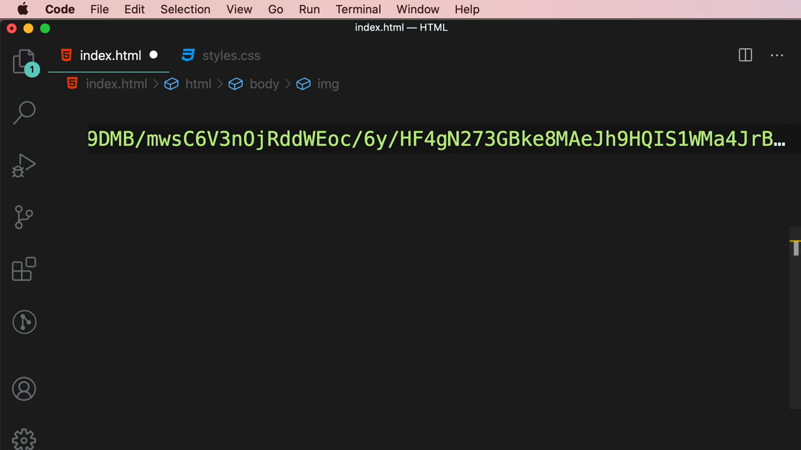

```html

```

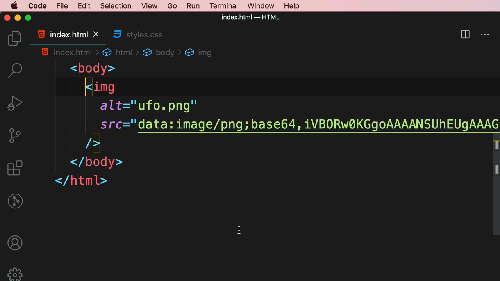

> **โครงสร้างของ Data URI:** `data:image/png;base64,<ข้อมูลภาพที่เข้ารหัสเป็น Base64>` — ส่วนแรก (`data:image/png`) บอกประเภทของข้อมูล (MIME type) ส่วน `base64` บอกวิธีเข้ารหัส และตามด้วยข้อมูลจริงของภาพทั้งหมดในรูปแบบข้อความยาวมาก

---

## 4. ผลลัพธ์ในเบราว์เซอร์: ภาพแสดงผลได้โดยไม่มี Network Request

รีเฟรชหน้าเว็บ — ไอคอนยูเอฟโอแสดงผลถูกต้องปกติทุกประการ:

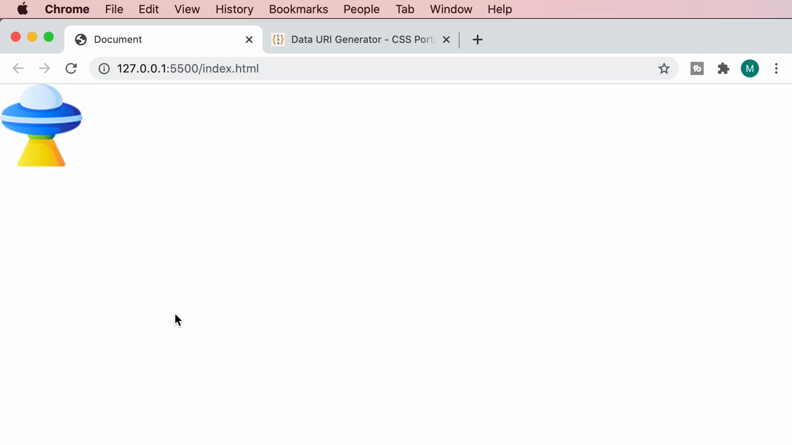

เปิด DevTools แท็บ **Network** เพื่อตรวจสอบ:

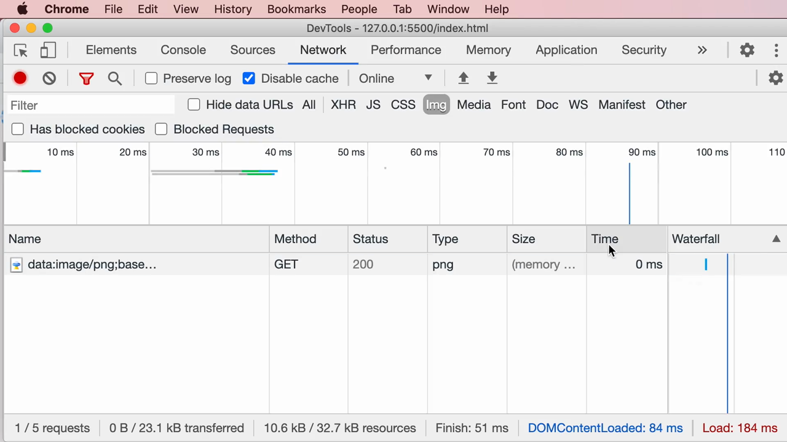

> **ผลลัพธ์ที่สำคัญที่สุด:** รายการที่ปรากฏใน Network tab เป็นเพียง `data:image/png;base...` ที่มี **Size = 0 B (memory cache)** และ **Time = 0 ms** — หมายความว่า**ไม่มีการส่ง HTTP request ออกไปจริงเลย** เพราะข้อมูลภาพทั้งหมดอยู่ในตัวไฟล์ HTML ที่โหลดมาแล้วตั้งแต่แรก ไม่ต้องขอไฟล์เพิ่มจากเซิร์ฟเวอร์อีกต่อไป

---

## 5. ข้อจำกัดของ Data URLs

ก่อนจบคลิป Mosh สรุปข้อเสียของเทคนิคนี้ผ่านสไลด์ **"PROBLEMS"**:

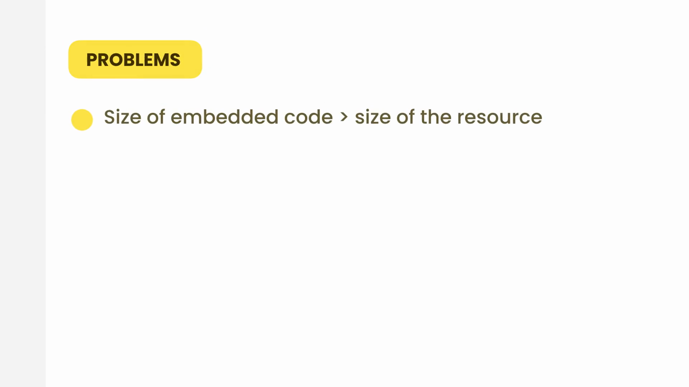
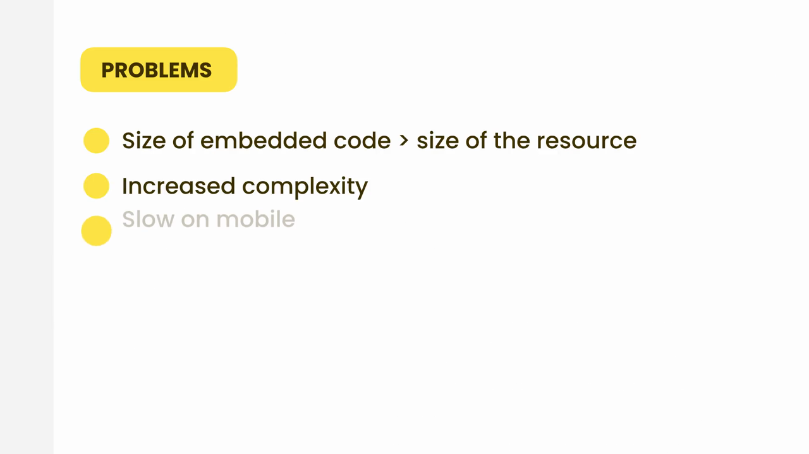

> **ปัญหา (Problems):**
> 1. **Size of embedded code > size of the resource (ขนาดโค้ดที่ฝังใหญ่กว่าขนาดไฟล์ต้นฉบับ)** — อย่างที่เห็นในตัวอย่าง ขนาดข้อมูลเพิ่มขึ้นประมาณ 30-34% จากการเข้ารหัส Base64
> 2. **Increased complexity (เพิ่มความซับซ้อนของโค้ด)** — โค้ด HTML/CSS จะเต็มไปด้วยข้อความยาวมากที่อ่านและดูแลรักษายาก โดยเฉพาะเมื่อมีภาพหลายภาพ
> 3. **Slow on mobile (ช้าลงบนมือถือ)** — เพราะไฟล์ HTML/CSS ที่มีข้อมูลภาพฝังอยู่จะมีขนาดใหญ่ขึ้นมาก อุปกรณ์มือถือที่มีทรัพยากรจำกัดอาจประมวลผลได้ช้าลง

---

## สรุปภาพรวมของคลิปนี้

| หัวข้อ | รายละเอียด |
|---|---|
| **แนวคิด** | ฝังข้อมูลภาพ (เข้ารหัสแบบ Base64) ลงในโค้ด HTML/CSS โดยตรง แทนการอ้างอิงไฟล์ภายนอก |
| **รูปแบบ** | `data:image/<type>;base64,<ข้อมูลที่เข้ารหัส>` |
| **เครื่องมือ** | cssportal.com/image-to-data/ (แปลงไฟล์ภาพเป็น Data URI อัตโนมัติ) |
| **ข้อดี** | ไม่มี HTTP request แยกสำหรับภาพนั้นเลย |
| **ข้อเสีย** | ขนาดข้อมูลใหญ่ขึ้น ~30%, เพิ่มความซับซ้อนของโค้ด, อาจช้าลงบนมือถือ |

**แนวคิดสำคัญที่ได้จากคลิปนี้:**

1. **Data URLs เหมาะกับภาพขนาดเล็กมากๆ ที่ใช้เพียงครั้งเดียว** เช่น ไอคอนเล็กๆ หรือภาพตกแต่งเล็กน้อย ไม่เหมาะกับภาพขนาดใหญ่หรือภาพที่ใช้ซ้ำหลายที่ (เพราะไม่ได้รับประโยชน์จาก browser cache แบบไฟล์ภาพทั่วไป)
2. **เปรียบเทียบกับ CSS Sprites ที่เรียนไปก่อนหน้า:** ทั้งสองเทคนิคต่างมุ่งลดจำนวน HTTP request เหมือนกัน แต่ CSS Sprites ยังคงเป็นไฟล์ภาพแยกที่เบราว์เซอร์ cache ได้ ในขณะที่ Data URL ฝังอยู่ในไฟล์ HTML/CSS โดยตรง ทำให้ไม่ได้ประโยชน์จาก cache ของภาพในการเข้าชมครั้งถัดไป (ต้องพึ่งพา cache ของไฟล์ HTML/CSS แทน)
3. **ต้องชั่งน้ำหนักระหว่างจำนวน Request ที่ลดลง กับ ขนาดไฟล์ที่เพิ่มขึ้นและความซับซ้อนของโค้ด** ก่อนตัดสินใจใช้เทคนิคนี้ในโปรเจกต์จริง
4. **เทคนิคนี้มักถูกใช้ในกรณีเฉพาะ** เช่น ไอคอนเล็กๆ ที่ต้องการให้แสดงผลทันทีโดยไม่มีการกระพริบ (flash) ขณะรอโหลดภาพ หรือในสถานการณ์ที่ต้องการลด request ให้น้อยที่สุดเท่าที่จะทำได้

---

*หมายเหตุ: คลิปนี้เป็นส่วนหนึ่งของบท "4-Images" จากคอร์ส The Ultimate HTML and CSS Course โดย Mosh Hamedani (codewithmosh.com) — คลิปที่ 6 ของบทนี้*
