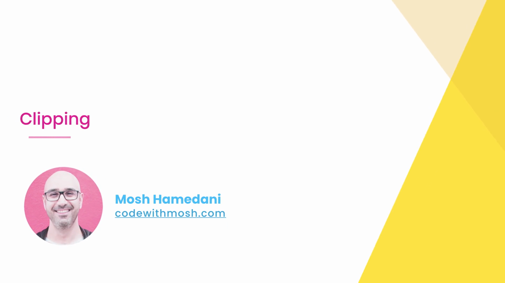
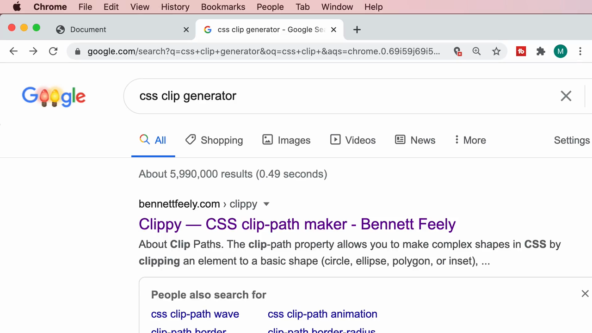
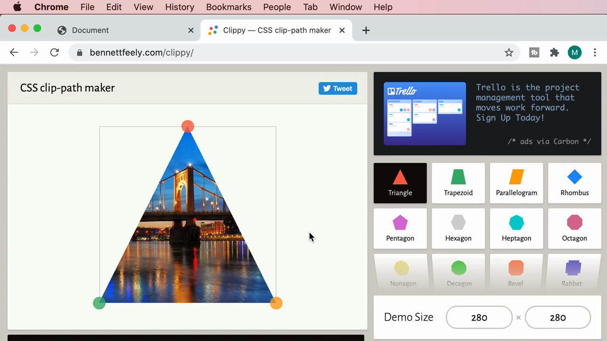
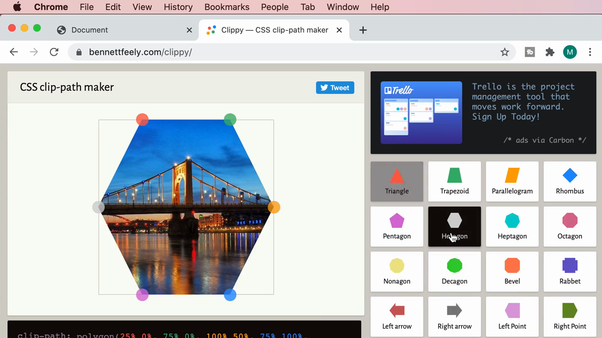
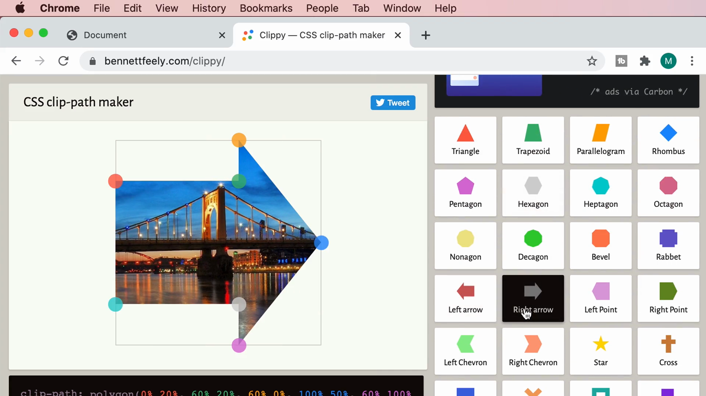
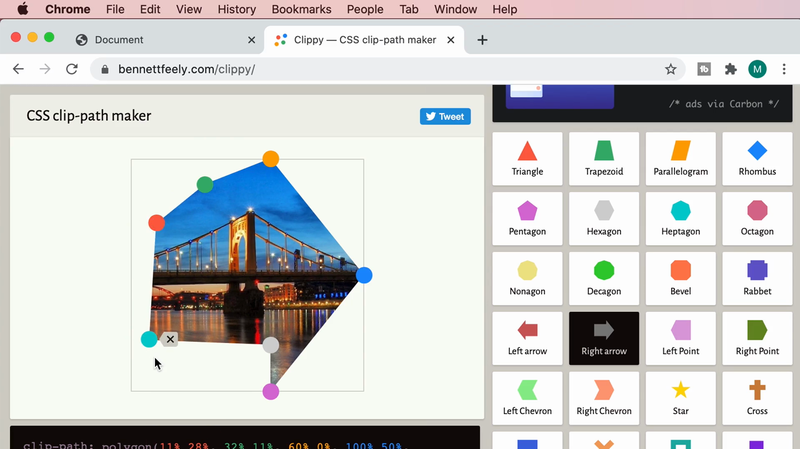
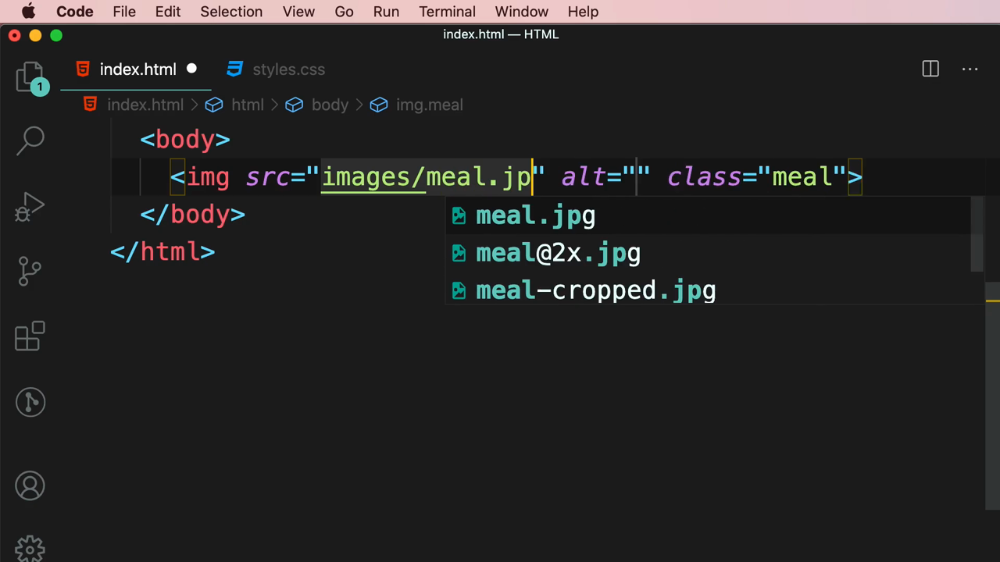
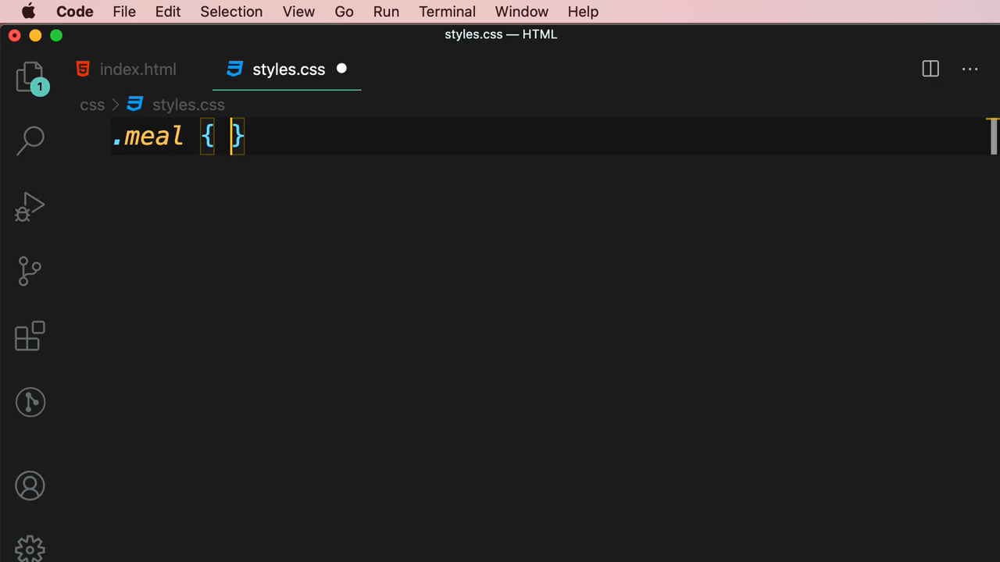
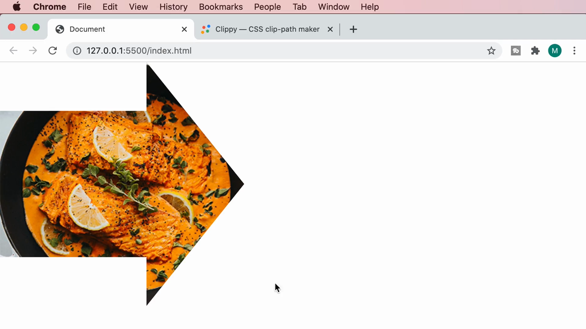

# 4-Images: 07 - Clipping (1:51)

**ไฟล์ต้นทาง:** `7-Clipping.mp4`

▶️ **[เปิดวิดีโอต้นฉบับ](../../../HTML-CSS-2/4-Images/7-Clipping.mp4)**

---

## ภาพรวมคลิปนี้

คลิปสั้นแต่ทรงพลัง — สอนการใช้ CSS property **`clip-path`** เพื่อ**ครอบตัด (clip)** รูปทรงของภาพให้เป็นรูปทรงเรขาคณิตต่างๆ (สามเหลี่ยม, หกเหลี่ยม, ลูกศร ฯลฯ) โดยไม่ต้องแก้ไขไฟล์ภาพต้นฉบับเลย พร้อมแนะนำเครื่องมือออนไลน์ที่ช่วยสร้างค่า `clip-path` แบบไม่ต้องคำนวณเอง



---

## 1. ค้นหาเครื่องมือช่วยสร้าง Clip-path

Mosh เริ่มด้วยการค้นหา **"css clip generator"** ใน Google:



เลือกเข้าเว็บไซต์ **Clippy — CSS clip-path maker** (bennettfeely.com/clippy/) ซึ่งเป็นเครื่องมือฟรีสำหรับสร้างค่า `clip-path` แบบเห็นผลทันที (visual editor):



> เว็บไซต์นี้มีรูปทรงสำเร็จรูปให้เลือกมากมาย เช่น Triangle, Trapezoid, Parallelogram, Rhombus, Pentagon, Hexagon, Heptagon, Octagon, Nonagon, Decagon, Bevel, Rabbet, ลูกศรซ้าย-ขวา, Chevron, ดาว, กากบาท และอื่นๆ อีกมาก

---

## 2. ทดลองรูปทรงต่างๆ

Mosh คลิกเลือกรูปทรง **Hexagon** (หกเหลี่ยม) เพื่อดูตัวอย่าง:



จากนั้นเปลี่ยนไปเลือกรูปทรง **Right arrow** (ลูกศรชี้ขวา):



Mosh ยังสาธิตการ**ลากจุดควบคุม (control points)** บนภาพตัวอย่างเพื่อปรับแต่งรูปทรงให้เป็นแบบกำหนดเอง (custom shape) นอกเหนือจากรูปทรงสำเร็จรูป:



> ที่ด้านล่างของเครื่องมือจะแสดงโค้ด CSS ที่สร้างขึ้นโดยอัตโนมัติแบบ real-time ในรูปแบบ:
> ```css
> clip-path: polygon(11% 28%, 32% 11%, 60% 0%, 100% 50%, 60% 100%, 32% 89%, 0% 100%, 0% 20%);
> ```
> ตัวเลขแต่ละคู่ (X%, Y%) คือ**พิกัดของจุดมุมแต่ละจุด**ของรูปทรงหลายเหลี่ยม (polygon) โดยอ้างอิงเป็นเปอร์เซ็นต์ของความกว้าง/ความสูงของ element นั้น — เมื่อลากจุดเปลี่ยนตำแหน่ง ตัวเลขในโค้ดจะอัปเดตให้ทันที ทำให้ไม่ต้องคำนวณพิกัดเองเลย

---

## 3. นำ `clip-path` มาใช้กับภาพจริงในโปรเจกต์

กลับมาที่ VS Code Mosh เพิ่ม `` พร้อม `class="meal"`:

```html

```



สร้าง selector `.meal` เปล่าใน `styles.css`:

```css
.meal {
}
```



จากนั้นวางโค้ด `clip-path: polygon(...)` ที่คัดลอกมาจากเว็บไซต์ Clippy ลงในคลาส `.meal` นี้

---

## 4. ผลลัพธ์: ภาพอาหารถูกครอบตัดเป็นรูปลูกศร

รีเฟรชหน้าเว็บ — ภาพอาหาร (`meal.jpg`) ที่เดิมเป็นสี่เหลี่ยมผืนผ้าธรรมดา ตอนนี้ถูกครอบตัดให้เป็น**รูปลูกศรชี้ขวา**ตามค่า `clip-path` ที่กำหนด โดยส่วนที่อยู่นอกรูปทรงจะถูกซ่อนไป (โปร่งใส) ไม่แสดงผล:



> **หลักการทำงานของ `clip-path`:** property นี้จะ**สร้าง "หน้าต่าง" ที่มีรูปทรงตามที่กำหนด** แล้วแสดงเฉพาะส่วนของ element ที่อยู่ภายในรูปทรงนั้นเท่านั้น ส่วนที่อยู่นอกรูปทรงจะถูกซ่อนไปโดยสมบูรณ์ (ไม่ใช่แค่โปร่งแสง แต่มองไม่เห็นเลย และไม่สามารถคลิกโดนได้ด้วย) — ไฟล์ภาพต้นฉบับไม่ได้ถูกแก้ไขเลย เป็นเพียงการเปลี่ยนวิธี "แสดงผล" ของภาพผ่าน CSS เท่านั้น

---

## สรุปภาพรวมของคลิปนี้

| หัวข้อ | รายละเอียด |
|---|---|
| **Property หลัก** | `clip-path` |
| **ค่าที่ใช้บ่อย** | `polygon(x1% y1%, x2% y2%, ...)` — รายการพิกัดจุดมุมของรูปทรง |
| **เครื่องมือช่วย** | Clippy (bennettfeely.com/clippy) — สร้าง `clip-path` แบบลากวางเห็นผลทันที |
| **ผลลัพธ์** | ภาพถูกครอบตัดให้เป็นรูปทรงที่กำหนด โดยไม่แก้ไขไฟล์ภาพต้นฉบับ |

**แนวคิดสำคัญที่ได้จากคลิปนี้:**

1. **`clip-path` เป็นวิธีที่สะอาดและยืดหยุ่นในการทำให้ภาพมีรูปทรงพิเศษ** โดยไม่ต้องไปตัดต่อภาพในโปรแกรมกราฟิกภายนอกเลย ทุกอย่างทำผ่าน CSS
2. **ไม่จำเป็นต้องคำนวณพิกัด polygon ด้วยตัวเอง** เพราะมีเครื่องมือออนไลน์อย่าง Clippy ที่ให้ลากจุดปรับแต่งแบบเห็นผลทันทีแล้วคัดลอกโค้ดไปใช้ได้เลย
3. **เทคนิคนี้เหมาะกับการสร้างจุดเด่นทางภาพ (visual interest)** เช่น การ์ดสินค้า, banner, หรือส่วนตกแต่งของเว็บไซต์ที่ต้องการความแตกต่างจากกรอบสี่เหลี่ยมทั่วไป
4. **`clip-path` ยังใช้ร่วมกับ transition/animation ได้** (แม้จะไม่ได้สาธิตในคลิปนี้) ทำให้สามารถสร้างเอฟเฟกต์ภาพเปลี่ยนรูปทรงเมื่อ hover หรือโต้ตอบกับผู้ใช้ได้ด้วย

---

*หมายเหตุ: คลิปนี้เป็นส่วนหนึ่งของบท "4-Images" จากคอร์ส The Ultimate HTML and CSS Course โดย Mosh Hamedani (codewithmosh.com) — คลิปที่ 7 ของบทนี้*
