# 4-Images: 08 - Filters (2:16)

**ไฟล์ต้นทาง:** `8-Filters.mp4`

▶️ **[เปิดวิดีโอต้นฉบับ](../../../HTML-CSS-2/4-Images/8-Filters.mp4)**

---

## ภาพรวมคลิปนี้

คลิปนี้สอนการใช้ CSS property **`filter`** เพื่อใส่เอฟเฟกต์ทางภาพ (visual effects) ให้กับรูปภาพโดยตรงผ่าน CSS เช่น สีเทา (grayscale), เบลอ (blur), และการรวมหลายฟิลเตอร์เข้าด้วยกัน พร้อมสาธิตการใช้ pseudo-class `:hover` ร่วมกับ `filter` เพื่อสร้างเอฟเฟกต์เมื่อผู้ใช้เอาเมาส์ไปวางบนภาพ

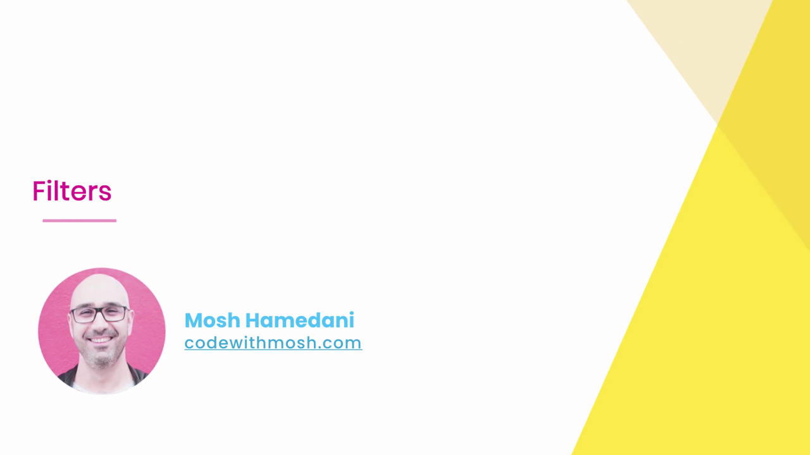

---

## 1. เริ่มต้นด้วย Selector `.meal` เปล่า

Mosh เริ่มจากไฟล์ `styles.css` ที่มี selector `.meal {}` เปล่าอยู่แล้ว (ต่อเนื่องจากภาพ `meal.jpg` ที่ใช้มาตั้งแต่คลิปก่อนๆ ในบทนี้):

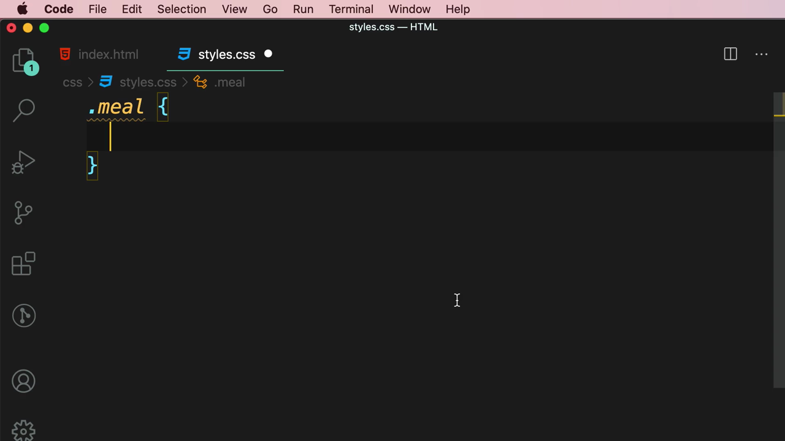

ภาพต้นฉบับก่อนใส่ฟิลเตอร์ใดๆ (สีสันปกติ คมชัด):


---

## 2. `filter: grayscale()` — แปลงภาพเป็นสีเทา

Mosh เพิ่ม property `filter` พร้อมฟังก์ชัน `grayscale()`:

```css
.meal {
  filter: grayscale(70%);
}
```

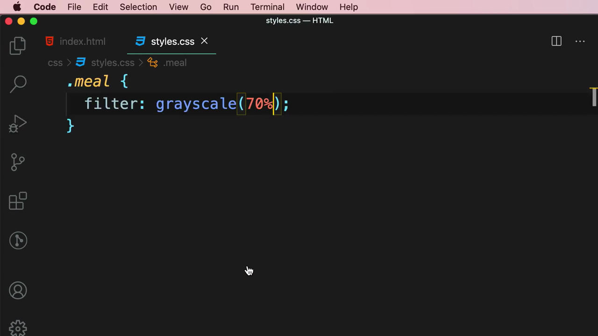

> **`grayscale()`** รับค่าเป็นเปอร์เซ็นต์ (0% ถึง 100%) บอกระดับความเข้มของสีเทาที่จะผสมเข้าไป — `0%` คือภาพสีปกติไม่เปลี่ยนแปลง ส่วน `100%` คือขาวดำสมบูรณ์ ค่า `70%` จึงทำให้ภาพมีสีจางลงมากแต่ยังไม่ถึงขาวดำเต็มรูปแบบ

---

## 3. รวมหลายฟิลเตอร์เข้าด้วยกัน (Chaining Filters)

Mosh เพิ่มฟังก์ชันที่สองต่อท้ายในค่า `filter` เดียวกัน:

```css
.meal {
  filter: grayscale(70%) blur(3px);
}
```

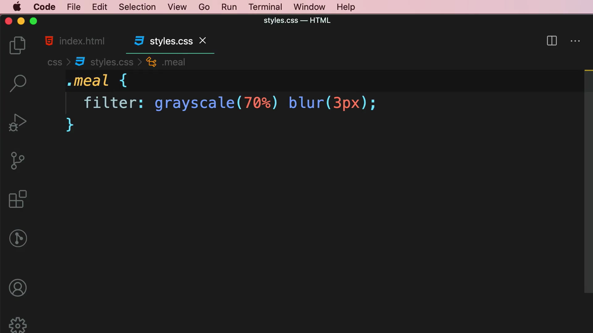

> **หลักการสำคัญ:** `filter` สามารถรับ**ฟังก์ชันหลายตัวพร้อมกันได้ โดยคั่นด้วยช่องว่าง (space)** ไม่ใช่ comma — เบราว์เซอร์จะประมวลผลฟิลเตอร์ทั้งหมด**ตามลำดับที่เขียน**ทับซ้อนกันไปเรื่อยๆ (ในที่นี้: ทำให้เป็นสีเทาก่อน แล้วค่อยเบลอภาพที่ได้)

ผลลัพธ์ในเบราว์เซอร์: ภาพเบลอและสีจางลงพร้อมกัน:

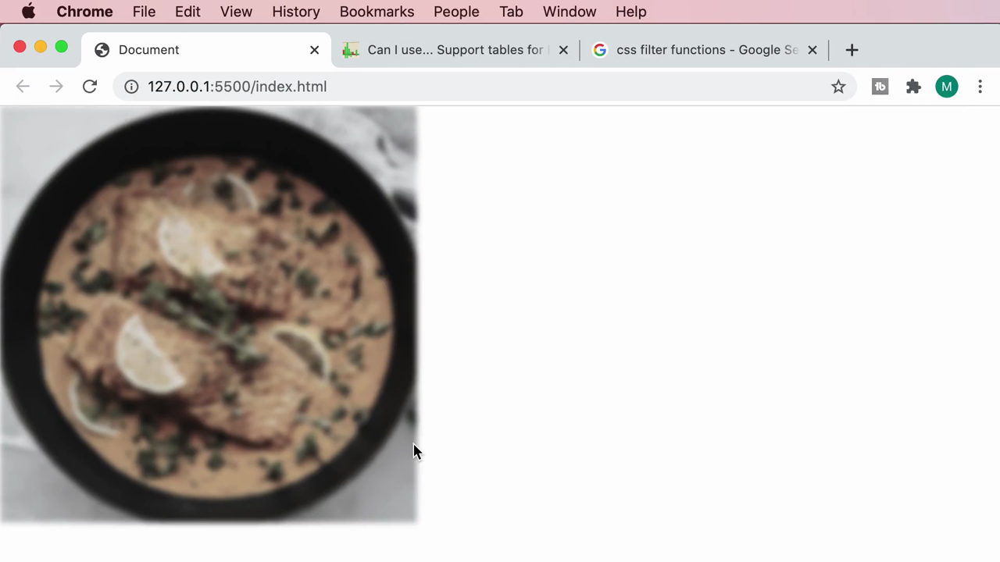

---

## 4. ใช้ `filter` ร่วมกับ `:hover` — เอฟเฟกต์เมื่อเอาเมาส์ไปวาง

Mosh เปลี่ยน selector จาก `.meal` ธรรมดาเป็น **`.meal:hover`** (pseudo-class selector ที่เรียนไปในบทก่อนหน้าเรื่อง Selectors):

```css
.meal:hover {
  filter: grayscale(70%) blur(3px);
}
```

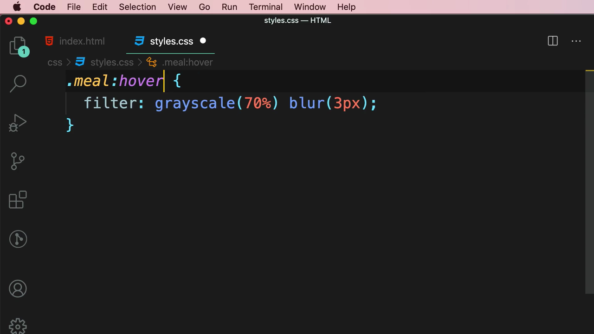

ผลลัพธ์: เมื่อยังไม่ได้เอาเมาส์ไปชี้ที่ภาพ ภาพจะแสดงผลปกติ (สีสันสดใส คมชัด ไม่มีฟิลเตอร์ใดๆ):


> **ผลลัพธ์ที่สำคัญ:** เมื่อย้าย selector จาก `.meal` เป็น `.meal:hover` ฟิลเตอร์จะ**มีผลเฉพาะตอนที่เมาส์อยู่เหนือภาพเท่านั้น** — พอเมาส์เลื่อนออกไป ภาพจะกลับมาเป็นปกติทันที เป็นเทคนิคที่ใช้บ่อยมากสำหรับสร้าง interactive effect เช่น การ์ดสินค้าที่เปลี่ยนสีเมื่อ hover, ปุ่มที่มีเอฟเฟกต์ตอบสนอง หรือแกลเลอรีภาพที่ไฮไลต์ภาพที่กำลังถูกชี้อยู่

---

## 5. สำรวจฟังก์ชัน Filter ทั้งหมดผ่านเอกสาร MDN

Mosh เปิดหน้าเอกสาร **MDN Web Docs** เรื่อง `filter` เพื่อดูตัวอย่างเชิงโต้ตอบ (CSS Demo) ที่แสดงผลด้วยโลโก้ Firefox:

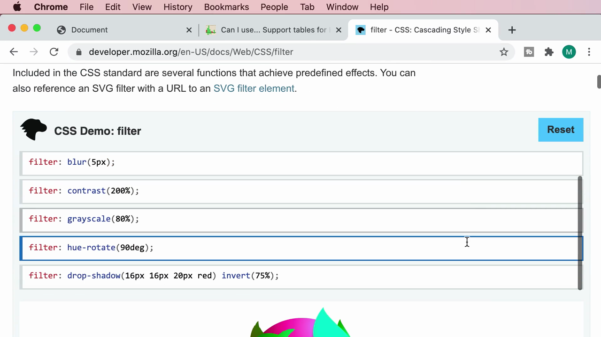

ทดลองคลิกดูฟังก์ชัน `hue-rotate(90deg)` — หมุนค่าสี (hue) ของภาพไปตามองศาที่กำหนด ทำให้สีทั้งภาพเปลี่ยนโทนไปพร้อมกัน (จากสีส้ม/ชมพูเดิม กลายเป็นโทนเขียว-น้ำเงิน):

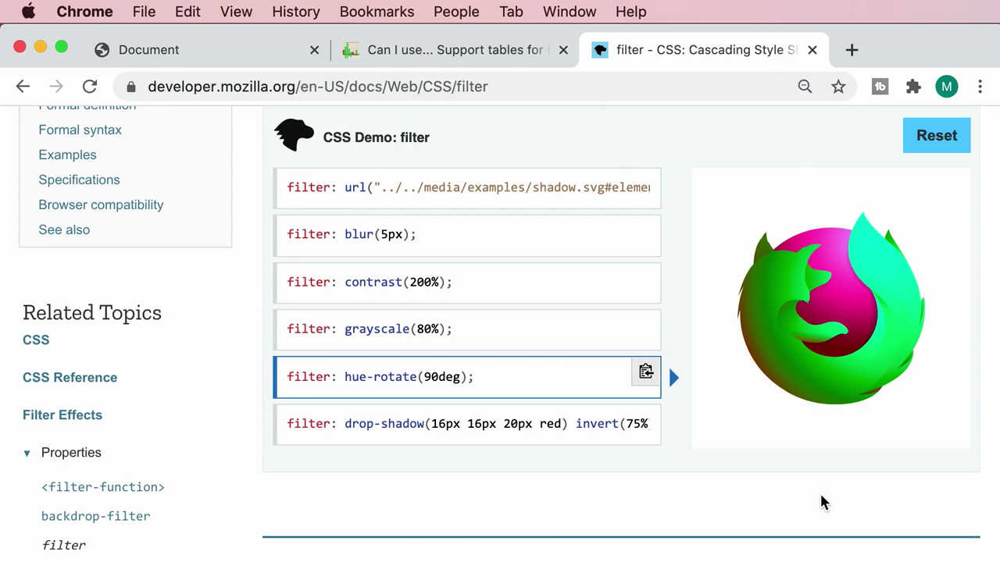

ทดลองดูฟังก์ชัน `drop-shadow(16px 16px 20px red) invert(75%)` — เงาตกกระทบสีแดงและกลับสี (invert) บางส่วน:

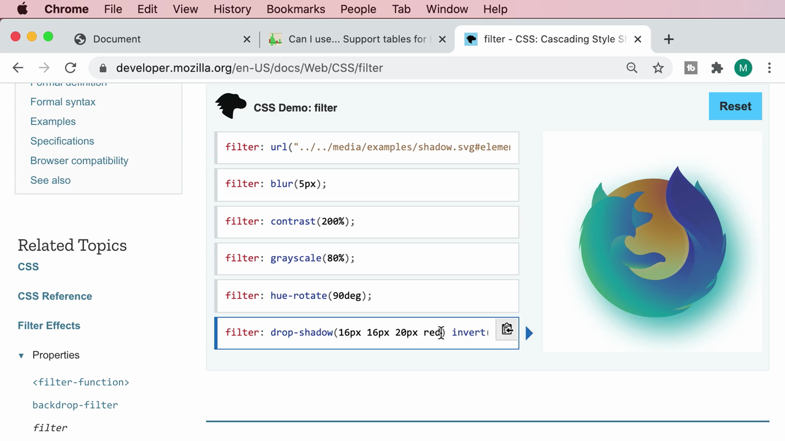

เลื่อนลงมาดูส่วน **Syntax** ที่สรุปฟังก์ชัน `filter` ทั้งหมดพร้อมตัวอย่างค่า:

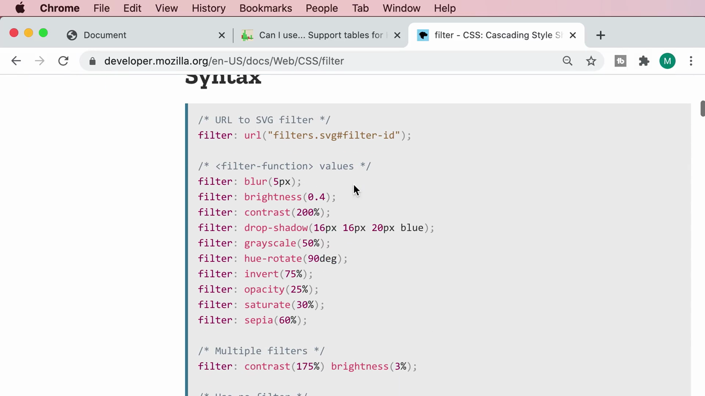

```css
/* URL to SVG filter */
filter: url("filters.svg#filter-id");

/* <filter-function> values */
filter: blur(5px);
filter: brightness(0.4);
filter: contrast(200%);
filter: drop-shadow(16px 16px 20px blue);
filter: grayscale(50%);
filter: hue-rotate(90deg);
filter: invert(75%);
filter: opacity(25%);
filter: saturate(30%);
filter: sepia(60%);

/* Multiple filters */
filter: contrast(175%) brightness(3%);
```

> **สรุปฟังก์ชันทั้งหมดของ `filter`:**
> - **`blur()`** — เบลอภาพ (หน่วยความยาว เช่น px)
> - **`brightness()`** — ปรับความสว่าง (0 = มืดสนิท, 1 = ปกติ, มากกว่า 1 = สว่างขึ้น)
> - **`contrast()`** — ปรับความต่างของสี/ความสว่าง
> - **`drop-shadow()`** — ใส่เงาตกกระทบ (คล้าย `box-shadow` แต่ตามรูปทรงจริงของภาพ ไม่ใช่แค่กรอบสี่เหลี่ยม)
> - **`grayscale()`** — แปลงเป็นสีเทา
> - **`hue-rotate()`** — หมุนวงล้อสี (หน่วยองศา)
> - **`invert()`** — กลับสี (negative)
> - **`opacity()`** — ปรับความโปร่งใส
> - **`saturate()`** — ปรับความอิ่มตัวของสี
> - **`sepia()`** — โทนสีซีเปีย (สีน้ำตาลแบบภาพเก่า)
> - **`url()`** — อ้างอิงไปยัง SVG filter ที่ซับซ้อนกว่า

---

## 6. ตรวจสอบการรองรับเบราว์เซอร์

Mosh เปิด **caniuse.com** ค้นหา "filter" เพื่อตรวจสอบว่าเบราว์เซอร์รองรับ CSS Filter Effects มากน้อยแค่ไหน:

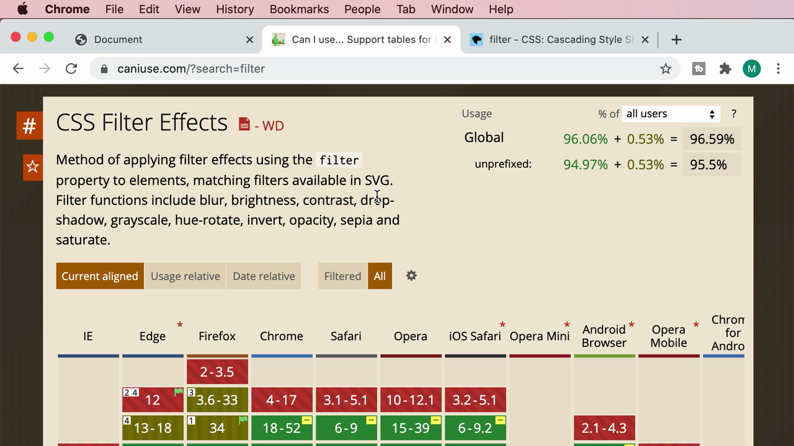

> ผลลัพธ์: รองรับทั่วโลกสูงถึง **96.59%** (94.97% รองรับแบบไม่ต้องใส่ prefix + 0.53% ต้องใส่ vendor prefix) ครอบคลุมเบราว์เซอร์หลักเกือบทั้งหมดในปัจจุบัน (Chrome, Firefox, Safari, Edge, Opera เวอร์ชันใหม่ๆ)

---

## สรุปภาพรวมของคลิปนี้

| ฟังก์ชัน | หน้าที่ |
|---|---|
| `grayscale()` | แปลงภาพเป็นสีเทา |
| `blur()` | เบลอภาพ |
| `brightness()` | ปรับความสว่าง |
| `contrast()` | ปรับความต่างของสี |
| `drop-shadow()` | ใส่เงาตามรูปทรงจริงของภาพ |
| `hue-rotate()` | หมุนวงล้อสี |
| `invert()` | กลับสี |
| `opacity()` | ปรับความโปร่งใส |
| `saturate()` | ปรับความอิ่มตัวของสี |
| `sepia()` | โทนสีซีเปีย |

**แนวคิดสำคัญที่ได้จากคลิปนี้:**

1. **`filter` เปิดโอกาสให้ปรับแต่งภาพได้หลากหลายโดยไม่ต้องพึ่งโปรแกรมแก้ไขภาพภายนอกเลย** ทำได้ทั้งหมดผ่าน CSS
2. **สามารถรวมหลายฟังก์ชันเข้าด้วยกันได้ในค่าเดียว** โดยคั่นด้วยช่องว่าง และลำดับการเขียนมีผลต่อผลลัพธ์สุดท้าย
3. **การผสาน `filter` กับ `:hover` เป็นรูปแบบที่ใช้บ่อยมากในเว็บไซต์จริง** สำหรับสร้าง interactive effect ที่ตอบสนองต่อการกระทำของผู้ใช้แบบทันที
4. **ควรตรวจสอบ Browser Support เสมอก่อนใช้ feature ใหม่ๆ** แม้ `filter` จะได้รับการรองรับกว้างขวางแล้วในปัจจุบัน (~96%) แต่การตรวจสอบผ่าน caniuse.com ยังคงเป็นนิสัยที่ดีของนักพัฒนามืออาชีพ
5. **เอกสาร MDN Web Docs เป็นแหล่งอ้างอิงที่ดีที่สุด** สำหรับการเรียนรู้ CSS property ต่างๆ เพราะมักมีตัวอย่างเชิงโต้ตอบ (interactive demo) ให้ทดลองเล่นได้จริง

---

*หมายเหตุ: คลิปนี้เป็นส่วนหนึ่งของบท "4-Images" จากคอร์ส The Ultimate HTML and CSS Course โดย Mosh Hamedani (codewithmosh.com) — คลิปที่ 8 ของบทนี้*
