# 4-Images: 09 - Supporting High-density Screens (8:14)

**ไฟล์ต้นทาง:** `9-Supporting_High-density_Screens.mp4`

▶️ **[เปิดวิดีโอต้นฉบับ](../../../HTML-CSS-2/4-Images/9-Supporting_High-density_Screens.mp4)**

---

## ภาพรวมคลิปนี้

คลิปนี้เป็นหนึ่งในคลิปที่ยาวและมีเนื้อหาลึกที่สุดของบท "4-Images" — สอนเรื่อง **การรองรับหน้าจอความละเอียดสูง (High-density Screens)** หรือที่รู้จักกันในชื่อ **Retina Display** อธิบายตั้งแต่แนวคิดพื้นฐาน (Physical resolution, Logical resolution, Device Pixel Ratio) ไปจนถึงขั้นตอนจริงในการเตรียมไฟล์ภาพหลายความละเอียดด้วย Adobe Photoshop และสุดท้ายคือการเขียนโค้ด HTML attribute **`srcset`** เพื่อให้เบราว์เซอร์เลือกไฟล์ภาพที่เหมาะสมกับหน้าจอของผู้ใช้โดยอัตโนมัติ พร้อมพิสูจน์ผลลัพธ์จริงผ่าน DevTools

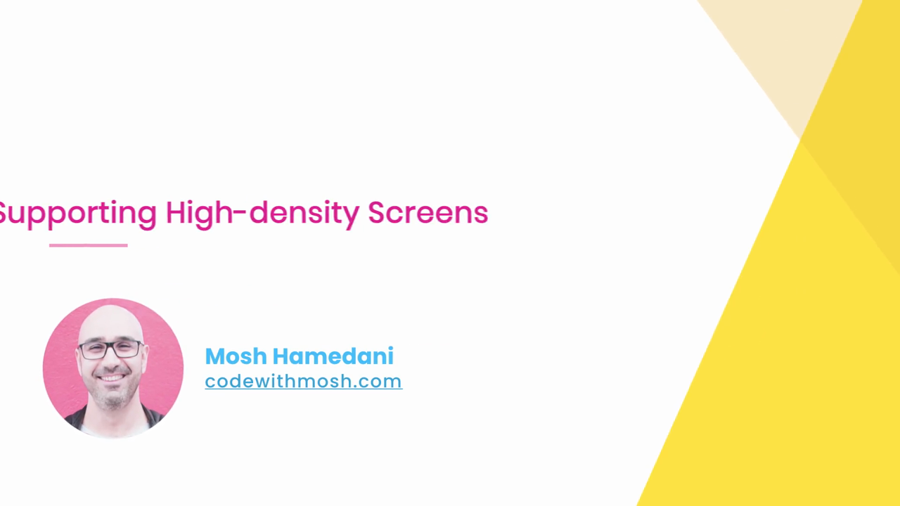

---

## 1. ปัญหา: หน้าจอความละเอียดสูงทำให้ภาพดูไม่คมชัด

Mosh เริ่มอธิบายด้วยภาพเปรียบเทียบหน้าจอมือถือสองรุ่น:

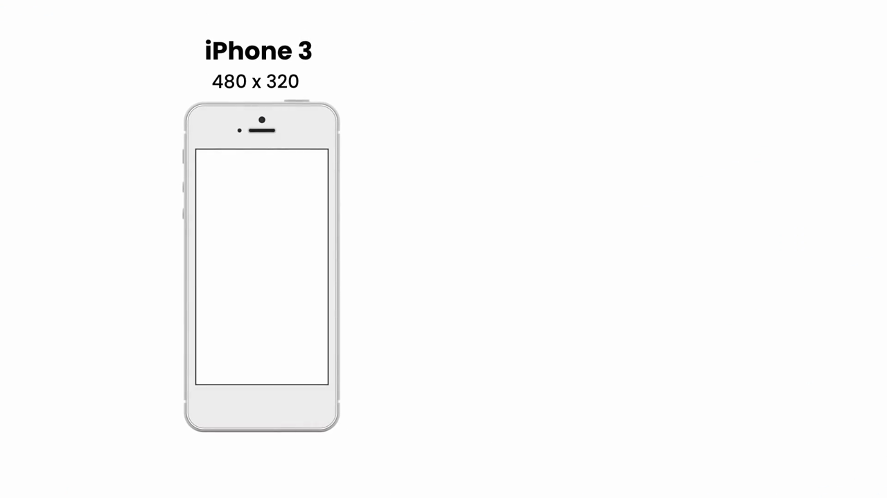

**iPhone 3** มีความละเอียดหน้าจอ **480 x 320** พิกเซล ส่วน **iPhone 4** ซึ่งเป็นรุ่นแรกที่มาพร้อมจอ **Retina** มีความละเอียดสูงถึง **960 x 640** พิกเซล (มากกว่าเท่าตัวในทั้งสองมิติ):

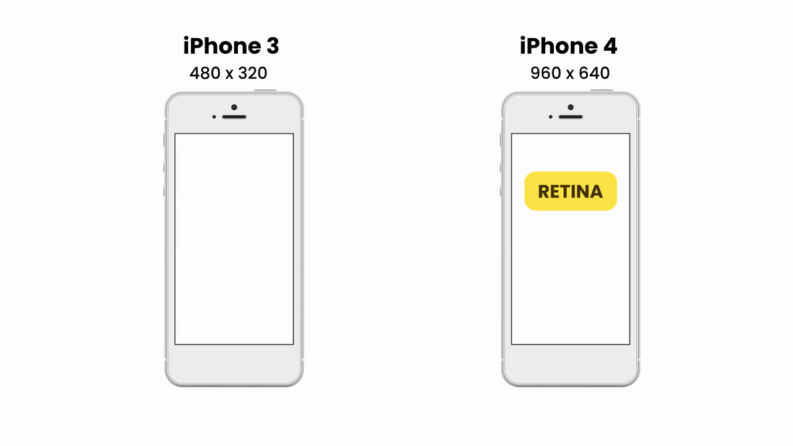

Mosh สาธิตโดยการวางภาพอาหารขนาด **320 x 320 พิกเซล** เดียวกันไว้บนหน้าจอทั้งสองรุ่น:

> ผลลัพธ์ที่สำคัญ: บน **iPhone 3** ภาพขนาด 320x320 พิกเซล จะแสดงผลได้ **คมชัดสมบูรณ์แบบ** เพราะพิกเซลของภาพตรงกับพิกเซลจริงของหน้าจอแบบ 1 ต่อ 1 (1 พิกเซลของภาพ = 1 พิกเซลจริงบนจอ)

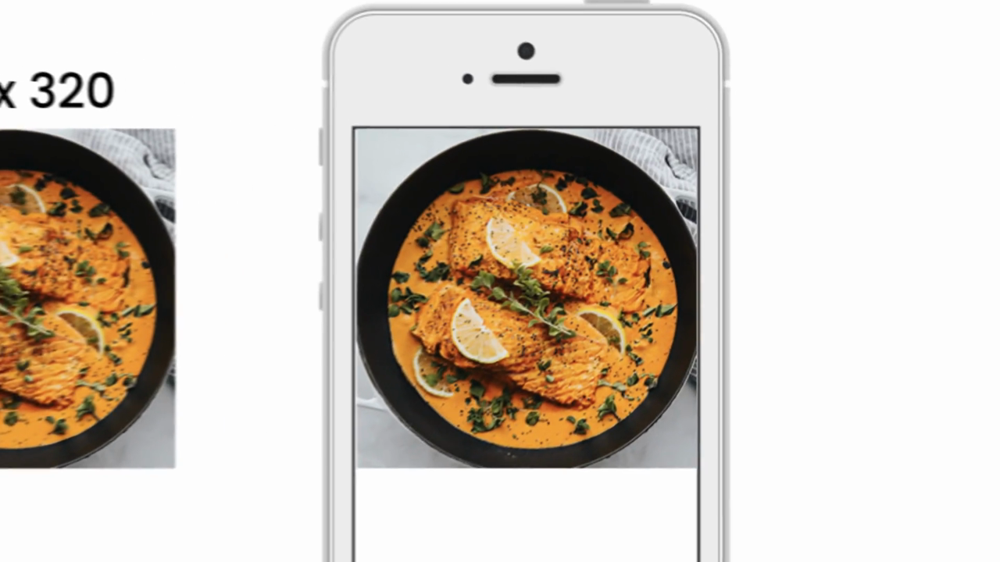

แต่เมื่อนำภาพขนาด 320x320 พิกเซลเดียวกันนี้ไปแสดงบน **iPhone 4** (จอ Retina) กลับพบว่า:

> ผลลัพธ์ที่สำคัญ: เบราว์เซอร์บนมือถือจะแสดงภาพนี้ให้มีขนาด "ตามพิกเซลตรรกะ (CSS pixel)" เท่าเดิม (เพื่อให้ขนาดของสิ่งต่างๆ บนหน้าจอยังคงสัดส่วนใกล้เคียงกับจอความละเอียดปกติ) แต่เนื่องจากจอ Retina มีพิกเซลจริงมากกว่าถึง 2 เท่าในแต่ละมิติ ภาพต้นฉบับที่มีอยู่แค่ 320x320 พิกเซล จึงถูก**ขยาย (stretch/upscale)** ให้เต็มพื้นที่เดิม ทำให้ภาพดู**เบลอ พร่ามัว ไม่คมชัด** เพราะพิกเซลของภาพไม่พอที่จะเติมเต็มพิกเซลจริงของหน้าจอที่มีมากกว่า

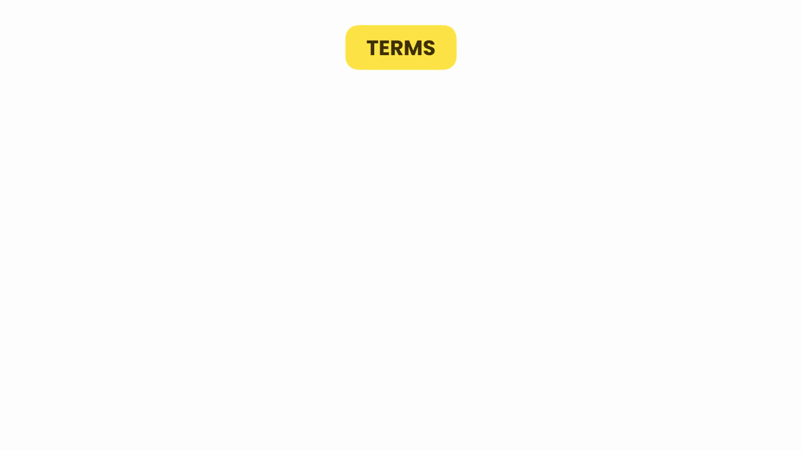

---

## 2. TERMS — คำศัพท์สำคัญที่ต้องเข้าใจก่อน

Mosh สรุปคำศัพท์ 3 คำที่เป็นหัวใจของเรื่องนี้ผ่านสไลด์ **"TERMS"**:

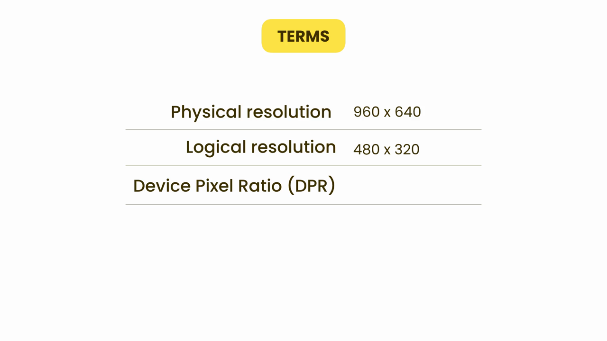

| คำศัพท์ | ความหมาย | ตัวอย่าง (iPhone 4) |
|---|---|---|
| **Physical resolution** | ความละเอียด**จริง**ของหน้าจอ นับเป็นจำนวนพิกเซลจริงที่จอแสดงผลได้ทั้งหมด | 960 x 640 |
| **Logical resolution** | ความละเอียด**ตรรกะ** หรือที่เรียกว่า "CSS pixel" คือขนาดที่นักพัฒนาเว็บใช้อ้างอิงเวลาเขียน CSS/HTML (ไม่ใช่พิกเซลจริง) | 480 x 320 |
| **Device Pixel Ratio (DPR)** | อัตราส่วนระหว่าง Physical resolution ต่อ Logical resolution บอกว่าจอนั้น "หนาแน่น" กว่าจอปกติกี่เท่า | 960÷480 = **2** (หรือเรียกว่า "2x") |

> **อธิบายเพิ่มเติม:** จอ Retina มาตรฐานทั่วไปจะมี **DPR = 2** (เรียกว่า "2x") ส่วนหน้าจอมือถือรุ่นใหม่ๆ ที่มีความละเอียดสูงกว่านั้นอีก เช่น iPhone รุ่น Plus/Pro Max บางรุ่น อาจมี **DPR = 3** ("3x") นักพัฒนาเว็บจึงจำเป็นต้องเตรียมไฟล์ภาพหลายเวอร์ชันความละเอียด เพื่อให้ภาพยังคงคมชัดไม่ว่าจะแสดงผลบนจอที่มี DPR เท่าใดก็ตาม — นี่คือที่มาของชื่อไฟล์อย่าง `meal.jpg` (1x), `meal@2x.jpg` (2x), `meal@3x.jpg` (3x) ที่เห็นในโปรเจกต์มาตลอดหลายคลิปที่ผ่านมา

---

## 3. สำรวจไฟล์ภาพที่มีอยู่แล้วในโปรเจกต์ (Finder)

Mosh สลับไปที่ **Finder** เปิดโฟลเดอร์ `images` ของโปรเจกต์ เพื่อชี้ให้เห็นว่ามีไฟล์ภาพหลายเวอร์ชันความละเอียดเตรียมไว้อยู่แล้วตั้งแต่คลิปก่อนๆ:

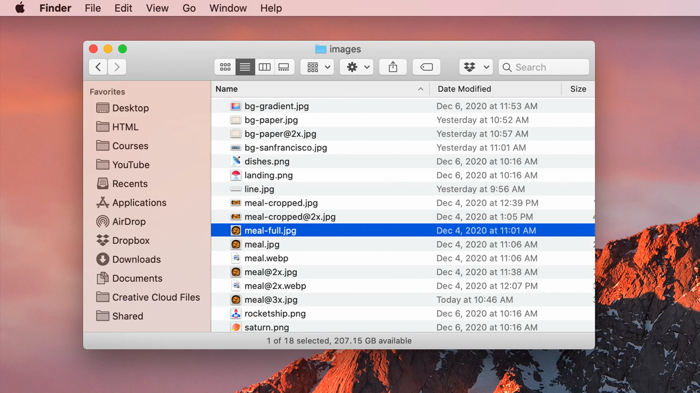

รายชื่อไฟล์ในโฟลเดอร์ `images` (ที่เกี่ยวข้องกับภาพ `meal`):

| ชื่อไฟล์ | ความหมาย |
|---|---|
| `meal.jpg` | เวอร์ชันมาตรฐาน (1x) |
| `meal@2x.jpg` | เวอร์ชันสำหรับจอ Retina 2x |
| `meal@3x.jpg` | เวอร์ชันสำหรับจอความละเอียดสูง 3x |
| `meal.webp` / `meal@2x.webp` | เวอร์ชัน format WebP (ใช้ในคลิปถัดๆ ไปเรื่อง Modern Image Formats) |
| `meal-cropped.jpg` / `meal-cropped@2x.jpg` | เวอร์ชันครอปสำหรับใช้กับเทคนิค Art Direction |
| `meal-full.jpg` | ไฟล์ต้นฉบับความละเอียดสูงสุด (master file) ที่ยังไม่ได้ย่อขนาด — **นี่คือไฟล์ที่จะใช้สร้างไฟล์ทุกเวอร์ชันด้านบน** |

> สังเกตว่า `meal.jpg` และ `meal@2x.jpg` มีวันที่แก้ไขล่าสุดเป็น "Dec 4, 2020" (สร้างไว้ตั้งแต่คลิปก่อนหน้า) ในขณะที่ `meal@3x.jpg` มีวันที่เป็น "Today" — บ่งชี้ว่าไฟล์นี้คือไฟล์ที่ Mosh กำลังจะสร้างขึ้นใหม่ในคลิปนี้เอง

---

## 4. เตรียมไฟล์ภาพหลายความละเอียดด้วย Adobe Photoshop

Mosh เปิดโปรแกรม **Adobe Photoshop CC 2017** แล้วเปิดไฟล์ต้นฉบับ **`meal-full.jpg`**:

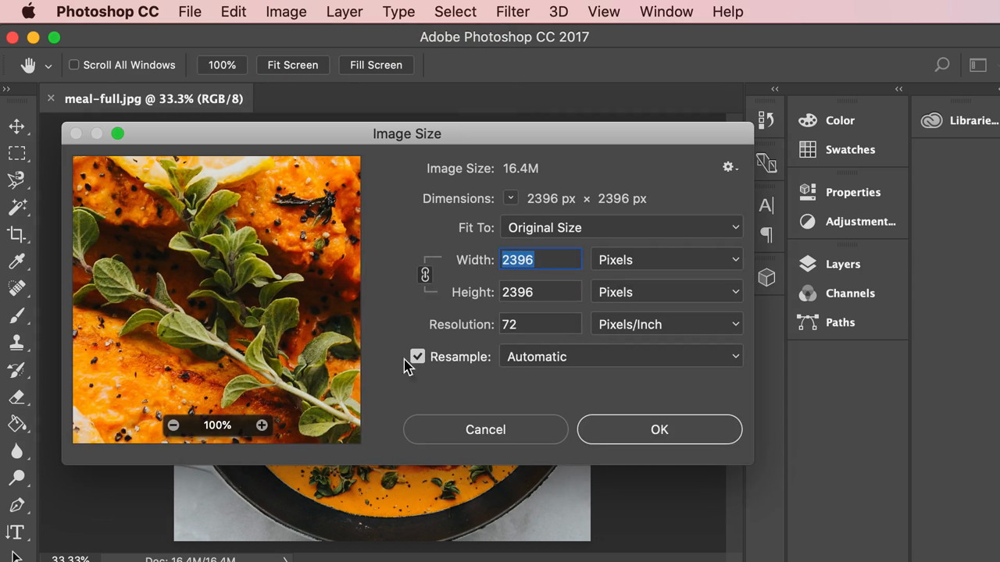

ไฟล์ต้นฉบับนี้มีขนาดใหญ่มาก — ไปที่เมนู **Image > Image Size...** เพื่อตรวจสอบขนาดจริง:

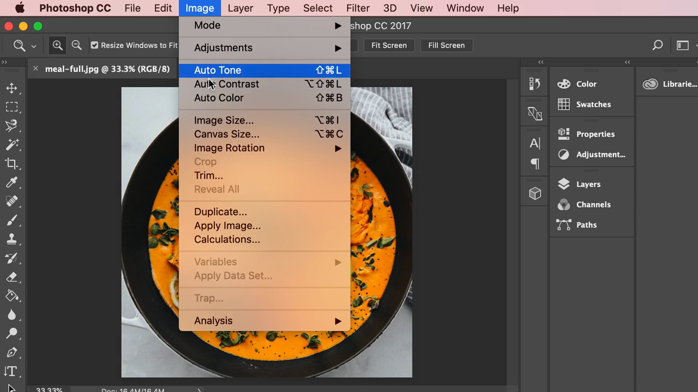

> **ข้อมูลไฟล์ต้นฉบับ (`meal-full.jpg`):**
> - **Image Size:** 16.4M (16.4 เมกะไบต์ เมื่อคลาย compression เป็นข้อมูลดิบ)
> - **Dimensions:** 2396 x 2396 พิกเซล (ภาพสี่เหลี่ยมจัตุรัส)
> - **Resolution:** 72 Pixels/Inch
> - **Resample:** ✅ Automatic (เปิดใช้งาน — จำเป็นเมื่อจะย่อขนาดภาพ)

### 4.1 ย่อขนาดลงเหลือ 1200x1200 พิกเซล (สำหรับ `@3x`)

Mosh แก้ค่า **Fit To** เป็น **Custom** แล้วพิมพ์ค่า Width เป็น **1200** (Height ปรับตามอัตโนมัติเพราะ aspect ratio ถูกล็อกไว้ด้วยไอคอนโซ่):

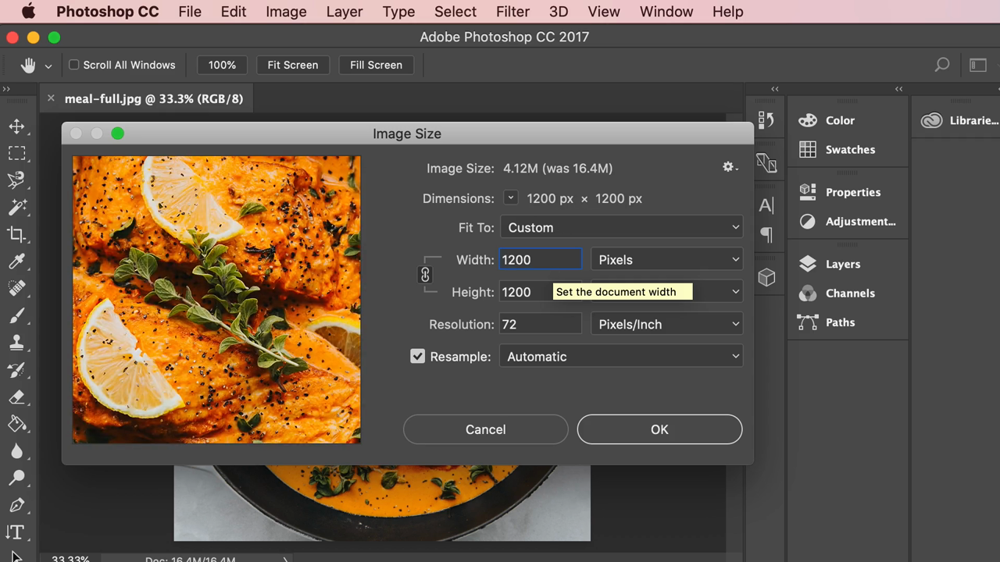

> เมื่อพิมพ์ 1200 ในช่อง Width ตัวเลข **Image Size** จะอัปเดตทันทีเป็น **"4.12M (was 16.4M)"** — แสดงให้เห็นว่าขนาดไฟล์ (เมื่อคลาย compression) ลดลงจาก 16.4MB เหลือเพียง 4.12MB ตามสัดส่วนพื้นที่ภาพที่ลดลง

กด **OK** ภาพในแคนวาสจะย่อขนาดลงทันที:


### 4.2 บันทึกเป็น `meal@3x.jpg` ผ่าน File > Save As

ไปที่เมนู **File > Save As...**:

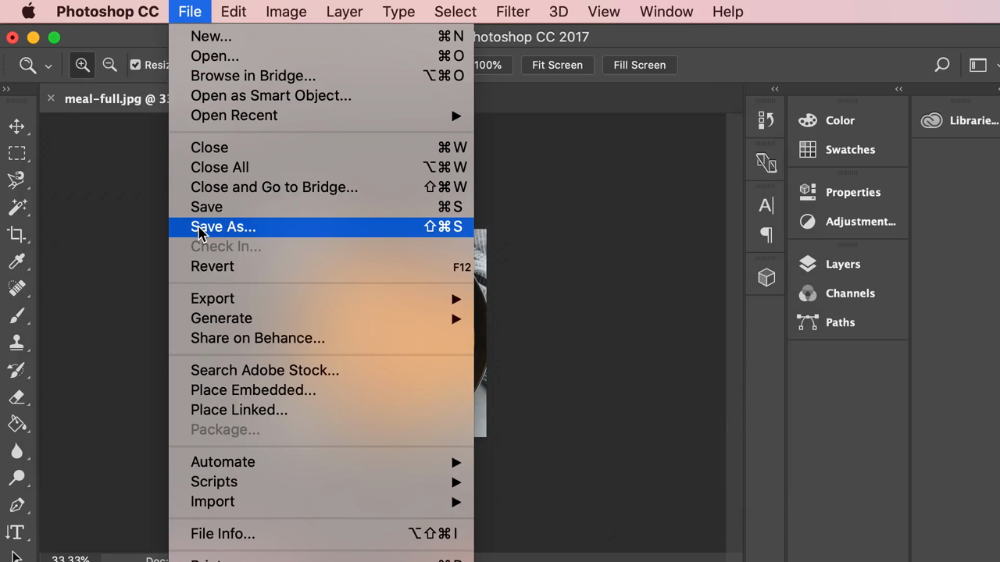

หน้าต่าง Save As เปิดขึ้น พร้อมชื่อไฟล์เริ่มต้นเป็น `meal-full.jpg` (ชื่อไฟล์เดิมที่เปิดไว้) — Mosh แก้ไขชื่อไฟล์เป็น **`meal@3x.jpg`** เพื่อบันทึกเป็นไฟล์ใหม่แยกจากไฟล์ต้นฉบับ (โดยไม่เขียนทับไฟล์ `meal-full.jpg` เดิม) และบันทึกไว้ในโฟลเดอร์ `images` เดียวกัน:

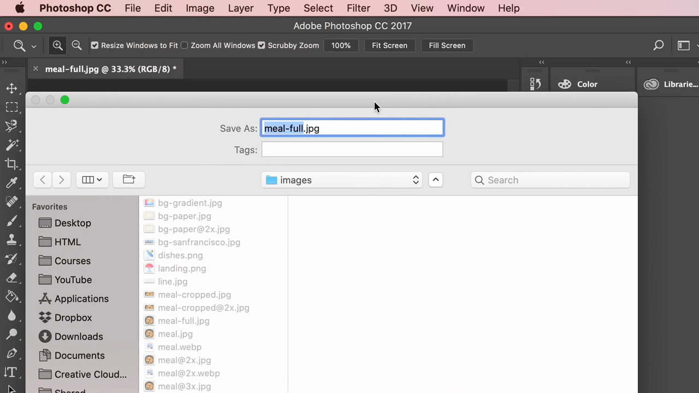

เมื่อกด **Save** โปรแกรมจะแสดงหน้าต่าง **JPEG Options** ให้กำหนดคุณภาพของไฟล์ JPEG ที่จะบันทึก:

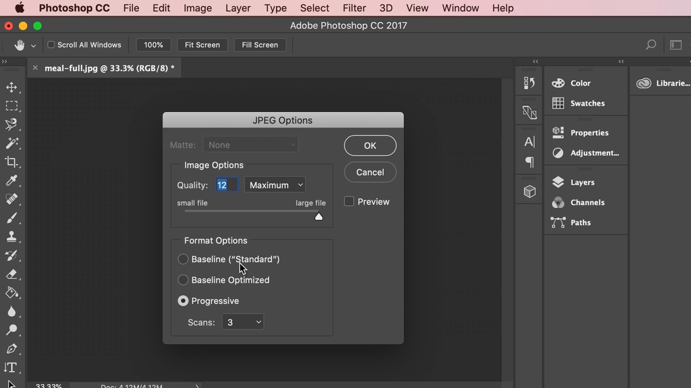

> **ค่าที่ Mosh เลือกในหน้าต่าง JPEG Options:**
> - **Quality:** `12` (ระดับสูงสุดในสเกล Photoshop คือ 0-12) พร้อมป้ายกำกับ **"Maximum"**
> - แถบเลื่อน **small file ↔ large file** ถูกเลื่อนไปทางขวาสุด (คุณภาพสูงสุด ไฟล์ใหญ่สุด)
> - **Format Options:** เลือก **Progressive** (แทนที่จะเป็น Baseline "Standard" หรือ Baseline Optimized) พร้อมกำหนด **Scans: 3**
>
> **อธิบายเพิ่มเติมสำหรับผู้เริ่มต้น:**
> - **Quality/Maximum** หมายถึงการบีบอัดภาพให้สูญเสียรายละเอียดน้อยที่สุดเท่าที่จะเป็นไปได้ — เหมาะกับภาพที่จะถูกใช้เป็น "ไฟล์คุณภาพสูงสำหรับจอความละเอียดสูง" เพราะไม่ต้องการให้การบีบอัดมาทำลายความคมชัดที่ตั้งใจรักษาไว้
> - **Progressive JPEG** คือรูปแบบการเข้ารหัสที่ทำให้ภาพ**ค่อยๆ ปรากฏจากภาพเบลอไปสู่ภาพคมชัด**ขณะที่กำลังโหลด (ต่างจาก Baseline ที่โหลดจากบนลงล่างทีละแถบ) ซึ่งให้ประสบการณ์ผู้ใช้ที่ดีกว่าบนอินเทอร์เน็ตความเร็วช้า เพราะผู้ใช้จะเห็นภาพรวมคร่าวๆ ได้เร็ว
> - **Scans** คือจำนวนรอบ (passes) ที่ภาพจะถูกเข้ารหัสแบบ progressive — ยิ่งมากยิ่งค่อยๆ ชัดขึ้นทีละขั้นมากขึ้น

หลังกด **OK** ชื่อไฟล์ที่แถบชื่อ (title bar) ของ Photoshop จะเปลี่ยนจาก `meal-full.jpg` เป็น **`meal@3x.jpg`** ทันที (จุด `*` ที่บ่งบอกว่ามีการแก้ไขยังไม่บันทึกก็หายไปด้วย):

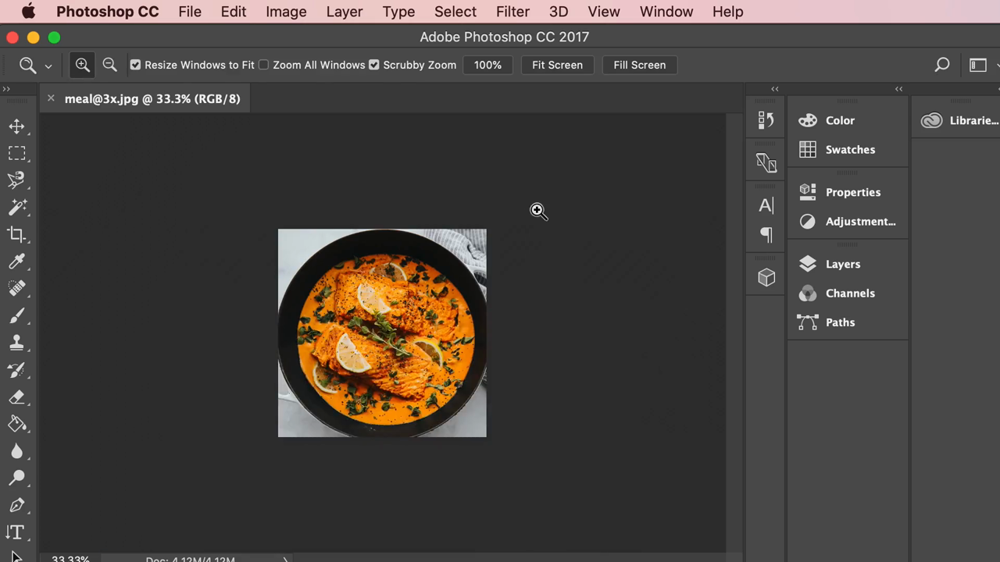

### 4.3 สาธิตการย่อขนาดต่อเพื่อสร้างเวอร์ชัน `@2x` และเวอร์ชันฐาน (1x)

Mosh เปิดเมนู **Image > Image Size...** อีกครั้ง (ครั้งนี้บนไฟล์ `meal@3x.jpg` ที่เพิ่งบันทึกไป ขนาด 1200x1200 พิกเซล) แล้วพิมพ์ Width ใหม่เป็น **800** พิกเซล เพื่อสาธิตวิธีสร้างเวอร์ชัน `@2x`:

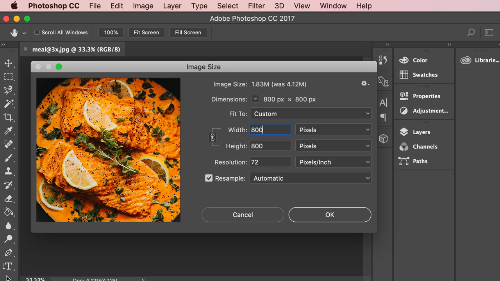

> Image Size อัปเดตเป็น **"1.83M (was 4.12M)"** — ขนาดไฟล์ (เมื่อคลาย compression) ลดลงตามสัดส่วน

จากนั้น Mosh เปิด Image Size อีกครั้งเป็นครั้งที่สาม แล้วพิมพ์ Width เป็น **400** พิกเซล เพื่อสาธิตวิธีสร้างเวอร์ชันฐาน (1x):

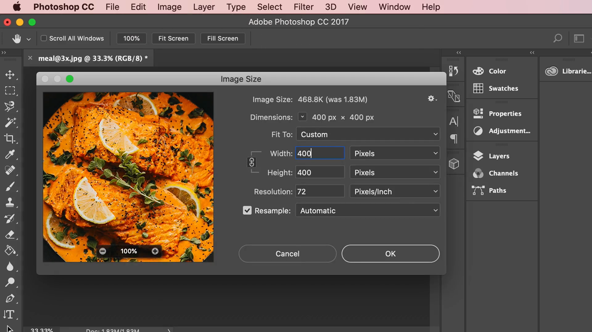

> Image Size อัปเดตเป็น **"468.8K, was 1.83M"** — ยืนยันขนาดไฟล์ฐาน 400x400 พิกเซล

> **สรุปหลักการสำคัญของขั้นตอน Photoshop ทั้งหมด:** แทนที่จะไปหาไฟล์ภาพสามไฟล์แยกกันจากแหล่งต่างๆ (ซึ่งอาจได้คุณภาพไม่สม่ำเสมอกัน) วิธีที่ถูกต้องคือ**เริ่มจากไฟล์ต้นฉบับความละเอียดสูงสุดเพียงไฟล์เดียว (master file)** แล้ว**ย่อขนาดลงมาเรื่อยๆ ตามลำดับจากใหญ่ไปเล็ก** (2396 → 1200 → 800 → 400) เพื่อให้ได้ไฟล์แต่ละเวอร์ชันที่มีคุณภาพและสัดส่วนสอดคล้องกันตามสูตรมาตรฐาน:
> - **1x (ฐาน):** 400 x 400 พิกเซล → `meal.jpg`
> - **2x (Retina มาตรฐาน):** 800 x 800 พิกเซล → `meal@2x.jpg`
> - **3x (จอความละเอียดสูงสุด):** 1200 x 1200 พิกเซล → `meal@3x.jpg`
>
> (หมายเหตุ: ไฟล์ `meal.jpg` และ `meal@2x.jpg` ที่เห็นในขั้นตอนก่อนหน้าถูกเตรียมไว้ล่วงหน้าแล้วในโปรเจกต์จากคลิปก่อนๆ ด้วยวิธีการเดียวกันนี้เป๊ะๆ — คลิปนี้จึงเน้นสาธิต**เทคนิคและหลักการ**ในการสร้างไฟล์ ไม่ได้เขียนทับไฟล์เดิมที่มีอยู่แล้วซ้ำอีกครั้ง)

---

## 5. กลับสู่ VS Code — เขียนโค้ด HTML/CSS ให้เบราว์เซอร์เลือกไฟล์ภาพที่เหมาะสมเอง

Mosh สลับกลับไปที่ **VS Code** เห็น `index.html` ที่มี `<body></body>` ว่างเปล่า:

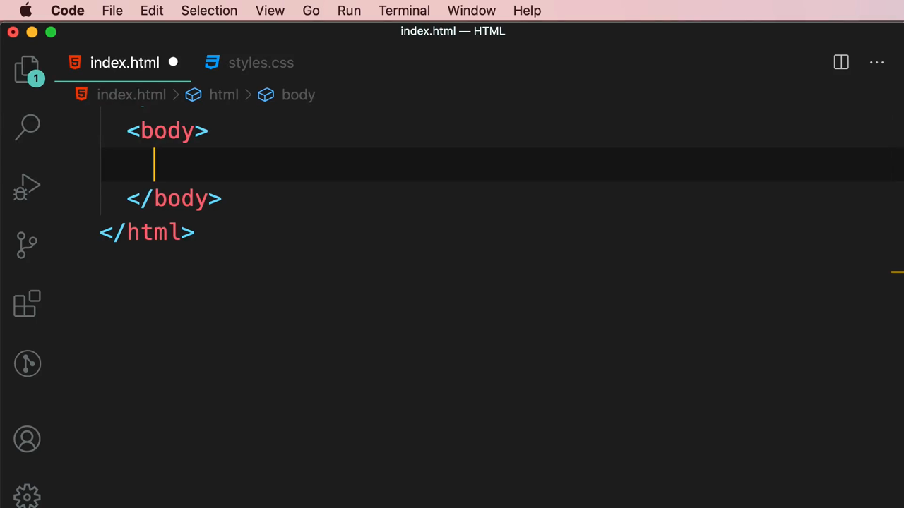

### 5.1 เริ่มจาก `` แบบพื้นฐาน (ยังไม่มี `srcset`)

Mosh พิมพ์แท็ก `` แบบธรรมดาก่อน โดยอ้างอิงไฟล์ `meal.jpg` (เวอร์ชันฐาน 1x):

```html

```

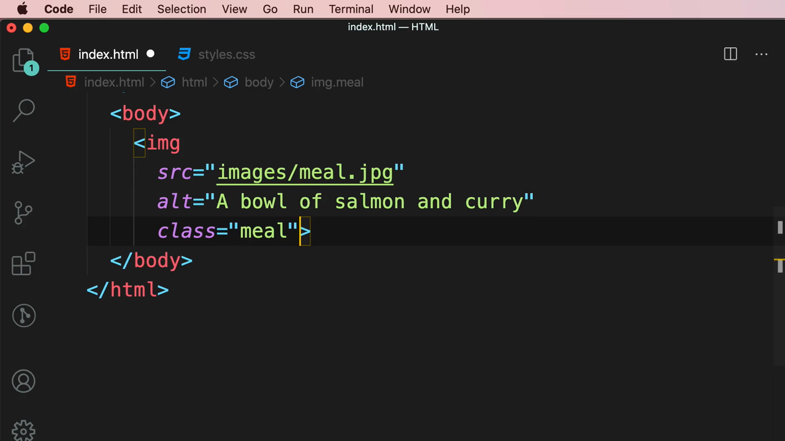

> ในสถานะนี้ ไม่ว่าผู้ใช้จะเปิดเว็บด้วยหน้าจอความละเอียดปกติหรือจอ Retina เบราว์เซอร์ก็จะโหลดไฟล์ `meal.jpg` (400x400) เพียงไฟล์เดียวเสมอ — ซึ่งจะทำให้ภาพดูเบลอบนจอ Retina ตามปัญหาที่อธิบายไว้ในส่วนที่ 1

### 5.2 เพิ่ม Attribute `srcset` เพื่อบอกเบราว์เซอร์ให้เลือกไฟล์เอง

Mosh เพิ่ม attribute ใหม่ชื่อ **`srcset`** ต่อท้าย `class` โดยพิมพ์รายการไฟล์พร้อม **density descriptor** (`1x`, `2x`, `3x`) คั่นด้วยจุลภาค — ระหว่างพิมพ์ VS Code (IntelliSense) แสดงคำแนะนำอัตโนมัติของชื่อไฟล์ให้เลือก:

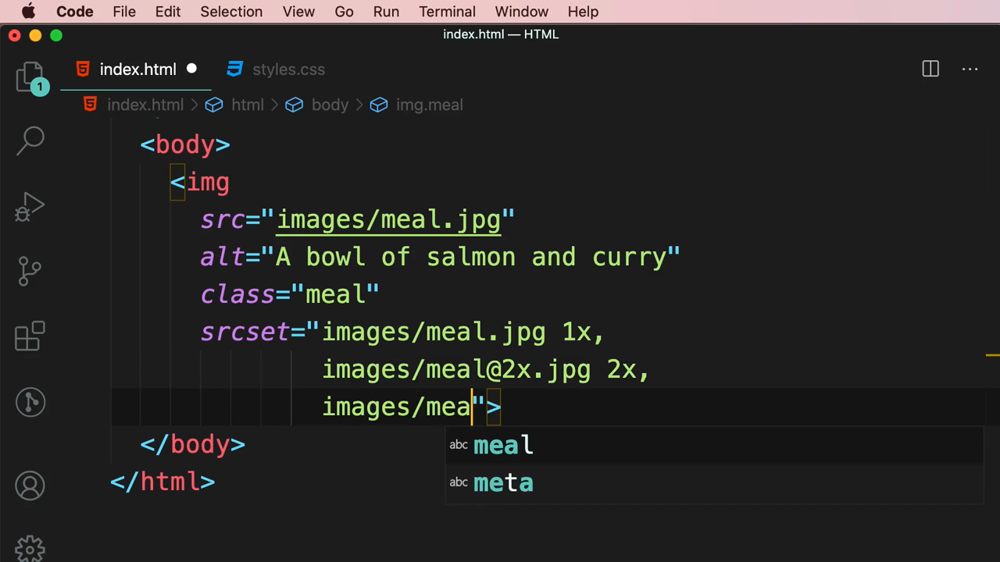

เมื่อพิมพ์เสร็จสมบูรณ์ครบทั้ง 3 เวอร์ชัน (ในขั้นนี้ยังมีแค่ 1x และ 2x ที่มองเห็นได้เต็มบรรทัด ส่วน 3x กำลังจะตามมา):

```html

```

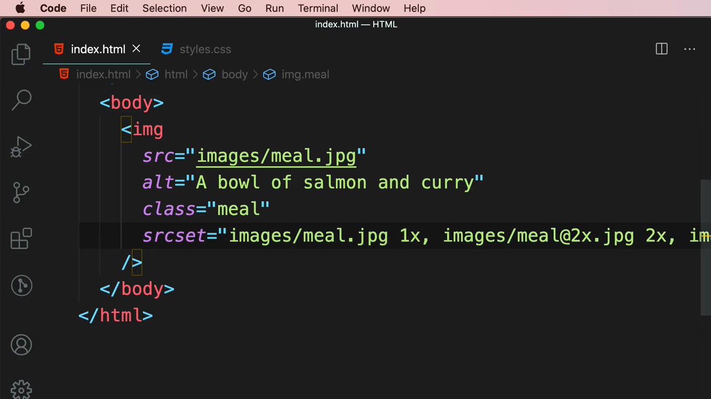

> **หลักการทำงานของ `srcset` กับ density descriptor:**
> - **`srcset`** คือ attribute ที่บอกเบราว์เซอร์ว่า "มีไฟล์ภาพเวอร์ชันอื่นๆ ให้เลือกด้วยนะ นอกเหนือจากไฟล์ใน `src`"
> - แต่ละรายการในค่าของ `srcset` เขียนในรูปแบบ **`<url> <density>x`** คั่นด้วยจุลภาค เช่น `images/meal@2x.jpg 2x` หมายถึง "ไฟล์นี้ให้ใช้กับหน้าจอที่มี Device Pixel Ratio = 2"
> - **`src`** ยังคงจำเป็นต้องมีอยู่เสมอ เพื่อเป็น**ค่าสำรอง (fallback)** สำหรับเบราว์เซอร์รุ่นเก่าที่ไม่รู้จัก `srcset`
> - เบราว์เซอร์ (ไม่ใช่เซิร์ฟเวอร์) จะเป็นผู้**ตรวจสอบ DPR ของหน้าจอผู้ใช้เองโดยอัตโนมัติ** แล้วเลือกดาวน์โหลดเฉพาะไฟล์ที่ตรงกับ DPR นั้นเพียงไฟล์เดียว (ไม่ได้โหลดทุกไฟล์)

Mosh สลับไปดูไฟล์ `styles.css` เพื่อยืนยันว่ายังไม่มี CSS ใดๆ กำกับภาพนี้อยู่ ณ จุดนี้ (ไฟล์ว่างเปล่า):

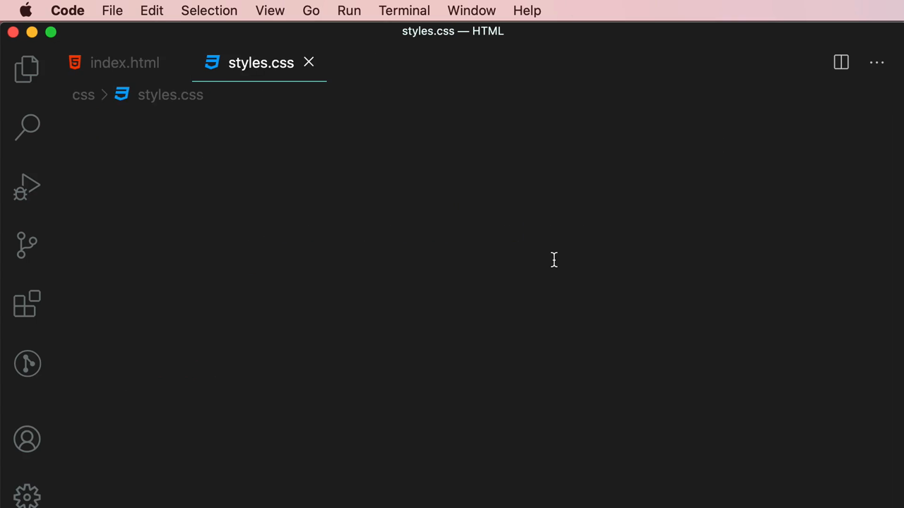

---

## 6. พิสูจน์ผลลัพธ์จริงด้วย Google Chrome DevTools

รีเฟรชหน้าเว็บที่ `127.0.0.1:5500/index.html` — ภาพอาหารแสดงผลตามปกติ (ดูดีคมชัด):

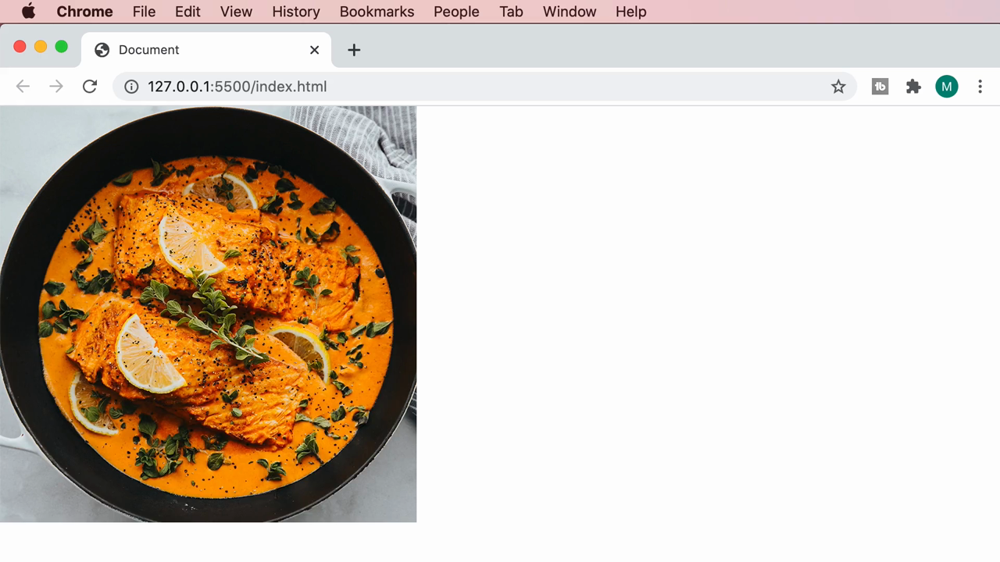

เปิด **DevTools** แล้วไปที่แท็บ **Network** กรองเฉพาะประเภท **Img** แล้วรีเฟรชหน้าอีกครั้ง:

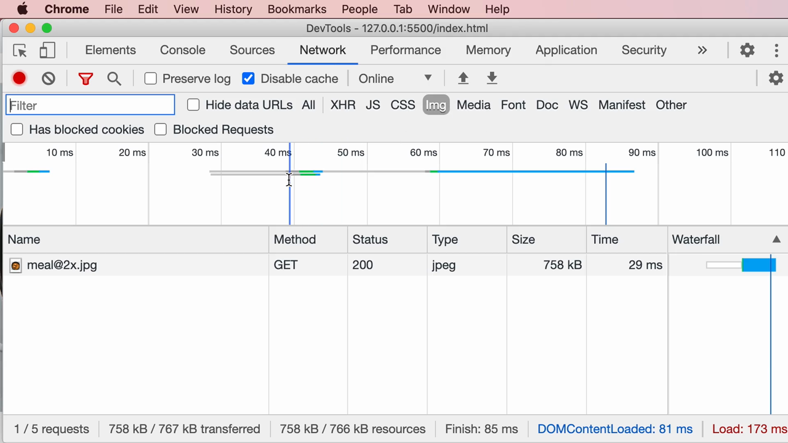

> **ผลลัพธ์ที่สำคัญที่สุดของคลิปนี้:** รายการที่ปรากฏในแท็บ Network มีเพียง **`meal@2x.jpg`** เท่านั้น (Status 200, Type jpeg, **Size 758 kB**, Time 29 ms) — เบราว์เซอร์**ไม่ได้โหลดทั้ง 3 ไฟล์** แต่**เลือกโหลดเฉพาะไฟล์ที่ตรงกับ Device Pixel Ratio ของหน้าจอที่ใช้ทดสอบ (ในที่นี้คือจอที่มี DPR = 2)** เพียงไฟล์เดียวเท่านั้น พิสูจน์ว่า `srcset` ทำงานตามที่ตั้งใจไว้จริง — ประหยัดทั้ง bandwidth และเวลาโหลด เพราะไม่ต้องโหลดไฟล์ที่ใหญ่เกินความจำเป็น (เช่น `meal@3x.jpg`) หรือไฟล์ที่เบลอเกินไป (เช่น `meal.jpg` เวอร์ชัน 1x)

### 6.1 เปรียบเทียบกับภาพ `` อีกอันหนึ่งข้างๆ กัน

เพื่อยืนยันให้เห็นภาพชัดเจนยิ่งขึ้น Mosh เพิ่ม `` อีกแท็กหนึ่งในโค้ด (มี `src`, `alt` เหมือนกัน แต่ยุบบรรทัดเก็บไว้ดูสั้นๆ) วางไว้ถัดจากแท็กเดิมที่มี `srcset` ครบสมบูรณ์:

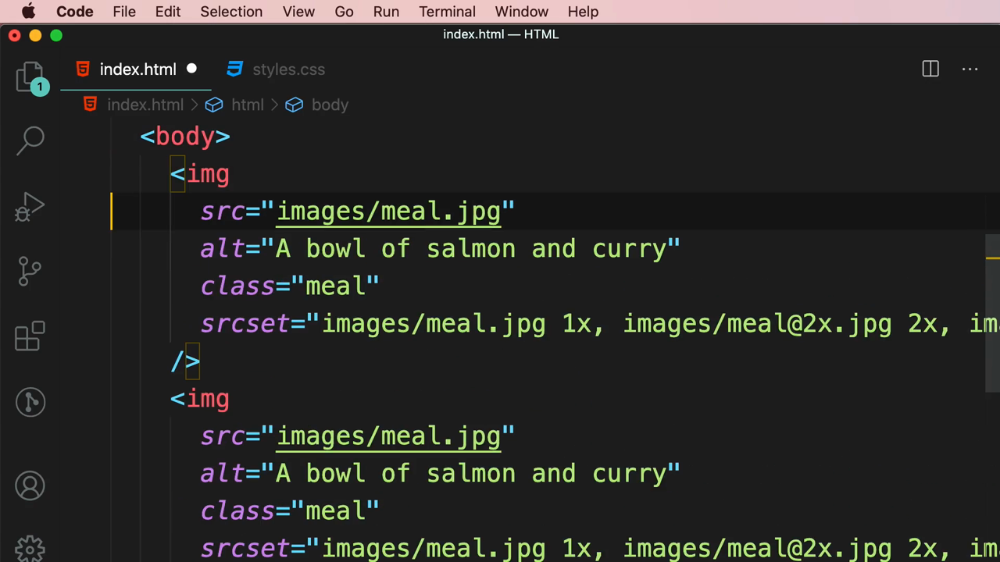

รีเฟรชหน้าเว็บ ภาพทั้งสองแสดงผลเคียงข้างกัน:

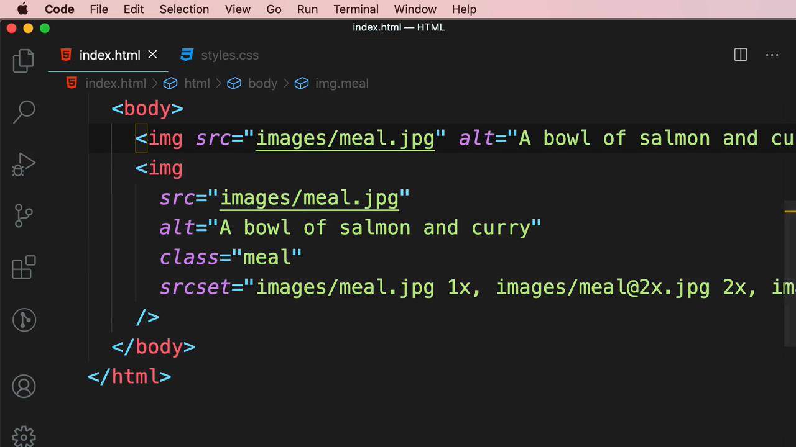

> ภาพทั้งสองมีขนาดที่แสดงผล (CSS size) เท่ากันทุกประการ และดูคมชัดเหมือนกันทั้งคู่ในสายตา — เพราะเบราว์เซอร์เลือกไฟล์ที่มีความละเอียดพอเหมาะพอดีกับจอที่ทดสอบให้ทั้งสองภาพอยู่แล้ว (แม้ว่าจริงๆ แล้วเบื้องหลัง ไฟล์ต้นทางที่ถูกโหลดมาอาจต่างกันไปตามว่าภาพนั้นมี `srcset` หรือไม่)

### 6.2 เพิ่ม `srcset` สมบูรณ์ครบทั้ง 1x, 2x, 3x

กลับไปที่โค้ด Mosh พิมพ์เพิ่มจนครบทั้งสามเวอร์ชันในค่า `srcset` (จบด้วย `images/meal@3x.jpg 3x`):

```html
srcset="
  images/meal.jpg 1x,
  images/meal@2x.jpg 2x,
  images/meal@3x.jpg 3x"
```

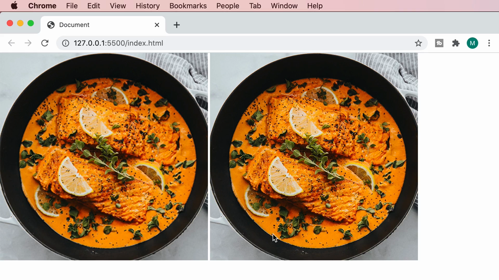

---

## 7. เพิ่ม CSS กำหนดขนาดการแสดงผลของภาพ

Mosh สลับไปที่ `styles.css` เพิ่ม selector `.meal` กำหนดความกว้างคงที่:

```css
.meal {
  width: 400px;
}
```

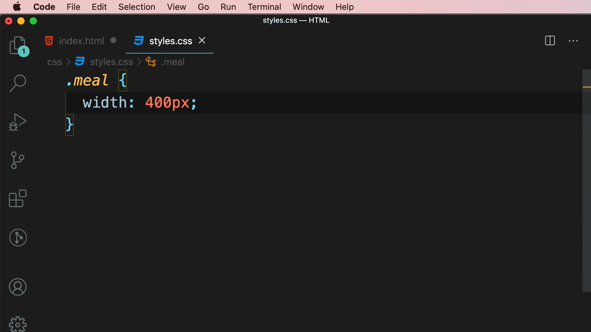

> **เหตุผลที่ต้องกำหนด `width` ด้วย CSS:** เมื่อใช้ `srcset` เบราว์เซอร์อาจเลือกไฟล์ที่มีขนาดพิกเซลจริงต่างกันมาก (400 vs 800 vs 1200 พิกเซล) หากไม่กำหนด `width` ตายตัวไว้ ภาพแต่ละเวอร์ชันจะแสดงผล**ขนาดไม่เท่ากัน**บนหน้าจอ (เพราะเบราว์เซอร์จะแสดงภาพตามขนาดพิกเซลจริงของไฟล์โดยไม่ทราบเจตนา) การกำหนด `width: 400px` จึงบังคับให้ไฟล์ทุกเวอร์ชันแสดงผล**ในขนาดตรรกะ (CSS pixel) เท่ากันเสมอ** ไม่ว่าไฟล์จริงที่ถูกเลือกมาจะมีความละเอียดสูงแค่ไหนก็ตาม — ความละเอียดที่สูงกว่านั้นถูกใช้เพียงเพื่อให้ภาพดู "คมชัดขึ้น" บนจอ Retina เท่านั้น ไม่ได้ทำให้ภาพ "ใหญ่ขึ้น" บนหน้าจอ

โค้ด HTML ฉบับสมบูรณ์สุดท้ายของคลิปนี้:

```html

```

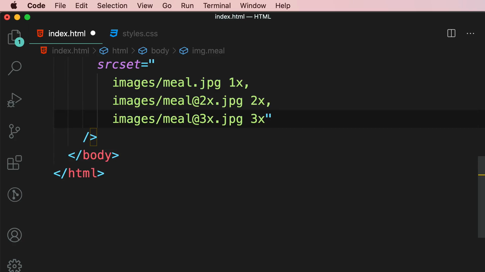

---

## สรุปภาพรวมของคลิปนี้

| หัวข้อ | รายละเอียด |
|---|---|
| **ปัญหา** | ภาพความละเอียดเดียวจะดูเบลอบนหน้าจอความละเอียดสูง (Retina/High-density) |
| **Physical resolution** | จำนวนพิกเซลจริงบนหน้าจอ (เช่น 960x640) |
| **Logical resolution** | ขนาด CSS pixel ที่นักพัฒนาอ้างอิง (เช่น 480x320) |
| **Device Pixel Ratio (DPR)** | Physical ÷ Logical (เช่น 2 สำหรับ Retina มาตรฐาน, 3 สำหรับจอความละเอียดสูงกว่านั้น) |
| **เครื่องมือเตรียมไฟล์** | Adobe Photoshop — ย่อขนาดจากไฟล์ต้นฉบับ (master) ใหญ่สุดลงมาตามลำดับ (2396→1200→800→400) |
| **รูปแบบไฟล์มาตรฐาน** | `ชื่อ.jpg` (1x), `ชื่อ@2x.jpg` (2x), `ชื่อ@3x.jpg` (3x) |
| **HTML attribute** | `srcset="url1 1x, url2 2x, url3 3x"` ร่วมกับ `src` เดิมเป็น fallback |
| **การพิสูจน์ผล** | DevTools > Network > กรอง Img — เห็นว่ามีการโหลดเพียงไฟล์เดียวตาม DPR ของจอ |
| **CSS ที่ต้องคู่กัน** | กำหนด `width` (หรือ `height`) ตายตัว เพื่อให้ทุกเวอร์ชันแสดงผลขนาดเท่ากันบนหน้าจอ |

**แนวคิดสำคัญที่ได้จากคลิปนี้:**

1. **หน้าจอ Retina/High-density ไม่ได้แค่ "จอสวยกว่า" แต่เปลี่ยนวิธีคิดเรื่องขนาดภาพไปเลย** — นักพัฒนาต้องเข้าใจ Physical resolution, Logical resolution และ Device Pixel Ratio เพื่อเตรียมภาพให้เหมาะสม ไม่ใช่แค่ใช้ไฟล์เดียวสำหรับทุกอุปกรณ์
2. **วิธีที่ถูกต้องในการเตรียมไฟล์หลายความละเอียดคือเริ่มจากไฟล์ต้นฉบับที่มีความละเอียดสูงที่สุด (master file) แล้วย่อขนาดลงมาเรื่อยๆ** ไม่ใช่หาไฟล์แยกจากหลายแหล่งที่มา เพื่อให้คุณภาพและสัดส่วนของแต่ละเวอร์ชันสอดคล้องกัน
3. **`srcset` กับ density descriptor (`1x`, `2x`, `3x`) เป็นวิธีที่ง่ายและตรงไปตรงมาที่สุดในการรองรับหลายความละเอียดของหน้าจอ** โดยให้เบราว์เซอร์เป็นผู้ตัดสินใจเลือกไฟล์ที่เหมาะสมเองโดยอัตโนมัติ ไม่ต้องเขียน JavaScript ตรวจสอบอุปกรณ์เอง
4. **ต้องกำหนดขนาดการแสดงผล (เช่น `width`) ด้วย CSS เสมอเมื่อใช้ `srcset` แบบ density descriptor** เพื่อไม่ให้ขนาดภาพที่ปรากฏบนหน้าจอเปลี่ยนแปลงไปตามว่าเบราว์เซอร์เลือกไฟล์เวอร์ชันไหนมา
5. **DevTools > Network tab เป็นเครื่องมือพิสูจน์ผลลัพธ์ที่เชื่อถือได้เสมอ** — แทนที่จะเดาว่าเทคนิคทำงานถูกต้องหรือไม่ ควรเปิด Network tab ดูจริงว่าเบราว์เซอร์โหลดไฟล์อะไรมา เพื่อยืนยันว่าโค้ดทำงานตามที่ตั้งใจ
6. **เทคนิคนี้แตกต่างจาก Responsive Images ด้วย `sizes`/width descriptor (`w`)** ที่ใช้แก้ปัญหาคนละแบบ (การเลือกภาพตาม**ขนาดหน้าจอ/viewport** ไม่ใช่ตาม**ความหนาแน่นของพิกเซล**) ซึ่งจะได้เรียนในคลิปถัดไปเรื่อง "Resolution Switching"

---

*หมายเหตุ: คลิปนี้เป็นส่วนหนึ่งของบท "4-Images" จากคอร์ส The Ultimate HTML and CSS Course โดย Mosh Hamedani (codewithmosh.com) — คลิปที่ 9 ของบทนี้*
