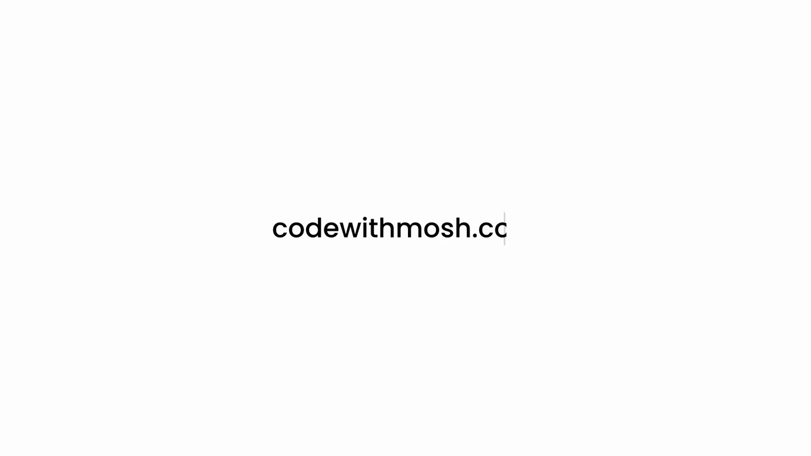
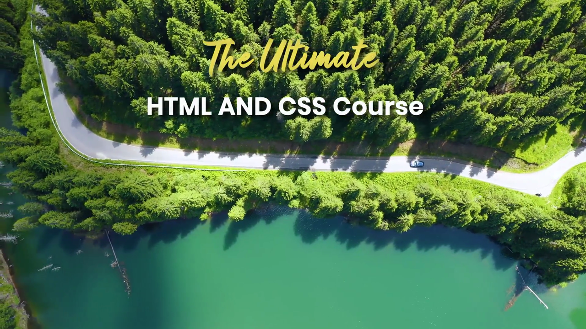
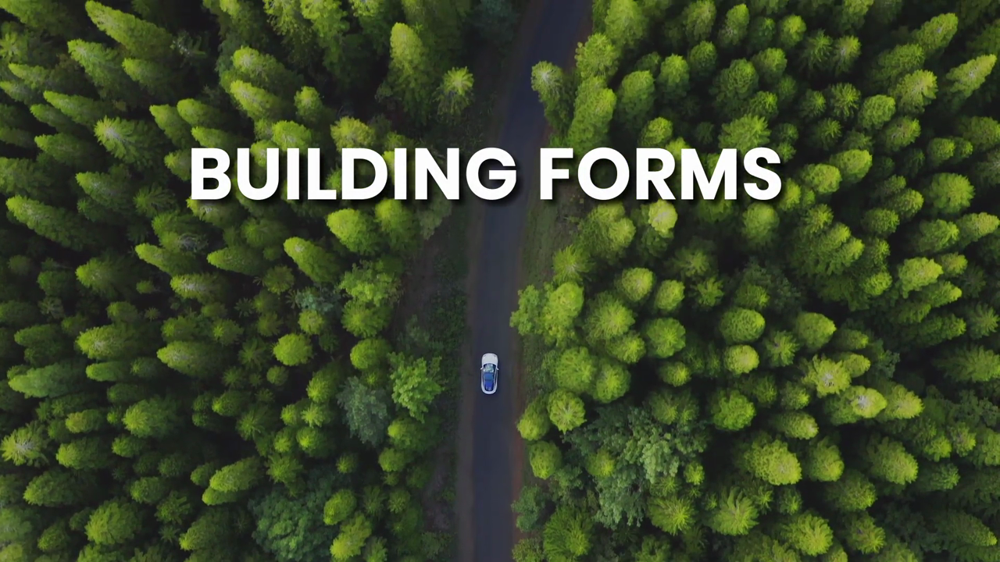

# 5-Forms: 01 - Introduction (0:40)

**ไฟล์ต้นทาง:** `1-Introduction.mp4`

▶️ **[เปิดวิดีโอต้นฉบับ](../../../HTML-CSS-2/5-Forms/1-Introduction.mp4)**

---

## ภาพรวมคลิปนี้

คลิปเปิดบทใหม่ **"5-Forms" (Building Forms)** — เป็นคลิปแนะนำสั้นๆ ความยาวเพียง 40 วินาที (รูปแบบเดียวกับที่ใช้เปิดทุกบทของคอร์สนี้ ไม่ว่าจะเป็น 3-Typography หรือ 4-Images) โดยใช้ภาพโดรนบินสำรวจถนนคดเคี้ยวกลางป่าสนสีเขียว พร้อมข้อความชื่อคอร์สและชื่อบทซ้อนทับ ตามด้วยสไลด์ **"YOU'LL LEARN"** ที่สรุปหัวข้อทั้งหมด 12 หัวข้อที่จะได้เรียนในบทนี้ ปิดท้ายด้วยโลโก้ **MOSH** แบบเดียวกับคลิปเปิดบทอื่นๆ ยังไม่มีการลงโค้ดหรือสอนเนื้อหาจริงในคลิปนี้ เป็นเพียงคลิปแนะนำภาพรวม (teaser/overview) เท่านั้น

---

## 1. ภาพเปิดคอร์ส (Course Intro Animation)

คลิปเริ่มต้นด้วยพื้นหลังสีครีมอ่อน มีข้อความ **"codewithmosh.co..."** กำลังเล่นแอนิเมชันพิมพ์ทีละตัวอักษร (typing animation) พร้อมเคอร์เซอร์กระพริบ ซึ่งเป็นอินโทรมาตรฐานที่ Mosh ใช้เปิดคลิป "Introduction" ของทุกบทในคอร์สนี้

จากนั้นภาพเปลี่ยนเป็นวิดีโอโดรน (drone footage) ถ่ายมุมสูงจากด้านบนลงมา (bird's-eye / top-down view) แสดงถนนลาดยางสีเทาโค้งเคี้ยวผ่ากลางป่าสนหนาทึบสีเขียวสด มีรถยนต์สีขาวคันหนึ่งกำลังแล่นอยู่บนถนน ขณะเดียวกันข้อความชื่อคอร์สก็ค่อยๆ ปรากฏขึ้นซ้อนทับวิดีโอ:

> ตัวอักษร **"The Ultimate"** ปรากฏเป็นฟอนต์ลายมือ (cursive/script font) สีเหลืองทอง ส่วนคำว่า **"HTML AND CSS Course"** ปรากฏเป็นฟอนต์ตัวหนา sans-serif สีขาว อยู่ด้านล่างคำแรก รวมกันเป็นชื่อเต็มของคอร์ส "The Ultimate HTML AND CSS Course"

---

## 2. ชื่อบทใหม่: "BUILDING FORMS"

หลังจากภาพโดรนแสดงชื่อคอร์สอยู่ครู่หนึ่ง ข้อความจะเปลี่ยนเป็นชื่อบทใหม่ **"BUILDING FORMS"** แสดงด้วยฟอนต์ตัวหนาสีขาวขนาดใหญ่ วางอยู่กึ่งกลางเฟรม ซ้อนทับบนภาพโดรนเดิม (ถนนคดเคี้ยวกลางป่าสนพร้อมรถยนต์สีขาว) — เป็นการประกาศเข้าสู่บทใหม่ของคอร์สอย่างชัดเจน

---

## 3. สไลด์สรุปหัวข้อที่จะได้เรียน (YOU'LL LEARN)

ภาพเปลี่ยนจากวิดีโอโดรนเป็นสไลด์พื้นหลังสีขาวครีม มีป้ายสีเหลืองเขียนว่า **"YOU'LL LEARN"** อยู่มุมบนซ้าย จากนั้นหัวข้อย่อยต่างๆ จะถูกเปิดเผยทีละรายการ (แสดงทีละบรรทัดต่อเนื่องกัน โดยมีจุดกลมสีเหลืองนำหน้าแต่ละหัวข้อ) จนครบทั้งหมด 12 หัวข้อ แบ่งเป็น 2 คอลัมน์:

**คอลัมน์ซ้าย:**
1. **Build forms** — การสร้างฟอร์มพื้นฐาน
2. **Style forms** — การจัดสไตล์ฟอร์มด้วย CSS
3. **Text fields** — ช่องกรอกข้อความ
4. **Data lists** — รายการข้อมูล (datalist) สำหรับ autocomplete
5. **Drop-down lists** — เมนูแบบเลื่อนลง (select)
6. **Check boxes** — ช่องกาเครื่องหมาย

**คอลัมน์ขวา:**
7. **Radio buttons** — ปุ่มตัวเลือกแบบวงกลม
8. **Sliders** — แถบเลื่อนค่า (range input)
9. **File inputs** — ช่องอัปโหลดไฟล์
10. **Hidden fields** — ฟิลด์ที่ซ่อนไว้ไม่แสดงผลบนหน้าจอ
11. **Data validation** — การตรวจสอบความถูกต้องของข้อมูล
12. **Submitting forms** — การส่งข้อมูลฟอร์ม

> **ข้อสังเกต:** รายการหัวข้อนี้ตรงกับไฟล์วิดีโอที่อัปโหลดมาเกือบทั้งหมด (คลิป 2 ถึง 15) ยกเว้นหัวข้อ **"Grouping Related Fields"** (การจัดกลุ่มฟิลด์ที่เกี่ยวข้องกันด้วย `<fieldset>`) ซึ่งเป็นคลิปที่ 12 ในไฟล์ที่อัปโหลดจริง แต่ไม่ได้ถูกระบุแยกไว้ในสไลด์สรุปนี้ — อาจถูกนับรวมอยู่ในหัวข้อ "Build forms" หรือ "Style forms" ก็เป็นได้

---

## 4. ภาพโดรนปิดท้ายและโลโก้ MOSH

หลังจากสไลด์สรุปหัวข้อจบลง ภาพจะสลับกลับไปที่วิดีโอโดรนบินสำรวจป่าสนอีกครั้ง (มุมกล้องเปลี่ยนเล็กน้อยจากตอนต้น) ก่อนจะตัดเข้าสู่ฉากปิดท้ายซึ่งเป็นแอนิเมชันโลโก้ **MOSH** (รูปสามเหลี่ยมสีชมพู-แดงและสีม่วงซ้อนกันเป็นรูปตัว "M" พร้อมข้อความ "MOSH" สีกรมท่าเข้มด้านขวา) บนพื้นหลังสีขาว ก่อนตัดเป็นจอดำเพื่อจบคลิป

---

## สรุปภาพรวมของคลิปนี้

| ประเด็น | รายละเอียด |
|---|---|
| **ชื่อบท** | 5-Forms (Building Forms) |
| **ความยาว** | 0:40 นาที |
| **จำนวนหัวข้อในสไลด์แนะนำ** | 12 หัวข้อ (แบ่ง 2 คอลัมน์ คอลัมน์ละ 6 หัวข้อ) |
| **เนื้อหา** | คลิปแนะนำภาพรวมของบท ยังไม่มีโค้ดหรือการสอนจริง เป็นการปูทางสู่หัวข้อ HTML Forms ทั้งหมดที่จะได้เรียน |
| **รูปแบบการนำเสนอ** | วิดีโอโดรนพื้นหลัง + ข้อความชื่อคอร์ส/บท + สไลด์รายการหัวข้อ + โลโก้ MOSH ปิดท้าย |

**แนวคิดสำคัญที่ได้จากคลิปนี้:**

1. **บท "5-Forms" จะครอบคลุมเนื้อหาเกี่ยวกับฟอร์ม HTML อย่างครบวงจร** ตั้งแต่การสร้างฟอร์มพื้นฐาน การจัดสไตล์ด้วย CSS ไปจนถึง input ประเภทต่างๆ (text, datalist, select, checkbox, radio, range/slider, file) รวมถึงเรื่องขั้นสูงอย่าง hidden fields, data validation และการส่งฟอร์ม (submitting)
2. **ฟอร์มเป็นหัวใจสำคัญของเว็บแอปพลิเคชัน** เพราะเป็นช่องทางหลักที่ผู้ใช้โต้ตอบและส่งข้อมูลกลับมายังเซิร์ฟเวอร์ — ทักษะนี้จำเป็นมากสำหรับ Front End Developer โดยเฉพาะเมื่อจะต้องต่อยอดไปทำ full stack project ที่ต้องรับข้อมูลจากฟอร์มไปเก็บใน local storage หรือส่งไปยัง json-server ตามที่กำลังฝึกฝนอยู่
3. **โครงสร้างของคลิปยืนยันรูปแบบมาตรฐานของคอร์สนี้** คือทุกบทใหม่จะเริ่มด้วยคลิป Introduction สั้นๆ แบบเดียวกัน (วิดีโอโดรน + ชื่อบท + สไลด์สรุปหัวข้อ + โลโก้ MOSH) ก่อนที่คลิปถัดไปจะเริ่มลงลึกในเนื้อหาและโค้ดจริง

---

*หมายเหตุ: คลิปนี้เป็นส่วนหนึ่งของบท "5-Forms" จากคอร์ส The Ultimate HTML and CSS Course โดย Mosh Hamedani (codewithmosh.com) — คลิปที่ 1 ของบทนี้*
