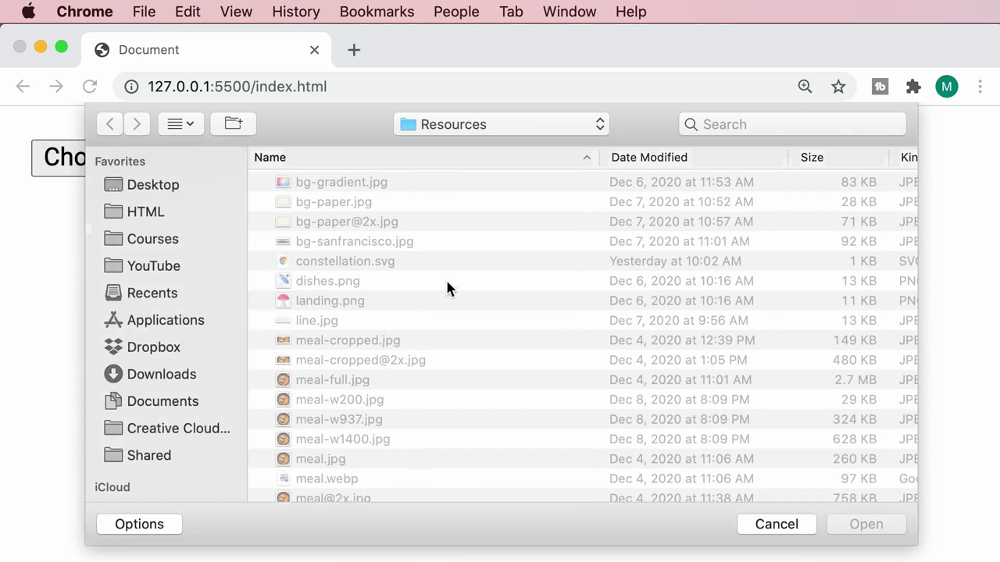
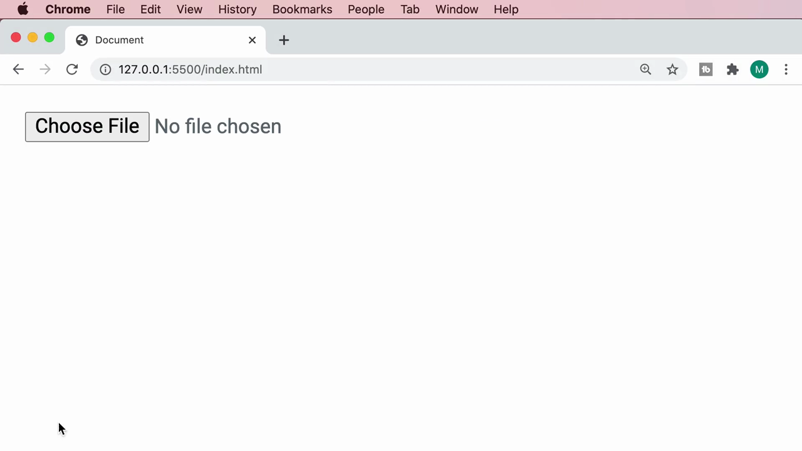
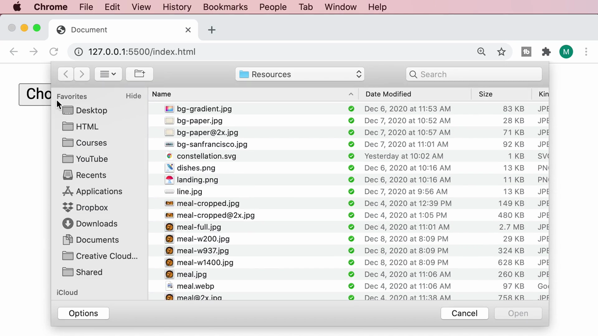
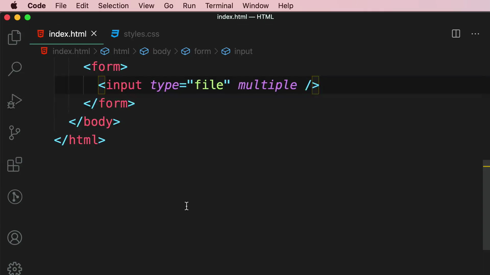
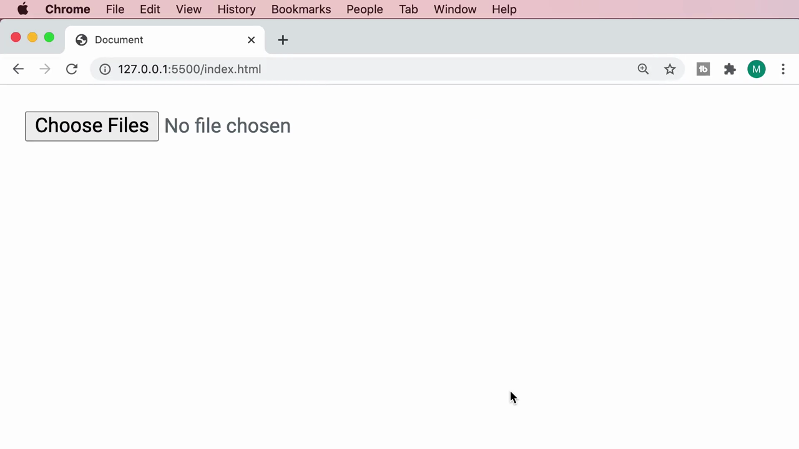
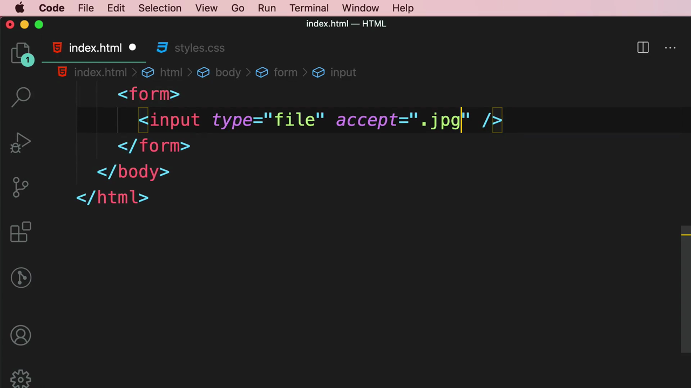
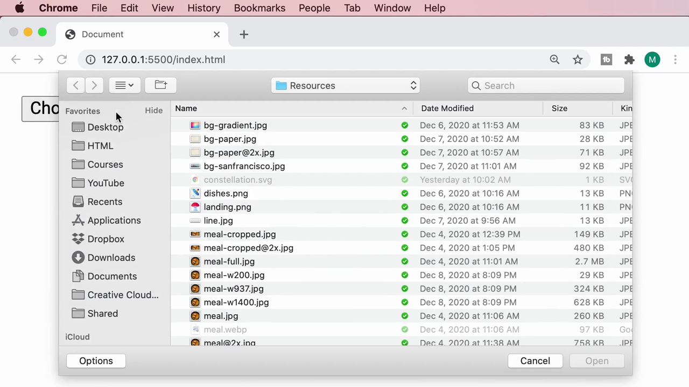
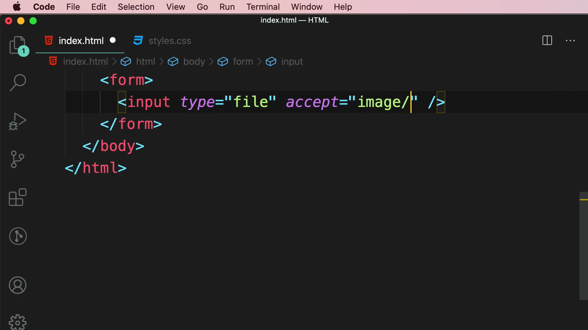

# 5-Forms: 10 - File Inputs (1:20)

**ไฟล์ต้นทาง:** `11-File_Inputs.mp4`

▶️ **[เปิดวิดีโอต้นฉบับ](../../../HTML-CSS-2/5-Forms/10-File-Inputs.mp4)**

---

## ภาพรวมคลิปนี้

คลิปนี้ Mosh สอนแท็ก **`<input type="file">`** สำหรับให้ผู้ใช้อัปโหลดไฟล์จากเครื่องคอมพิวเตอร์ของตนเอง โดยครอบคลุมแอตทริบิวต์ **`multiple`** (เลือกได้หลายไฟล์พร้อมกัน) และ **`accept`** (จำกัดชนิดไฟล์ที่เลือกได้ ทั้งแบบระบุนามสกุลไฟล์และแบบ MIME type)

---

## 1. สร้าง File Input พื้นฐาน

สไลด์ชื่อคลิป **"File Inputs"** เปิดคลิป จากนั้น Mosh เพิ่ม `<input type="file">` ในฟอร์มเปล่า:


```html
<input type="file" />
```



เมื่อรันในเบราว์เซอร์ จะเห็นปุ่ม **"Choose File"** พร้อมข้อความ **"No file chosen"** ต่อท้าย:



เมื่อคลิกที่ปุ่ม เบราว์เซอร์จะเปิด **หน้าต่างเลือกไฟล์แบบเนทีฟของระบบปฏิบัติการ** (native OS file picker) ให้ผู้ใช้เรียกดูและเลือกไฟล์จากเครื่องของตนเอง:



> **จุดเด่นสำคัญ:** เบราว์เซอร์จัดการ UI ของหน้าต่างเลือกไฟล์ให้ทั้งหมดโดยอัตโนมัติ — เป็นหน้าต่างเดียวกับที่ระบบปฏิบัติการใช้เปิดไฟล์ในโปรแกรมอื่นๆ ทำให้ผู้ใช้คุ้นเคยและใช้งานง่ายทันที

---

## 2. แอตทริบิวต์ `multiple` — เลือกได้หลายไฟล์พร้อมกัน

Mosh เพิ่มแอตทริบิวต์ **`multiple`**:

```html
<input type="file" multiple />
```



ผลลัพธ์: ข้อความบนปุ่มเปลี่ยนจาก **"Choose File"** เป็น **"Choose Files"** (พหูพจน์) บ่งบอกว่าตอนนี้ผู้ใช้สามารถเลือกได้มากกว่าหนึ่งไฟล์พร้อมกันในหน้าต่างเลือกไฟล์เดียวกัน (เช่น กด Cmd/Ctrl ค้างไว้พร้อมคลิกหลายไฟล์):



---

## 3. แอตทริบิวต์ `accept` — จำกัดชนิดไฟล์ที่เลือกได้

Mosh เพิ่มแอตทริบิวต์ **`accept`** พร้อมระบุนามสกุลไฟล์ **`.jpg`**:

```html
<input type="file" accept=".jpg" />
```



ผลลัพธ์ในหน้าต่างเลือกไฟล์: ไฟล์ที่ไม่ใช่นามสกุล `.jpg` (เช่น `.png`, `.svg`, `.webp`) จะแสดงเป็นสีจางและไม่สามารถเลือกได้ (disabled) ในขณะที่ไฟล์ `.jpg` ยังคงเลือกได้ตามปกติ:



จากนั้น Mosh เปลี่ยนค่าของ `accept` เป็น **MIME type แบบ wildcard**:

```html
<input type="file" accept="image/*" />
```



> **เปรียบเทียบสองรูปแบบของ `accept`:**
> - **`accept=".jpg"`** — จำกัดตามนามสกุลไฟล์ที่ระบุไว้อย่างเจาะจง (เฉพาะ `.jpg` เท่านั้น)
> - **`accept="image/*"`** — ใช้ MIME type แบบ wildcard เพื่อยอมรับไฟล์รูปภาพทุกชนิด (JPG, PNG, GIF, WebP ฯลฯ) ในคราวเดียว โดยไม่ต้องระบุนามสกุลทีละชนิด
>
> รูปแบบ `accept` ยังรองรับค่าอื่นๆ เช่น `accept="video/*"` (ไฟล์วิดีโอทุกชนิด), `accept="application/pdf"` (เฉพาะ PDF) หรือระบุหลายชนิดคั่นด้วยจุลภาค (`accept=".jpg,.png"`)

---

## สรุปภาพรวมของคลิปนี้

| ประเด็น | รายละเอียด |
|---|---|
| **หัวข้อ** | File Inputs |
| **แท็ก/ประเภทใหม่** | `<input type="file">` |
| **แอตทริบิวต์สำคัญ** | `multiple`, `accept` (นามสกุลไฟล์ หรือ MIME type) |

**แนวคิดสำคัญที่ได้จากคลิปนี้:**

1. **`<input type="file">` มอบ UI การเลือกไฟล์แบบเนทีฟให้ฟรี** โดยไม่ต้องเขียนโค้ดเพิ่มเติมใดๆ เบราว์เซอร์จัดการหน้าต่างเรียกดูไฟล์ของระบบปฏิบัติการให้ทั้งหมด
2. **`multiple` เปลี่ยนพฤติกรรมจากเลือกได้ทีละไฟล์เป็นเลือกได้หลายไฟล์พร้อมกัน** สังเกตได้จากข้อความบนปุ่มที่เปลี่ยนจาก "Choose File" เป็น "Choose Files"
3. **`accept` ช่วยกรองชนิดไฟล์ตั้งแต่ระดับ UI** ทำให้ผู้ใช้เลือกไฟล์ผิดชนิดได้ยากขึ้น (แม้จะยังต้องตรวจสอบซ้ำฝั่ง backend เสมอ เพราะผู้ใช้ยังสามารถเปลี่ยนตัวกรองในหน้าต่างเลือกไฟล์เพื่อเลือกไฟล์ชนิดอื่นได้ในบางกรณี)
4. **MIME type แบบ wildcard (เช่น `image/*`)** เป็นวิธีที่ยืดหยุ่นและครอบคลุมกว่าการระบุนามสกุลไฟล์ทีละชนิด เหมาะกับกรณีที่ต้องการยอมรับไฟล์ประเภทกว้างๆ เช่น รูปภาพหรือวิดีโอทุกชนิด

---

*หมายเหตุ: คลิปนี้เป็นส่วนหนึ่งของบท "5-Forms" จากคอร์ส The Ultimate HTML and CSS Course โดย Mosh Hamedani (codewithmosh.com) — คลิปที่ 10 ของบทนี้*
