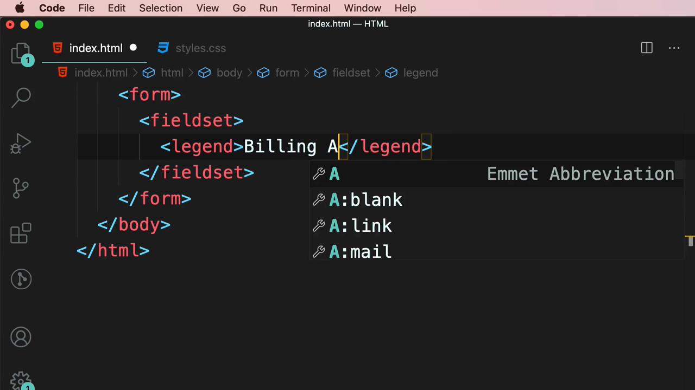
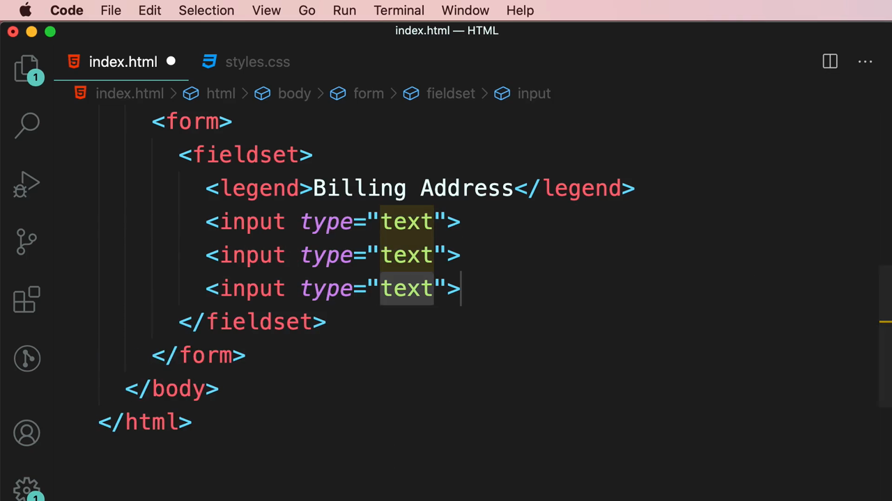
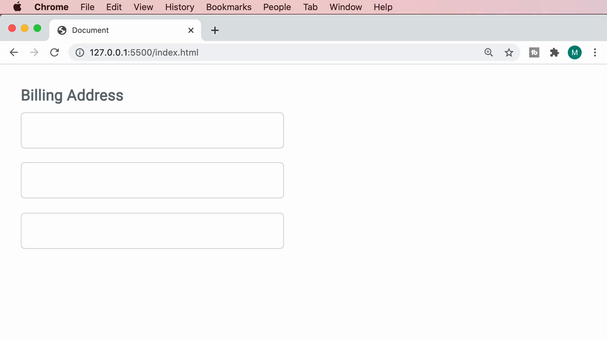
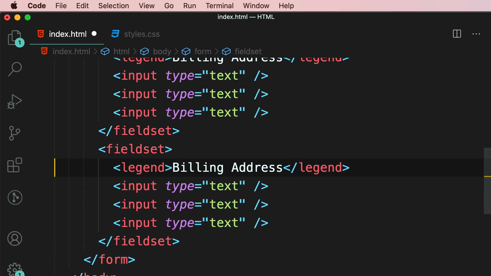
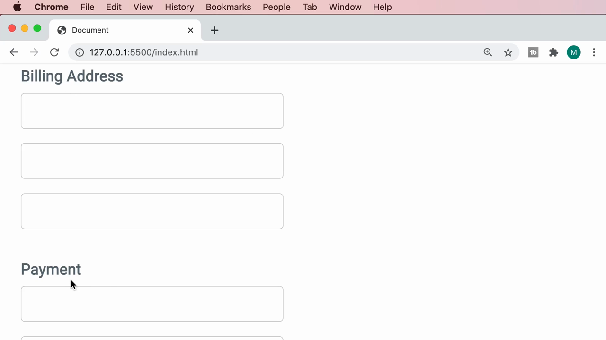
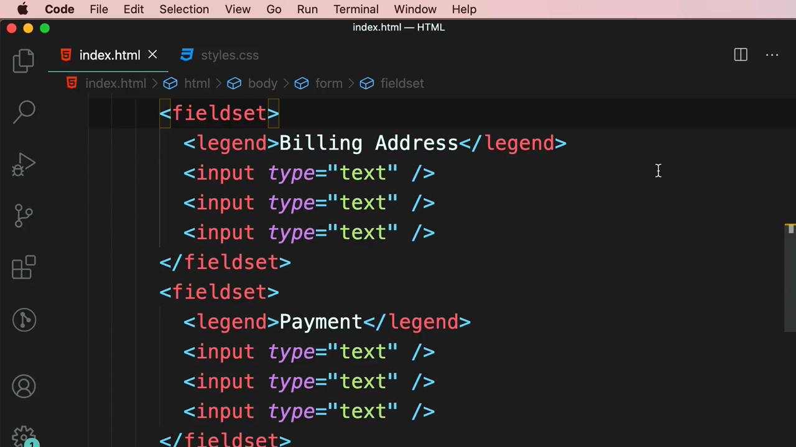

# 5-Forms: 11 - Grouping Related Fields (1:10)

**ไฟล์ต้นทาง:** `12-Grouping_Related_Fields.mp4`

▶️ **[เปิดวิดีโอต้นฉบับ](../../../HTML-CSS-2/5-Forms/11-Grouping-Related-Fields.mp4)**

---

## ภาพรวมคลิปนี้

คลิปสั้นๆ นี้ Mosh สอนแท็ก **`<fieldset>`** และ **`<legend>`** สำหรับจัดกลุ่มฟิลด์ที่เกี่ยวข้องกันในฟอร์มขนาดใหญ่ให้เป็นหมวดหมู่ที่ชัดเจน (เช่น แยกส่วน "ที่อยู่สำหรับเรียกเก็บเงิน" ออกจากส่วน "การชำระเงิน") พร้อมหัวข้อกำกับแต่ละกลุ่ม

---

## 1. สร้าง `<fieldset>` พร้อม `<legend>`

สไลด์ชื่อคลิป **"Grouping Related Fields"** เปิดคลิป จากนั้น Mosh เริ่มจากฟอร์มเปล่าแล้วเพิ่มแท็ก **`<fieldset>`** พร้อมแท็กลูก **`<legend>`** ที่มีข้อความ "Billing Address" (ใช้ Emmet เพื่อพิมพ์เร็วขึ้น):


```html
<fieldset>
  <legend>Billing Address</legend>
</fieldset>
```



จากนั้นเพิ่ม `<input type="text">` สามช่องภายใน `<fieldset>` เดียวกัน (แทนฟิลด์ที่อยู่ เช่น ที่อยู่, เมือง, รหัสไปรษณีย์):

```html
<fieldset>
  <legend>Billing Address</legend>
  <input type="text" />
  <input type="text" />
  <input type="text" />
</fieldset>
```



เมื่อรันในเบราว์เซอร์ จะเห็นหัวข้อ **"Billing Address"** แสดงเป็นตัวหนังสือขนาดใหญ่ (ด้วยสไตล์เริ่มต้นของเบราว์เซอร์สำหรับ `<legend>`) พร้อมช่องกรอกข้อความสามช่องอยู่ด้านล่าง — เห็นได้ชัดว่าเป็นกลุ่มเดียวกัน:



> **บทบาทของ `<fieldset>` และ `<legend>`:**
> - **`<fieldset>`** ครอบกลุ่มของฟิลด์ที่เกี่ยวข้องกัน โดยเบราว์เซอร์มักแสดงกรอบเส้นล้อมรอบกลุ่มนั้นตามสไตล์เริ่มต้น
> - **`<legend>`** ทำหน้าที่เป็นหัวข้อ/คำอธิบายของกลุ่มนั้น แสดงซ้อนทับอยู่บนกรอบของ `<fieldset>`
>
> การใช้ `<fieldset>`/`<legend>` ช่วยทั้งด้านการจัดระเบียบภาพ (visual grouping) และด้าน accessibility เพราะ screen reader จะประกาศชื่อกลุ่ม (legend) ก่อนอ่านฟิลด์แต่ละอันภายในกลุ่มนั้น ทำให้ผู้ใช้ที่ใช้เทคโนโลยีช่วยเหลือเข้าใจบริบทของฟิลด์ได้ดีขึ้น

---

## 2. เพิ่มกลุ่มที่สอง — "Payment"

Mosh คัดลอกทั้งบล็อก `<fieldset>` แล้ววางต่อท้าย จากนั้นเปลี่ยนข้อความใน `<legend>` เป็น **"Payment"** (สำหรับฟิลด์เกี่ยวกับการชำระเงิน เช่น หมายเลขบัตร, วันหมดอายุ, CVV):

```html
<form>
  <fieldset>
    <legend>Billing Address</legend>
    <input type="text" />
    <input type="text" />
    <input type="text" />
  </fieldset>
  <fieldset>
    <legend>Payment</legend>
    <input type="text" />
    <input type="text" />
    <input type="text" />
  </fieldset>
</form>
```



ผลลัพธ์ในเบราว์เซอร์: ทั้งสองกลุ่มแสดงแยกจากกันอย่างชัดเจน แต่ละกลุ่มมีหัวข้อของตัวเอง ("Billing Address" และ "Payment") พร้อมฟิลด์สามช่องต่อกลุ่ม:



โค้ด HTML ฉบับเต็มของทั้งสองกลุ่ม:



---

## สรุปภาพรวมของคลิปนี้

| ประเด็น | รายละเอียด |
|---|---|
| **หัวข้อ** | Grouping Related Fields |
| **แท็กใหม่** | `<fieldset>`, `<legend>` |

**แนวคิดสำคัญที่ได้จากคลิปนี้:**

1. **`<fieldset>` และ `<legend>` ช่วยจัดระเบียบฟอร์มที่มีฟิลด์จำนวนมาก** ให้แบ่งเป็นหมวดหมู่ที่เข้าใจง่าย ทั้งในเชิงภาพและเชิงความหมาย (semantic)
2. **เหมาะกับฟอร์มที่มีหลายส่วนแยกกันชัดเจน** เช่น แบบฟอร์มสั่งซื้อสินค้าที่มีทั้งส่วนที่อยู่จัดส่ง ที่อยู่เรียกเก็บเงิน และข้อมูลการชำระเงิน
3. **ประโยชน์ด้าน accessibility** เป็นเหตุผลสำคัญที่ควรใช้ `<fieldset>`/`<legend>` แทนการใช้ `<div>`/`<h3>` ธรรมดา เพราะ screen reader รองรับโครงสร้างนี้โดยเฉพาะ ทำให้ผู้ใช้ที่พึ่งพาเทคโนโลยีช่วยเหลือเข้าใจบริบทของแต่ละกลุ่มฟิลด์ได้ดีกว่า

---

*หมายเหตุ: คลิปนี้เป็นส่วนหนึ่งของบท "5-Forms" จากคอร์ส The Ultimate HTML and CSS Course โดย Mosh Hamedani (codewithmosh.com) — คลิปที่ 11 ของบทนี้*
