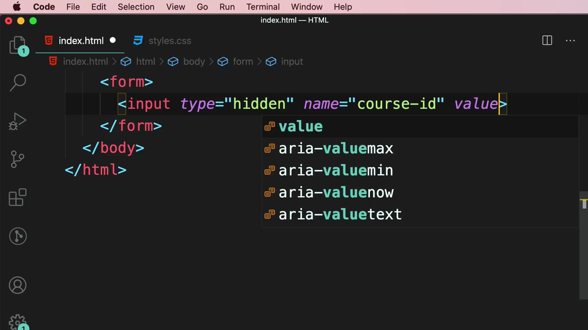
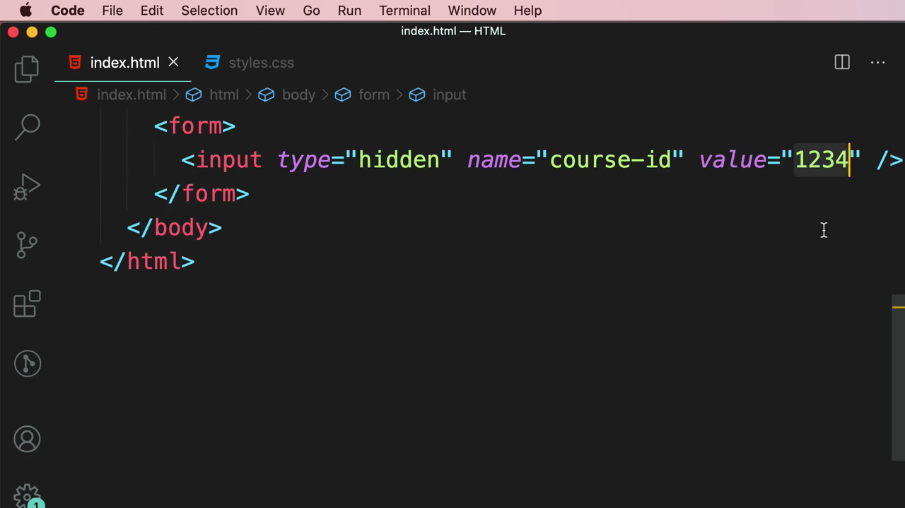
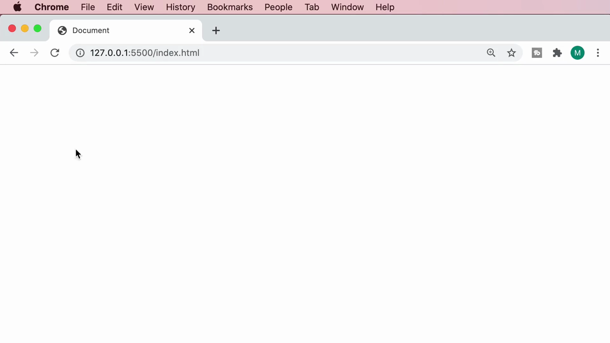
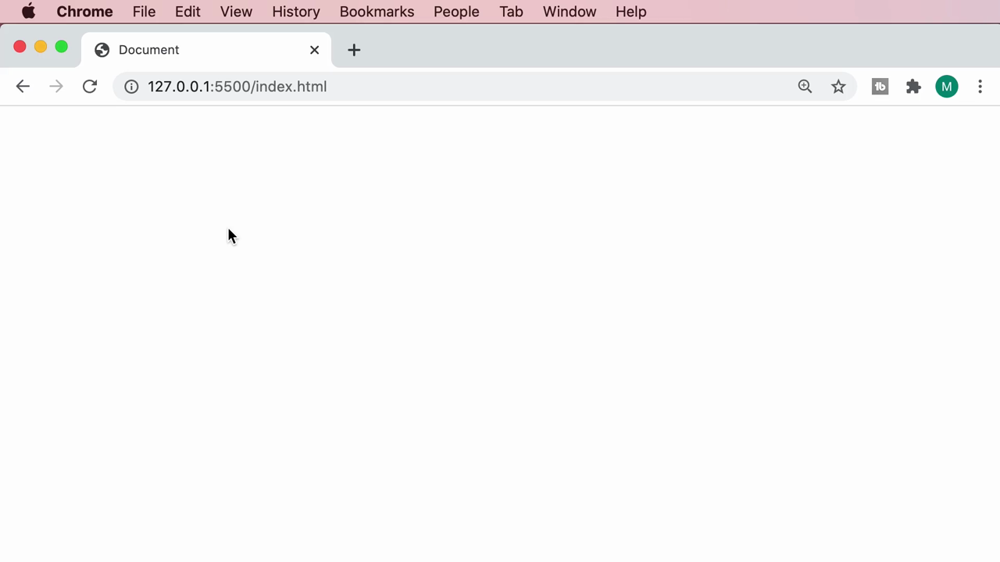
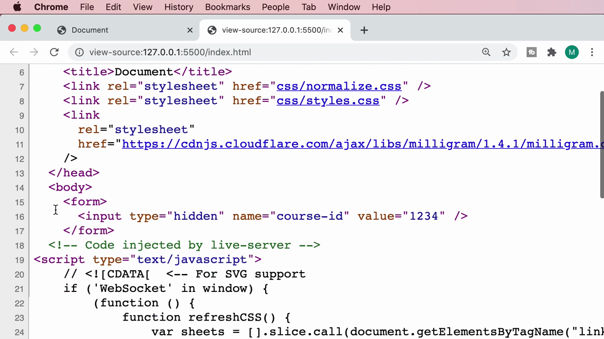

# 5-Forms: 12 - Hidden Fields (1:37)

**ไฟล์ต้นทาง:** `13-Hidden_Fields.mp4`

▶️ **[เปิดวิดีโอต้นฉบับ](../../../HTML-CSS-2/5-Forms/12-Hidden-Fields.mp4)**

---

## ภาพรวมคลิปนี้

คลิปนี้ Mosh สอนแท็ก **`<input type="hidden">`** สำหรับเก็บข้อมูลที่ต้องการส่งไปพร้อมกับฟอร์ม แต่ไม่ต้องการให้ผู้ใช้เห็นหรือแก้ไขได้ (เช่น รหัสอ้างอิงภายในระบบ) พร้อมพิสูจน์ให้เห็นว่าฟิลด์นี้ยังคงอยู่จริงในซอร์สโค้ด HTML แม้จะมองไม่เห็นบนหน้าเว็บก็ตาม

---

## 1. สร้าง Hidden Field

สไลด์ชื่อคลิป **"Hidden Fields"** เปิดคลิป จากนั้น Mosh เพิ่ม `<input type="hidden">` พร้อมแอตทริบิวต์ `name` และ `value`:


```html
<input type="hidden" name="course-id" value="" />
```



จากนั้นกำหนดค่า `value` เป็น **"1234"** (สมมติเป็นรหัสอ้างอิงคอร์สในระบบฐานข้อมูล):

```html
<input type="hidden" name="course-id" value="1234" />
```



เมื่อรันในเบราว์เซอร์ หน้าเว็บจะแสดงเป็น**หน้าว่างเปล่าโดยสิ้นเชิง** เพราะ hidden field ไม่แสดงผลใดๆ ให้ผู้ใช้เห็นเลย:



---

## 2. พิสูจน์ว่า Hidden Field ยังคงอยู่จริงในซอร์สโค้ด

Mosh คลิกขวาบนหน้าเว็บเพื่อเปิดเมนูบริบท (context menu) ของเบราว์เซอร์:



แล้วเลือก **"View Page Source"** เพื่อดูซอร์สโค้ด HTML ดิบของหน้าเว็บ ผลลัพธ์ยืนยันว่า `<input type="hidden" name="course-id" value="1234" />` ยังคงอยู่ในโครงสร้าง HTML จริง เพียงแต่เบราว์เซอร์เลือกที่จะไม่แสดงผลมันบนหน้าจอเท่านั้น:



> **หลักการสำคัญของ `type="hidden"`:**
> - ฟิลด์นี้**ไม่แสดงผลบนหน้าเว็บเลย** ไม่ว่าจะเป็นกล่องข้อความ ปุ่ม หรือองค์ประกอบภาพใดๆ
> - แต่ค่าของมัน**ยังคงถูกส่งไปพร้อมฟอร์ม**เมื่อ submit เหมือน input ประเภทอื่นทุกประการ (ต่างจาก `disabled` ที่ค่าจะไม่ถูกส่งไป)
> - เหมาะกับการเก็บข้อมูลที่ระบบต้องใช้ประกอบการทำงาน แต่ผู้ใช้ไม่จำเป็นต้องเห็นหรือแก้ไข เช่น รหัสอ้างอิง (ID), token, หรือค่าที่คำนวณไว้ล่วงหน้าจากฝั่งเซิร์ฟเวอร์
> - **ข้อควรระวังด้านความปลอดภัย:** แม้ผู้ใช้ทั่วไปจะมองไม่เห็นค่านี้บนหน้าเว็บ แต่ก็สามารถเปิดดูได้ง่ายๆ ผ่าน "View Page Source" หรือ DevTools ดังที่สาธิตในคลิปนี้ ดังนั้นจึง**ไม่ควรใช้ hidden field เก็บข้อมูลที่เป็นความลับ**เด็ดขาด (เช่น รหัสผ่าน หรือข้อมูลที่ไม่ควรให้ผู้ใช้ทั่วไปเข้าถึง)

---

## สรุปภาพรวมของคลิปนี้

| ประเด็น | รายละเอียด |
|---|---|
| **หัวข้อ** | Hidden Fields |
| **แท็ก/ประเภทใหม่** | `<input type="hidden">` |
| **แอตทริบิวต์สำคัญ** | `name`, `value` |
| **เครื่องมือที่ใช้สาธิต** | View Page Source ของ Chrome |

**แนวคิดสำคัญที่ได้จากคลิปนี้:**

1. **Hidden field ยังคงถูกส่งไปพร้อมฟอร์มเสมอ** แม้จะมองไม่เห็นบนหน้าจอ ต่างจาก `disabled` ที่ค่าจะไม่ถูกส่งไปเลย
2. **เหมาะสำหรับข้อมูลระบบที่ไม่ต้องการให้ผู้ใช้แก้ไข** เช่น ID อ้างอิง, CSRF token, หรือค่าที่คำนวณจากฝั่งเซิร์ฟเวอร์มาก่อนแล้ว
3. **ไม่ใช่กลไกความปลอดภัย** — hidden field เพียงซ่อนจากการแสดงผลเท่านั้น ใครก็ตามที่เปิด View Page Source หรือ DevTools ก็สามารถเห็นค่านั้นได้ทันที จึงไม่ควรใช้เก็บข้อมูลลับหรือข้อมูลอ่อนไหว
4. **"View Page Source" เป็นเครื่องมือสำคัญที่ควรคุ้นเคย** สำหรับตรวจสอบโครงสร้าง HTML จริงที่เบราว์เซอร์ได้รับ ซึ่งอาจแตกต่างจากสิ่งที่มองเห็นด้วยตาเปล่าบนหน้าเว็บ

---

*หมายเหตุ: คลิปนี้เป็นส่วนหนึ่งของบท "5-Forms" จากคอร์ส The Ultimate HTML and CSS Course โดย Mosh Hamedani (codewithmosh.com) — คลิปที่ 12 ของบทนี้*
