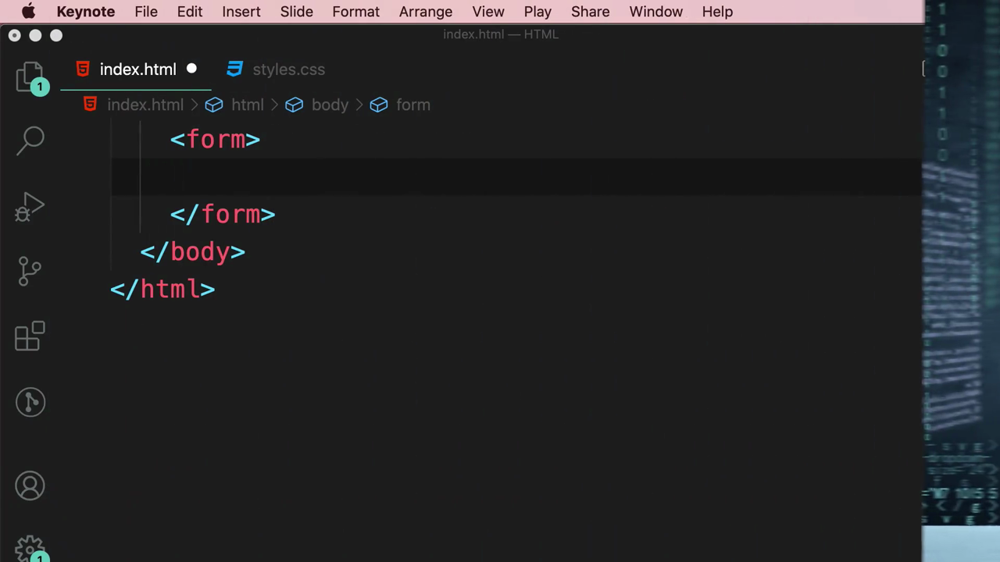
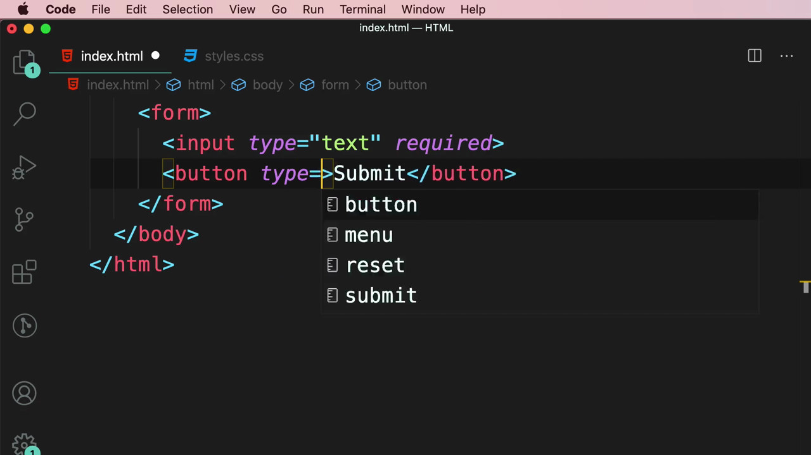
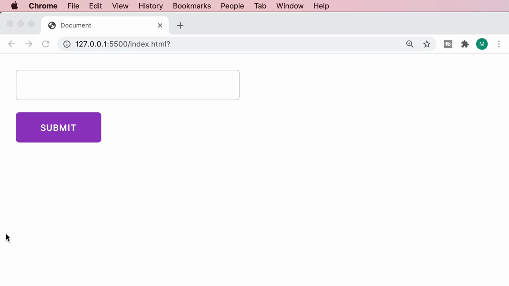
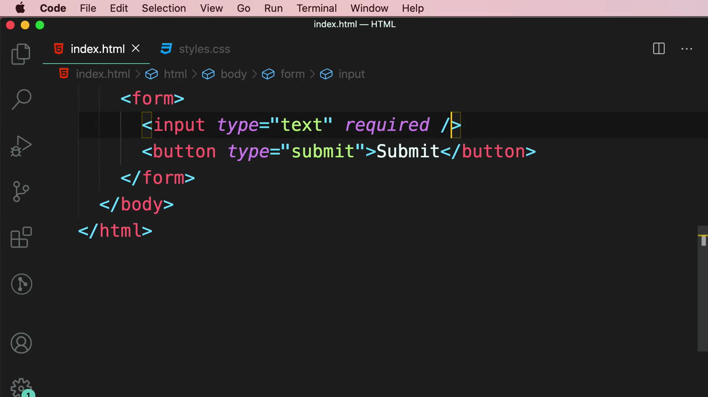
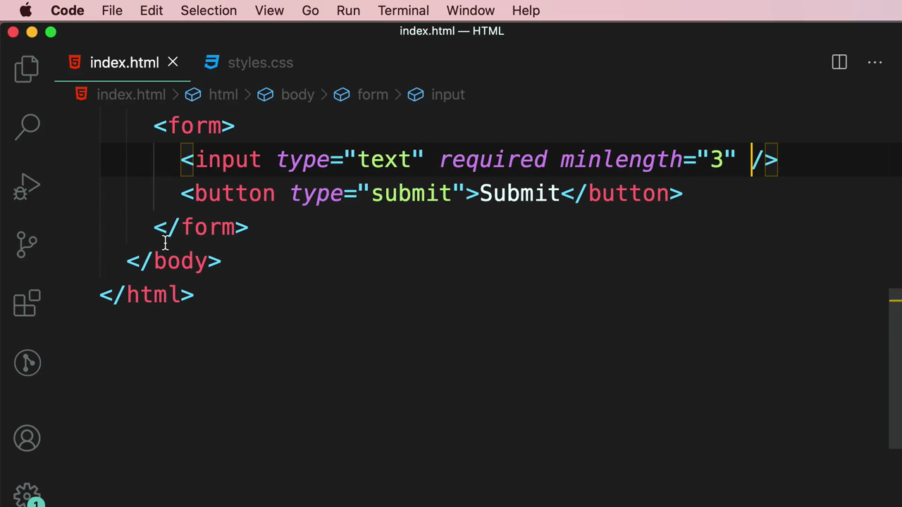
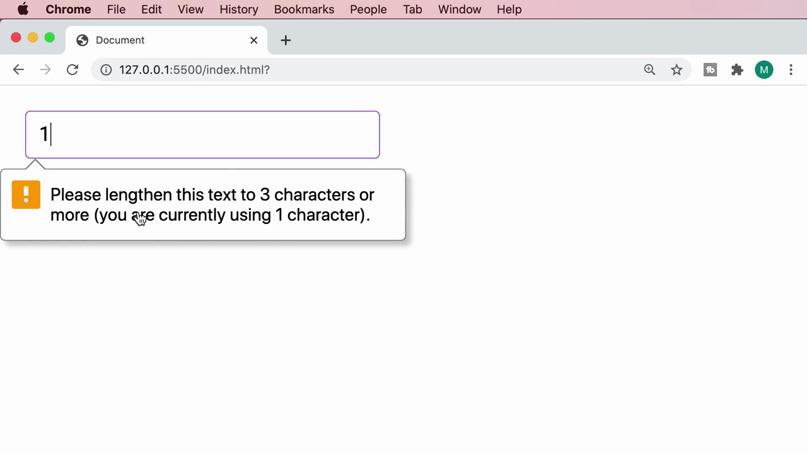
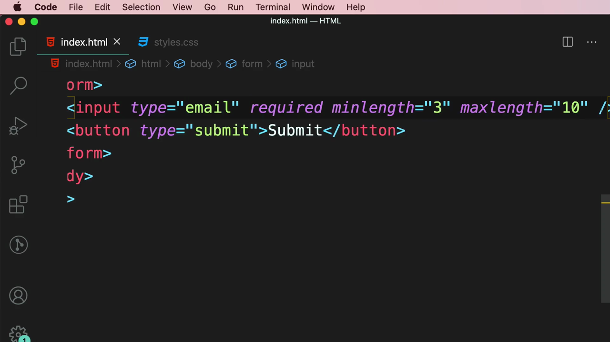
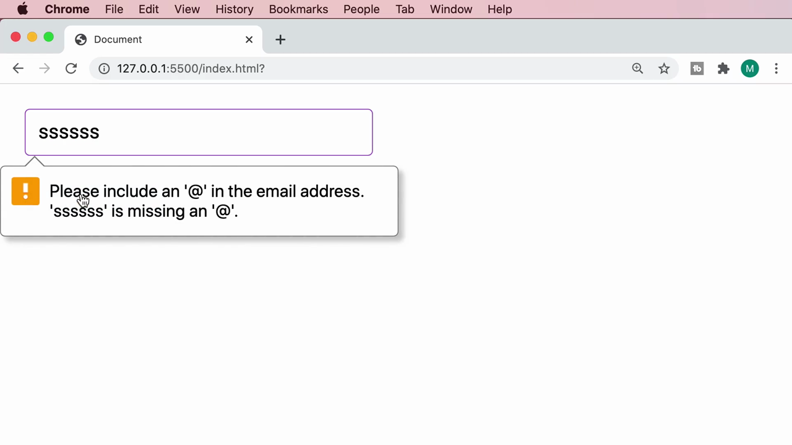

# 5-Forms: 13 - Data Validation (3:33)

**ไฟล์ต้นทาง:** `14-Data_Validation.mp4`

▶️ **[เปิดวิดีโอต้นฉบับ](../../../HTML-CSS-2/5-Forms/13-Data-Validation.mp4)**

---

## ภาพรวมคลิปนี้

คลิปนี้ Mosh สอนเรื่อง **Data Validation** (การตรวจสอบความถูกต้องของข้อมูล) ในฟอร์ม HTML โดยเริ่มจากอธิบายว่าทำไม client-side validation เพียงอย่างเดียวไม่เพียงพอต่อความปลอดภัย จากนั้นสาธิตแอตทริบิวต์ validation พื้นฐานของ HTML5 ได้แก่ **`required`**, **`minlength`**, **`maxlength`** และการตรวจสอบรูปแบบอัตโนมัติของ **`type="email"`** พร้อมแสดงข้อความแจ้งเตือน (validation bubble) ที่เบราว์เซอร์สร้างให้โดยอัตโนมัติเมื่อข้อมูลไม่ผ่านเงื่อนไข

---

## 1. ทำไม Client-Side Validation เพียงอย่างเดียวไม่ปลอดภัย

สไลด์ชื่อคลิป **"Data Validation"** เปิดคลิป:


จากนั้น Mosh แสดงสไลด์ภาพประกอบเป็นรูปแฮกเกอร์สวมฮู้ดนั่งอยู่หน้าคอมพิวเตอร์ พร้อมพื้นหลังโค้ดสีเขียวสไตล์ Matrix และคำว่า "password" เรืองแสง เพื่ออธิบายแนวคิดว่า **การตรวจสอบข้อมูลฝั่ง client (เบราว์เซอร์) เพียงอย่างเดียวไม่เพียงพอต่อความปลอดภัย** เพราะผู้ใช้ที่ประสงค์ร้ายสามารถหลีกเลี่ยงการตรวจสอบฝั่ง client ได้ง่ายๆ (เช่น ปิด JavaScript, แก้ไข HTML ผ่าน DevTools, หรือส่งคำขอ HTTP ตรงไปยังเซิร์ฟเวอร์โดยไม่ผ่านหน้าเว็บเลย):


> **หลักการสำคัญ:** Client-side validation (การตรวจสอบด้วย HTML/JavaScript ในเบราว์เซอร์) มีไว้เพื่อ**ช่วยปรับปรุงประสบการณ์ผู้ใช้ (UX)** ให้ผู้ใช้ทั่วไปได้รับ feedback ทันทีโดยไม่ต้องรอส่งข้อมูลไปเซิร์ฟเวอร์ก่อน แต่**ไม่ควรใช้เป็นเครื่องมือความปลอดภัยเพียงอย่างเดียว** — ระบบที่ปลอดภัยจริงต้องมี **server-side validation** ควบคู่กันเสมอ เพื่อตรวจสอบข้อมูลซ้ำอีกครั้งก่อนนำไปประมวลผลหรือบันทึกลงฐานข้อมูล เนื่องจากเซิร์ฟเวอร์ไม่สามารถไว้ใจข้อมูลใดๆ ที่มาจากฝั่ง client ได้เลย

---

## 2. เตรียมฟอร์มพื้นฐาน

Mosh สลับจาก Keynote มายัง VS Code (เห็นสไลด์แฮกเกอร์ยังค้างอยู่ที่ขอบจอในช่วงเปลี่ยนหน้าต่าง) และเริ่มจากฟอร์มเปล่า:



```html
<form></form>
```

จากนั้นพิมพ์ `<input type="text">` พร้อมเพิ่มแอตทริบิวต์ **`required`** และปุ่ม `<button type="submit">` โดยระหว่างพิมพ์ค่า `type` ของปุ่ม VS Code แสดง IntelliSense แนะนำค่าที่เป็นไปได้ (**button, menu, reset, submit**) ให้เลือก:

```html
<input type="text" required>
<button type="submit">Submit</button>
```



เมื่อรันในเบราว์เซอร์ จะเห็นช่องกรอกข้อความว่างเปล่าพร้อมปุ่ม **SUBMIT** สีม่วง:



โค้ดฉบับเต็มของฟอร์มในขั้นตอนนี้:

```html
<form>
  <input type="text" required />
  <button type="submit">Submit</button>
</form>
```



> **`required`** เป็น boolean attribute ที่บังคับให้ผู้ใช้ต้องกรอกข้อมูลในฟิลด์นั้นก่อนจึงจะ submit ฟอร์มได้ หากปล่อยว่างแล้วกด Submit เบราว์เซอร์จะปฏิเสธการส่งฟอร์มโดยอัตโนมัติและแสดงข้อความแจ้งเตือน (validation bubble) ให้ผู้ใช้ทราบทันที โดยไม่ต้องเขียน JavaScript ใดๆ เพิ่มเติมเลย

---

## 3. แอตทริบิวต์ `minlength` — กำหนดความยาวขั้นต่ำ

Mosh เพิ่มแอตทริบิวต์ **`minlength="3"`** ให้กับ input:

```html
<input type="text" required minlength="3" />
```



เมื่อทดสอบพิมพ์ตัวอักษรเพียง **1 ตัว** (พิมพ์เลข "1") แล้วกด Submit เบราว์เซอร์จะแสดงข้อความแจ้งเตือนแบบ native ทันที:

> "Please lengthen this text to 3 characters or more (you are currently using 1 character)."



> **`minlength`** กำหนดจำนวนตัวอักษรขั้นต่ำที่ผู้ใช้ต้องกรอก หากกรอกน้อยกว่าค่าที่กำหนด เบราว์เซอร์จะบล็อกการ submit และแจ้งเตือนพร้อมระบุจำนวนตัวอักษรที่ขาดไปอย่างชัดเจน (ในตัวอย่างนี้คือ ต้องการอย่างน้อย 3 ตัวอักษร แต่ผู้ใช้กรอกมาเพียง 1 ตัว) ข้อความแจ้งเตือนเหล่านี้เป็น**ข้อความมาตรฐานของเบราว์เซอร์ (native validation message)** ที่สร้างขึ้นเองโดยอัตโนมัติ ไม่ต้องเขียนโค้ดเพิ่มเพื่อสร้างข้อความเหล่านี้

---

## 4. เพิ่ม `maxlength` และเปลี่ยนเป็น `type="email"` — ตรวจสอบรูปแบบอัตโนมัติ

Mosh รีเซ็ตฟอร์มกลับมาเป็นค่าว่างเปล่าอีกครั้งเพื่อทดสอบรอบใหม่:


จากนั้นเปลี่ยนค่า `type` จาก `"text"` เป็น **`"email"`** และเพิ่มแอตทริบิวต์ **`maxlength="10"`** เข้าไปด้วย:

```html
<input type="email" required minlength="3" maxlength="10" />
```



เมื่อทดสอบพิมพ์ข้อความ **"sssssss"** (ตัว s เจ็ดตัว ซึ่งผ่านเงื่อนไข `minlength`/`maxlength` แล้ว แต่ไม่ใช่รูปแบบอีเมลที่ถูกต้อง) แล้วกด Submit เบราว์เซอร์จะแสดงข้อความแจ้งเตือนใหม่ที่เกี่ยวกับรูปแบบอีเมลโดยเฉพาะ:

> "Please include an '@' in the email address. 'sssssss' is missing an '@'."



> **`type="email"` มาพร้อมกับการตรวจสอบรูปแบบ (pattern validation) ในตัวโดยอัตโนมัติ** เบราว์เซอร์จะตรวจสอบว่าข้อความที่กรอกมีโครงสร้างคล้ายอีเมลหรือไม่ (ต้องมีเครื่องหมาย `@` อย่างน้อยหนึ่งตัว) หากไม่ตรงตามรูปแบบ จะแสดงข้อความแจ้งเตือนที่ระบุปัญหาอย่างเจาะจง (ในที่นี้คือ "ขาดเครื่องหมาย @") โดยไม่ต้องเขียน regular expression หรือ JavaScript ตรวจสอบเอง — ต่างจาก `type="text"` ที่ไม่มีการตรวจสอบรูปแบบใดๆ ในตัว

---

## สรุปภาพรวมของคลิปนี้

| ประเด็น | รายละเอียด |
|---|---|
| **หัวข้อ** | Data Validation |
| **แนวคิดหลัก** | Client-side validation ช่วยด้าน UX แต่ต้องมี Server-side validation ควบคู่เสมอเพื่อความปลอดภัย |
| **แอตทริบิวต์ validation ที่สอน** | `required`, `minlength`, `maxlength`, `type="email"` (ตรวจสอบรูปแบบอัตโนมัติ) |
| **พฤติกรรมของเบราว์เซอร์** | สร้างข้อความแจ้งเตือน (validation bubble) ให้อัตโนมัติ พร้อมบล็อกการ submit จนกว่าข้อมูลจะถูกต้อง |

**แนวคิดสำคัญที่ได้จากคลิปนี้:**

1. **Client-side validation ไม่ใช่มาตรการความปลอดภัย** เป็นเพียงการช่วยปรับปรุงประสบการณ์ผู้ใช้เท่านั้น ผู้ใช้ที่ประสงค์ร้ายสามารถหลีกเลี่ยงได้เสมอ ระบบจริงต้องตรวจสอบข้อมูลซ้ำที่ฝั่งเซิร์ฟเวอร์ (server-side validation) ทุกครั้งก่อนนำข้อมูลไปใช้งาน
2. **`required`, `minlength`, `maxlength` เป็นแอตทริบิวต์ validation พื้นฐานของ HTML5** ที่ทำงานได้ทันทีโดยไม่ต้องเขียน JavaScript เพิ่มเติมเลย
3. **`type="email"` (และ input type อื่นๆ เช่น `url`, `number`) มาพร้อมกฎการตรวจสอบรูปแบบในตัว** ทำให้ตรวจจับข้อมูลที่ไม่ถูกต้องตามรูปแบบได้โดยอัตโนมัติ ต่างจาก `type="text"` ที่ไม่มีการตรวจสอบรูปแบบใดๆ
4. **ข้อความแจ้งเตือน (validation message/bubble) เป็นสิ่งที่เบราว์เซอร์สร้างขึ้นเองโดยอัตโนมัติ** ตามภาษาของระบบและประเภทของการตรวจสอบที่ไม่ผ่าน ช่วยลดภาระในการเขียนข้อความ error เองทั้งหมด
5. **HTML5 validation ทำให้สร้างฟอร์มที่ตรวจสอบข้อมูลเบื้องต้นได้อย่างรวดเร็ว** โดยไม่ต้องพึ่งพา JavaScript library ภายนอก เหมาะสำหรับกรณีตรวจสอบพื้นฐาน เช่น ฟิลด์บังคับ ความยาวขั้นต่ำ/สูงสุด และรูปแบบข้อมูลทั่วไป

---

*หมายเหตุ: คลิปนี้เป็นส่วนหนึ่งของบท "5-Forms" จากคอร์ส The Ultimate HTML and CSS Course โดย Mosh Hamedani (codewithmosh.com) — คลิปที่ 13 ของบทนี้*
