# 5-Forms: 14 - Submitting the Form (5:55)

**ไฟล์ต้นทาง:** `15-Submitting_the_Form.mp4`

▶️ **[เปิดวิดีโอต้นฉบับ](../../../HTML-CSS-2/5-Forms/14-Submitting-the-Form.mp4)**

---

## ภาพรวมคลิปนี้

คลิปสุดท้ายของบทนี้ Mosh สอนเรื่อง **การส่งฟอร์มจริง (submitting the form)** ตั้งแต่วิธีสร้างปุ่ม submit สองแบบ (`<input type="submit">` และ `<button type="submit">`) ไปจนถึงการทำความเข้าใจว่าทำไมฟอร์มต้องมี**เทคโนโลยีฝั่งเซิร์ฟเวอร์ (server-side technology)** มารองรับการส่งข้อมูลจริง โดยใช้บริการฟรีชื่อ **Formspree.io** เป็นตัวอย่าง พร้อมสาธิตแอตทริบิวต์ **`action`**, **`method`** (`GET` vs `POST`) และ **`name`** ของแต่ละ input รวมถึงเปิด DevTools เพื่อดู HTTP request จริงที่เกิดขึ้นเบื้องหลังเมื่อกด Submit

---

## 1. สร้างฟอร์มพื้นฐานพร้อมปุ่ม Submit สองแบบ

สไลด์ชื่อคลิป **"Submitting the Form"** เปิดคลิป จากนั้น Mosh เริ่มจากฟอร์มเปล่า:

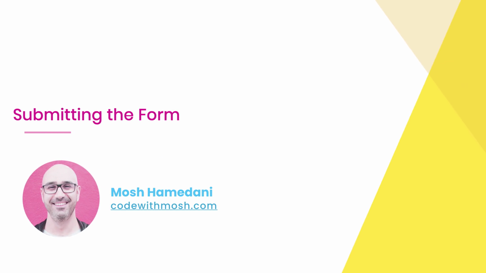

เพิ่ม `<input type="text">` สองช่อง (Name, Email) และ `<button></button>` เปล่า:

```html
<form>
  <input type="text" placeholder="Name" />
  <input type="text" placeholder="Email" />
  <button></button>
</form>
```

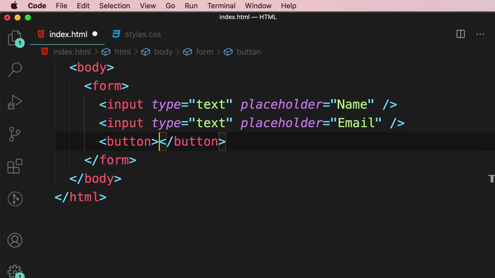

Mosh ใช้ Emmet พิมพ์ `input:b` เพื่อดูตัวเลือก abbreviation ต่างๆ ของ input (เช่น `input:button`, `input:checkbox`, `input:color`, `input:date`) ก่อนเลือกสร้าง **`<input type="submit">`**:

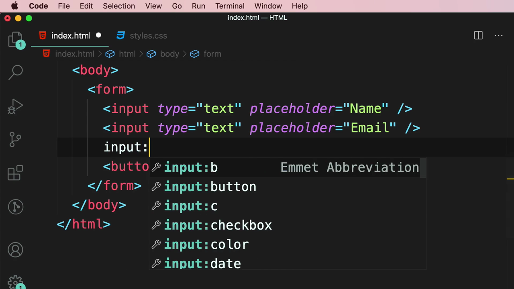

```html
<input type="submit" value="" />
```

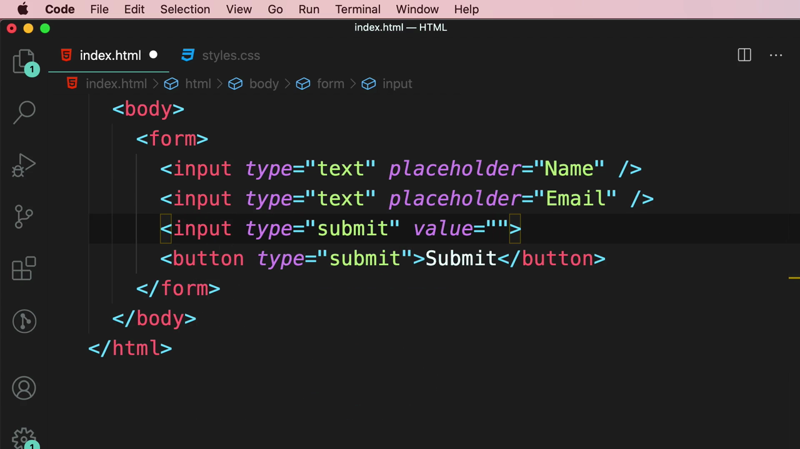

เมื่อรันในเบราว์เซอร์ (มีทั้ง `<input type="submit">` และ `<button type="submit">` วางคู่กัน) จะเห็นปุ่ม **SUBMIT** สองปุ่มที่หน้าตาเหมือนกันทุกประการ:

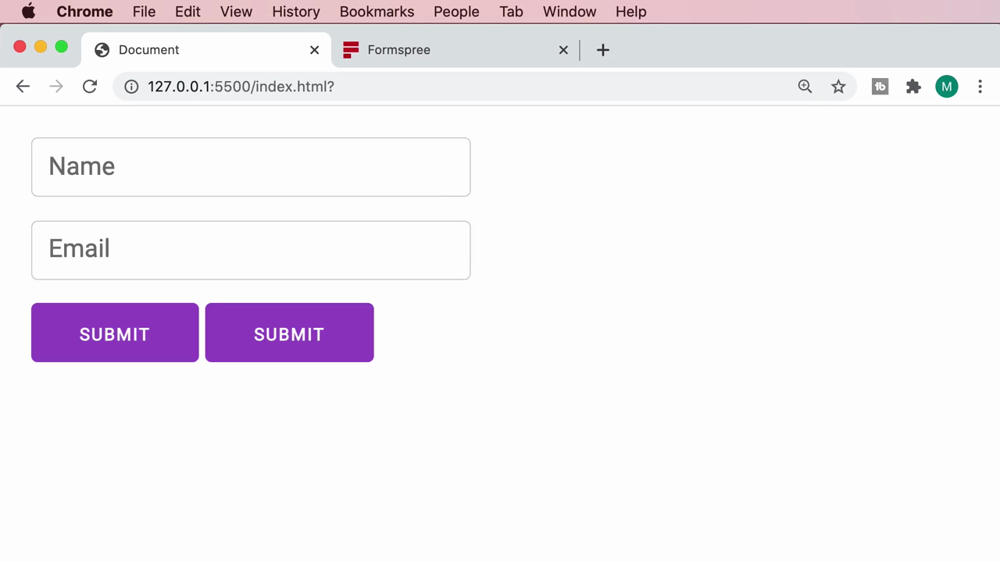

จากนั้น Mosh ใส่ข้อความ **"Submit"** ให้กับ `value` ของ `<input type="submit">`:

```html
<input type="submit" value="Submit" />
```

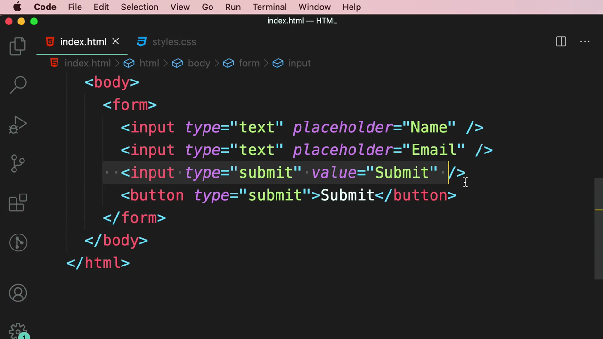

> **เปรียบเทียบ `<input type="submit">` กับ `<button type="submit">`:**
> - **`<input type="submit" value="...">`** — เป็น self-closing element แสดงผลได้เฉพาะ**ข้อความล้วน**ตามค่าของ `value` เท่านั้น ไม่สามารถใส่ HTML อื่นๆ เช่นไอคอนเข้าไปข้างในได้
> - **`<button type="submit">...</button>`** — เป็น element ที่มีเนื้อหาภายใน (content) จึงยืดหยุ่นกว่ามาก สามารถใส่ทั้งข้อความและ HTML อื่นๆ ผสมกันได้ เช่น ไอคอน, `<span>`, หรือ ``
>
> ด้วยความยืดหยุ่นนี้ ปัจจุบัน **`<button type="submit">` จึงเป็นตัวเลือกที่นิยมใช้มากกว่า** `<input type="submit">` ในการพัฒนาเว็บสมัยใหม่

---

## 2. เพิ่มไอคอนเข้าไปในปุ่ม Submit

Mosh สาธิตข้อดีของ `<button>` โดยพิมพ์ Emmet abbreviation **`i.fas`** เพื่อสร้างแท็ก `<i>` พร้อมคลาส Font Awesome:

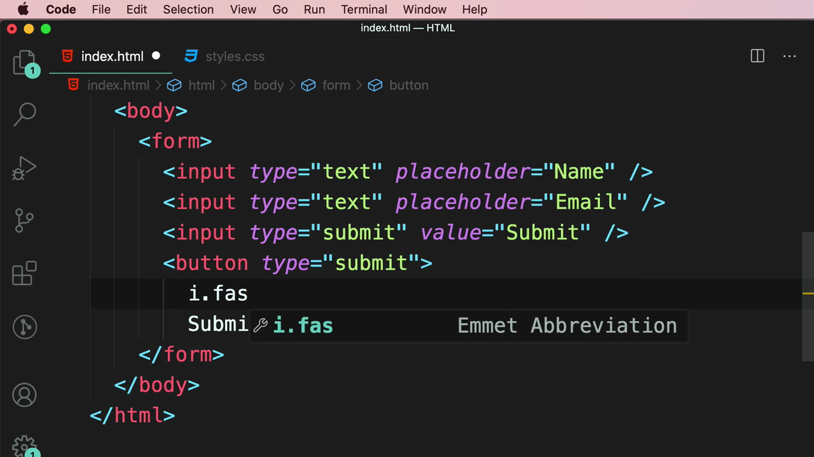

```html
<button type="submit">
  <i class="fas fa-alert"></i>
  Submit
</button>
```

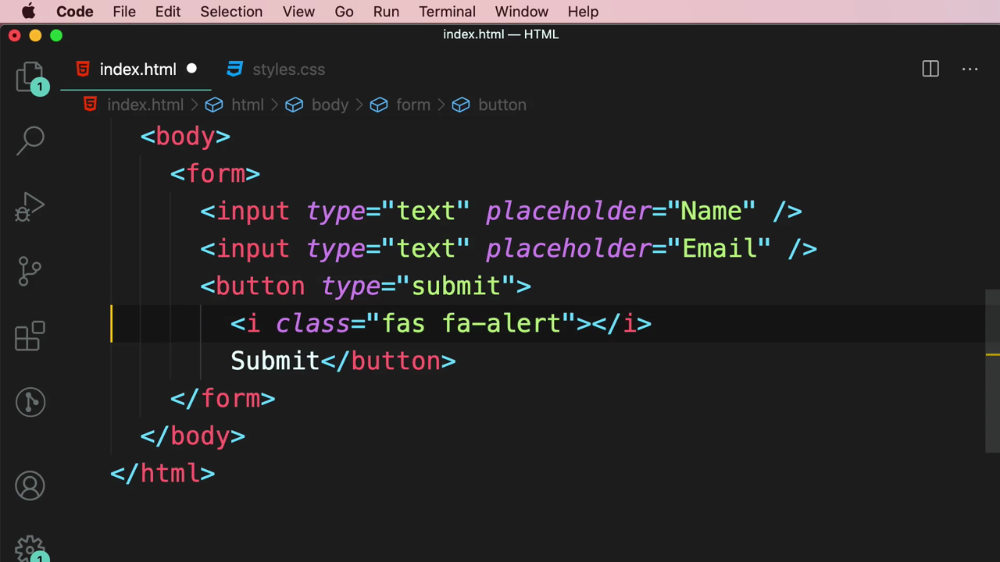

> การใส่ไอคอนแบบนี้ทำได้เฉพาะกับ `<button>` เท่านั้น เพราะสามารถมีลูก (child elements) อยู่ภายในได้ ซึ่งเป็นเหตุผลสำคัญที่ทำให้ `<button>` เป็นตัวเลือกที่ยืดหยุ่นและได้รับความนิยมมากกว่าในการสร้างปุ่ม submit ของฟอร์มยุคใหม่

---

## 3. ทำไมฟอร์มต้องมี Server-Side Technology

Mosh อธิบายว่าการกดปุ่ม Submit เพียงอย่างเดียวยังไม่เพียงพอ — ฟอร์มต้องมี**เทคโนโลยีฝั่งเซิร์ฟเวอร์** มารับข้อมูลและประมวลผลต่อ (เช่น บันทึกลงฐานข้อมูล หรือส่งอีเมล) แสดงสไลด์หัวข้อ **"SERVER-SIDE TECHNOLOGIES"**:

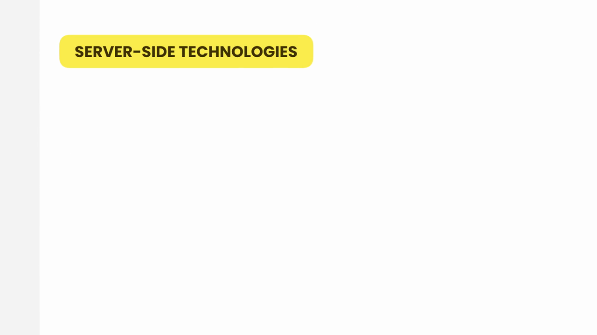

> โดยปกติแล้วการสร้าง backend เองต้องใช้ภาษาและเฟรมเวิร์กฝั่งเซิร์ฟเวอร์ (เช่น Node.js, PHP, Python) แต่สำหรับผู้ที่ยังไม่พร้อมเขียน backend เอง มีบริการสำเร็จรูปฟรีที่ช่วยรับข้อมูลจากฟอร์มแทนได้ เช่น **Formspree.io**

---

## 4. สร้างฟอร์มบน Formspree.io

Mosh เข้าเว็บไซต์ **formspree.io** และไปที่หน้า **"Your Forms"** ในบัญชีของเขา:

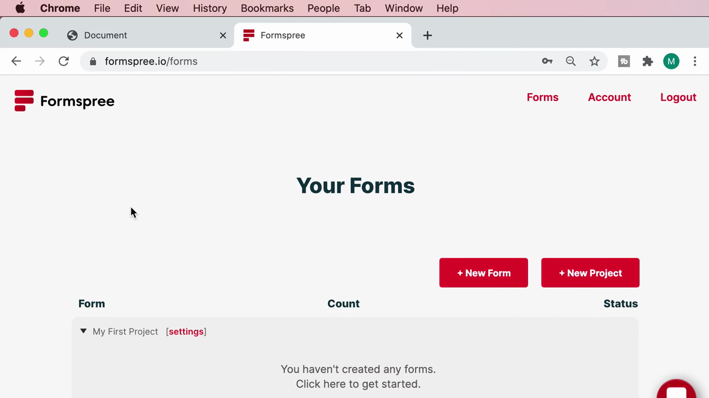

คลิก **"+ New Form"** แล้วกรอกแบบฟอร์ม **"Create Form"** — ตั้งชื่อฟอร์ม, เลือกโปรเจกต์ และระบุอีเมลที่จะให้ Formspree ส่งข้อมูลที่ได้รับไปให้:

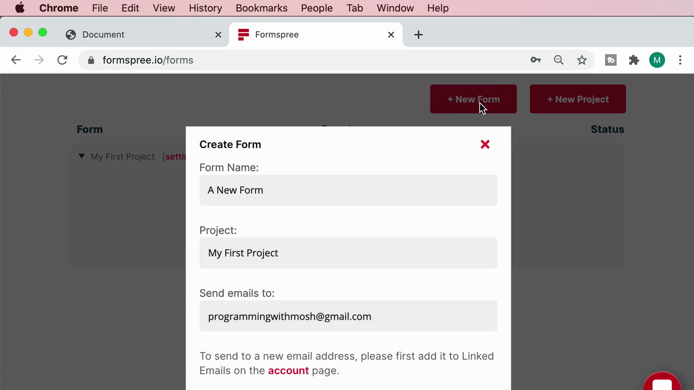

หลังสร้างสำเร็จ ระบบแสดงข้อความ **"Form created successfully"** พร้อมหน้า **"Form Details"** ของฟอร์มชื่อ "Contact Form":

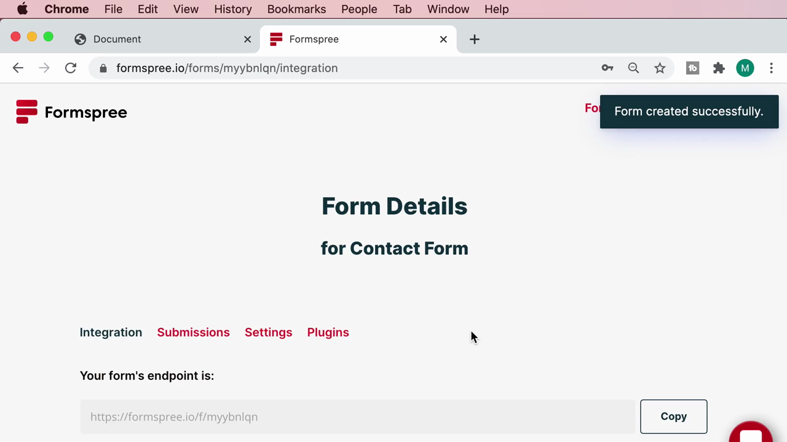

Formspree ให้ **endpoint URL** เฉพาะของฟอร์มนี้มา (`https://formspree.io/f/myybnlqn`) พร้อมคำแนะนำการใช้งานว่า: ให้นำ URL นี้ไปใส่ใน `action`, ต้องใช้ `method="POST"` และทุก `<input>` ต้องมี `name` attribute พร้อมตัวอย่างโค้ดประกอบ:

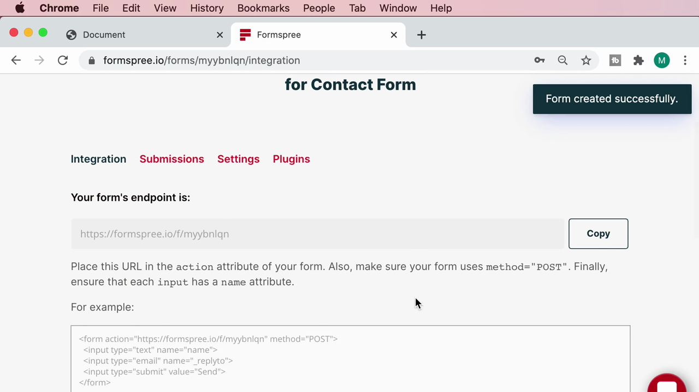

---

## 5. เชื่อมฟอร์มกับ Formspree ด้วย `action` และ `method`

Mosh เพิ่มแอตทริบิวต์ **`action`** ให้กับ `<form>` โดยใส่ endpoint URL ที่คัดลอกมาจาก Formspree:

```html
<form action="https://formspree.io/f/myybnlqn">
```

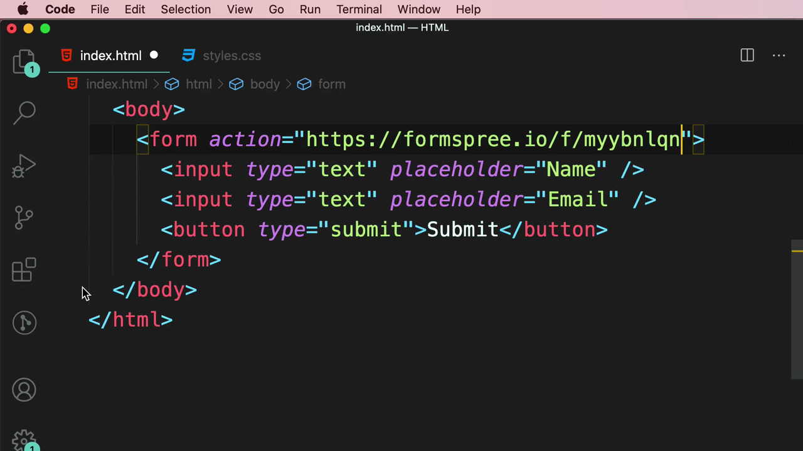

จากนั้นทดลองเพิ่มแอตทริบิวต์ **`method`** โดย VS Code แสดง IntelliSense แนะนำค่า **`GET`** เป็นค่าแรก:

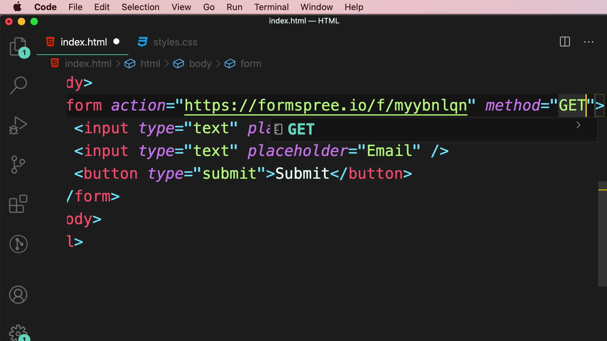

เมื่อทดลองกรอกฟอร์มแล้ว submit ด้วย `method="GET"` เบราว์เซอร์จะนำข้อมูลที่กรอกไปแนบต่อท้าย URL เป็น **query string** (เช่น `?name=Mosh&email=programmingwithmosh%40gmail.com` — คล้ายกับการค้นหาบน Google ที่คำค้นหาจะปรากฏใน URL เช่นกัน) แต่ Formspree ปฏิเสธคำขอนี้และแสดงข้อความ **"Form should POST — Make sure your form has the `method="POST"` attribute"**:

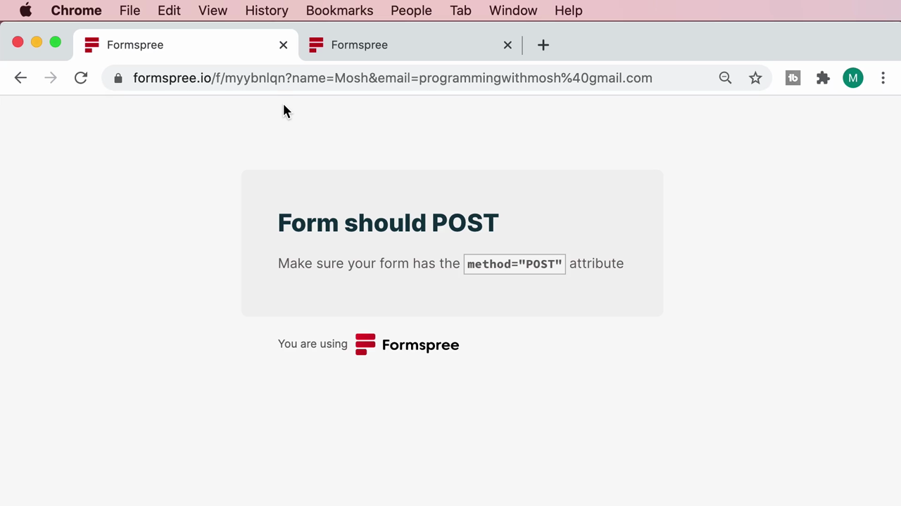

Mosh จึงแก้ไขเป็น **`method="POST"`** และเพิ่มแอตทริบิวต์ **`name`** ให้กับ input แต่ละช่อง (`name="name"`, `name="email"`) ตามที่ Formspree ต้องการ เพื่อให้ระบบรู้ว่าค่าที่ส่งมาแต่ละอันคือฟิลด์ใด:

```html
<form action="https://formspree.io/f/myybnlqn" method="POST">
  <input type="text" placeholder="Name" name="name" />
  <input type="text" placeholder="Email" name="email" />
  <button type="submit">Submit</button>
</form>
```

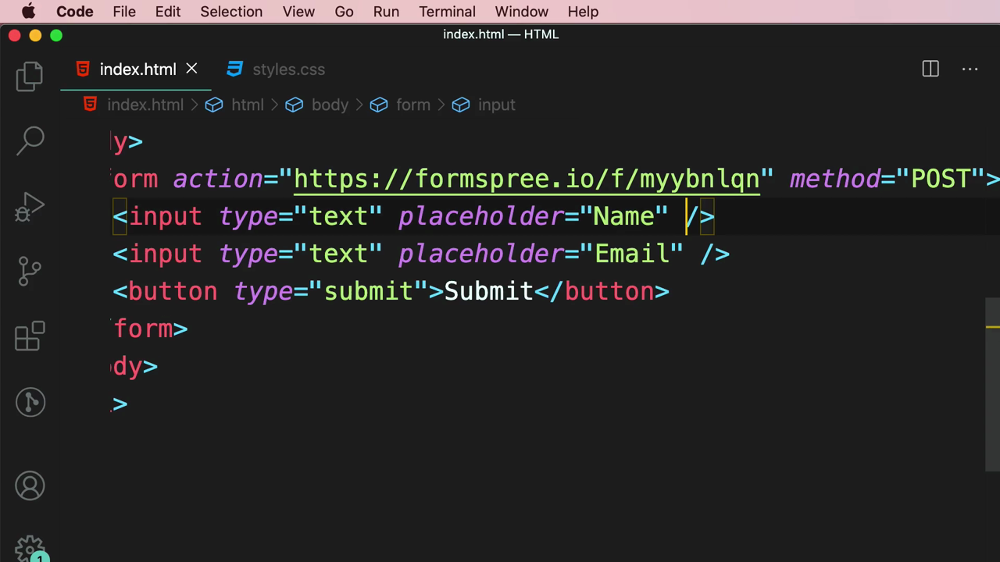

> **เปรียบเทียบ `method="GET"` กับ `method="POST"`:**
> - **`GET`** — ข้อมูลฟอร์มถูกแนบไปกับ URL ในรูปแบบ query string มองเห็นได้ชัดเจนในแถบที่อยู่ เหมาะกับการค้นหาหรือคำขอที่ไม่มีผลข้างเคียง (เช่น การค้นหาบน Google)
> - **`POST`** — ข้อมูลฟอร์มถูกส่งอยู่ใน **body ของ HTTP request** ไม่ปรากฏใน URL ให้เห็น เหมาะกับข้อมูลที่มีความละเอียดอ่อนหรือมีผลข้างเคียงต่อระบบ (เช่น การสมัครสมาชิก, การส่งข้อความติดต่อ) ซึ่ง Formspree (และ backend ส่วนใหญ่) กำหนดให้ฟอร์มต้องใช้ `POST` เท่านั้น
> - **`name` เป็นแอตทริบิวต์ที่จำเป็นสำหรับทุก input ที่ต้องการส่งค่าไปกับฟอร์ม** เพราะเซิร์ฟเวอร์ใช้ค่านี้เป็น "กุญแจ" (key) ในการระบุว่าค่าที่ส่งมาแต่ละตัวคือข้อมูลของฟิลด์ใด

---

## 6. ทดสอบส่งฟอร์มจริงและตรวจสอบผลลัพธ์

Mosh กรอกข้อมูลลงในฟอร์ม (Name: "Mosh", Email: "programmingwithmosh@gmail.com") แล้วกด Submit:

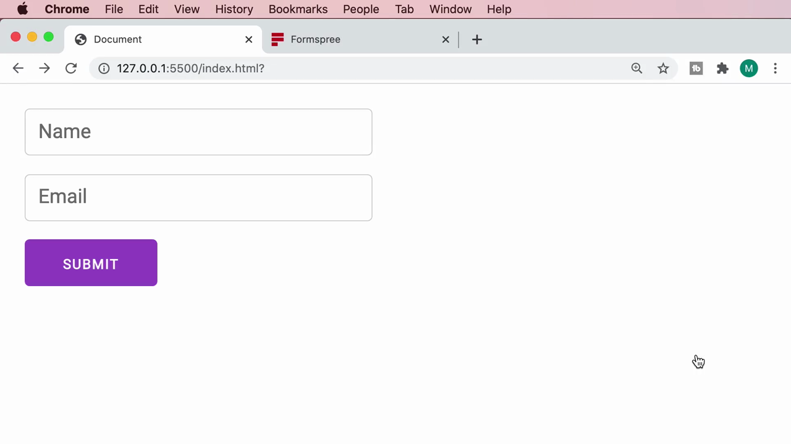

เบราว์เซอร์นำทางไปยังหน้า **"Thanks!"** ของ Formspree พร้อมข้อความ **"The form was submitted successfully."** ยืนยันว่าข้อมูลถูกส่งไปถึงเซิร์ฟเวอร์ของ Formspree สำเร็จ:

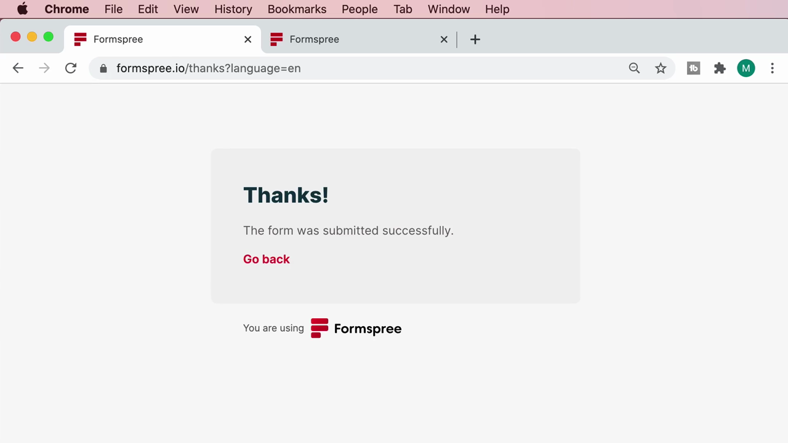

---

## 7. ตรวจสอบ HTTP Request เบื้องหลังด้วย DevTools

Mosh เปิด **Chrome DevTools** แท็บ **Network** แล้วทดลอง submit ฟอร์มอีกครั้งเพื่อดู request ที่เกิดขึ้นจริง พบรายการ **`myybnlqn`** ที่มี **Method: POST** และ **Status Code: 302** (redirect ไปยังหน้า thanks):

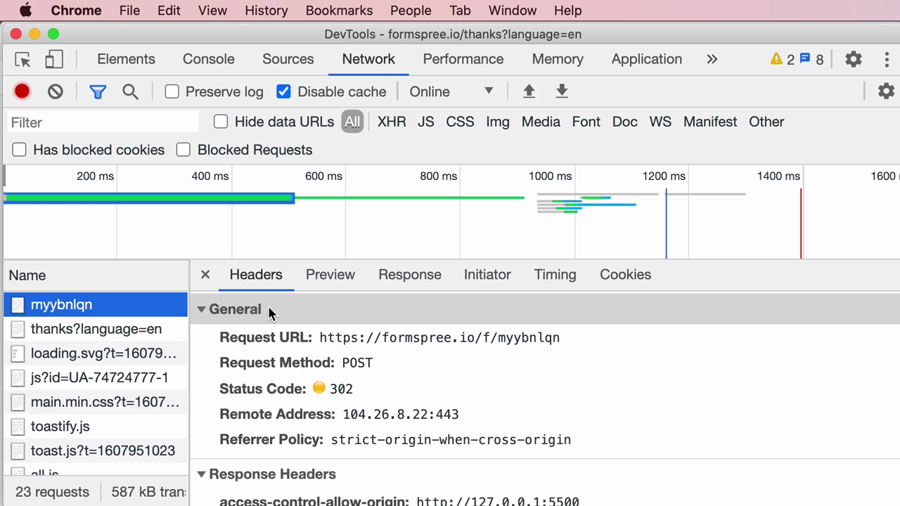

เมื่อเลื่อนลงไปดูส่วน **"Form Data"** ใน tab Headers จะเห็นข้อมูลที่ถูกส่งไปจริงในรูปแบบ **key-value** ตรงกับ `name` attribute ที่กำหนดไว้ในโค้ด:

```
name: Mosh
email: programmingwithmosh@gmail.com
```

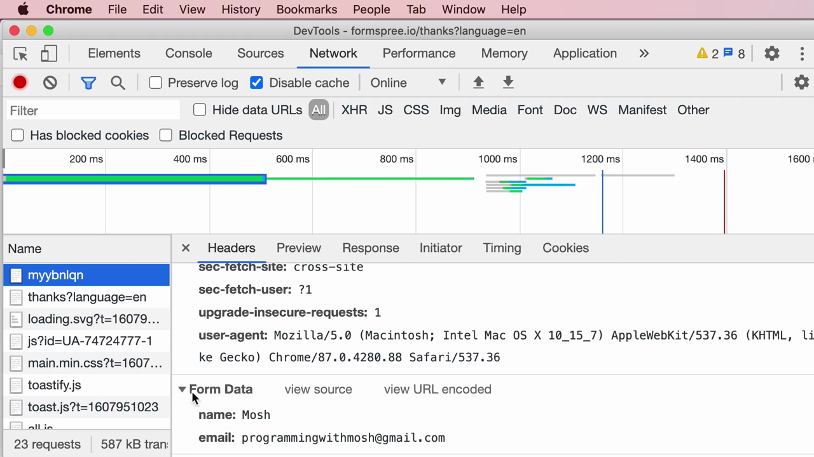

สุดท้าย Mosh กลับไปที่หน้า Dashboard ของ Formspree แท็บ **"Submissions"** เพื่อยืนยันว่าข้อมูลที่ส่งมาถูกบันทึกไว้จริง — เห็นกราฟแสดงจำนวนการส่งฟอร์มที่เพิ่มขึ้น พร้อมตารางรายการแสดงวันที่, อีเมล และชื่อ ("Mosh") ที่ตรงกับข้อมูลที่กรอกไป:

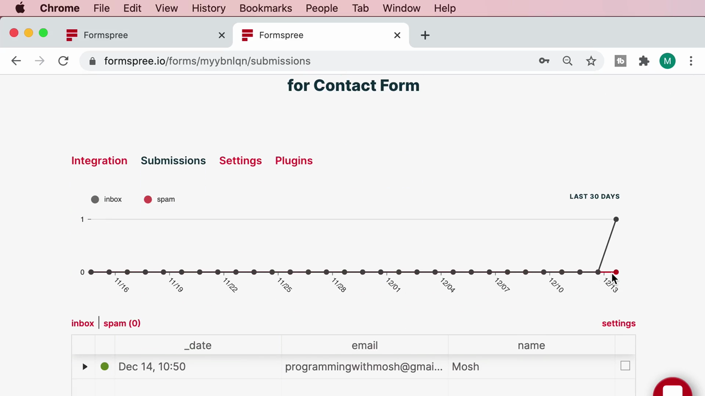

> **สรุปวงจรการทำงานของการ submit ฟอร์ม:** ผู้ใช้กรอกข้อมูล → กด submit → เบราว์เซอร์ส่ง HTTP request (มักเป็น `POST`) ไปยัง URL ที่ระบุใน `action` → เซิร์ฟเวอร์ (ในที่นี้คือ Formspree) รับข้อมูลไปประมวลผลและบันทึก → เซิร์ฟเวอร์ตอบกลับ (มักเป็นหน้ายืนยันหรือ redirect) กลับมาให้ผู้ใช้เห็น กระบวนการทั้งหมดนี้สามารถตรวจสอบได้อย่างละเอียดผ่าน DevTools แท็บ Network

---

## สรุปภาพรวมของคลิปนี้

| ประเด็น | รายละเอียด |
|---|---|
| **หัวข้อ** | Submitting the Form |
| **แท็ก/ประเภทที่เกี่ยวข้อง** | `<input type="submit">`, `<button type="submit">` |
| **แอตทริบิวต์ของ `<form>`** | `action` (URL ปลายทาง), `method` (`GET`/`POST`) |
| **แอตทริบิวต์ของ `<input>`** | `name` (กุญแจระบุฟิลด์เมื่อส่งข้อมูล) |
| **เครื่องมือ/บริการที่ใช้สาธิต** | Formspree.io (backend สำเร็จรูปสำหรับรับข้อมูลฟอร์ม), Chrome DevTools (แท็บ Network) |

**แนวคิดสำคัญที่ได้จากคลิปนี้:**

1. **`<button type="submit">` ยืดหยุ่นกว่า `<input type="submit">`** เพราะสามารถใส่เนื้อหาอื่นๆ เช่นไอคอนผสมกับข้อความได้ ในขณะที่ `<input type="submit">` แสดงได้เฉพาะข้อความล้วนตาม `value`
2. **ฟอร์มต้องพึ่งพาเทคโนโลยีฝั่งเซิร์ฟเวอร์เสมอ** เพื่อรับและประมวลผลข้อมูลที่ผู้ใช้กรอก การกด submit เพียงอย่างเดียวไม่มีความหมายหากไม่มีปลายทางรองรับ
3. **Formspree.io เป็นตัวอย่างบริการฟรีที่ช่วยให้ฟอร์ม HTML ธรรมดาส่งข้อมูลได้จริง** โดยไม่ต้องเขียน backend เอง เหมาะสำหรับผู้เริ่มต้นหรือโปรเจกต์ขนาดเล็ก
4. **`action` กำหนดปลายทางที่ข้อมูลฟอร์มจะถูกส่งไป** ส่วน **`method`** กำหนดวิธีการส่ง โดย `GET` แนบข้อมูลไปกับ URL (เห็นได้ในแถบที่อยู่) ส่วน `POST` ส่งข้อมูลอยู่ใน body ของ request ซึ่งปลอดภัยและเหมาะสมกว่าสำหรับการส่งฟอร์มส่วนใหญ่
5. **`name` attribute ของแต่ละ input จำเป็นเสมอ** หากต้องการให้ค่าของ input นั้นถูกส่งไปพร้อมฟอร์ม เพราะเซิร์ฟเวอร์ใช้ชื่อนี้เป็นกุญแจในการอ่านค่าแต่ละฟิลด์
6. **Chrome DevTools แท็บ Network เป็นเครื่องมือสำคัญ** สำหรับตรวจสอบ HTTP request ที่เกิดขึ้นจริงเบื้องหลังการ submit ฟอร์ม ทั้ง method, status code, และข้อมูลที่ถูกส่งไปจริง (Form Data) ช่วยให้เข้าใจการทำงานของฟอร์มในระดับที่ลึกกว่าการดูผลลัพธ์บนหน้าจอเพียงอย่างเดียว

---

*หมายเหตุ: คลิปนี้เป็นส่วนหนึ่งของบท "5-Forms" จากคอร์ส The Ultimate HTML and CSS Course โดย Mosh Hamedani (codewithmosh.com) — คลิปที่ 14 ของบทนี้ (คลิปสุดท้ายของบท)*
