# 5-Forms: 02 - Creating a Basic Form (3:50)

**ไฟล์ต้นทาง:** `2-Creating_a_Basic_Form.mp4`

▶️ **[เปิดวิดีโอต้นฉบับ](../../../HTML-CSS-2/5-Forms/2-Creating-a-Basic-Form.mp4)**

---

## ภาพรวมคลิปนี้

คลิปนี้ Mosh เริ่มสอนวิธีสร้างฟอร์ม HTML พื้นฐานตั้งแต่ศูนย์ โดยเริ่มจากแท็ก `<form>` และ `<input>` เปล่าๆ จากนั้นค่อยๆ เพิ่ม `<label>` เพื่อระบุชื่อฟิลด์อย่างถูกต้องตามหลัก accessibility อธิบายความสำคัญของแอตทริบิวต์ `for` และ `id` ที่ใช้เชื่อมโยง label กับ input เข้าด้วยกัน จากนั้นสาธิตการใช้ Emmet **"Wrap with Abbreviation"** เพื่อครอบกลุ่ม label+input ด้วย `<div>` ให้แต่ละฟิลด์ขึ้นบรรทัดใหม่ และปิดท้ายด้วยการเพิ่มปุ่ม **Register** (submit) และ **Clear** (reset)

---

## 1. เริ่มต้นด้วย `<form>` และ `<input>` เปล่า

สไลด์ชื่อคลิป **"Creating a Basic Form"** เปิดคลิป จากนั้น Mosh เปิด VS Code และเริ่มเขียนโครงสร้างพื้นฐาน โดยพิมพ์แท็ก `<form>` เปล่าๆ ก่อน แล้วจึงเพิ่ม `<input type="text" />` เข้าไปข้างใน:

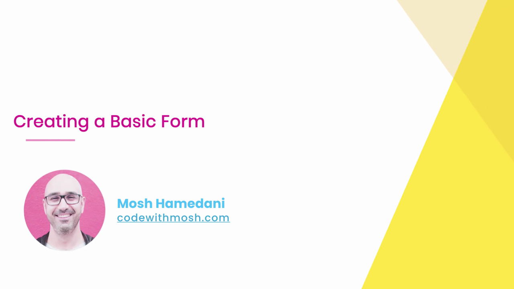

```html
<body>
  <form>

  </form>
</body>
```

จากนั้นเพิ่ม input:

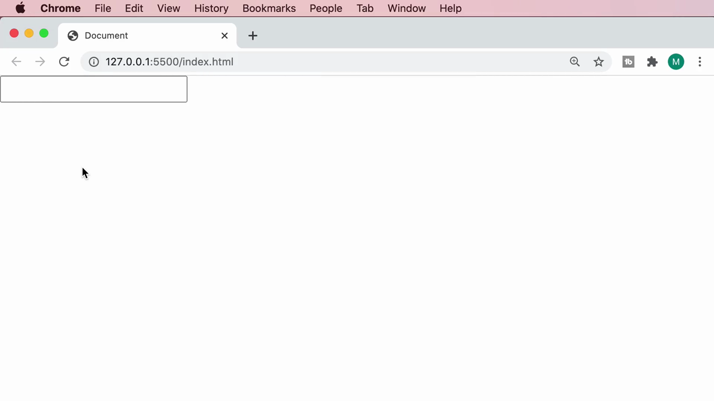

```html
<body>
  <form>
    <input type="text" />
  </form>
</body>
```

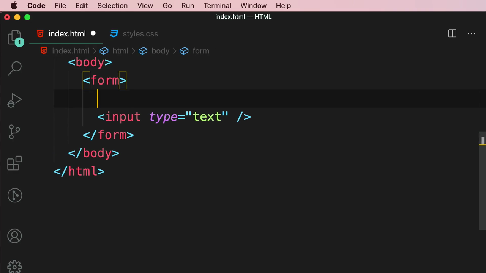

เมื่อรันในเบราว์เซอร์ (ผ่าน Live Server ที่ `127.0.0.1:5500`) จะเห็นเพียงกล่องข้อความ (text box) ว่างๆ กล่องเดียว โดยไม่มีป้ายกำกับใดๆ บอกผู้ใช้ว่าต้องกรอกอะไร:

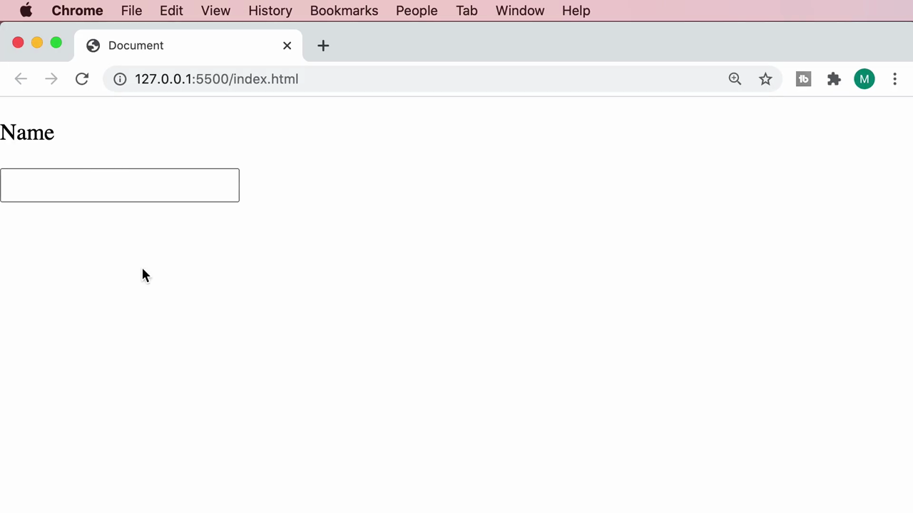

> **ปัญหาที่ Mosh ชี้ให้เห็น:** ผู้ใช้ไม่มีทางรู้เลยว่ากล่องข้อความนี้ใช้กรอกอะไร (ชื่อ? อีเมล? อื่นๆ?) เพราะไม่มีข้อความอธิบายกำกับอยู่เลย

---

## 2. ลองใช้ `<p>` เพื่อใส่ label (และทำไมจึงไม่ถูกต้อง)

ขั้นแรก Mosh ลองแก้ปัญหาด้วยการใส่ข้อความ "Name" ไว้ในแท็ก `<p>` เหนือ input:

```html
<form>
  <p>Name</p>
  <input type="text" />
</form>
```


> **ทำไมวิธีนี้ไม่ดี:** แม้จะแสดงผลตัวอักษร "Name" ให้ผู้ใช้เห็นได้ แต่ `<p>` เป็นเพียงข้อความธรรมดา ไม่มีความสัมพันธ์ทางโครงสร้าง (semantic relationship) กับ input เลย ผู้ใช้จะคลิกที่คำว่า "Name" เพื่อโฟกัสไปที่ช่องกรอกไม่ได้ และเทคโนโลยีช่วยเหลือผู้พิการ (screen reader) ก็ไม่สามารถเชื่อมโยงคำอธิบายนี้เข้ากับ input ได้เช่นกัน

---

## 3. แก้ไขด้วย `<label>` และแอตทริบิวต์ `for` / `id`

Mosh จึงเปลี่ยนจาก `<p>` มาเป็นแท็ก **`<label>`** ซึ่งเป็นแท็กที่ถูกออกแบบมาโดยเฉพาะสำหรับกำกับฟิลด์ในฟอร์ม:

```html
<form>
  <label for="">Name</label>
  <input type="text" />
</form>
```

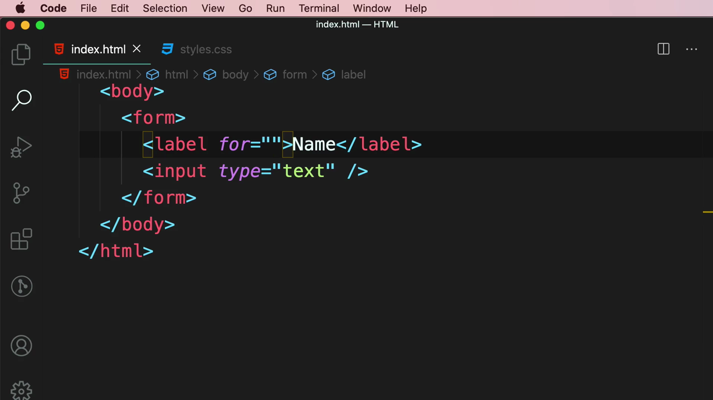

จากนั้นอธิบายว่า `<label>` ต้องเชื่อมกับ `<input>` ด้วยกลไก **`for`** (บน label) คู่กับ **`id`** (บน input) — ค่าทั้งสองต้องตรงกันทุกตัวอักษร:

```html
<form>
  <label for="name">Name</label>
  <input id="name" type="text" />
</form>
```

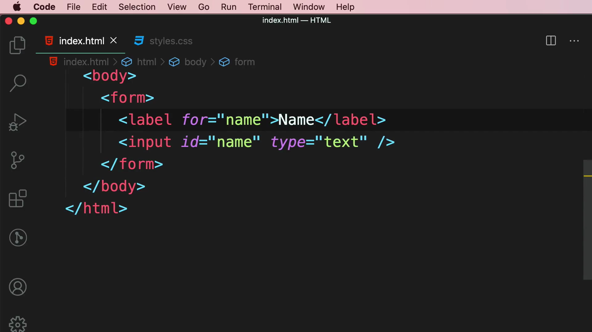

> **ประโยชน์ของการเชื่อม label กับ input ด้วย `for`/`id`:**
> 1. เมื่อคลิกที่ข้อความ label ("Name") เบราว์เซอร์จะเลื่อนโฟกัส (focus) ไปที่ input โดยอัตโนมัติ — สังเกตจาก mouse cursor ที่เปลี่ยนเป็นรูปมือ (pointer) เมื่อชี้ไปที่ label
> 2. Screen reader และเทคโนโลยีช่วยเหลือผู้พิการสามารถอ่านและเชื่อมโยงคำอธิบายเข้ากับฟิลด์ได้อย่างถูกต้อง
> 3. ทำให้ฟอร์มเข้าถึงได้ง่ายขึ้น (accessible) ซึ่งเป็นแนวปฏิบัติที่ดี (best practice) ที่ควรใช้เสมอเมื่อสร้างฟอร์ม

Mosh สาธิตการคลิกที่ข้อความ "Name" ในเบราว์เซอร์ แล้วแสดงให้เห็นว่า cursor กลายเป็นรูปมือ (pointer) และเมื่อคลิกแล้ว input จะถูกโฟกัสทันที:

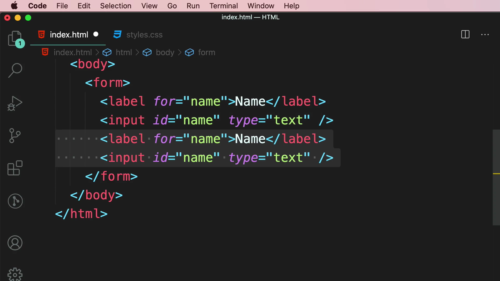

---

## 4. เพิ่มฟิลด์ที่สอง: Email

Mosh คัดลอกคู่ label+input เดิม แล้ววางต่อท้าย เปลี่ยนค่าต่างๆ ให้เป็นของฟิลด์ **Email**:

```html
<form>
  <label for="name">Name</label>
  <input id="name" type="text" />
  <label for="email">Email</label>
  <input id="email" type="email" />
</form>
```

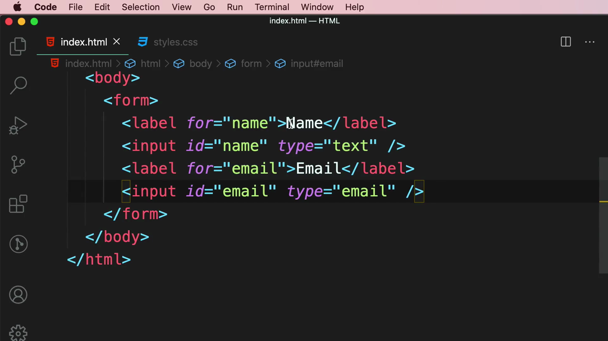

> **หมายเหตุสำคัญ:** สังเกตว่า input ของอีเมลใช้ `type="email"` แทนที่จะเป็น `type="text"` — นี่คือการใช้ input type ที่เหมาะสมกับชนิดข้อมูล (ซึ่งจะช่วยเรื่องการตรวจสอบความถูกต้อง/validation และการแสดงคีย์บอร์ดที่เหมาะสมบนมือถือ)

เมื่อรันในเบราว์เซอร์ ทั้งสองฟิลด์แสดงเรียงต่อกันในบรรทัดเดียว (inline) เพราะทั้ง `<label>` และ `<input>` เป็น inline elements โดยค่าเริ่มต้น:

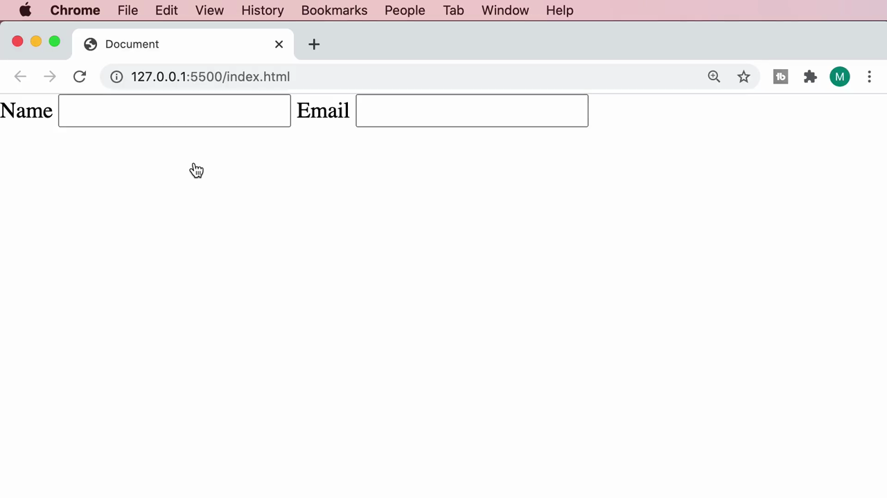

---

## 5. จัดกลุ่มแต่ละฟิลด์ด้วย `<div>` โดยใช้ Emmet "Wrap with Abbreviation"

เพื่อให้แต่ละฟิลด์ (label+input) ขึ้นบรรทัดใหม่แยกจากกัน Mosh เลือก (select) โค้ดของ label+input คู่แรก แล้วเปิด **Command Palette** ของ VS Code ผ่านเมนู **View > Command Palette...** (คีย์ลัด `⇧⌘P`):

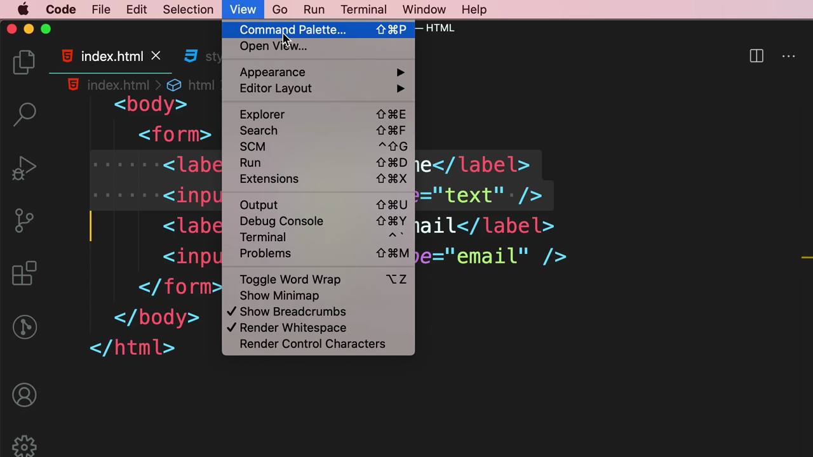

จากนั้นพิมพ์คำสั่งและเลือก **"Emmet: Wrap with Abbreviation"** จากรายการ (ปรากฏเป็นคำสั่งที่ใช้ล่าสุด "recently used"):

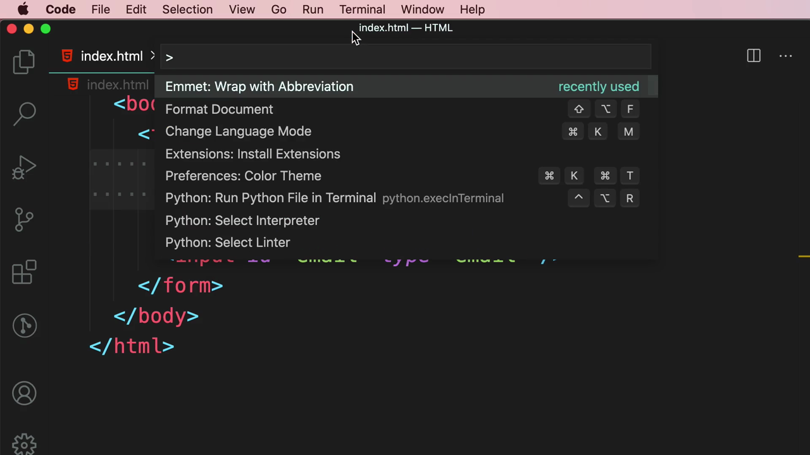

จากนั้นกล่อง **"Enter Abbreviation"** จะปรากฏขึ้น ให้พิมพ์ `div` แล้วกด Enter เพื่อครอบโค้ดที่เลือกไว้ด้วย `<div>...</div>` โดยอัตโนมัติ:

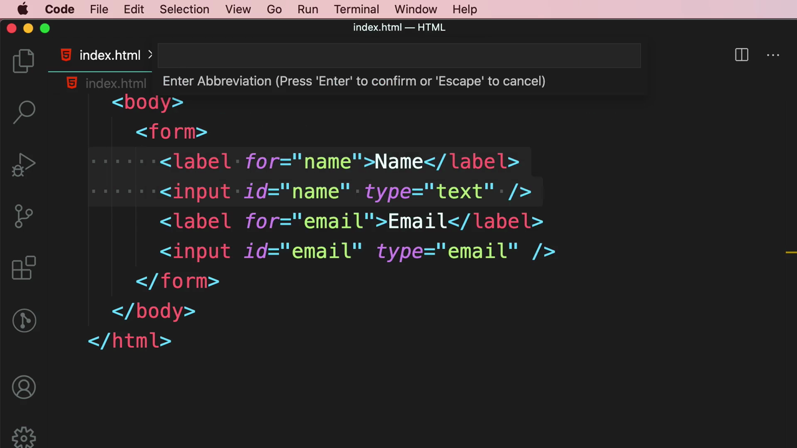

```html
<form>
  <div>
    <label for="name">Name</label>
    <input id="name" type="text" />
  </div>
  <label for="email">Email</label>
  <input id="email" type="email" />
</form>
```

ทำซ้ำขั้นตอนเดียวกันกับคู่ label+input ของ Email:

```html
<form>
  <div>
    <label for="name">Name</label>
    <input id="name" type="text" />
  </div>
  <div>
    <label for="email">Email</label>
    <input id="email" type="email" />
  </div>
</form>
```

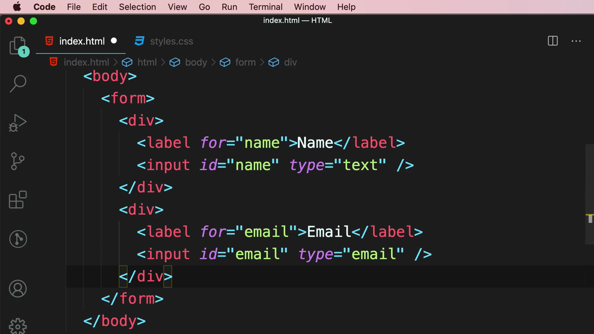

เมื่อรันในเบราว์เซอร์ แต่ละฟิลด์จะขึ้นบรรทัดใหม่ (แยกกันชัดเจน) เพราะ `<div>` เป็น block-level element:

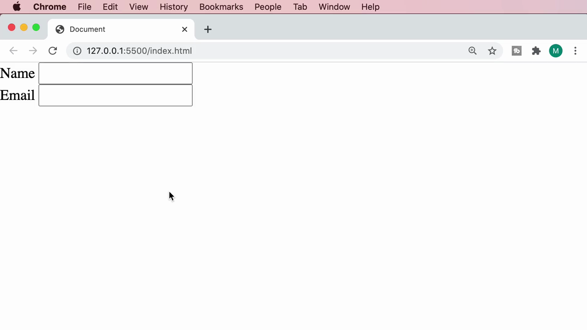

> **หลักการสำคัญ:** การครอบ `<div>` รอบแต่ละกลุ่ม label+input เป็นเทคนิคพื้นฐานที่ใช้กันทั่วไปในการจัดโครงสร้างฟอร์ม เพราะช่วยให้ควบคุม layout (เช่น จัดวางแนวตั้ง, เว้นระยะห่างระหว่างฟิลด์) ได้ง่ายด้วย CSS ในคลิปถัดไป

---

## 6. เพิ่มปุ่ม Register และ Clear

สุดท้าย Mosh เพิ่มปุ่มสองปุ่มต่อท้ายฟอร์ม โดยใช้แท็ก **`<button>`**:

```html
<button type="submit">Register</button>
<button type="submit">Register</button>
```

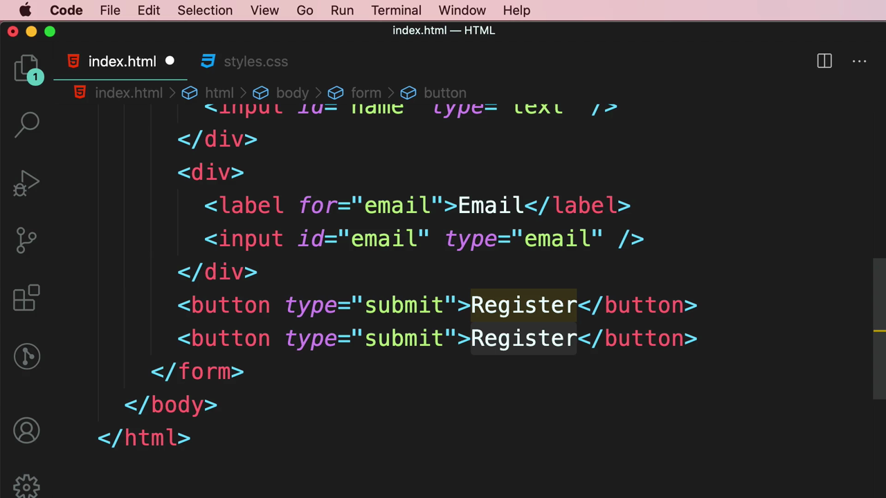

จากนั้นแก้ไขปุ่มที่สองให้เป็นปุ่ม **Clear** โดยเปลี่ยนแอตทริบิวต์ `type` จาก `"submit"` เป็น **`"reset"`** และเปลี่ยนข้อความเป็น "Clear":

```html
<form>
  <div>
    <label for="name">Name</label>
    <input id="name" type="text" />
  </div>
  <div>
    <label for="email">Email</label>
    <input id="email" type="email" />
  </div>
  <button type="submit">Register</button>
  <button type="reset">Clear</button>
</form>
```

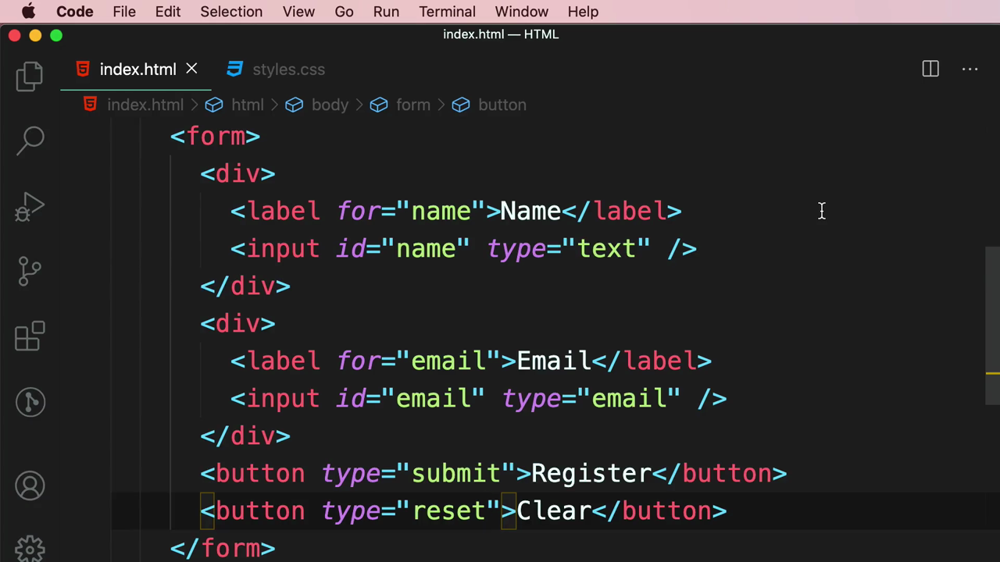

ผลลัพธ์สุดท้ายในเบราว์เซอร์ แสดงฟอร์มที่มีฟิลด์ Name, Email และปุ่ม Register กับ Clear เรียงกัน:

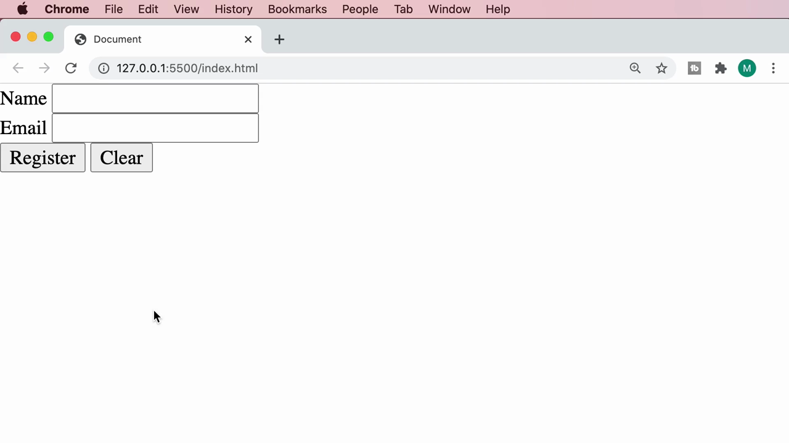

> **ความแตกต่างระหว่าง `type="submit"` กับ `type="reset"`:**
> - **`type="submit"`** — เมื่อคลิก จะส่งข้อมูลฟอร์มไปประมวลผล (submit the form)
> - **`type="reset"`** — เมื่อคลิก จะล้างค่าทั้งหมดในฟอร์มกลับไปเป็นค่าเริ่มต้น (reset the form) โดยไม่ส่งข้อมูลใดๆ

---

## สรุปภาพรวมของคลิปนี้

| ประเด็น | รายละเอียด |
|---|---|
| **หัวข้อ** | Creating a Basic Form |
| **แท็กหลักที่ใช้** | `<form>`, `<input>`, `<label>`, `<div>`, `<button>` |
| **แอตทริบิวต์สำคัญ** | `for` (บน label), `id` (บน input), `type` ("text", "email", "submit", "reset") |
| **เครื่องมือที่ใช้** | VS Code + Emmet "Wrap with Abbreviation" (⇧⌘P → พิมพ์ "Emmet: Wrap with Abbreviation") |

**แนวคิดสำคัญที่ได้จากคลิปนี้:**

1. **ห้ามใช้ `<p>` แทน label** — ต้องใช้ `<label>` คู่กับ `for`/`id` เสมอ เพื่อความถูกต้องเชิงความหมาย (semantic) และการเข้าถึงได้ (accessibility) ของฟอร์ม
2. **การเชื่อม label กับ input ด้วย `for="id_ของ_input"`** ทำให้คลิกที่ label แล้วโฟกัสไปที่ input ได้ทันที ซึ่งช่วยเรื่อง UX และ accessibility อย่างมาก
3. **Emmet "Wrap with Abbreviation"** เป็นเครื่องมือที่ช่วยเร่งการเขียนโค้ดใน VS Code ได้อย่างมาก โดยเฉพาะเมื่อต้องครอบกลุ่มโค้ดที่เลือกไว้ด้วยแท็กใหม่ ไม่ต้องพิมพ์เปิด-ปิดแท็กเอง
4. **`type="submit"` และ `type="reset"`** เป็นสองค่าพื้นฐานสำหรับปุ่มในฟอร์มที่ต้องเข้าใจให้ชัดเจนก่อนจะไปเรียนเรื่อง data validation และ submitting form ในคลิปถัดๆ ไป

---

*หมายเหตุ: คลิปนี้เป็นส่วนหนึ่งของบท "5-Forms" จากคอร์ส The Ultimate HTML and CSS Course โดย Mosh Hamedani (codewithmosh.com) — คลิปที่ 2 ของบทนี้*
