# 5-Forms: 03 - Styling Forms (8:45)

**ไฟล์ต้นทาง:** `3-Styling_Forms.mp4`

▶️ **[เปิดวิดีโอต้นฉบับ](../../../HTML-CSS-2/5-Forms/3-Styling-Forms.mp4)**

---

## ภาพรวมคลิปนี้

คลิปนี้เป็นคลิปที่ยาวและมีเนื้อหาเข้มข้นที่สุดในบทนี้ (8:45 นาที) Mosh สอนวิธีจัดสไตล์ (styling) ฟอร์มที่สร้างไว้ในคลิปก่อนหน้าให้ดูสวยงามและใช้งานง่ายขึ้น โดยครอบคลุมตั้งแต่การตั้งค่า font และ line-height พื้นฐาน, การจัดวาง label ให้อยู่คนละบรรทัด, การเว้นระยะห่างระหว่างฟิลด์ด้วยคลาส `.form-group`, การจัดสไตล์ input (border, border-radius, padding), การสร้าง custom focus state ด้วย `:focus` pseudo-class พร้อม box-shadow แบบ glow effect, ไปจนถึงการจัดสไตล์ปุ่ม (button) ให้มีสีพื้นหลัง ขอบมน และไม่มีเส้นขอบเริ่มต้นของเบราว์เซอร์

---

## 1. สถานะเริ่มต้น: ฟอร์มที่ยังไม่ได้จัดสไตล์

สไลด์ชื่อคลิป **"Styling Forms"** เปิดคลิป จากนั้น Mosh แสดงฟอร์มที่สร้างไว้จากคลิปก่อนหน้า (Name, Email, ปุ่ม Register/Clear) ซึ่งยังไม่ได้จัดสไตล์ใดๆ เลย โดยกรอกคำว่า "Mosh" ในช่อง Name เพื่อสาธิต — จะเห็นว่าปุ่ม Register/Clear แสดงผลด้วยสไตล์เริ่มต้นของเบราว์เซอร์ (สีน้ำเงินเข้ม พื้นหลังไล่เฉด ตามธีมของระบบปฏิบัติการ):

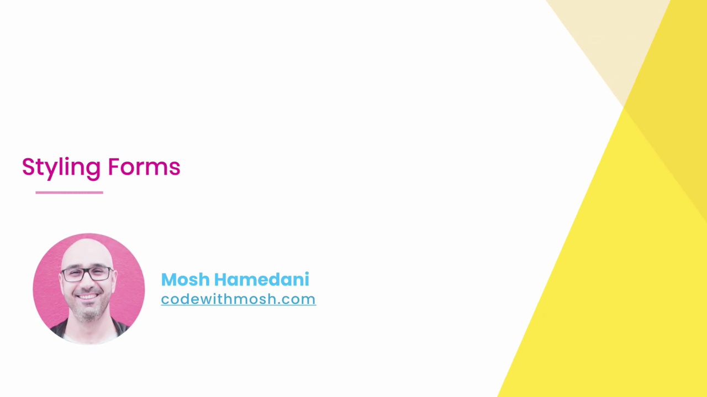

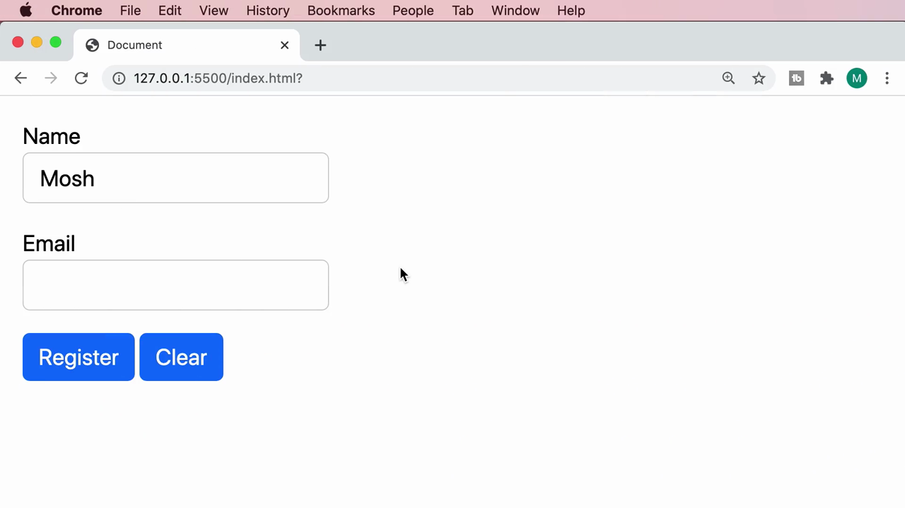

---

## 2. ตั้งค่า Font และ Line Height ให้กับ `body`

Mosh เปิดไฟล์ `styles.css` และเริ่มเขียนกฎ CSS แรกที่ selector `body` โดยใช้ **font stack** (ชุดรายชื่อฟอนต์สำรอง) แบบมาตรฐานที่ใช้ฟอนต์ของระบบปฏิบัติการเป็นหลัก (system font stack) ซึ่ง VS Code มี IntelliSense แนะนำชุดฟอนต์นี้ให้อัตโนมัติ:

```css
body {
  font-family: -apple-system, BlinkMacSystemFont, "Segoe UI", Roboto,
    Ubuntu, Cantarell, "Open Sans", "Helvetica Neue", sans-serif;
  line-height: 1.5;
}
```

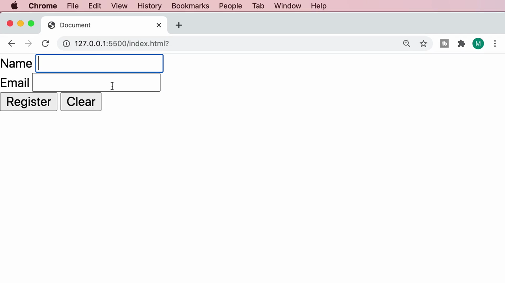

> **อธิบาย `font-family` แบบ system font stack:** แนวคิดคือให้เบราว์เซอร์ใช้ฟอนต์เริ่มต้นของระบบปฏิบัติการนั้นๆ (เช่น San Francisco บน macOS, Segoe UI บน Windows) แทนที่จะโหลดฟอนต์จากภายนอก ทำให้เว็บโหลดเร็วขึ้นและดูกลมกลืนกับระบบปฏิบัติการของผู้ใช้แต่ละคน รายชื่อฟอนต์จะถูกลองใช้เรียงจากซ้ายไปขวา หากตัวแรกไม่มีในเครื่องก็จะลองตัวถัดไป
>
> **`line-height: 1.5`** กำหนดระยะห่างระหว่างบรรทัดของข้อความให้มีค่าเป็น 1.5 เท่าของขนาดฟอนต์ ช่วยให้อ่านง่ายขึ้น

---

## 3. จัดให้ Label ขึ้นบรรทัดใหม่ (block)

ค่าเริ่มต้นของ `<label>` คือ `inline` ทำให้ label กับ input อยู่ติดกันในบรรทัดเดียว Mosh จึงเพิ่มกฎ:

```css
label {
  display: block;
}
```

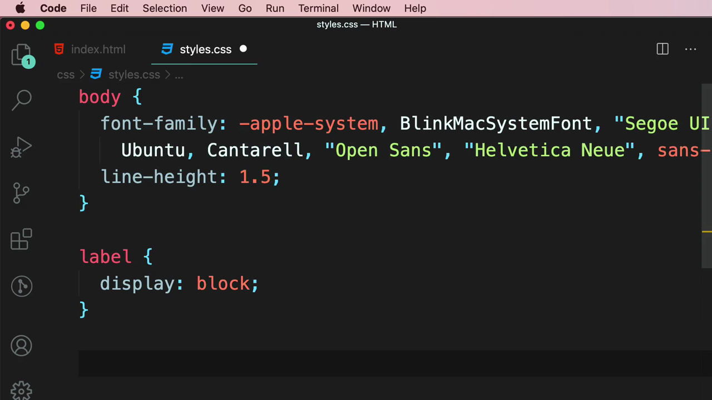

ผลลัพธ์คือ label แต่ละอันจะขึ้นบรรทัดใหม่ แยกจาก input ด้านล่างอย่างชัดเจน:

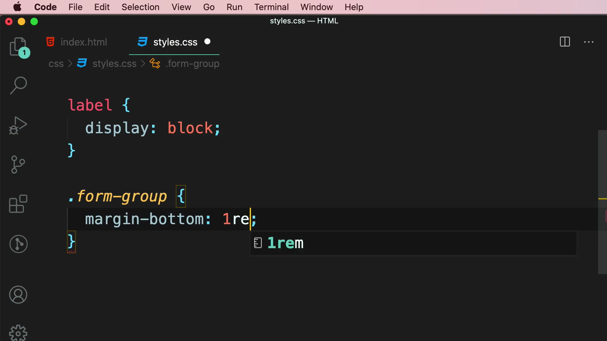

---

## 4. เว้นระยะห่างระหว่างฟิลด์ด้วยคลาส `.form-group`

Mosh สร้างกฎ CSS ใหม่โดยใช้ class selector **`.form-group`**:

```css
.form-group {
  margin-bottom: 1rem;
}
```

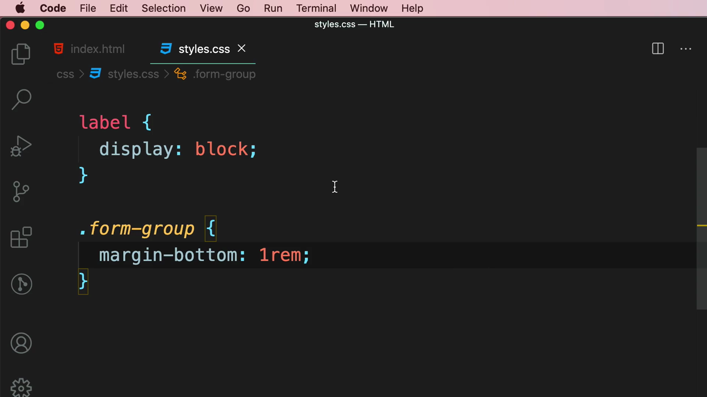

จากนั้นสลับไปที่ไฟล์ `index.html` และเพิ่ม `class="form-group"` ให้กับ `<div>` ที่ครอบแต่ละคู่ label+input (ที่สร้างไว้ในคลิปก่อนหน้าด้วย Emmet Wrap with Abbreviation):

```html
<form>
  <div class="form-group">
    <label for="name">Name</label>
    <input id="name" type="text" />
  </div>
  <div class="form-group">
    <label for="email">Email</label>
    <input id="email" type="email" />
  </div>
  <button type="submit">Register</button>
  <button type="reset">Clear</button>
</form>
```

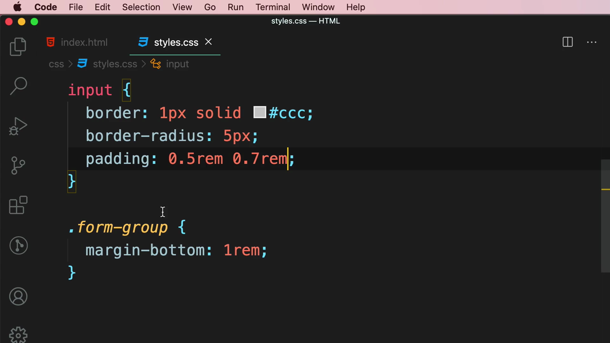

ผลลัพธ์คือแต่ละฟิลด์มีระยะห่างชัดเจนจากฟิลด์ถัดไป ทำให้ฟอร์มดูเป็นระเบียบมากขึ้น:

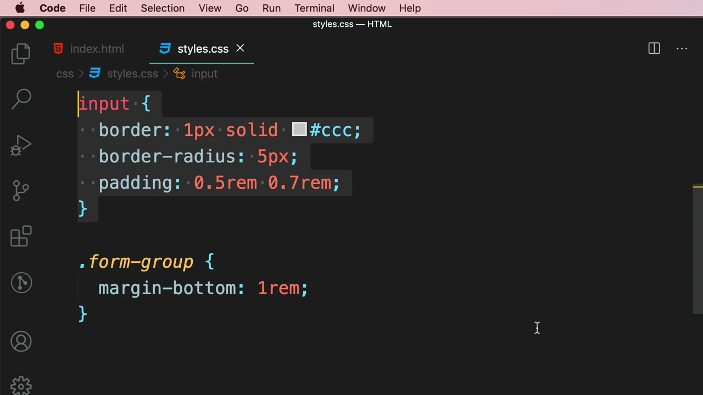

---

## 5. จัดสไตล์กรอบ Input (border, border-radius, padding)

Mosh เพิ่มกฎสำหรับ `input` โดยกำหนด border, มุมโค้ง (border-radius) และระยะห่างภายใน (padding):

```css
input {
  border: 1px solid #ccc;
  border-radius: 5px;
  padding: 0.5rem 0.7rem;
}
```

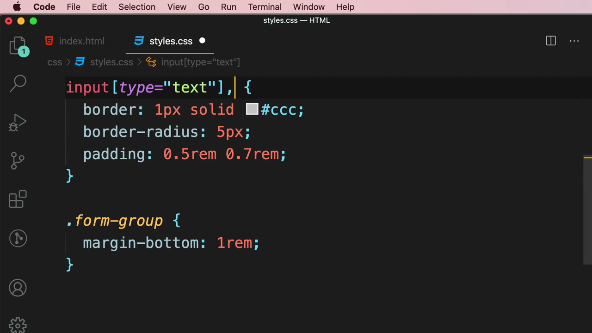

ผลลัพธ์: input มีกรอบสีเทาอ่อน มุมโค้งมน และมีพื้นที่หายใจภายในกล่องมากขึ้น ดูเป็นมิตรกับผู้ใช้มากกว่าเดิม:

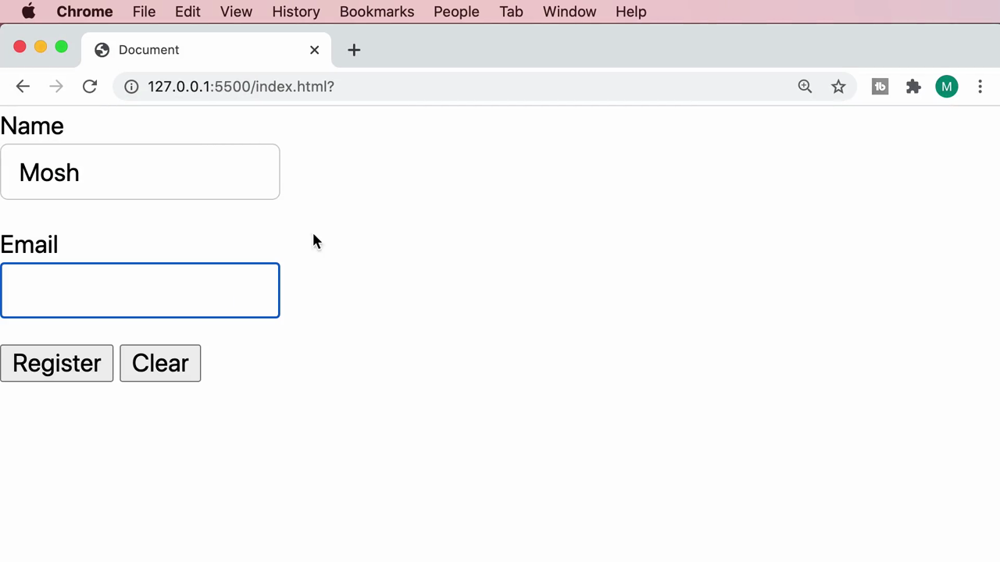

---

## 6. เปลี่ยนจาก `input` เป็น Attribute Selector `input[type="text"], input[type="email"]`

Mosh อธิบายว่าการใช้ selector `input` เฉยๆ จะกระทบ input **ทุกประเภท** (รวมถึง checkbox, radio, range, file ที่จะได้เรียนในคลิปถัดๆ ไป ซึ่งไม่ควรมีกรอบสี่เหลี่ยมแบบนี้) จึงเปลี่ยน selector ให้เจาะจงเฉพาะ `type="text"` และ `type="email"` โดยใช้ **attribute selector**:

```css
input[type="text"],
input[type="email"] {
  border: 1px solid #ccc;
  border-radius: 5px;
  padding: 0.5rem 0.7rem;
}
```

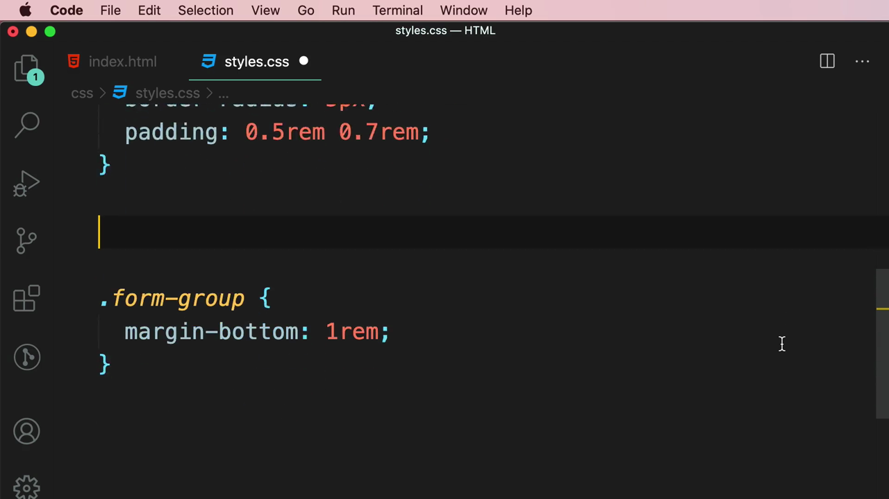

> **หลักการสำคัญ:** `input[type="text"]` คือ attribute selector ที่เลือกเฉพาะ `<input>` ที่มีแอตทริบิวต์ `type` เท่ากับค่าที่ระบุ การใช้ comma (`,`) คั่นระหว่าง selector หลายตัว หมายถึง "ใช้กฎเดียวกันนี้กับทุก selector ที่ระบุไว้" — เทคนิคนี้ช่วยให้ควบคุมสไตล์ของ input แต่ละประเภทได้อย่างแม่นยำ ไม่กระทบ input ประเภทอื่นโดยไม่ตั้งใจ

---

## 7. สร้าง Custom Focus State ด้วย `:focus`

ค่าเริ่มต้นเมื่อคลิกโฟกัส input เบราว์เซอร์จะแสดงเส้นขอบสีน้ำเงินหนา (default focus outline) ซึ่ง Mosh มองว่าไม่สวยงามพอ จึงสร้างสไตล์ focus เอง โดยเริ่มจากเปลี่ยนสีขอบ (`border-color`) เมื่อ input ถูกโฟกัส:

```css
input[type="text"]:focus {
  border-color: #7db0fb;
}
```

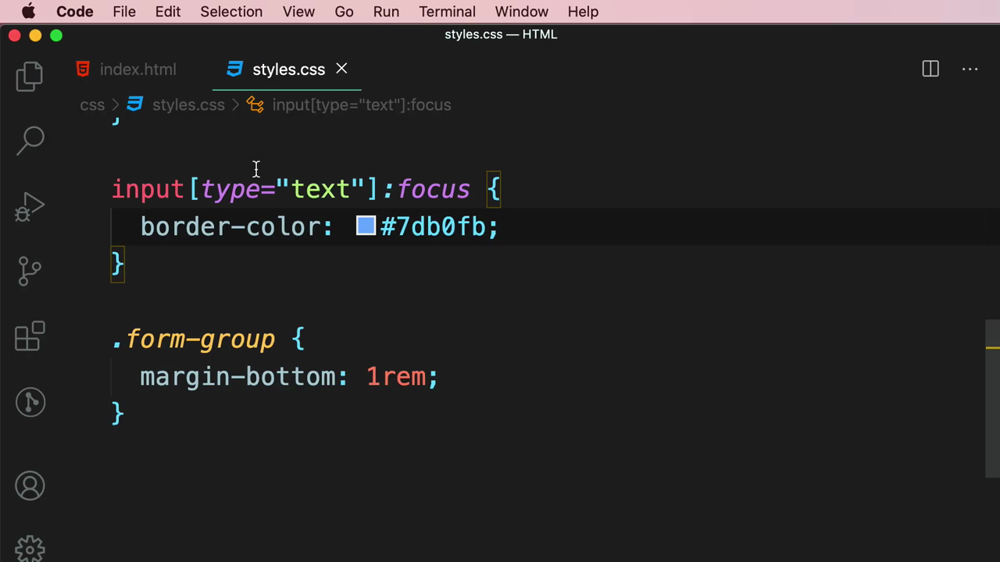

ผลลัพธ์เบื้องต้น: เมื่อคลิกที่ input จะเห็นทั้งกรอบสีฟ้าอ่อนที่ Mosh กำหนดเอง **และ** เส้น outline สีฟ้าเข้มเริ่มต้นของเบราว์เซอร์ซ้อนกันอยู่ (ยังไม่สวย):

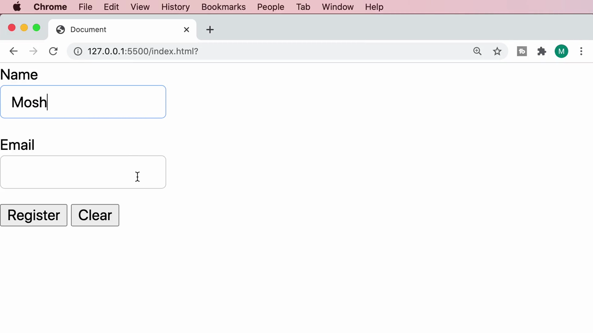

จึงเพิ่ม `outline: 0;` เพื่อลบเส้น outline เริ่มต้นของเบราว์เซอร์ออกไป:

```css
input[type="text"]:focus,
input[type="email"]:focus {
  border-color: #7db0fb;
  outline: 0;
}
```

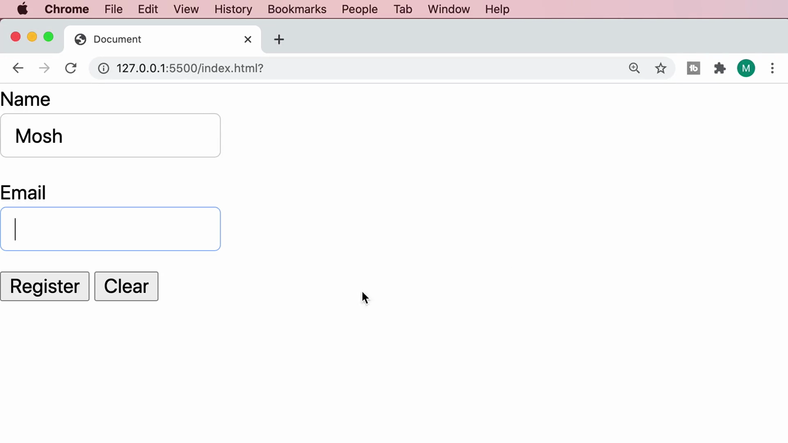

---

## 8. เพิ่ม Box Shadow แบบ "Glow Effect" ตอนโฟกัส

เพื่อชดเชยการลบ outline (ซึ่งสำคัญต่อ accessibility — ผู้ใช้ที่ควบคุมด้วยคีย์บอร์ดต้องเห็นว่ากำลังโฟกัสอยู่ที่ไหน) Mosh จึงเพิ่ม **`box-shadow`** แบบ 4px กระจายรอบด้าน (แทน outline) เพื่อสร้างเอฟเฟกต์ "เรืองแสง" (glow) รอบกรอบ input แทน:

```css
input[type="text"]:focus,
input[type="email"]:focus {
  border-color: #7db0fb;
  outline: 0;
  box-shadow: 0 0 0 4px rgba(24, 117, 255, 0.25);
}
```

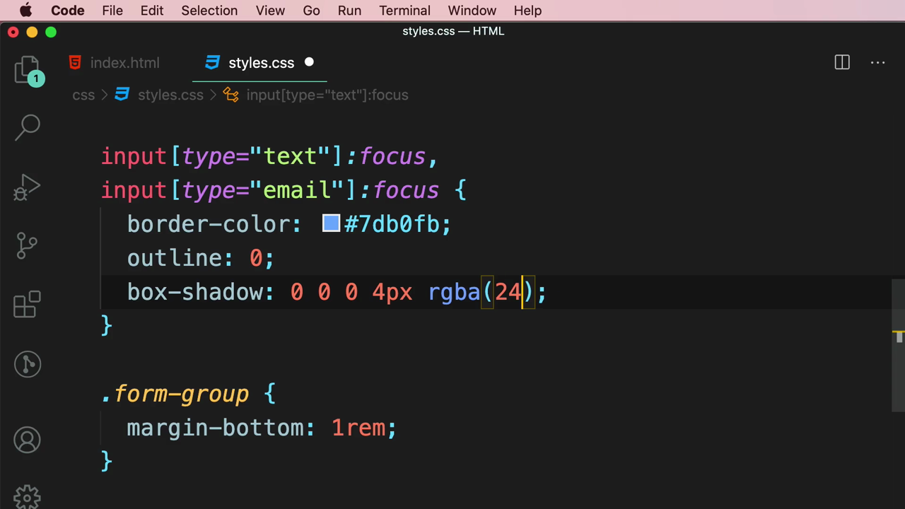

ผลลัพธ์: เมื่อคลิกโฟกัส input จะเห็นกรอบสีฟ้าอ่อนพร้อมเงาสีฟ้าโปร่งแสงกระจายรอบกล่องอย่างนุ่มนวล ดูทันสมัยกว่าเส้น outline เริ่มต้นมาก:

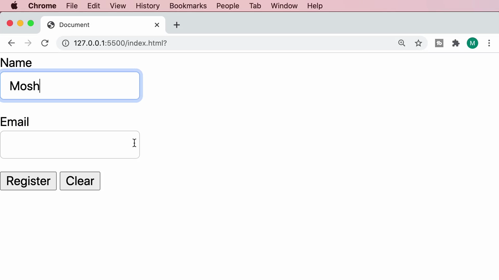

> **อธิบายค่า `box-shadow: 0 0 0 4px rgba(24, 117, 255, 0.25)`:**
> - ค่าที่ 1 และ 2 (`0 0`) คือระยะเลื่อนแนวนอนและแนวตั้งของเงา (ไม่เลื่อน = เงาอยู่ตรงกลาง)
> - ค่าที่ 3 (`0`) คือ blur radius (ไม่เบลอ ขอบเงาคมชัด)
> - ค่าที่ 4 (`4px`) คือ spread radius — ทำให้เงาแผ่ขยายออกไปรอบกล่องเป็นระยะ 4 พิกเซล คล้ายเส้นขอบหนาที่นุ่มนวลกว่า
> - `rgba(24, 117, 255, 0.25)` คือสีฟ้าแบบโปร่งแสง 25% ทำให้เงาดูจางและไม่แข็งกระด้าง

ภายหลัง Mosh ยังเพิ่ม **`transition`** ให้กับกฎ input หลัก เพื่อให้การเปลี่ยนแปลงสี border และ box-shadow เกิดขึ้นอย่างนุ่มนวล (smooth) แทนที่จะเปลี่ยนทันทีทันใด:

```css
input[type="text"],
input[type="email"] {
  border: 1px solid #ccc;
  border-radius: 5px;
  padding: 0.5rem 0.7rem;
  transition: border-color 0.15s, box-shadow 0.15s;
}
```

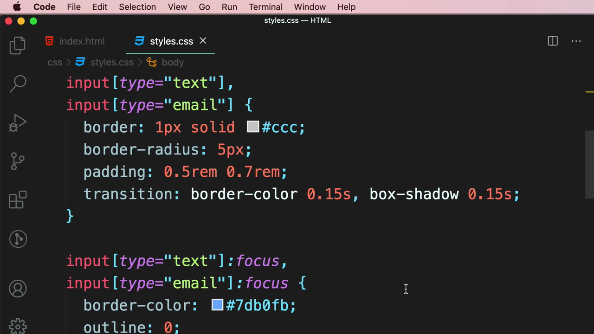

> **`transition: border-color 0.15s, box-shadow 0.15s;`** หมายความว่า เมื่อค่าของ `border-color` หรือ `box-shadow` เปลี่ยนแปลง (เช่น จากสถานะปกติไปเป็นสถานะ focus) ให้ค่อยๆ เปลี่ยนแปลงอย่างนุ่มนวลภายในเวลา 0.15 วินาที แทนที่จะกระโดดเปลี่ยนทันที ทำให้ UI ดูลื่นไหลและเป็นมืออาชีพมากขึ้น

---

## 9. จัดสไตล์ปุ่ม (Button)

สุดท้าย Mosh หันมาจัดสไตล์ `<button>` โดยเริ่มจากพื้นหลังและสีตัวอักษร:

```css
button {
}
```

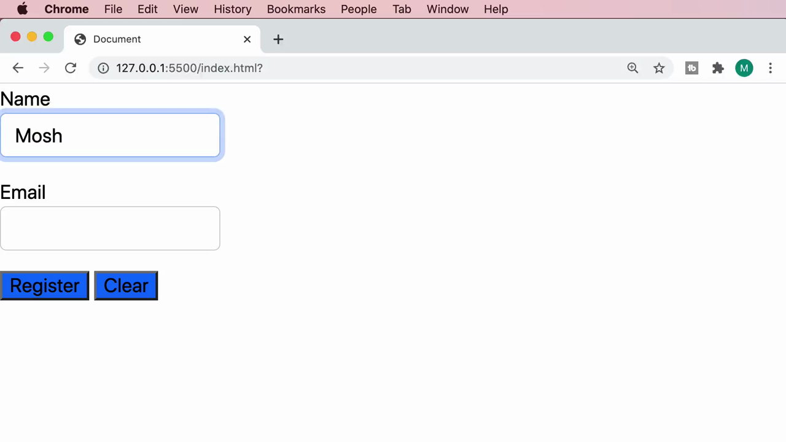

```css
button {
  background: #0d6efd;
  color: #fff;
}
```

ปุ่มทั้งสอง (Register, Clear) เปลี่ยนเป็นสีน้ำเงินพร้อมตัวอักษรสีขาว แต่ยังคงมีเส้นขอบ (border) แบบเริ่มต้นของเบราว์เซอร์อยู่ (เห็นเป็นเส้นกรอบสีเข้มรอบปุ่ม):

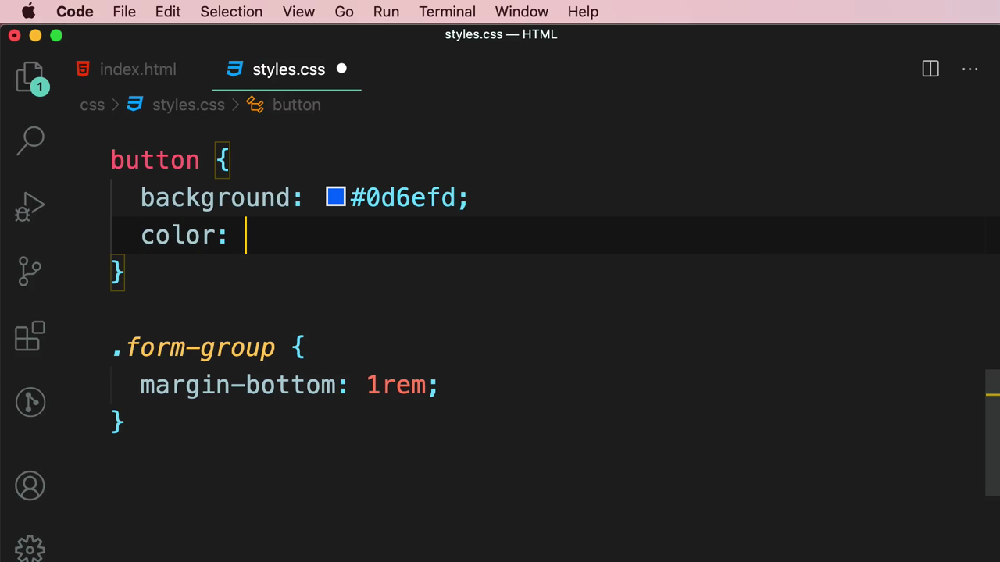

จากนั้นเพิ่ม `border: 0;` เพื่อลบเส้นขอบเริ่มต้นออก:

```css
button {
  background: #0d6efd;
  color: #fff;
  border: 0;
}
```

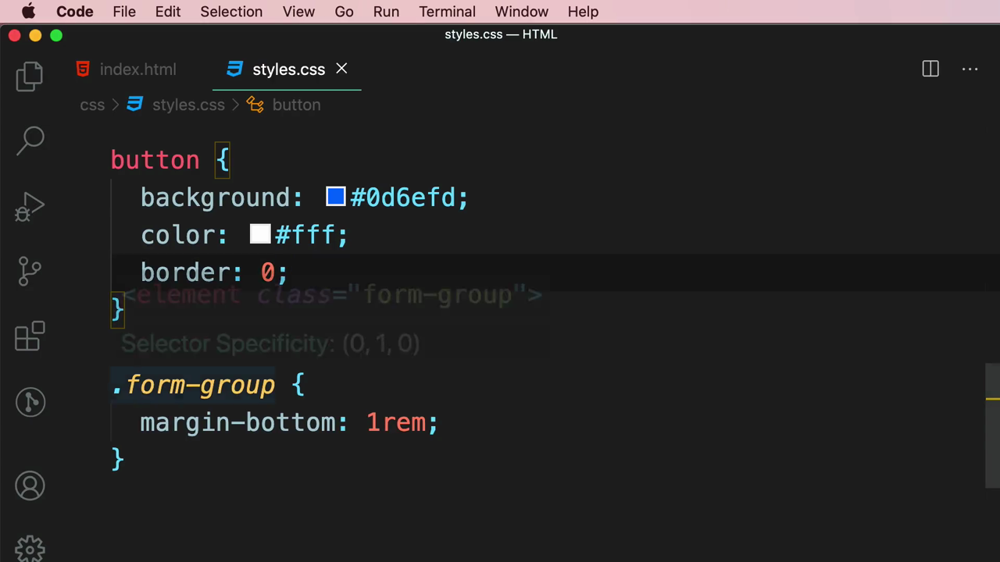

ต่อมาเพิ่ม padding และ border-radius ให้ปุ่มมีขนาดพอดีและมุมโค้งมนเหมือน input:

```css
button {
  background: #0d6efd;
  color: #fff;
  border: 0;
  padding: 0.5rem 0.7rem;
  border-radius: 5px;
}
```

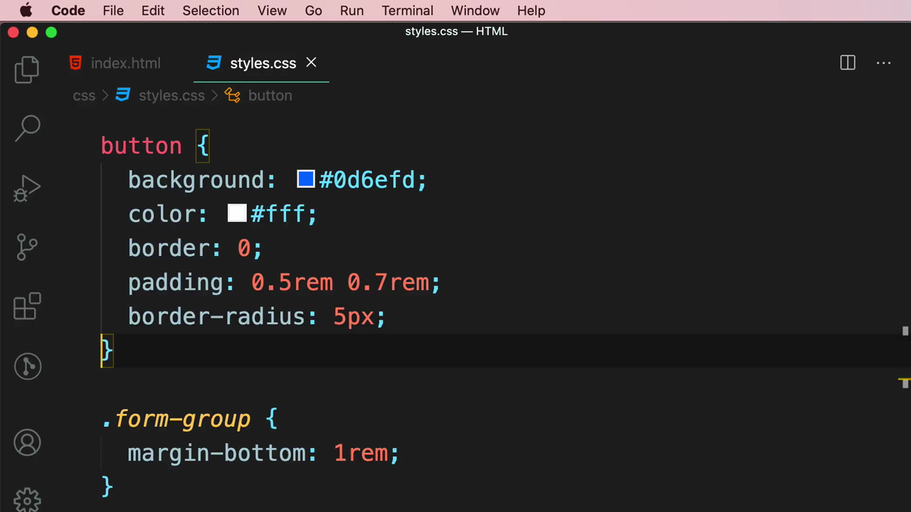

สุดท้ายเพิ่ม `outline: 0;` เพื่อลบเส้น outline สีฟ้าเริ่มต้นของเบราว์เซอร์เมื่อคลิกปุ่ม (focus state ของปุ่ม):

```css
button {
  background: #0d6efd;
  color: #fff;
  border: 0;
  padding: 0.5rem 0.7rem;
  border-radius: 5px;
  outline: 0;
}
```

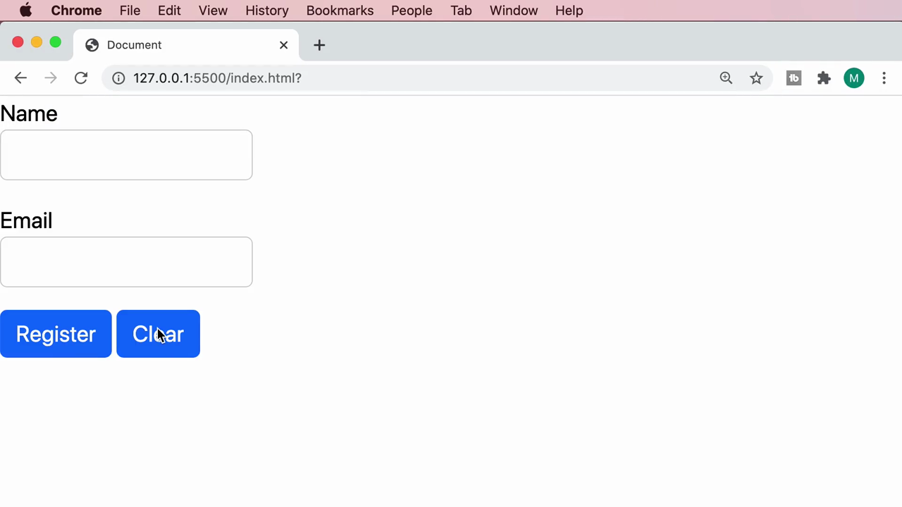

ผลลัพธ์สุดท้าย: ฟอร์มที่จัดสไตล์ครบถ้วนแล้ว — label แยกบรรทัด, ฟิลด์เว้นระยะห่างกันเป็นระเบียบ, input มีกรอบมนพร้อม focus glow effect, และปุ่มสีน้ำเงินทันสมัยไม่มีเส้นขอบแปลกๆ:

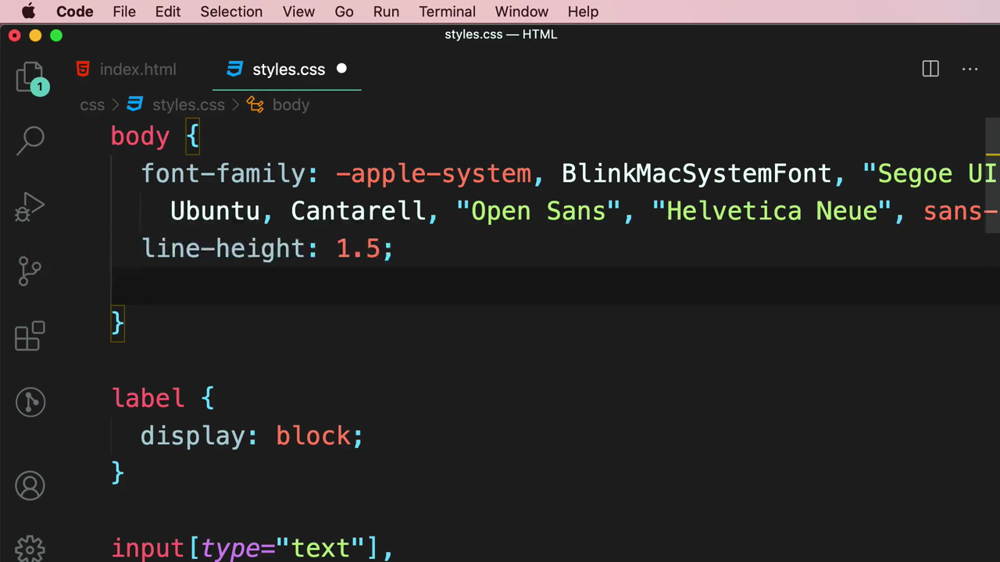

---

## สรุปภาพรวมของคลิปนี้

| ประเด็น | รายละเอียด |
|---|---|
| **หัวข้อ** | Styling Forms |
| **Selector ที่ใช้** | `body`, `label`, `.form-group`, `input[type="text"]`, `input[type="email"]`, `:focus`, `button` |
| **CSS Properties สำคัญ** | `font-family`, `line-height`, `display: block`, `margin-bottom`, `border`, `border-radius`, `padding`, `outline`, `box-shadow`, `transition`, `background`, `color` |
| **เทคนิคเด่น** | Attribute selector (`input[type="..."]`), custom focus state ด้วย box-shadow glow แทน outline เริ่มต้น |

**แนวคิดสำคัญที่ได้จากคลิปนี้:**

1. **Attribute selector (`input[type="text"]`)** เป็นเทคนิคสำคัญในการจัดสไตล์ฟอร์ม เพราะช่วยให้เจาะจงสไตล์เฉพาะ input ประเภทที่ต้องการ โดยไม่กระทบ input ประเภทอื่น (เช่น checkbox, radio, range ที่ควรมีรูปลักษณ์ต่างออกไป)
2. **การลบ `outline: 0` ต้องมาพร้อมกับการเพิ่ม visual feedback อื่นแทน** (เช่น `border-color` เปลี่ยน หรือ `box-shadow`) เพื่อไม่ให้กระทบ accessibility ของผู้ใช้ที่ใช้คีย์บอร์ดในการนำทาง (keyboard navigation) — ห้ามลบ outline เฉยๆ โดยไม่มีอะไรมาทดแทน
3. **`transition`** ช่วยให้การเปลี่ยนสถานะของ UI (เช่น focus/hover) ดูนุ่มนวลเป็นมืออาชีพ เป็นเทคนิคง่ายๆ ที่ยกระดับคุณภาพของ UI ได้มาก
4. **คลาส `.form-group`** เป็น pattern ที่ใช้กันทั่วไปในการเว้นระยะห่างระหว่างกลุ่มฟิลด์ในฟอร์ม แยกจากการจัดสไตล์ตัว input/label เอง ทำให้โค้ด CSS เป็นระเบียบและดูแลรักษาง่าย
5. **การจัดสไตล์ปุ่มด้วย `border: 0` และกำหนด `background`, `color`, `padding`, `border-radius` เอง** ช่วยให้ปุ่มมีรูปลักษณ์ที่สอดคล้องกันในทุกเบราว์เซอร์ ไม่ต้องพึ่งพาสไตล์เริ่มต้นที่แตกต่างกันไปในแต่ละระบบปฏิบัติการ

---

*หมายเหตุ: คลิปนี้เป็นส่วนหนึ่งของบท "5-Forms" จากคอร์ส The Ultimate HTML and CSS Course โดย Mosh Hamedani (codewithmosh.com) — คลิปที่ 3 ของบทนี้*
