# 5-Forms: 04 - Text Fields (5:48)

**ไฟล์ต้นทาง:** `5-Text_Fields.mp4`

▶️ **[เปิดวิดีโอต้นฉบับ](../../../HTML-CSS-2/5-Forms/4-Text-Fields.mp4)**

---

## ภาพรวมคลิปนี้

คลิปนี้ Mosh สอนเจาะลึกเรื่อง **input ประเภทข้อความ (text-based inputs)** โดยเริ่มจากไฟล์ HTML ใหม่ (ฟอร์มเปล่า) แล้วสาธิต input `type` ต่างๆ ที่เบราว์เซอร์รองรับ (number, password, date, email) พร้อมเปิดเอกสาร MDN เพื่ออ้างอิงรายการ input type ทั้งหมด จากนั้นแนะนำแท็ก `<textarea>` สำหรับข้อความหลายบรรทัด และปิดท้ายด้วยแอตทริบิวต์สำคัญที่ใช้ควบคุมพฤติกรรมของ input ได้แก่ `value`, `placeholder`, `readonly`, `disabled`, `maxlength` และ `autofocus`

---

## 1. เริ่มไฟล์ใหม่และทดลอง Input Types ต่างๆ

สไลด์ชื่อคลิป **"Text Fields"** เปิดคลิป จากนั้น Mosh เริ่มไฟล์ `index.html` ใหม่ด้วยฟอร์มเปล่า และตั้งค่า CSS พื้นฐานให้ฟอร์ม:


```css
form {
  width: 50%;
  padding: 2rem;
}
```

จากนั้นทดลองเปลี่ยนค่า `type` ของ `<input>` ไปเรื่อยๆ เพื่อสาธิตพฤติกรรมที่แตกต่างกันของแต่ละประเภท เริ่มจาก **`type="number"`**:

```html
<input type="number" />
```

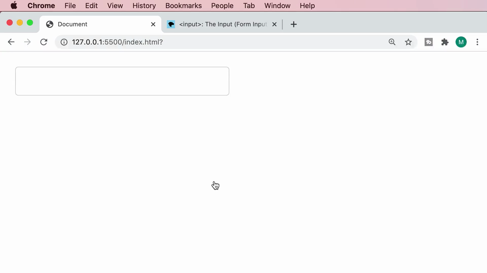

> เมื่อกำหนด `type="number"` เบราว์เซอร์จะจำกัดให้ผู้ใช้กรอกได้เฉพาะตัวเลข และมักแสดงปุ่มลูกศรขึ้น-ลง (spinner) ให้ปรับค่าได้ด้วย

ต่อมาทดลอง **`type="password"`**:

```html
<input type="password" />
```

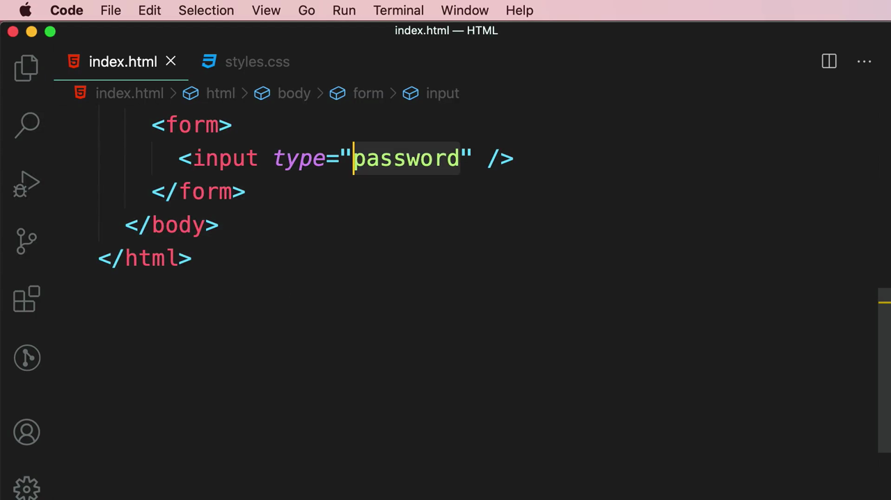

> `type="password"` จะซ่อนตัวอักษรที่พิมพ์ไว้ (แสดงเป็นจุดหรือดอกจัน) เพื่อความปลอดภัยเมื่อผู้ใช้กรอกรหัสผ่าน

ต่อมาทดลอง **`type="date"`**:

```html
<input type="date" />
```

เมื่อรันในเบราว์เซอร์ จะเห็นกล่องข้อความรูปแบบ `mm/dd/yyyy` พร้อมไอคอนปฏิทิน:

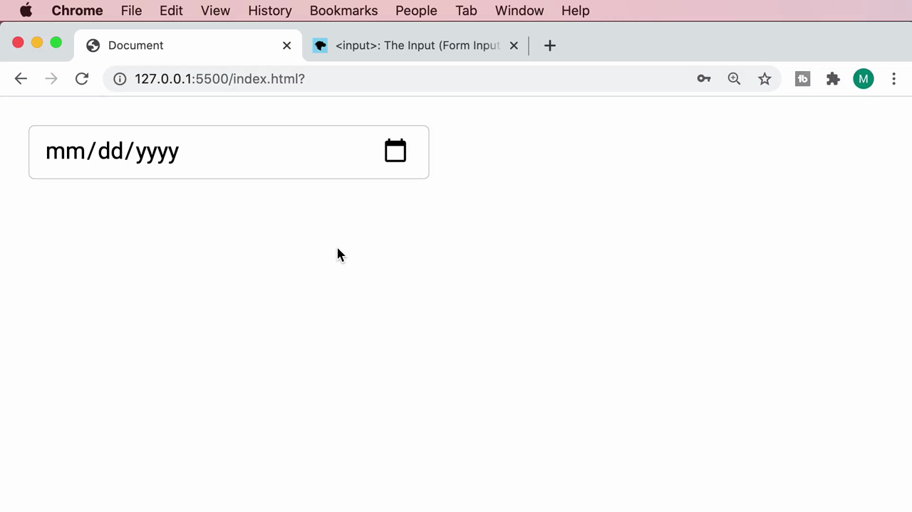

เมื่อคลิกที่ไอคอนปฏิทิน เบราว์เซอร์ (Chrome) จะแสดง **date picker แบบเนทีฟ** ให้เลือกวันที่ได้โดยไม่ต้องเขียนโค้ด JavaScript ใดๆ เพิ่มเติมเลย รวมถึงสามารถคลิกที่ชื่อเดือน/ปีเพื่อเปลี่ยนมุมมองเป็นเลือกเดือนหรือปีได้ด้วย:

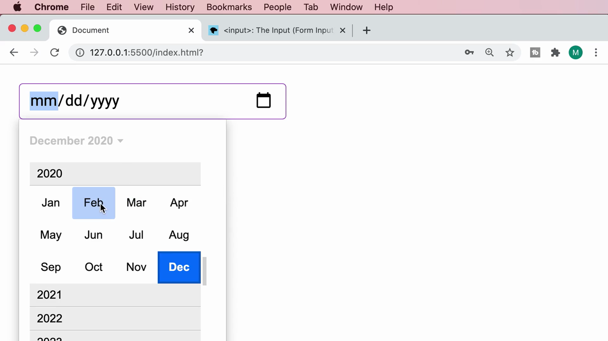

> **จุดเด่นของ `type="date"`:** เบราว์เซอร์จัดการ UI ของการเลือกวันที่ให้ทั้งหมดโดยอัตโนมัติ (native date picker) ทำให้นักพัฒนาไม่ต้องเขียน widget ปฏิทินเองหรือพึ่งพา library ภายนอกสำหรับงานพื้นฐาน

สุดท้ายในส่วนนี้ ทดลอง **`type="email"`**:

```html
<input type="email" />
```

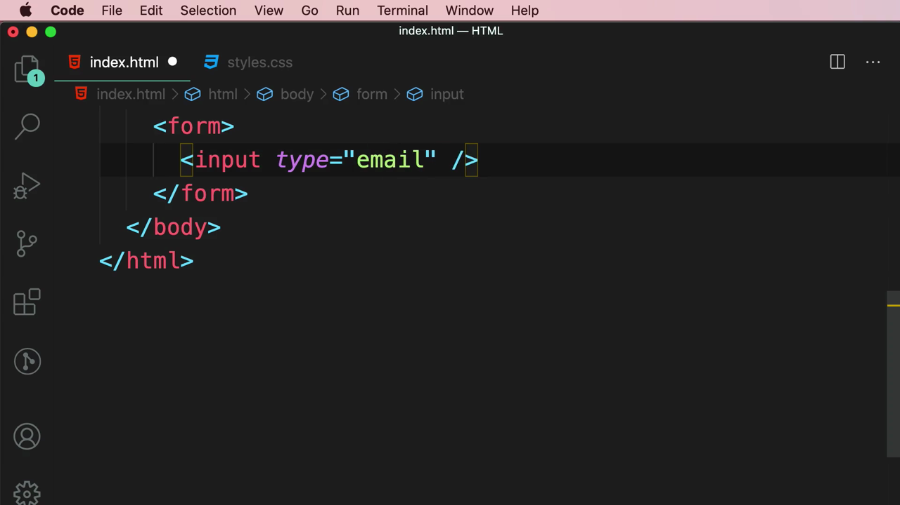

---

## 2. ค้นหาข้อมูลอ้างอิงจาก MDN

Mosh เปิดแท็บใหม่ใน Chrome แล้วค้นหาคำว่า **"html input element"** ผ่าน Google เพื่อไปยังหน้าเอกสารอ้างอิงของ MDN (Mozilla Developer Network):

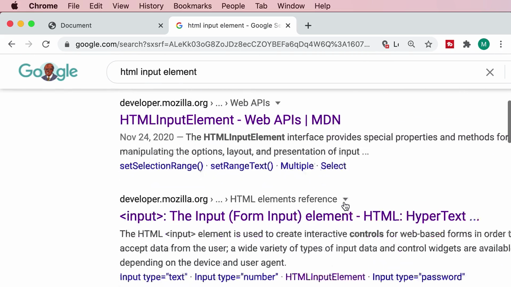

จากนั้นคลิกเข้าไปที่หน้า **`<input>`: The Input (Form Input) element - MDN** และเลื่อนลงไปดูตาราง **"The available types are as follows"** ซึ่งแสดงรายการ `type` ทั้งหมดของ `<input>` พร้อมคำอธิบายและตัวอย่างการแสดงผล (button, checkbox, color, date, datetime-local, email ฯลฯ):

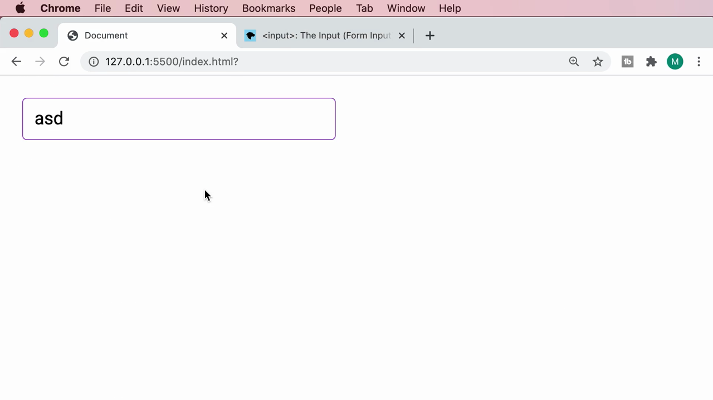

> **ทำไม Mosh ต้องเปิด MDN:** MDN คือแหล่งอ้างอิงมาตรฐานอุตสาหกรรมสำหรับเอกสารเว็บ (HTML, CSS, JavaScript) ที่นักพัฒนาเว็บมืออาชีพใช้ตรวจสอบสเปกและพฤติกรรมของแท็ก/แอตทริบิวต์ต่างๆ Mosh แนะนำให้ผู้เรียนคุ้นเคยกับการค้นหาและอ่านเอกสารจาก MDN แทนที่จะพยายามจำทุกอย่างเอง

---

## 3. ทดลองพิมพ์ข้อความในช่อง Email (ยังไม่มีการ Validate ทันที)

Mosh กลับมาที่เบราว์เซอร์และพิมพ์ข้อความ **"asd"** ลงในช่อง `type="email"` เพื่อแสดงให้เห็นว่าเบราว์เซอร์ **ไม่ได้บล็อกการพิมพ์ข้อความที่ไม่ใช่รูปแบบอีเมลทันที** — การตรวจสอบความถูกต้อง (validation) จะเกิดขึ้นก็ต่อเมื่อฟอร์มถูก submit เท่านั้น (หัวข้อนี้จะได้เรียนละเอียดในคลิป Data Validation ถัดๆ ไป):

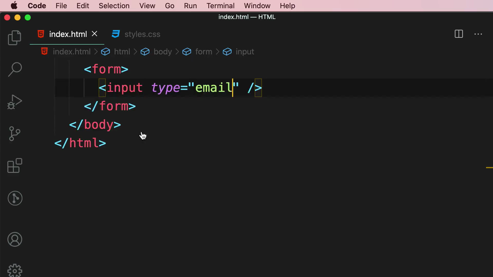

---

## 4. แนะนำแท็ก `<textarea>` สำหรับข้อความหลายบรรทัด

Mosh อธิบายว่า `<input>` เหมาะกับข้อความบรรทัดเดียวสั้นๆ แต่หากต้องการให้ผู้ใช้กรอกข้อความยาวหลายบรรทัด (เช่น ความคิดเห็น หรือที่อยู่) ต้องใช้แท็ก **`<textarea>`** แทน:

```html
<textarea cols="30" rows="10"></textarea>
```

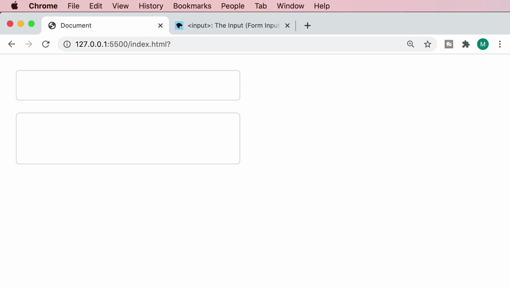

เมื่อรันในเบราว์เซอร์ จะเห็นกล่องข้อความที่สองปรากฏขึ้นใต้ input เดิม เป็นกล่องสี่เหลี่ยมขนาดใหญ่กว่า:

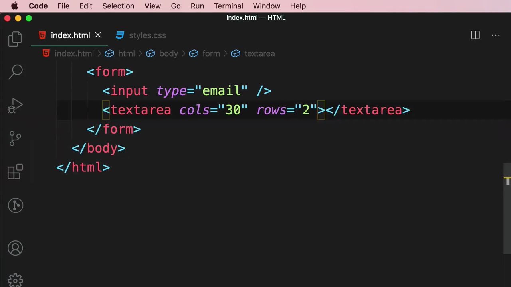

> **อธิบายแอตทริบิวต์ของ `<textarea>`:**
> - **`cols`** กำหนดความกว้างโดยประมาณของกล่อง (นับเป็นจำนวนตัวอักษร)
> - **`rows`** กำหนดความสูงโดยประมาณของกล่อง (นับเป็นจำนวนบรรทัด)
>
> Mosh ยังสาธิตการพิมพ์ข้อความหลายบรรทัดลงใน textarea เพื่อแสดงว่าสามารถกด Enter ขึ้นบรรทัดใหม่ได้ตามปกติ และมีจุดจับมุมด้านขวาล่าง (resize handle) ให้ผู้ใช้ลากปรับขนาดกล่องได้เองตามค่าเริ่มต้นของเบราว์เซอร์ (ควบคุมได้ด้วย CSS property `resize`)

---

## 5. แอตทริบิวต์ `value` — กำหนดค่าเริ่มต้น

Mosh เพิ่มแอตทริบิวต์ **`value`** ให้กับ input เพื่อกำหนดค่าเริ่มต้นที่จะแสดงในกล่องตั้งแต่โหลดหน้าเว็บครั้งแรก:

```html
<input type="email" value="programmingwithmosh@gmail.com" />
```

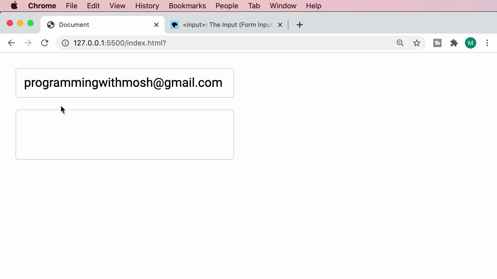

ผลลัพธ์: input จะมีข้อความ "programmingwithmosh@gmail.com" ปรากฏอยู่แล้วทันทีที่หน้าเว็บโหลดเสร็จ โดยผู้ใช้ยังสามารถแก้ไขข้อความนี้ได้ตามปกติ:

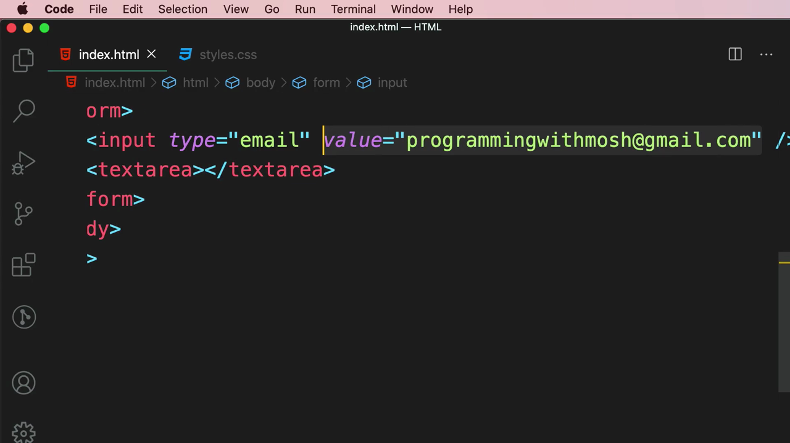

---

## 6. แอตทริบิวต์ `placeholder` — ข้อความแนะนำเมื่อช่องว่าง

Mosh เปลี่ยนจาก `value` มาใช้ **`placeholder`** แทน:

```html
<input type="email" placeholder="Email" />
```

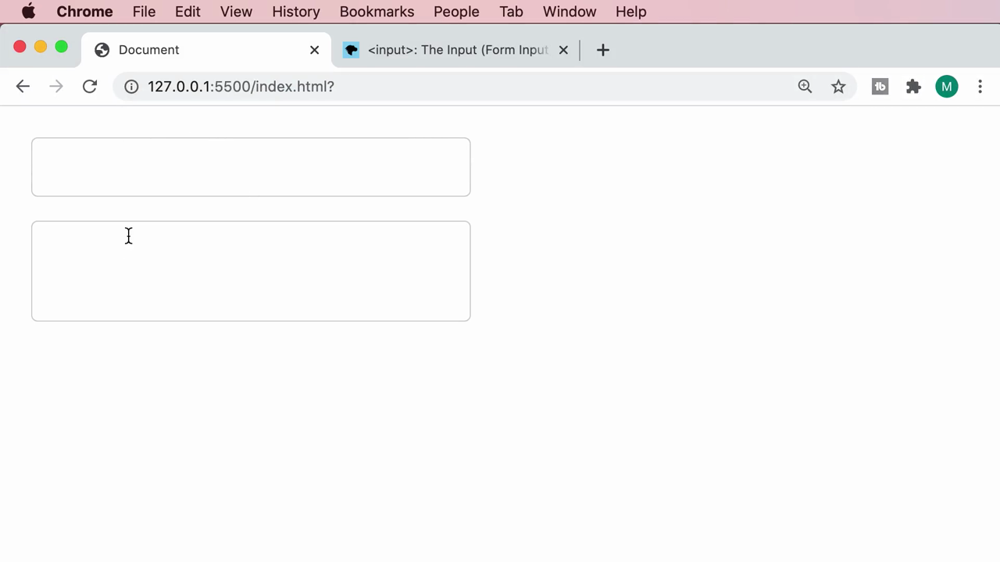

ผลลัพธ์: จะเห็นคำว่า "Email" แสดงเป็นตัวอักษรสีเทาจางๆ ในกล่อง — ข้อความนี้เป็นเพียง **คำแนะนำ** ไม่ใช่ค่าจริงของ input (เมื่อผู้ใช้เริ่มพิมพ์ ข้อความ placeholder จะหายไปทันที และหากไม่พิมพ์อะไรเลย ค่า value ของ input จะยังคงเป็นค่าว่างเปล่า ไม่ใช่คำว่า "Email"):

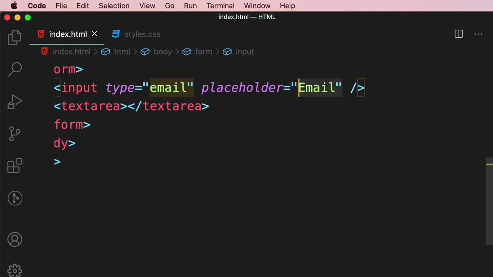

> **ข้อแตกต่างสำคัญระหว่าง `value` กับ `placeholder`:**
> - **`value`** คือค่าจริงของ input ที่จะถูกส่งไปพร้อมฟอร์มเมื่อ submit (ผู้ใช้ต้องลบออกเองถ้าไม่ต้องการ)
> - **`placeholder`** เป็นเพียงข้อความคำแนะนำที่จะหายไปเมื่อผู้ใช้พิมพ์ และไม่ถูกส่งไปพร้อมฟอร์มไม่ว่ากรณีใด

---

## 7. แอตทริบิวต์ `disabled` และ `readonly`

Mosh ทดลองแอตทริบิวต์ **`disabled`** ควบคู่กับ `value`:

```html
<input type="email" disabled value="..." />
```

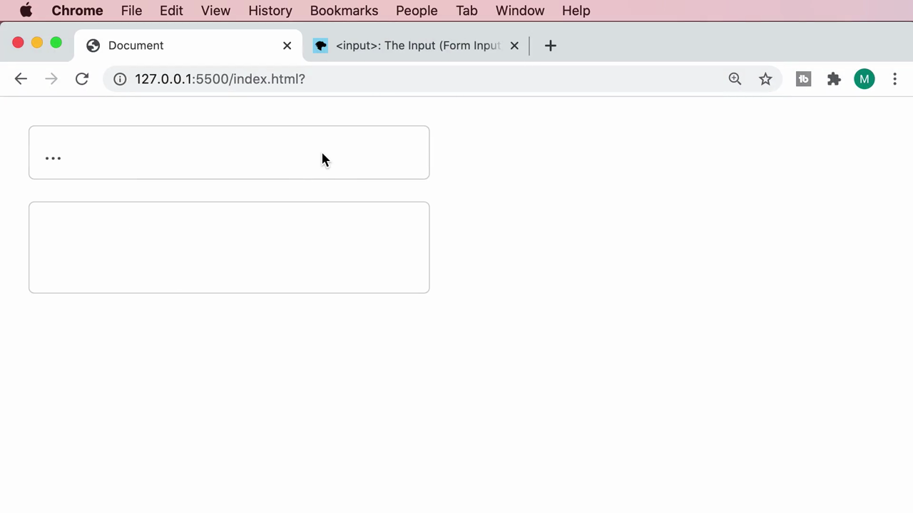

ผลลัพธ์: input จะแสดงเป็นสีเทาจาง (grayed out) ไม่สามารถคลิกหรือแก้ไขค่าใดๆ ได้เลย และเมื่อฟอร์มถูก submit ค่าของ input ที่ถูก disable จะ **ไม่ถูกส่งไปด้วย**:

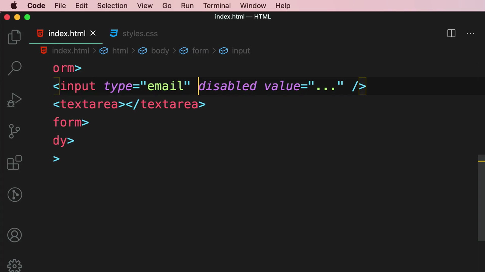

> **เปรียบเทียบ `disabled` กับ `readonly` (ที่ Mosh สาธิตก่อนหน้านี้ในคลิป):**
> - **`readonly`** — ผู้ใช้แก้ไขค่าไม่ได้ แต่ input ยังคงถูกโฟกัสได้ (แสดงเคอร์เซอร์ได้) และค่ายังคง**ถูกส่งไปพร้อมฟอร์ม**เมื่อ submit
> - **`disabled`** — ผู้ใช้แก้ไขค่าไม่ได้ ไม่สามารถโฟกัสได้เลย (คลิกไม่ติด) และค่า**จะไม่ถูกส่งไป**พร้อมฟอร์มเมื่อ submit
>
> ควรเลือกใช้ `readonly` เมื่อต้องการให้ผู้ใช้เห็นค่านั้นแต่แก้ไขไม่ได้ (และยังต้องส่งค่าไปกับฟอร์ม) ส่วน `disabled` เหมาะกับกรณีที่ต้องการปิดการใช้งานฟิลด์นั้นทั้งหมดชั่วคราว (เช่น ฟิลด์ที่ยังใช้งานไม่ได้ตามเงื่อนไขบางอย่าง)

---

## 8. แอตทริบิวต์ `maxlength` — จำกัดจำนวนตัวอักษร

Mosh ทดลองกำหนด **`maxlength="5"`**:

```html
<input type="email" maxlength="5" />
```

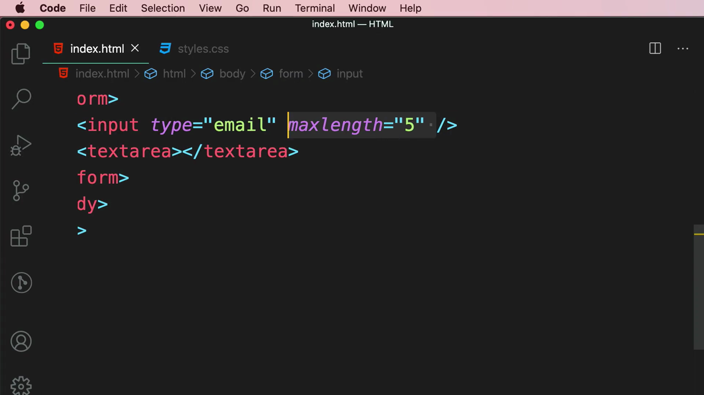

> เมื่อกำหนด `maxlength="5"` ผู้ใช้จะไม่สามารถพิมพ์ตัวอักษรเกิน 5 ตัวในช่องนี้ได้เลย เบราว์เซอร์จะบล็อกการพิมพ์เพิ่มโดยอัตโนมัติเมื่อครบจำนวนที่กำหนด — เป็นการจำกัดความยาวข้อมูลแบบง่ายๆ โดยไม่ต้องเขียน JavaScript

---

## 9. แอตทริบิวต์ `autofocus` — โฟกัสอัตโนมัติเมื่อโหลดหน้า

สุดท้าย Mosh สาธิตแอตทริบิวต์ **`autofocus`**:

```html
<input type="email" autofocus />
```

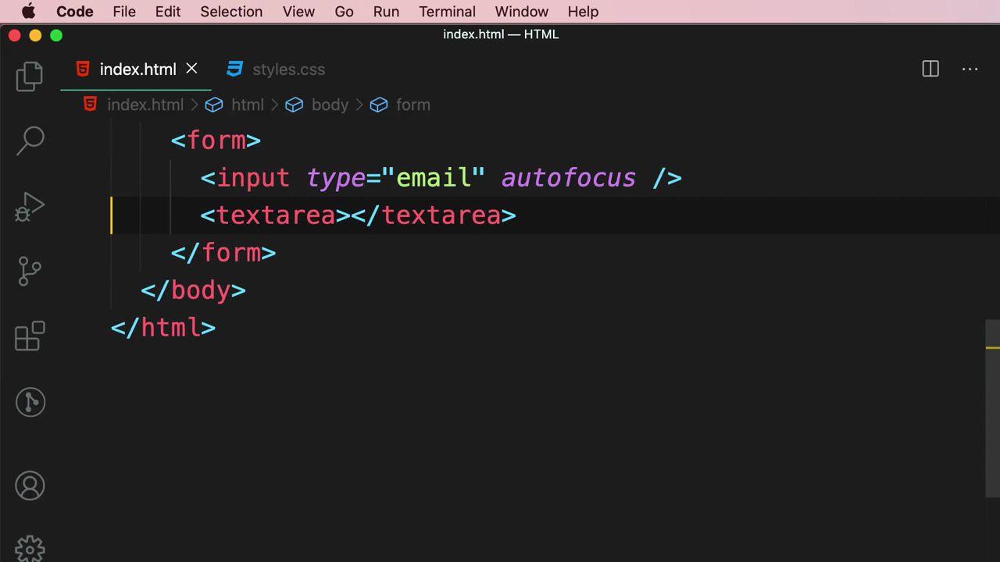

ผลลัพธ์: เมื่อรีเฟรชหน้าเว็บ จะเห็นว่า input ช่องนี้ถูกโฟกัส (มีกรอบสีม่วง/น้ำเงินและเคอร์เซอร์กระพริบ) ทันทีโดยที่ผู้ใช้ยังไม่ได้คลิกอะไรเลย พร้อมกันนี้ยังสาธิตการเพิ่ม `placeholder="Comment...."` ให้กับ `<textarea>` ด้วยเช่นกัน (ยืนยันว่า `<textarea>` ก็รองรับ `placeholder` เช่นเดียวกับ `<input>`):

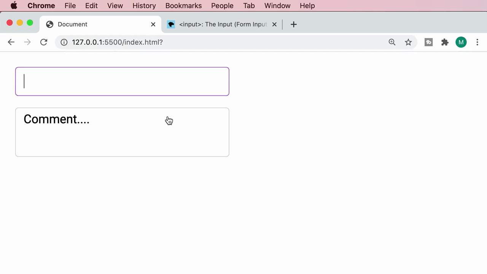

> **ข้อควรระวังของ `autofocus`:** ควรใช้อย่างระมัดระวังและมีเหตุผลที่ชัดเจน (เช่น หน้า login ที่มีฟิลด์เดียว) เพราะหากใช้ในฟอร์มที่ซับซ้อนหรือหน้าเว็บที่มีหลายฟอร์ม อาจสร้างความสับสนให้ผู้ใช้ (โดยเฉพาะผู้ใช้ที่พึ่งพา screen reader) ว่าทำไมโฟกัสถึงกระโดดไปที่ฟิลด์นั้นโดยไม่คาดคิด

---

## สรุปภาพรวมของคลิปนี้

| ประเด็น | รายละเอียด |
|---|---|
| **หัวข้อ** | Text Fields |
| **Input types ที่สาธิต** | `number`, `password`, `date`, `email` |
| **แท็กใหม่** | `<textarea>` (พร้อม `cols`, `rows`) |
| **แอตทริบิวต์สำคัญ** | `value`, `placeholder`, `readonly`, `disabled`, `maxlength`, `autofocus` |
| **แหล่งอ้างอิง** | MDN Web Docs (`<input>` element reference) |

**แนวคิดสำคัญที่ได้จากคลิปนี้:**

1. **`type` ของ `<input>` กำหนดพฤติกรรมและ UI ของฟิลด์นั้นอย่างมาก** เบราว์เซอร์จัดการ UI พิเศษให้อัตโนมัติ (เช่น date picker สำหรับ `type="date"`) โดยไม่ต้องเขียนโค้ดเพิ่ม
2. **MDN Web Docs เป็นแหล่งอ้างอิงที่ขาดไม่ได้** สำหรับนักพัฒนาเว็บ ควรฝึกค้นหาและอ่านเอกสารจากที่นี่เป็นนิสัย แทนที่จะพยายามจำทุก attribute เอง
3. **ต้องแยกแยะ `value`, `placeholder`, `readonly`, `disabled` ให้ชัดเจน** เพราะแต่ละตัวมีผลต่อพฤติกรรมการ submit ฟอร์มที่แตกต่างกัน โดยเฉพาะ `disabled` ที่ทำให้ค่าไม่ถูกส่งไปกับฟอร์มเลย ต่างจาก `readonly` ที่ยังคงส่งค่าไปตามปกติ
4. **`autofocus` ช่วยปรับปรุงประสบการณ์ผู้ใช้ได้ในบางกรณี** (เช่น หน้า login ที่มีฟิลด์เดียว) แต่ต้องใช้อย่างระมัดระวังเพื่อไม่ให้กระทบ accessibility

---

*หมายเหตุ: คลิปนี้เป็นส่วนหนึ่งของบท "5-Forms" จากคอร์ส The Ultimate HTML and CSS Course โดย Mosh Hamedani (codewithmosh.com) — คลิปที่ 4 ของบทนี้*
