# 5-Forms: 05 - Data Lists (4:46)

**ไฟล์ต้นทาง:** `6-Data_Lists.mp4`

▶️ **[เปิดวิดีโอต้นฉบับ](../../../HTML-CSS-2/5-Forms/5-Data-Lists.mp4)**

---

## ภาพรวมคลิปนี้

คลิปนี้ Mosh สอนแท็ก **`<datalist>`** ซึ่งใช้สร้างรายการตัวเลือกแบบ autocomplete ให้กับ `<input>` โดยที่ผู้ใช้ยังสามารถพิมพ์ค่าที่ไม่อยู่ในรายการเองได้ (ต่างจาก dropdown แบบ `<select>` ที่บังคับเลือกจากรายการเท่านั้น) นอกจากนี้ยังตรวจสอบความรองรับของเบราว์เซอร์ผ่าน caniuse.com และค้นหาข้อมูลเพิ่มเติมจาก MDN เพื่อดูตัวอย่างการจัดสไตล์และการเขียน JavaScript fallback สำหรับเบราว์เซอร์ที่ไม่รองรับ

---

## 1. เริ่มต้นด้วย `<datalist>` และ `<option>`

สไลด์ชื่อคลิป **"Data Lists"** เปิดคลิป จากนั้น Mosh เริ่มจากฟอร์มที่มี `<input type="text" />` เปล่าๆ แล้วเพิ่มแท็ก **`<datalist>`** พร้อมแท็กลูก **`<option>`** ข้างใน (ทดลองพิมพ์ "Australia" ซ้ำสองครั้งก่อนเพื่อสาธิตโครงสร้าง):


```html
<datalist>
  <option>Australia</option>
  <option>Australia</option>
</datalist>
```

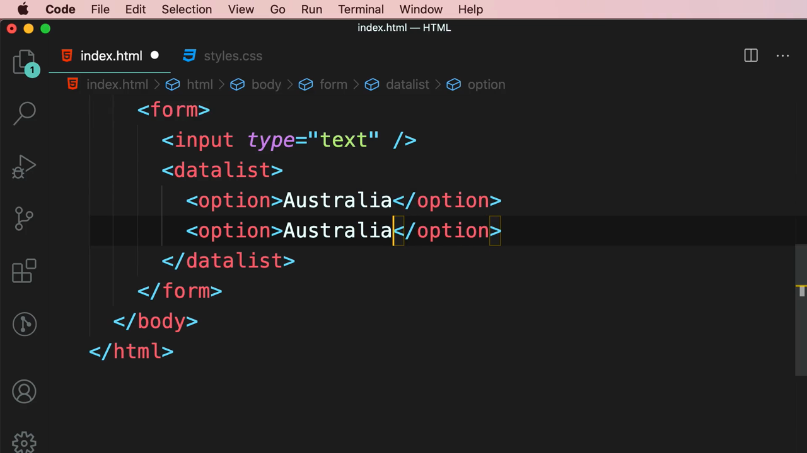

จากนั้นแก้ไขให้เป็นรายการประเทศจริงสี่ประเทศ:

```html
<datalist>
  <option>Australia</option>
  <option>Canada</option>
  <option>India</option>
  <option>United States</option>
</datalist>
```

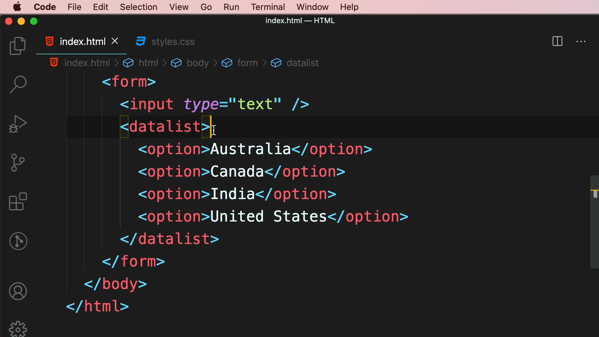

> ในขั้นตอนนี้ `<datalist>` ยังไม่ได้เชื่อมกับ `<input>` ใดๆ จึงยังไม่มีผลอะไรปรากฏในเบราว์เซอร์ — ต้องเชื่อมด้วยแอตทริบิวต์ `list`/`id` ในขั้นตอนถัดไป

---

## 2. ตรวจสอบความรองรับของเบราว์เซอร์ด้วย caniuse.com

ก่อนใช้งานฟีเจอร์นี้จริง Mosh เปิดเว็บไซต์ **caniuse.com** เพื่อตรวจสอบว่าเบราว์เซอร์ต่างๆ รองรับ `<datalist>` มากน้อยเพียงใด:

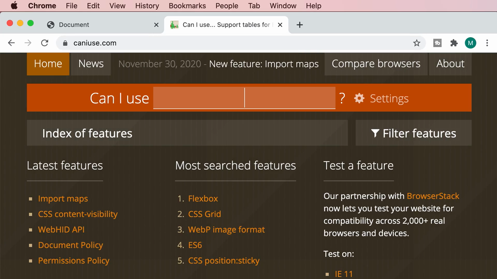

พิมพ์คำว่า "datalist" ในช่องค้นหา พบผลลัพธ์ **"Datalist element"** พร้อมสถิติการรองรับทั่วโลกอยู่ที่ **95.08%** ของผู้ใช้งานทั้งหมด (88.3% รองรับเต็มรูปแบบ + 6.77% รองรับบางส่วน):

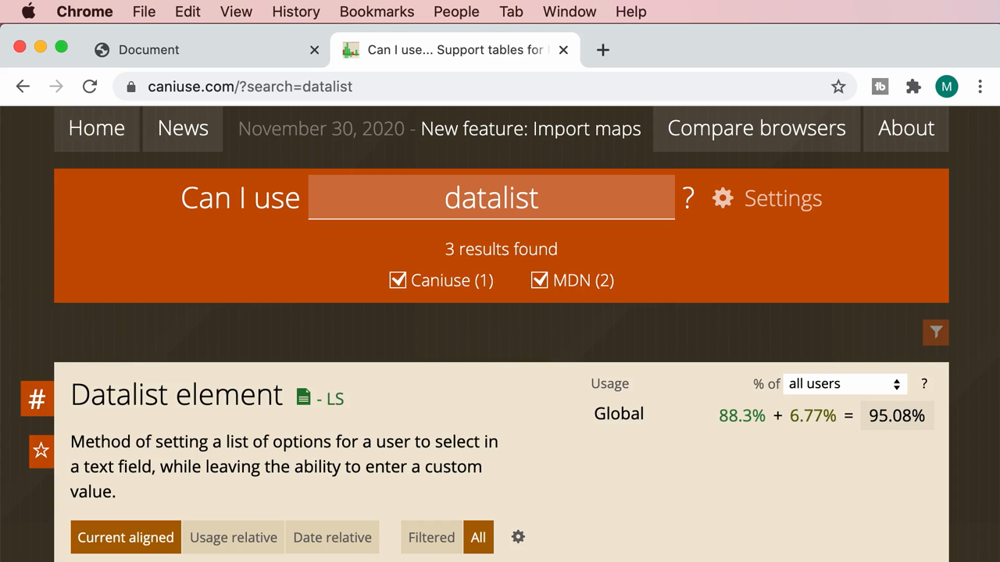

> **ทำไมต้องเช็ค caniuse.com:** เว็บไซต์นี้เป็นแหล่งอ้างอิงมาตรฐานที่นักพัฒนาเว็บใช้ตรวจสอบว่าฟีเจอร์ HTML/CSS/JavaScript ตัวใดตัวหนึ่งได้รับการรองรับจากเบราว์เซอร์ต่างๆ (Chrome, Firefox, Safari, Edge ฯลฯ) มากน้อยเพียงใด ก่อนตัดสินใจนำไปใช้งานจริงในโปรเจกต์ เพื่อให้มั่นใจว่าผู้ใช้ส่วนใหญ่จะเห็นผลลัพธ์ตามที่ออกแบบไว้

---

## 3. เชื่อม Input กับ Datalist ด้วย `list` และ `id`

Mosh เพิ่มแอตทริบิวต์ **`id`** ให้กับ `<datalist>` และแอตทริบิวต์ **`list`** ให้กับ `<input>` โดยค่าทั้งสองต้องตรงกัน (หลักการเดียวกับ `for`/`id` ของ label):

```html
<input type="text" list="countries" />
<datalist id="countries">
  <option>Australia</option>
  <option>Canada</option>
  <option>India</option>
  <option>United States</option>
</datalist>
```

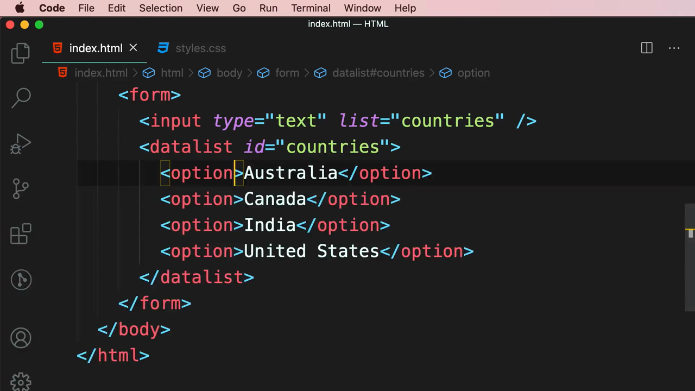

เมื่อรันในเบราว์เซอร์ จะเห็นลูกศรสามเหลี่ยมเล็กๆ ปรากฏที่มุมขวาของ input บ่งบอกว่ามีรายการตัวเลือกให้เลือก:

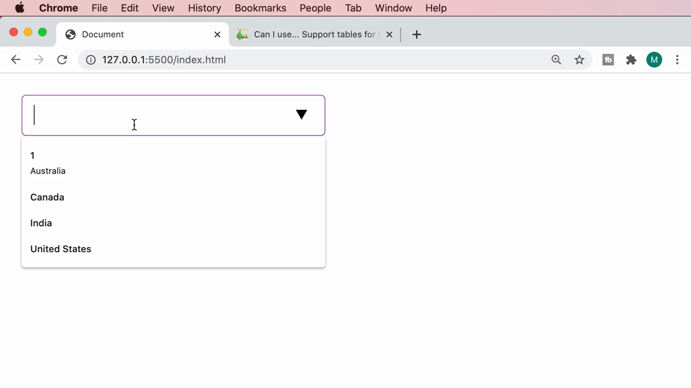

เมื่อคลิกที่ input จะเห็น dropdown แสดงรายการประเทศทั้งสี่ (Australia, Canada, India, United States) ให้เลือกได้ทันที:

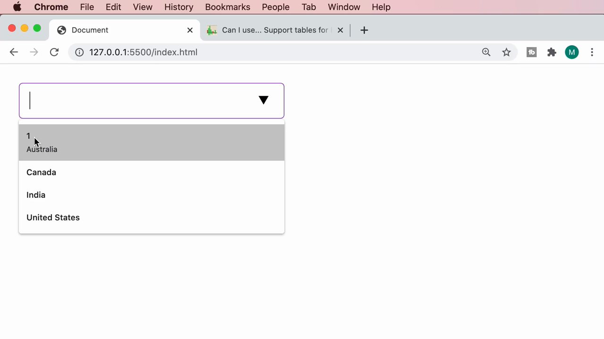

เมื่อเลื่อนเมาส์ไปวางเหนือแต่ละตัวเลือก แถวนั้นจะถูกไฮไลต์เป็นสีเทา (hover state) ให้เห็นชัดเจนว่ากำลังจะเลือกตัวเลือกใด:

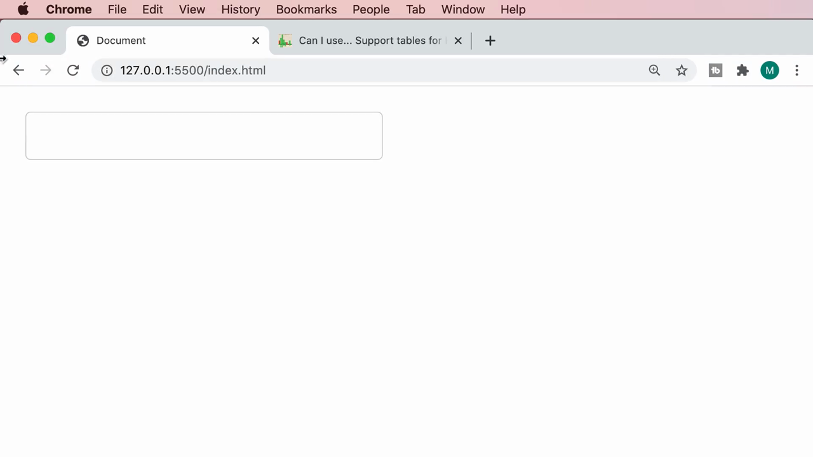

> **จุดเด่นสำคัญของ `<datalist>`:** ต่างจาก `<select>` ตรงที่ผู้ใช้**ไม่จำเป็นต้องเลือกจากรายการเท่านั้น** — ยังสามารถพิมพ์ค่าอื่นที่ไม่อยู่ในรายการได้อย่างอิสระ (เช่น พิมพ์ชื่อประเทศที่ไม่มีในลิสต์) ทำให้ `<datalist>` เหมาะกับกรณีที่ต้องการ "แนะนำ" ตัวเลือกที่พบบ่อย แต่ยังเปิดให้ผู้ใช้กรอกค่าที่กำหนดเองได้

---

## 4. ทดลองแอตทริบิวต์ `data-value` และ `autocomplete`

Mosh ทดลองเพิ่มแอตทริบิวต์ `data-value="1"` ให้กับ option แรก (เพื่อสาธิตว่าสามารถแนบข้อมูลเพิ่มเติมได้ผ่าน custom `data-*` attribute โดยไม่กระทบข้อความที่แสดงผล):

```html
<option data-value="1">Australia</option>
```

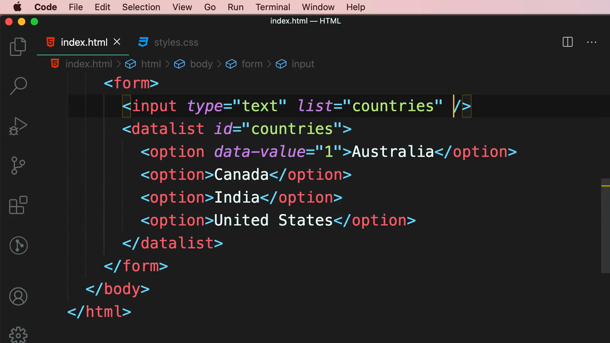

จากนั้นเพิ่มแอตทริบิวต์ **`autocomplete="off"`** ให้กับ `<input>` เพื่อปิดการแสดงประวัติการกรอกข้อมูลเดิมของเบราว์เซอร์เอง (browser's own autofill suggestions) ซึ่งอาจซ้อนทับหรือสร้างความสับสนกับ dropdown ของ `<datalist>`:

```html
<input type="text" list="countries" autocomplete="off" />
```

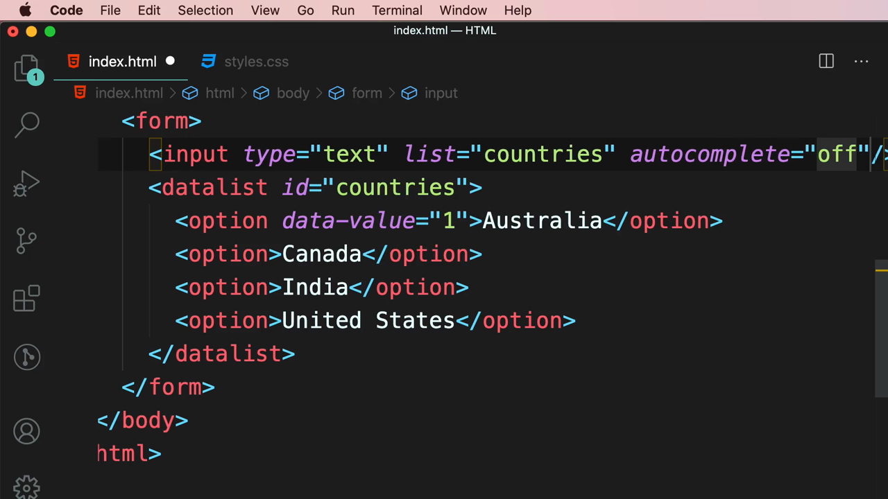

---

## 5. ค้นคว้าเพิ่มเติมจาก MDN

Mosh เปิด Google และค้นหาคำว่า **"html datalist element"**:

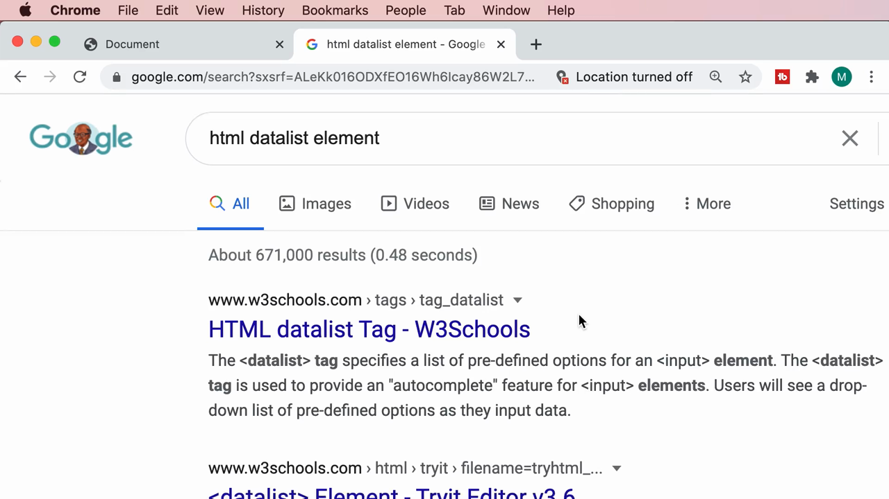

พบผลลัพธ์จาก MDN ในหน้าค้นหา และคลิกเข้าไปที่หน้า **`<datalist>`: The HTML Data List element**:

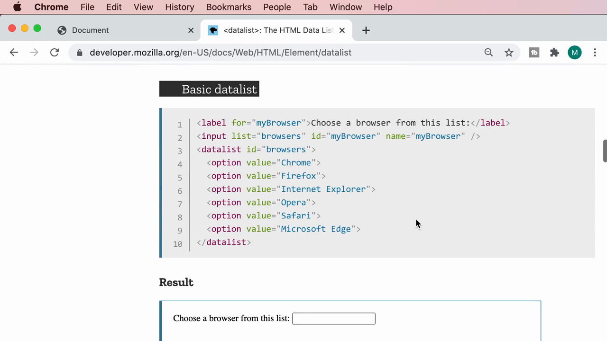

ในหน้า MDN มีตัวอย่างพื้นฐาน (Basic datalist) แสดงโค้ดตัวอย่างการใช้ `<datalist>` กับฟิลด์เลือกเบราว์เซอร์ (Chrome, Firefox, Internet Explorer, Opera, Safari, Microsoft Edge):

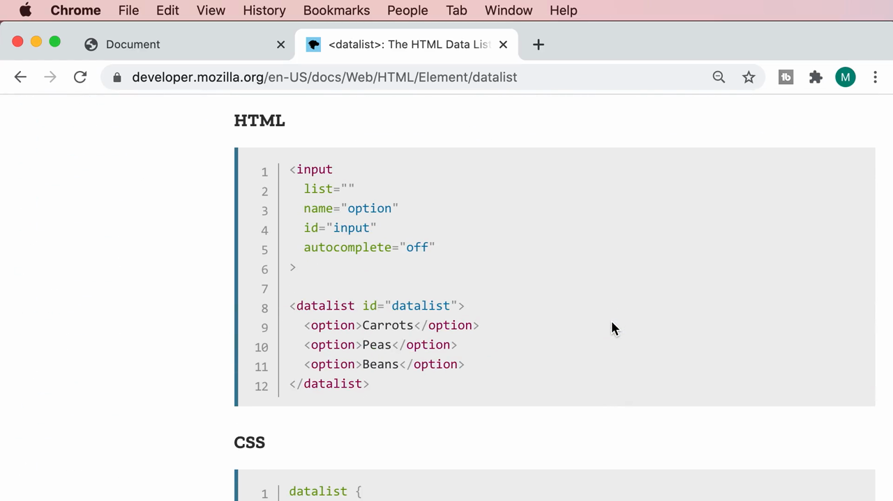

MDN ยังมีตัวอย่างขั้นสูงกว่า (Advanced example) ที่แสดงวิธีจัดสไตล์ `<datalist>` ด้วย CSS และเขียน **JavaScript fallback** สำหรับเบราว์เซอร์ที่ไม่รองรับ `<datalist>` โดยตรง:

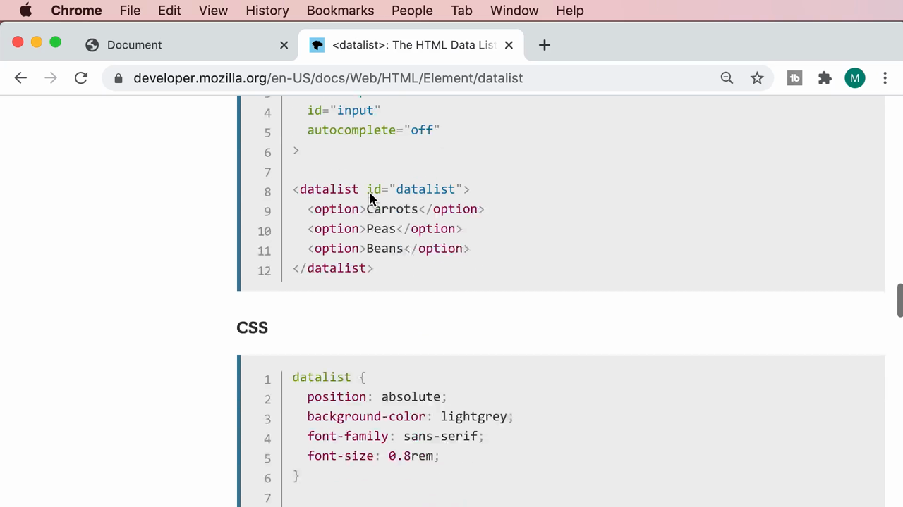

```css
datalist {
  position: absolute;
  background-color: lightgrey;
  font-family: sans-serif;
  font-size: 0.8rem;
}

option {
  background-color: #bbb;
  padding: 4px;
  margin-bottom: 1px;
  cursor: pointer;
}
```

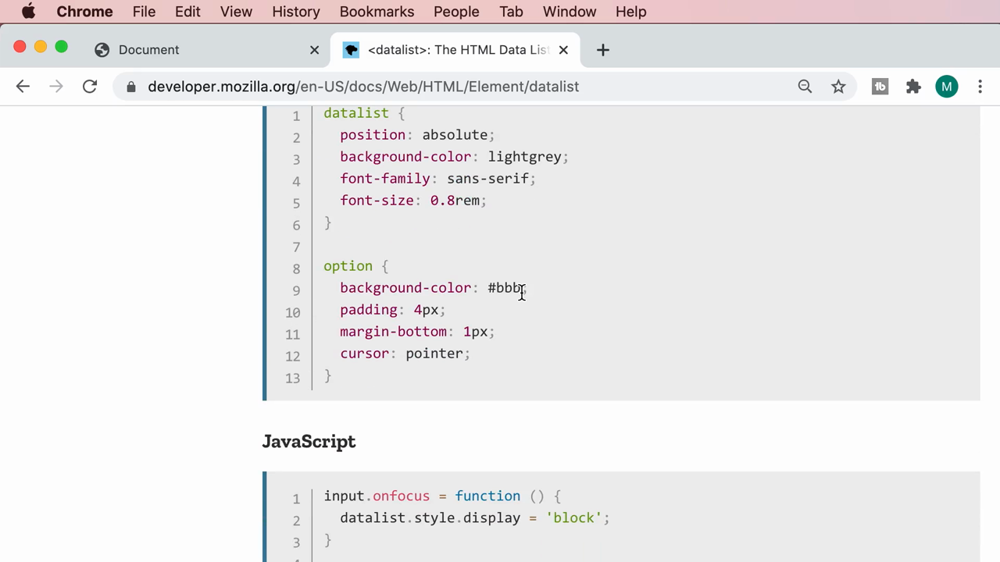

```js
input.onfocus = function () {
  datalist.style.display = 'block';
}

for (let option of datalist.options) {
  option.onclick = function () {
    input.value = this.value;
    datalist.style.display = 'none';
  }
}

datalist.style.width = input.offsetWidth + 'px';
datalist.style.left = input.offsetLeft + 'px';
datalist.style.top = input.offsetTop + input.offsetHeight + 'px';
```

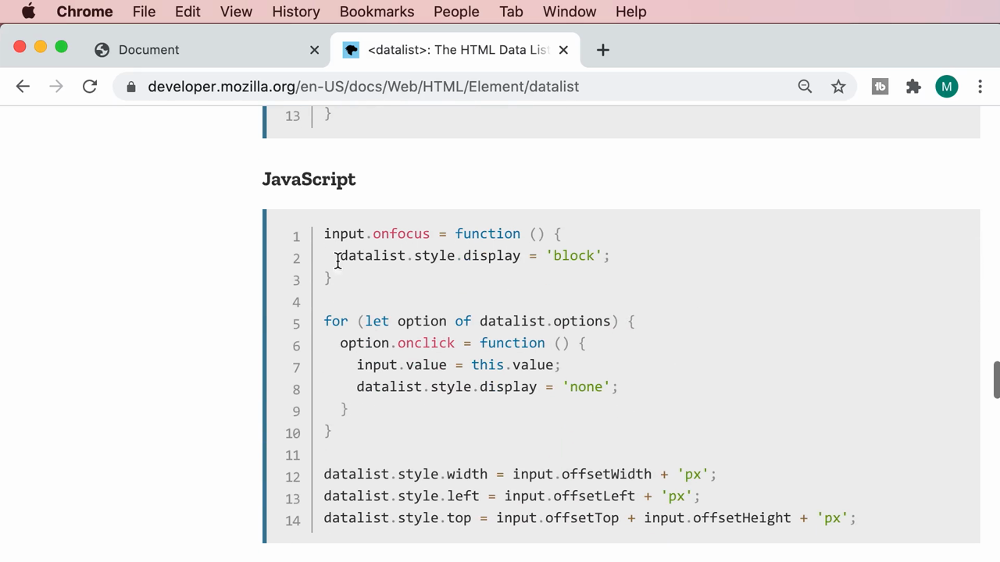

> **จุดประสงค์ของตัวอย่าง JavaScript fallback นี้:** เนื่องจากเบราว์เซอร์บางตัว (โดยเฉพาะเวอร์ชันเก่าหรือ Safari บางเวอร์ชัน) อาจไม่รองรับ `<datalist>` แบบเนทีฟอย่างสมบูรณ์ นักพัฒนาบางคนจึงเขียนโค้ด JavaScript จำลองพฤติกรรม dropdown เองด้วยมือ (แสดง/ซ่อน `<datalist>` เมื่อ input ถูกโฟกัส และจัดการคลิกเลือกตัวเลือกด้วย `onclick`) เพื่อให้ผู้ใช้ในทุกเบราว์เซอร์ได้ประสบการณ์ใกล้เคียงกัน

---

## สรุปภาพรวมของคลิปนี้

| ประเด็น | รายละเอียด |
|---|---|
| **หัวข้อ** | Data Lists |
| **แท็กใหม่** | `<datalist>`, `<option>` |
| **แอตทริบิวต์สำคัญ** | `list` (บน input), `id` (บน datalist), `data-value` (custom data attribute), `autocomplete="off"` |
| **เครื่องมือ/แหล่งอ้างอิงที่ใช้** | caniuse.com (เช็ค browser support), MDN Web Docs (`<datalist>` reference) |
| **ความรองรับเบราว์เซอร์ (ตามที่แสดงในคลิป)** | 95.08% ของผู้ใช้ทั่วโลก |

**แนวคิดสำคัญที่ได้จากคลิปนี้:**

1. **`<datalist>` ให้ทั้งความสะดวก (autocomplete) และความยืดหยุ่น (พิมพ์ค่าเองได้)** ต่างจาก `<select>` ที่บังคับให้เลือกจากรายการที่กำหนดไว้เท่านั้น เหมาะกับกรณีที่มีตัวเลือกยอดนิยมแต่ไม่ต้องการจำกัดผู้ใช้
2. **การเชื่อม `list` (บน input) กับ `id` (บน datalist)** เป็นรูปแบบเดียวกับการเชื่อม `for`/`id` ของ label — ค่าทั้งสองฝั่งต้องตรงกันทุกตัวอักษร
3. **ควรตรวจสอบ browser support ด้วย caniuse.com ก่อนใช้ฟีเจอร์ HTML/CSS ใหม่ๆ เสมอ** เพื่อประเมินความเสี่ยงว่าฟีเจอร์นั้นจะทำงานได้กับผู้ใช้ส่วนใหญ่ของเว็บไซต์หรือไม่
4. **MDN มักมีตัวอย่าง fallback ด้วย JavaScript** สำหรับฟีเจอร์ที่ browser support ยังไม่ครบ 100% ซึ่งเป็นแนวทางที่ดีในการศึกษาเพิ่มเติมเมื่อจำเป็นต้องรองรับผู้ใช้ในเบราว์เซอร์ที่หลากหลาย

---

*หมายเหตุ: คลิปนี้เป็นส่วนหนึ่งของบท "5-Forms" จากคอร์ส The Ultimate HTML and CSS Course โดย Mosh Hamedani (codewithmosh.com) — คลิปที่ 5 ของบทนี้*
