# 5-Forms: 06 - Drop-down Lists (3:07)

**ไฟล์ต้นทาง:** `7-Drop-down_Lists.mp4`

▶️ **[เปิดวิดีโอต้นฉบับ](../../../HTML-CSS-2/5-Forms/6-Drop-down-Lists.mp4)**

---

## ภาพรวมคลิปนี้

คลิปนี้ Mosh สอนแท็ก **`<select>`** สำหรับสร้างเมนูแบบเลื่อนลง (drop-down list) พร้อมแท็กลูก **`<option>`** โดยครอบคลุมตั้งแต่การสร้างตัวเลือกพื้นฐาน การกำหนดค่า `value` ให้แต่ละตัวเลือก การใช้ตัวเลือก "placeholder" ที่ไม่สามารถเลือกได้จริง (`value=""`), แอตทริบิวต์ `selected` เพื่อกำหนดค่าเริ่มต้น, แอตทริบิวต์ `multiple` เพื่อเลือกได้หลายรายการพร้อมกัน และปิดท้ายด้วยแท็ก **`<optgroup>`** สำหรับจัดกลุ่มตัวเลือกที่เกี่ยวข้องกัน

---

## 1. สร้าง `<select>` และ `<option>` พื้นฐาน

สไลด์ชื่อคลิป **"Drop-down Lists"** เปิดคลิป จากนั้น Mosh เริ่มจากฟอร์มเปล่าๆ แล้วเพิ่มแท็ก **`<select>`** พร้อม `<option>` สองอัน (ทดลองพิมพ์ `value=""` ว่างเปล่าก่อนเพื่อสาธิตโครงสร้าง):


```html
<select>
  <option value=""></option>
  <option value=""></option>
</select>
```

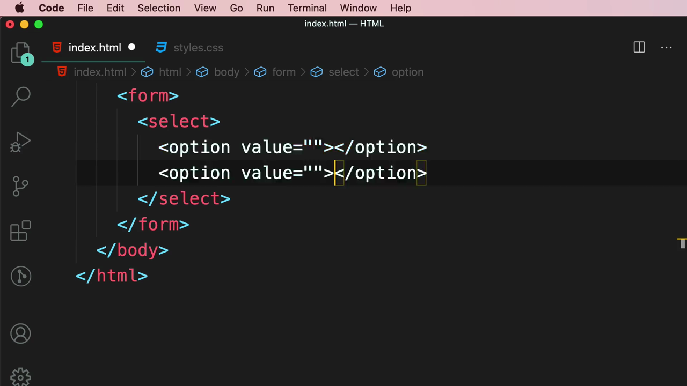

จากนั้นแก้ไขให้เป็นตัวเลือกจริง 3 รายการ (HTML, CSS, JavaScript):

```html
<select>
  <option value="">HTML</option>
  <option value="">CSS</option>
  <option value="">JavaScript</option>
</select>
```

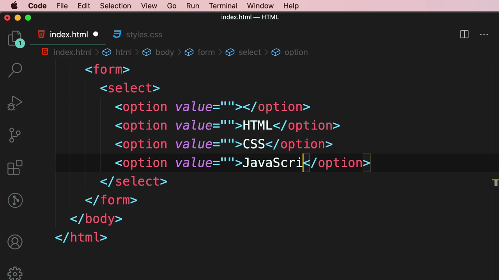

เมื่อรันในเบราว์เซอร์ จะเห็น dropdown ที่ยุบเก็บอยู่ (collapsed) พร้อมลูกศรชี้ลงที่มุมขวา:

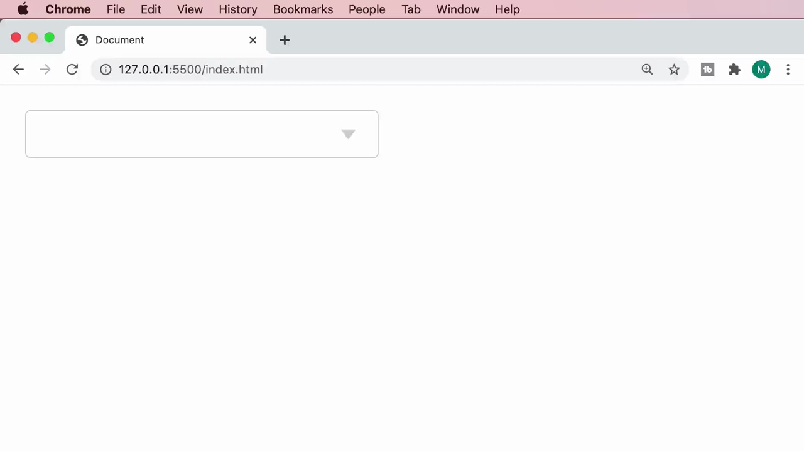

เมื่อคลิกที่ dropdown จะเห็นรายการตัวเลือกทั้งหมดขยายออกมา (HTML, CSS, JavaScript) พร้อมเครื่องหมายถูกหน้าตัวเลือกที่เลือกอยู่ในปัจจุบัน:

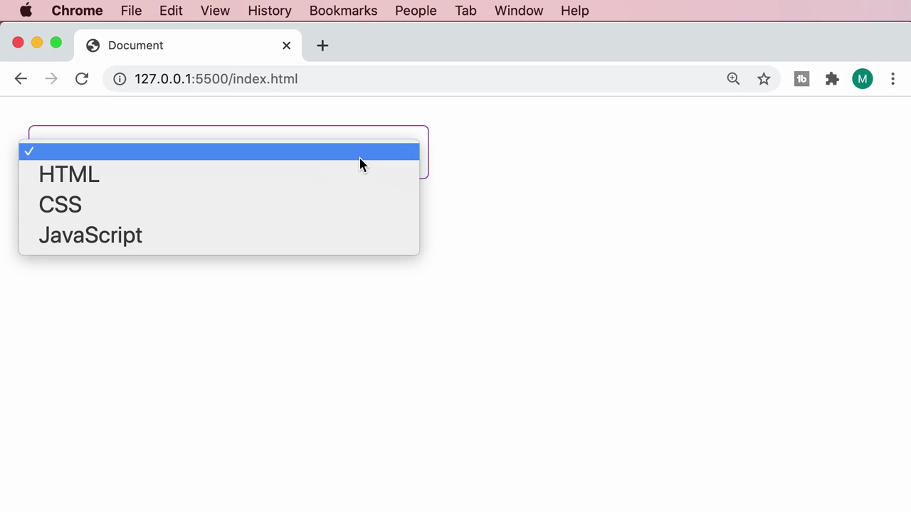

เมื่อเลือก "HTML" ตัวเลือกนั้นจะแสดงผลอยู่ใน select box:

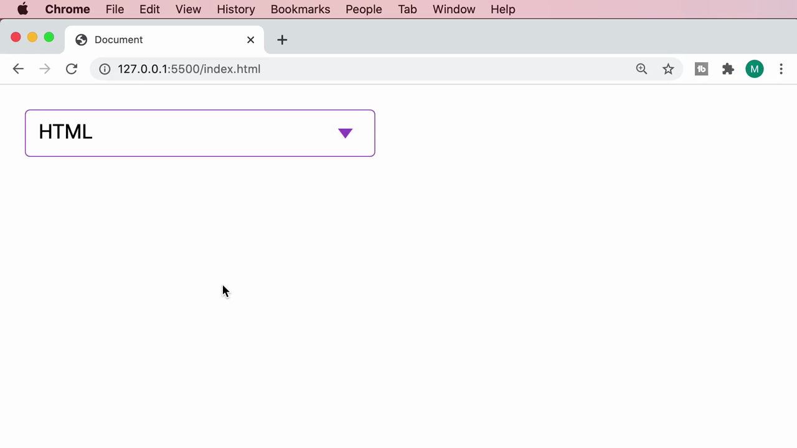

---

## 2. กำหนดค่า `value` ให้แต่ละตัวเลือก

Mosh เพิ่มค่า `value` ที่แตกต่างกันให้แต่ละ `<option>` (1, 2, 3) เพื่อให้มีค่าที่จะถูกส่งไปพร้อมฟอร์มเมื่อ submit (ค่าที่ผู้ใช้เห็นในหน้าจอกับค่าที่ถูกส่งจริงสามารถแตกต่างกันได้):

```html
<select>
  <option value="1">HTML</option>
  <option value="2">CSS</option>
  <option value="3">JavaScript</option>
</select>
```

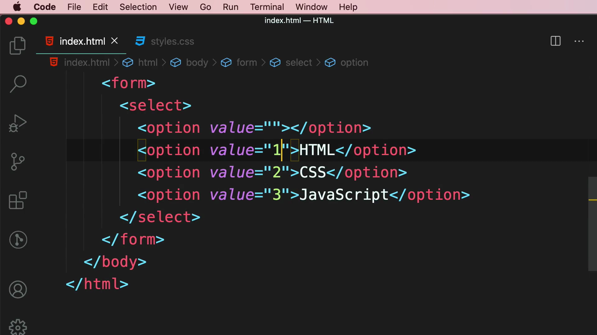

> **หลักการสำคัญ:** ข้อความที่แสดงในหน้าจอ (เช่น "HTML") กับค่าที่ถูกส่งไปจริงตอน submit (เช่น `"1"`) ไม่จำเป็นต้องเหมือนกัน ซึ่งมีประโยชน์มากเมื่อฝั่ง backend ต้องการรับค่าเป็นรหัส (ID) แทนที่จะเป็นข้อความเต็ม

---

## 3. เพิ่มตัวเลือก Placeholder ("Select a Course...")

Mosh เพิ่ม `<option>` แรกที่มี `value=""` (ค่าว่างเปล่า) และข้อความ **"Select a Course..."** เพื่อทำหน้าที่เป็นคำแนะนำเริ่มต้น บอกผู้ใช้ว่าต้องเลือกอะไร:

```html
<select>
  <option value="">Select a Course...</option>
  <option value="1">HTML</option>
  <option value="2">CSS</option>
  <option value="3">JavaScript</option>
</select>
```

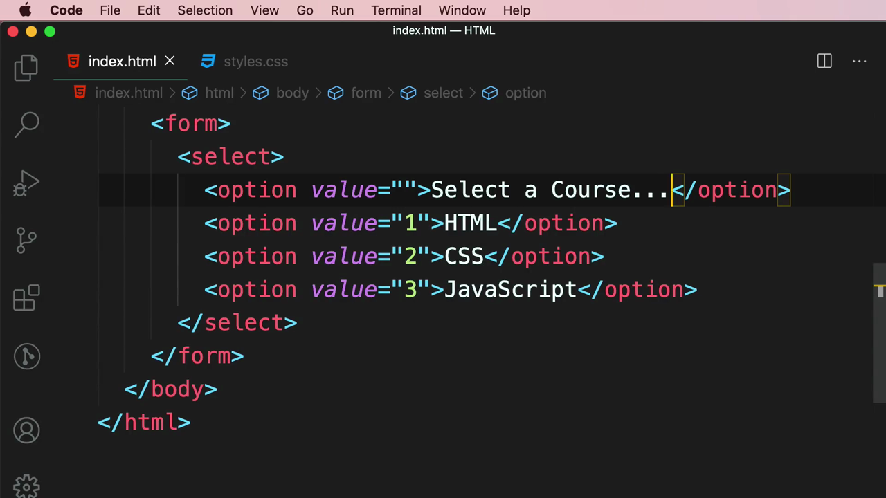

ผลลัพธ์ในเบราว์เซอร์: dropdown จะแสดงข้อความ "Select a Course..." เป็นค่าเริ่มต้นเมื่อยังไม่ได้เลือกอะไร:

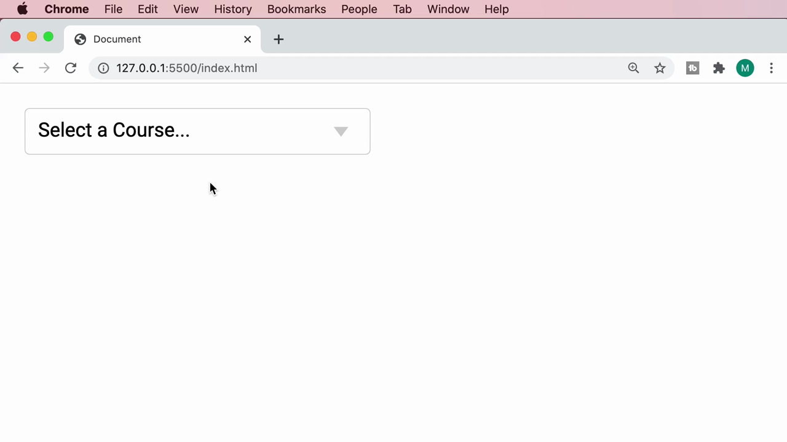

---

## 4. แอตทริบิวต์ `selected` — กำหนดตัวเลือกเริ่มต้น

Mosh เพิ่มแอตทริบิวต์ **`selected`** ให้กับ option "HTML" เพื่อกำหนดให้เป็นตัวเลือกที่ถูกเลือกไว้ล่วงหน้าตั้งแต่หน้าเว็บโหลดเสร็จ (แทนที่จะเป็น "Select a Course..." เป็นค่าเริ่มต้น):

```html
<select>
  <option value="">Select a Course...</option>
  <option value="1" selected>HTML</option>
  <option value="2">CSS</option>
  <option value="3">JavaScript</option>
</select>
```

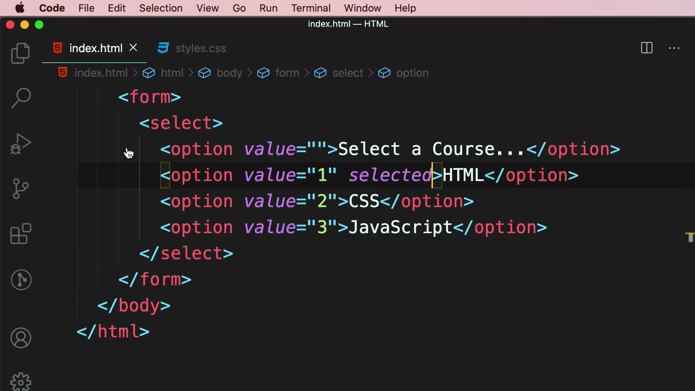

ผลลัพธ์: dropdown จะแสดง "HTML" เป็นค่าเริ่มต้นทันทีที่โหลดหน้า โดยผู้ใช้ยังสามารถเปลี่ยนเป็นตัวเลือกอื่นได้ตามปกติ:

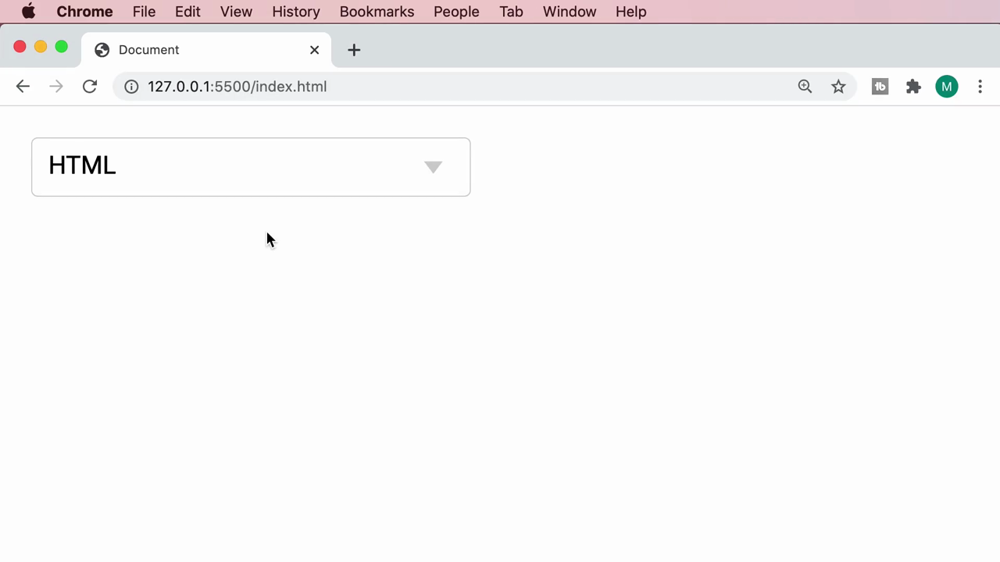

---

## 5. แอตทริบิวต์ `multiple` — เลือกได้หลายรายการ

Mosh ลบตัวเลือก placeholder ออกชั่วคราวและเพิ่มแอตทริบิวต์ **`multiple`** ให้กับ `<select>`:

```html
<select multiple>
  <option value="1">HTML</option>
  <option value="2">CSS</option>
  <option value="3">JavaScript</option>
</select>
```

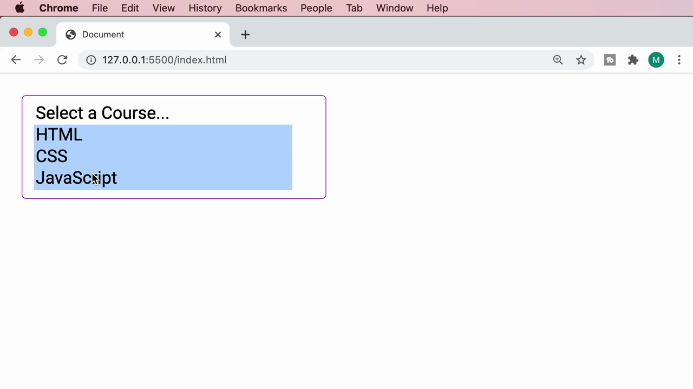

ผลลัพธ์: UI เปลี่ยนจาก dropdown แบบยุบเก็บ กลายเป็นกล่องรายการ (list box) ที่แสดงตัวเลือกทั้งหมดพร้อมกัน:

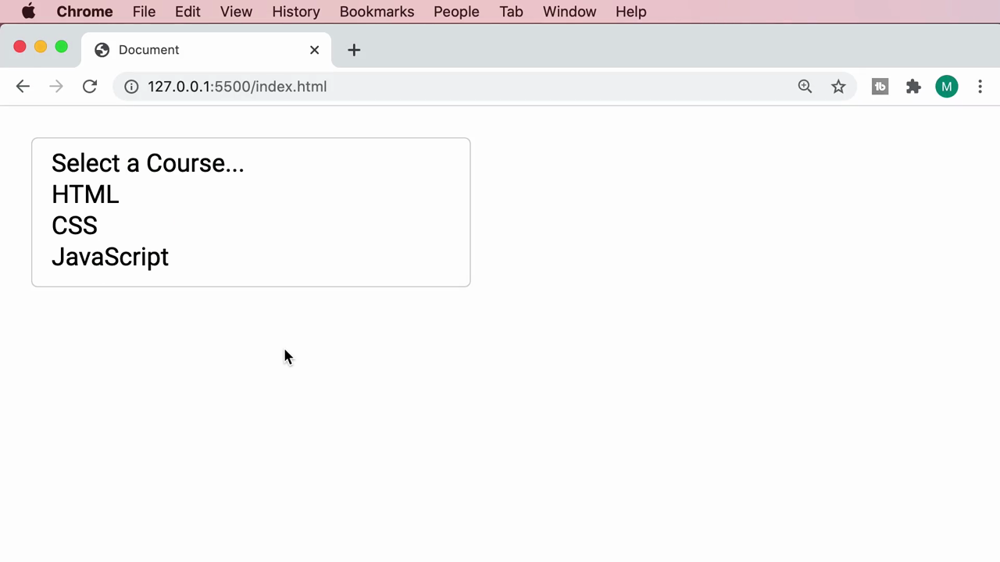

Mosh สาธิตการกดปุ่ม Cmd (macOS) ค้างไว้พร้อมคลิกเลือกหลายรายการพร้อมกัน (HTML, CSS, JavaScript ถูกเลือกพร้อมกันทั้งหมด แสดงเป็นแถบสีฟ้า):

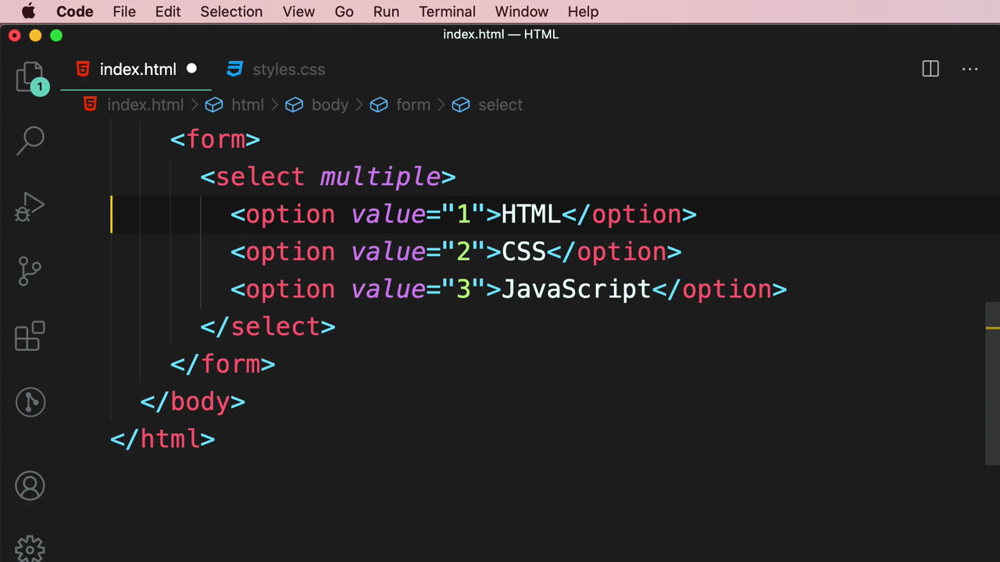

> **การใช้งาน `multiple`:** เหมาะกับกรณีที่ผู้ใช้ต้องเลือกได้มากกว่าหนึ่งตัวเลือกพร้อมกัน (เช่น เลือกหลายหมวดหมู่ หรือหลายแท็ก) ผู้ใช้กด Cmd (Mac) หรือ Ctrl (Windows) ค้างไว้ขณะคลิกเพื่อเลือกหลายรายการ

---

## 6. แท็ก `<optgroup>` — จัดกลุ่มตัวเลือกที่เกี่ยวข้อง

สุดท้าย Mosh ลบ `multiple` ออกและแนะนำแท็ก **`<optgroup>`** สำหรับจัดกลุ่มตัวเลือกที่เกี่ยวข้องกันภายใต้หัวข้อเดียวกัน โดยใช้ Emmet abbreviation "opt" ที่แสดงตัวเลือก `optgroup` ให้เลือก:

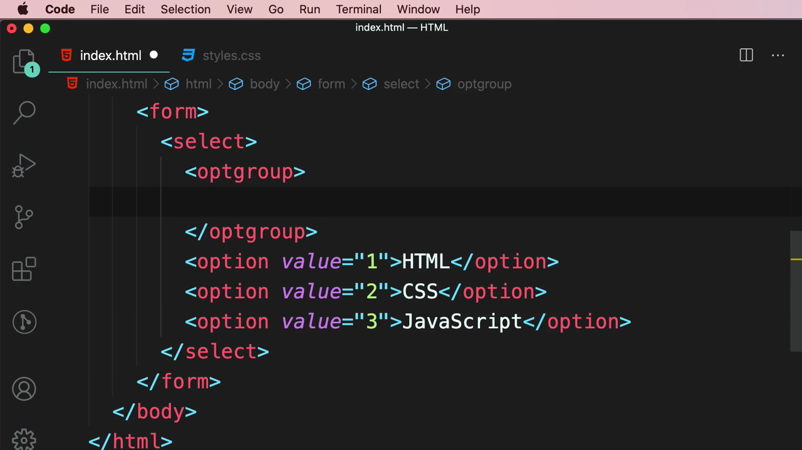

จากนั้นเพิ่มแอตทริบิวต์ **`label`** ให้กับ `<optgroup>` และย้าย option ทั้งสามเข้าไปไว้ข้างใน:

```html
<select>
  <optgroup label="Front-end Courses">
    <option value="1">HTML</option>
    <option value="2">CSS</option>
    <option value="3">JavaScript</option>
  </optgroup>
</select>
```

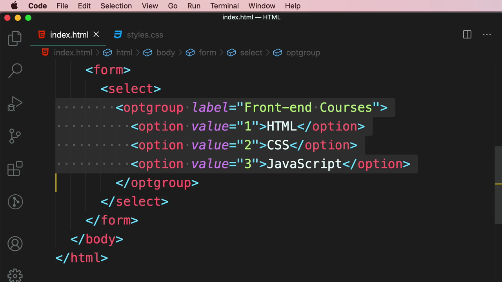

Mosh คัดลอก `<optgroup>` แล้วสร้างกลุ่มที่สอง เปลี่ยน `label` เป็น **"Back-end Courses"** พร้อมตัวเลือกใหม่ (Node.js, ASP.NET, Django):

```html
<select>
  <optgroup label="Front-end Courses">
    <option value="1">HTML</option>
    <option value="2">CSS</option>
    <option value="3">JavaScript</option>
  </optgroup>
  <optgroup label="Back-end Courses">
    <option value="4">Node.js</option>
    <option value="5">ASP.NET</option>
    <option value="6">Django</option>
  </optgroup>
</select>
```

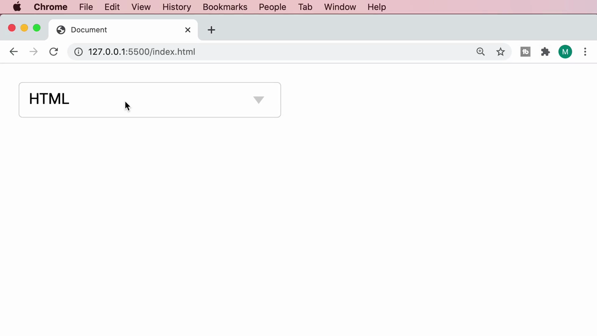

ผลลัพธ์สุดท้ายในเบราว์เซอร์: เมื่อคลิกเปิด dropdown จะเห็นหัวข้อกลุ่ม **"Front-end Courses"** และ **"Back-end Courses"** แสดงเป็นตัวหนังสือสีเทา (ไม่สามารถเลือกได้เอง เป็นเพียงป้ายหัวข้อ) คั่นระหว่างตัวเลือกแต่ละกลุ่ม พร้อมเครื่องหมายถูกหน้าตัวเลือกที่กำลังถูกเลือกอยู่ (HTML):

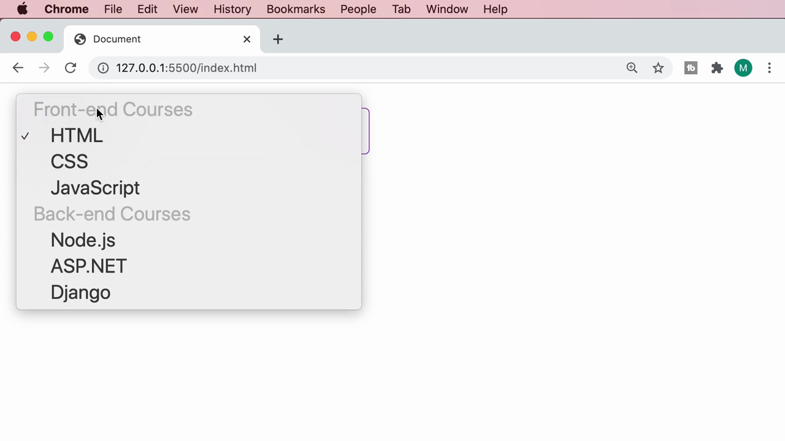

> **ประโยชน์ของ `<optgroup>`:** ช่วยจัดระเบียบ dropdown ที่มีตัวเลือกจำนวนมากให้เป็นหมวดหมู่ที่ชัดเจน ทำให้ผู้ใช้ค้นหาตัวเลือกที่ต้องการได้ง่ายขึ้น โดยเฉพาะเมื่อมีตัวเลือกหลายสิบรายการ

---

## สรุปภาพรวมของคลิปนี้

| ประเด็น | รายละเอียด |
|---|---|
| **หัวข้อ** | Drop-down Lists |
| **แท็กใหม่** | `<select>`, `<option>`, `<optgroup>` |
| **แอตทริบิวต์สำคัญ** | `value`, `selected`, `multiple`, `label` (บน optgroup) |

**แนวคิดสำคัญที่ได้จากคลิปนี้:**

1. **`value` ของ `<option>` ไม่จำเป็นต้องตรงกับข้อความที่แสดงผล** ทำให้สามารถส่งรหัส (ID) ไปยัง backend ได้ ในขณะที่ผู้ใช้เห็นข้อความที่อ่านง่ายกว่า
2. **ตัวเลือก placeholder ที่มี `value=""` เป็นเทคนิคทั่วไป** สำหรับบอกผู้ใช้ว่าต้องเลือกอะไร โดยควรใช้ร่วมกับ data validation (จะได้เรียนในคลิปถัดๆ ไป) เพื่อบังคับให้ผู้ใช้เลือกค่าอื่นที่ไม่ใช่ placeholder ก่อน submit
3. **`multiple` เปลี่ยนพฤติกรรมของ `<select>` อย่างสิ้นเชิง** จาก dropdown ยุบเก็บกลายเป็น list box ที่แสดงทุกตัวเลือกพร้อมกัน เหมาะกับการเลือกได้มากกว่าหนึ่งค่า
4. **`<optgroup>` ช่วยจัดหมวดหมู่ตัวเลือกจำนวนมาก** ให้อ่านง่ายขึ้น โดยหัวข้อกลุ่มเองไม่สามารถถูกเลือกได้ เป็นเพียงป้ายกำกับสำหรับแบ่งกลุ่ม

---

*หมายเหตุ: คลิปนี้เป็นส่วนหนึ่งของบท "5-Forms" จากคอร์ส The Ultimate HTML and CSS Course โดย Mosh Hamedani (codewithmosh.com) — คลิปที่ 6 ของบทนี้*
