# 5-Forms: 07 - Check Boxes (2:57)

**ไฟล์ต้นทาง:** `8-Check_Boxes.mp4`

▶️ **[เปิดวิดีโอต้นฉบับ](../../../HTML-CSS-2/5-Forms/7-Check-Boxes.mp4)**

---

## ภาพรวมคลิปนี้

คลิปนี้ Mosh สอนวิธีสร้าง **checkbox** ด้วย `<input type="checkbox">` พร้อม `<label>` ที่เชื่อมโยงกันอย่างถูกต้อง จากนั้นแวะไปดูตัวอย่างจริงจากเว็บไซต์ **Milligram** (CSS framework) เพื่อดูวิธีจัดสไตล์ checkbox ให้อยู่ในบรรทัดเดียวกับ label ด้วยคลาส `label-inline` และปิดท้ายด้วยการสร้าง checkbox หลายอันพร้อมแอตทริบิวต์ `checked` เพื่อกำหนดค่าเริ่มต้น

---

## 1. สร้าง Checkbox พื้นฐาน

สไลด์ชื่อคลิป **"Check Boxes"** เปิดคลิป จากนั้น Mosh เริ่มจากฟอร์มเปล่าแล้วเพิ่ม `<input type="checkbox">`:

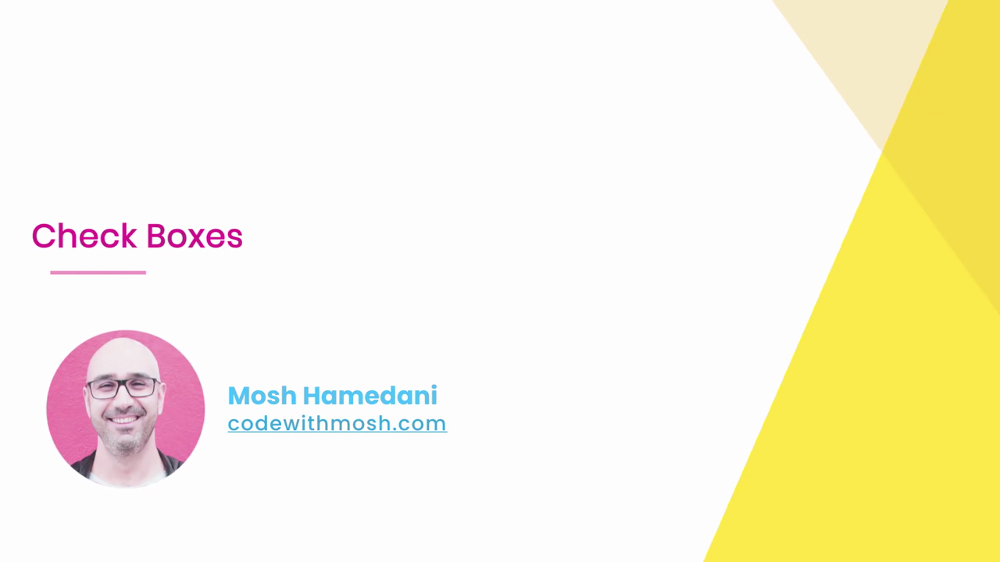

```html
<input type="checkbox" />
```

เมื่อรันในเบราว์เซอร์ จะเห็นกล่องสี่เหลี่ยมเล็กๆ ที่ยังไม่มีข้อความกำกับใดๆ:

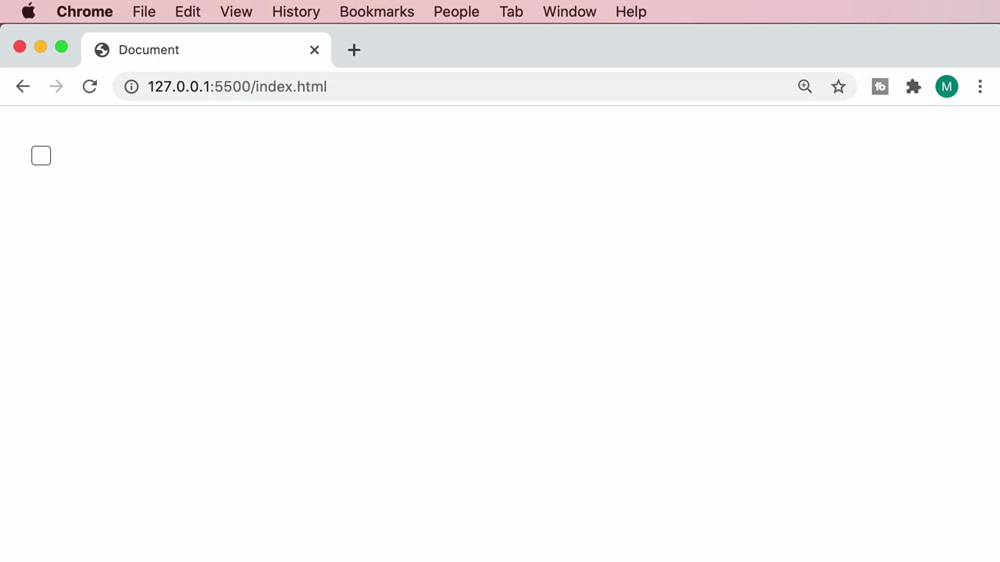

---

## 2. เชื่อม Checkbox กับ Label ด้วย `for`/`id`

เช่นเดียวกับ text field Mosh เพิ่ม `<label>` และเชื่อมกับ checkbox ด้วย `for`/`id` (หลักการเดียวกันทุกประการ):

```html
<input type="checkbox" id="front-end" />
<label for="front-end">Front-end</label>
```

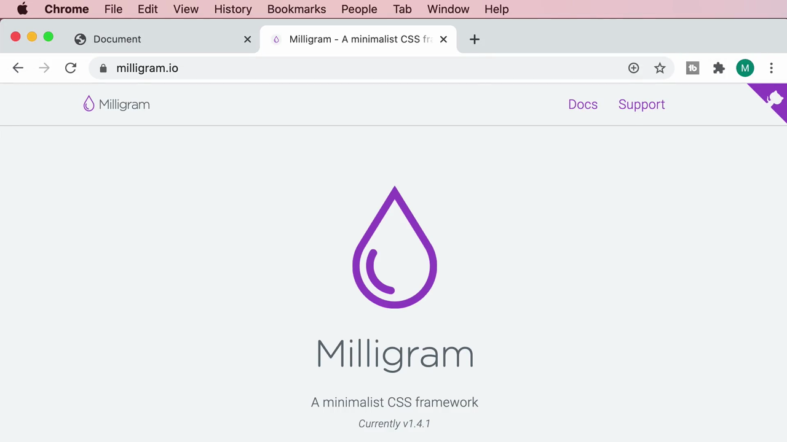

ผลลัพธ์ในเบราว์เซอร์: checkbox และข้อความ "Front-end" แสดงคนละบรรทัดกัน (เพราะ `<label>` เป็น block-level ตามค่าเริ่มต้นของเบราว์เซอร์ หรือจากสไตล์ที่สืบทอดมา):

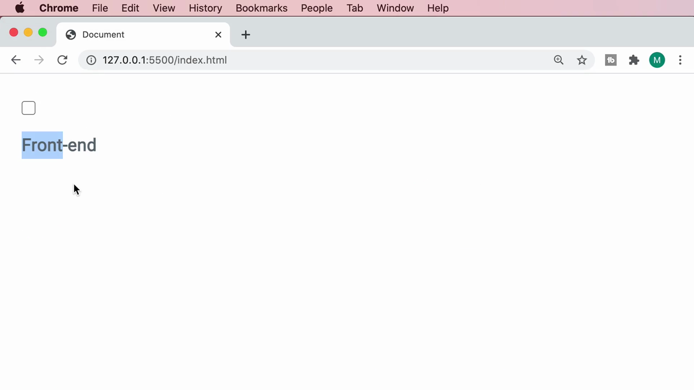

---

## 3. ดูตัวอย่างจริงจาก Milligram (CSS Framework)

Mosh เปิดเว็บไซต์ **milligram.io** ซึ่งเป็น CSS framework แบบมินิมอล เพื่อดูตัวอย่างการจัดสไตล์ฟอร์มจริง โดยเลื่อนไปที่ส่วน **"Forms"**:

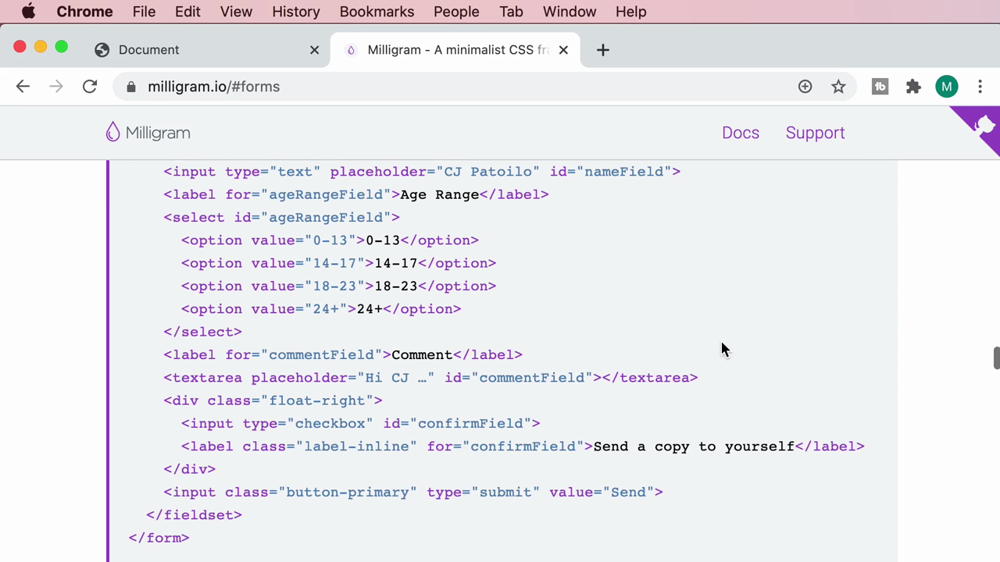

ในโค้ดตัวอย่างของ Milligram จะเห็นว่า checkbox ถูกครอบด้วย `<div class="float-right">` และ label ใช้คลาส **`label-inline`** เพื่อให้ checkbox กับข้อความอยู่ในบรรทัดเดียวกัน:

```html
<div class="float-right">
  <input type="checkbox" id="confirmField">
  <label class="label-inline" for="confirmField">Send a copy to yourself</label>
</div>
```

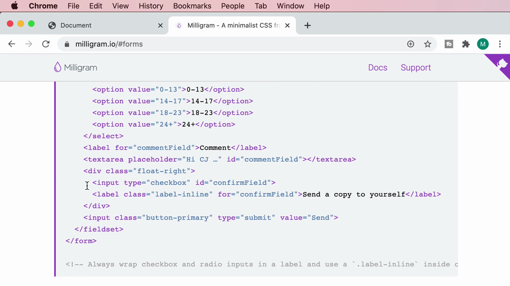

> **ทำไม Mosh ต้องแวะดู Milligram:** เพื่อแสดงให้เห็นว่าในโปรเจกต์จริง นักพัฒนามักใช้ CSS framework (เช่น Bootstrap, Milligram, Tailwind) ที่มีคลาสสำเร็จรูปสำหรับจัดสไตล์ฟอร์มให้ดูดีและใช้งานง่ายขึ้น แทนที่จะเขียน CSS เองทั้งหมดตั้งแต่ต้น

---

## 4. นำแนวคิด `label-inline` มาใช้กับโปรเจกต์ของตัวเอง

Mosh กลับมาที่โปรเจกต์ของตัวเองและเพิ่มคลาส **`label-inline`** ให้กับ `<label>`:

```html
<input type="checkbox" id="front-end" />
<label class="label-inline" for="front-end">Front-end</label>
```

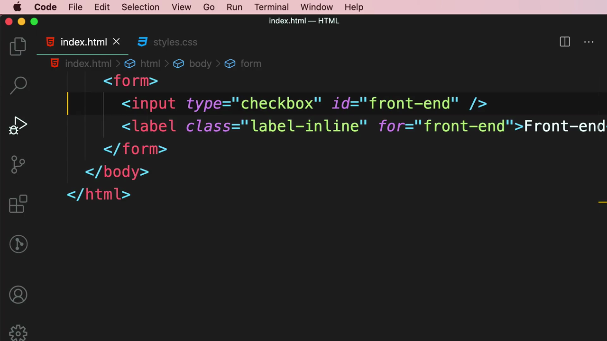

> **หมายเหตุ:** ในคลิปนี้ Mosh เพิ่มคลาส `label-inline` ไว้ก่อนเพื่อสาธิตแนวคิด แต่ยังไม่ได้เขียน CSS rule จริงให้กับคลาสนี้ในไฟล์ `styles.css` ของตัวเอง (การจัดสไตล์ checkbox แบบเต็มรูปแบบจะได้เรียนในหัวข้อถัดๆ ไปของคอร์ส) — เป้าหมายหลักของคลิปนี้คือทำความเข้าใจโครงสร้าง HTML ของ checkbox ที่ถูกต้อง

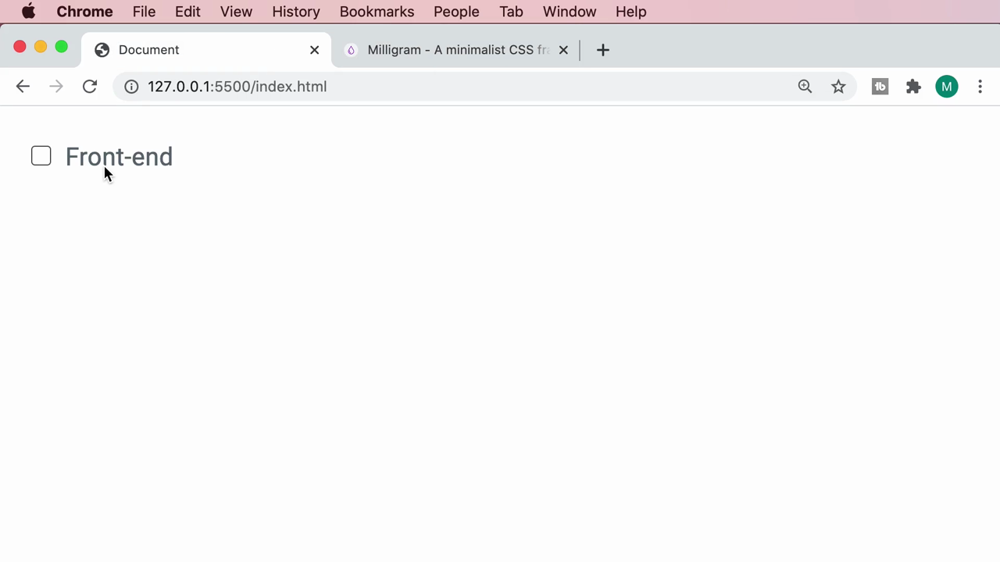

---

## 5. สร้าง Checkbox หลายอันด้วย `<div>` ครอบแยกกลุ่ม

Mosh ครอบ checkbox+label แต่ละคู่ด้วย `<div>` (เหมือนที่ทำกับ text field ในคลิปก่อนหน้า) แล้วคัดลอกเพื่อสร้าง checkbox ที่สอง โดยเปลี่ยนค่า `id`/`for` และข้อความเป็น "Back-end":

```html
<form>
  <div>
    <input type="checkbox" id="front-end" />
    <label class="label-inline" for="front-end">Front-end</label>
  </div>
  <div>
    <input type="checkbox" id="back-end" />
    <label class="label-inline" for="back-end">Back-end</label>
  </div>
</form>
```

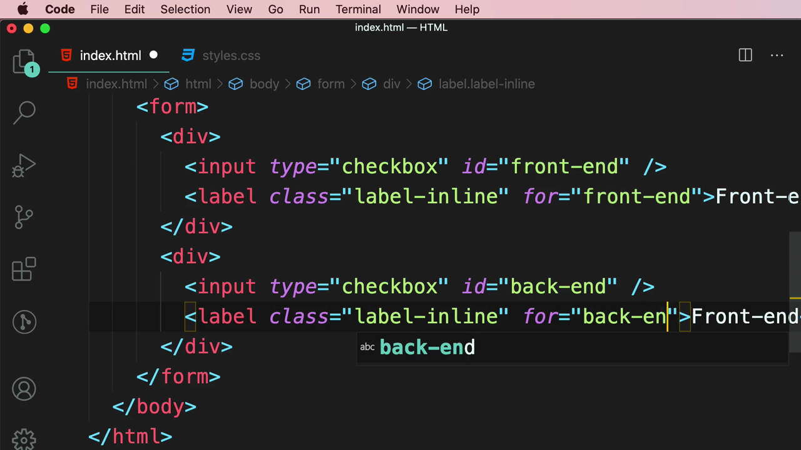

ผลลัพธ์: checkbox สองอันแสดงพร้อมข้อความกำกับ "Front-end" และ "Back-end" เรียงกันเป็นรายการ:

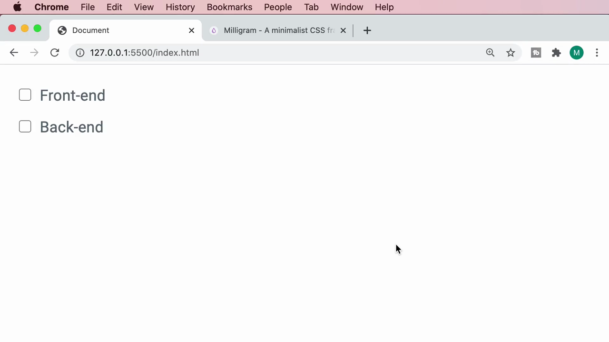

---

## 6. แอตทริบิวต์ `checked` — กำหนดค่าเริ่มต้นให้ถูกติ๊ก

Mosh เพิ่มแอตทริบิวต์ **`checked`** ให้กับ checkbox "Back-end" เพื่อให้ถูกติ๊กไว้ล่วงหน้าตั้งแต่หน้าเว็บโหลดเสร็จ:

```html
<input type="checkbox" id="back-end" checked />
```

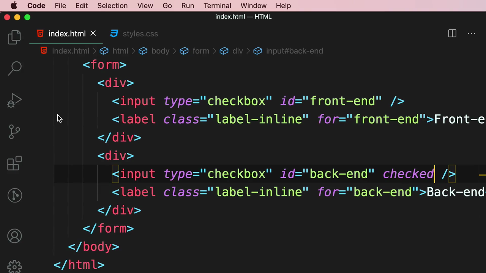

ผลลัพธ์: checkbox "Back-end" จะแสดงเป็นสีน้ำเงินพร้อมเครื่องหมายถูกทันทีที่โหลดหน้า ในขณะที่ "Front-end" ยังคงว่างเปล่าตามปกติ:

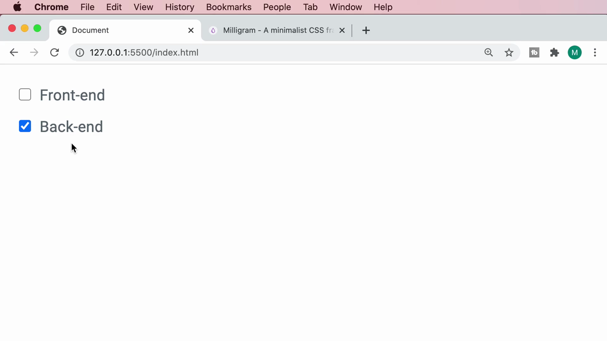

> **หลักการสำคัญของ `checked`:** เป็น boolean attribute (ไม่ต้องใส่ค่าใดๆ แค่มีแอตทริบิวต์นี้อยู่ก็มีผลทันที) ใช้กำหนดสถานะเริ่มต้นของ checkbox หรือ radio button ว่าจะถูกเลือกไว้ล่วงหน้าหรือไม่ ซึ่งมีประโยชน์มากเมื่อต้องแสดงค่าที่ผู้ใช้เคยบันทึกไว้ก่อนหน้า (เช่น การตั้งค่าที่เคยเลือกไว้)

---

## สรุปภาพรวมของคลิปนี้

| ประเด็น | รายละเอียด |
|---|---|
| **หัวข้อ** | Check Boxes |
| **แท็ก/ประเภทใหม่** | `<input type="checkbox">` |
| **แอตทริบิวต์สำคัญ** | `for`/`id` (เชื่อม label), `checked` (boolean attribute) |
| **แหล่งอ้างอิงภายนอก** | Milligram (milligram.io) — ตัวอย่างการจัดสไตล์ checkbox ด้วยคลาส `label-inline` |

**แนวคิดสำคัญที่ได้จากคลิปนี้:**

1. **Checkbox ก็ต้องเชื่อมกับ label ด้วย `for`/`id` เช่นเดียวกับ input ประเภทอื่นๆ** เพื่อให้คลิกที่ข้อความแล้วติ๊ก/ถอดติ๊กได้ทันที และรองรับ accessibility
2. **การดู CSS framework จริง (เช่น Milligram) เป็นวิธีเรียนรู้ pattern ที่ใช้กันจริงในอุตสาหกรรม** ช่วยให้เห็นว่านักพัฒนามืออาชีพจัดโครงสร้างและจัดสไตล์ฟอร์มอย่างไรในโปรเจกต์จริง
3. **`checked` เป็น boolean attribute** เหมือน `disabled`, `readonly`, `selected`, `autofocus` ที่เคยเรียนมาแล้ว — แค่ใส่ชื่อแอตทริบิวต์เฉยๆ (ไม่ต้องมีค่า) ก็มีผลทันที
4. **การครอบ checkbox+label แต่ละคู่ด้วย `<div>`** ช่วยให้จัดกลุ่มและควบคุม layout ของแต่ละตัวเลือกได้ง่ายขึ้น เป็น pattern เดียวกับที่ใช้กับ text field ในคลิปก่อนหน้า

---

*หมายเหตุ: คลิปนี้เป็นส่วนหนึ่งของบท "5-Forms" จากคอร์ส The Ultimate HTML and CSS Course โดย Mosh Hamedani (codewithmosh.com) — คลิปที่ 7 ของบทนี้*
