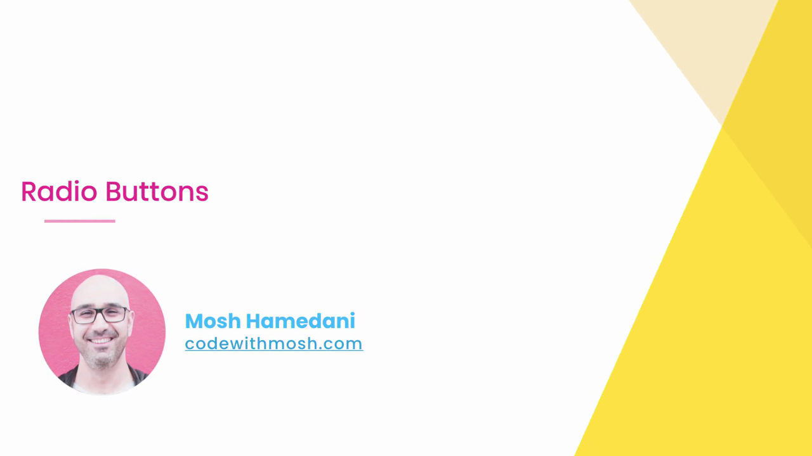
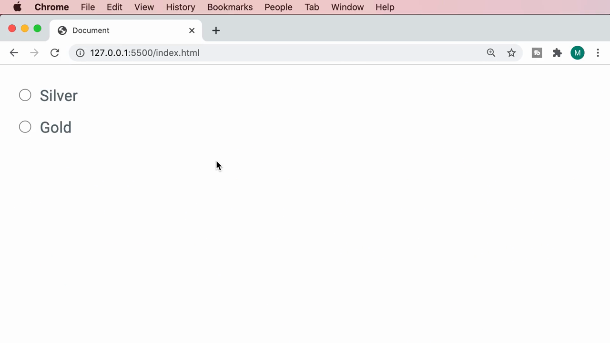
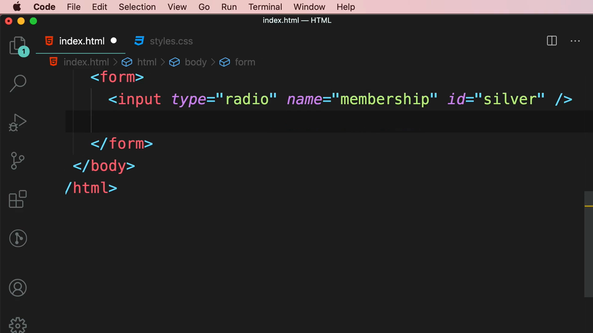
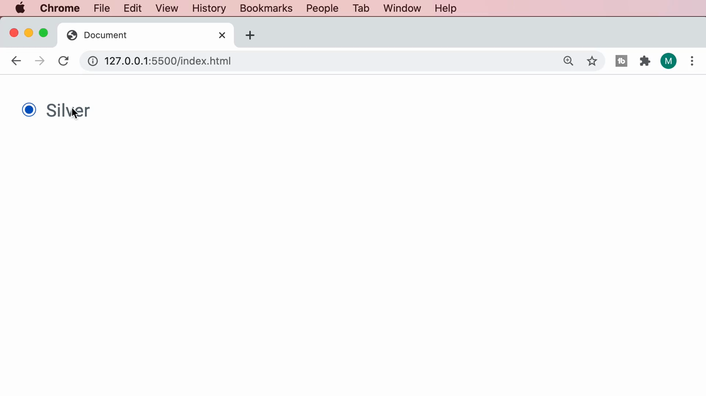
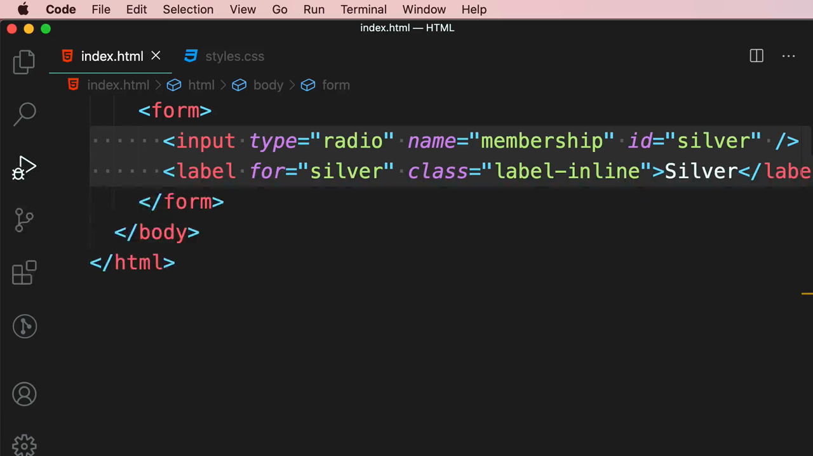
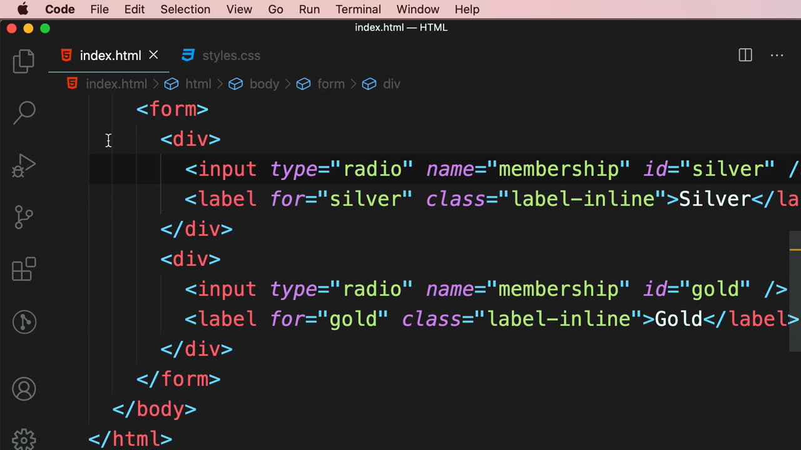
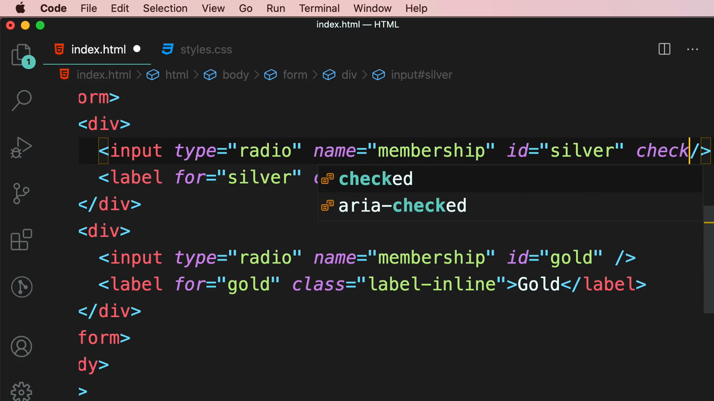
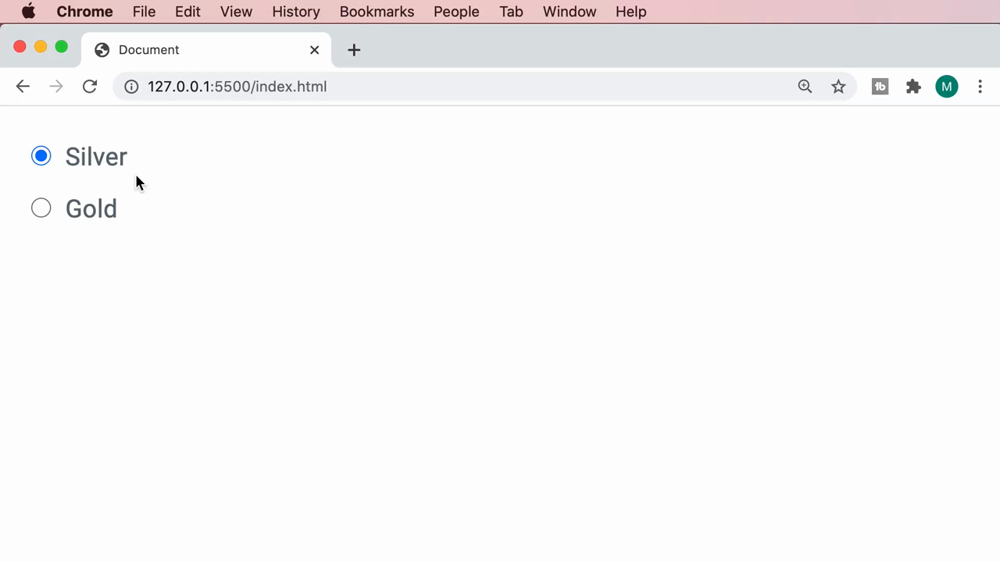

# 5-Forms: 08 - Radio Buttons (1:58)

**ไฟล์ต้นทาง:** `9-Radio_Buttons.mp4`

▶️ **[เปิดวิดีโอต้นฉบับ](../../../HTML-CSS-2/5-Forms/8-Radio-Buttons.mp4)**

---

## ภาพรวมคลิปนี้

คลิปนี้ Mosh สอนแท็ก **`<input type="radio">`** สำหรับสร้างปุ่มตัวเลือกแบบวงกลมที่ให้ผู้ใช้เลือกได้เพียงหนึ่งตัวเลือกจากกลุ่มเดียวกัน โดยหัวใจสำคัญคือแอตทริบิวต์ **`name`** ที่ต้องมีค่าเดียวกันในทุก radio button ของกลุ่มนั้น เพื่อบอกเบราว์เซอร์ว่าตัวเลือกเหล่านี้เป็นกลุ่มเดียวกันและเลือกได้เพียงหนึ่งอันเท่านั้น

---

## 1. ภาพรวมผลลัพธ์ที่จะสร้าง

สไลด์ชื่อคลิป **"Radio Buttons"** เปิดคลิป จากนั้น Mosh แสดงผลลัพธ์สุดท้ายที่จะสร้างในคลิปนี้ก่อน คือ radio button สองอัน **"Silver"** และ **"Gold"**:





---

## 2. สร้าง Radio Button แรกพร้อมแอตทริบิวต์ `name`

Mosh เริ่มจากฟอร์มเปล่าแล้วเพิ่ม `<input type="radio">` พร้อมแอตทริบิวต์ **`name="membership"`** และ **`id="silver"`**:

```html
<input type="radio" name="membership" id="silver" />
```



เมื่อรันในเบราว์เซอร์และคลิกที่วงกลม จะเห็นจุดสีน้ำเงินปรากฏตรงกลาง แสดงว่าถูกเลือกอยู่:



จากนั้นเพิ่ม `<label>` และเชื่อมด้วย `for`/`id` พร้อมคลาส `label-inline` (ต่อยอดจากเทคนิคที่ใช้กับ checkbox ในคลิปก่อนหน้า):

```html
<input type="radio" name="membership" id="silver" />
<label for="silver" class="label-inline">Silver</label>
```



---

## 3. เพิ่ม Radio Button ที่สอง — จุดสำคัญคือ `name` ต้องเหมือนกัน

Mosh ครอบ radio+label ด้วย `<div>` แล้วคัดลอกทั้งบล็อกเพื่อสร้างตัวเลือกที่สอง โดยเปลี่ยน `id`/`for` และข้อความเป็น "Gold" **แต่คงค่า `name="membership"` ให้เหมือนกันทุกประการ**:

```html
<form>
  <div>
    <input type="radio" name="membership" id="silver" />
    <label for="silver" class="label-inline">Silver</label>
  </div>
  <div>
    <input type="radio" name="membership" id="gold" />
    <label for="gold" class="label-inline">Gold</label>
  </div>
</form>
```



ผลลัพธ์ในเบราว์เซอร์: radio button สองอัน "Silver" และ "Gold" แสดงพร้อมกัน และเมื่อทดลองคลิกจะเห็นว่าเลือกได้เพียงอันเดียวในเวลาเดียวกัน (คลิกเลือก Gold แล้ว Silver จะถูกยกเลิกอัตโนมัติ):


> **หลักการสำคัญที่สุดของ radio button:** แอตทริบิวต์ **`name`** ต้องมีค่าเหมือนกันทุกตัวในกลุ่มเดียวกัน (ในตัวอย่างนี้คือ `"membership"`) เพื่อบอกเบราว์เซอร์ว่า radio button เหล่านี้เป็นกลุ่มเดียวกันและสามารถเลือกได้เพียงหนึ่งเดียวเท่านั้น — หาก `name` ต่างกัน แต่ละอันจะทำงานเป็นอิสระจากกัน (เลือกพร้อมกันได้หลายอัน ซึ่งขัดกับธรรมชาติของ radio button) ในขณะที่ `id` ของแต่ละอันยังคงต้องไม่ซ้ำกัน เพราะใช้เชื่อมกับ label ของตัวเอง

---

## 4. แอตทริบิวต์ `checked` — กำหนดตัวเลือกเริ่มต้น

Mosh เพิ่มแอตทริบิวต์ **`checked`** ให้กับ radio button "Silver" เพื่อให้เป็นตัวเลือกที่ถูกเลือกไว้ล่วงหน้าตั้งแต่หน้าเว็บโหลดเสร็จ (VS Code แสดง IntelliSense แนะนำ `checked` ให้อัตโนมัติ):

```html
<input type="radio" name="membership" id="silver" checked />
```



ผลลัพธ์: "Silver" จะถูกเลือกไว้ล่วงหน้าทันทีที่โหลดหน้า (แสดงจุดสีน้ำเงินตรงกลาง) ในขณะที่ "Gold" ยังว่างเปล่าตามปกติ:



---

## สรุปภาพรวมของคลิปนี้

| ประเด็น | รายละเอียด |
|---|---|
| **หัวข้อ** | Radio Buttons |
| **แท็ก/ประเภทใหม่** | `<input type="radio">` |
| **แอตทริบิวต์สำคัญ** | `name` (ต้องเหมือนกันในกลุ่มเดียวกัน), `id` (ต้องไม่ซ้ำ), `checked` |

**แนวคิดสำคัญที่ได้จากคลิปนี้:**

1. **`name` คือหัวใจของ radio button** — radio ทุกอันที่มี `name` เหมือนกันจะถูกจัดเป็นกลุ่มเดียวกันโดยเบราว์เซอร์ ทำให้เลือกได้เพียงหนึ่งเดียวในกลุ่มนั้น ต่างจาก checkbox ที่แต่ละอันทำงานอิสระจากกัน
2. **`id` ยังคงต้องไม่ซ้ำกัน** แม้ `name` จะเหมือนกัน เพราะ `id` ใช้เชื่อมกับ `label` ของแต่ละตัวเลือกโดยเฉพาะ (คนละบทบาทกับ `name`)
3. **`checked` ทำงานกับ radio button เหมือนกับ checkbox** คือเป็น boolean attribute ที่กำหนดสถานะเริ่มต้นว่าตัวเลือกใดถูกเลือกไว้ล่วงหน้า
4. **โครงสร้าง HTML ของ radio button คล้ายกับ checkbox มาก** (ครอบด้วย `<div>`, ใช้ `label-inline`, เชื่อมด้วย `for`/`id`) ความแตกต่างหลักอยู่ที่ค่า `type="radio"` และความสำคัญของแอตทริบิวต์ `name` ที่ใช้จัดกลุ่ม

---

*หมายเหตุ: คลิปนี้เป็นส่วนหนึ่งของบท "5-Forms" จากคอร์ส The Ultimate HTML and CSS Course โดย Mosh Hamedani (codewithmosh.com) — คลิปที่ 8 ของบทนี้*
