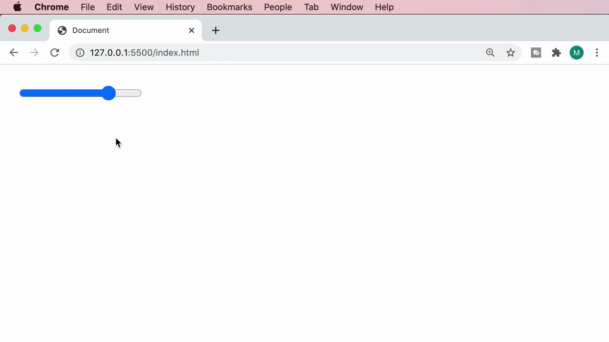
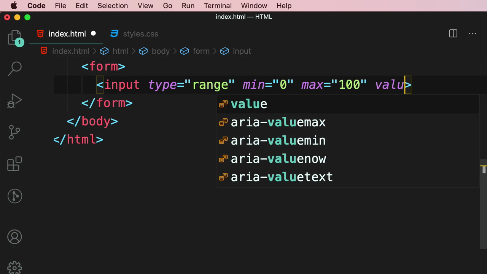
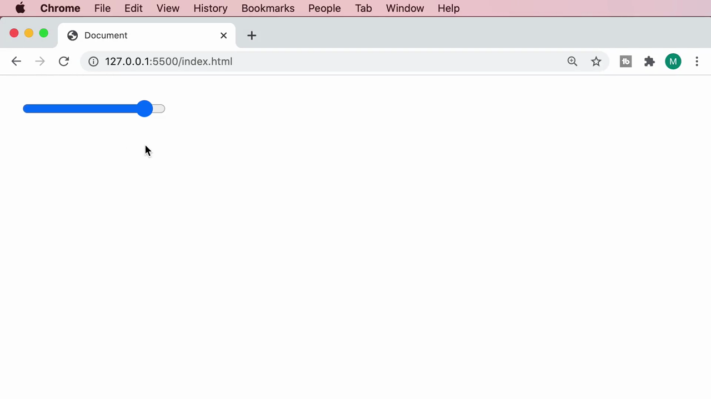

# 5-Forms: 09 - Sliders (0:55)

**ไฟล์ต้นทาง:** `10-Sliders.mp4`

▶️ **[เปิดวิดีโอต้นฉบับ](../../../HTML-CSS-2/5-Forms/9-Sliders.mp4)**

---

## ภาพรวมคลิปนี้

คลิปสั้นๆ (55 วินาที) นี้ Mosh สอนแท็ก **`<input type="range">`** สำหรับสร้างแถบเลื่อนค่า (slider) พร้อมแอตทริบิวต์ `min`, `max` และ `value` ที่ใช้ควบคุมช่วงค่าและตำแหน่งเริ่มต้นของตัวเลื่อน

---

## 1. ภาพรวมผลลัพธ์ที่จะสร้าง

สไลด์ชื่อคลิป **"Sliders"** เปิดคลิป จากนั้น Mosh แสดงตัวอย่าง slider ที่สร้างเสร็จแล้วให้ดูก่อน เป็นแถบยาวสีน้ำเงิน-เทาพร้อมปุ่มกลมสีน้ำเงินที่ลากเลื่อนได้:




---

## 2. สร้าง Slider ด้วย `type="range"` พร้อม `min`, `max`, `value`

Mosh เริ่มจากฟอร์มเปล่าแล้วพิมพ์ `<input type="range">` พร้อมกำหนดแอตทริบิวต์ **`min`**, **`max`** และ **`value`**:

```html
<input type="range" min="0" max="100" value="70" />
```



ผลลัพธ์ในเบราว์เซอร์: ปุ่มเลื่อน (thumb) จะอยู่ในตำแหน่งที่สอดคล้องกับค่า `value` ที่กำหนด (เทียบสัดส่วนกับช่วง `min`-`max`) โดยส่วนที่อยู่ทางซ้ายของปุ่มเลื่อนจะถูกเติมสีน้ำเงิน (แสดงว่าเป็นค่าที่ต่ำกว่าค่าปัจจุบัน) ส่วนทางขวาเป็นสีเทา:



> **อธิบายแอตทริบิวต์ของ `type="range"`:**
> - **`min`** กำหนดค่าต่ำสุดที่เลื่อนไปได้ (ในตัวอย่างคือ 0)
> - **`max`** กำหนดค่าสูงสุดที่เลื่อนไปได้ (ในตัวอย่างคือ 100)
> - **`value`** กำหนดค่าเริ่มต้นของตัวเลื่อนตั้งแต่หน้าเว็บโหลดเสร็จ (ในตัวอย่างคือ 70 ซึ่งอยู่ที่ประมาณ 70% ของความยาวแถบ)
>
> ผู้ใช้สามารถลากปุ่มเลื่อนด้วยเมาส์ หรือใช้ปุ่มลูกศรซ้าย-ขวาบนคีย์บอร์ดเมื่อโฟกัสอยู่ที่ slider เพื่อปรับค่าได้ทีละหน่วย

---

## สรุปภาพรวมของคลิปนี้

| ประเด็น | รายละเอียด |
|---|---|
| **หัวข้อ** | Sliders |
| **แท็ก/ประเภทใหม่** | `<input type="range">` |
| **แอตทริบิวต์สำคัญ** | `min`, `max`, `value` |

**แนวคิดสำคัญที่ได้จากคลิปนี้:**

1. **`type="range"` เหมาะกับการรับค่าตัวเลขที่อยู่ในช่วงจำกัด** (เช่น ระดับเสียง, ความสว่าง, คะแนนความพึงพอใจ) ในรูปแบบที่ใช้งานง่ายและเห็นภาพชัดเจนกว่าการพิมพ์ตัวเลข
2. **`min`/`max`/`value` ทำงานร่วมกัน** เพื่อกำหนดขอบเขตและตำแหน่งเริ่มต้นของตัวเลื่อน โดยเบราว์เซอร์จัดการ UI การลากและการแสดงผลให้ทั้งหมดโดยอัตโนมัติ ไม่ต้องเขียน JavaScript เพิ่มเติม
3. **Slider เป็นอีกหนึ่งตัวอย่างที่แสดงพลังของ HTML5 input types** ที่ช่วยลดภาระในการเขียน UI component เองตั้งแต่ต้น เช่นเดียวกับ `type="date"` และ `<datalist>` ที่เคยเรียนมาก่อนหน้านี้

---

*หมายเหตุ: คลิปนี้เป็นส่วนหนึ่งของบท "5-Forms" จากคอร์ส The Ultimate HTML and CSS Course โดย Mosh Hamedani (codewithmosh.com) — คลิปที่ 9 ของบทนี้*
