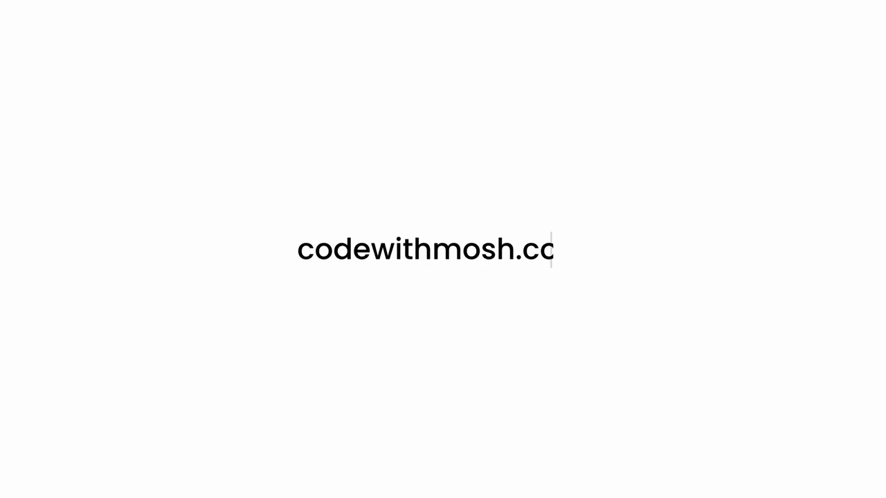
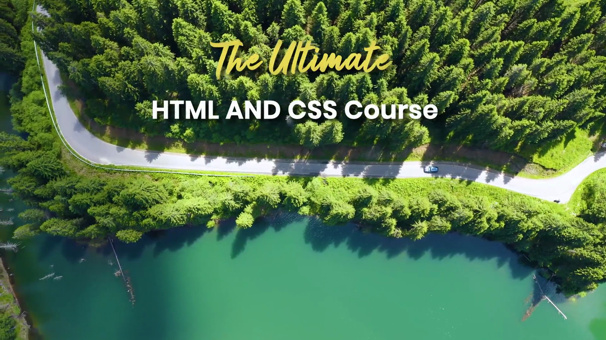
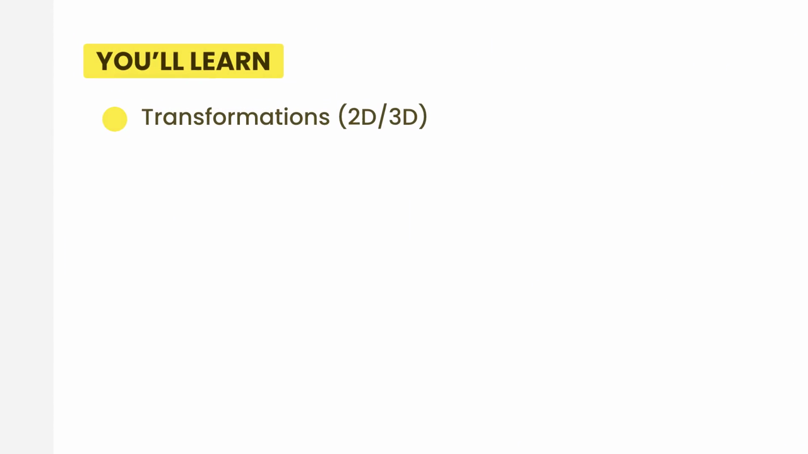
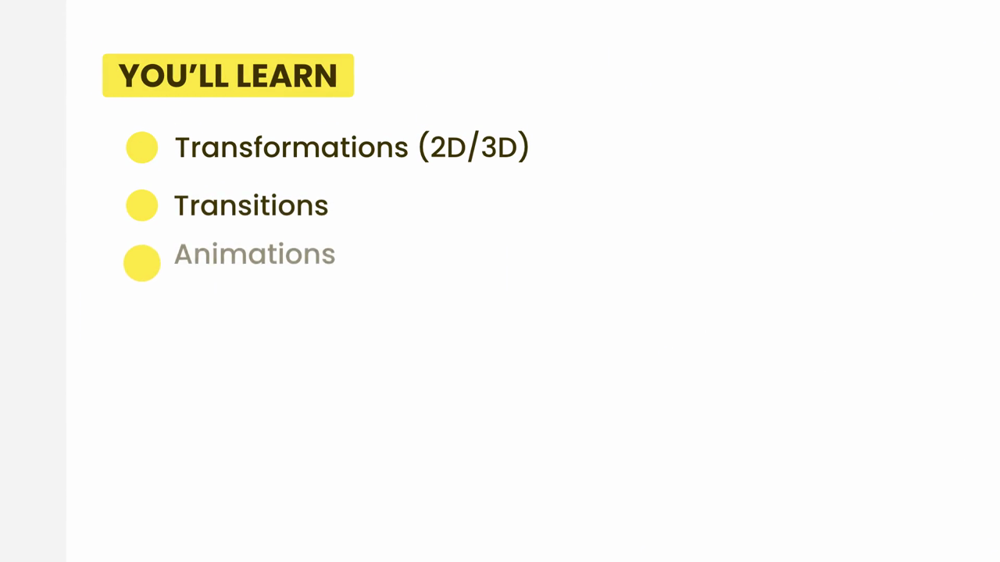
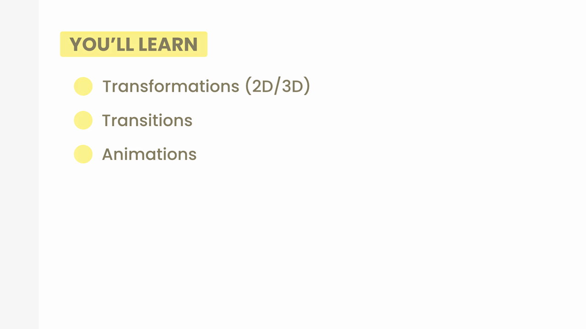

# 6-Transformations, Transitions, and Animations: 01 - Introduction (0:24)

**ไฟล์ต้นทาง:** `1-Introduction.mp4`

▶️ **[เปิดวิดีโอต้นฉบับ](../../../HTML-CSS-2/6-Transformations,%20Transitions,%20and%20Animations/1-Introduction.mp4)**

---

## ภาพรวมคลิปนี้

คลิปเปิดบทสั้นๆ (24 วินาที) แนะนำภาพรวมของบทใหม่ **"Transformations, Transitions, and Animations"** ซึ่งเป็นบทที่ต่อยอดจากพื้นฐาน CSS ไปสู่การทำให้เว็บเพจ**เคลื่อนไหวและมีปฏิสัมพันธ์** มากขึ้น โดยแสดงสไลด์หัวข้อทั้งสามเรื่องที่จะได้เรียนในบทนี้

---

## 1. อินโทรของคอร์ส

คลิปเริ่มด้วยแอนิเมชันพิมพ์ข้อความ **"codewithmosh.com"**:

ตามด้วยวิดีโอมุมสูงของถนนกลางป่าเขียวขจีข้างทะเลสาบ พร้อมข้อความหัวเรื่องคอร์ส **"The Ultimate HTML AND CSS Course"**:

---

## 2. สไลด์ "YOU'LL LEARN" — หัวข้อที่จะได้เรียนในบทนี้

สไลด์ **"YOU'LL LEARN"** แสดงหัวข้อแรกที่จะได้เรียนคือ **"Transformations (2D/3D)"**:

จากนั้นหัวข้อที่สองปรากฏเพิ่มเข้ามาคือ **"Transitions"**:

และสุดท้ายหัวข้อที่สามปรากฏครบคือ **"Animations"** ทำให้เห็นภาพรวมทั้งสามหัวข้อของบทนี้พร้อมกัน:

> **ภาพรวมสามหัวข้อหลักของบทนี้:**
> - **Transformations (2D/3D)** — การแปลงรูปทรงและตำแหน่งขององค์ประกอบ เช่น การหมุน (rotate), การย่อ/ขยาย (scale), การเลื่อนตำแหน่ง (translate) ทั้งในรูปแบบ 2 มิติและ 3 มิติ
> - **Transitions** — การทำให้การเปลี่ยนแปลงค่า CSS (เช่นสี ขนาด ตำแหน่ง) เกิดขึ้นอย่างนุ่มนวลแทนที่จะเปลี่ยนทันที
> - **Animations** — การสร้างแอนิเมชันที่ซับซ้อนและควบคุมได้มากขึ้นด้วย `@keyframes` ซึ่งสามารถกำหนดหลายขั้นตอนของการเคลื่อนไหวได้ในตัวเดียว

---

## 3. โลโก้ปิดท้ายคลิป

คลิปจบด้วยโลโก้ **"MOSH — Coding Made Simple"**:

---

## สรุปภาพรวมของคลิปนี้

| ประเด็น | รายละเอียด |
|---|---|
| **หัวข้อ** | Introduction (บทที่ 6) |
| **หัวข้อย่อยที่จะได้เรียน** | Transformations (2D/3D), Transitions, Animations |

**แนวคิดสำคัญที่ได้จากคลิปนี้:**

1. **บทนี้เป็นก้าวสำคัญจาก CSS แบบ static ไปสู่ CSS ที่มีการเคลื่อนไหว** ช่วยให้เว็บเพจดูมีชีวิตชีวาและตอบสนองต่อผู้ใช้ได้ดีขึ้น
2. **สามหัวข้อหลักมีความสัมพันธ์กัน** — Transformations เป็นพื้นฐานของ "การเปลี่ยนแปลง" ที่จะถูกนำไปใช้ร่วมกับ Transitions (ทำให้เปลี่ยนแบบนุ่มนวล) และ Animations (ทำให้ควบคุมหลายขั้นตอนได้ซับซ้อนขึ้น)
3. **3D Transformations เป็นหัวข้อใหม่ที่น่าสนใจ** เพราะเพิ่มมิติความลึก (depth) ให้กับองค์ประกอบเว็บ ซึ่งต่างจาก 2D ที่คุ้นเคยกันมาก่อนหน้านี้

---

*หมายเหตุ: คลิปนี้เป็นส่วนหนึ่งของบท "6-Transformations, Transitions, and Animations" จากคอร์ส The Ultimate HTML and CSS Course โดย Mosh Hamedani (codewithmosh.com) — คลิปที่ 1 ของบทนี้*
