# 6-Transformations, Transitions, and Animations: 02 - Transformations (4:11)

**ไฟล์ต้นทาง:** `2-Transformations.mp4`

▶️ **[เปิดวิดีโอต้นฉบับ](../../../HTML-CSS-2/6-Transformations,%20Transitions,%20and%20Animations/2-Transformations.mp4)**

---

## ภาพรวมคลิปนี้

คลิปนี้ Mosh สอนคุณสมบัติ CSS **`transform`** สำหรับแปลง (transform) รูปทรง ขนาด ตำแหน่ง และมุมขององค์ประกอบ HTML แบบ 2 มิติ โดยครอบคลุมฟังก์ชันหลัก **`rotate()`**, **`scale()`**, **`skew()`** และ **`translate()`** พร้อมสาธิตให้เห็นว่าเมื่อรวมหลายฟังก์ชันเข้าด้วยกัน **ลำดับของฟังก์ชัน (order) มีผลต่อผลลัพธ์สุดท้ายอย่างมาก**

---

## 1. เตรียมองค์ประกอบพื้นฐานสำหรับทดลอง

สไลด์ชื่อคลิป **"Transformations"** เปิดคลิป:

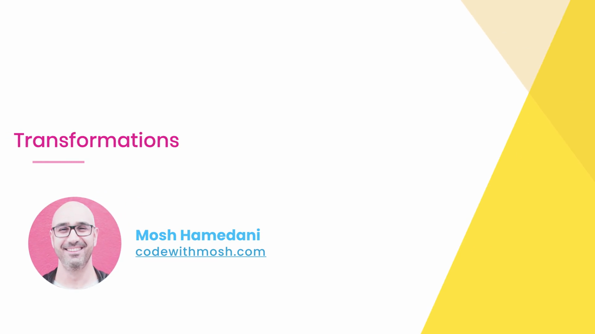

ตามด้วยสไลด์หัวข้อ **"TRANSFORMATIONS"**:

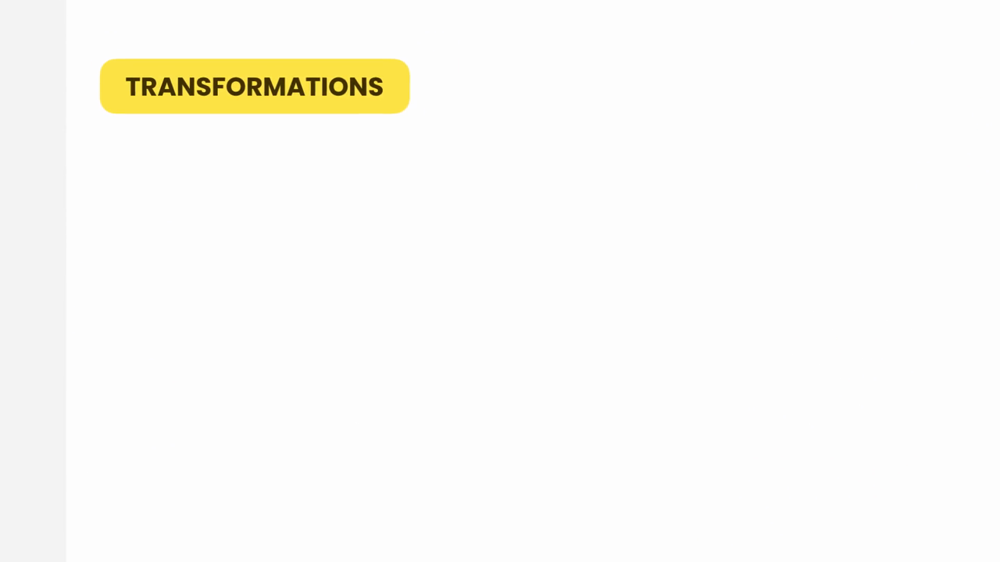

Mosh เริ่มจากไฟล์เปล่าแล้วสร้าง `<div class="box">` พร้อมใช้ Emmet abbreviation **`lorem`** เพื่อสร้างข้อความ placeholder แบบสุ่ม:

```html
<div class="box">
  lorem
</div>
```

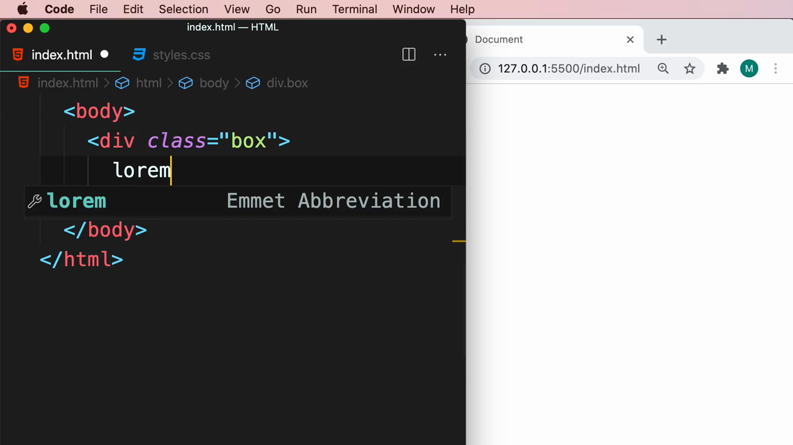

จากนั้นเขียน CSS กำหนดขนาดและสีพื้นหลังให้กล่อง:

```css
.box {
  width: 100px;
  height: 100px;
  background: gold;
}
```

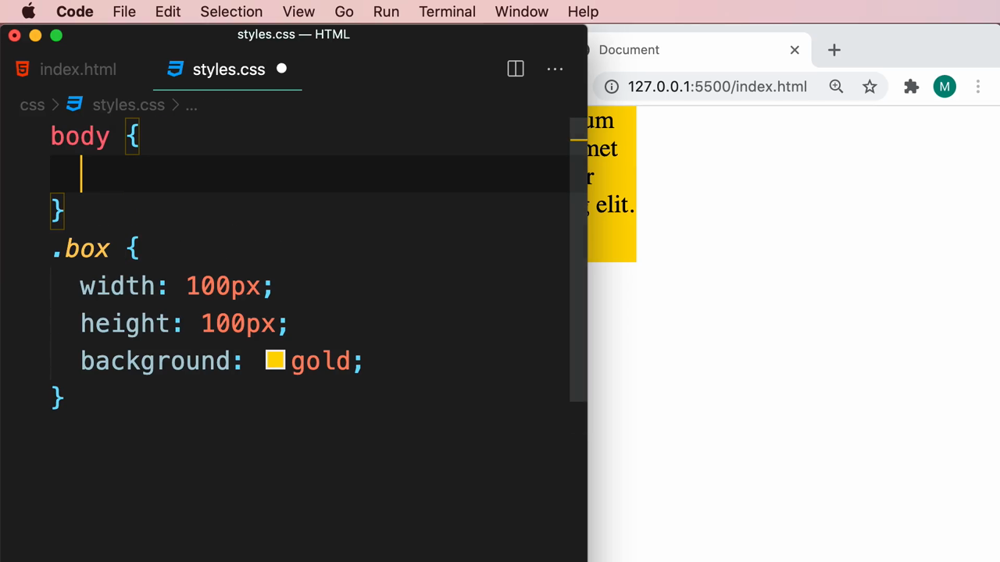

เพิ่ม flexbox ให้ `body` เพื่อจัดกล่องไว้กึ่งกลางแนวนอน/แนวตั้ง:

```css
body {
  display: flex;
  justify-content: center;
  align-items: center;
}
```

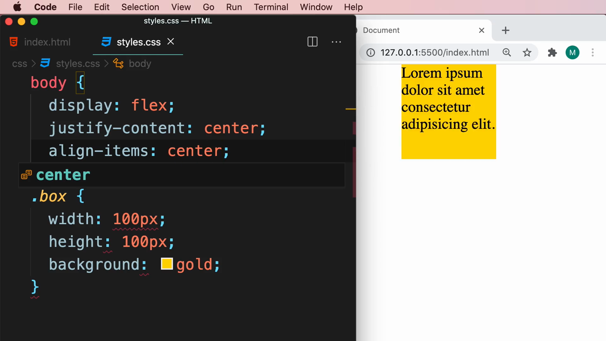

และเพิ่ม `height: 100vh` ให้ `body` เพื่อให้ความสูงเต็มหน้าจอ ทำให้ `align-items: center` มีผลจริง กล่องจึงอยู่กึ่งกลางหน้าจอพอดี:

```css
body {
  display: flex;
  justify-content: center;
  align-items: center;
  height: 100vh;
}
```

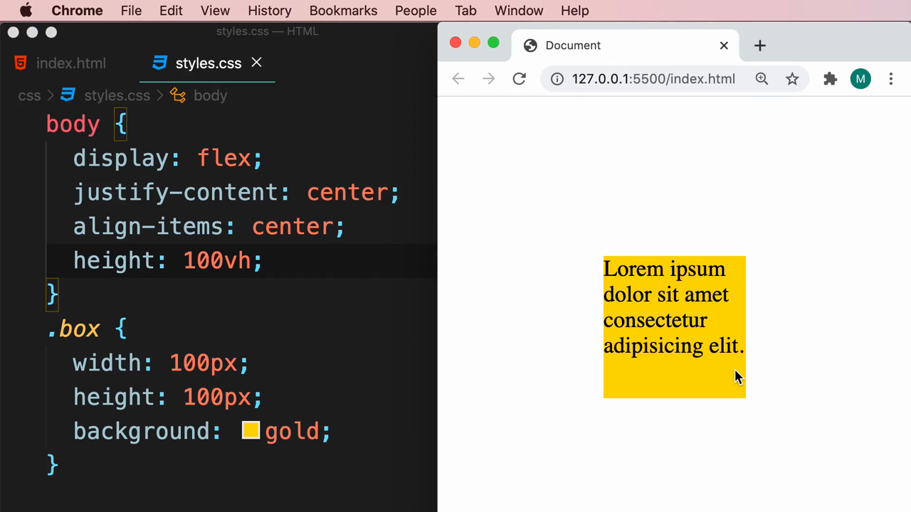

> **ทำไมต้องมี `height: 100vh`:** โดยปกติ `<body>` จะมีความสูงเท่ากับเนื้อหาภายในเท่านั้น การกำหนด `align-items: center` ใน flexbox จะไม่เห็นผลถ้า container (ในที่นี้คือ `body`) ไม่มีความสูงมากกว่าเนื้อหาลูก การกำหนด `height: 100vh` (100% ของความสูง viewport) จึงทำให้ body สูงเต็มจอ และ flexbox จึงสามารถจัดกล่องให้อยู่กึ่งกลางแนวตั้งได้จริง

---

## 2. `rotate()` — หมุนองค์ประกอบ

Mosh เพิ่ม selector `.box:hover` แล้วพิมพ์ `transform` โดย VS Code แสดง IntelliSense แนะนำค่าต่างๆ (`transform`, `transition`, `transform-origin`):

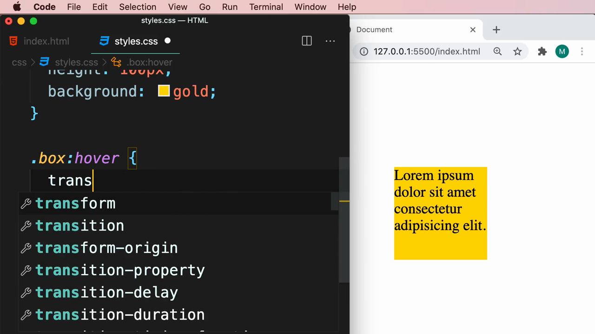

```css
.box:hover {
  transform: rotate(15deg);
}
```

เมื่อเอาเมาส์ไปชี้ที่กล่อง (hover) กล่องจะหมุนตามเข็มนาฬิกา 15 องศา:

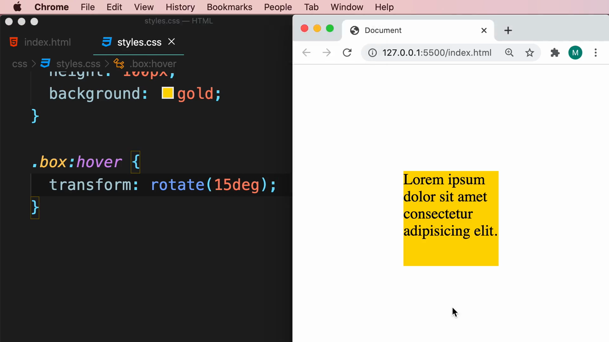

เมื่อเปลี่ยนเป็นค่าติดลบ **`rotate(-15deg)`** กล่องจะหมุนทวนเข็มนาฬิกาแทน:

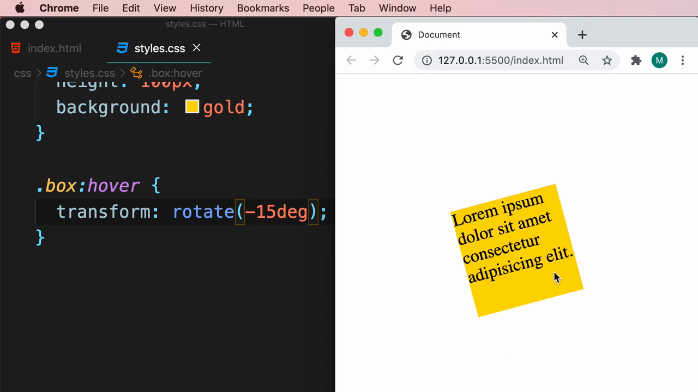

> **`rotate(<angle>)`** หมุนองค์ประกอบรอบจุดศูนย์กลางของมันเอง (ค่าเริ่มต้น) ตามมุมที่กำหนด หน่วยที่ใช้บ่อยคือ `deg` (องศา) ค่าบวกหมุนตามเข็มนาฬิกา ค่าลบหมุนทวนเข็มนาฬิกา

---

## 3. `scale()` — ย่อ/ขยายขนาด

Mosh ลบ `rotate` แล้วพิมพ์ `scale()` โดย IntelliSense แสดงตัวเลือกที่เกี่ยวข้อง (`scale()`, `scaleX()`, `scaleY()`, `scaleZ()`, `scale3d()`):


```css
.box:hover {
  transform: scale(1.5);
}
```

เมื่อ hover กล่องจะขยายใหญ่ขึ้นเป็น 1.5 เท่าของขนาดเดิม:

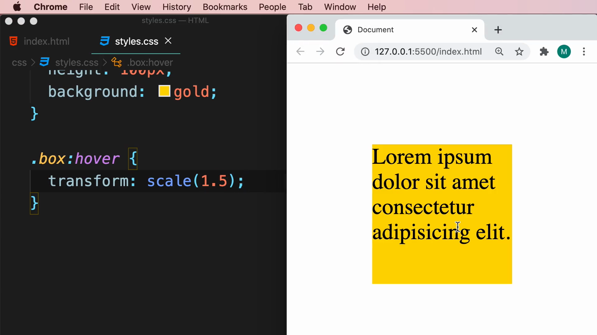

เมื่อเปลี่ยนเป็น **`scale(0.5)`** กล่องจะหดเล็กลงเหลือครึ่งหนึ่งของขนาดเดิม:

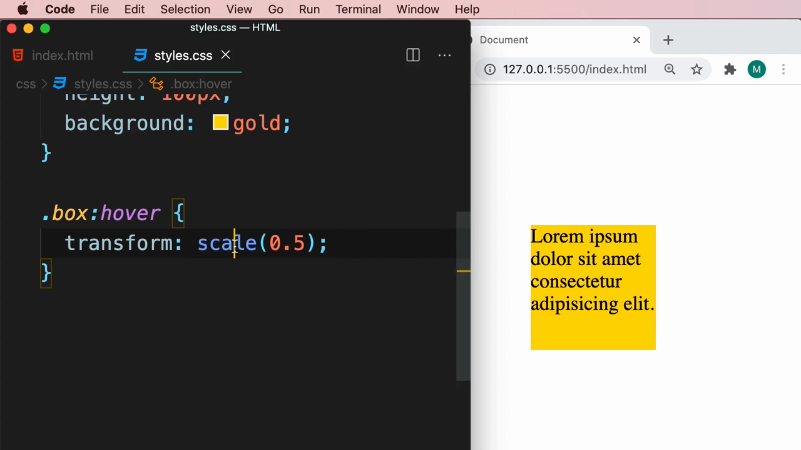

> **`scale(<factor>)`** ย่อ/ขยายขนาดองค์ประกอบตามตัวคูณที่กำหนด (ไม่มีหน่วย) ค่า `1` คือขนาดปกติ ค่ามากกว่า `1` คือขยายใหญ่ขึ้น ค่าน้อยกว่า `1` คือหดเล็กลง

---

## 4. `skew()` — บิดเอียงองค์ประกอบ

```css
.box:hover {
  transform: skew(15deg);
}
```

เมื่อ hover กล่องจะถูก**บิดเอียง**ไปในแนวทแยง ทำให้ขอบซ้าย-ขวาไม่ตั้งฉากกันอีกต่อไป:

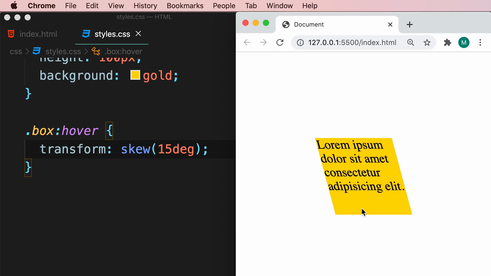

เมื่อเปลี่ยนเป็น **`skew(-15deg)`** ทิศทางการบิดเอียงจะกลับด้าน:

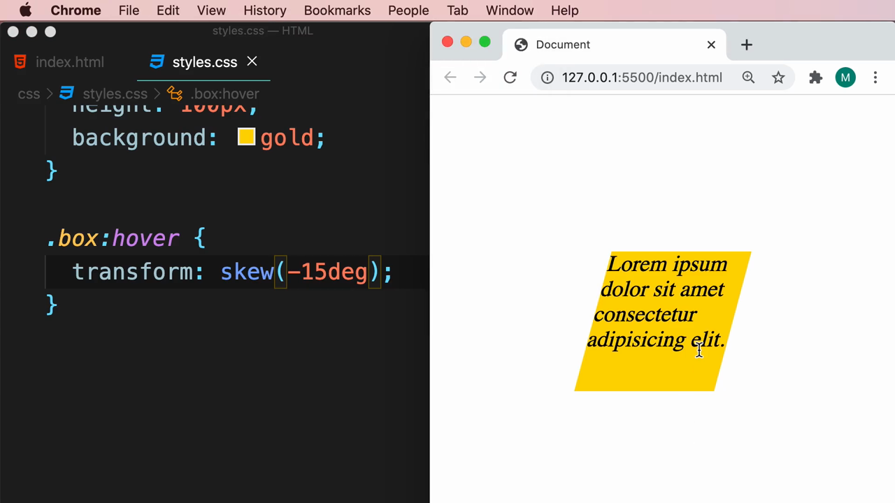

> **`skew(<angle>)`** บิดเอียงองค์ประกอบตามแกน (มุมที่ระบุจะเอียงตามแกนแนวนอนโดยค่าเริ่มต้น) ทำให้รูปทรงสี่เหลี่ยมกลายเป็นสี่เหลี่ยมด้านขนาน (parallelogram) เหมาะกับการสร้างเอฟเฟกต์เอียงเชิงกราฟิก

---

## 5. `translate()` — เลื่อนตำแหน่ง

Mosh พิมพ์ `translate` โดย IntelliSense แสดงตัวเลือก `translate()`, `translate3d()`, `translateX()`, `translateY()`, `translateZ()`:

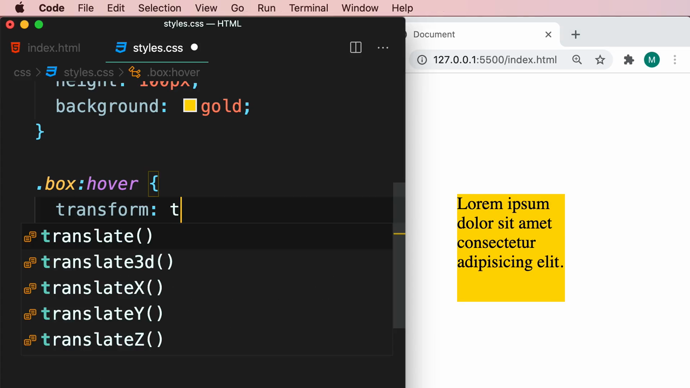

```css
.box:hover {
  transform: translate(10px);
}
```

เมื่อกำหนดค่าเดียว กล่องจะเลื่อนไปทางขวา 10px (แกน X เท่านั้น):

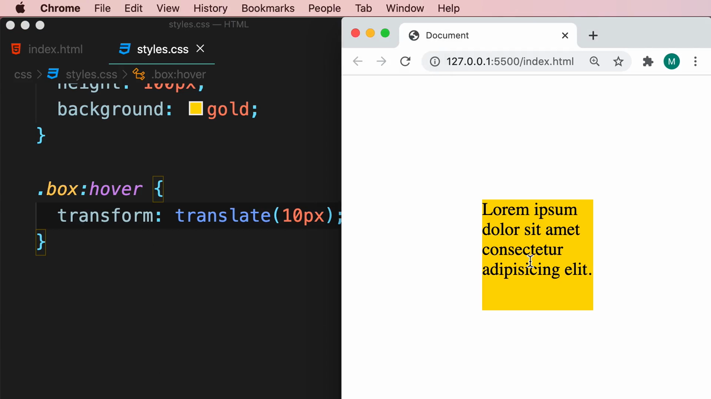

เมื่อกำหนดสองค่า **`translate(10px, 10px)`** กล่องจะเลื่อนทั้งแนวนอน (X) และแนวตั้ง (Y) พร้อมกัน:

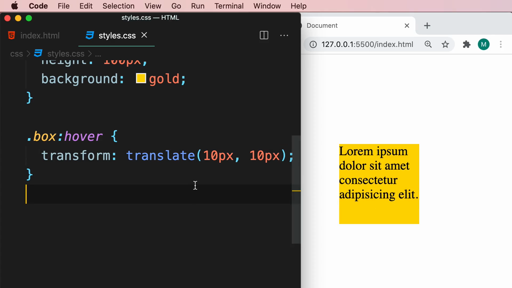

> **`translate(x, y)`** เลื่อนตำแหน่งองค์ประกอบตามแนวแกน X และ Y หากระบุค่าเดียวจะมีผลกับแกน X เท่านั้น จุดสำคัญคือ **`translate` ไม่กระทบต่อ layout ขององค์ประกอบข้างเคียง** (ต่างจากการเปลี่ยน `margin` หรือ `position`) เพราะเป็นเพียงการเลื่อนภาพที่มองเห็น ไม่ใช่การเปลี่ยนตำแหน่งจริงในโครงสร้างเอกสาร

Mosh อธิบายเพิ่มเติมโดยเริ่มพิมพ์ **`position: relative`** ให้กับ `.box:hover` เพื่อปูทางไปสู่การอธิบายว่า `transform` ทำงานเป็นอิสระจาก `position` ของ CSS layout:

```css
.box:hover {
  position: relative;

  transform: translate(10px, 10px);
}
```

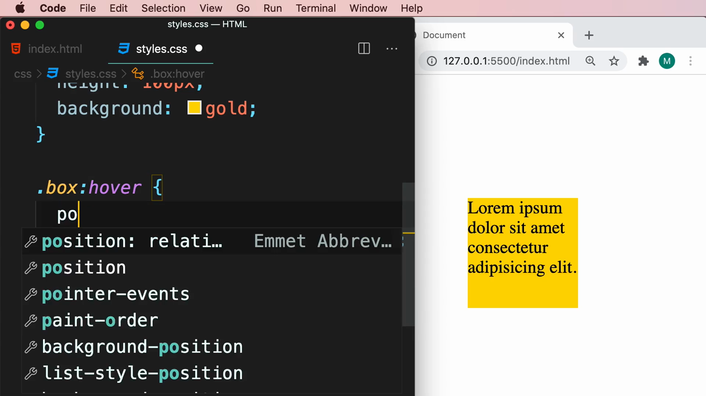

---

## 6. รวมหลายฟังก์ชัน — ลำดับ (Order) มีผลต่อผลลัพธ์

Mosh สาธิตประเด็นสำคัญที่สุดของคลิปนี้ โดยรวมฟังก์ชัน `rotate()` และ `translateX()` เข้าด้วยกันในค่า `transform` เดียว ลองเรียงลำดับแบบแรกคือ **`rotate(45deg) translateX(50px)`**:

```css
.box:hover {
  transform: rotate(45deg) translateX(50px);
}
```

ผลลัพธ์: กล่องหมุน 45 องศาก่อน แล้วจึงเลื่อนไปตามแกน X **ที่หมุนไปแล้ว** ทำให้กล่องเคลื่อนไปในแนวทแยงมุม (ลงล่างขวา):

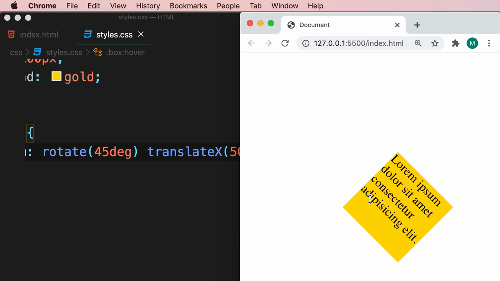

จากนั้น Mosh สลับลำดับเป็น **`translateX(50px) rotate(45deg)`** (เลื่อนก่อน แล้วจึงหมุน):

```css
.box:hover {
  transform: translateX(50px) rotate(45deg);
}
```

ผลลัพธ์เปลี่ยนไปอย่างชัดเจน: กล่องเลื่อนไปทางขวา 50px ตามแกน X ปกติก่อน แล้วจึงหมุน 45 องศารอบตำแหน่งใหม่นั้น ทำให้ตำแหน่งสุดท้ายของกล่องแตกต่างจากกรณีแรกโดยสิ้นเชิง แม้จะใช้ค่าตัวเลขเดียวกันทุกประการ:

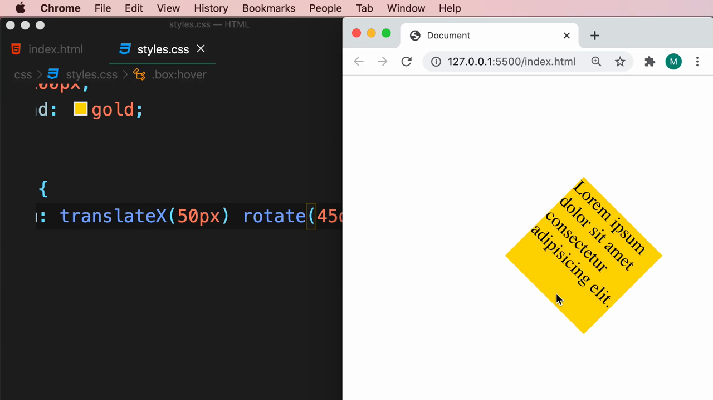

> **หลักการสำคัญ:** เมื่อรวมหลายฟังก์ชัน `transform` ไว้ในค่าเดียว เบราว์เซอร์จะ**ประมวลผลจากซ้ายไปขวาตามลำดับที่เขียน** และแต่ละฟังก์ชันจะ**ทำงานบนระบบพิกัดที่ถูกแปลงไปแล้วจากฟังก์ชันก่อนหน้า** ไม่ใช่ระบบพิกัดเดิมของหน้าเว็บ ดังนั้น `rotate() translateX()` กับ `translateX() rotate()` จึงให้ผลลัพธ์ที่แตกต่างกันโดยสิ้นเชิง แม้ใช้ตัวเลขเดียวกัน — นี่เป็นจุดที่ผู้เริ่มต้นมักสับสนและเป็นเหตุผลที่ต้องทดลองและสังเกตผลลัพธ์จริงเสมอเมื่อรวมหลาย transform เข้าด้วยกัน

---

## สรุปภาพรวมของคลิปนี้

| ประเด็น | รายละเอียด |
|---|---|
| **หัวข้อ** | Transformations (2D) |
| **CSS property หลัก** | `transform` |
| **ฟังก์ชันที่สอน** | `rotate()`, `scale()`, `skew()`, `translate()` |
| **แนวคิดขั้นสูง** | ลำดับของฟังก์ชันใน `transform` มีผลต่อผลลัพธ์ |

**แนวคิดสำคัญที่ได้จากคลิปนี้:**

1. **`transform` เปลี่ยนรูปลักษณ์ที่มองเห็นขององค์ประกอบโดยไม่กระทบ layout จริง** ต่างจากการเปลี่ยน `width`, `margin`, หรือ `position` ที่จะเปลี่ยนพื้นที่จริงในเอกสารและกระทบองค์ประกอบข้างเคียง
2. **ฟังก์ชันหลักทั้งสี่มีบทบาทต่างกันชัดเจน**: `rotate()` หมุน, `scale()` ย่อ/ขยาย, `skew()` บิดเอียง, `translate()` เลื่อนตำแหน่ง
3. **สามารถรวมหลายฟังก์ชันไว้ในค่า `transform` เดียวได้** โดยคั่นด้วยช่องว่าง เช่น `transform: rotate(45deg) scale(1.2);`
4. **ลำดับของฟังก์ชันมีผลต่อผลลัพธ์สุดท้ายเสมอ** เพราะแต่ละฟังก์ชันทำงานบนระบบพิกัดที่ถูกแปลงมาแล้วจากฟังก์ชันก่อนหน้า การสลับลำดับจึงให้ผลลัพธ์ที่ต่างกันแม้ใช้ค่าตัวเลขเดียวกันทุกประการ
5. **`.box:hover` เป็นวิธีที่สะดวกในการทดลองดูผล transform แบบ interactive** โดยไม่ต้องเขียน JavaScript เพียงแค่เอาเมาส์ไปชี้ก็เห็นผลการแปลงรูปทรงได้ทันที

---

*หมายเหตุ: คลิปนี้เป็นส่วนหนึ่งของบท "6-Transformations, Transitions, and Animations" จากคอร์ส The Ultimate HTML and CSS Course โดย Mosh Hamedani (codewithmosh.com) — คลิปที่ 2 ของบทนี้*
