# 6-Transformations, Transitions, and Animations: 03 - 3D Transformations (5:39)

**ไฟล์ต้นทาง:** `3-3D Transformations.mp4`

▶️ **[เปิดวิดีโอต้นฉบับ](../../../HTML-CSS-2/6-Transformations,%20Transitions,%20and%20Animations/3-3D-Transformations.mp4)**

---

## ภาพรวมคลิปนี้

คลิปนี้ Mosh ต่อยอดจากคลิปก่อนหน้าเรื่อง 2D Transformations ไปสู่ **3D Transformations** โดยสอนฟังก์ชัน **`perspective()`**, **`translateZ()`**, **`rotateX()`**, **`rotateY()`** พร้อม property **`transform-origin`** และ **`perspective`** (แบบ standalone property บน parent) เพื่อสร้างเอฟเฟกต์ความลึกแบบ 3 มิติให้กับองค์ประกอบ HTML

---

## 1. แกนที่สาม — `translateZ()` และทำไมต้องมี `perspective()`

สไลด์ชื่อคลิป **"3D Transformations"** เปิดคลิป:

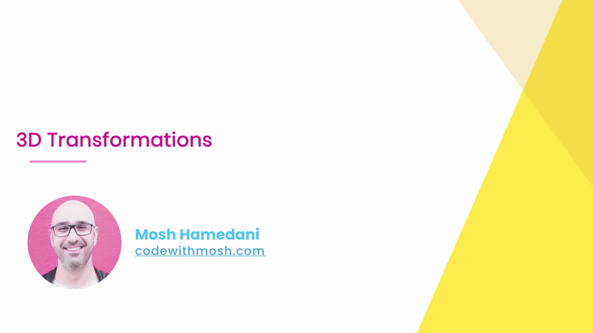

Mosh เริ่มจาก `.box:hover` เปล่า แล้วพิมพ์ `transform` (IntelliSense แสดง `transform`, `transition`, `transform-origin`):

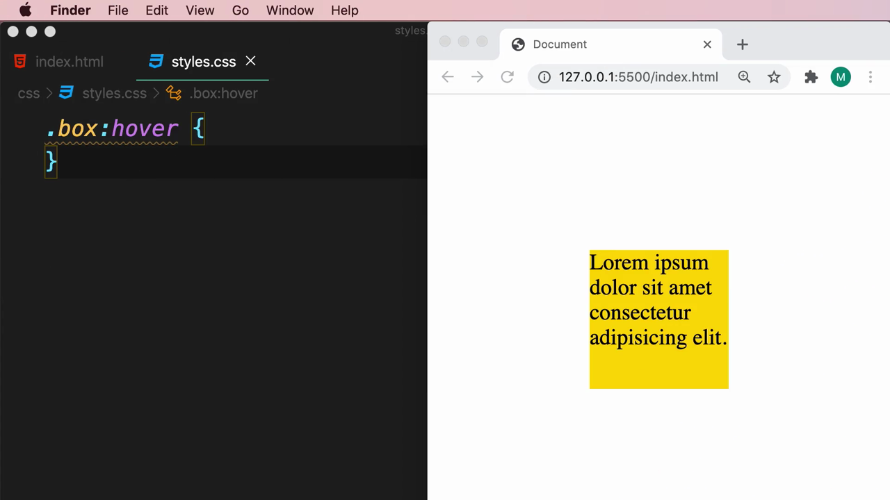

ทดลองใช้ **`translateZ(-50px)`** เพียงอย่างเดียว:

```css
.box:hover {
  transform: translateZ(-50px);
}
```

ผลลัพธ์: **ไม่มีอะไรเปลี่ยนแปลงที่มองเห็นได้เลย** แม้จะกำหนดค่าแล้วก็ตาม:


> **ทำไม `translateZ()` เพียงอย่างเดียวไม่เห็นผล:** แกน Z คือแกนที่ตั้งฉากกับหน้าจอ (เข้า-ออกจากผู้ชม) แต่หน้าจอคอมพิวเตอร์เป็นพื้นผิวแบบ 2 มิติ การจะมองเห็นความลึกได้ ต้องบอกเบราว์เซอร์ก่อนว่าผู้ชมกำลัง "มอง" ฉากนี้จากระยะห่างเท่าใด ซึ่งเป็นหน้าที่ของฟังก์ชัน **`perspective()`**

---

## 2. `perspective()` — กำหนดระยะมุมมอง

ทดลองใช้ **`perspective(200px)`** เพียงอย่างเดียวก่อน (ยังไม่มีค่า Z ให้ใช้งาน จึงยังไม่เห็นผลต่างที่ชัดเจน):

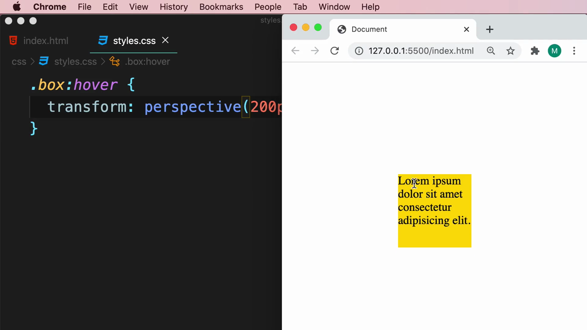

จากนั้นรวม **`perspective(200px)`** เข้ากับ **`translateZ(-50px)`** ในค่า `transform` เดียวกัน:

```css
.box:hover {
  transform: perspective(200px) translateZ(-50px);
}
```

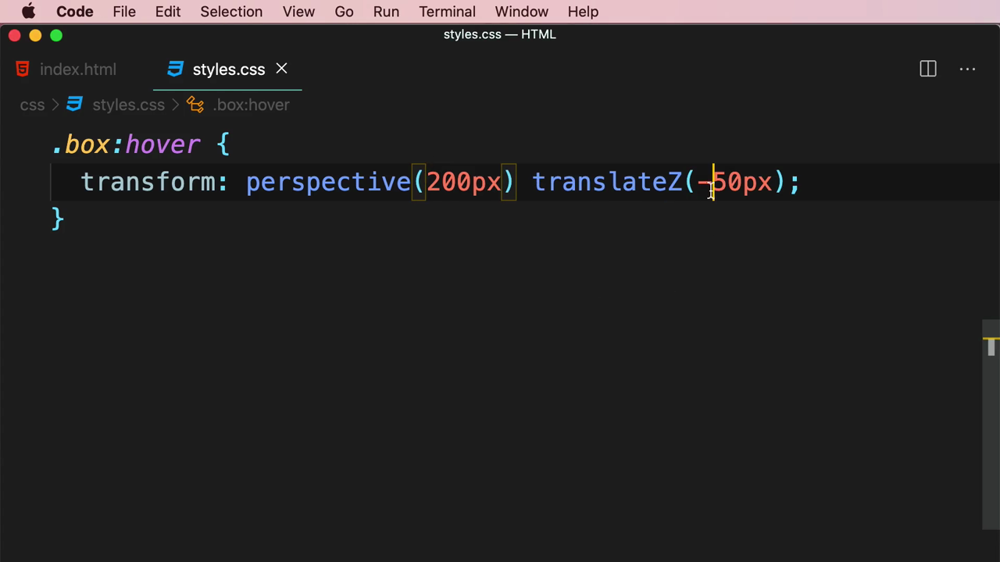

คราวนี้กล่องแสดงผลใหญ่ขึ้นอย่างชัดเจนเมื่อ hover เพราะเบราว์เซอร์มีทั้งระยะมุมมอง (perspective) และตำแหน่งบนแกน Z ให้คำนวณความลึกร่วมกัน:

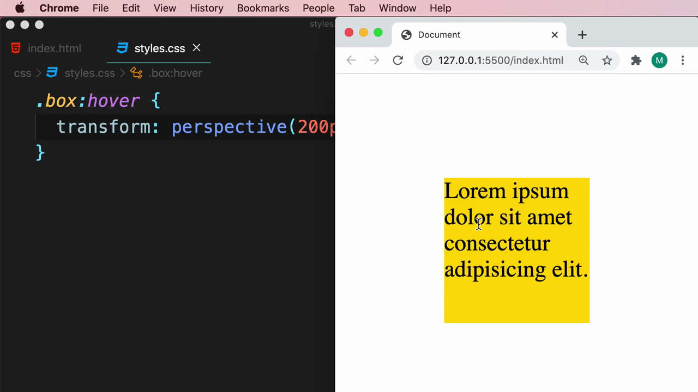

> **`perspective(<length>)`** จำลองระยะห่างระหว่างผู้ชมกับฉาก 3 มิติ — ค่ายิ่งน้อย ยิ่งให้ความรู้สึก "ใกล้" และเอฟเฟกต์ 3 มิติจะยิ่งเด่นชัด (บิดเบือนมาก) ค่ายิ่งมาก ยิ่งให้ความรู้สึก "ไกล" เอฟเฟกต์จะยิ่งดูแบนราบ (คล้าย 2 มิติ) เมื่อใช้ร่วมกับ **`translateZ()`** เบราว์เซอร์จะคำนวณและปรับขนาด/ตำแหน่งที่มองเห็นขององค์ประกอบให้สอดคล้องกับระยะมุมมองที่กำหนดไว้ ทำให้เกิดภาพลวงตาของความลึก

---

## 3. `rotateX()` และ `rotateY()` — หมุนรอบแกนแนวตั้ง/แนวนอน

Mosh เปลี่ยนจาก `translateZ` เป็น **`rotate(45deg)`** (ฟังก์ชัน 2D เดิม) เพื่อเทียบให้เห็นความแตกต่าง:

```css
.box:hover {
  transform: perspective(200px) rotate(45deg);
}
```

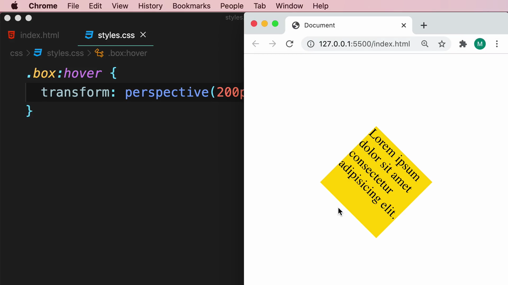

ผลลัพธ์: กล่องหมุนเป็นรูปสี่เหลี่ยมข้าวหลามตัด (diamond) แบบเดียวกับ `rotate()` ปกติในคลิปก่อนหน้า เพราะ `rotate()` หมุนรอบแกน Z เท่านั้น ไม่มีความลึกให้ `perspective()` แสดงผล:

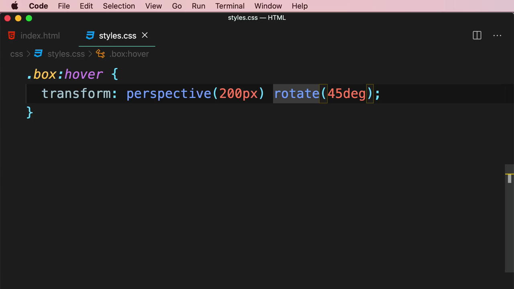

จากนั้น Mosh เปลี่ยนเป็นฟังก์ชัน 3D ของจริง — **`rotateY(45deg)`** (หมุนรอบแกนแนวตั้ง):

```css
.box:hover {
  transform: perspective(200px) rotateY(45deg);
}
```

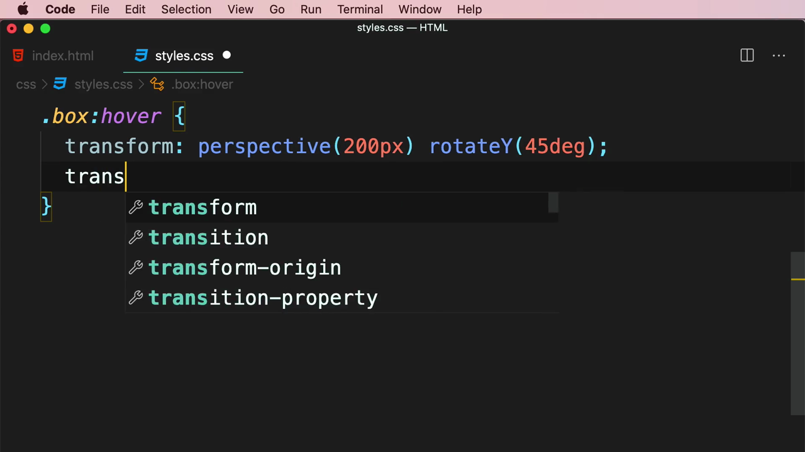

คราวนี้กล่องแสดงผลเป็นรูปทรงสี่เหลี่ยมคางหมู (trapezoid) ที่ดูเหมือนถูก "พับ" เข้าไปในฉาก 3 มิติจริงๆ ให้ความรู้สึกเหมือนหน้าหนังสือที่กำลังเปิด:

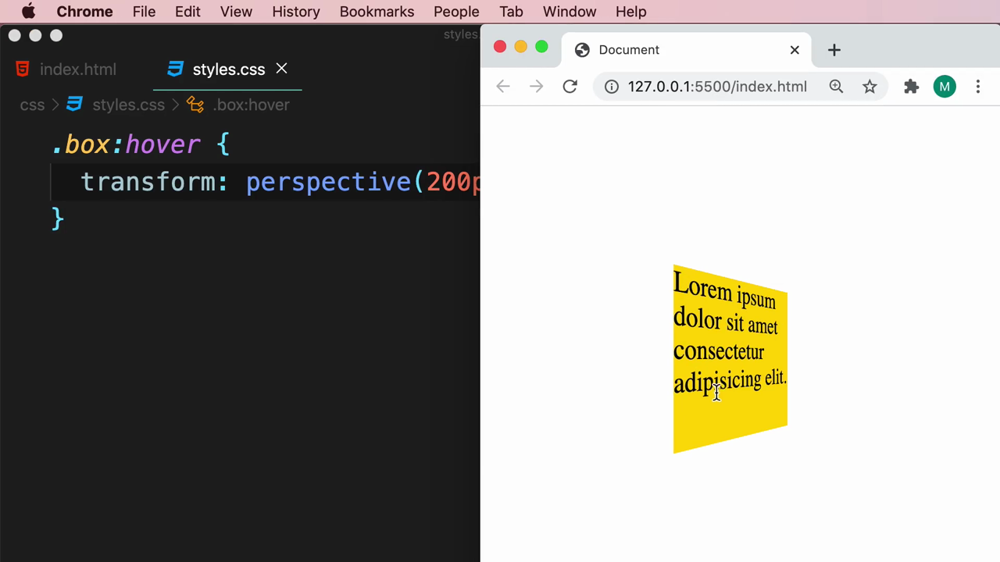

> **`rotateX(<angle>)`** หมุนรอบแกนแนวนอน (เหมือนพลิกหน้ากระดาษขึ้น-ลง) ส่วน **`rotateY(<angle>)`** หมุนรอบแกนแนวตั้ง (เหมือนเปิด-ปิดหน้าหนังสือ) ทั้งสองฟังก์ชันนี้ต่างจาก `rotate()` ที่หมุนรอบแกน Z (ตั้งฉากกับจอ) การจะเห็นเอฟเฟกต์ 3 มิติของ `rotateX`/`rotateY` ได้อย่างชัดเจน จำเป็นต้องมี `perspective()` กำกับไว้เสมอ

---

## 4. `transform-origin` — กำหนดจุดหมุน (บานพับ)

Mosh เพิ่ม **`transform-origin: 0 0`** เพื่อย้ายจุดหมุนจากกึ่งกลาง (ค่าเริ่มต้น) ไปที่มุมซ้ายบนของกล่อง:

```css
.box:hover {
  transform: perspective(200px) rotateY(45deg);
  transform-origin: 0 0;
}
```

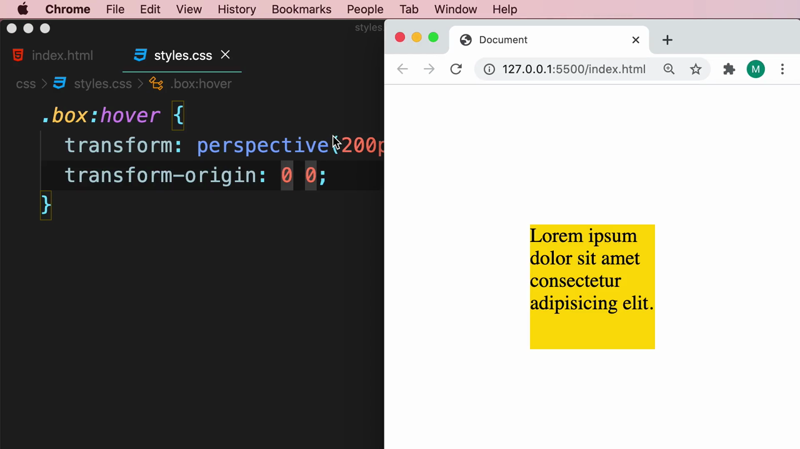

จากนั้นปรับเป็น **`transform-origin: 0 50%`** (ขอบซ้าย กึ่งกลางแนวตั้ง) ซึ่งทำให้จุดหมุนอยู่ที่ขอบซ้ายพอดี คล้ายบานพับประตูจริงๆ:

```css
.box:hover {
  transform: perspective(200px) rotateY(45deg);
  transform-origin: 0 50%;
}
```


> **`transform-origin`** กำหนดจุดอ้างอิงที่ใช้เป็น "แกนหมุน" หรือ "จุดศูนย์กลาง" ของการ transform ทั้งหมด (ทั้ง rotate, scale, skew) ค่าเริ่มต้นคือ `50% 50%` (กึ่งกลางองค์ประกอบ) การเปลี่ยนเป็น `0 50%` (ขอบซ้าย กึ่งกลางแนวตั้ง) ทำให้การหมุนดูเหมือนบานพับที่ขอบซ้าย ซึ่งเหมาะกับการจำลองเอฟเฟกต์ "เปิดหน้าหนังสือ" หรือ "เปิดประตู"

---

## 5. เปรียบเทียบสองกล่องพร้อมกัน

Mosh คัดลอกกล่องเพิ่มอีกหนึ่งอัน ทำให้มีสองกล่องวางเรียงกัน — เมื่อ hover ที่กล่องใดกล่องหนึ่ง จะเห็นกล่องนั้นพับเป็น 3 มิติ ในขณะที่อีกกล่องยังคงปกติ ทำให้เห็นความแตกต่างชัดเจนแบบเทียบเคียงกัน:

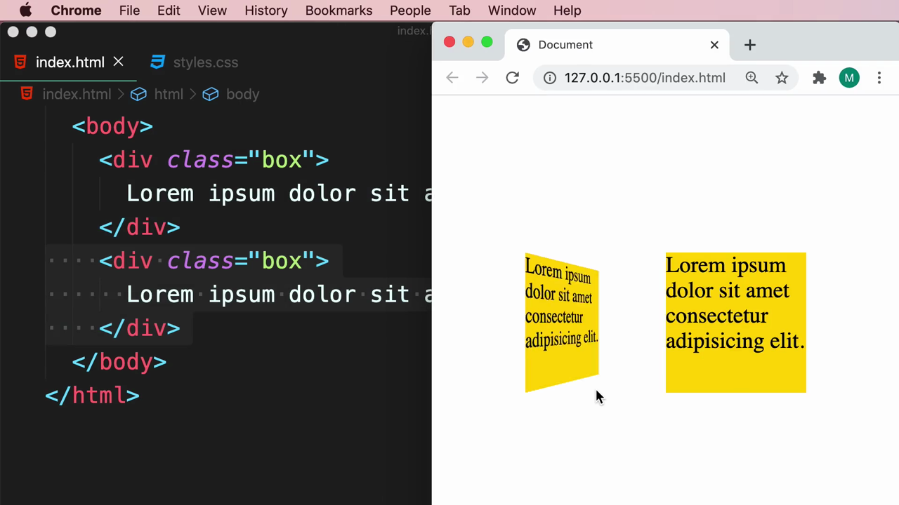

---

## 6. แชร์มุมมอง (Shared Perspective) ระหว่างหลายองค์ประกอบ

Mosh ครอบทั้งสองกล่องด้วย `<div class="container">` โดยใช้ Emmet abbreviation `.c`:

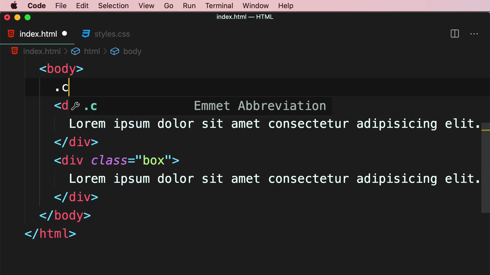

เมื่อย้าย selector จาก `.box:hover` เป็น **`.container:hover`** (ใส่ `perspective()` และ `rotateY()` ไว้ที่ `transform` ของ container โดยตรง) ทั้งสองกล่องจะพับไปพร้อมกันเป็นแผ่นเดียว เหมือนหน้ากระดาษเดียวกันที่พลิกทั้งแผ่น:

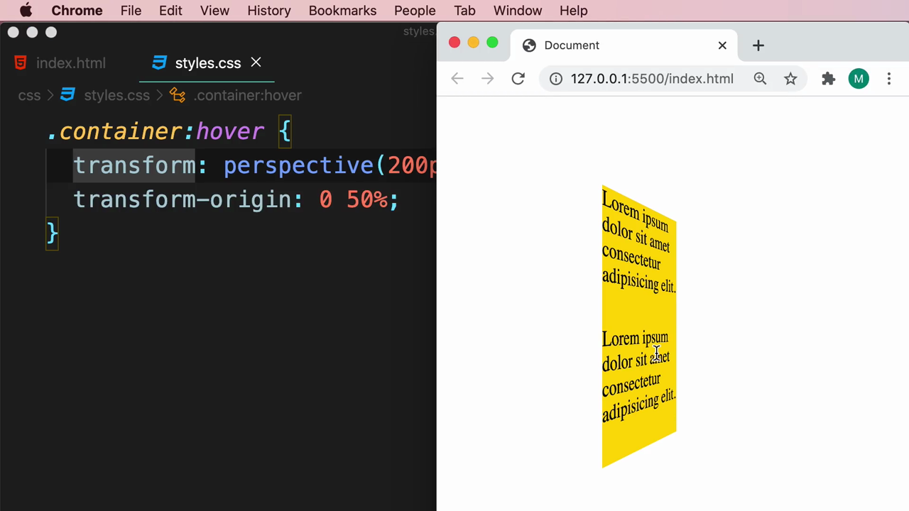

แต่เมื่อเปลี่ยน selector เป็น **`.container:hover .box`** (ใส่ `perspective()` ไว้ที่ระดับ `.box` แต่ละอันแยกกัน) กล่องทั้งสองจะพับแยกจากกันคนละมุมมอง (คนละ vantage point) แม้จะดูคล้ายกันแต่ไม่ได้เชื่อมเป็นฉากเดียวกันจริงๆ:

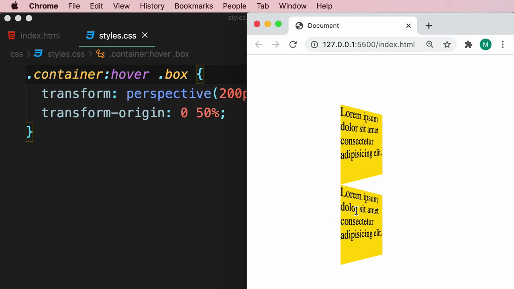

เพื่อแก้ปัญหานี้ Mosh ย้าย **`perspective`** ออกมาเป็น **CSS property แยกต่างหาก** (ไม่ใช่ฟังก์ชันใน `transform`) แล้วกำหนดไว้ที่ `.container` โดยตรง ส่วน `.container:hover .box` เหลือแค่ `rotateY()`:

```css
.container {
  perspective: 200px;
}

.container:hover .box {
  transform: rotateY(45deg);
  transform-origin: 0 50%;
}
```

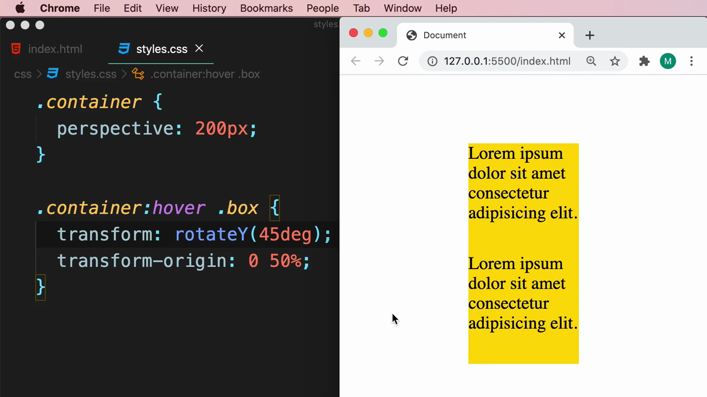

โค้ดฉบับสมบูรณ์หลังจัดระเบียบ:

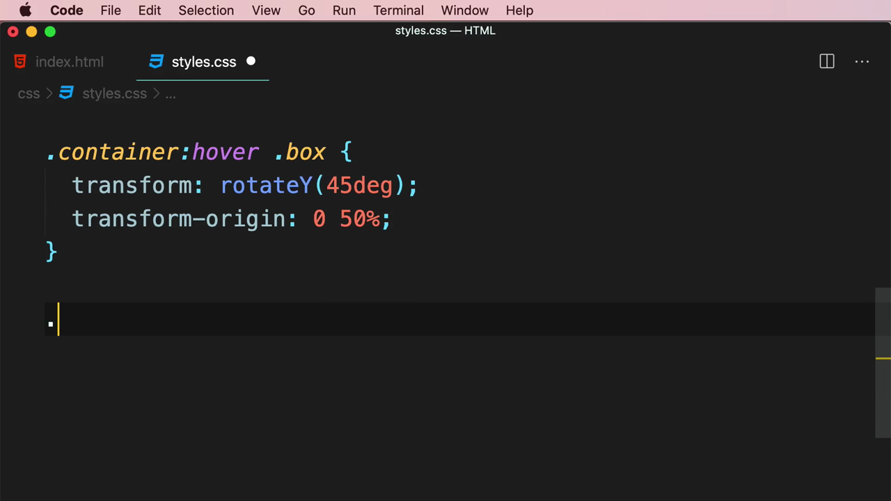

> **ความแตกต่างสำคัญระหว่าง `perspective()` (ฟังก์ชันใน `transform`) กับ `perspective` (CSS property):**
> - **`transform: perspective(200px) ...`** — กำหนดมุมมองเฉพาะสำหรับองค์ประกอบนั้นๆ เพียงตัวเดียว หากมีหลายองค์ประกอบที่ต้องหมุนพร้อมกัน แต่ละตัวจะมีมุมมอง (vantage point) ของตัวเอง ทำให้ดูเหมือนแยกจากกันแม้จะอยู่ในฉากเดียวกัน
> - **`perspective: 200px;`** (เขียนแยกเป็น property บน parent) — กำหนดมุมมองเดียวที่ใช้ร่วมกันสำหรับ**ลูกทุกตัว**ภายใน container นั้น ทำให้องค์ประกอบหลายตัวดูเหมือนอยู่ในฉาก 3 มิติเดียวกันจริงๆ เหมาะกับกรณีที่ต้องการให้หลายองค์ประกอบเคลื่อนไหวสัมพันธ์กันอย่างสมจริง (เช่น การ์ดหลายใบที่พลิกพร้อมกันในมุมมองเดียวกัน)

---

## 7. ทิ้งท้ายด้วยฟังก์ชัน 3D อื่นๆ

VS Code IntelliSense แสดงรายการฟังก์ชัน 3D ทั้งหมดที่เกี่ยวข้องกับ `transform`: `matrix()`, `matrix3d()`, `none`, `perspective()`, `rotate()`, `rotate3d()`, `rotateX()`, `rotateY()`, `rotateZ()`:

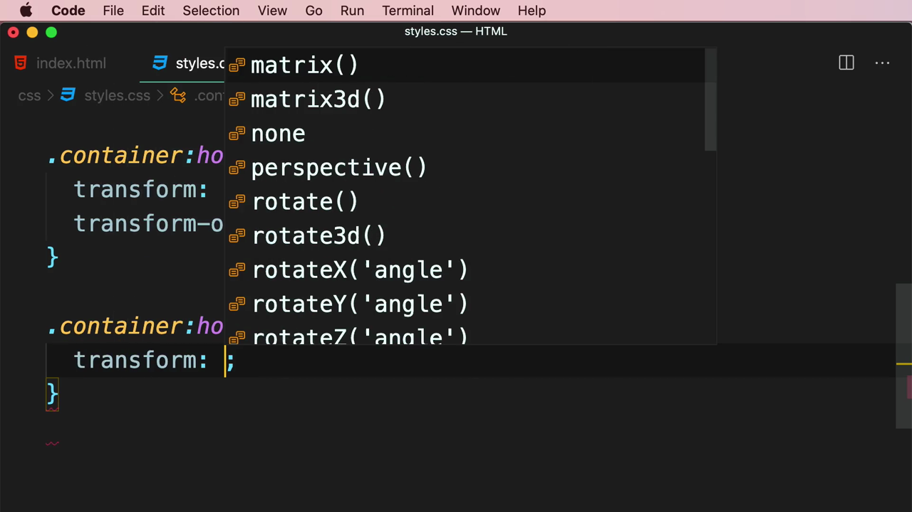

Mosh ทิ้งท้ายด้วยการสร้าง selector ตัวอย่างเพิ่มเติม **`.container:hover .box-special`** พร้อมทดลอง **`rotateX(45deg)`** (หมุนรอบแกนแนวนอนแทน) เป็นตัวอย่างให้ผู้เรียนลองต่อยอดเอง:

```css
.container:hover .box-special {
  transform: rotateX(45deg);
}
```

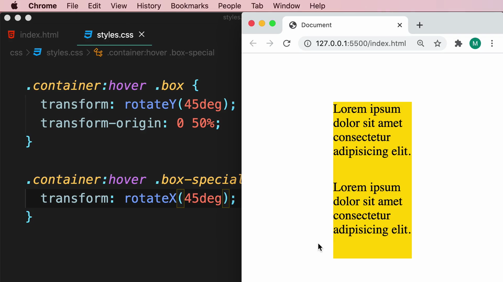

---

## สรุปภาพรวมของคลิปนี้

| ประเด็น | รายละเอียด |
|---|---|
| **หัวข้อ** | 3D Transformations |
| **ฟังก์ชัน `transform` ที่สอน** | `translateZ()`, `perspective()` (ในฐานะฟังก์ชัน), `rotateX()`, `rotateY()` |
| **CSS property ที่เกี่ยวข้อง** | `transform-origin`, `perspective` (ในฐานะ property บน parent) |
| **แนวคิดขั้นสูง** | Shared perspective ระหว่างหลายองค์ประกอบผ่าน parent container |

**แนวคิดสำคัญที่ได้จากคลิปนี้:**

1. **`translateZ()` เพียงอย่างเดียวไม่เห็นผล** จำเป็นต้องมี `perspective()` กำกับเสมอ เพื่อให้เบราว์เซอร์รู้ว่าจะจำลองความลึกอย่างไรบนหน้าจอ 2 มิติ
2. **`rotateX()` และ `rotateY()` คือหัวใจของ 3D Transformations** ต่างจาก `rotate()`/`rotateZ()` ที่หมุนบนระนาบเดิม (2D) ทั้งสองฟังก์ชันนี้หมุนรอบแกนแนวนอนและแนวตั้งตามลำดับ สร้างเอฟเฟกต์ "พับ" หรือ "เปิดหน้ากระดาษ" ที่สมจริง
3. **`transform-origin` ควบคุมตำแหน่งของ "บานพับ"** การตั้งค่าเป็น `0 50%` ทำให้จุดหมุนอยู่ที่ขอบซ้าย เหมาะกับเอฟเฟกต์เปิด-ปิดแบบประตูหรือหนังสือ
4. **เมื่อมีหลายองค์ประกอบที่ต้องดูเหมือนอยู่ในฉาก 3 มิติเดียวกัน ควรกำหนด `perspective` เป็น property แยกไว้ที่ parent container** แทนที่จะใส่ `perspective()` แยกกันในแต่ละองค์ประกอบ เพื่อให้ทุกองค์ประกอบใช้มุมมอง (vantage point) เดียวกันอย่างสอดคล้อง
5. **3D Transformations เหมาะสำหรับสร้างเอฟเฟกต์ UI ที่น่าสนใจ** เช่น การ์ดที่พลิกได้ (flip card), เมนูที่หมุนเป็น 3 มิติ, หรือแกลเลอรีภาพที่มีมิติความลึก

---

*หมายเหตุ: คลิปนี้เป็นส่วนหนึ่งของบท "6-Transformations, Transitions, and Animations" จากคอร์ส The Ultimate HTML and CSS Course โดย Mosh Hamedani (codewithmosh.com) — คลิปที่ 3 ของบทนี้*
