# 6-Transformations, Transitions, and Animations: 04 - Transitions (3:24)

**ไฟล์ต้นทาง:** `4-Transitions.mp4`

▶️ **[เปิดวิดีโอต้นฉบับ](../../../HTML-CSS-2/6-Transformations,%20Transitions,%20and%20Animations/4-Transitions.mp4)**

---

## ภาพรวมคลิปนี้

คลิปนี้ Mosh สอนคุณสมบัติ CSS **`transition`** สำหรับทำให้การเปลี่ยนแปลงค่า CSS (เช่น `transform`, `background`) เกิดขึ้นอย่างนุ่มนวลแทนที่จะเปลี่ยนทันทีทันใด โดยครอบคลุมทั้ง **duration**, **timing function (easing)**, **delay** พร้อมแนะนำเว็บไซต์ **cubic-bezier.com** สำหรับสร้างเส้นโค้ง easing แบบกำหนดเอง และปิดท้ายด้วยข้อสังเกตสำคัญว่า `transition` มีผลเฉพาะ property ที่ระบุไว้เท่านั้น

---

## 1. ปัญหา: การเปลี่ยนแปลงที่เกิดขึ้นทันที (ไม่มี Transition)

สไลด์ชื่อคลิป **"Transitions"** เปิดคลิป Mosh เริ่มจากกล่อง `.box` ที่มี `.box:hover { transform: rotate(45deg); }` โดยยังไม่มี `transition` ใดๆ:

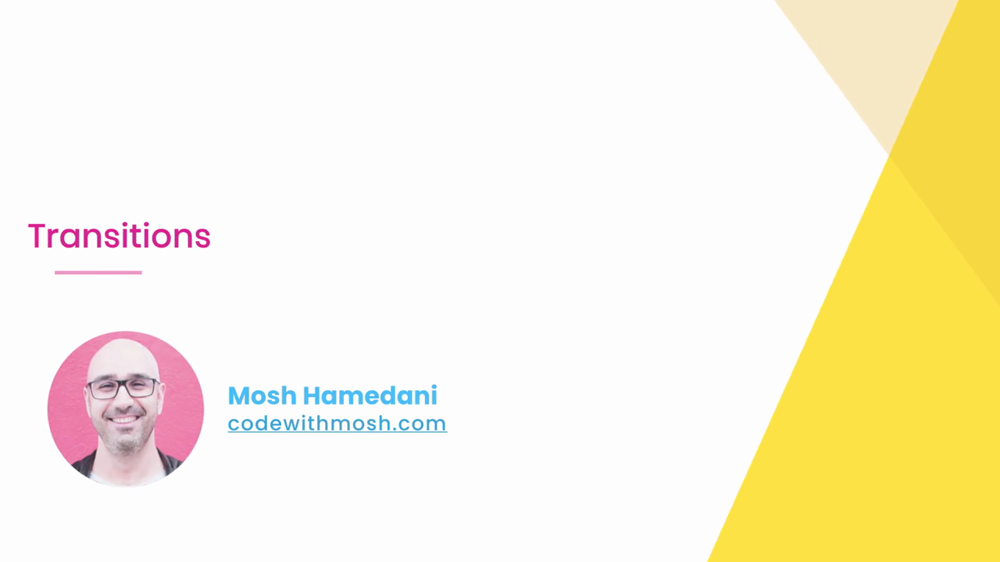

เมื่อ hover กล่องจะหมุน 45 องศา**ทันทีในพริบตา** ไม่มีการเคลื่อนไหวแบบค่อยเป็นค่อยไปเลย:

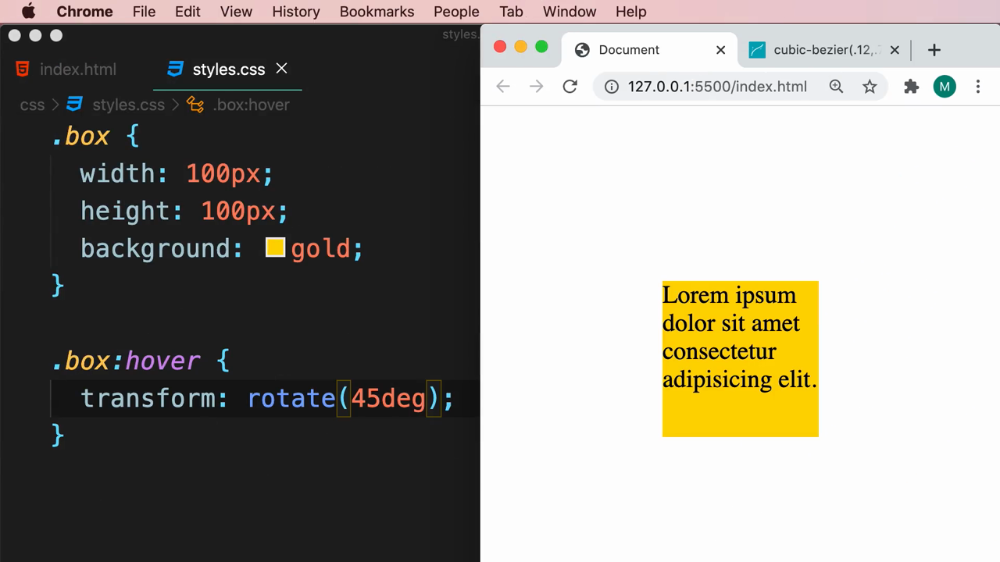

---

## 2. เพิ่ม `transition` พื้นฐาน — Duration

Mosh เพิ่ม property **`transition`** ให้กับ `.box` (ไม่ใช่ `.box:hover`) โดย IntelliSense แสดงตัวเลือกที่เกี่ยวข้อง (`transition`, `transition-property`, `transition-delay` ฯลฯ):

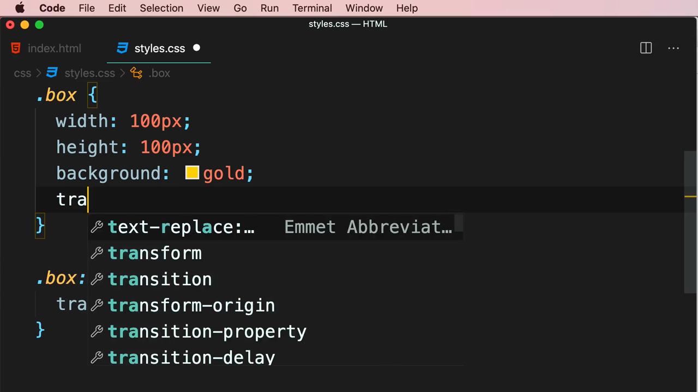

```css
.box {
  width: 100px;
  height: 100px;
  background: gold;
  transition: transform 0.5s;
}

.box:hover {
  transform: rotate(45deg);
}
```

เมื่อรันใหม่ กล่องจะหมุนอย่างนุ่มนวลภายในเวลา 0.5 วินาทีแทนที่จะกระตุกทันที:

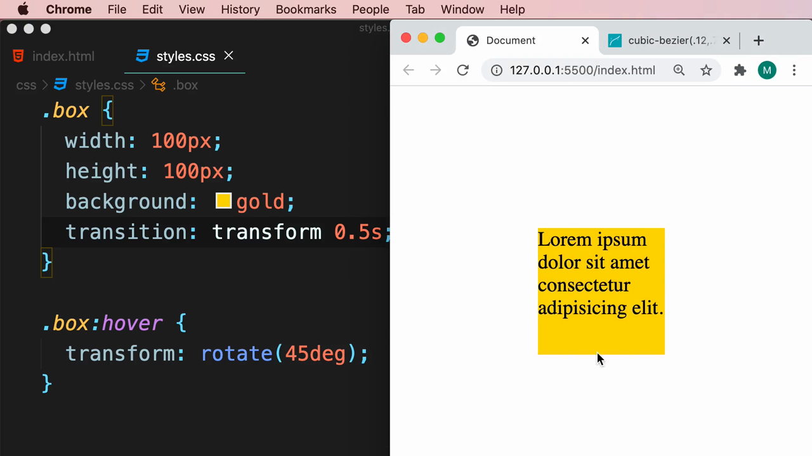

> **รูปแบบพื้นฐานของ `transition`:** `transition: <property> <duration>;` โดย `<property>` คือ CSS property ที่ต้องการให้เปลี่ยนแปลงอย่างนุ่มนวล (ในที่นี้คือ `transform`) และ `<duration>` คือระยะเวลาที่ใช้ในการเปลี่ยนแปลง (ในที่นี้คือ `0.5s` หรือครึ่งวินาที) **ต้องกำหนด `transition` ไว้ที่ state ปกติของ selector** (`.box`) ไม่ใช่ที่ `:hover` เพื่อให้มีผลทั้งตอนเข้าและออกจาก hover

---

## 3. Timing Function (Easing) — ควบคุมจังหวะความเร็ว

Mosh เพิ่มค่าที่สามคือ **`ease-in`**:

```css
.box {
  transition: transform 0.5s ease-in;
}
```

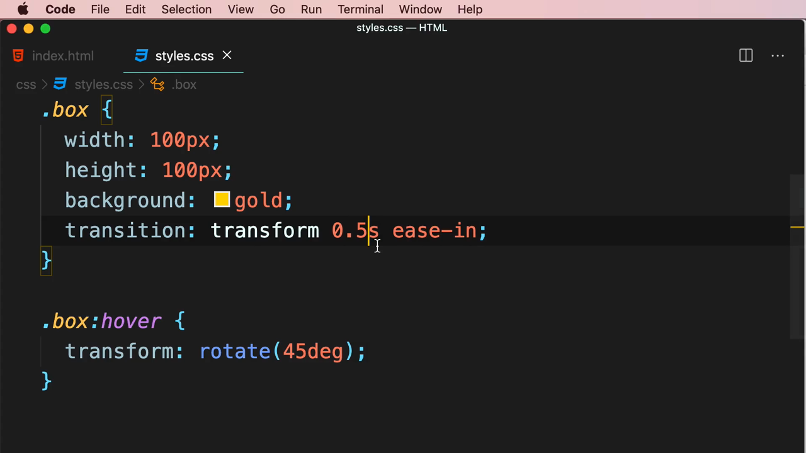

> **Timing function** กำหนดว่าความเร็วของการเปลี่ยนแปลงจะเปลี่ยนไปอย่างไรตลอดช่วงเวลา ค่ามาตรฐานที่มีให้เลือก ได้แก่ `linear` (ความเร็วคงที่ตลอด), `ease` (ค่าเริ่มต้น เร่งช้าๆ แล้วค่อยชะลอ), `ease-in` (เริ่มช้าแล้วเร่งเร็วขึ้น), `ease-out` (เริ่มเร็วแล้วค่อยชะลอ)

---

## 4. cubic-bezier.com — สร้างเส้นโค้ง Easing แบบกำหนดเอง

Mosh เปิดเว็บไซต์ **cubic-bezier.com** เพื่อสำรวจว่า timing function ต่างๆ มีลักษณะเส้นกราฟอย่างไร:

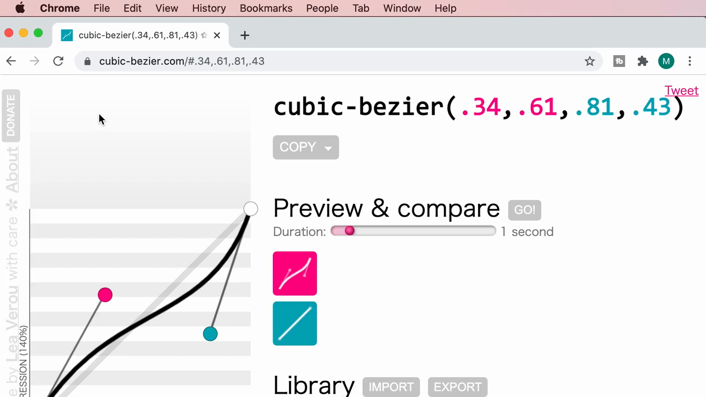

เว็บไซต์นี้มีคลังเส้นโค้งสำเร็จรูป (Library) ให้เลือกเปรียบเทียบ ได้แก่ **ease**, **linear**, **ease-in**, **ease-out** พร้อมแสดงกราฟแต่ละแบบให้เห็นความแตกต่างของจังหวะความเร็ว:

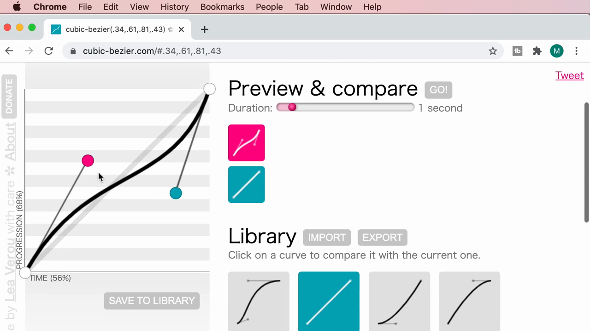

ผู้ใช้สามารถลากจุดควบคุม (control point) สีชมพูและฟ้าบนกราฟเพื่อสร้างเส้นโค้งแบบกำหนดเองได้อย่างอิสระ ระบบจะคำนวณค่าตัวเลขทั้ง 4 ตัวของฟังก์ชัน `cubic-bezier()` ให้อัตโนมัติตามตำแหน่งจุดที่ลาก:

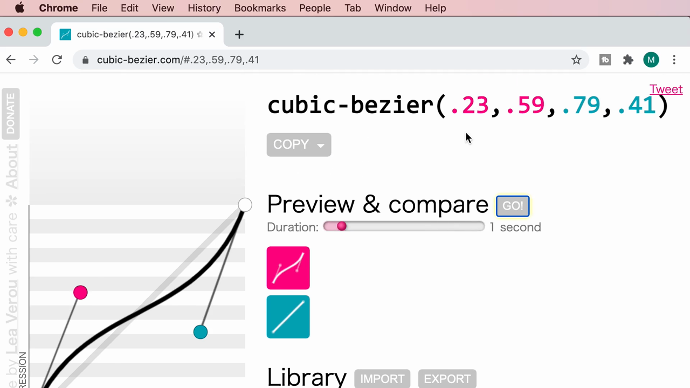

Mosh คัดลอกค่าตัวเลขที่ได้แล้วนำมาใช้แทนคำหลัก (keyword) อย่าง `ease-in`:

```css
.box {
  transition: transform 0.5s cubic-bezier();
}
```

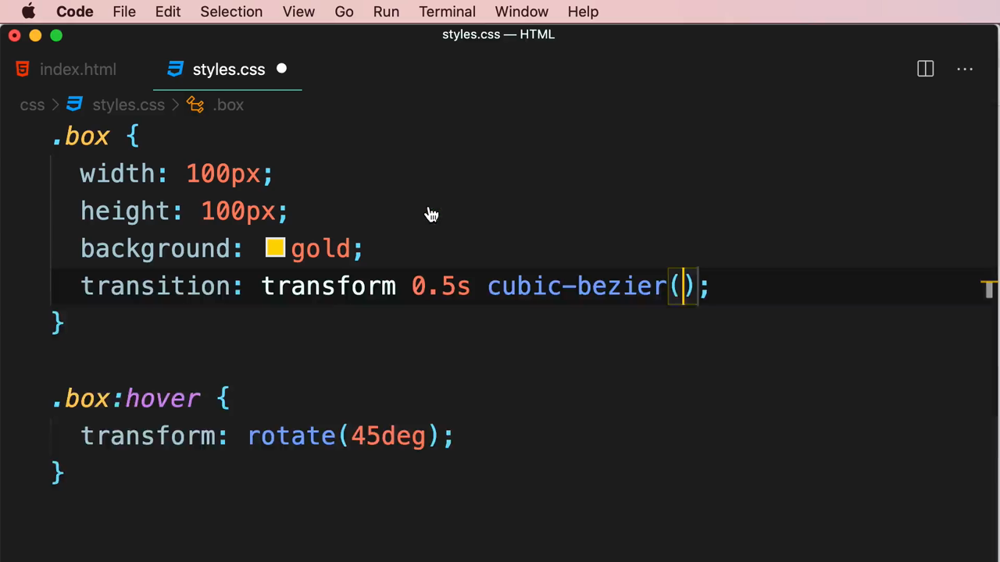

> **`cubic-bezier(x1, y1, x2, y2)`** คือฟังก์ชันที่ให้ผู้พัฒนากำหนดเส้นโค้งความเร็วของ transition ได้อย่างละเอียดและอิสระมากกว่าคำหลักสำเร็จรูป เหมาะสำหรับสร้างเอฟเฟกต์การเคลื่อนไหวที่มีเอกลักษณ์เฉพาะตัว โดยเว็บไซต์ cubic-bezier.com ช่วยให้มองเห็นภาพและทดสอบผลลัพธ์ได้ง่ายก่อนนำค่าตัวเลขมาใส่ในโค้ดจริง

---

## 5. `transition-delay` — หน่วงเวลาก่อนเริ่ม Transition

Mosh เปลี่ยนค่า timing function กลับเป็น `linear` แล้วเพิ่มค่าที่สี่คือ **`1s`** (delay):

```css
.box {
  transition: transform 0.5s linear 1s;
}
```

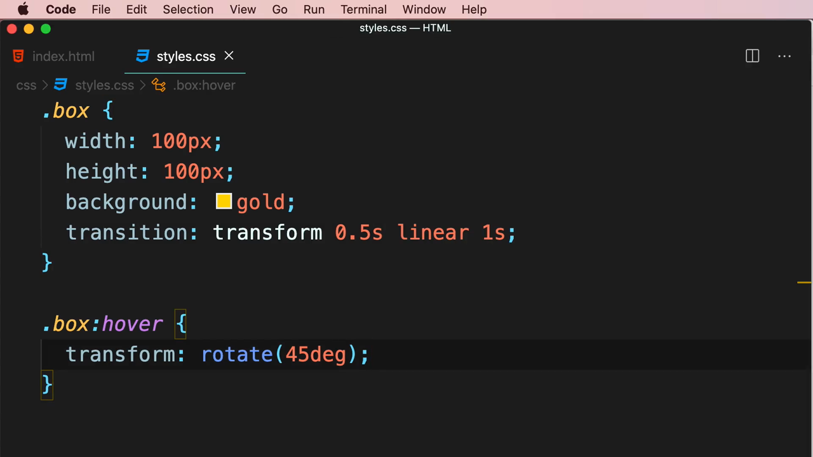

> เมื่อ `transition` มีค่าตัวเลขสองตัว (เช่น `0.5s` และ `1s`) **ค่าตัวเลขแรกจะถูกตีความเป็น duration เสมอ ส่วนค่าที่สองจะถูกตีความเป็น delay** ผลคือเมื่อ hover กล่องจะ**รอ 1 วินาทีก่อน** แล้วจึงเริ่มหมุนแบบนุ่มนวลภายใน 0.5 วินาทีถัดไป มีประโยชน์เมื่อต้องการหน่วงจังหวะการเคลื่อนไหวให้ดูเป็นธรรมชาติมากขึ้น หรือรอให้แอนิเมชันอื่นจบก่อน

---

## 6. ข้อสังเกตสำคัญ: Transition มีผลเฉพาะ Property ที่ระบุไว้เท่านั้น

Mosh พิมพ์ property ใหม่ในนามส่วน `.box:hover` โดย IntelliSense แสดงตัวเลือกกลุ่ม `background-*` (`background-color`, `background-image`, `background-position` ฯลฯ):

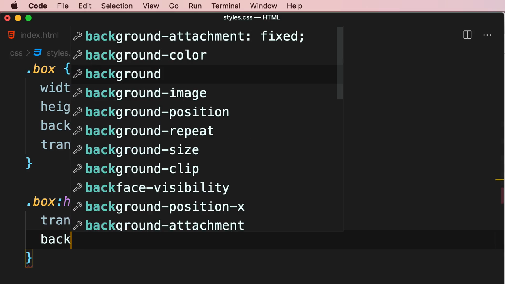

เลือก **`background: dodgerblue`** เพิ่มเข้าไปใน `.box:hover` (โดยที่ `transition` ของ `.box` ยังคงระบุไว้เฉพาะ `transform` เท่านั้น ไม่ใช่ `all`):

```css
.box {
  transition: transform 0.5s linear 1s;
}

.box:hover {
  transform: rotate(45deg);
  background: dodgerblue;
}
```

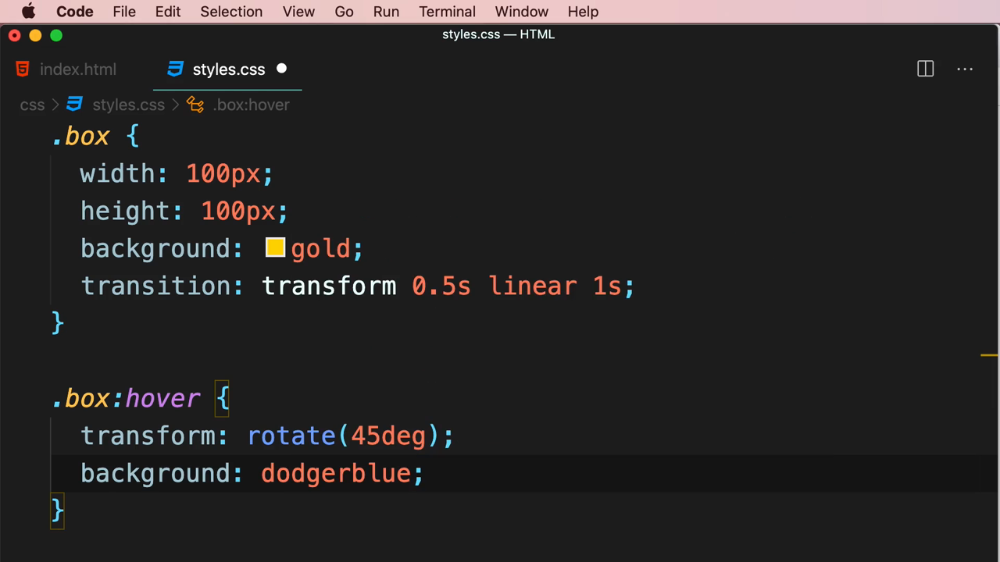

ผลลัพธ์เมื่อ hover: **การหมุน (`transform`) เปลี่ยนแปลงอย่างนุ่มนวลตามที่ตั้งค่าไว้ แต่สีพื้นหลัง (`background`) เปลี่ยนเป็นสีน้ำเงิน (dodgerblue) ทันทีแบบไม่มีการไล่สี (snap)** เพราะไม่ได้ถูกรวมอยู่ใน `transition` เลย:

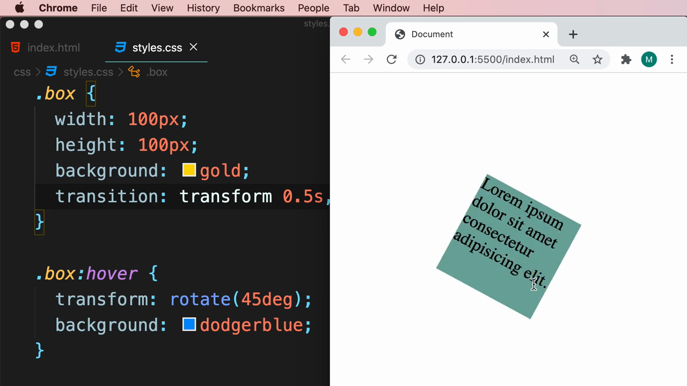

> **หลักการสำคัญที่สุดของคลิปนี้:** `transition` มีผลเฉพาะ **CSS property ที่ระบุไว้อย่างชัดเจนเท่านั้น** (ในตัวอย่างนี้คือ `transform`) property อื่นๆ ที่เปลี่ยนแปลงพร้อมกัน (เช่น `background`) จะยังคงเปลี่ยนแปลงทันทีตามปกติ หากต้องการให้ทุก property ที่เปลี่ยนแปลงมีการทำ transition ทั้งหมด สามารถใช้ค่าพิเศษ **`transition: all 0.5s;`** แทนการระบุชื่อ property ทีละตัวได้

---

## สรุปภาพรวมของคลิปนี้

| ประเด็น | รายละเอียด |
|---|---|
| **หัวข้อ** | Transitions |
| **CSS property หลัก** | `transition` (และรูปแบบย่อ `transition-property`, `transition-duration`, `transition-timing-function`, `transition-delay`) |
| **ส่วนประกอบของ `transition`** | property, duration, timing function (easing), delay |
| **เครื่องมือที่ใช้สาธิต** | cubic-bezier.com |

**แนวคิดสำคัญที่ได้จากคลิปนี้:**

1. **`transition` ต้องกำหนดไว้ที่ state ปกติ (`.box`) ไม่ใช่ที่ `:hover`** เพื่อให้มีผลทั้งตอนเข้าและออกจากสถานะ hover
2. **รูปแบบเต็มของ `transition` คือ `<property> <duration> <timing-function> <delay>`** โดยค่าตัวเลขตัวแรกเสมอถูกตีความเป็น duration และตัวที่สองเป็น delay
3. **Timing function กำหนดจังหวะความเร็ว** — `linear`, `ease`, `ease-in`, `ease-out` เป็นค่าสำเร็จรูป ส่วน `cubic-bezier()` ให้ความยืดหยุ่นสูงสุดในการออกแบบเส้นโค้งเอง
4. **cubic-bezier.com เป็นเครื่องมือที่มีประโยชน์มาก** สำหรับทดลองและมองเห็นภาพเส้นโค้ง easing ก่อนคัดลอกค่าตัวเลขมาใช้ในโค้ดจริง
5. **`transition` มีผลเฉพาะ property ที่ระบุไว้เท่านั้น** — property อื่นที่เปลี่ยนพร้อมกันแต่ไม่ได้ถูกระบุไว้จะยังคงเปลี่ยนแปลงทันทีโดยไม่มีการไล่ระดับ การใช้ `transition: all ...;` จะครอบคลุมทุก property ที่เปลี่ยนแปลง แต่ควรใช้ด้วยความระมัดระวังเพราะอาจกระทบประสิทธิภาพหากมี property จำนวนมากเปลี่ยนแปลงพร้อมกัน

---

*หมายเหตุ: คลิปนี้เป็นส่วนหนึ่งของบท "6-Transformations, Transitions, and Animations" จากคอร์ส The Ultimate HTML and CSS Course โดย Mosh Hamedani (codewithmosh.com) — คลิปที่ 4 ของบทนี้*
