# 6-Transformations, Transitions, and Animations: 05 - Animations (5:06)

**ไฟล์ต้นทาง:** `5-Animations.mp4`

▶️ **[เปิดวิดีโอต้นฉบับ](../../../HTML-CSS-2/6-Transformations,%20Transitions,%20and%20Animations/5-Animations.mp4)**

---

## ภาพรวมคลิปนี้

คลิปนี้ Mosh สอนคุณสมบัติ **`@keyframes`** และกลุ่ม property **`animation-*`** สำหรับสร้างแอนิเมชันที่ซับซ้อนและควบคุมได้มากกว่า `transition` เพราะสามารถกำหนดหลายขั้นตอน (steps) ของการเปลี่ยนแปลงได้ในตัวเดียว โดยไม่ต้องพึ่งพา event อย่าง `:hover` เลย

---

## 1. ทบทวน Transition หลาย Property พร้อมกัน

สไลด์ชื่อคลิป **"Animations"** เปิดคลิป Mosh เริ่มด้วยการทบทวนจากคลิปก่อนหน้า โดยแก้ปัญหาที่ `background` เปลี่ยนแบบกระตุก (snap) ด้วยการระบุ **หลาย property คั่นด้วยจุลภาค** ในค่า `transition`:

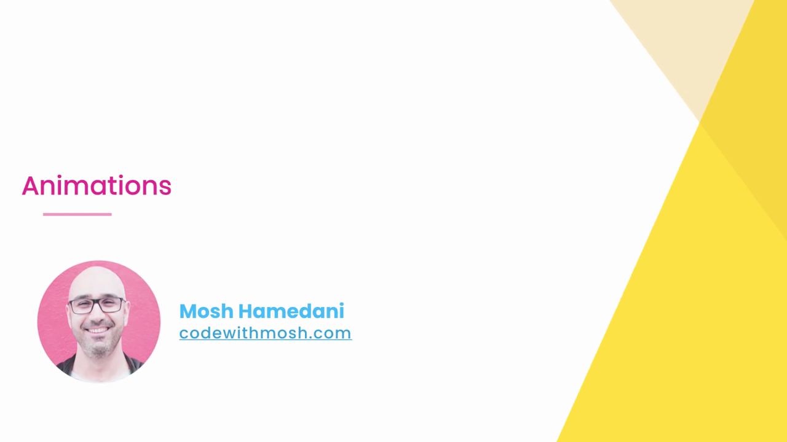

```css
.box {
  transition: transform 0.5s, background 0.5s;
}
```

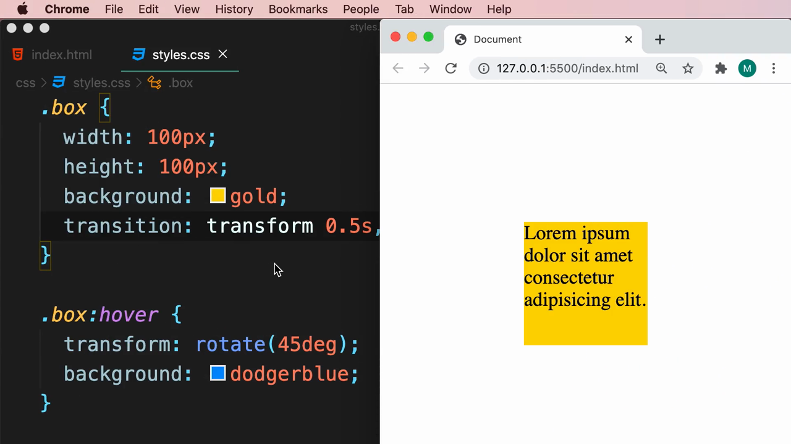

> **`transition` รองรับหลาย property พร้อมกันได้** โดยคั่นแต่ละชุด (`property duration`) ด้วยจุลภาค ทำให้ทุก property ที่ระบุไว้เปลี่ยนแปลงอย่างนุ่มนวลพร้อมกันได้ อย่างไรก็ตาม เมื่อต้องการแอนิเมชันที่ซับซ้อนกว่านี้ (เช่น มีหลายขั้นตอนย่อยในระหว่างทาง ไม่ใช่แค่จุดเริ่มต้นกับจุดสิ้นสุด) `transition` เพียงอย่างเดียวจะเริ่มไม่เพียงพอ

Mosh ล้างโค้ดกลับไปเป็นกล่องพื้นฐานที่ยังไม่มี `transition` หรือ `animation` ใดๆ เพื่อเริ่มบทเรียนใหม่:

```css
.box {
  width: 100px;
  height: 100px;
  background: gold;
}
```

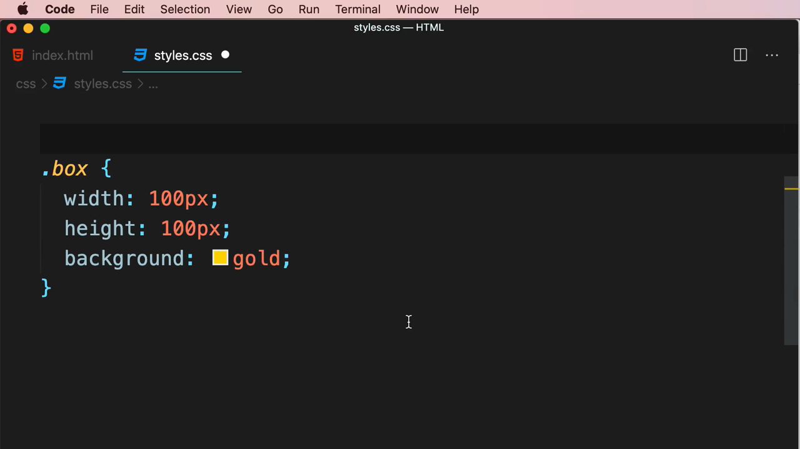

---

## 2. สร้าง `@keyframes` — นิยามขั้นตอนของแอนิเมชัน

Mosh สร้าง **`@keyframes`** พร้อมตั้งชื่อแอนิเมชันว่า **`pop`**:

```css
@keyframes pop {

}
```

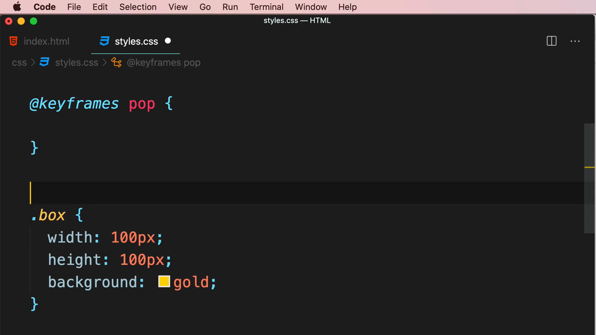

จากนั้นเพิ่มขั้นตอนแรกที่ **`0%`** (จุดเริ่มต้น) กำหนดให้กล่องมีขนาดปกติ:

```css
@keyframes pop {
  0% {
    transform: scale(1);
  }
}
```

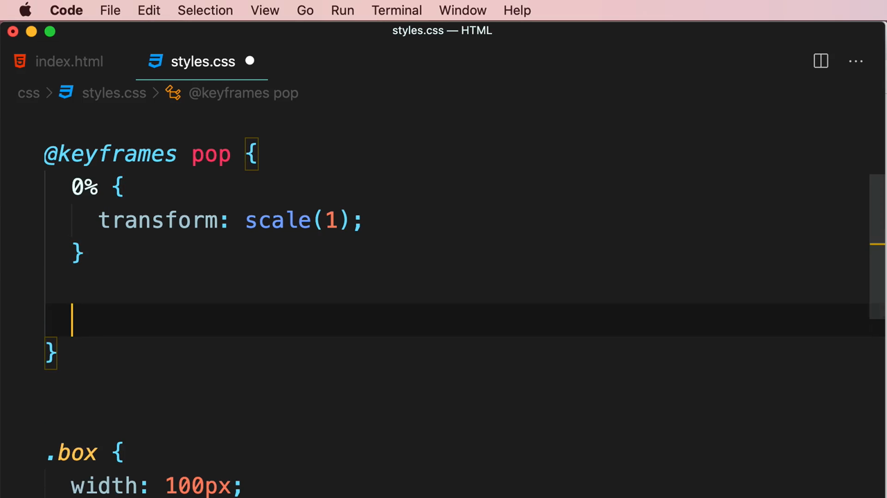

เพิ่มขั้นตอนที่ **`25%`** ของระยะเวลาทั้งหมด ให้กล่องขยายใหญ่ขึ้นเล็กน้อย:

```css
25% {
  transform: scale(1.3);
}
```

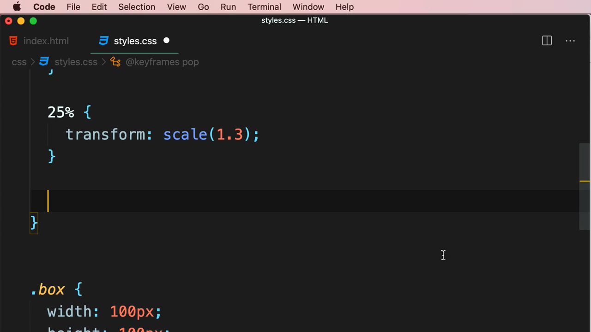

เพิ่มขั้นตอนที่ **`50%`** ให้กล่องหมุน 45 องศา **พร้อมเปลี่ยนสีพื้นหลังเป็น `tomato`** (แสดงว่าในหนึ่ง keyframe สามารถเปลี่ยนได้หลาย property พร้อมกัน):

```css
50% {
  transform: rotate(45deg);
  background: tomato;
}
```

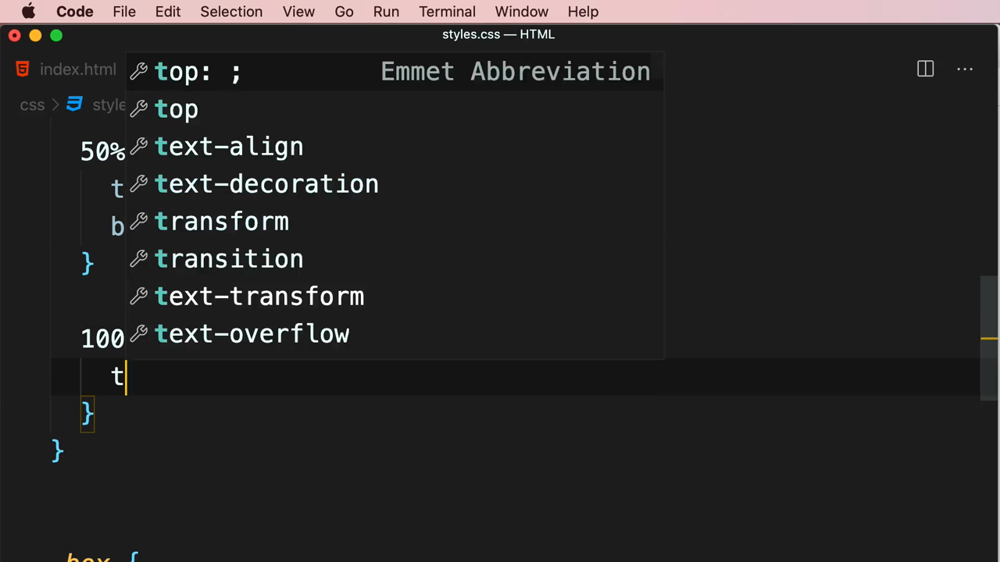

และสุดท้ายที่ **`100%`** (จุดสิ้นสุด) ให้กล่องกลับมาที่มุมเริ่มต้น:

```css
100% {
  transform: rotate(0);
}
```

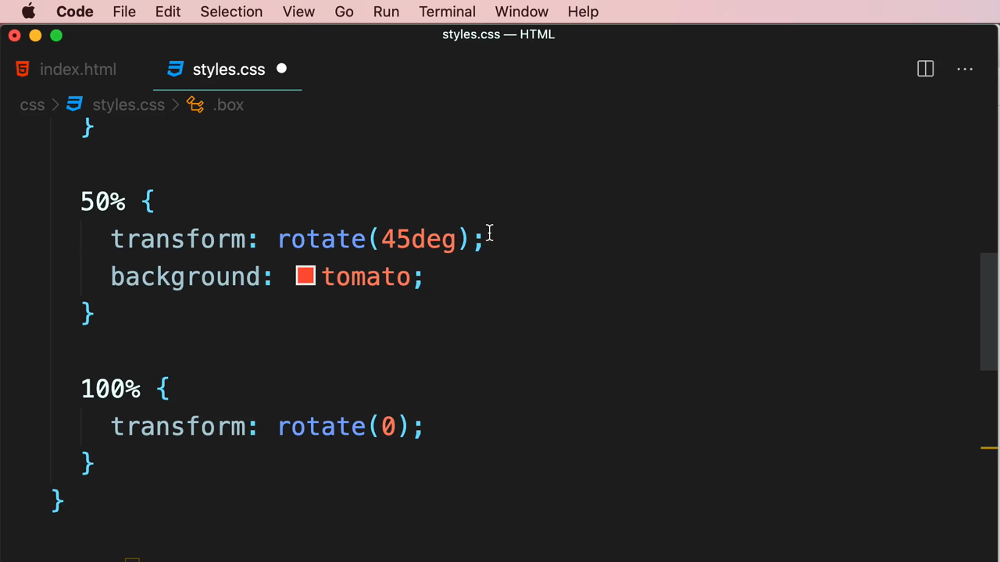

> **`@keyframes`** ให้ผู้พัฒนากำหนด "สถานะ" ของ property ต่างๆ ณ จุดเวลาใดๆ ก็ได้ตลอดช่วงแอนิเมชัน โดยใช้หน่วยเปอร์เซ็นต์ (0% คือเริ่มต้น, 100% คือสิ้นสุด) เบราว์เซอร์จะคำนวณและไล่ระดับ (interpolate) ค่าต่างๆ ระหว่างแต่ละขั้นตอนให้อัตโนมัติ ทำให้สร้างแอนิเมชันหลายขั้นตอนที่ซับซ้อนได้ในนิยามเดียว ต่างจาก `transition` ที่ทำได้แค่ระบุจุดเริ่มต้นกับจุดสิ้นสุดเท่านั้น

---

## 3. นำ `@keyframes` ไปใช้งานด้วย `animation-name` และ `animation-duration`

Mosh กลับไปที่ `.box` แล้วเพิ่ม **`animation-name: pop;`** และ **`animation-duration: 4s;`**:

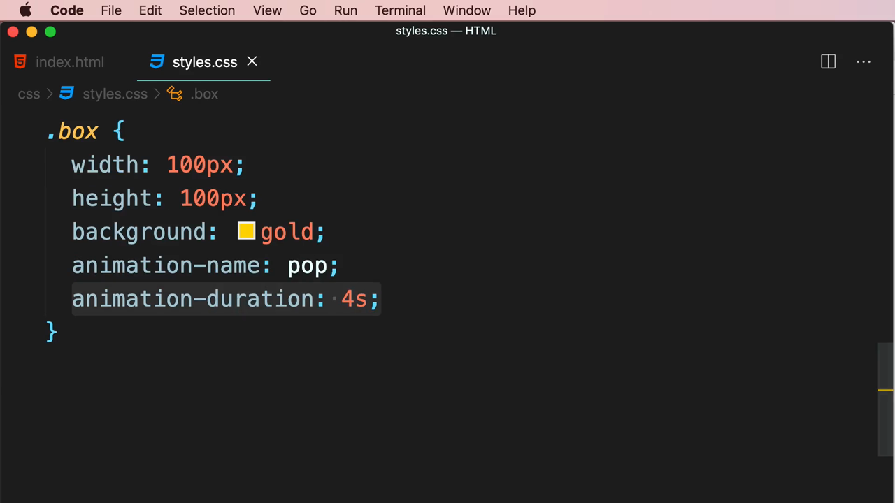

```css
.box {
  width: 100px;
  height: 100px;
  background: gold;
  animation-name: pop;
  animation-duration: 4s;
}
```

ผลลัพธ์ที่สำคัญที่สุด: **กล่องเริ่มเล่นแอนิเมชันโดยอัตโนมัติทันทีที่หน้าเว็บโหลดเสร็จ โดยไม่ต้องมี `:hover` หรือ event ใดๆ มากระตุ้นเลย**:

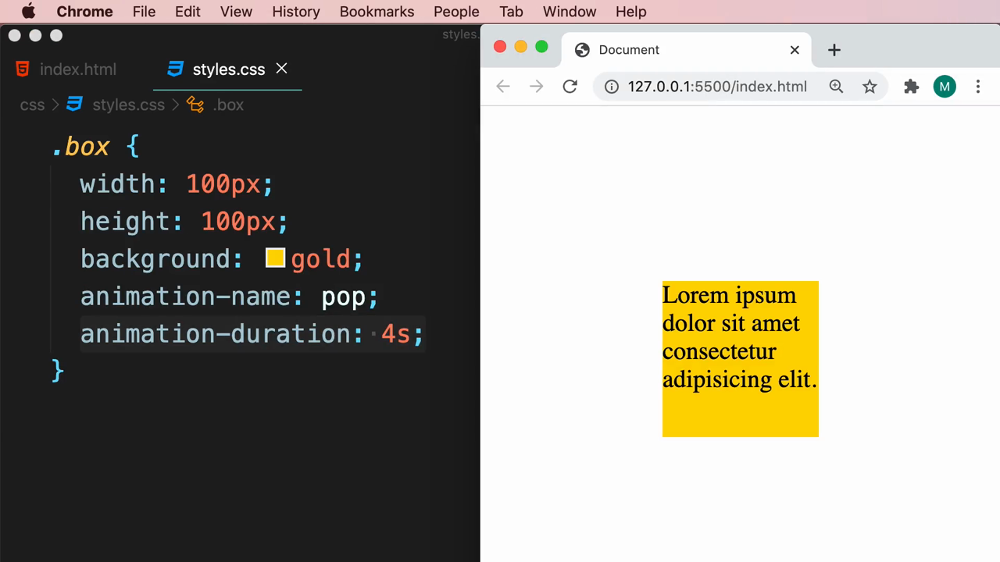

> ข้อแตกต่างสำคัญระหว่าง `animation` กับ `transition`: **`transition` ต้องอาศัยการเปลี่ยนแปลง state (เช่น `:hover`) มากระตุ้นเสมอ ในขณะที่ `animation` เล่นได้เองโดยอัตโนมัติ** ทันทีที่ property ถูกกำหนดไว้ ไม่ต้องรอ event ใดๆ

---

## 4. `animation-delay` — หน่วงเวลาก่อนเริ่ม

Mosh เพิ่ม **`animation-delay: 1s;`** เพื่อให้แอนิเมชันรอ 1 วินาทีก่อนเริ่มเล่น:

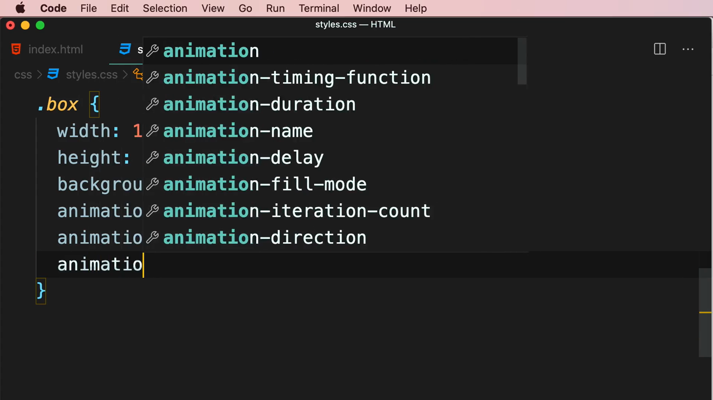

---

## 5. `animation-iteration-count` — จำนวนรอบการเล่น

Mosh เพิ่ม **`animation-iteration-count: infinite;`** เพื่อให้แอนิเมชันเล่นซ้ำไปเรื่อยๆ ไม่มีที่สิ้นสุด (ตัวเลือกอื่นที่ IntelliSense แสดง ได้แก่ `inherit`, `initial`, `unset` หรือใส่ตัวเลขจำนวนรอบที่ต้องการโดยตรง เช่น `3`):

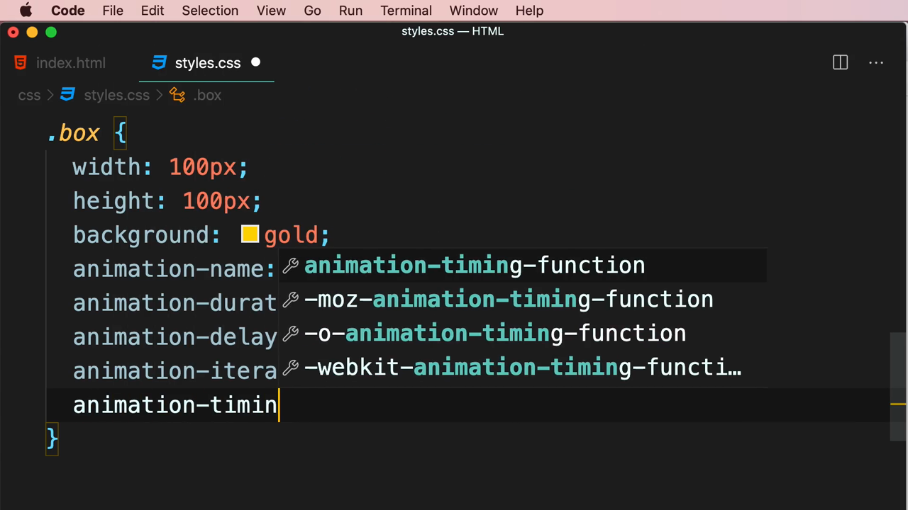

---

## 6. `animation-timing-function` — จังหวะความเร็ว (เหมือนใน Transition)

Mosh พิมพ์ **`animation-timing-function`** โดย VS Code แสดงรายการค่า `cubic-bezier()` สำเร็จรูปจำนวนมากให้เลือก เช่นเดียวกับที่เคยเห็นใน `transition-timing-function`:

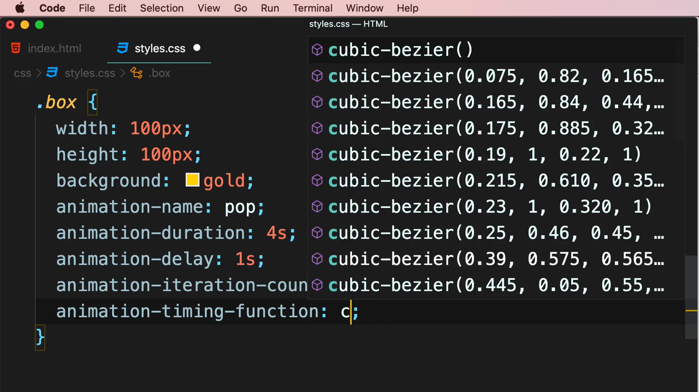

Mosh เลือกใช้คำหลักสำเร็จรูป **`ease-out`**:

```css
animation-timing-function: ease-out;
```

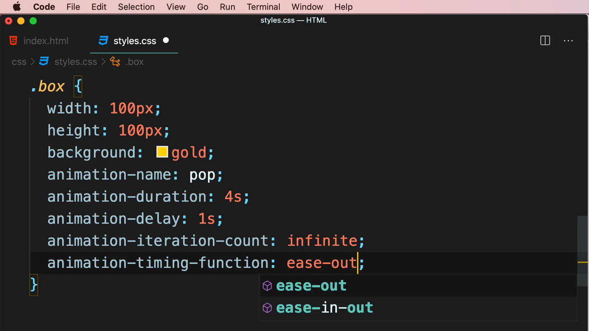

---

## 7. `animation-direction` — ทิศทางการเล่น

Mosh พิมพ์ **`animation-direction`** โดย IntelliSense แสดงตัวเลือก **`alternate`**, **`alternate-reverse`**, **`normal`**, **`reverse`**:

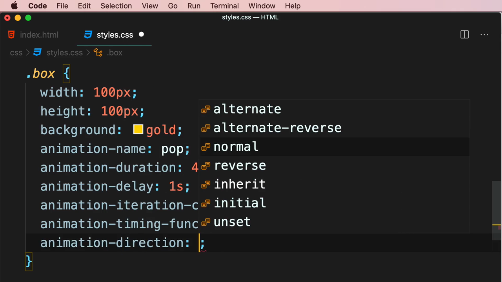

เลือกใช้ **`alternate`** ซึ่งทำให้แอนิเมชันเล่นไปข้างหน้าตามปกติในรอบแรก แล้ว**เล่นย้อนกลับ**ในรอบถัดไป สลับไปมาแบบนี้ตลอด (สังเกตว่ากล่องยังคงหมุนและเปลี่ยนสีตามที่กำหนดใน `@keyframes` แต่ทิศทางของแต่ละรอบจะสลับกัน):

```css
.box {
  animation-name: pop;
  animation-duration: 4s;
  animation-delay: 1s;
  animation-iteration-count: infinite;
  animation-timing-function: ease-out;
  animation-direction: alternate;
}
```

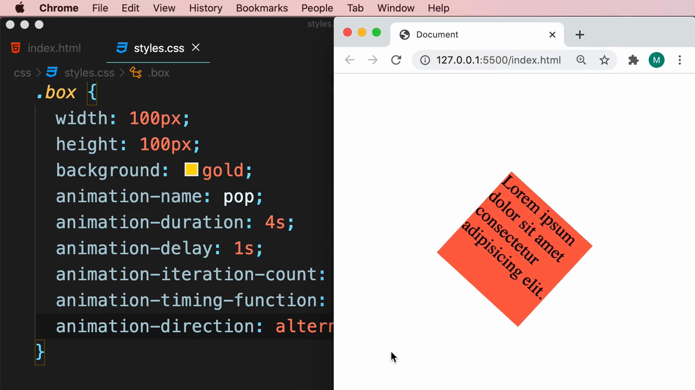

> **ตัวเลือกของ `animation-direction`:**
> - **`normal`** (ค่าเริ่มต้น) — เล่นจาก 0% ไป 100% ทุกรอบเหมือนเดิม
> - **`reverse`** — เล่นจาก 100% ถอยไปหา 0% ทุกรอบ
> - **`alternate`** — สลับทิศทางในแต่ละรอบ (รอบคี่เล่นไปข้างหน้า รอบคู่เล่นย้อนกลับ) ทำให้เกิดเอฟเฟกต์ "ไป-กลับ" ที่ราบรื่นโดยไม่กระตุกเมื่อจบแต่ละรอบ
> - **`alternate-reverse`** — เหมือน `alternate` แต่เริ่มด้วยทิศทางย้อนกลับก่อน

---

## 8. Shorthand — รวมทุก Property ไว้ใน `animation` เดียว

ทิ้งท้ายคลิป Mosh แสดงให้เห็นว่าสามารถรวม property ทั้งหมดของ `animation-*` ไว้ในบรรทัดเดียวโดยใช้ **shorthand property `animation`** VS Code แสดง IntelliSense อธิบายลำดับค่าที่รองรับ (`name duration timing-function delay iteration-count ...`):

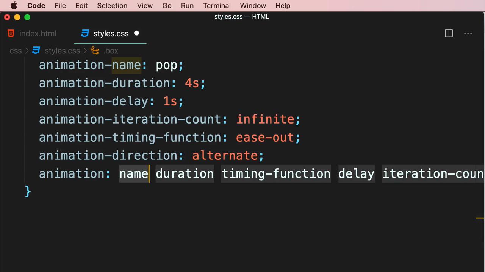

```css
.box {
  animation: pop 4s ease-out;
}
```

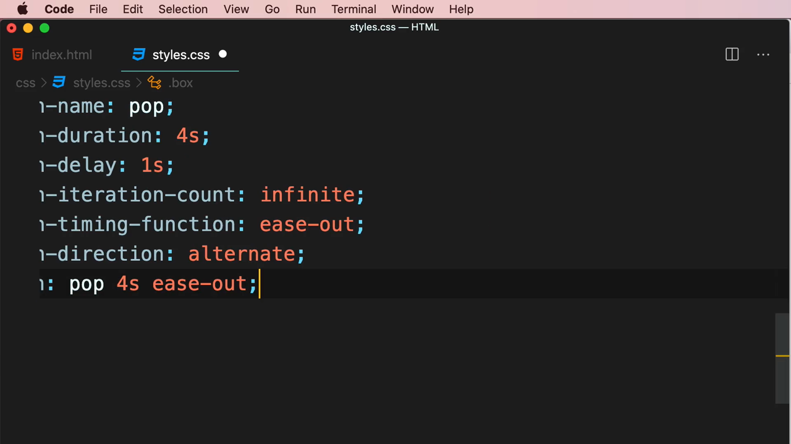

> **`animation`** คือ shorthand property ที่รวม `animation-name`, `animation-duration`, `animation-timing-function`, `animation-delay`, `animation-iteration-count`, `animation-direction`, `animation-fill-mode` และ `animation-play-state` ไว้ในบรรทัดเดียว ช่วยให้โค้ดกระชับขึ้นมาก คล้ายกับที่ `transition` มี shorthand ของตัวเองเช่นกัน

---

## สรุปภาพรวมของคลิปนี้

| ประเด็น | รายละเอียด |
|---|---|
| **หัวข้อ** | Animations |
| **At-rule หลัก** | `@keyframes` |
| **Property ที่สอน** | `animation-name`, `animation-duration`, `animation-delay`, `animation-iteration-count`, `animation-timing-function`, `animation-direction`, และ shorthand `animation` |

**แนวคิดสำคัญที่ได้จากคลิปนี้:**

1. **`@keyframes` ให้ควบคุมแอนิเมชันได้ละเอียดกว่า `transition` มาก** เพราะกำหนดได้หลายขั้นตอน (0%, 25%, 50%, 100% ฯลฯ) ไม่ใช่แค่จุดเริ่มต้นกับจุดสิ้นสุด
2. **`animation` เล่นได้เองโดยอัตโนมัติทันทีที่หน้าเว็บโหลด** ไม่ต้องอาศัย event เช่น `:hover` เหมือน `transition`
3. **`animation-iteration-count: infinite`** ทำให้แอนิเมชันเล่นวนซ้ำไม่มีที่สิ้นสุด เหมาะกับเอฟเฟกต์พื้นหลังหรือไอคอนที่ต้องการความเคลื่อนไหวตลอดเวลา
4. **`animation-direction: alternate`** สร้างเอฟเฟกต์ไป-กลับที่ราบรื่น โดยสลับทิศทางการเล่นในแต่ละรอบ
5. **`animation` shorthand ช่วยให้โค้ดกระชับ** โดยรวม `name`, `duration`, `timing-function`, `delay` และ property อื่นๆ ไว้ในบรรทัดเดียว เหมาะกับการใช้งานจริงเมื่อโค้ดเสถียรแล้ว

---

*หมายเหตุ: คลิปนี้เป็นส่วนหนึ่งของบท "6-Transformations, Transitions, and Animations" จากคอร์ส The Ultimate HTML and CSS Course โดย Mosh Hamedani (codewithmosh.com) — คลิปที่ 5 ของบทนี้*
