# 6-Transformations, Transitions, and Animations: 06 - Reusable Animations (2:19)

**ไฟล์ต้นทาง:** `6-Reusable_Animations.mp4`

▶️ **[เปิดวิดีโอต้นฉบับ](../../../HTML-CSS-2/6-Transformations,%20Transitions,%20and%20Animations/6-Reusable-Animations.mp4)**

---

## ภาพรวมคลิปนี้

คลิปสุดท้ายของบทนี้ Mosh สอนวิธีทำให้แอนิเมชันที่เขียนไว้**นำกลับมาใช้ซ้ำได้ (reusable)** โดยแยก property ของ `animation-*` ออกมาเป็นคลาสของตัวเอง แทนที่จะฝังไว้ในคลาสขององค์ประกอบโดยตรง จากนั้นแนะนำไลบรารีสำเร็จรูปชื่อ **Animate.css** ที่รวบรวมแอนิเมชันสำเร็จรูปหลากหลายแบบไว้ให้เรียกใช้ได้ทันทีโดยไม่ต้องเขียน `@keyframes` เอง

---

## 1. ปัญหา: Animation ผูกติดกับ `.box` โดยตรง

สไลด์ชื่อคลิป **"Reusable Animations"** เปิดคลิป Mosh ทบทวนโค้ดจากคลิปก่อนหน้าที่ property ทั้งหมดของ `animation-*` ถูกเขียนไว้ใน `.box` โดยตรง (รวมถึง shorthand `animation: pop 4s ease-out;`):

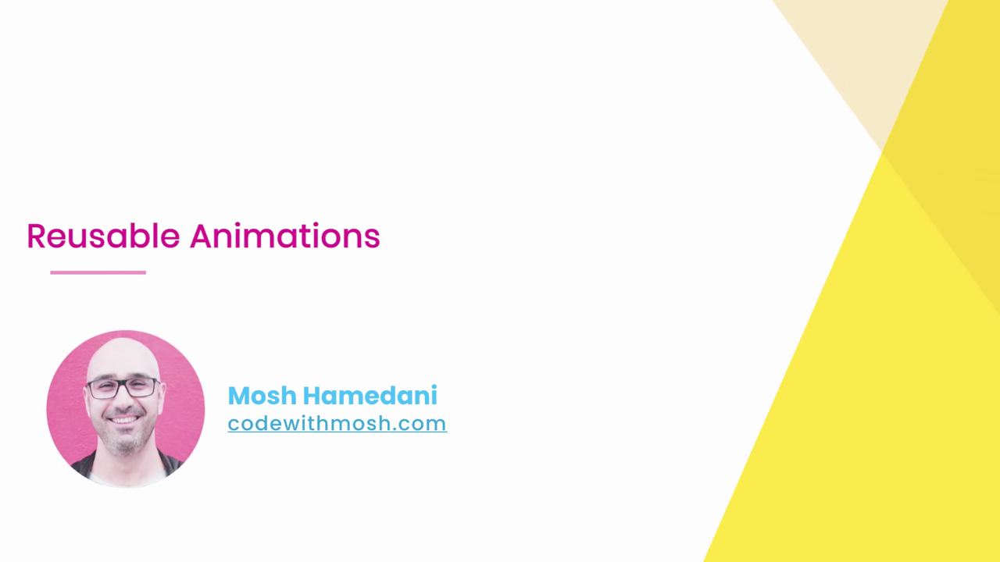

```css
.box {
  width: 100px;
  height: 100px;
  background: gold;
  animation-name: pop;
  animation-duration: 4s;
  animation-delay: 1s;
  animation-iteration-count: infinite;
  animation-timing-function: ease-out;
  animation-direction: alternate;
  animation: pop 4s ease-out;
}
```

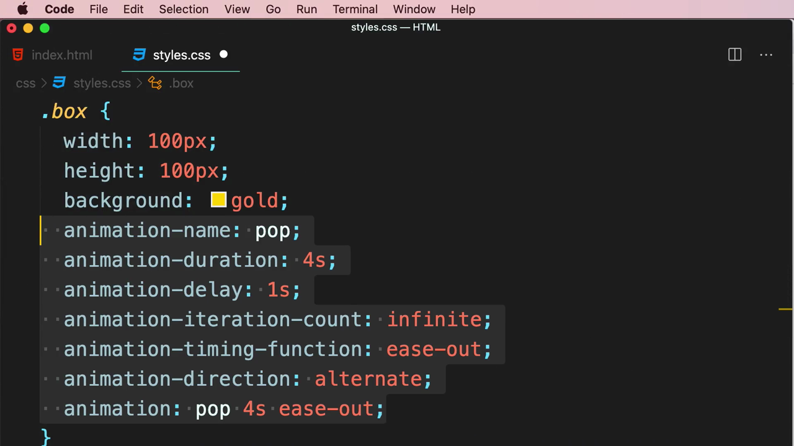

> **ปัญหาของการเขียนแบบนี้:** หาก `.box` เป็นคลาสที่ใช้กำหนดรูปลักษณ์พื้นฐาน (ขนาด สี) ขององค์ประกอบหลายๆ ตัวในเว็บไซต์ แต่ต้องการให้**บางตัว**เท่านั้นที่มีแอนิเมชัน "pop" การฝัง `animation-*` ไว้ใน `.box` โดยตรงจะทำให้**ทุกองค์ประกอบที่ใช้คลาส `.box` เล่นแอนิเมชันเหมือนกันหมด** ไม่สามารถเลือกเปิด-ปิดแอนิเมชันเป็นรายองค์ประกอบได้

---

## 2. แยก Animation ออกเป็นคลาสของตัวเอง

Mosh ลบ property ของ `animation-*` ทั้งหมดออกจาก `.box` ให้เหลือแค่สไตล์พื้นฐาน แล้วสร้างคลาสใหม่ชื่อ **`.animation-pop`**:

```css
.box {
  width: 100px;
  height: 100px;
  background: gold;
}

.animation-pop {

}
```

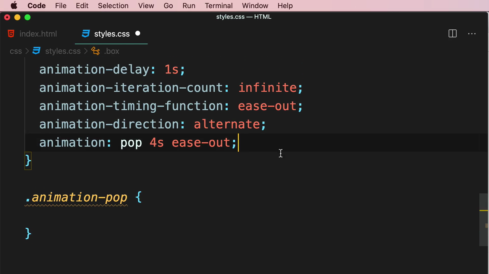

จากนั้นย้าย property ทั้งหมดของ `animation-*` (รวมถึง shorthand) เข้าไปไว้ใน `.animation-pop`:

```css
.animation-pop {
  animation-name: pop;
  animation-duration: 4s;
  animation-delay: 1s;
  animation-iteration-count: infinite;
  animation-timing-function: ease-out;
  animation-direction: alternate;
  animation: pop 4s ease-out;
}
```

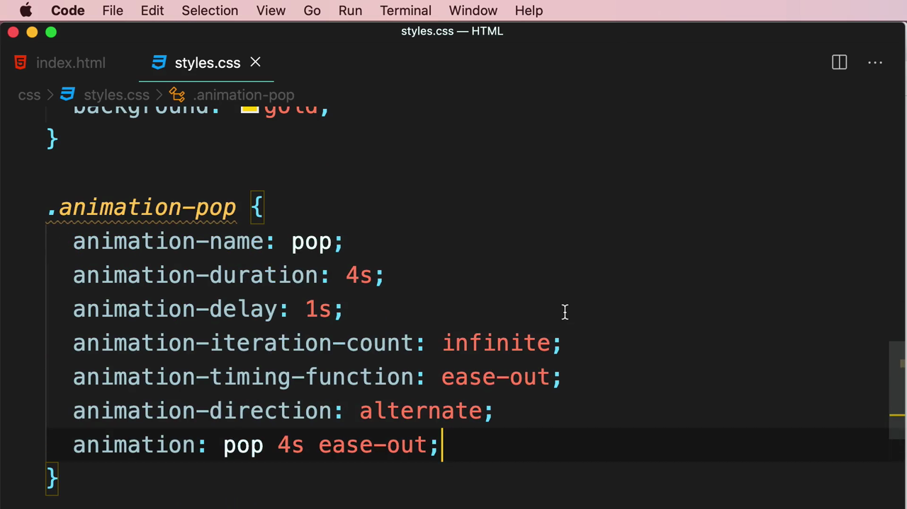

---

## 3. ใช้งานหลายคลาสร่วมกันใน HTML

Mosh กลับไปที่ `index.html` ซึ่งตอนนี้ `<div>` มีเพียงคลาส **`box`** เท่านั้น (ยังไม่มีแอนิเมชัน):

```html
<div class="box">
  Lorem ipsum dolor sit amet consectetur adipisicing elit.
</div>
```

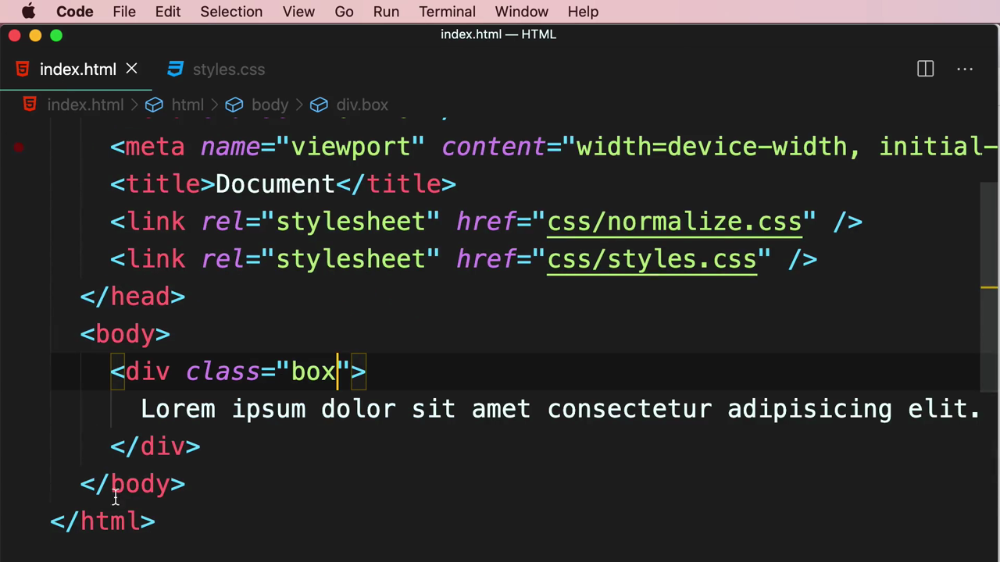

จากนั้นเพิ่มคลาสที่สองเข้าไป โดยคั่นด้วยช่องว่างในแอตทริบิวต์ `class` เดียวกัน:

```html
<div class="box animation-pop">
  Lorem ipsum dolor sit amet consectetur adipisicing elit.
</div>
```

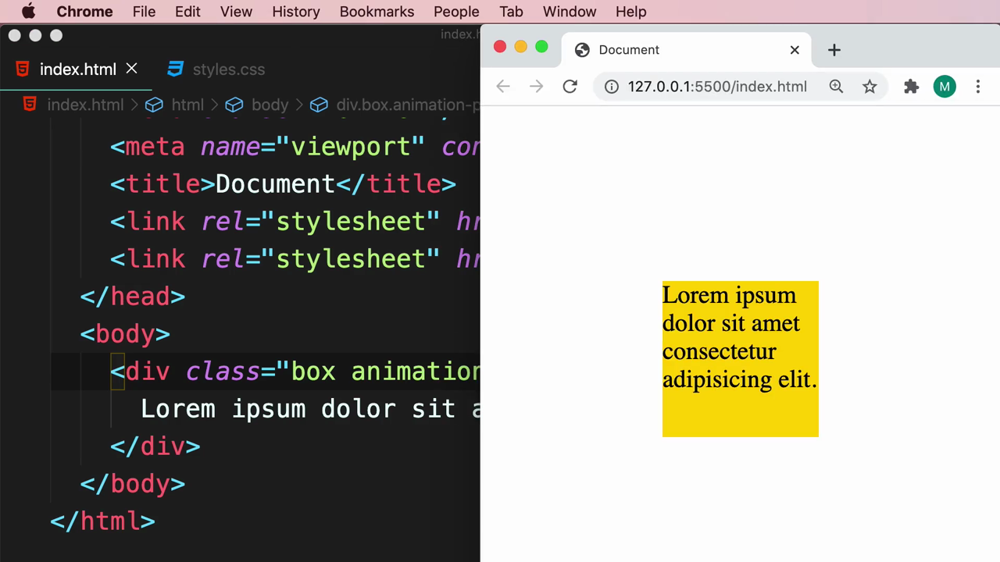

ผลลัพธ์: กล่องเล่นแอนิเมชัน "pop" เหมือนเดิมทุกประการ แต่คราวนี้ **`.animation-pop` เป็นคลาสอิสระที่สามารถนำไปแปะเพิ่มบนองค์ประกอบใดก็ได้** โดยไม่กระทบสไตล์พื้นฐานของ `.box`:

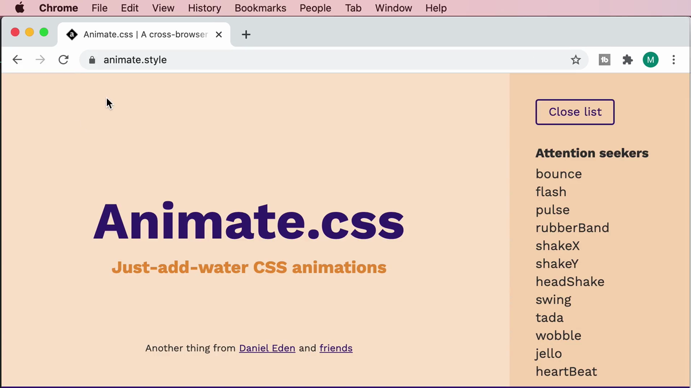

> **หลักการสำคัญ:** การแยก `animation-*` ออกมาเป็นคลาสเฉพาะ (เช่น `.animation-pop`, `.animation-shake`, `.animation-fade`) ทำให้สามารถ**ผสมและจับคู่ (mix and match)** คลาสสไตล์พื้นฐานกับคลาสแอนิเมชันได้อย่างอิสระ องค์ประกอบใดต้องการแอนิเมชันก็เพิ่มคลาสเข้าไป องค์ประกอบใดไม่ต้องการก็ไม่ต้องเพิ่ม โดยไม่ต้องเขียน CSS ซ้ำหรือสร้างคลาสใหม่ทุกครั้ง

---

## 4. Animate.css — ไลบรารีแอนิเมชันสำเร็จรูป

Mosh แนะนำว่าแทนที่จะเขียน `@keyframes` เองทุกครั้ง สามารถใช้ไลบรารีสำเร็จรูปชื่อ **Animate.css** (เว็บไซต์ animate.style) ซึ่งรวบรวมแอนิเมชันสำเร็จรูปไว้เป็นหมวดหมู่ เช่น กลุ่ม **"Attention seekers"**: `bounce`, `flash`, `pulse`, `rubberBand`, `shakeX`, `shakeY`, `headShake`, `swing`, `tada`, `wobble`, `jello`, `heartBeat`:

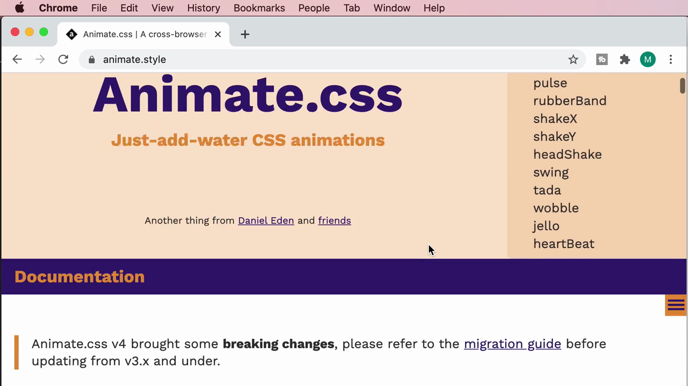

หน้าเว็บแสดงวิธีติดตั้งสามแบบ: **`npm install animate.css --save`**, **`yarn add animate.css`** หรือใช้ **CDN** โดยแปะ `<link>` tag ตรงในหน้าเว็บ:

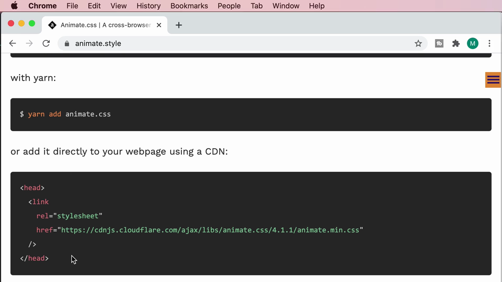

Mosh เลือกวิธี CDN โดยคัดลอกโค้ด `<link>` ที่ชี้ไปยังไฟล์บน cdnjs.cloudflare.com:

```html
<link
  rel="stylesheet"
  href="https://cdnjs.cloudflare.com/ajax/libs/animate.css/4.1.1/animate.min.css"
/>
```

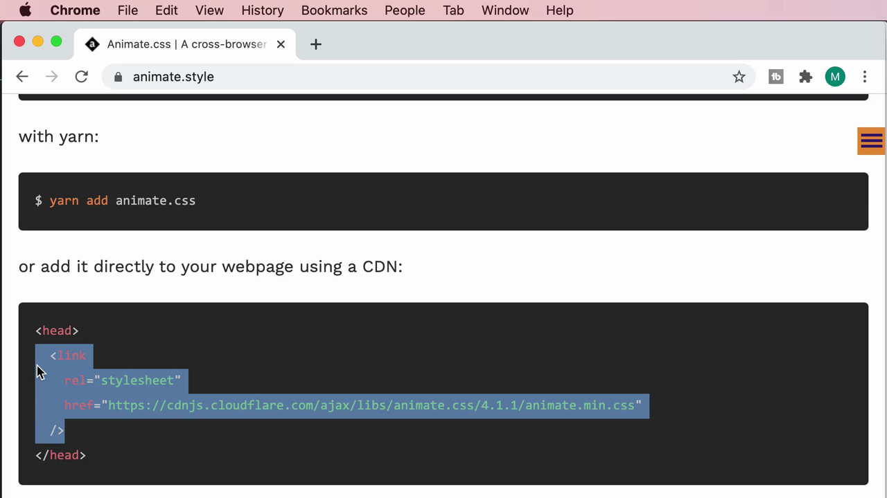

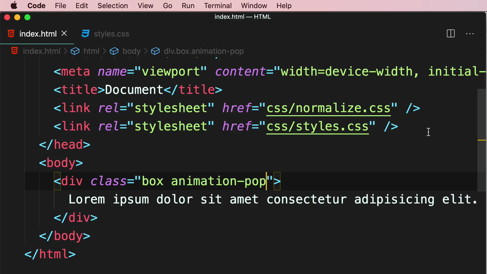

แล้วนำไปวางไว้ใน `<head>` ของ `index.html` ต่อจาก stylesheet เดิม:

```html
<head>
  ...
  <link rel="stylesheet" href="css/styles.css" />
  <link
    rel="stylesheet"
    href="https://cdnjs.cloudflare.com/ajax/libs/animate.css/4.1.1/animate.min.css"
  />
</head>
```

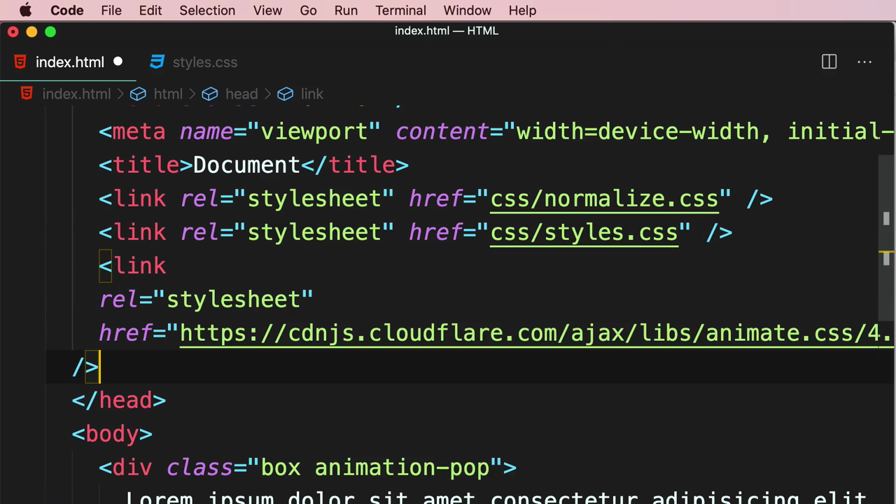

---

## 5. Basic Usage — ใช้คลาสสำเร็จรูปจาก Animate.css

เอกสารของ Animate.css อธิบายวิธีใช้งานพื้นฐาน: เพิ่มคลาส **`animate__animated`** (คลาสหลักที่ต้องมีเสมอ) ร่วมกับคลาสชื่อแอนิเมชันที่ต้องการ โดยต้องมี prefix **`animate__`** นำหน้าเสมอ เช่น `animate__bounce`:

```html
<h1 class="animate__animated animate__bounce">An animated element</h1>
```

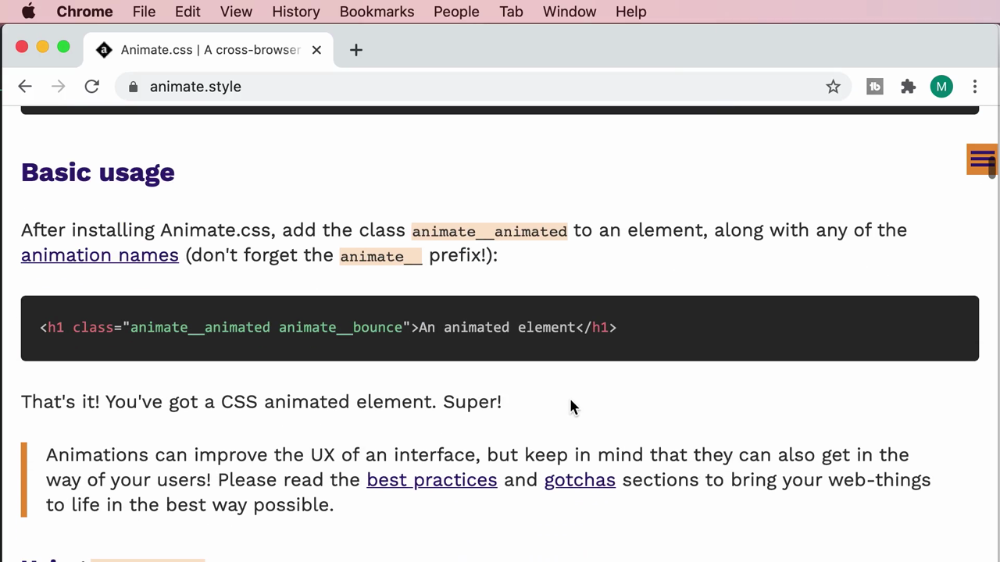

โค้ด HTML ฉบับเต็มหลังเพิ่ม `<link>` ของ Animate.css เข้าไปใน `<head>` เรียบร้อยแล้ว:

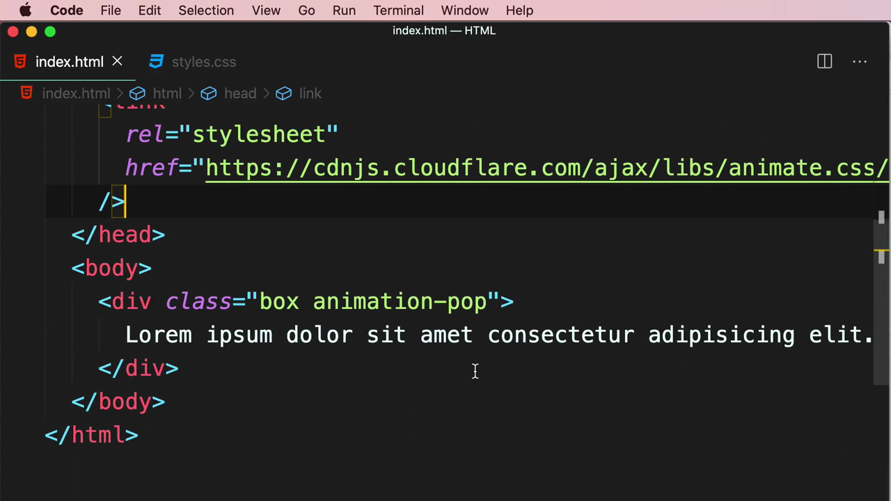

Mosh ทดลองแทนที่คลาส `animation-pop` ของตัวเองด้วยคลาสจาก Animate.css บน `<div>` ของตนเอง:

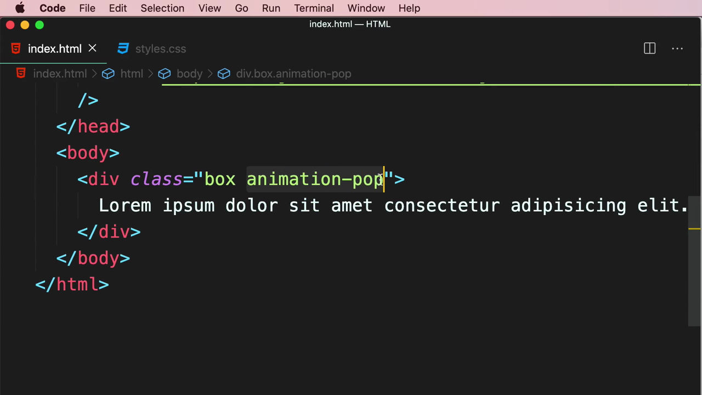

ผลลัพธ์ในเบราว์เซอร์ (ก่อนรีเฟรชเห็นแอนิเมชันใหม่จริง แต่โครงสร้างคลาสพร้อมใช้งานแล้ว):

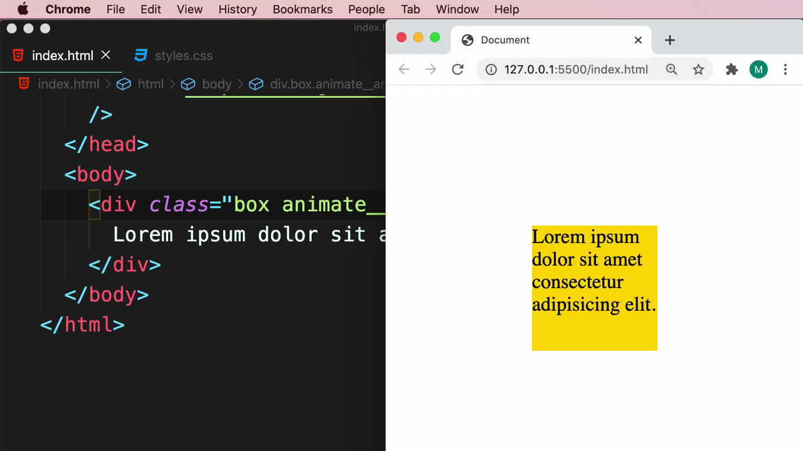

> **ข้อดีของการใช้ไลบรารีอย่าง Animate.css:**
> - ไม่ต้องเขียน `@keyframes` เองตั้งแต่ต้นสำหรับเอฟเฟกต์ทั่วไป (bounce, shake, fade, zoom ฯลฯ) ที่ผ่านการทดสอบและปรับแต่งมาอย่างดีแล้ว
> - ประหยัดเวลาในการพัฒนา โดยเฉพาะสำหรับเอฟเฟกต์ UI มาตรฐาน เช่น การ "สั่น" เพื่อดึงความสนใจ หรือแอนิเมชันตอนโหลดหน้า
> - ยังคงเปิดทางให้เขียน `@keyframes` เองสำหรับกรณีพิเศษที่ไลบรารีไม่มีให้ หรือเมื่อต้องการควบคุมรายละเอียดที่ไลบรารีสำเร็จรูปทำไม่ได้

---

## สรุปภาพรวมของคลิปนี้

| ประเด็น | รายละเอียด |
|---|---|
| **หัวข้อ** | Reusable Animations |
| **แนวคิดหลัก** | แยก `animation-*` ออกเป็นคลาสอิสระ, การผสมหลายคลาสใน HTML |
| **เครื่องมือ/ไลบรารีที่แนะนำ** | Animate.css (animate.style) |
| **คลาสสำคัญของ Animate.css** | `animate__animated` (บังคับ) + `animate__<ชื่อแอนิเมชัน>` |

**แนวคิดสำคัญที่ได้จากคลิปนี้:**

1. **แยก `animation-*` ออกจากคลาสสไตล์พื้นฐานเสมอ** เพื่อให้นำแอนิเมชันไปใช้ซ้ำกับองค์ประกอบอื่นๆ ได้อย่างอิสระ โดยไม่ต้องเขียน CSS ซ้ำหรือผูกติดกับองค์ประกอบใดองค์ประกอบหนึ่ง
2. **HTML รองรับการใส่หลายคลาสในแอตทริบิวต์ `class` เดียวกัน** โดยคั่นด้วยช่องว่าง (เช่น `class="box animation-pop"`) ทำให้ผสมผสานสไตล์และพฤติกรรมต่างๆ เข้าด้วยกันได้อย่างยืดหยุ่น
3. **Animate.css เป็นไลบรารีที่ช่วยประหยัดเวลาอย่างมาก** สำหรับแอนิเมชันมาตรฐานที่พบได้บ่อย (bounce, shake, fade, zoom, flip ฯลฯ) โดยเพียงเพิ่มคลาสสำเร็จรูปสองคลาสก็ใช้งานได้ทันที
4. **การเข้าใจ `@keyframes` และ `animation-*` อย่างลึกซึ้งก่อน แล้วจึงใช้ไลบรารี** ช่วยให้เข้าใจว่าไลบรารีทำงานอย่างไรเบื้องหลัง และสามารถปรับแต่งหรือแก้ปัญหาได้เมื่อไลบรารีไม่ตอบโจทย์ทุกกรณี

---

*หมายเหตุ: คลิปนี้เป็นส่วนหนึ่งของบท "6-Transformations, Transitions, and Animations" จากคอร์ส The Ultimate HTML and CSS Course โดย Mosh Hamedani (codewithmosh.com) — คลิปที่ 6 ของบทนี้ (คลิปสุดท้ายของบท)*
