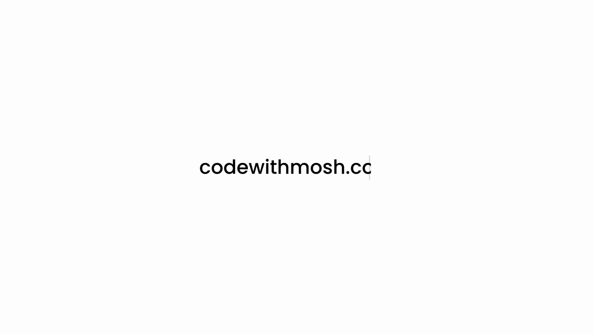
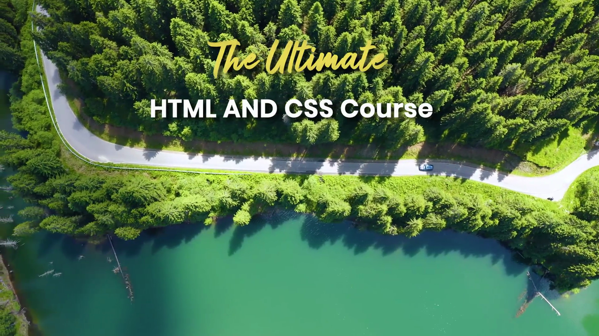
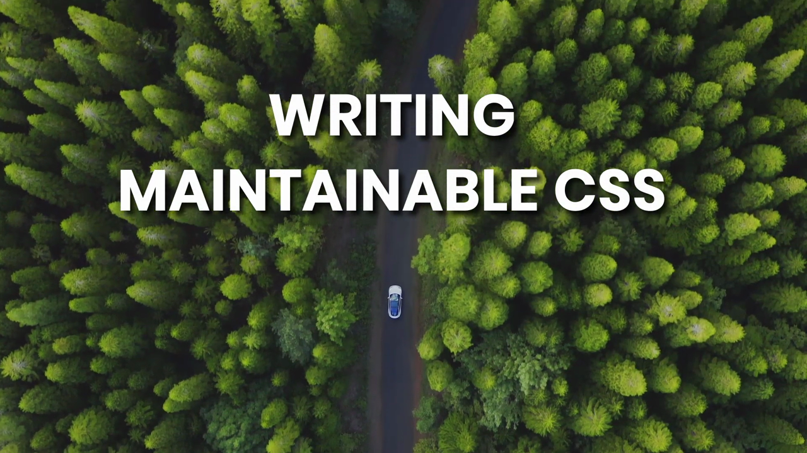
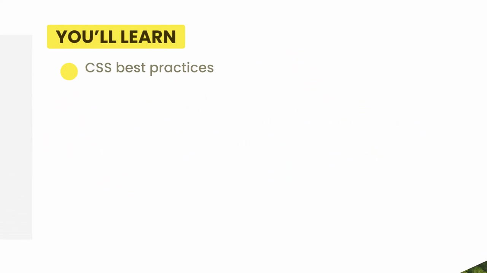
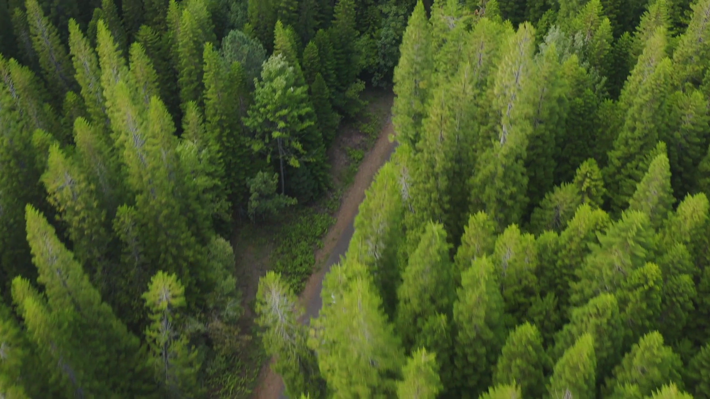

# 7-Writing Clean, Maintainable CSS: 01 - Introduction (0:50)

**ไฟล์ต้นทาง:** `1-_Introduction.mp4`

▶️ **[เปิดวิดีโอต้นฉบับ](../../../HTML-CSS-2/7-Writing%20Clean,%20Maintainable%20CSS/1-_Introduction.mp4)**

---

## ภาพรวมคลิปนี้

คลิปเปิดบทของบทที่ 7 "Writing Clean, Maintainable CSS" เป็นคลิปแนะนำสั้นๆ ตามรูปแบบมาตรฐานของคอร์ส (โลโก้ codewithmosh → footage โดรนบินเหนือป่า/ทะเลสาบ → ชื่อคอร์ส → ชื่อบท → สไลด์ "YOU'LL LEARN" ที่เผยหัวข้อที่จะได้เรียนในบทนี้ → footage โดรนเพิ่มเติม → ปิดท้ายด้วยโลโก้ Mosh Hamedani) ยังไม่มีการสอนเนื้อหา CSS จริงในคลิปนี้ เป็นเพียงการแนะนำหัวข้อของบทเท่านั้น

---

## 1. เปิดคลิป — โลโก้ codewithmosh.com

คลิปเริ่มต้นด้วยแอนิเมชันพิมพ์ตัวอักษรทีละตัวของข้อความ **"codewithmosh.co"** บนพื้นหลังสีขาวล้วน (สไตล์เดียวกับทุกคลิป Introduction ของคอร์สนี้):

---

## 2. ชื่อคอร์ส — The Ultimate HTML AND CSS Course

จากนั้นตัดเข้าสู่ footage โดรนบินสำรวจเหนือถนนคดเคี้ยวกลางป่าสนติดทะเลสาบสีฟ้าเขียว พร้อมข้อความชื่อคอร์สค่อยๆ ปรากฏขึ้นตรงกลางจอ:

> ข้อความประกอบด้วยสองส่วน: **"The Ultimate"** (ฟอนต์สคริปต์สีเหลือง/ทอง ลายมือ) และ **"HTML AND CSS Course"** (ฟอนต์ sans-serif หนาสีขาว) — เป็นรูปแบบชื่อคอร์สที่ใช้ซ้ำในทุกบทของคอร์สนี้

---

## 3. ชื่อบท — Writing Maintainable CSS

ต่อมาชื่อคอร์สจางหายไป แทนที่ด้วยชื่อบทปัจจุบัน **"WRITING MAINTAINABLE CSS"** (ตัวอักษรสีขาวโปร่งแสง ฟอนต์ sans-serif หนา) ซ้อนทับบน footage โดรนอีกมุมหนึ่งที่แสดงถนนป่าสนพร้อมรถยนต์คันหนึ่งกำลังแล่นอยู่กลางถนน:

---

## 4. สไลด์ "YOU'LL LEARN" — หัวข้อที่จะได้เรียนในบทนี้

สไลด์เปลี่ยนเป็นเทมเพลตมาตรฐาน **"YOU'LL LEARN"** (ป้ายรูปยาแคปซูลสีเหลืองด้านบน, พื้นหลังสีเข้ม) พร้อมเผยหัวข้อแรกด้วยเครื่องหมายหัวข้อกลมสีเหลือง:

> หัวข้อที่ปรากฏคือ **"CSS best practices"** ซึ่งสอดคล้องกับคลิปที่ 2 ของบทนี้ (CSS Best Practices) รูปแบบสไลด์นี้เหมือนกับที่ใช้เปิดตัวทุกบทของคอร์ส (เช่น บทที่ 6 ก็มีสไลด์ "YOU'LL LEARN" แบบเดียวกัน) โดยปกติจะทยอยเผยหัวข้อทีละบรรทัดตามลำดับคลิปในบท

---

## 5. Footage โดรนช่วงเปลี่ยนผ่าน (B-roll)

ก่อนตัดเข้าสู่โลโก้ปิดท้าย มีชุด footage โดรนบินเหนือป่าเพิ่มเติมอีกหลายช็อต ทั้งถนนป่าสนกว้างที่มีรถแล่นผ่าน และเส้นทางแคบร่มรื่นใต้ร่มเงาต้นไม้หนาทึบ ไม่มีข้อความซ้อนทับในช่วงนี้ ทำหน้าที่เป็นภาพเปลี่ยนผ่านก่อนจบคลิป:

---

## 6. ปิดท้ายด้วยโลโก้ Mosh Hamedani

คลิปจบด้วยแอนิเมชันโลโก้ **Mosh Hamedani** (ไอคอนรูปสามเหลี่ยมสองอันสีชมพู-ม่วงซ้อนกันคล้ายลูกศร/เพชร ถัดด้วยตัวอักษร "M" สีกรมท่าเข้ม) กำลังเล่นแอนิเมชันเข้าจอบนพื้นหลังสีขาว:

---

## สรุปภาพรวมของคลิปนี้

| ประเด็น | รายละเอียด |
|---|---|
| **หัวข้อ** | Introduction (คลิปเปิดบท) |
| **เนื้อหา CSS** | ไม่มี — เป็นคลิปแนะนำบทเท่านั้น |
| **หัวข้อที่ประกาศใน "YOU'LL LEARN"** | CSS best practices |
| **รูปแบบ** | ตรงกับคลิป Introduction ของทุกบทในคอร์สนี้ |

**แนวคิดสำคัญที่ได้จากคลิปนี้:**

1. **คลิปนี้เป็นบทนำ (intro) ไม่ใช่บทเรียน** — ทำหน้าที่ปูทางและสร้างความคาดหวังก่อนเข้าสู่เนื้อหา CSS จริงในคลิปถัดๆ ไปของบท "Writing Clean, Maintainable CSS"
2. **สไลด์ "YOU'LL LEARN" เผยหัวข้อ "CSS best practices"** เป็นหัวข้อแรก ซึ่งตรงกับชื่อคลิปที่ 2 ของบทนี้ บ่งบอกว่าบทนี้จะเน้นเรื่องแนวทางปฏิบัติที่ดีในการเขียน CSS ให้สะอาดและดูแลรักษาง่าย
3. **โครงสร้างคลิป Introduction ซ้ำรูปแบบเดิมทุกบท** ได้แก่ โลโก้ codewithmosh → ชื่อคอร์ส → ชื่อบท → YOU'LL LEARN → B-roll โดรน → โลโก้ Mosh Hamedani ปิดท้าย ทำให้ผู้เรียนคุ้นเคยกับจังหวะการเริ่มต้นแต่ละบทของคอร์ส

---

*หมายเหตุ: คลิปนี้เป็นส่วนหนึ่งของบท "7-Writing Clean, Maintainable CSS" จากคอร์ส The Ultimate HTML and CSS Course โดย Mosh Hamedani (codewithmosh.com) — คลิปที่ 1 ของบทนี้*
