# 7-Writing Clean, Maintainable CSS: 02 - CSS Best Practices (9:21)

**ไฟล์ต้นทาง:** `2-CSS_Best_Practices.mp4`

▶️ **[เปิดวิดีโอต้นฉบับ](../../../HTML-CSS-2/7-Writing%20Clean,%20Maintainable%20CSS/2-CSS_Best_Practices.mp4)**

---

## ภาพรวมคลิปนี้

คลิปนี้เป็นคลิปที่ยาวที่สุดในบท (ราว 9 นาที 21 วินาที) Mosh สอนแนวทางปฏิบัติที่ดี (Best Practices) 5 ข้อสำหรับการเขียน CSS ให้สะอาดและดูแลรักษาง่าย ได้แก่ (1) ตั้งชื่อ class ตามหลัก naming convention ที่สม่ำเสมอ (2) จัดกลุ่ม/แบ่งส่วน logical sections ในสไตล์ชีต (3) หลีกเลี่ยง selector ที่จำเพาะเจาะจงเกินไป (over-specific selectors) (4) จัดเรียง (sort) CSS properties ให้อ่านง่าย และ (5) ใช้ประโยชน์จาก **style inheritance** เพื่อลดโค้ดที่ซ้ำซ้อน โดยสรุปด้วยหลักการ **DRY (Don't Repeat Yourself)** ปิดท้ายคลิป

---

## 1. เปิดคลิปด้วยสไลด์ชื่อเรื่อง

สไลด์ชื่อคลิป **"CSS Best Practices"** พร้อมรูปโปรไฟล์และชื่อผู้สอน Mosh Hamedani:


จากนั้นสไลด์เปลี่ยนเป็นหัวข้อป้ายเหลือง **"BEST PRACTICES"** เปล่าๆ (ยังไม่มีบูลเลตข้อไหนปรากฏ) พร้อมภาพสต็อกประกอบ (ภาพนักพัฒนาชายและหญิงกำลังใช้แล็ปท็อป) เป็นการเกริ่นนำหัวข้อ:


> ระหว่างการเกริ่นนำยังมีภาพสต็อกกอง "เสื้อผ้าและของใช้ที่ไม่เป็นระเบียบ" ปรากฏสั้นๆ ซึ่งเป็นภาพเปรียบเทียบ (metaphor) สื่อถึงโค้ด CSS ที่ไม่มีระเบียบ/ไม่มีการจัดหมวดหมู่ ก่อนจะเข้าสู่เนื้อหาบูลเลตแรก

---

## 2. Best Practice #1 — Follow a Naming Convention (ตั้งชื่อ Class ตามหลักการที่แน่นอน)

Mosh สลับไปที่ VS Code เปิดไฟล์ `styles.css` ที่ว่างเปล่า เตรียมสาธิต:

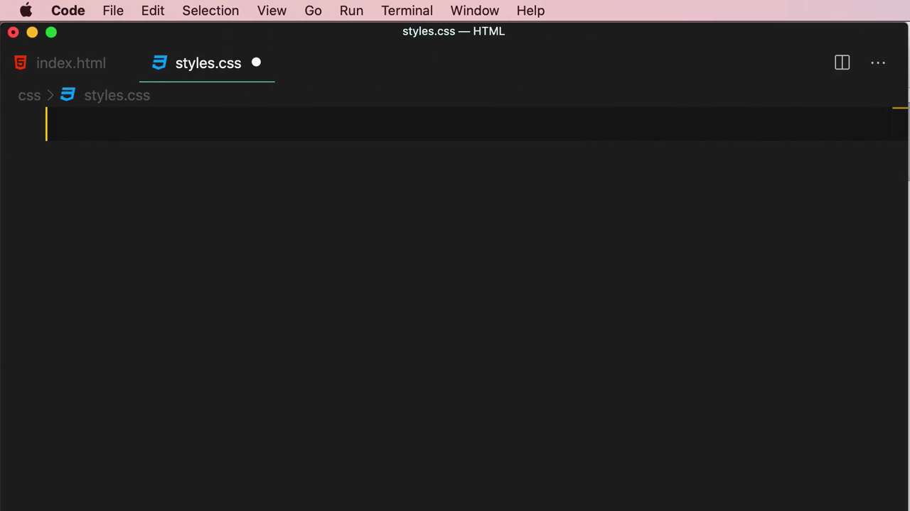

สไลด์กลับมาเผยบูลเลตแรก **"Follow a naming convention"**:

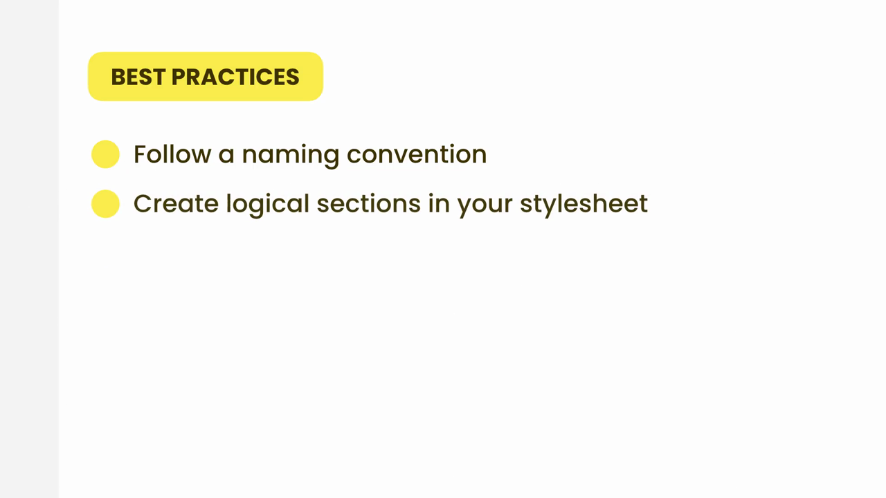

> **หลักการ:** ควรเลือก **รูปแบบการตั้งชื่อ class** ที่แน่นอนรูปแบบหนึ่ง (เช่น `kebab-case` อย่าง `nav-item`, หรือ BEM ที่จะพูดถึงในคลิปหลังของบทนี้) แล้วใช้ให้สม่ำเสมอตลอดทั้งโปรเจกต์ เพื่อให้ทีมและตัวเราเองในอนาคตเข้าใจโครงสร้างของ class ได้ง่ายขึ้น ไม่สับสนระหว่างรูปแบบต่างๆ ปนกัน

Mosh สลับไปที่ `index.html` ที่มี `<body>` ว่างเปล่า แล้วเริ่มพิมพ์โครงสร้าง HTML ตัวอย่างสำหรับสาธิต:

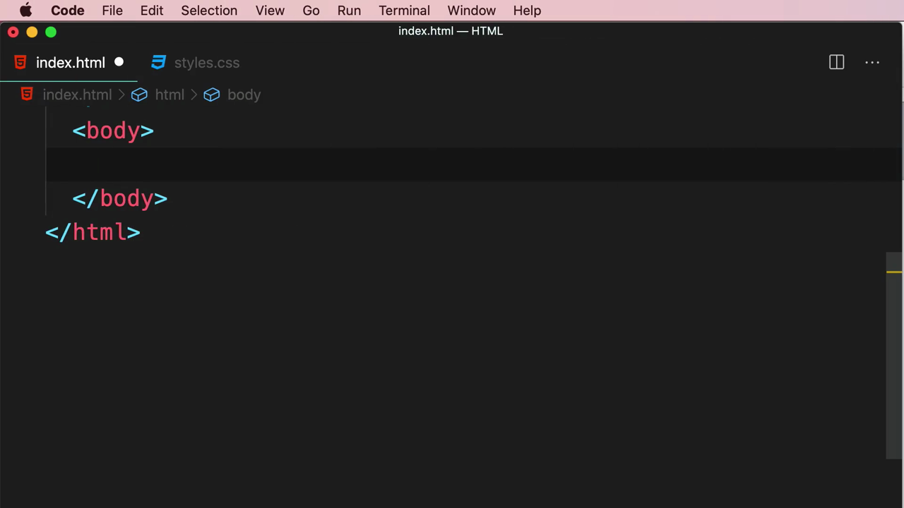

ใช้ **Emmet abbreviation** เพื่อสร้างโครงสร้าง navigation อย่างรวดเร็ว ได้ผลลัพธ์เป็น:

```html
<body>
  <div class="nav">
    <ul class="items">
      <li>Link 1</li>
      <li>Link 2</li>
      <li>Link 3</li>
    </ul>
  </div>
</body>
```

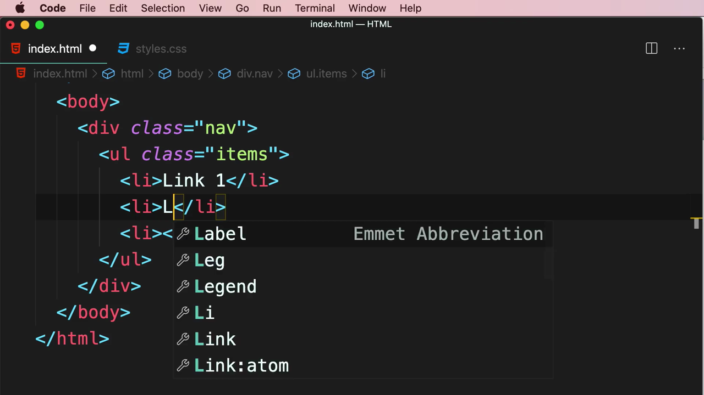

> ระหว่างพิมพ์ IntelliSense/Emmet แสดงตัวเลือกอัตโนมัติ เช่น `Label`, `Leg`, `Legend`, `Li`, `Link`, `Link:atom` ฯลฯ ให้เลือกเติมแท็กได้รวดเร็วโดยไม่ต้องพิมพ์เต็ม

---

## 3. Best Practice #2 — Create Logical Sections in Your Stylesheet

สไลด์เผยบูลเลตที่สอง **"Create logical sections in your stylesheet"** (ไม่มีภาพสาธิตแยกโดยเฉพาะ แต่หลักการนี้หมายถึงการแบ่งสไตล์ชีตเป็นส่วนๆ ตามลอจิก เช่น ส่วน Layout, ส่วน Navigation, ส่วน Buttons ฯลฯ โดยอาจใช้คอมเมนต์คั่นแต่ละส่วน เพื่อให้ค้นหาและแก้ไขโค้ดได้ง่ายขึ้นเมื่อไฟล์มีขนาดใหญ่)

---

## 4. Best Practice #3 — Avoid Over-Specific Selectors (หลีกเลี่ยง Selector ที่จำเพาะเกินไป)

สไลด์เผยบูลเลตที่สาม **"Avoid over-specific selectors"**:

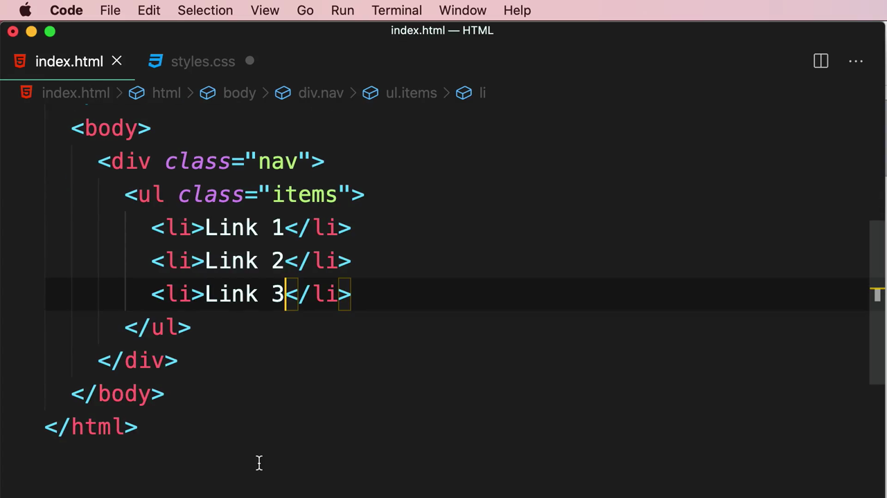

Mosh สาธิตด้วยการเขียน selector แบบลูกโซ่ (chained descendant selector) ที่จำเพาะเจาะจงมากในไฟล์ `styles.css`:

```css
div.nav > ul.items > li {
}
```

โดย VS Code (ผ่านส่วนขยาย CSS specificity/lint) แสดง tooltip แจ้งค่าความจำเพาะของ selector และคำเตือนเรื่อง ruleset ว่างเปล่า:

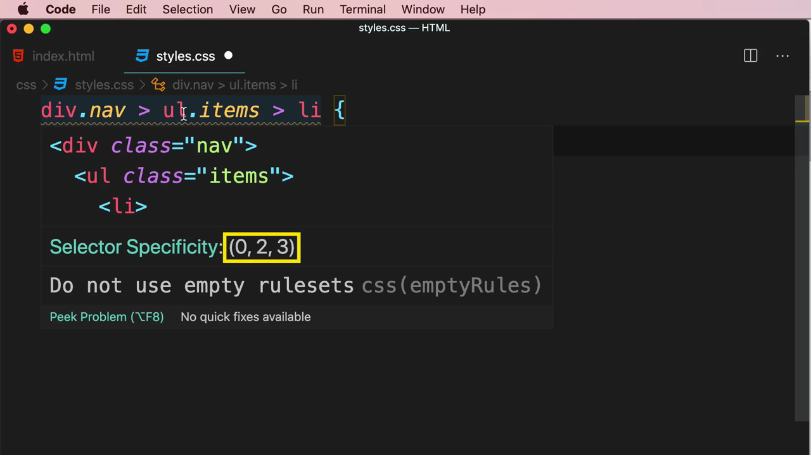

> **Selector Specificity: (0, 2, 3)** — ตัวเลขนี้คือค่าความจำเพาะ (specificity) ของ selector `div.nav > ul.items > li` โดยตีความเป็นสามหมวด (ID, Class/Attribute/Pseudo-class, Type/Element) ยิ่งตัวเลขสูง ยิ่งจำเพาะมาก และยิ่งยากที่จะ override ด้วย selector อื่นในภายหลัง นอกจากนี้ VS Code ยังเตือน **"Do not use empty rulesets css(emptyRules)"** เพราะยังไม่ได้ใส่ property ใดๆ ในบล็อกนี้

Mosh อธิบายว่า selector ที่จำเพาะเกินไปแบบนี้เป็นปัญหา เพราะ:
1. อ่านยากและยาวเกินความจำเป็น
2. ผูกติดกับโครงสร้าง HTML มากเกินไป (ถ้าเปลี่ยนโครงสร้าง HTML ภายหลัง CSS จะพังทันที)
3. มีค่า specificity สูง ทำให้การ override สไตล์ในภายหลังทำได้ยากขึ้น

### แนวทางแก้ไข — เปลี่ยนไปใช้ Semantic Element และ Class เดี่ยว

Mosh แก้ไข HTML โดยเปลี่ยน `<div class="nav">` เป็นแท็กความหมายเชิงความหมาย (semantic tag) **`<nav class="nav">`**:

```html
<body>
  <nav class="nav">
    <ul class="items">
      <li>Link 1</li>
      <li>Link 2</li>
      <li>Link 3</li>
    </ul>
  </nav>
</body>
```

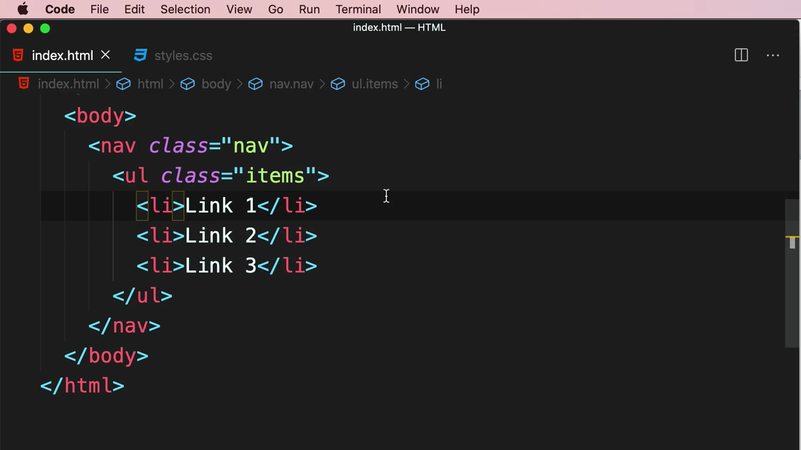

> **`<nav>`** เป็นหนึ่งใน HTML5 semantic elements ที่สื่อความหมายว่าเนื้อหาภายในเป็นส่วน navigation ของหน้าเว็บ ช่วยให้ทั้งนักพัฒนาและเทคโนโลยีช่วยเหลือ (เช่น screen reader) เข้าใจโครงสร้างหน้าเว็บได้ดีขึ้น โดยไม่จำเป็นต้องพึ่งพา class ที่จำเพาะเจาะจงมากในการเลือก element

### ทดลอง Override ด้วยคลาสเดี่ยว `.item` แล้วเจอปัญหา Specificity

Mosh ทดลองเพิ่มสไตล์ `.item { background: yellow; }` แล้วรันดูผลลัพธ์ในเบราว์เซอร์ พบว่าพื้นหลังของลิงก์ทั้งสามกลายเป็นสีเหลือง:

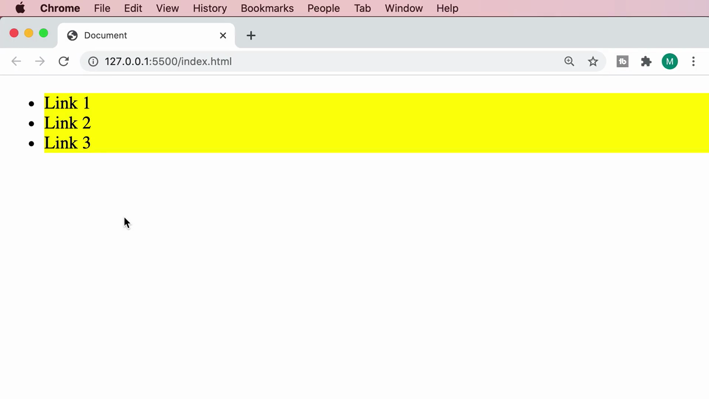

จากนั้นต้องการยกเลิกพื้นหลังสีเหลืองเฉพาะเมื่ออยู่ภายใน `.nav` จึงเพิ่ม selector ที่จำเพาะกว่าเข้าไปแข่งขัน:

```css
.item {
  background: yellow;
}

.nav .item {
  background: none;
}
```

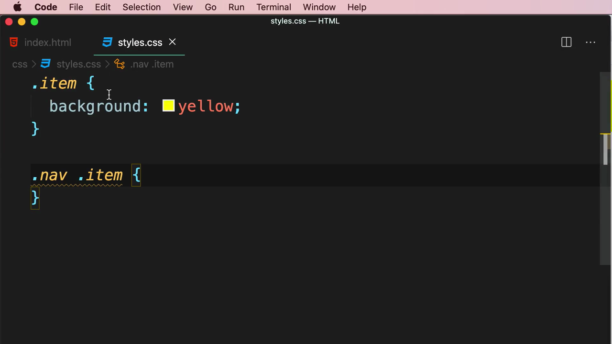

> Mosh ใช้ตัวอย่างนี้เพื่อชี้ให้เห็นว่าการไล่เพิ่ม selector ให้จำเพาะขึ้นเรื่อยๆ เพื่อ "เอาชนะ" กฎเดิม เป็นแนวทางที่ไม่ยั่งยืน เพราะยิ่งเพิ่มความจำเพาะ ก็ยิ่งต้องเพิ่มความจำเพาะของ selector ถัดไปให้มากกว่าเดิมเรื่อยๆ ในอนาคตหากต้องการ override อีกครั้ง

Mosh ยังสาธิตการใช้ **`!important`** เป็นทางลัด (ซึ่งเป็นแนวทางที่ไม่แนะนำ) เพื่อบังคับให้กฎมีผลเหนือกฎอื่นทั้งหมด:

```css
.item {
  background: yellow !important;
}

.nav .nav-item {
  background: none !important;
}
```

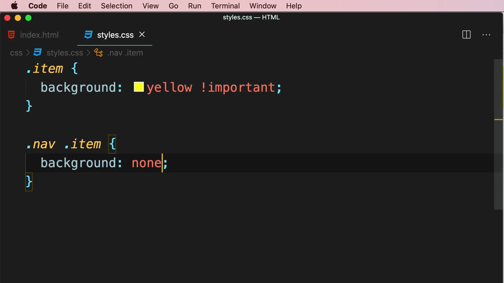

> **`!important`** คือคำสั่งพิเศษที่ทำให้ property นั้น "ชนะ" การแข่งขัน specificity ทั้งหมด ไม่ว่ากฎอื่นจะจำเพาะแค่ไหนก็ตาม Mosh เตือนว่า **ควรหลีกเลี่ยงการใช้ `!important`** เพราะเมื่อใช้แล้ว การจะ override อีกครั้งในอนาคตจะยิ่งยากขึ้นไปอีก (ต้องใช้ `!important` ซ้อนกันไปเรื่อยๆ) ทำให้โค้ดดูแลรักษายากขึ้นในระยะยาว

ในภาพนี้ยังสังเกตได้ว่า selector ที่พิมพ์คือ `.nav .nav-item` แต่ HTML ใช้ class `item` ไม่ใช่ `nav-item` — เป็นตัวอย่างข้อผิดพลาดจากการตั้งชื่อ class ที่ไม่สอดคล้องกัน (breadcrumb ด้านบนของ VS Code ยืนยันเส้นทาง `.nav .nav-item` ที่ไม่ตรงกับ HTML จริง):

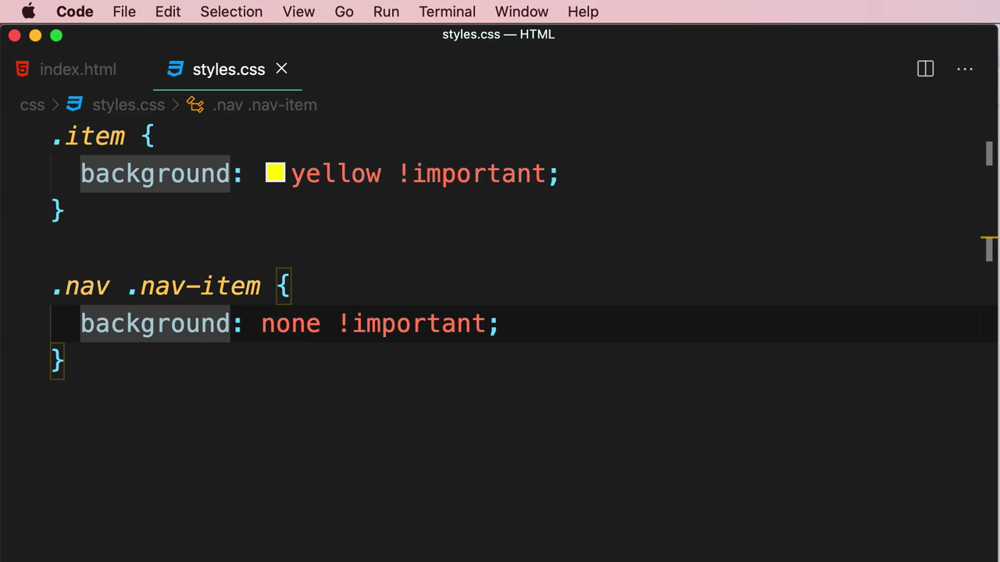

หลังจากแก้ไขให้ class ใน HTML และ CSS ตรงกัน (เปลี่ยนมาใช้ class ที่มีความหมายเจาะจงกับ navigation โดยตรง แทนที่จะใช้ชื่อกลางๆ อย่าง `.item` ที่อาจชนกับ class อื่นในหน้าเว็บ) ผลลัพธ์ในเบราว์เซอร์แสดงว่าพื้นหลังสีเหลืองหายไปแล้วโดยไม่ต้องพึ่งพา `!important`:

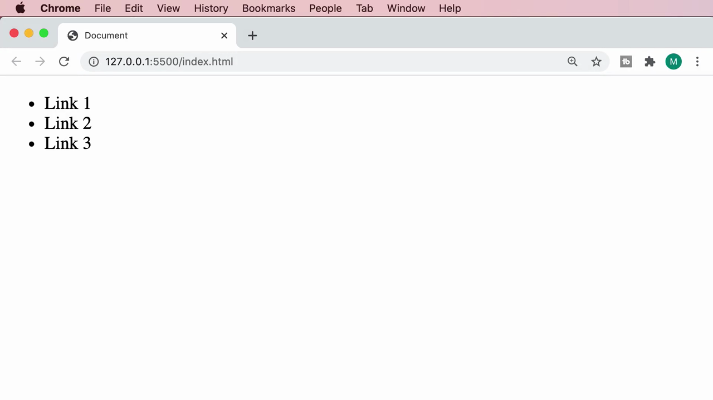

> **บทเรียนสำคัญของหัวข้อนี้:** ทางออกที่ยั่งยืนกว่าการไล่เพิ่มความจำเพาะหรือใช้ `!important` คือการตั้งชื่อ class ให้มีความหมายเจาะจงกับบริบทตั้งแต่แรก (เช่น `nav-item` แทน `item` ที่เป็นชื่อกลางเกินไปและอาจชนกับ class อื่น) ทำให้ selector สั้น อ่านง่าย และมี specificity ต่ำพอที่จะ override ได้ง่ายในอนาคตโดยไม่ต้องพึ่งเทคนิคหลบเลี่ยงต่างๆ

---

## 5. Best Practice #4 — Sort CSS Properties (จัดเรียง Properties ให้อ่านง่าย)

สไลด์เผยบูลเลตที่สี่ **"Sort CSS properties"**:

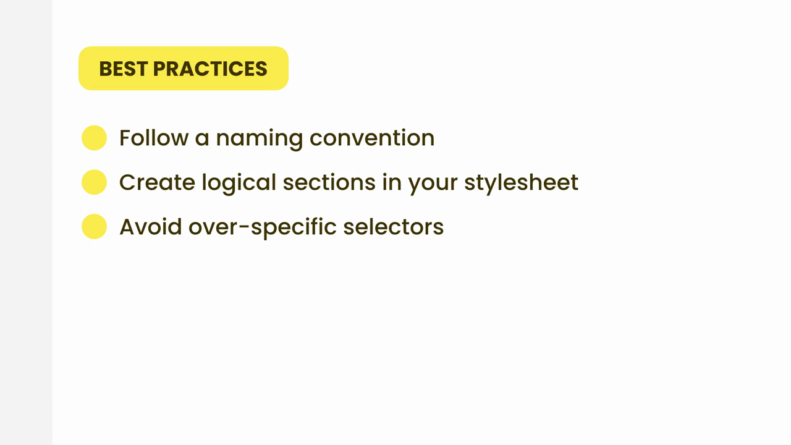

Mosh สาธิตด้วยการเขียน rule `.nav-item` ที่มี properties เรียงแบบสุ่ม ไม่เป็นระบบ:

```css
.nav-item {
  color: tomato;
  width: 100%;
  background: #fff;
  font-weight: bold;
}
```

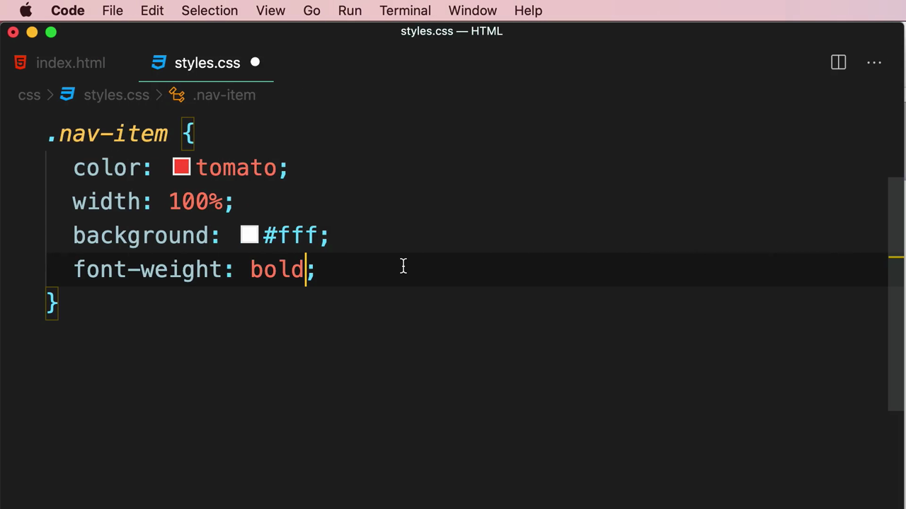

> **หลักการ:** ควรจัดเรียงลำดับ properties ภายใน rule เดียวกันให้เป็นระบบสม่ำเสมอ เช่น เรียงตามตัวอักษร (alphabetical order) หรือจัดกลุ่มตามประเภท (เช่น positioning ก่อน แล้วตามด้วย box model, typography, และ visual/decoration) เพื่อให้ทุกคนในทีมคาดเดาตำแหน่งของ property ที่ต้องการหาได้ง่ายขึ้น และลดโอกาสเขียน property ซ้ำโดยไม่รู้ตัว หลายบรรณาธิการโค้ด (เช่น VS Code ผ่านส่วนขยาย CSS sorter) มีเครื่องมือช่วยจัดเรียงอัตโนมัติได้เช่นกัน

---

## 6. Best Practice #5 — Take Advantage of Style Inheritance (ใช้ประโยชน์จากการสืบทอดสไตล์)

สไลด์เผยบูลเลตที่ห้า (บูลเลตสุดท้าย) **"Take advantage of style inheritance"**:

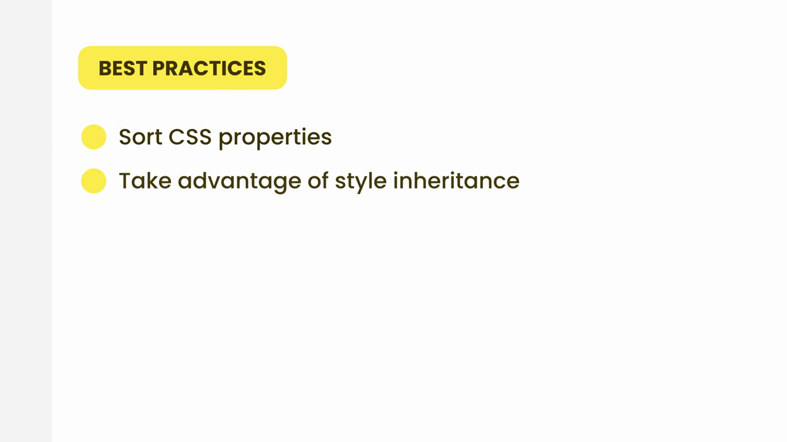

Mosh ปรับ HTML ให้มีลิงก์แบรนด์เพิ่มเข้ามา (`My Website`) นอกเหนือจาก `Link 1-3` แล้วเขียน CSS กำหนด `font-family` ให้กับ `.nav-item`:

```css
.nav-item {
  font-family: -apple-system, BlinkMacSystemFont, "Segoe UI", Roboto, Ubuntu,
    Cantarell, "Open Sans", "Helvetica Neue", sans-serif;
}
```

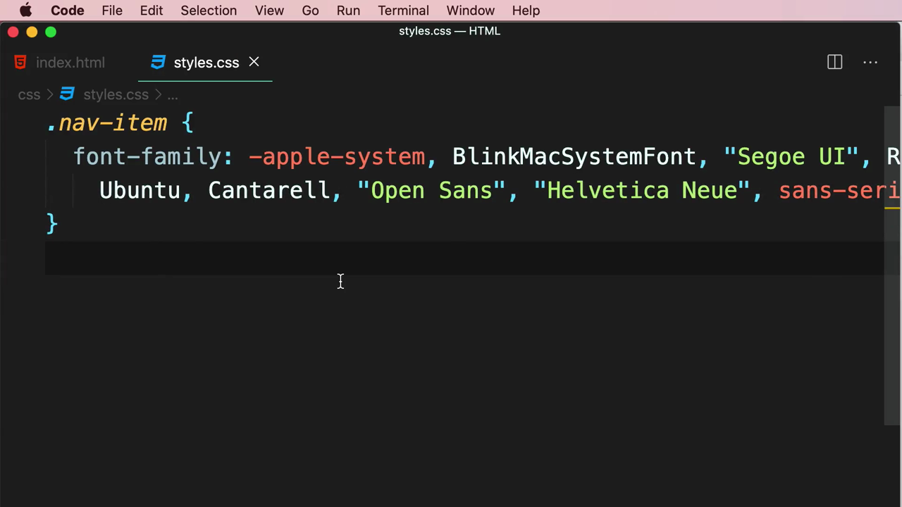

จากนั้นต้องการให้ลิงก์แบรนด์ (`.nav-brand`) ใช้ฟอนต์แบบเดียวกัน จึงคัดลอกค่า `font-family` เดิมมาใส่ซ้ำในกฎใหม่:

```css
.nav-item {
  font-family: -apple-system, BlinkMacSystemFont, "Segoe UI", Roboto, Ubuntu,
    Cantarell, "Open Sans", "Helvetica Neue", sans-serif;
}

.nav-brand {
  font-family: -apple-system, BlinkMacSystemFont, "Segoe UI", Roboto, Ubuntu,
    Cantarell, "Open Sans", "Helvetica Neue", sans-serif;
}
```

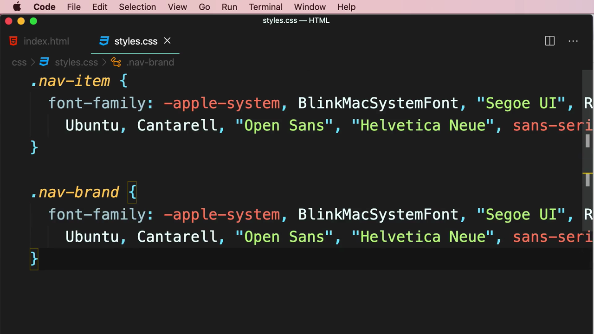

> Mosh ชี้ให้เห็นว่านี่คือการเขียนโค้ดซ้ำซ้อน (**duplicate code**) โดยไม่จำเป็น เพราะทั้งสอง selector (`.nav-item` และ `.nav-brand`) ต่างก็เป็นลูกหลานของ `.nav` เหมือนกัน

### แก้ไขด้วยการย้าย Property ขึ้นไปที่ Parent Selector

Mosh ลบ `font-family` ออกจากทั้ง `.nav-item` และ `.nav-brand` แล้วย้ายไปกำหนดไว้ที่ selector แม่ `.nav` แทนเพียงครั้งเดียว:

```css
.nav {
  font-family: -apple-system, BlinkMacSystemFont, "Segoe UI", Roboto, Ubuntu,
    Cantarell, "Open Sans", "Helvetica Neue", sans-serif;
}
```

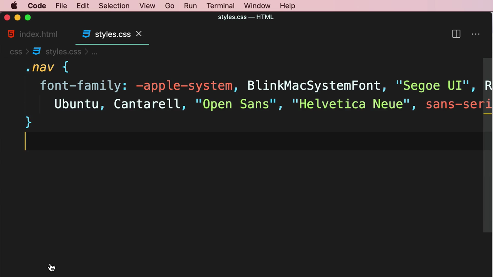

รันผลลัพธ์ในเบราว์เซอร์ พบว่าทั้งลิงก์ "My Website" (แบรนด์) และลิงก์เมนู "Link 1-3" ยังคงแสดงผลด้วยฟอนต์เดียวกันตามที่ตั้งใจ แม้จะลบ `font-family` ออกจาก selector ลูกทั้งสองแล้ว:

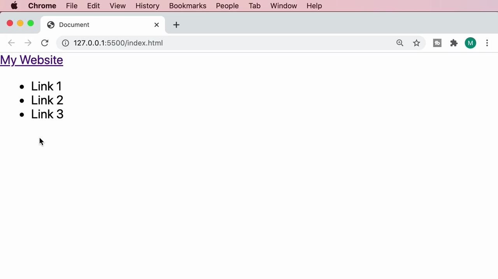

> **หลักการ Style Inheritance:** ค่า CSS บาง property (โดยเฉพาะกลุ่มที่เกี่ยวกับ typography เช่น `font-family`, `color`, `font-size`, `line-height`) จะ **สืบทอด (inherit)** จาก element แม่ไปยัง element ลูกโดยอัตโนมัติ หากไม่ได้ถูกกำหนดค่าทับไว้ที่ลูกเอง ดังนั้นแทนที่จะกำหนดค่าเดิมซ้ำๆ ในทุก selector ลูก ควรกำหนดไว้ที่ selector แม่เพียงจุดเดียว แล้วปล่อยให้ลูกสืบทอดค่ามาโดยอัตโนมัติ ช่วยลดปริมาณโค้ดและจุดที่ต้องแก้ไขเมื่อจำเป็นต้องเปลี่ยนแปลงในอนาคต — property กลุ่ม layout อย่าง `width`, `height`, `margin`, `padding`, `border` **ไม่ถูกสืบทอด** จึงยังต้องกำหนดแยกในแต่ละ selector ตามปกติ

---

## 7. ปิดท้ายด้วยหลักการ DRY (Don't Repeat Yourself)

คลิปปิดท้ายด้วยสไลด์แสดงคำว่า **"DRY"** บนพื้นหลังสีฟ้าสด สรุปหลักการรวบยอดของทุกข้อที่สอนมาในคลิปนี้:

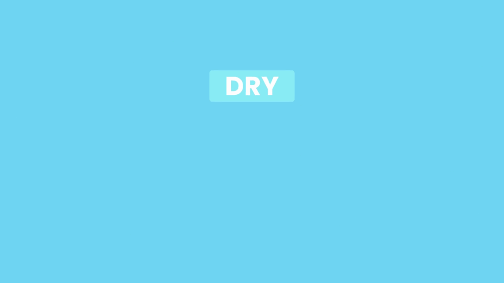

> **DRY (Don't Repeat Yourself)** เป็นหลักการเขียนโค้ดพื้นฐานที่ใช้ได้กับทุกภาษาโปรแกรมมิ่ง ไม่ใช่แค่ CSS — หมายถึงการหลีกเลี่ยงการเขียนโค้ดหรือข้อมูลชุดเดียวกันซ้ำซ้อนในหลายที่ หากมี logic หรือค่าใดที่ต้องใช้ซ้ำ ควรรวมไว้ที่จุดเดียวแล้วอ้างอิงกลับมาใช้ (เช่นในคลิปนี้คือการใช้ style inheritance และการเลือก selector ที่เหมาะสม) เพื่อให้เมื่อต้องแก้ไขในอนาคต แก้เพียงจุดเดียวก็เพียงพอ

---

## สรุปภาพรวมของคลิปนี้

| ประเด็น | รายละเอียด |
|---|---|
| **หัวข้อ** | CSS Best Practices |
| **Best Practice #1** | Follow a naming convention |
| **Best Practice #2** | Create logical sections in your stylesheet |
| **Best Practice #3** | Avoid over-specific selectors |
| **Best Practice #4** | Sort CSS properties |
| **Best Practice #5** | Take advantage of style inheritance |
| **หลักการสรุป** | DRY (Don't Repeat Yourself) |
| **เครื่องมือ/แนวคิดที่กล่าวถึง** | Selector Specificity, `!important`, HTML5 semantic elements (`<nav>`), Style Inheritance |

**แนวคิดสำคัญที่ได้จากคลิปนี้:**

1. **ตั้งชื่อ class ให้สม่ำเสมอตามรูปแบบเดียว** ตลอดทั้งโปรเจกต์ เพื่อให้อ่านและเข้าใจง่าย
2. **แบ่งสไตล์ชีตเป็นส่วนๆ ตามลอจิก** (logical sections) เพื่อให้ค้นหาและแก้ไขโค้ดได้รวดเร็วเมื่อไฟล์มีขนาดใหญ่
3. **หลีกเลี่ยง selector ที่จำเพาะเกินไป** (เช่น `div.nav > ul.items > li`) เพราะอ่านยาก ผูกติดกับโครงสร้าง HTML มากเกินไป และมีค่า specificity สูงจน override ยากในอนาคต — ควรใช้ semantic element (เช่น `<nav>`) ร่วมกับ class ที่ตั้งชื่อให้จำเพาะกับบริบทตั้งแต่แรก แทนการไล่เพิ่มความจำเพาะหรือพึ่งพา `!important`
4. **จัดเรียง (sort) CSS properties ภายใน rule ให้เป็นระบบสม่ำเสมอ** เพื่อให้คาดเดาตำแหน่งของ property ได้ง่าย ลดโอกาสเขียนซ้ำโดยไม่ตั้งใจ
5. **ใช้ประโยชน์จาก style inheritance** โดยเฉพาะ property กลุ่ม typography (เช่น `font-family`) — กำหนดไว้ที่ selector แม่เพียงจุดเดียว แล้วปล่อยให้ลูกสืบทอดค่ามาโดยอัตโนมัติ แทนการเขียนค่าเดิมซ้ำในหลาย selector
6. **หลักการ DRY (Don't Repeat Yourself)** คือแก่นของ Best Practices ทั้งหมดในคลิปนี้ — ลดความซ้ำซ้อนของโค้ดให้มากที่สุดเท่าที่จะทำได้ เพื่อให้ดูแลรักษาง่ายในระยะยาว

---

*หมายเหตุ: คลิปนี้เป็นส่วนหนึ่งของบท "7-Writing Clean, Maintainable CSS" จากคอร์ส The Ultimate HTML and CSS Course โดย Mosh Hamedani (codewithmosh.com) — คลิปที่ 2 ของบทนี้*
