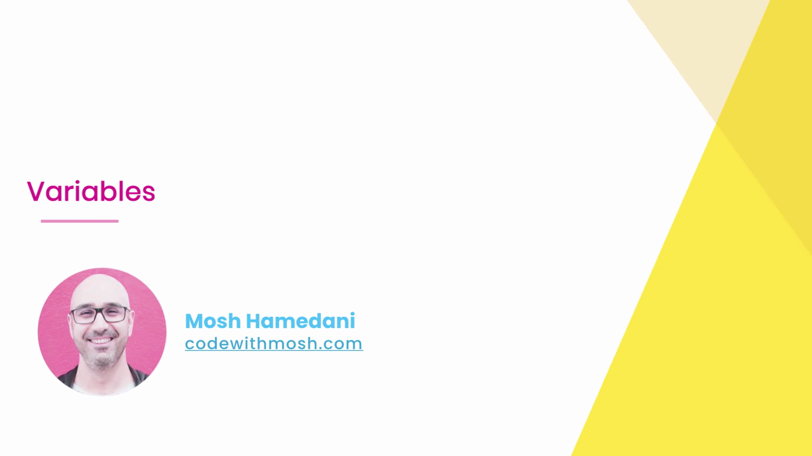
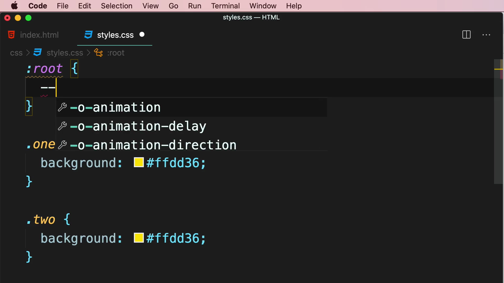
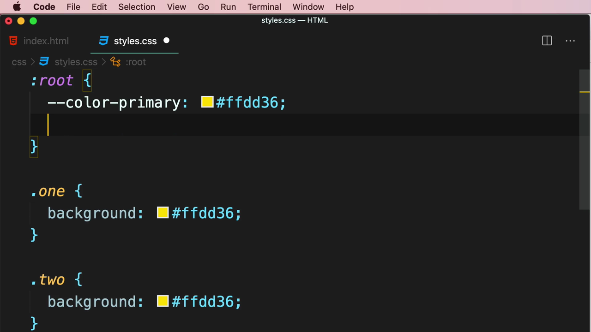
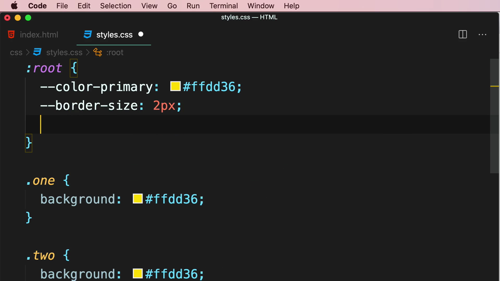
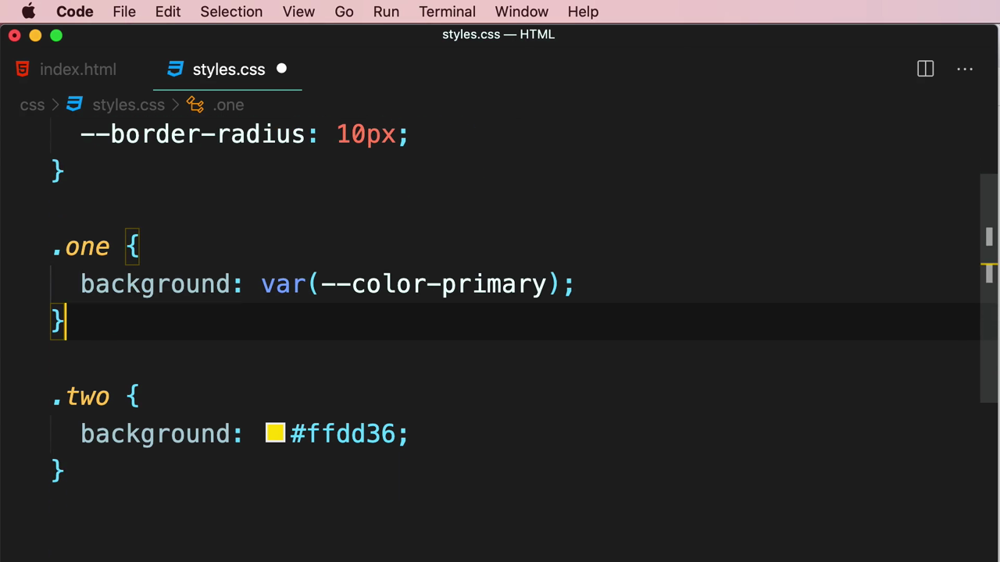
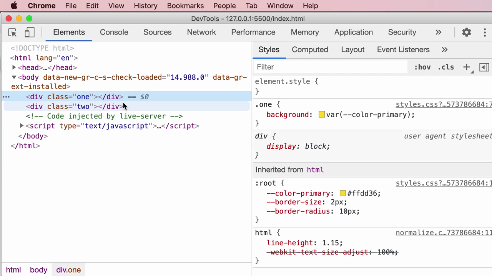

# 7-Writing Clean, Maintainable CSS: 03 - Variables (2:18)

**ไฟล์ต้นทาง:** `3-Variables.mp4`

▶️ **[เปิดวิดีโอต้นฉบับ](../../../HTML-CSS-2/7-Writing%20Clean,%20Maintainable%20CSS/3-Variables.mp4)**

---

## ภาพรวมคลิปนี้

คลิปนี้ Mosh สอนเรื่อง **CSS Variables** (หรือชื่อทางการคือ **CSS Custom Properties**) ซึ่งเป็นอีกหนึ่งเครื่องมือสำคัญที่ช่วยลดความซ้ำซ้อนของค่าคงที่ (เช่น สี, ขนาด border) ในสไตล์ชีต ต่อยอดจากหลักการ DRY ที่พูดถึงในคลิปก่อนหน้า โดยสาธิตการประกาศตัวแปรใน **`:root`** แล้วเรียกใช้ด้วยฟังก์ชัน **`var()`** พร้อมตรวจสอบผลลัพธ์ผ่าน Chrome DevTools

---

## 1. เปิดคลิปด้วยสไลด์ชื่อเรื่อง

สไลด์ชื่อคลิป **"Variables"** พร้อมรูปโปรไฟล์ผู้สอน:



---

## 2. ปัญหา: ค่าสีซ้ำซ้อนในหลาย Selector

Mosh เปิด `styles.css` ที่มีสอง class คือ `.one` และ `.two` ซึ่งทั้งคู่กำหนด `background` เป็นค่าสีเดียวกัน (`#ffdd36`) ซ้ำกัน:

```css
.one {
  background: #ffdd36;
}

.two {
  background: #ffdd36;
}
```



> นี่คือปัญหาแบบเดียวกับที่พูดถึงในคลิปก่อนหน้า (CSS Best Practices) — การเขียนค่าคงที่เดิมซ้ำในหลายที่ทำให้เมื่อธุรกิจต้องการเปลี่ยนสีธีมในอนาคต จะต้องไล่แก้ทีละจุดทั่วทั้งไฟล์ ซึ่งเสี่ยงต่อการตกหล่นและไม่สอดคล้องกัน

---

## 3. สร้างตัวแปรด้วย `:root` และ Custom Property

Mosh แก้ปัญหาด้วยการประกาศ **CSS custom property** ไว้ใน selector พิเศษ **`:root`**:

```css
:root {
  --color-primary: #ffdd36;
}
```



> **`:root`** เป็น pseudo-class ที่หมายถึง element รากของเอกสาร (เทียบเท่ากับ `<html>` แต่มี specificity สูงกว่าเล็กน้อย) นิยมใช้เป็นที่ประกาศตัวแปร CSS ส่วนกลาง เพราะ `:root` อยู่บนสุดของ DOM tree ทำให้ตัวแปรที่ประกาศไว้ที่นี่ถูก **สืบทอด (inherit)** ไปยังทุก element ในหน้าเว็บได้
>
> **ไวยากรณ์การประกาศตัวแปร:** ชื่อตัวแปร CSS ต้องขึ้นต้นด้วยเครื่องหมาย **`--`** สองขีด (เช่น `--color-primary`) ตามด้วยเครื่องหมายทวิภาค (`:`) และค่าที่ต้องการเก็บ

Mosh เพิ่มตัวแปรอีกสองตัวสำหรับค่าที่เกี่ยวกับ border:

```css
:root {
  --color-primary: #ffdd36;
  --border-size: 2px;
  --border-radius: 10px;
}
```



> ตัวแปร CSS สามารถเก็บค่าประเภทใดก็ได้ที่ CSS รองรับ ไม่จำกัดแค่สี — ในตัวอย่างนี้มีทั้งค่าสี (`--color-primary`), ค่าความหนา border เป็นพิกเซล (`--border-size: 2px`) และค่ารัศมีมุมโค้งของ border (`--border-radius: 10px`)

---

## 4. เรียกใช้ตัวแปรด้วยฟังก์ชัน `var()`

Mosh กลับไปแก้ไข `.one` ให้เรียกใช้ค่าจากตัวแปรแทนการเขียนโค้ดสีตรงๆ โดยใช้ฟังก์ชัน **`var()`**:

```css
.one {
  background: var(--color-primary);
}

.two {
  background: #ffdd36;
}
```



> **`var(--ชื่อตัวแปร)`** คือฟังก์ชันมาตรฐานของ CSS สำหรับดึงค่าที่เก็บไว้ในตัวแปรที่ประกาศไว้ก่อนหน้า (เช่นใน `:root`) มาใช้งาน ณ ตำแหน่งที่เรียก เมื่อภายหลังต้องการเปลี่ยนสีธีมทั้งเว็บไซต์ เพียงแก้ไขค่าที่จุดประกาศใน `:root` เพียงจุดเดียว การเปลี่ยนแปลงจะมีผลกับทุก selector ที่เรียกใช้ `var()` นั้นโดยอัตโนมัติ ต่างจากการพิมพ์ค่าสีตรงๆ ซ้ำๆ ที่ต้องไล่แก้ทีละจุด

---

## 5. ตรวจสอบตัวแปรผ่าน Chrome DevTools

Mosh เปิด Chrome DevTools (คลิกขวา → Inspect) เพื่อตรวจสอบผลลัพธ์ โดยเลือก element `<div class="one">` แล้วดูที่แผง **Styles**:



จากภาพจะเห็นว่า:
- กฎ `.one { background: var(--color-primary); }` แสดงอยู่ในแผง Styles พร้อมสีตัวอย่าง (สี่เหลี่ยมสีเหลือง) ข้างค่า `var(--color-primary)`
- ด้านล่างมีส่วน **"Inherited from html"** ที่แสดงกฎ `:root { --color-primary: #ffdd36; --border-size: 2px; --border-radius: 10px; }` ยืนยันว่าตัวแปรทั้งสามที่ประกาศไว้ใน `:root` ถูกสืบทอดมาถึง `<div class="one">` ได้จริง

> DevTools ของ Chrome รองรับการแสดงผลค่า CSS custom properties โดยตรง ช่วยให้นักพัฒนาตรวจสอบได้ง่ายว่าตัวแปรแต่ละตัวมีค่าอะไร และถูกสืบทอดมาจากที่ใดในลำดับชั้น (cascade) ของ DOM ซึ่งเป็นประโยชน์มากเวลา debug ปัญหาเกี่ยวกับตัวแปรที่ไม่แสดงผลตามที่คาดไว้

---

## สรุปภาพรวมของคลิปนี้

| ประเด็น | รายละเอียด |
|---|---|
| **หัวข้อ** | CSS Variables (Custom Properties) |
| **ไวยากรณ์ประกาศ** | `--ชื่อตัวแปร: ค่า;` ภายใน selector (นิยมใช้ `:root`) |
| **ไวยากรณ์เรียกใช้** | `var(--ชื่อตัวแปร)` |
| **เครื่องมือตรวจสอบ** | Chrome DevTools (แผง Styles + Inherited from html) |
| **ประเภทค่าที่เก็บได้** | สี, ขนาด (px), รัศมีมุมโค้ง ฯลฯ — ค่าประเภทใดก็ได้ที่ CSS รองรับ |

**แนวคิดสำคัญที่ได้จากคลิปนี้:**

1. **`:root` คือตำแหน่งมาตรฐานสำหรับประกาศตัวแปร CSS ระดับ global** เพราะอยู่บนสุดของ DOM ทำให้ตัวแปรถูกสืบทอดไปยังทุก element ในหน้าเว็บ
2. **ชื่อตัวแปร CSS ต้องขึ้นต้นด้วย `--`** เสมอ เพื่อแยกความแตกต่างจาก property มาตรฐานของ CSS
3. **ใช้ `var(--ชื่อตัวแปร)` เพื่อเรียกค่าที่ประกาศไว้มาใช้งาน** แทนการพิมพ์ค่าคงที่ซ้ำๆ ในหลาย selector
4. **การรวมค่าคงที่ไว้เป็นตัวแปรช่วยให้แก้ไขธีม/ค่าคงที่ในอนาคตได้ง่ายขึ้นมาก** เพราะแก้เพียงจุดเดียวใน `:root` ก็มีผลกับทุกจุดที่เรียกใช้ ตรงตามหลักการ DRY (Don't Repeat Yourself)
5. **Chrome DevTools แสดงตัวแปร CSS และแหล่งที่มาของการสืบทอด (inherited from) ได้โดยตรง** ทำให้ตรวจสอบและ debug ค่าตัวแปรได้สะดวก

---

*หมายเหตุ: คลิปนี้เป็นส่วนหนึ่งของบท "7-Writing Clean, Maintainable CSS" จากคอร์ส The Ultimate HTML and CSS Course โดย Mosh Hamedani (codewithmosh.com) — คลิปที่ 3 ของบทนี้*
