# 7-Writing Clean, Maintainable CSS: 04 - Object-oriented CSS (5:07)

**ไฟล์ต้นทาง:** `4-Object-oriented_CSS.mp4`

▶️ **[เปิดวิดีโอต้นฉบับ](../../../HTML-CSS-2/7-Writing%20Clean,%20Maintainable%20CSS/4-Object-oriented_CSS.mp4)**

---

## ภาพรวมคลิปนี้

คลิปนี้ Mosh สอนแนวคิด **Object-Oriented CSS (OOCSS)** ซึ่งเป็นแนวทางออกแบบ CSS ที่ช่วยลดความซ้ำซ้อนของโค้ดโดยการมองแต่ละ component (เช่นปุ่ม) เป็น "object" ที่ใช้ซ้ำได้ในหลายบริบท มีหลักการย่อยสองข้อคือ (1) **แยก container ออกจาก content** เพื่อให้สไตล์ของ component ไม่ผูกติดกับตำแหน่งที่มันอยู่ และ (2) **แยกโครงสร้าง (structure) ออกจากรูปลักษณ์ (skin)** เพื่อให้สามารถสร้างตัวแปรสี/รูปลักษณ์ต่างๆ ได้โดยไม่ต้องเขียนโค้ดซ้ำ

---

## 1. เปิดคลิปด้วยสไลด์ชื่อเรื่อง

สไลด์ชื่อคลิป **"Object-oriented CSS"** พร้อมรูปโปรไฟล์ผู้สอน จากนั้นตัดเข้าสู่ภาพสต็อกมือกำลังวางบล็อกไม้ต่อกันเป็นรูปทรงพีระมิด ซึ่งเป็นภาพเปรียบเทียบสื่อถึงการสร้างส่วนประกอบ (building blocks/objects) ที่นำมาประกอบกันได้อย่างยืดหยุ่น:

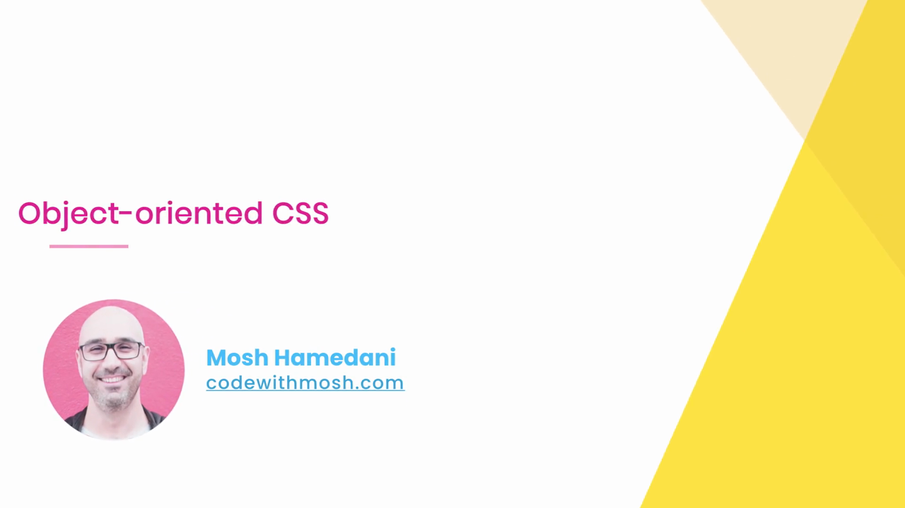


---

## 2. ปัญหา: สไตล์ปุ่มผูกติดกับ Container

Mosh เริ่มต้นด้วยการสร้างปุ่ม "Sign Up" ภายใน `<header class="hero">` แล้วกำหนดสไตล์ด้วย selector ที่ผูกกับ container:

```css
.hero .btn {
  background: gold;
  border: 0;
  border-radius: 30px;
  padding: 1rem 2rem;
  font-family: -apple-system, BlinkMacSystemFont, "Segoe UI", Roboto, Ubuntu,
    Cantarell, "Open Sans", "Helvetica Neue", sans-serif;
}
```

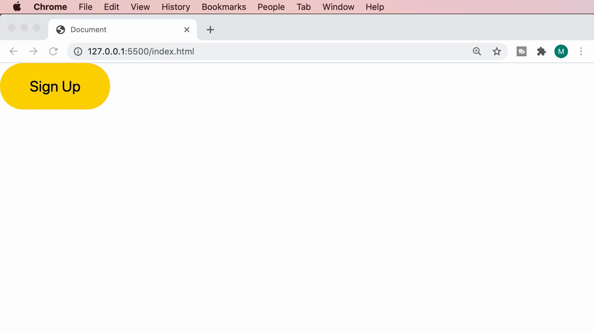

ผลลัพธ์ในเบราว์เซอร์แสดงปุ่ม "Sign Up" สีทอง ขอบมน สวยงามตามที่ตั้งใจ:

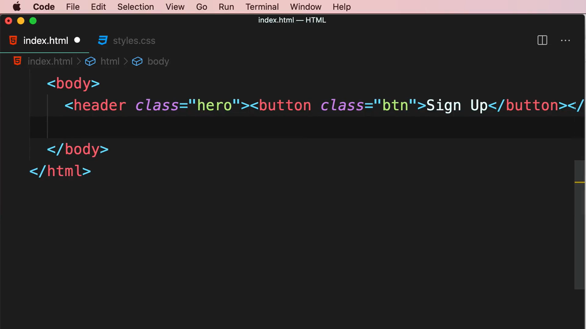

จากนั้น Mosh เพิ่มปุ่มที่สองชื่อ "Contact" ไว้ภายใน `<aside class="side-bar">` โดยใช้ class `btn` เดียวกัน แต่เนื่องจาก selector เดิมคือ `.hero .btn` (ผูกกับ container `.hero` เท่านั้น) ปุ่ม Contact ซึ่งอยู่ใน `.side-bar` จึงไม่ได้รับสไตล์ใดๆ เลย แสดงผลเป็นปุ่มเริ่มต้นของเบราว์เซอร์ (สีเทา, เหลี่ยม):

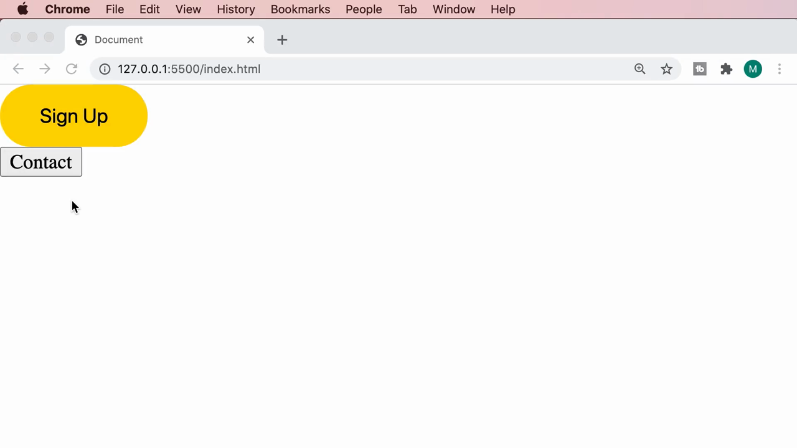

> **ปัญหาที่ Mosh ชี้ให้เห็น:** การเขียน selector แบบผูกกับ container (`.hero .btn`) ทำให้สไตล์ของปุ่ม "ใช้ซ้ำไม่ได้" เมื่อนำปุ่มเดียวกันไปวางไว้ใน container อื่น สไตล์จะไม่ตามไปด้วย ทั้งที่จริงๆ แล้วปุ่มทั้งสองควรมีหน้าตาเหมือนกัน

### ทางแก้ไขที่ไม่ดี — คัดลอกกฎซ้ำสำหรับแต่ละ Container

Mosh สาธิตวิธีแก้ปัญหาแบบผิดๆ ที่มือใหม่มักทำ คือคัดลอกกฎ CSS ทั้งหมดมาสร้างใหม่โดยเปลี่ยนแค่ selector container:

```css
.hero .btn {
  background: gold;
  border: 0;
  border-radius: 30px;
  padding: 1rem 2rem;
  font-family: -apple-system, BlinkMacSystemFont, "Segoe UI", Roboto, Ubuntu,
    Cantarell, "Open Sans", "Helvetica Neue", sans-serif;
}

.side-bar .btn {
  background: gold;
  border: 0;
  border-radius: 30px;
  padding: 1rem 2rem;
  font-family: -apple-system, BlinkMacSystemFont, "Segoe UI", Roboto, Ubuntu,
    Cantarell, "Open Sans", "Helvetica Neue", sans-serif;
}
```

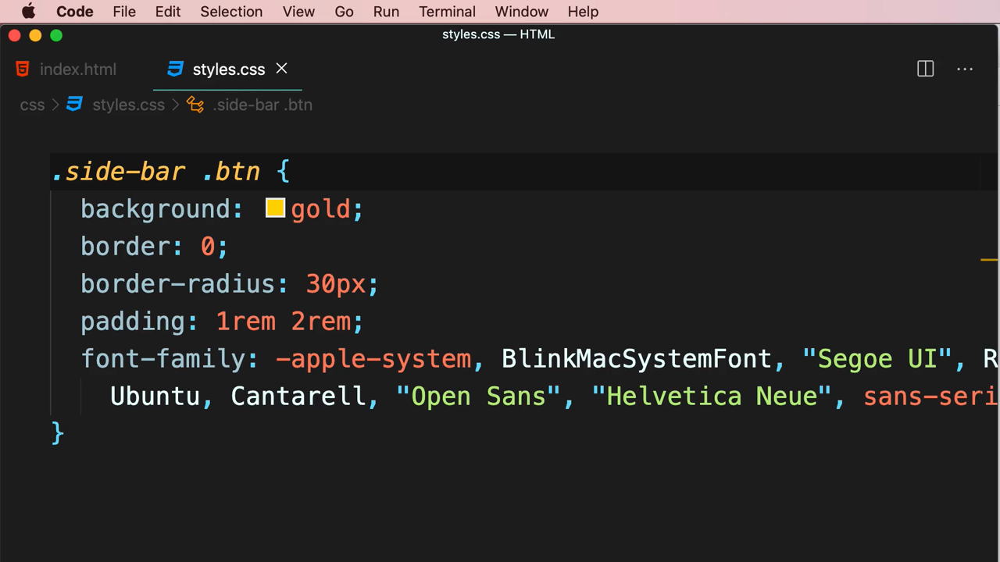

ผลลัพธ์ทำให้ปุ่มทั้งสองมีหน้าตาเหมือนกันแล้วก็จริง แต่ต้องแลกกับการเขียนโค้ดซ้ำทั้งชุด:

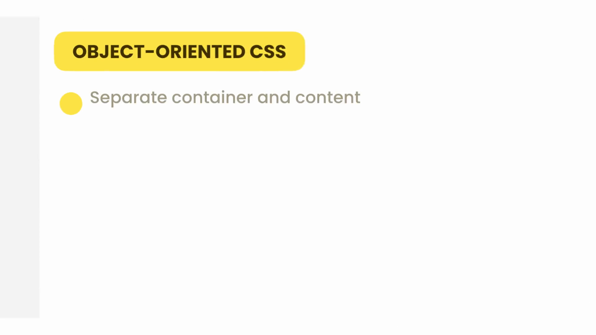

> Mosh เตือนว่านี่คือการละเมิดหลักการ DRY อย่างชัดเจน — หากในอนาคตมีปุ่มลักษณะนี้ปรากฏใน container ที่สาม ที่สี่ ก็ต้องคัดลอกกฎเดิมซ้ำไปเรื่อยๆ ทำให้ไฟล์ CSS บวมและแก้ไขยาก (เช่น หากต้องการเปลี่ยนสีปุ่มทั้งหมด ต้องไล่แก้ทุก selector ที่คัดลอกไว้)

---

## 3. หลักการ OOCSS #1 — Separate Container and Content (แยก Container ออกจาก Content)

สไลด์เผยหลักการแรกของ Object-Oriented CSS:

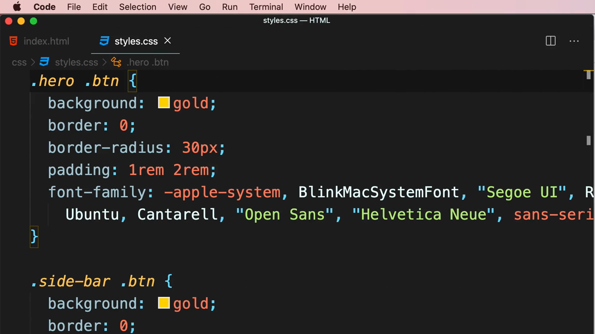

### แนวทางแก้ไข — ใช้ Class เดี่ยวที่ไม่ผูกกับ Container

Mosh รวมกฎที่ซ้ำกันทั้งสองเป็น class เดียวที่ไม่อ้างอิงถึง container เลย:

```css
.btn {
  background: gold;
  border: 0;
  border-radius: 30px;
  padding: 1rem 2rem;
  font-family: -apple-system, BlinkMacSystemFont, "Segoe UI", Roboto, Ubuntu,
    Cantarell, "Open Sans", "Helvetica Neue", sans-serif;
}
```

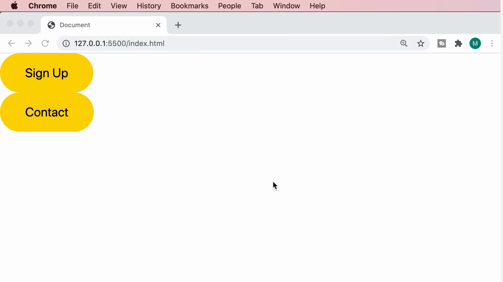

จากนั้นแก้ไข HTML ให้ปุ่มทั้งสองใช้ class `btn` เดียวกัน โดยไม่สนใจว่าจะอยู่ใน container ใด:

```html
<header class="hero"><button class="btn">Sign Up</button></header>
<aside class="side-bar"><button class="btn">Contact</button></aside>
```

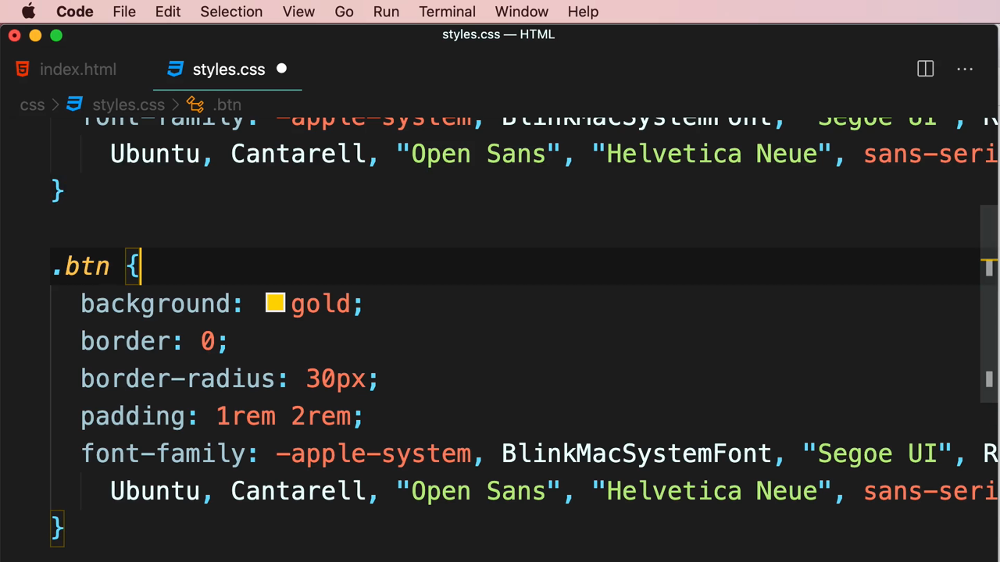

> **แนวคิดสำคัญ:** เมื่อ "แยก content (ปุ่ม) ออกจาก container (hero/side-bar)" ได้สำเร็จ ปุ่มก็กลายเป็น **object ที่ใช้ซ้ำได้อย่างอิสระ** ไม่ว่าจะนำไปวางไว้ใน container ใดก็ตาม สไตล์จะติดไปกับตัวปุ่มเองเสมอ (ผ่าน class `.btn` ที่ผูกกับตัว element โดยตรง ไม่ใช่ผูกกับตำแหน่งที่มันอยู่)

---

## 4. หลักการ OOCSS #2 — Separate Structure and Skin (แยกโครงสร้างออกจากรูปลักษณ์)

### ปัญหาใหม่: ต้องการปุ่มสีน้ำเงินอีกแบบ

Mosh ต้องการให้ปุ่ม "Contact" เป็นสีน้ำเงินแทนสีทอง จึงลองสร้าง class ใหม่ `.btn-blue` โดยคัดลอกกฎทั้งหมดจาก `.btn` มาอีกครั้ง แล้วเปลี่ยนแค่ค่าสี:

```css
.btn {
  background: gold;
  border: 0;
  border-radius: 30px;
  padding: 1rem 2rem;
  font-family: -apple-system, BlinkMacSystemFont, "Segoe UI", Roboto, Ubuntu,
    Cantarell, "Open Sans", "Helvetica Neue", sans-serif;
}

.btn-blue {
  background: dodgerblue;
  border: 0;
  border-radius: 30px;
  padding: 1rem 2rem;
  font-family: -apple-system, BlinkMacSystemFont, "Segoe UI", Roboto, Ubuntu,
    Cantarell, "Open Sans", "Helvetica Neue", sans-serif;
}
```

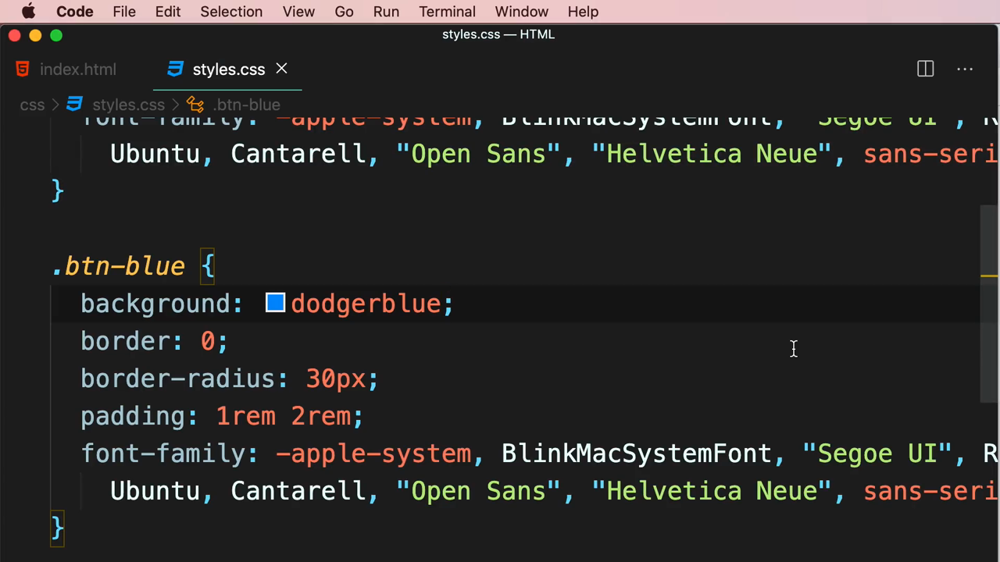

เมื่อเปลี่ยนปุ่ม Contact ให้ใช้ class `btn-blue` แทน `btn` ผลลัพธ์ในเบราว์เซอร์แสดงปุ่ม Contact เป็นสีน้ำเงินตามต้องการ:

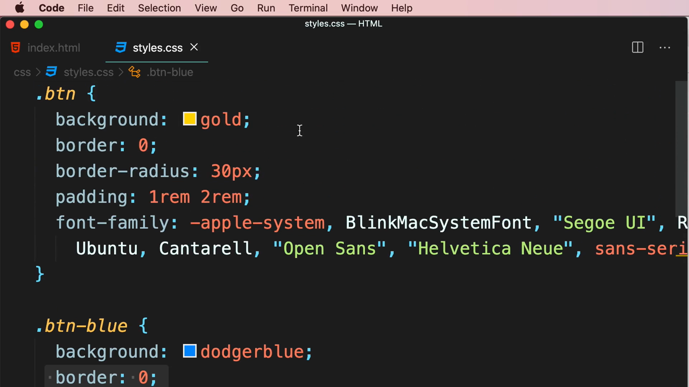

> Mosh ชี้ให้เห็นว่านี่คือการทำผิดซ้ำแบบเดียวกับตอนต้นคลิป — คัดลอก property ที่ไม่เกี่ยวกับสี (เช่น `border`, `border-radius`, `padding`, `font-family`) ซ้ำไปมาโดยไม่จำเป็น ทั้งที่ property เหล่านี้เหมือนกันทุกตัวแปรสี มีเพียง `background` เท่านั้นที่ต่างกัน

### แนวทางแก้ไข — แยก "โครงสร้าง" (Structure) ออกจาก "รูปลักษณ์" (Skin)

Mosh ลบ `background: gold;` ออกจาก `.btn` (ให้ `.btn` เหลือแค่ property ที่เป็น**โครงสร้างร่วม**ของปุ่มทุกแบบ เช่น border, ขนาด, ฟอนต์):

```css
.btn {
  border: 0;
  border-radius: 30px;
  padding: 1rem 2rem;
  font-family: -apple-system, BlinkMacSystemFont, "Segoe UI", Roboto, Ubuntu,
    Cantarell, "Open Sans", "Helvetica Neue", sans-serif;
}
```

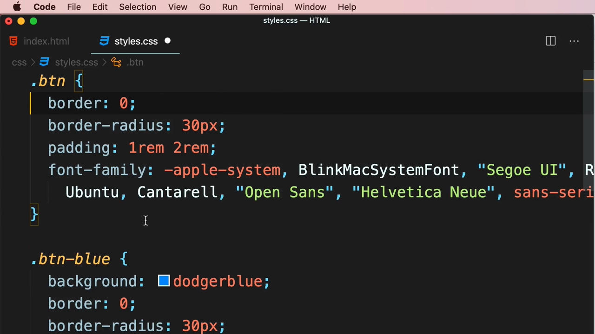

แล้วสร้าง class "skin" แยกสำหรับแต่ละสีธีม โดยแต่ละ class มีเพียง property เดียวคือสีพื้นหลัง:

```css
.btn {
  border: 0;
  border-radius: 30px;
  padding: 1rem 2rem;
  font-family: -apple-system, BlinkMacSystemFont, "Segoe UI", Roboto, Ubuntu,
    Cantarell, "Open Sans", "Helvetica Neue", sans-serif;
}

.btn-primary {
  background: gold;
}

.btn-secondary {
  background: dodgerblue;
}
```

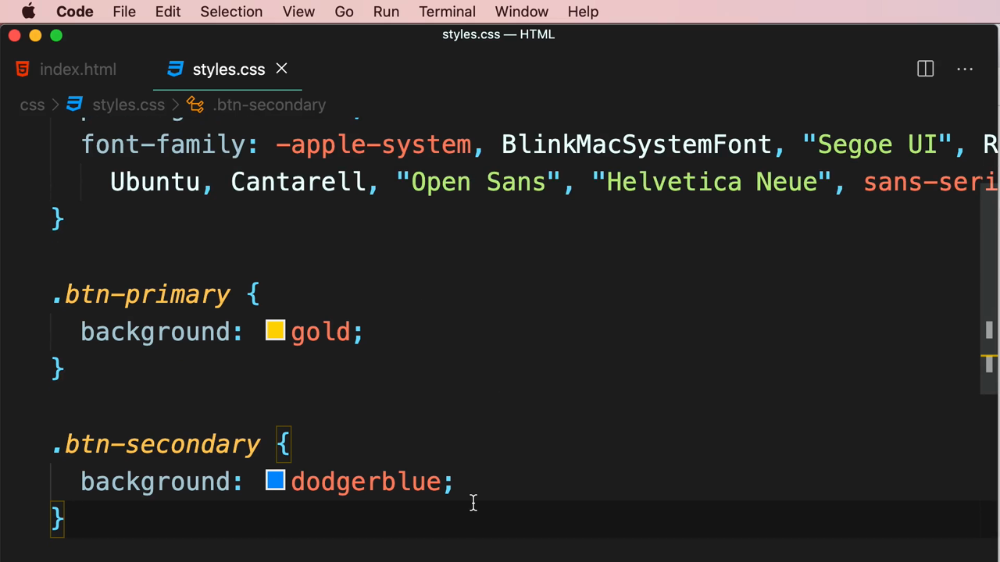

จากนั้นปรับ HTML ให้แต่ละปุ่มใช้ **สอง class ร่วมกัน** — class โครงสร้าง (`.btn`) และ class รูปลักษณ์ (`.btn-blue` หรือเทียบเท่า `.btn-secondary`):

```html
<header class="hero"><button class="btn">Sign Up</button></header>
<aside class="side-bar"><button class="btn-blue">Contact</button></aside>
```

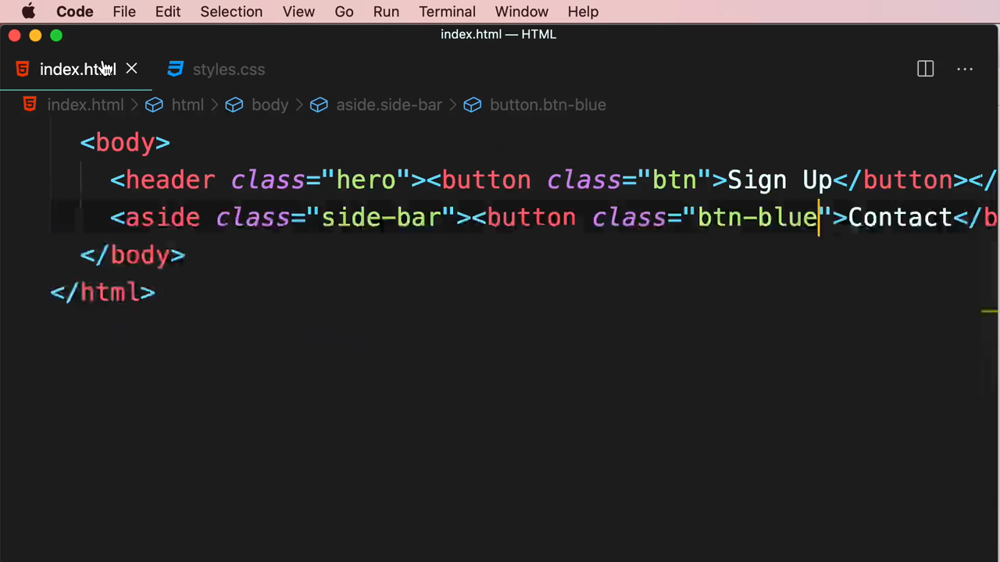

รันผลลัพธ์สุดท้ายในเบราว์เซอร์ ปุ่ม "Sign Up" ยังคงเป็นสีทอง และปุ่ม "Contact" เป็นสีน้ำเงิน ทั้งสองปุ่มมีรูปทรง ขอบมน และฟอนต์เหมือนกันทุกประการ โดยไม่มีโค้ดซ้ำซ้อนแม้แต่บรรทัดเดียว:

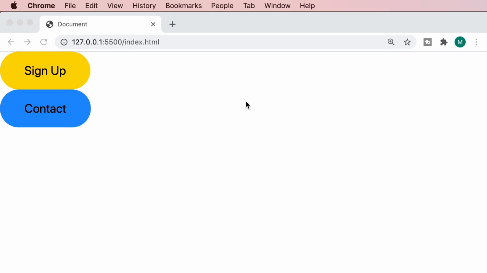

> **หลักการสำคัญของ OOCSS ข้อที่สอง:** แยก CSS ออกเป็นสองกลุ่มเสมอ — **Structure classes** (เช่น `.btn`) ที่กำหนด layout/รูปทรง/ระยะห่าง/ฟอนต์ที่ใช้ร่วมกันในทุก variant และ **Skin classes** (เช่น `.btn-primary`, `.btn-secondary`) ที่กำหนดเฉพาะรูปลักษณ์ที่ต่างกัน (สี, เงา ฯลฯ) แล้วนำทั้งสองมาผสมกันบน element เดียว (`class="btn btn-primary"`) วิธีนี้ทำให้สร้างตัวแปรสี/รูปลักษณ์ใหม่ได้ง่ายมากในอนาคต เพียงเพิ่ม skin class ใหม่ที่มี property เดียว โดยไม่ต้องคัดลอกโครงสร้างทั้งหมดซ้ำอีก

---

## สรุปภาพรวมของคลิปนี้

| ประเด็น | รายละเอียด |
|---|---|
| **หัวข้อ** | Object-Oriented CSS (OOCSS) |
| **หลักการ #1** | Separate container and content — แยก selector ออกจาก container เพื่อให้ component ใช้ซ้ำได้ในทุกบริบท |
| **หลักการ #2** | Separate structure and skin — แยก class โครงสร้าง (`.btn`) ออกจาก class รูปลักษณ์ (`.btn-primary`, `.btn-secondary`) |
| **ตัวอย่างที่สาธิต** | ปุ่ม "Sign Up" (ใน `.hero`) และปุ่ม "Contact" (ใน `.side-bar`) |
| **Class สุดท้ายที่ได้** | `.btn` (โครงสร้าง) + `.btn-primary` / `.btn-secondary` (สกิน) |

**แนวคิดสำคัญที่ได้จากคลิปนี้:**

1. **อย่าผูก selector ของ component เข้ากับ container ที่มันอยู่** (เช่น `.hero .btn`) เพราะจะทำให้สไตล์ใช้ซ้ำไม่ได้เมื่อย้าย component ไปไว้ที่อื่น
2. **มองแต่ละ component เป็น "object" อิสระ** ที่มี class ของตัวเอง (เช่น `.btn`) ไม่ขึ้นกับตำแหน่งหรือบริบทที่ใช้งาน
3. **แยกโครงสร้าง (structure) ออกจากรูปลักษณ์ (skin)** — โครงสร้างคือสิ่งที่เหมือนกันในทุก variant (ขนาด, รูปทรง, ฟอนต์) ส่วนสกินคือสิ่งที่ต่างกัน (สี) แยกเป็นคนละ class แล้วนำมาผสมกันบน element เดียว
4. **ผลลัพธ์ของ OOCSS คือโค้ด CSS ที่กระชับและขยายง่าย** — การเพิ่มปุ่มสีใหม่ในอนาคตทำได้เพียงเพิ่ม skin class ใหม่ที่มี property เดียว โดยไม่ต้องแตะโครงสร้างเดิมเลย ตรงตามหลักการ DRY ที่พูดถึงในคลิปก่อนหน้า

---

*หมายเหตุ: คลิปนี้เป็นส่วนหนึ่งของบท "7-Writing Clean, Maintainable CSS" จากคอร์ส The Ultimate HTML and CSS Course โดย Mosh Hamedani (codewithmosh.com) — คลิปที่ 4 ของบทนี้*
