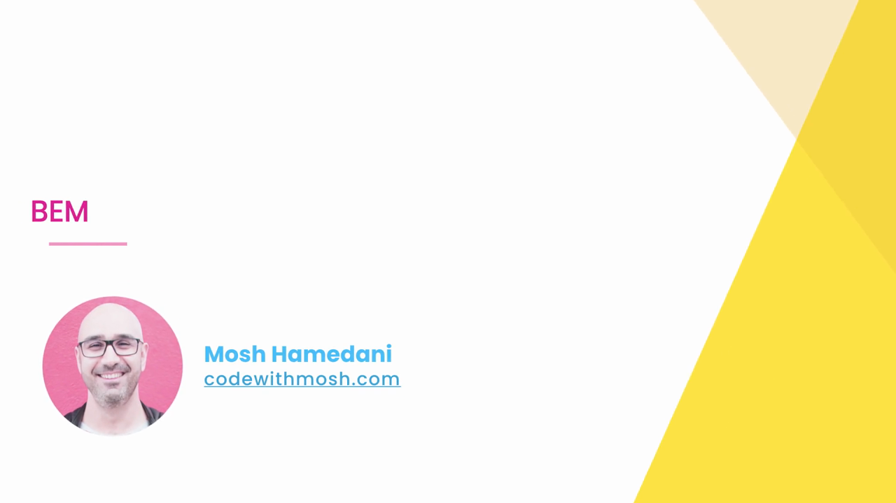
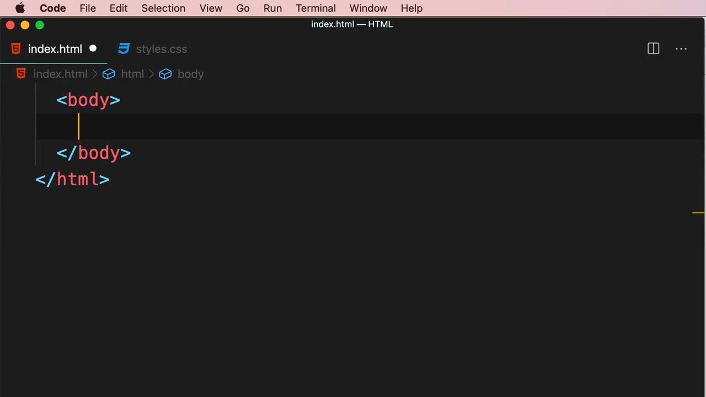
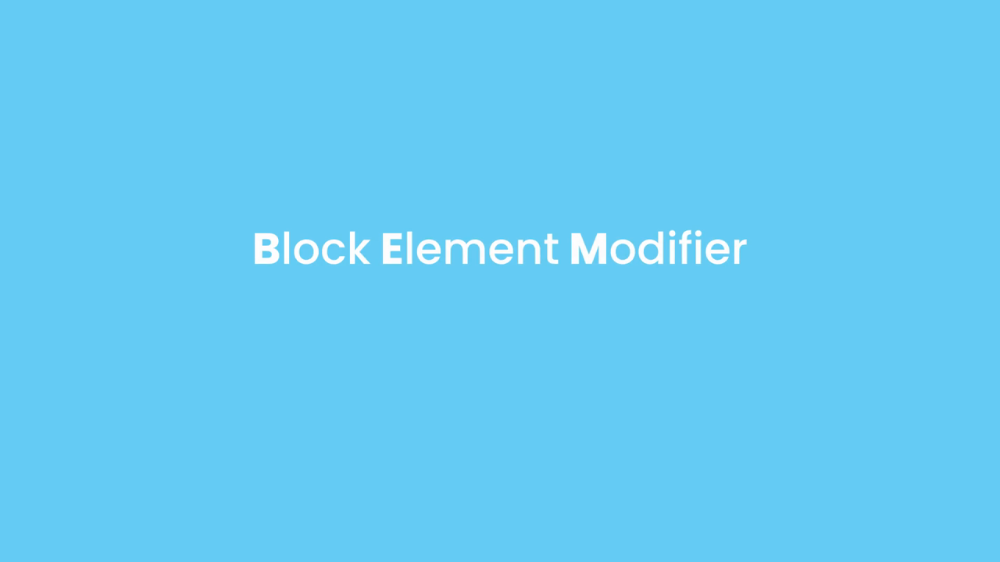
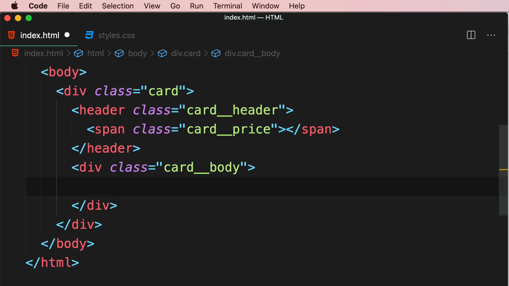
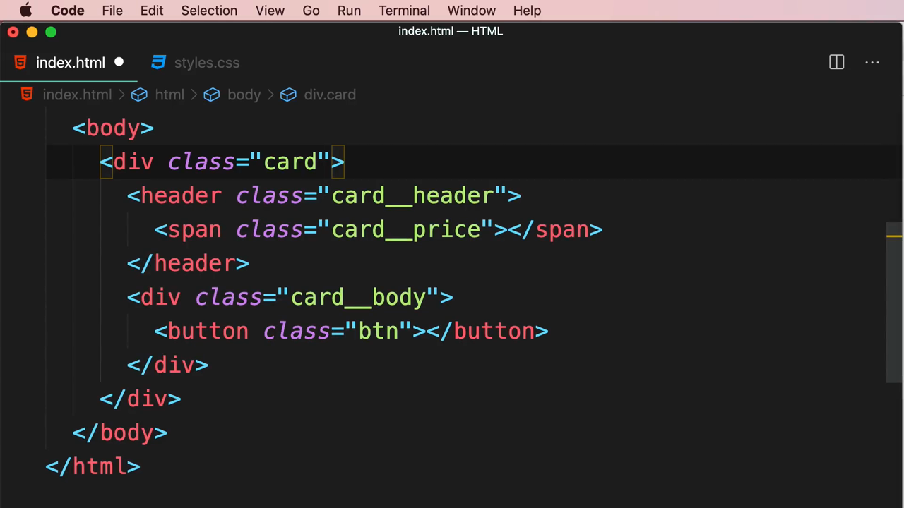

# 7-Writing Clean, Maintainable CSS: 05 - BEM (4:12)

**ไฟล์ต้นทาง:** `5-BEM.mp4`

▶️ **[เปิดวิดีโอต้นฉบับ](../../../HTML-CSS-2/7-Writing%20Clean,%20Maintainable%20CSS/5-BEM.mp4)**

---

## ภาพรวมคลิปนี้

คลิปนี้ Mosh สอนแนวทางการตั้งชื่อ class แบบ **BEM (Block, Element, Modifier)** ซึ่งเป็นหนึ่งใน naming convention ที่ได้รับความนิยมมากที่สุดในวงการ CSS ต่อยอดจากหลักการ "Follow a naming convention" ที่พูดถึงในคลิป CSS Best Practices และแนวคิด OOCSS ในคลิปก่อนหน้า โดยใช้ตัวอย่างจากการ์ดราคา (pricing card) ของโปรเจกต์จริง **"Moshify"** ที่เคยสร้างไว้ในคอร์สนี้มาอธิบายประกอบ

---

## 1. เปิดคลิปด้วยสไลด์ชื่อเรื่อง

สไลด์ชื่อคลิป **"BEM"** พร้อมรูปโปรไฟล์ผู้สอน จากนั้นตัดไปยังสไลด์พื้นหลังสีฟ้าแสดงตัวอักษรคำว่า **"BEM"** ตัวใหญ่ตรงกลางจอ:



---

## 2. ตัวอย่างจากโปรเจกต์จริง — Moshify Pricing Cards

Mosh เปิดเบราว์เซอร์แสดงหน้าเว็บโปรเจกต์ **"Moshify"** ที่มีการ์ดราคาสามใบ (Entry, Business, Business Plus) พร้อมป้ายราคา, รายการฟีเจอร์ (checklist) และปุ่ม "BUY NOW" — เป็นตัวอย่าง component จริงที่ซับซ้อนพอจะอธิบายแนวคิด BEM ได้ชัดเจน:


> Mosh ใช้การ์ดราคานี้ตั้งคำถามว่า "เราจะตั้งชื่อ class ให้กับส่วนประกอบย่อยแต่ละส่วนของการ์ด (หัวการ์ด, ราคา, เนื้อหา, ปุ่ม) อย่างไรให้สื่อความหมายชัดเจนและไม่ชนกับ class อื่นในหน้าเว็บ?" ซึ่งเป็นปัญหาที่ BEM ถูกออกแบบมาเพื่อแก้โดยเฉพาะ

---

## 3. เริ่มสร้างโครงสร้าง HTML ของการ์ดตัวอย่าง

Mosh เปิดไฟล์ `index.html` ที่มี `<body>` ว่างเปล่า แล้วเริ่มพิมพ์โครงสร้าง:


สร้าง `<div class="card">` เป็น container หลัก แล้วเพิ่ม `<header class="card__header">` ไว้ข้างใน โดยใช้ Emmet ช่วยพิมพ์:

```html
<div class="card">
  <header class="card__header"></header>
</div>
```



> สังเกตไวยากรณ์ชื่อ class **`card__header`** ที่ใช้เครื่องหมาย **underscore สองตัว (`__`)** เป็นตัวเชื่อมระหว่างชื่อ **Block** (`card`) กับชื่อ **Element** (`header`)

---

## 4. หลักการ BEM — Block, Element, Modifier

สไลด์เผยชื่อเต็มของแนวคิดนี้ **"Block Element Modifier"** พร้อมเน้นตัวอักษรตัวแรกของแต่ละคำ (**B**lock **E**lement **M**odifier) ซึ่งประกอบกันเป็นคำย่อ "BEM":



> **BEM (Block, Element, Modifier)** คือ naming convention ของ CSS ที่แบ่งโครงสร้างของ class ออกเป็นสามส่วนตามบทบาท:
> - **Block** คือ component หลักที่ทำงานได้อย่างอิสระในตัวเอง (เช่น `card`)
> - **Element** คือส่วนประกอบย่อยภายใน block ที่ไม่มีความหมายหากแยกออกไปอยู่นอก block (เช่น `card__header`, `card__price`, `card__body`) เขียนด้วยรูปแบบ `block__element`
> - **Modifier** คือตัวแปรหรือสถานะที่ต่างออกไปของ block หรือ element (เช่น การ์ดแบบ "Popular" ที่มีสีต่างจากการ์ดปกติ) เขียนด้วยรูปแบบ `block--modifier` โดยใช้ **เครื่องหมายขีดกลางสองตัว (`--`)** เป็นตัวเชื่อม

Mosh ขยายโครงสร้างต่อโดยเพิ่ม `<span class="card__price">` ไว้ภายใน header และเพิ่ม `<div class="card__body">` เป็นพี่น้องกับ header:

```html
<div class="card">
  <header class="card__header">
    <span class="card__price"></span>
  </header>
  <div class="card__body"></div>
</div>
```



---

## 5. โครงสร้าง HTML สุดท้าย — ผสาน BEM เข้ากับ OOCSS

Mosh เพิ่มปุ่มเข้าไปในส่วน `card__body` โดยใช้ class **`btn`** (ไม่ใช่ `card__btn`) ซึ่งเป็น class ที่สร้างไว้แล้วจากคลิป Object-oriented CSS ก่อนหน้า:

```html
<div class="card">
  <header class="card__header">
    <span class="card__price"></span>
  </header>
  <div class="card__body">
    <button class="btn"></button>
  </div>
</div>
```



> **จุดสำคัญของตัวอย่างนี้:** ปุ่ม (`.btn`) ไม่ได้ถูกตั้งชื่อเป็น `card__btn` ทั้งที่อยู่ภายใน `.card` เพราะปุ่มเป็น **object ที่ใช้ซ้ำได้อิสระ** (ตามหลัก OOCSS ที่สอนในคลิปก่อนหน้า) ไม่ใช่ element ที่ผูกติดกับ block `card` โดยเฉพาะ — Mosh ใช้ตัวอย่างนี้แสดงให้เห็นว่า **BEM และ OOCSS ทำงานร่วมกันได้** โดยไม่ขัดแย้งกัน: BEM ใช้จัดการชื่อ class ของ element ที่เป็นส่วนหนึ่งของ block เฉพาะ ในขณะที่ OOCSS ใช้จัดการ component ที่ต้องการใช้ซ้ำข้าม block ต่างๆ

---

## สรุปภาพรวมของคลิปนี้

| ประเด็น | รายละเอียด |
|---|---|
| **หัวข้อ** | BEM (Block, Element, Modifier) |
| **ไวยากรณ์ Element** | `block__element` (ใช้ `__` สองตัว) |
| **ไวยากรณ์ Modifier** | `block--modifier` (ใช้ `--` สองตัว) |
| **ตัวอย่างที่สาธิต** | การ์ดราคาจากโปรเจกต์ Moshify (`.card`, `.card__header`, `.card__price`, `.card__body`) |
| **เชื่อมโยงกับ** | OOCSS (คลิปก่อนหน้า) — ปุ่ม `.btn` ยังคงเป็น object อิสระ ไม่ถูกครอบด้วยชื่อ BEM |

**แนวคิดสำคัญที่ได้จากคลิปนี้:**

1. **BEM แบ่งชื่อ class ออกเป็นสามระดับตามบทบาท** — Block (component หลัก), Element (ส่วนประกอบย่อยภายใน block), Modifier (ตัวแปรหรือสถานะที่ต่างออกไป)
2. **ไวยากรณ์มาตรฐาน:** `block__element` สำหรับ element (underscore สองตัว) และ `block--modifier` สำหรับ modifier (ขีดกลางสองตัว)
3. **BEM ช่วยให้ชื่อ class สื่อความหมายและมีโครงสร้างชัดเจน** ทำให้เมื่อเห็นชื่อ class ก็รู้ทันทีว่า element นั้นเป็นส่วนหนึ่งของ block ใด ลดโอกาสชื่อ class ชนกันในโปรเจกต์ขนาดใหญ่
4. **BEM ใช้ร่วมกับ OOCSS ได้อย่างกลมกลืน** — element ที่ผูกกับ block เฉพาะใช้ไวยากรณ์ BEM (`card__header`) ในขณะที่ component ที่ต้องการใช้ซ้ำในหลาย block (เช่นปุ่ม `.btn`) ยังคงเป็น class อิสระตามหลัก OOCSS ไม่ต้องบังคับให้ทุก class มีคำนำหน้าเป็นชื่อ block เสมอไป

---

*หมายเหตุ: คลิปนี้เป็นส่วนหนึ่งของบท "7-Writing Clean, Maintainable CSS" จากคอร์ส The Ultimate HTML and CSS Course โดย Mosh Hamedani (codewithmosh.com) — คลิปที่ 5 ของบทนี้*
