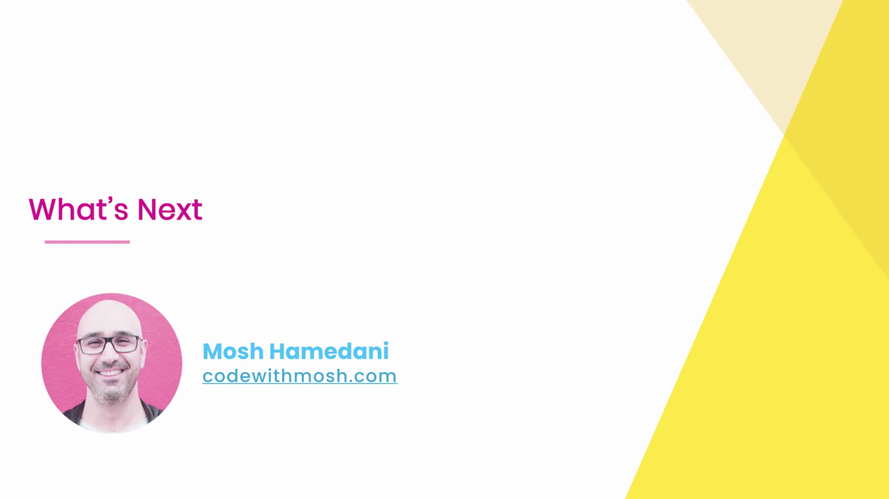
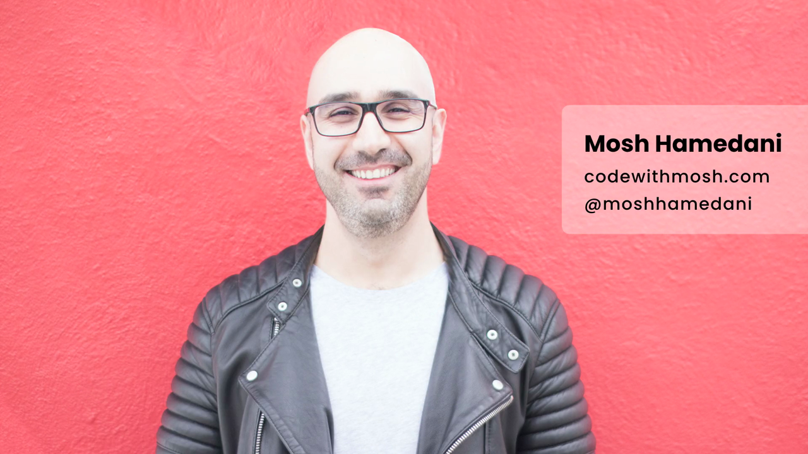
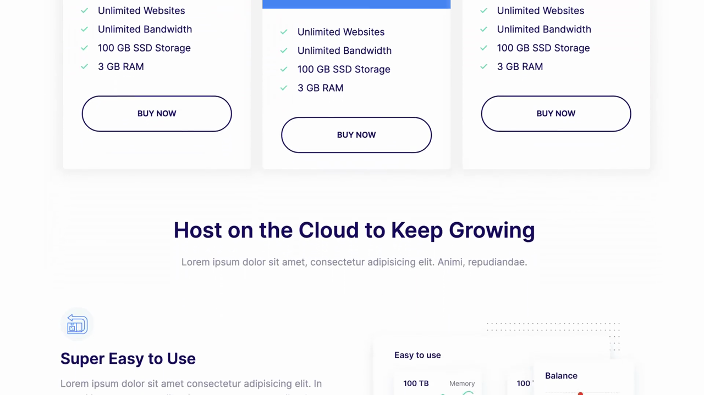

# 7-Writing Clean, Maintainable CSS: 06 - What's Next (0:30)

**ไฟล์ต้นทาง:** `7-Whats_Next.mp4`

▶️ **[เปิดวิดีโอต้นฉบับ](../../../HTML-CSS-2/7-Writing%20Clean,%20Maintainable%20CSS/7-Whats_Next.mp4)**

---

## ภาพรวมคลิปนี้

คลิปปิดท้ายของบทที่ 7 "Writing Clean, Maintainable CSS" เป็นคลิปสั้นๆ (30 วินาที) ที่สรุปปิดบทโดยไม่มีเนื้อหา CSS ใหม่ Mosh แนะนำตัวเองอีกครั้งพร้อมช่องทางติดตาม จากนั้นเลื่อนดูภาพรวมของหน้าเว็บ **Moshify** ฉบับสมบูรณ์ (ซึ่งเป็นโปรเจกต์ตัวอย่างที่ใช้ประกอบการสอนตลอดคอร์ส) ก่อนปิดท้ายด้วยโลโก้ Mosh Hamedani

---

## 1. เปิดคลิปด้วยสไลด์ชื่อเรื่อง

สไลด์ชื่อคลิป **"What's Next"** พร้อมรูปโปรไฟล์ผู้สอน:

---

## 2. สไลด์แนะนำตัวผู้สอนพร้อมช่องทางติดตาม

ตัดเข้าสู่ภาพถ่ายของ Mosh Hamedani บนพื้นหลังสีแดง พร้อมกล่องข้อความแสดงชื่อและช่องทางติดต่อ:

> ข้อมูลที่แสดง: **Mosh Hamedani**, เว็บไซต์ **codewithmosh.com**, และบัญชีโซเชียลมีเดีย **@moshhamedani** — เป็นสไลด์มาตรฐานที่ Mosh ใช้ปิดท้ายคอร์สหรือบทเรียนเพื่อเชิญชวนให้ผู้เรียนติดตามช่องทางอื่นๆ ของเขา

---

## 3. ภาพรวมหน้าเว็บ Moshify ฉบับสมบูรณ์

Mosh เลื่อนสกรอลล์แสดงภาพรวมของหน้าเว็บโปรเจกต์ **"Moshify"** (เว็บไซต์ให้บริการ Cloud Hosting สมมติ) ตั้งแต่ส่วน hero ด้านบนสุด:

> ส่วน hero header แสดงข้อความ **"Cloud Hosting for Pros"** พร้อมคำโปรย "Deploy your website in less than 60 seconds." และปุ่ม "GET STARTED" สีแดง ประกอบภาพกราฟิกไอโซเมตริกรูปเซิร์ฟเวอร์กับโดเมนต่างๆ (.com, .net, .org, .in)

เลื่อนลงมาแสดงส่วนตารางราคา (pricing cards) ที่เคยสร้างและปรับปรุงด้วยหลักการ BEM ตลอดคลิปก่อนหน้า:

เลื่อนต่อผ่านส่วนอื่นๆ ของหน้าเว็บ เช่น "Host on the Cloud to Keep Growing", "Super Easy to Use", "Simply Fast Websites", "WordPress Made Easy" ซึ่งแต่ละส่วนมีภาพประกอบกราฟิก (กราฟข้อมูล, การ์ดสถิติ) และปุ่ม "LEARN MORE" กำกับอยู่

> คลิปนี้ไม่ได้ลงรายละเอียดโค้ดใดๆ เพิ่มเติม แต่ใช้เป็นการ**สรุปภาพรวม (recap)** ให้ผู้เรียนเห็นว่าเทคนิคและหลักการที่เรียนมาตลอดคอร์ส (Flexbox, Grid, Transitions/Animations, และหลักการเขียน CSS สะอาดจากบทนี้) ถูกนำมาประกอบกันเป็นเว็บไซต์ที่สมบูรณ์และใช้งานได้จริงอย่างไร

---

## 4. ปิดท้ายด้วยโลโก้ Mosh Hamedani

คลิปจบด้วยแอนิเมชันไอคอนโลโก้ Mosh Hamedani (รูปสามเหลี่ยมสีชมพู-ม่วงซ้อนกัน) ที่ค่อยๆ ขยายแล้วเผยชื่อเต็ม **"MOSH"** ข้างๆ ไอคอน:

---

## สรุปภาพรวมของคลิปนี้

| ประเด็น | รายละเอียด |
|---|---|
| **หัวข้อ** | What's Next (คลิปปิดบท) |
| **เนื้อหา CSS** | ไม่มีเนื้อหาใหม่ — เป็นการสรุปปิดบทและแนะนำตัวผู้สอน |
| **โปรเจกต์ที่แสดง** | Moshify (เว็บไซต์ Cloud Hosting ตัวอย่าง) |
| **ช่องทางติดตามผู้สอน** | codewithmosh.com, @moshhamedani |

**แนวคิดสำคัญที่ได้จากคลิปนี้:**

1. **คลิปนี้เป็นบทสรุปปิดท้าย (outro)** ไม่ใช่บทเรียนใหม่ — ทำหน้าที่ปิดบท "Writing Clean, Maintainable CSS" อย่างเป็นทางการ
2. **หน้าเว็บ Moshify ที่แสดงเป็นตัวอย่างรวมของทักษะทั้งหมด** ที่เรียนมาในคอร์ส HTML/CSS นี้ ทั้งเรื่อง layout (hero section, pricing cards), การจัดวางเนื้อหา, และหลักการเขียน CSS ให้สะอาดและดูแลรักษาง่ายตามที่สอนในบทนี้ (naming convention, OOCSS, BEM, CSS Variables)
3. **โครงสร้างคลิปปิดบทซ้ำรูปแบบเดิมกับทุกบทของคอร์ส** ได้แก่ สไลด์ชื่อคลิป → สไลด์แนะนำตัวผู้สอนพร้อมช่องทางติดตาม → ภาพรวมผลงาน/รีแคป → โลโก้ Mosh Hamedani ปิดท้าย

---

*หมายเหตุ: คลิปนี้เป็นส่วนหนึ่งของบท "7-Writing Clean, Maintainable CSS" จากคอร์ส The Ultimate HTML and CSS Course โดย Mosh Hamedani (codewithmosh.com) — คลิปที่ 6 (คลิปสุดท้าย) ของบทนี้*
