# HTML-CSS-3: 01 - Introduction (1:07)

**ไฟล์ต้นทาง:** `1-_Introduction.mp4`

▶️ **[เปิดวิดีโอต้นฉบับ](../../HTML-CSS-3/1-_Introduction.mp4)**

---

## ภาพรวมคลิปนี้

คลิปเปิดคอร์สใหม่ **"Building a Web Site"** ซึ่งเป็นคอร์สต่อยอดจาก The Ultimate HTML and CSS Course — เปลี่ยนจากการสอนหลักการ HTML/CSS ทีละหัวข้อ มาเป็นการ**ลงมือสร้างเว็บไซต์จริงทั้งหน้าตั้งแต่ต้นจนจบ** จากไฟล์ดีไซน์ Photoshop ที่ทำไว้ล่วงหน้า โดยใช้โปรเจกต์ตัวอย่างชื่อ **"Moshify"** (เว็บไซต์ให้บริการ Cloud Hosting สมมติ) เป็นโจทย์หลักตลอดทั้งคอร์ส

---

## 1. เปิดคอร์สด้วยชื่อคอร์สและชื่อบทใหม่

แอนิเมชันพิมพ์ตัวอักษร "codewithmosh.com" แล้วตัดเข้าสู่ footage โดรนเหนือป่า/ทะเลสาบพร้อมข้อความชื่อคอร์สเดิม **"The Ultimate HTML AND CSS Course"**:

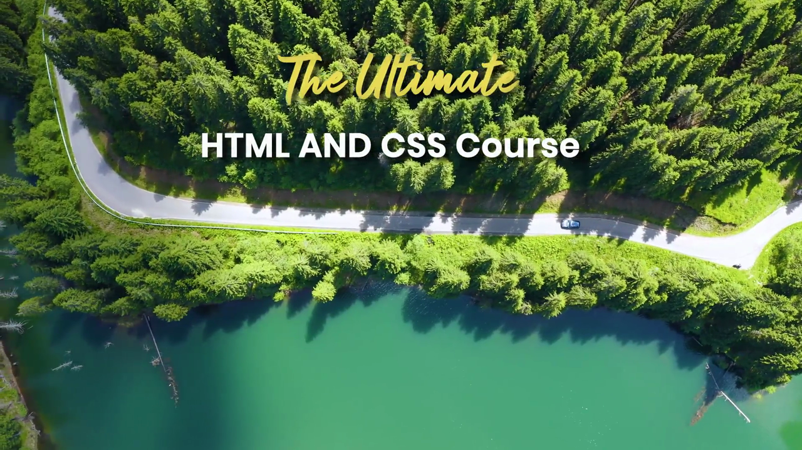

จากนั้นเผยชื่อบทใหม่ **"BUILDING A WEB SITE"** ซ้อนทับบน footage โดรนถนนป่าสนอีกมุมหนึ่ง:

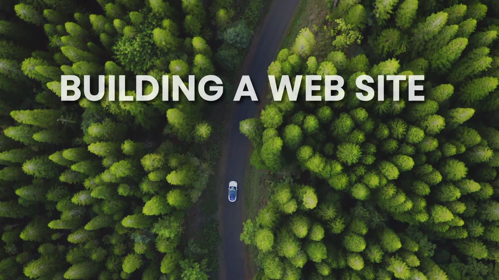

ตามด้วยสไลด์สามช่องสีสรุปจุดเด่นของเว็บไซต์ที่จะสร้าง — **BEAUTIFUL (สวยงาม)**, **RESPONSIVE (ปรับตามหน้าจอ)**, **FAST (โหลดเร็ว)**:

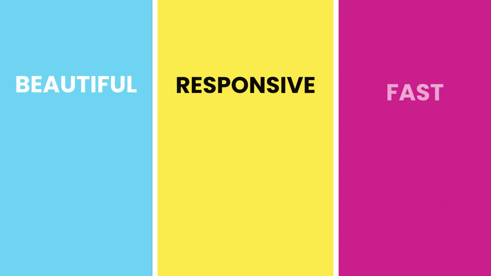

---

## 2. ตัวอย่างผลลัพธ์สุดท้าย — เว็บไซต์ Moshify

Mosh เปิดเบราว์เซอร์แสดงหน้าเว็บ **Moshify** เวอร์ชันสมบูรณ์ ซึ่งเป็นเว็บไซต์ให้บริการ Cloud Hosting สมมติ พร้อมส่วน hero header สีดำ ข้อความ "Cloud Hosting for Pros", ปุ่ม "GET STARTED", และภาพกราฟิกไอโซเมตริกเซิร์ฟเวอร์:

จากนั้นมีสไลด์มุกตลกแสดงโดเมน **"moshified.com"** (เล่นคำจากคำว่า Moshify) บนพื้นหลังสีชมพูม่วง:

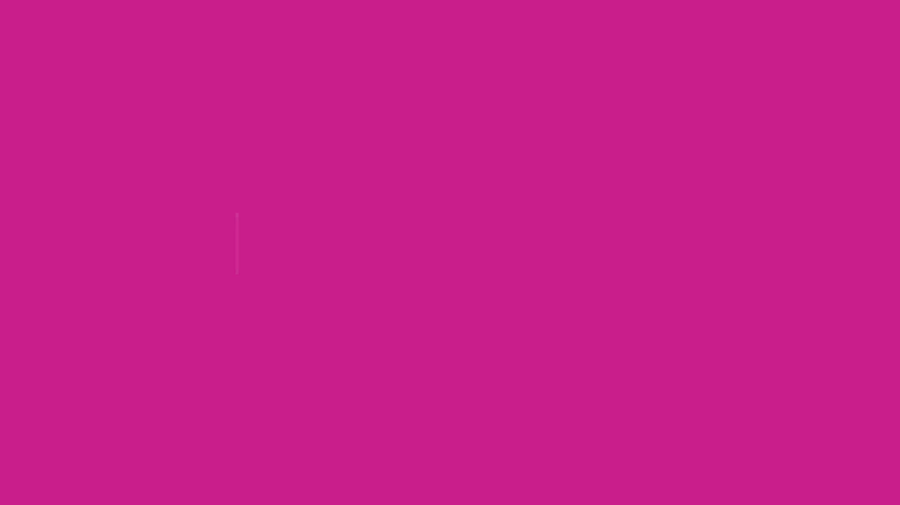

---

## 3. เบื้องหลัง — ไฟล์ดีไซน์ Photoshop ต้นแบบ

Mosh เปิด Adobe Photoshop 2021 แสดงไฟล์ดีไซน์ต้นแบบสองไฟล์ที่เตรียมไว้ล่วงหน้า: **`mobile.psd`** (เวอร์ชันมือถือ) และ **`standard.psd`** (เวอร์ชันเดสก์ท็อป) ซึ่งมีหน้าตาตรงกับเว็บไซต์ที่จะสร้างขึ้นจริงทุกประการ:

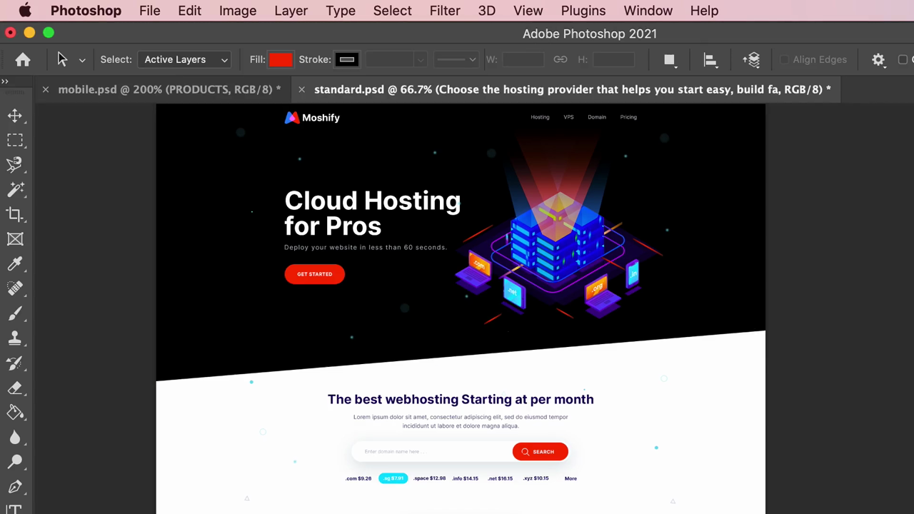

> **แนวคิดสำคัญ:** คอร์สนี้จำลองสถานการณ์การทำงานจริงของ Front-end Developer ที่ได้รับไฟล์ดีไซน์จากนักออกแบบ (ในรูปแบบ Photoshop `.psd`) แล้วต้องแปลงเป็นเว็บไซต์ HTML/CSS ที่ใช้งานได้จริง ทั้งเวอร์ชันมือถือและเดสก์ท็อป

---

## 4. เริ่มต้นเขียนโค้ดจาก VS Code

ตัดไปที่ VS Code แสดงโปรเจกต์ **"Moshify"** ที่มีไฟล์ `index.html` และ `styles.css` เตรียมพร้อม เริ่มพิมพ์โครงสร้างแรกด้วย Emmet:

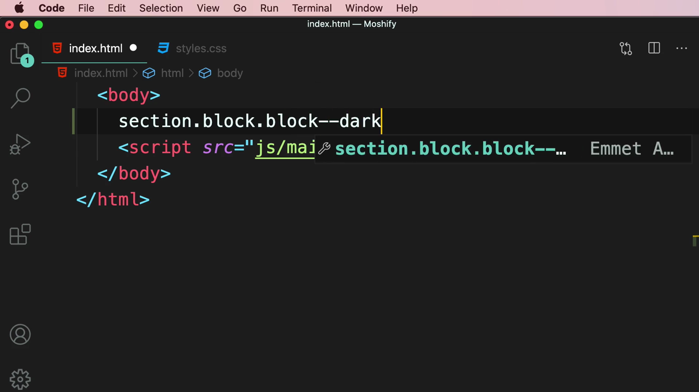

ผลลัพธ์ทดสอบแบบแบ่งครึ่งจอ (mobile/desktop split view) แสดงส่วน hero ของหน้าเว็บที่กำลังสร้าง เทียบเคียงกับภาพพื้นหลังภูเขา:

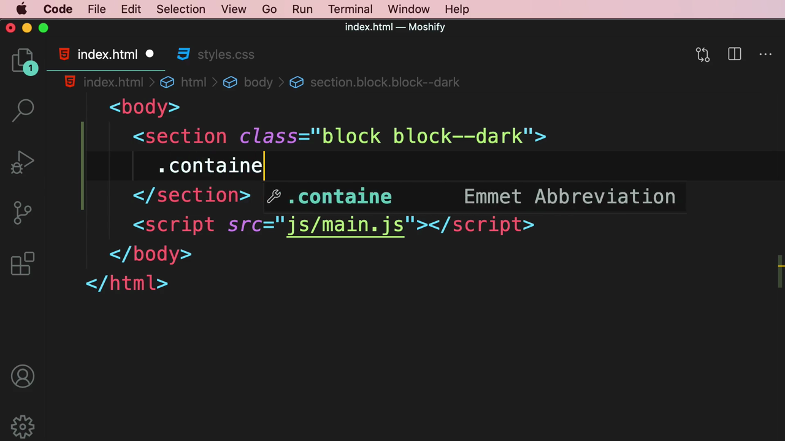

โค้ด HTML ที่พิมพ์ใช้ class ตามหลัก BEM ตั้งแต่ต้น เช่น `<section class="block block--dark">` และ `
`:

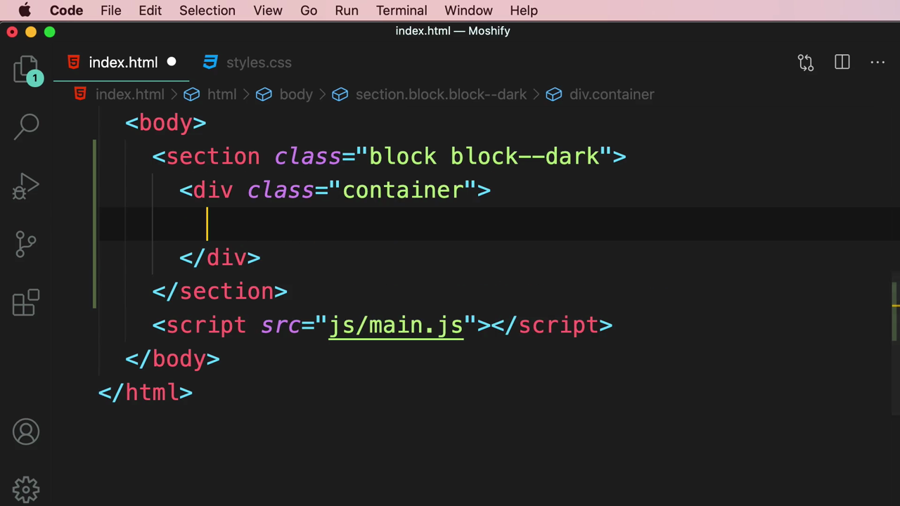

---

## 5. แนวคิดหลักของคอร์ส — "Become an HTML/CSS Expert"

สไลด์แสดงข้อความ **"BECOME AN HTML/CSS EXPERT"** เป็นเป้าหมายหลักของคอร์สนี้:

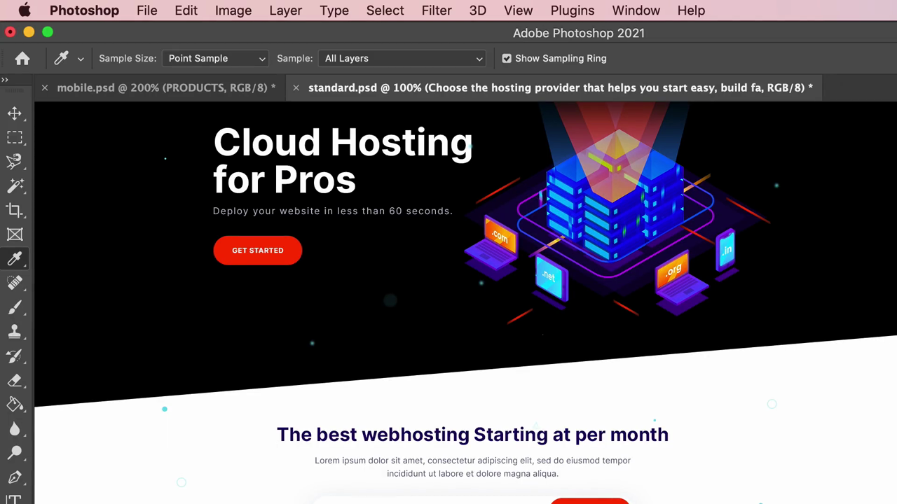

ตามด้วยการเลื่อนดูส่วนอื่นๆ ของหน้าเว็บ Moshify ที่จะสร้าง เช่นส่วน **"Simply Fast Websites"** พร้อมกราฟข้อมูลประกอบ:

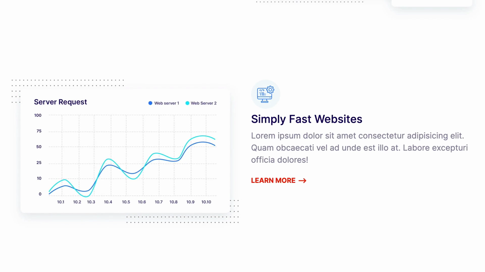

---

## 6. ปิดท้ายด้วยสไลด์แนะนำผู้สอนและโลโก้

สไลด์แนะนำตัว Mosh Hamedani พร้อมช่องทางติดตาม (codewithmosh.com, @moshhamedani):

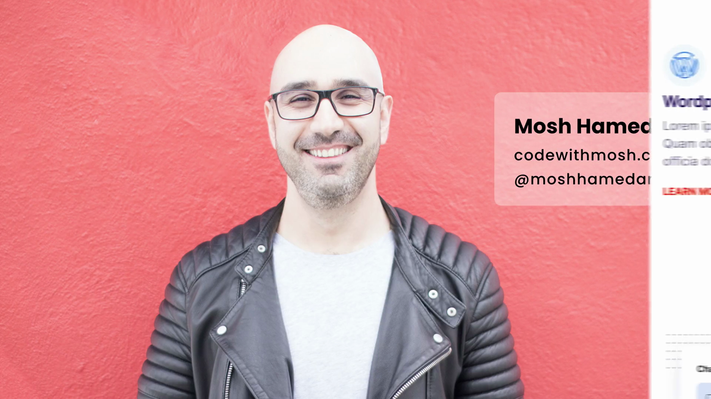

ปิดท้ายด้วยแอนิเมชันโลโก้ Mosh Hamedani:

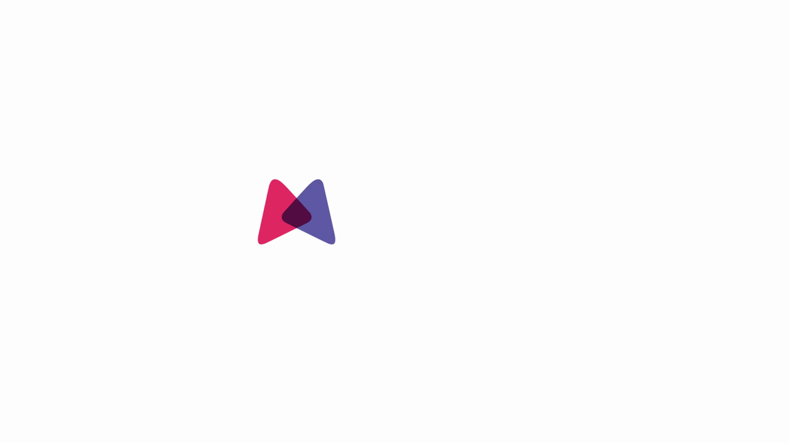

---

## สรุปภาพรวมของคลิปนี้

| ประเด็น | รายละเอียด |
|---|---|
| **หัวข้อ** | Introduction — เปิดคอร์สใหม่ "Building a Web Site" |
| **โปรเจกต์ตัวอย่าง** | Moshify (เว็บไซต์ Cloud Hosting สมมติ) |
| **ไฟล์ดีไซน์ต้นแบบ** | `mobile.psd`, `standard.psd` (Adobe Photoshop) |
| **จุดเด่นที่เน้น** | Beautiful, Responsive, Fast |
| **แนวทางการเขียนโค้ด** | ใช้ BEM naming convention ตั้งแต่เริ่มต้น (`.block`, `.block--dark`, `.container`) |

**แนวคิดสำคัญที่ได้จากคลิปนี้:**

1. **คอร์สนี้เปลี่ยนโหมดการเรียนรู้** จากการสอนทีละหัวข้อ (topic-based) มาเป็นการสร้างโปรเจกต์จริงทั้งหน้าตั้งแต่ต้นจนจบ (project-based)
2. **จุดเริ่มต้นของงานคือไฟล์ดีไซน์ Photoshop** (`mobile.psd`, `standard.psd`) ซึ่งจำลองสถานการณ์การทำงานจริงที่นักพัฒนาได้รับไฟล์ดีไซน์จากดีไซเนอร์มาแปลงเป็นโค้ด
3. **หลักการที่เรียนมาก่อนหน้า (BEM, OOCSS, Best Practices) ถูกนำมาใช้จริงตั้งแต่บรรทัดแรก** ของโปรเจกต์ Moshify เช่น `block`, `block--dark`, `container`
4. **เป้าหมายสุดท้ายคือเว็บไซต์ที่สวยงาม (Beautiful) ปรับตามขนาดหน้าจอได้ (Responsive) และโหลดเร็ว (Fast)** ซึ่งเป็นสามเสาหลักของการพัฒนาเว็บสมัยใหม่

---

*หมายเหตุ: คลิปนี้เป็นคลิปเปิดคอร์ส "Building a Web Site" (ต่อจาก The Ultimate HTML and CSS Course) โดย Mosh Hamedani (codewithmosh.com) — คลิปที่ 1*
