# HTML-CSS-3: 13 - Lists

**ไฟล์ต้นทาง:** 13-Lists.mp4

▶️ [ดูวิดีโอ](../../HTML-CSS-3/13-Lists.mp4)

---

## ภาพรวมคลิปนี้

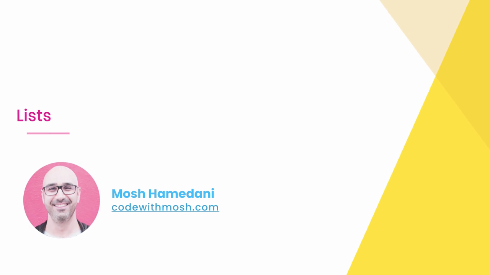

คลิปนี้ Mosh สอนเรื่อง **Lists (รายการ)** โดยเริ่มจากการดูดีไซน์ใน Photoshop ที่แสดงส่วนของแผนราคา (Pricing Plan) ซึ่งมีรายการฟีเจอร์พร้อมเครื่องหมายถูกสีเขียว (checkmark) นำหน้าแต่ละบรรทัด เช่น "Unlimited Websites", "Unlimited Bandwidth", "100 GB SSD Storage", "3 GB RAM"

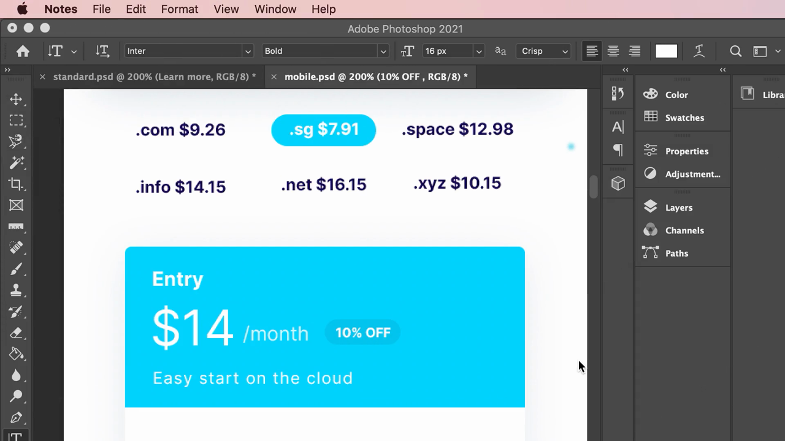

และมีการย้อนดู badge ราคาที่ทำไว้จากคลิปที่แล้ว (12-Badges) ประกอบกันเป็นส่วนหนึ่งของ pricing plan

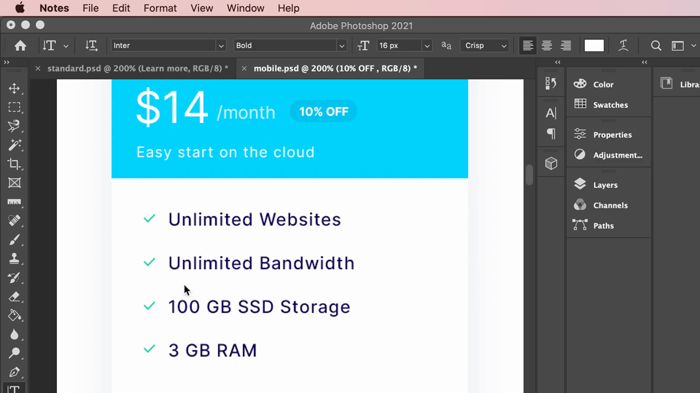

เป้าหมายของคลิปนี้คือสร้าง CSS component ชื่อ `.list` ที่ปรับแต่งได้หลายรูปแบบด้วยหลักการ **BEM (Block Element Modifier)** แบบครบสูตรเป็นครั้งแรก คือมีทั้ง Block (`.list`), Element (`.list__item`) และ Modifier (`.list--inline`, `.list--tick`) ผสมกันในคลิปเดียว พร้อมทั้งสอนเทคนิคการใช้ไอคอน SVG แทนเครื่องหมาย bullet ปกติด้วย `list-style-image`

> **หมายเหตุสำคัญ:** นี่คือคลิปแรกที่ Mosh อธิบายและใช้ BEM ครบทั้ง 3 ส่วน (Block / Element / Modifier) พร้อมกันอย่างชัดเจน ต่างจากคลิป Badges (12) ที่ใช้แค่ Block กับ Modifier เท่านั้น (ไม่มี Element)

---

## 1. สร้าง Block พื้นฐาน `.list`

Mosh เริ่มต้นด้วยการเปิดไฟล์ `styles.css` แล้วพิมพ์ selector `.list` ขึ้นมาใหม่

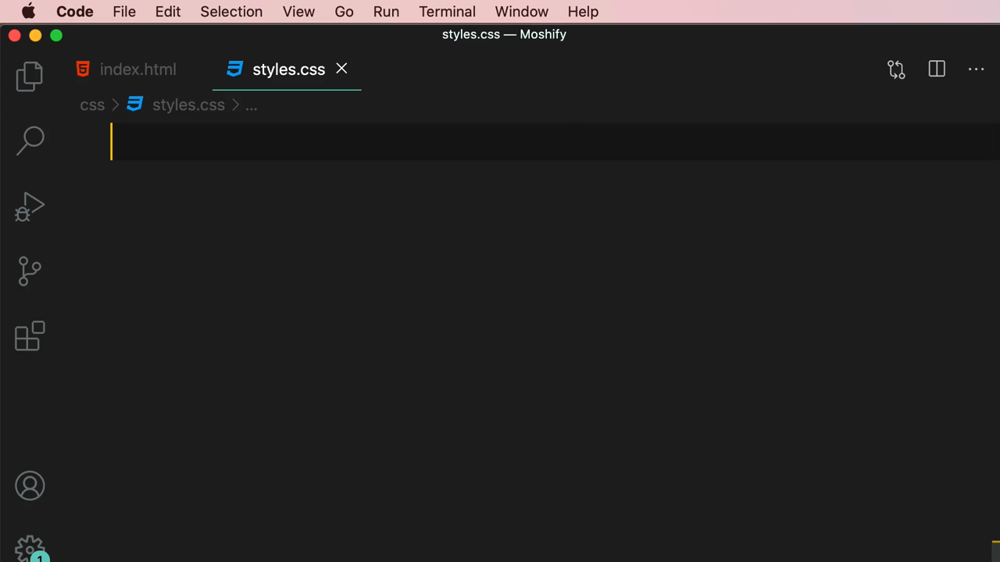

ภายในบล็อกนี้ เขาพิมพ์ property `list-style` ซึ่ง VS Code (พร้อม extension CSS IntelliSense) แสดงคำแนะนำค่าต่างๆ ให้เลือก เช่น `none`

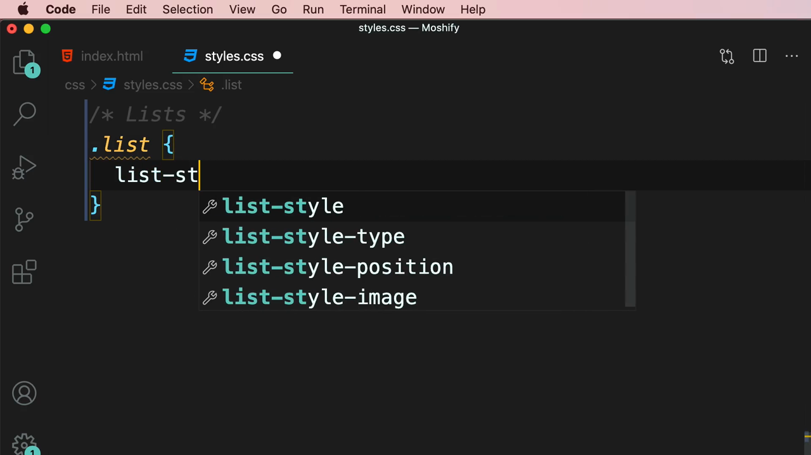

โค้ด CSS ที่ได้ในขั้นตอนนี้:

```css
.list {
  list-style: none;
  padding-left: 0;
  color: var(--color-headings);
}
```

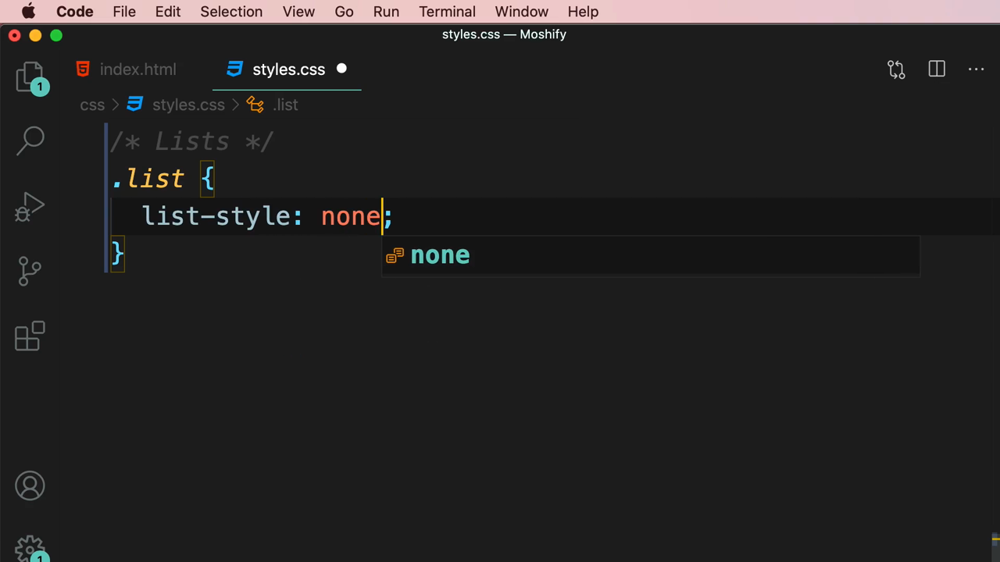

> **คำอธิบายแต่ละ property:**
> - `list-style: none;` — เอาเครื่องหมาย bullet (จุดกลม) ที่เบราว์เซอร์ใส่ให้ `<ul>`/`<ol>` โดยอัตโนมัติออกไป เพราะเราจะออกแบบ bullet เองในภายหลัง (ด้วย modifier `.list--tick`)
> - `padding-left: 0;` — โดยปกติ `<ul>` และ `<ol>` จะมี padding ด้านซ้ายที่เบราว์เซอร์กำหนดมาให้ (เพื่อเว้นที่ให้ bullet) ทำให้ข้อความเยื้องเข้าไป การตั้งเป็น `0` คือการล้างค่านั้นออก เพื่อให้ list ชิดขอบซ้ายเหมือน element ปกติ — นี่คือ **CSS Reset pattern ที่ใช้บ่อยมากสำหรับ list**
> - `color: var(--color-headings);` — ใช้ CSS Custom Property (ตัวแปรสี) ที่ตั้งไว้ใน `:root` เพื่อให้สีตัวอักษรของ list เข้ากับสีหัวข้อ (heading) ในธีมของเว็บไซต์ ทำให้ดูเป็นระบบเดียวกัน

---

## 2. สร้าง HTML markup ด้วย Emmet

หลังจากนั้น Mosh สลับไปที่ไฟล์ `index.html` แล้วพิมพ์ Emmet abbreviation เพื่อสร้าง list ตัวอย่างขึ้นมาทดสอบ

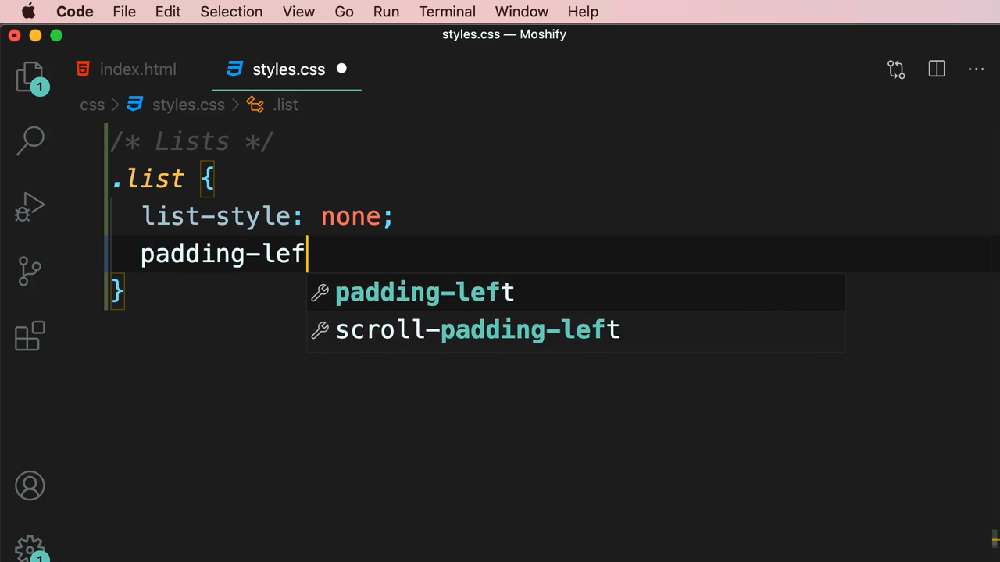

เมื่อกด Tab เพื่อขยาย Emmet ออกมา

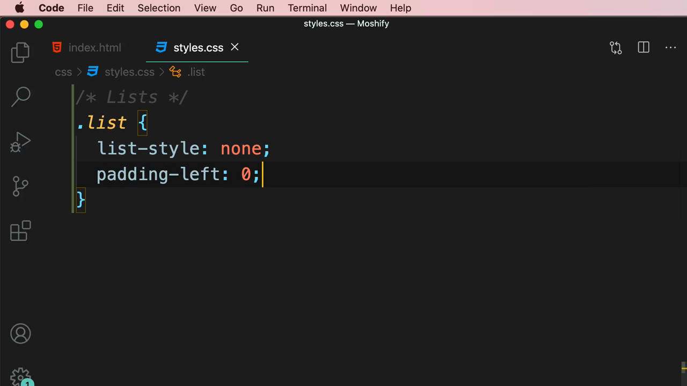

จะได้ HTML markup ดังนี้:

```html
<ul class="list">
  <li>Item 1</li>
  <li>Item 2</li>
  <li>Item 3</li>
</ul>
```

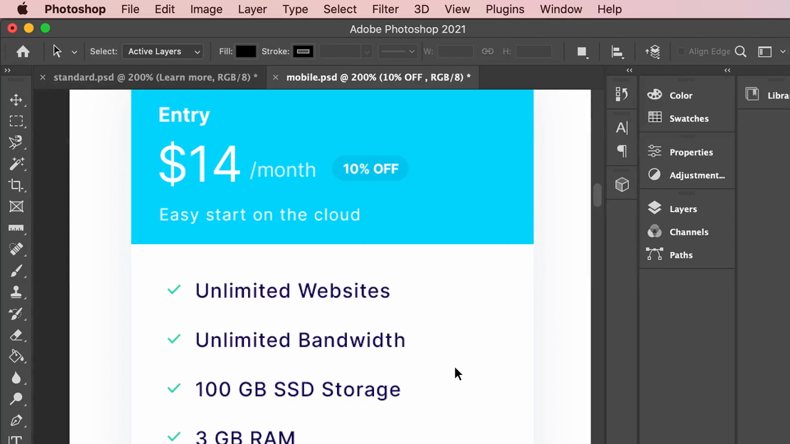

> **อธิบาย Emmet abbreviation `ul.list>li{Item $}*3`:**
> - `ul.list` — สร้าง tag `<ul>` พร้อม class `list`
> - `>` — หมายถึง "ข้างใน" (child element)
> - `li{Item $}` — สร้าง `<li>` ที่มีข้อความ "Item" ตามด้วยตัวเลขจาก `$` (ตัวนับอัตโนมัติ)
> - `*3` — ทำซ้ำ 3 ครั้ง โดย `$` จะถูกแทนที่ด้วย 1, 2, 3 ตามลำดับ
>
> นี่คือหนึ่งในเทคนิค Emmet ที่มีประโยชน์มากสำหรับการสร้างรายการซ้ำๆ อย่างรวดเร็ว แทนที่จะพิมพ์ `<li>` ทีละบรรทัดเอง

จากนั้นทดสอบผลลัพธ์ในเบราว์เซอร์ ผลลัพธ์คือ bullet หายไป, การเยื้อง (indentation) หายไป และตัวอักษรเป็นสีเดียวกับสี heading ตามที่ตั้งค่า CSS ไว้

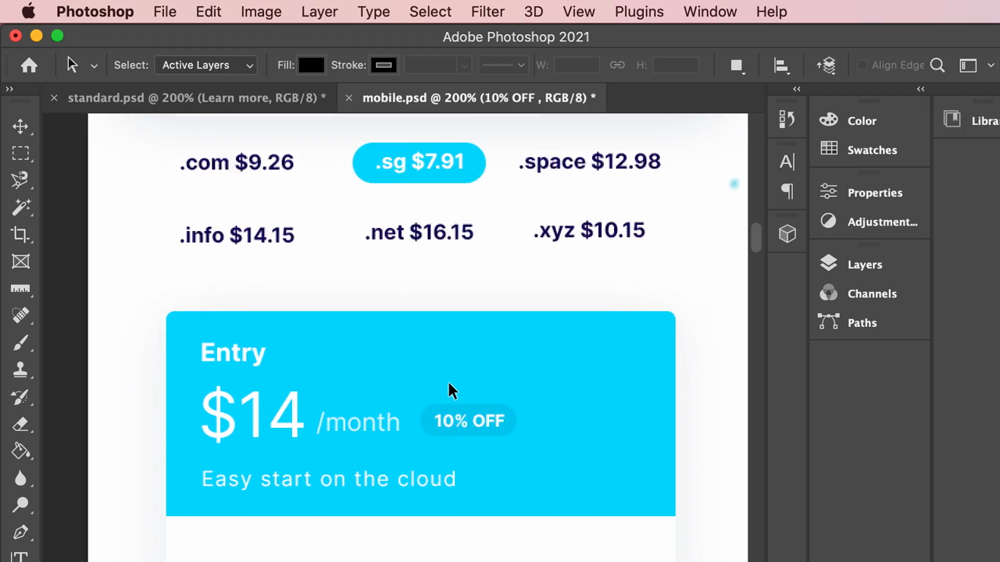

---

## 3. เพิ่ม BEM Element: `.list__item`

ขั้นตอนนี้สำคัญมาก เพราะเป็นครั้งแรกที่คลิปในซีรีส์นี้อธิบาย **Element** ของ BEM อย่างชัดเจน (ก่อนหน้านี้ในคลิป Badges มีแต่ Modifier)

Mosh ย้อนกลับไปดู markup เดิมอีกครั้ง

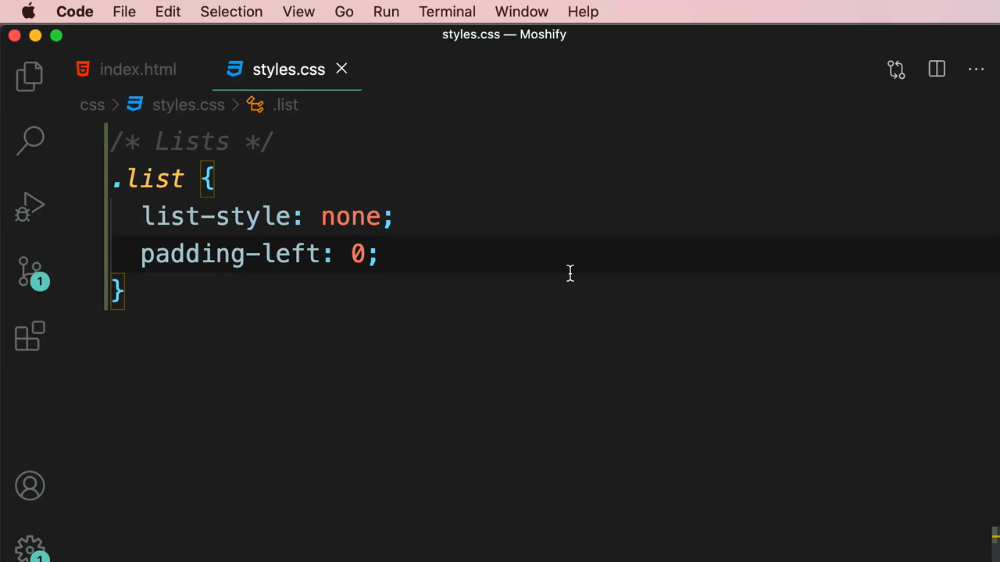

แล้วเริ่มพิมพ์ class `list__item` ลงใน `<li>` ตัวแรก

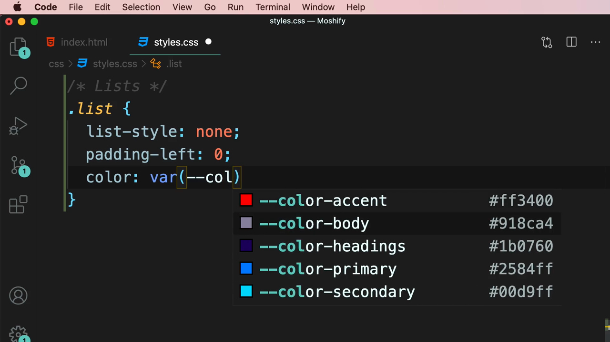

จากนั้นใช้เทคนิค **Multi-cursor editing** ของ VS Code (กด `Cmd/Ctrl + D` เพื่อเลือกคำที่เหมือนกันหลายจุดพร้อมกัน หรือ `Option/Alt + คลิก` เพื่อวาง cursor หลายจุด) เพื่อเลือก `<li>` ทั้ง 3 ตัวพร้อมกัน

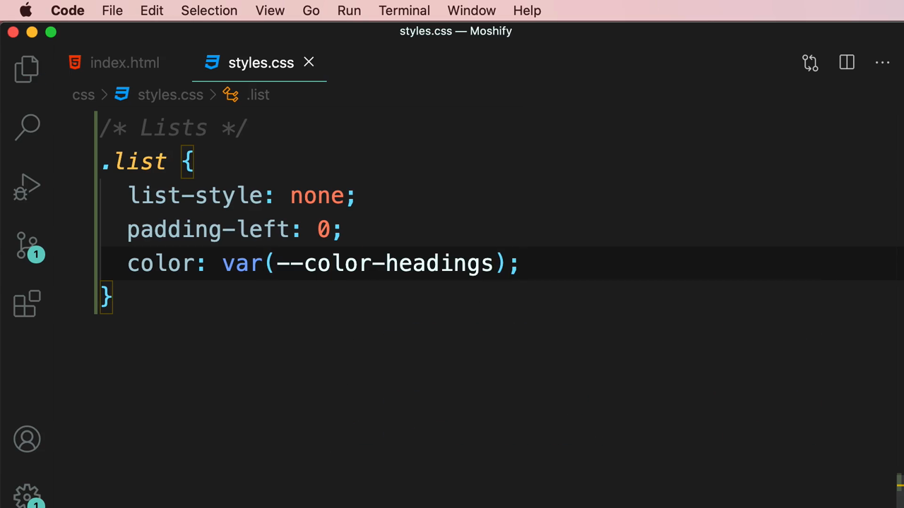

แล้วพิมพ์ `class="list__item"` เพิ่มเข้าไปในทุก `<li>` พร้อมกันในครั้งเดียว

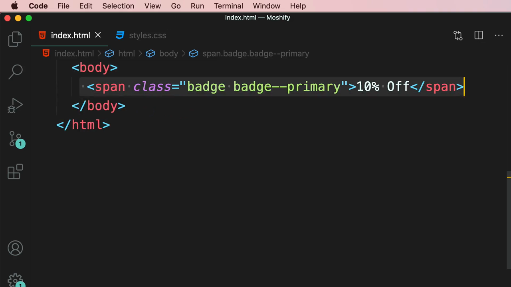

ผลลัพธ์สุดท้ายของ HTML:

```html
<ul class="list">
  <li class="list__item">Item 1</li>
  <li class="list__item">Item 2</li>
  <li class="list__item">Item 3</li>
</ul>
```

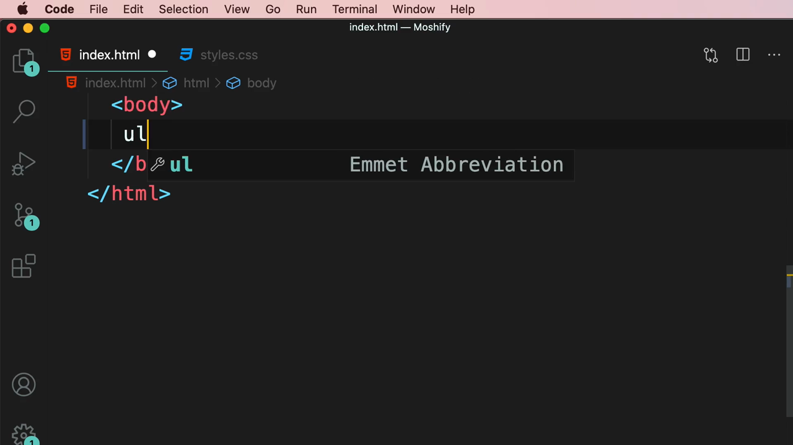

> **อธิบายหลักการ BEM แบบละเอียด:**
>
> BEM ย่อมาจาก **Block, Element, Modifier** เป็นวิธีตั้งชื่อ class ใน CSS ให้เป็นระบบ อ่านง่าย ไม่ชนกัน (naming collision) และรู้ทันทีว่า class นั้นสัมพันธ์กับอะไร
>
> - **Block** คือ component หลักหรือ "กล่องใหญ่" ในที่นี้คือ `.list` — เป็นตัวแทนของ component ทั้งก้อน
> - **Element** คือ "ส่วนย่อย" ที่อยู่ภายใน Block นั้น เขียนด้วยการต่อ underscore สองตัว (`__`) ต่อท้ายชื่อ Block เช่น `.list__item` หมายถึง "ไอเทมที่อยู่ภายใน list" — สังเกตว่า Element จะพึ่งพา Block เสมอ ไม่สามารถใช้ `.list__item` เดี่ยวๆ โดยไม่มี `.list` ครอบอยู่แล้วมีความหมายสมบูรณ์
> - **Modifier** คือ "ตัวแปรหรือรูปแบบที่ต่างออกไป" ของ Block หรือ Element เขียนด้วยขีดกลางสองตัว (`--`) เช่น `.list--inline`, `.list--tick` (ที่จะสอนในหัวข้อถัดไป) หรือจากคลิปก่อนหน้า `.badge--primary`, `.badge--secondary`
>
> การผสมกันจะได้ selector ที่ทรงพลัง เช่น `.list--inline .list__item` (Modifier ของ Block ใช้ descendant selector หา Element) ซึ่งจะอธิบายในหัวข้อถัดไป

---

## 4. สร้าง Modifier แรก: `.list--inline`

Mosh พิมพ์ selector ใหม่ใน `styles.css`

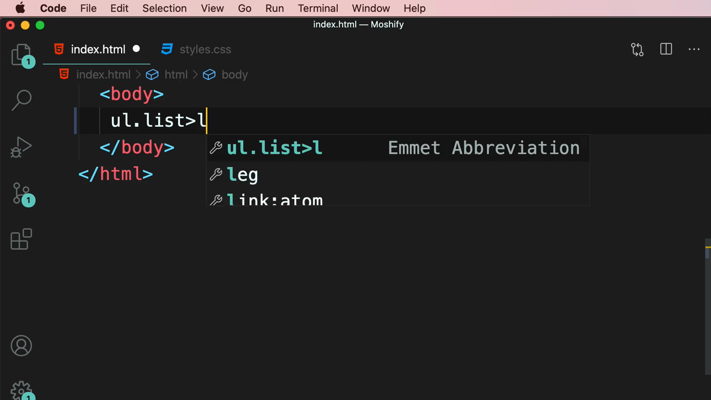

แล้วต่อด้วย descendant selector หา Element `.list__item` ข้างใน

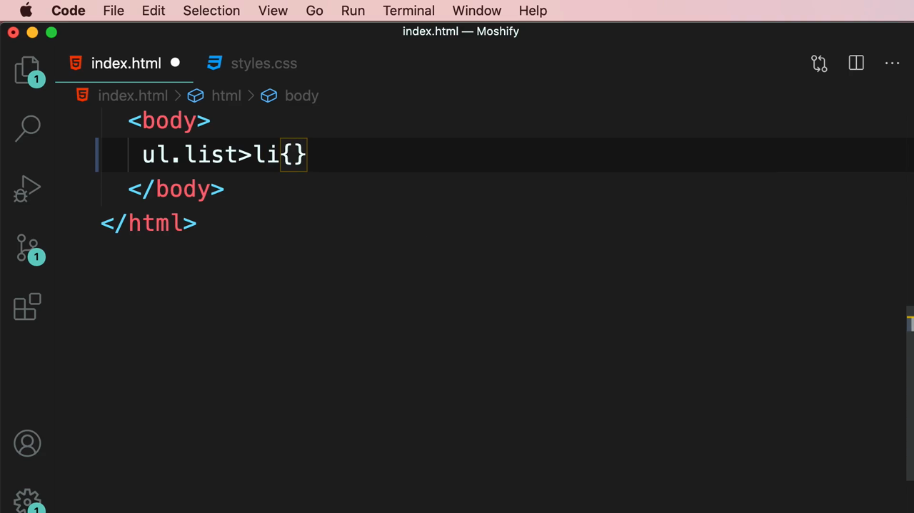

ภายในบล็อกนี้พิมพ์ property `display` โดย IntelliSense แนะนำค่า `inline-block`

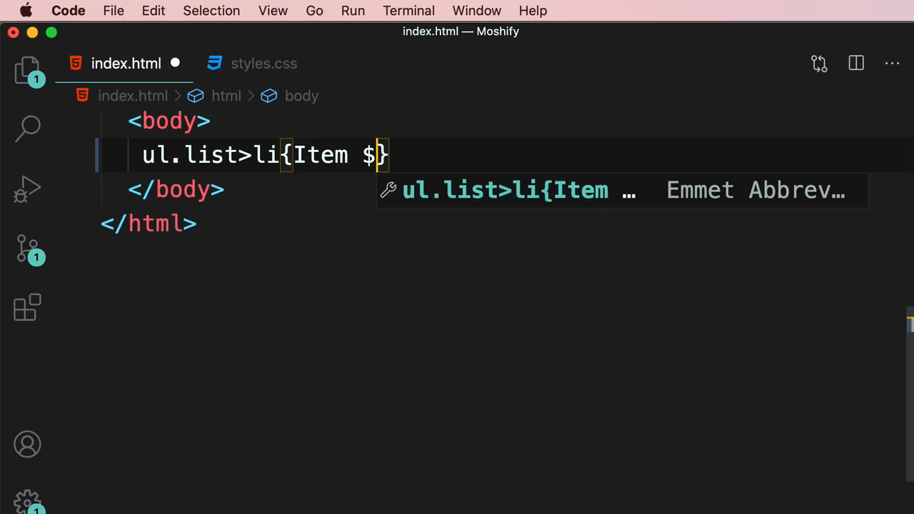

จากนั้นพิมพ์ `margin-right: 2rem;` เพื่อเว้นระยะห่างระหว่างไอเทมแต่ละตัวเมื่อเรียงตามแนวนอน

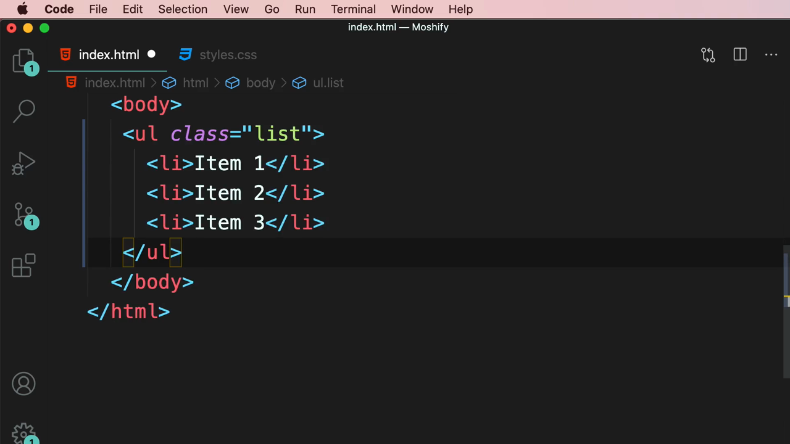

โค้ดสมบูรณ์:

```css
.list--inline .list__item {
  display: inline-block;
  margin-right: 2rem;
}
```

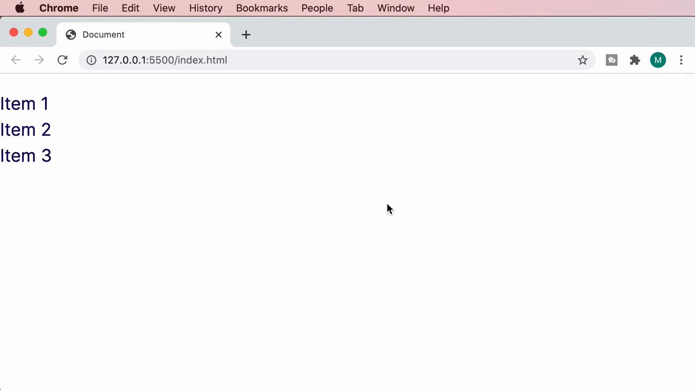

> **คำอธิบาย:**
> - selector `.list--inline .list__item` หมายถึง "เลือก element ที่มี class `list__item` ซึ่งอยู่ **ข้างใน** element ที่มี class `list--inline`" — เป็น descendant combinator (เว้นวรรคระหว่าง selector สองตัว) นี่คือรูปแบบมาตรฐานของ BEM ที่ผสาน Modifier ของ Block เข้ากับ Element เพื่อเปลี่ยนพฤติกรรมของ Element นั้นเมื่ออยู่ภายใต้ Modifier ที่กำหนด
> - `display: inline-block;` — เปลี่ยนจาก `<li>` ที่ปกติเป็น block-level (ขึ้นบรรทัดใหม่ทุกตัว) ให้กลายเป็น inline-block (เรียงต่อกันในแนวนอนได้ แต่ยังกำหนด width/height/margin/padding ได้เหมือน block)
> - `margin-right: 2rem;` — เว้นระยะห่างด้านขวาของแต่ละไอเทม 2rem (20px ด้วยเทคนิค 62.5% ที่ตั้งไว้ตั้งแต่คลิป Links) เพื่อไม่ให้ไอเทมชิดติดกันเกินไปเมื่อเรียงแนวนอน

จากนั้นกลับไปที่ `index.html` เพื่อเพิ่ม class `list--inline` เข้าไปที่ `<ul>`

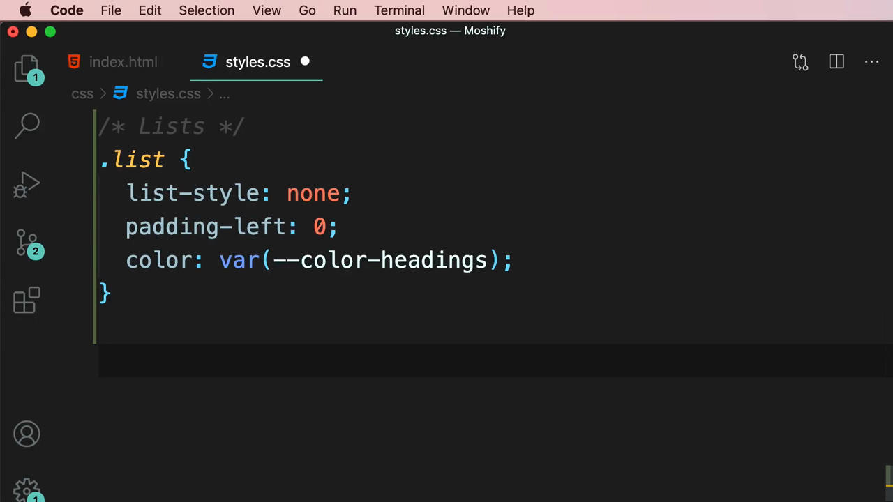

ทดสอบผลลัพธ์ในเบราว์เซอร์ — ไอเทมทั้ง 3 เรียงตัวในแนวนอนพร้อมระยะห่าง 2rem ระหว่างกัน

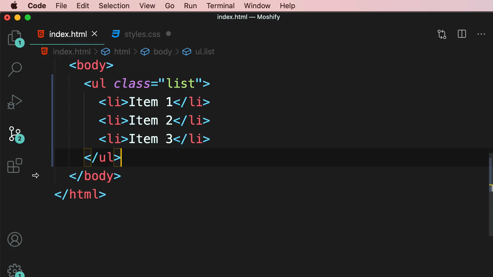

> **หมายเหตุการเขียน class หลายตัว:** ใน HTML การใส่ class หลายตัวให้เขียนคั่นด้วยช่องว่าง เช่น `class="list list--inline"` — หมายความว่า element นี้มีทั้ง class `list` (Block พื้นฐาน) และ `list--inline` (Modifier) พร้อมกัน ซึ่งเป็นวิธีมาตรฐานของ BEM ในการ "เปิดใช้งาน" Modifier — ไม่ได้แทนที่ class เดิม แต่เพิ่มเข้าไป

---

## 5. ข้อควรระวัง: การพิมพ์ผิดโดยไม่ตั้งใจ (`font-size: bold`)

ระหว่างที่กำลังพิมพ์โค้ด Mosh พิมพ์ property ผิดโดยไม่ตั้งใจ คือใส่ `font-size: bold;` ลงในบล็อก `.list` (ซึ่งเป็นค่าที่ไม่ถูกต้อง เพราะ `font-size` ต้องเป็นหน่วยขนาด เช่น `px`/`rem`/`%` ไม่ใช่คำว่า `bold` — คำว่า `bold` เป็นค่าที่ถูกต้องสำหรับ property `font-weight` ต่างหาก)

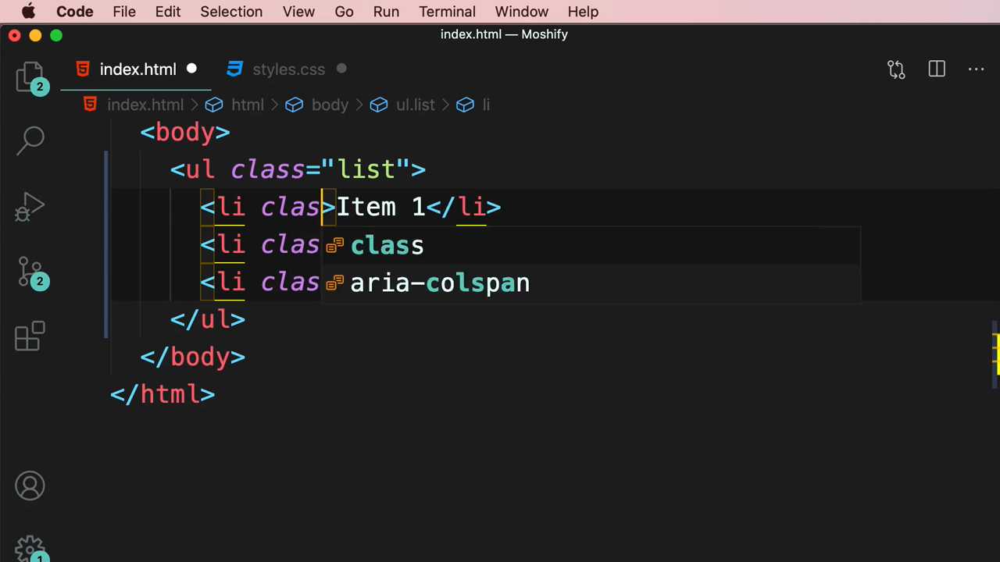

เมื่อสังเกตเห็นว่าไม่ถูกต้อง เขาก็ลบทิ้งทันที กลับไปเป็นบล็อก `.list` เดิม (มีแค่ 3 properties: `list-style`, `padding-left`, `color`)

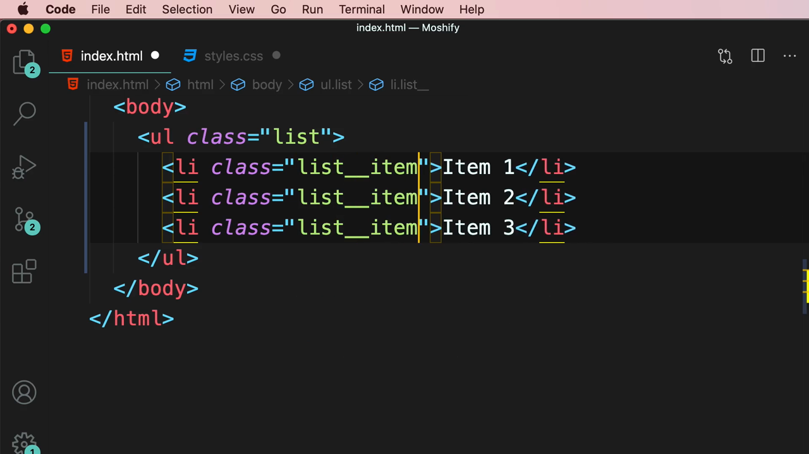

> **บทเรียนจากจุดนี้:** นี่คือตัวอย่างที่ดีว่าแม้แต่ผู้สอนมืออาชีพก็พิมพ์ผิดได้ (เช่น สับสนระหว่าง `font-size` กับ `font-weight`) สิ่งสำคัญคือ VS Code จะไม่ error ทันทีถ้าใส่ค่าที่ผิดแบบนี้ (เพราะ CSS เป็นภาษาที่ "ให้อภัย" — invalid declaration จะถูกเบราว์เซอร์เพิกเฉยไปเงียบๆ ไม่ทำให้หน้าเว็บพัง) ดังนั้นการ debug ด้วยตาและอ่านทวนโค้ดของตัวเองอยู่เสมอจึงสำคัญมาก

---

## 6. เริ่มสร้าง Modifier ที่สอง: `.list--tick`

Mosh พิมพ์ selector ใหม่

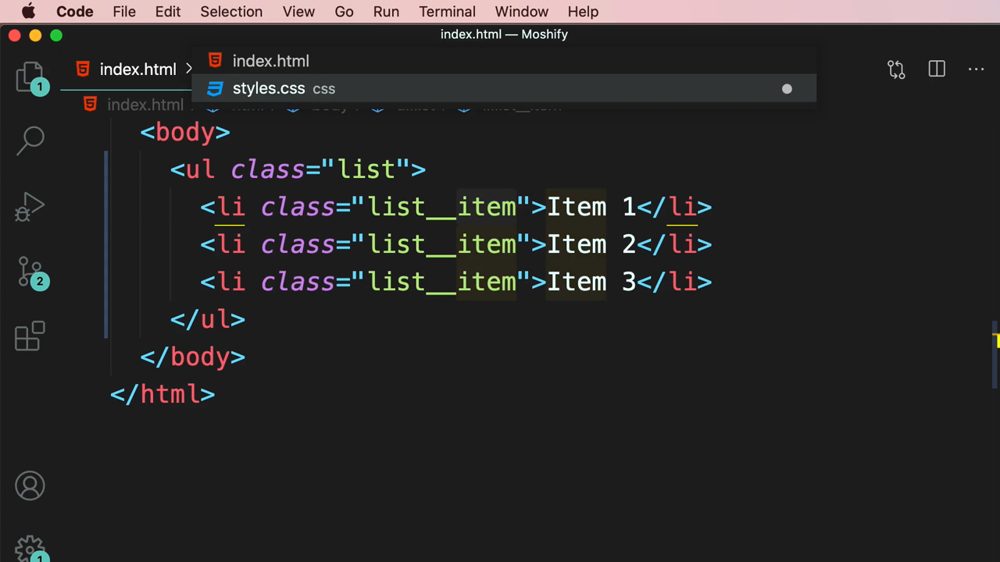

สร้างเป็น empty block ไว้ก่อน เตรียมเติมเนื้อหาทีหลัง

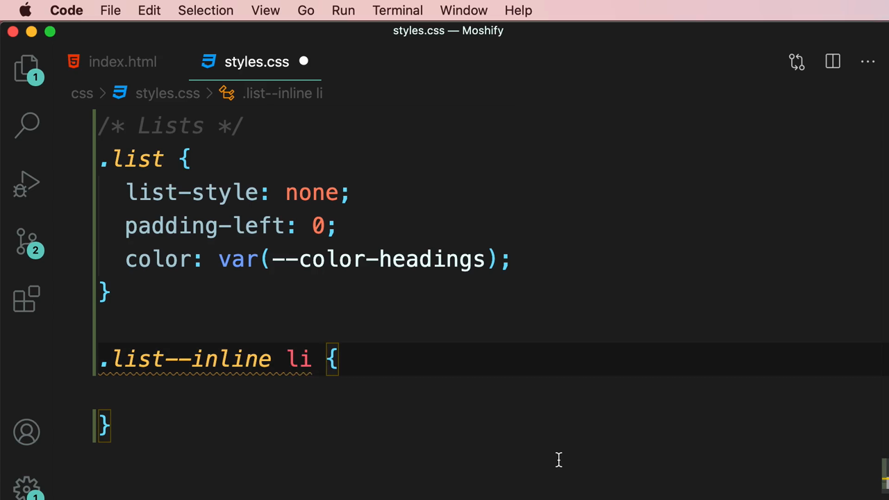

```css
.list--tick {

}
```

> **จุดประสงค์ของ `.list--tick`:** Modifier ตัวนี้จะทำให้ list แสดงเครื่องหมายถูก (✓) สีเขียวแทน bullet ปกติ ตามดีไซน์ pricing plan ที่เห็นใน Photoshop ตอนต้นคลิป

---

## 7. หาไอคอน SVG จาก Icon Library ส่วนตัว

Mosh เปิด Finder แล้วไปที่โฟลเดอร์ Downloads > icons ซึ่งเป็นคลังไอคอน SVG ส่วนตัวที่รวบรวมไว้ ภายในมีไฟล์ SVG หลายแบบ เช่น `quotes.svg`, `menu.svg`, `snap.svg`, `wordpress.svg`, `logo.svg`, `growth.svg`, `easy.svg`, `clock.svg`, `computer.svg`, `line.svg`, `tick.svg`, `settings.svg`, `chevron.svg`, `search.svg` และไฟล์ `attributions.txt` (สำหรับอ้างอิงที่มาของไอคอน)

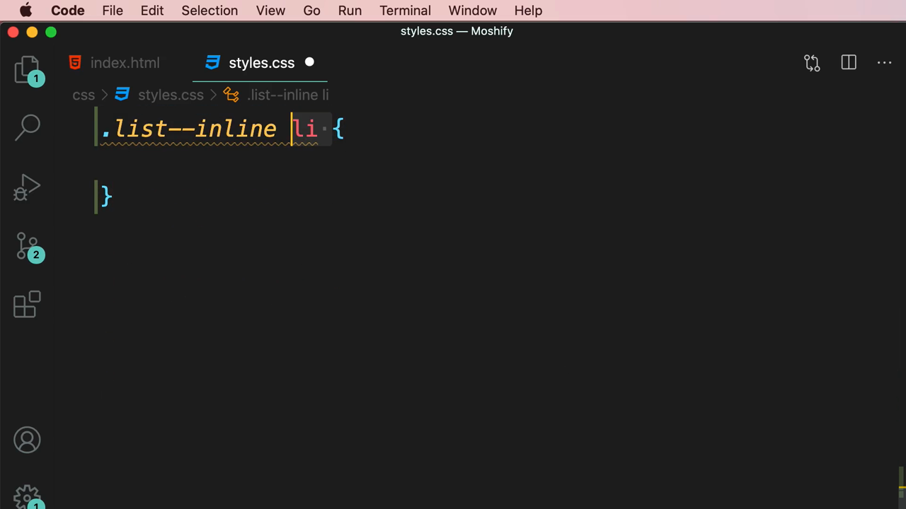

เขาเลือกไฟล์ `tick.svg` ที่จะใช้เป็นไอคอนเครื่องหมายถูก

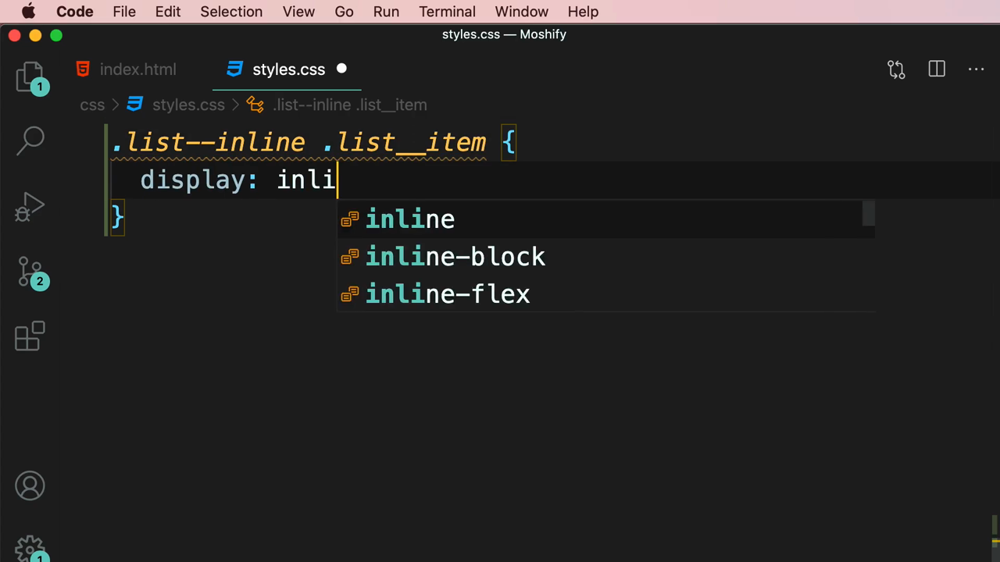

> **หมายเหตุ:** การมี "คลังไอคอน" (icon library) ส่วนตัวไว้ล่วงหน้าเป็นแนวทางปฏิบัติที่ดีสำหรับนักพัฒนา Front End เพราะช่วยประหยัดเวลาในการหาไอคอนใหม่ทุกครั้งที่ต้องใช้งาน ไฟล์ `attributions.txt` มีไว้เพื่อบันทึกแหล่งที่มาของไอคอน (สำคัญมากถ้าไอคอนมีลิขสิทธิ์ที่ต้องให้เครดิตผู้สร้าง)

---

## 8. สร้างโฟลเดอร์ `images/` ในโปรเจกต์ และคัดลอกไอคอน

กลับมาที่ VS Code เขาคลิกขวาใน Explorer เพื่อสร้างโฟลเดอร์ใหม่

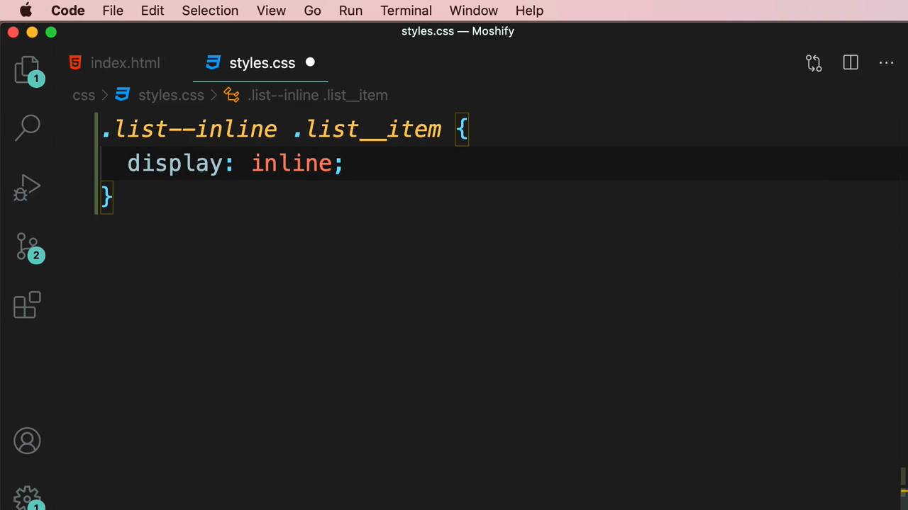

ตั้งชื่อโฟลเดอร์ว่า `images` แล้วสร้างสำเร็จ

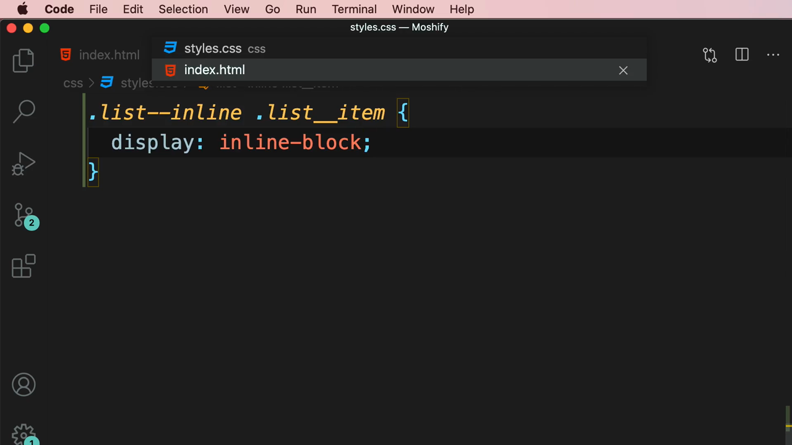

จากนั้นลาก (drag & drop) ไฟล์ `tick.svg` จาก Finder เข้าไปในโฟลเดอร์ `images` ของโปรเจกต์

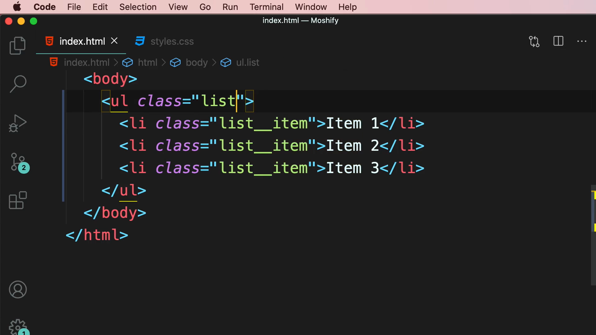

ไฟล์ถูกคัดลอกเข้ามาสำเร็จ ปรากฏใน Explorer ของ VS Code

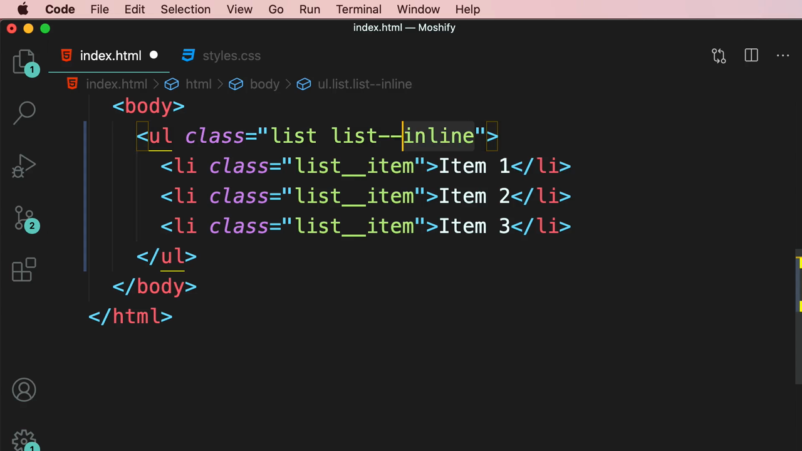

---

## 9. เปิดดูโค้ดข้างใน `tick.svg`

Mosh เปิดไฟล์ `tick.svg` ขึ้นมาดูเนื้อหาข้างในเพื่อความเข้าใจว่า SVG ทำงานอย่างไร

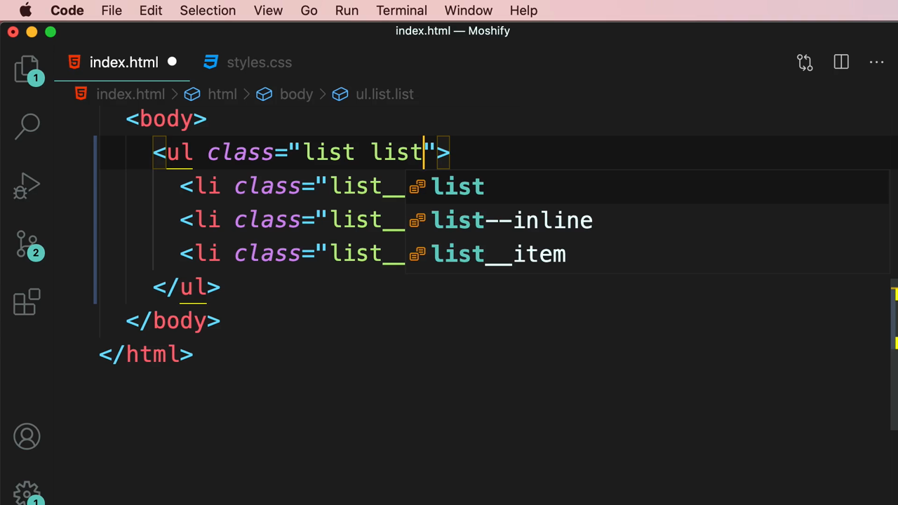

เนื้อหาภายในไฟล์ (โครงสร้างหลัก):

```svg
<svg xmlns="http://www.w3.org/2000/svg" width="...">
  <defs>
    <style>
      .cls-1 {
        fill: none;
        stroke: #2dd5a7;
        stroke-width: 2px;
        fill-rule: evenodd;
      }
    </style>
  </defs>
  <path id="Shape_10_copy_5" data-name="Sha..." class="cls-1" d="..." />
</svg>
```

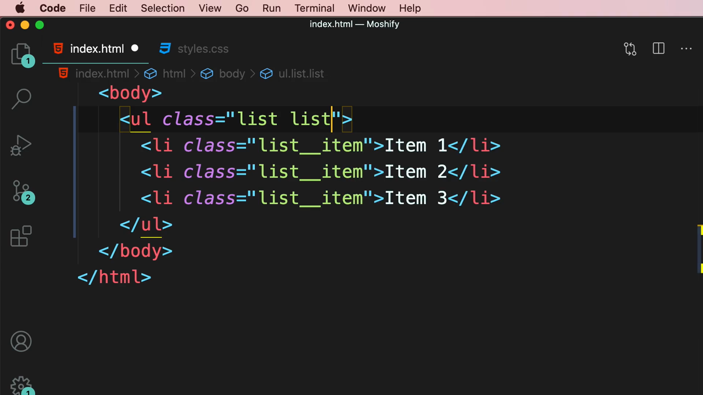

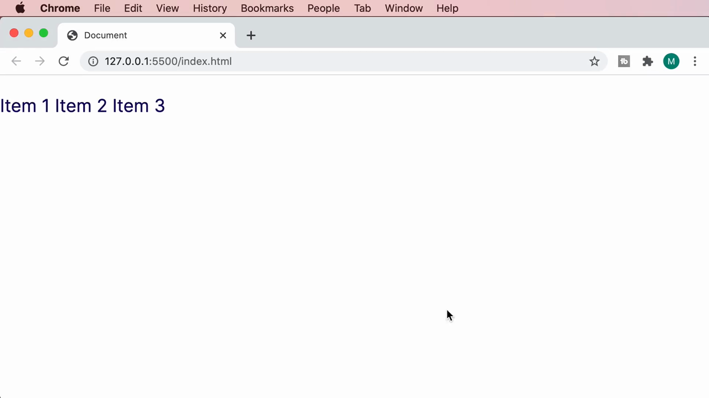

> **อธิบายโครงสร้าง SVG:**
> - `<svg xmlns="...">` — root element ของไฟล์ SVG (Scalable Vector Graphics) ระบุ XML namespace ที่จำเป็น
> - `<defs>` — ย่อมาจาก "definitions" ใช้เก็บสิ่งที่จะถูกอ้างอิงใช้ในที่อื่นของไฟล์ (เช่น style, gradient, symbol) โดยไม่แสดงผลโดยตรง
> - `<style>` ภายใน `<defs>` — กำหนด CSS class ชื่อ `.cls-1` ให้กับ shape ใน SVG นี้ ได้แก่ `fill: none;` (ไม่เติมสีข้างใน), `stroke: #2dd5a7;` (สีเส้นขอบเป็นสีเขียวมิ้นท์), `stroke-width: 2px;` (ความหนาเส้น 2 พิกเซล), `fill-rule: evenodd;` (กฎการกำหนดพื้นที่ด้านในของรูปทรงที่ซับซ้อน)
> - `<path class="cls-1" d="...">` — องค์ประกอบหลักที่วาดรูปทรงเครื่องหมายถูกจริงๆ โดยใช้ attribute `d` ซึ่งเป็นชุดคำสั่งวาดเส้น (M = moveto, L = lineto, C = curveto ฯลฯ) — เป็นภาษาเฉพาะของ SVG path ที่ค่อนข้างซับซ้อน แต่ไม่จำเป็นต้องเข้าใจลึกในระดับนี้ เพียงรู้ว่ามันคือ "พิกัดการวาดเส้น" ก็เพียงพอสำหรับการใช้งานทั่วไป
>
> ข้อดีของการใช้ SVG แทนรูปภาพ PNG/JPG คือ SVG เป็น **vector graphic** สามารถขยายขนาดได้ไม่จำกัดโดยไม่แตกเป็นพิกเซล (ต่างจากภาพ raster) และมีขนาดไฟล์เล็กกว่ามากสำหรับไอคอนเรียบง่ายแบบนี้

---

## 10. ผูก SVG เข้ากับ CSS ด้วย `list-style-image`

กลับไปที่ `styles.css` ภายในบล็อก `.list--tick` เริ่มพิมพ์ property ใหม่

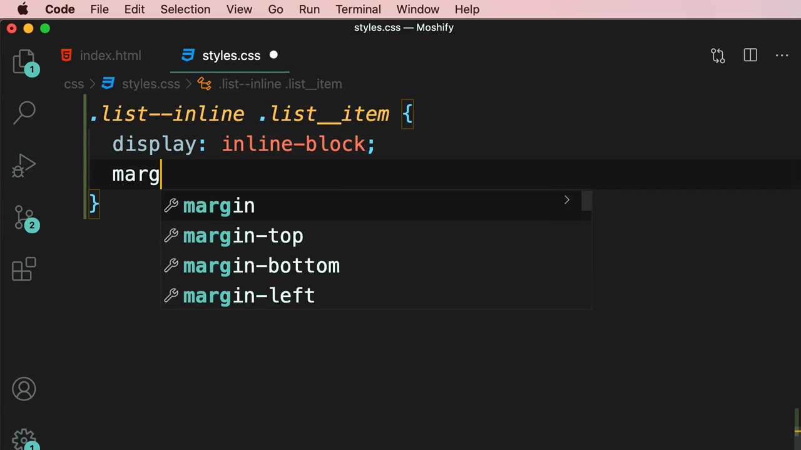

IntelliSense แสดงตัวเลือก property ที่เกี่ยวข้องกับ `list-style` ทั้งหมด ได้แก่ `list-style`, `list-style-type`, `list-style-position`, `list-style-image`

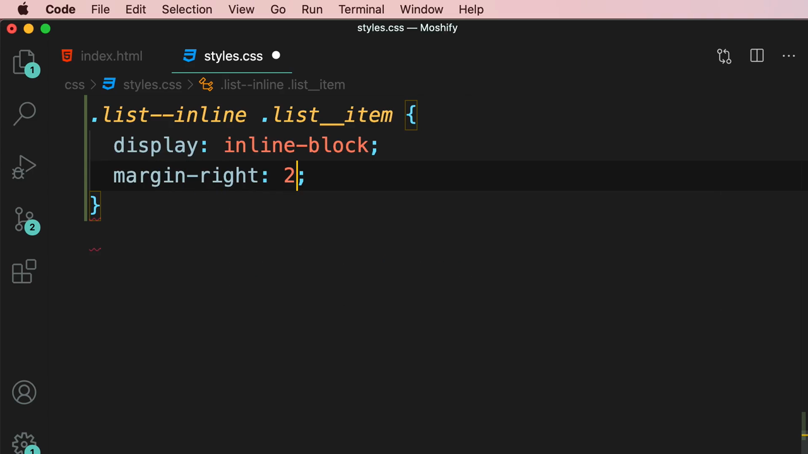

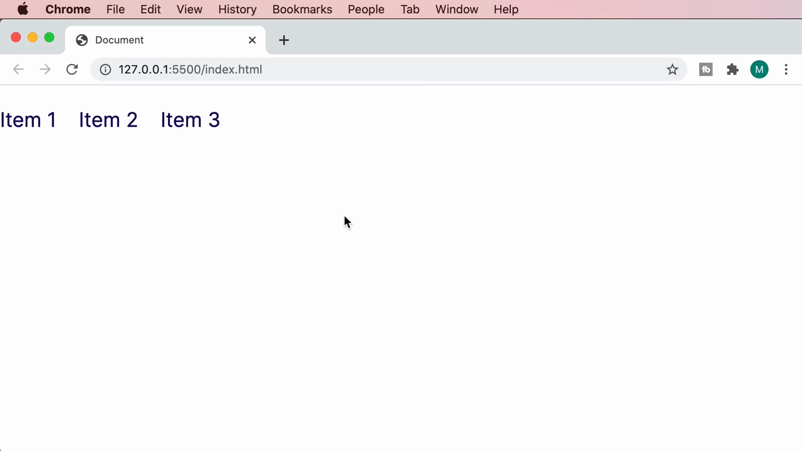

เลือก `list-style-image`

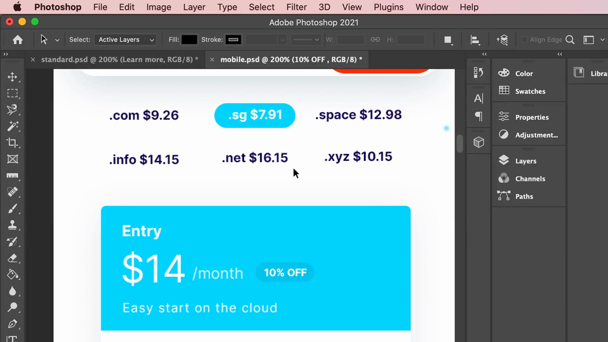

เมื่อพิมพ์ `:` แล้ว IntelliSense แสดงค่าที่เป็นไปได้ เช่น `none`

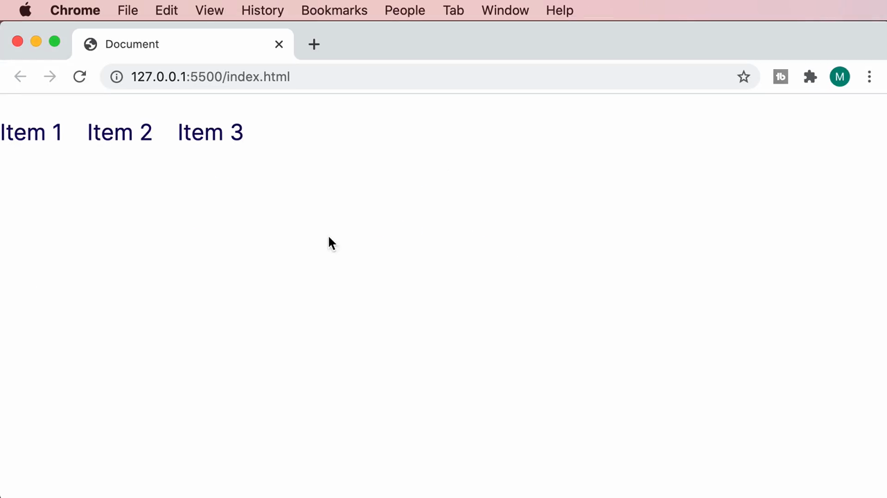

รวมถึงฟังก์ชัน CSS อื่นๆ เช่น `-moz-element()`, `-moz-linear-gradient()` (เป็น vendor-prefix เฉพาะของ Firefox ซึ่งไม่ได้ใช้ในกรณีนี้)

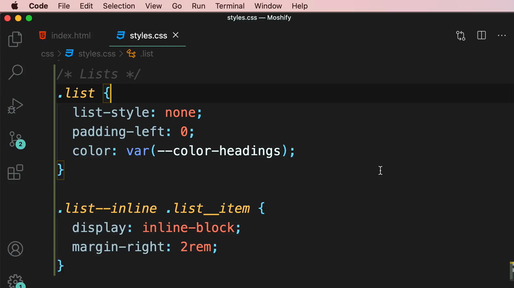

จนกระทั่งเจอฟังก์ชันที่ต้องการคือ `url()`

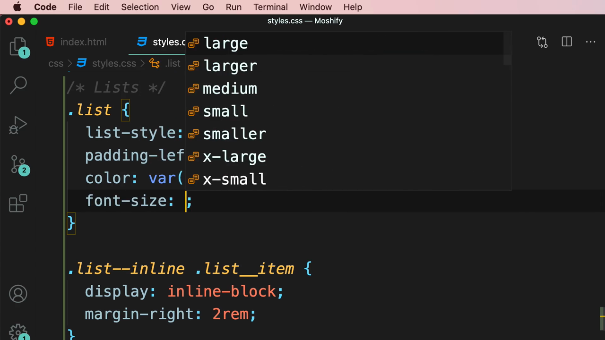

เมื่อพิมพ์ `url()` แล้ว วาง cursor ไว้ข้างในวงเล็บ

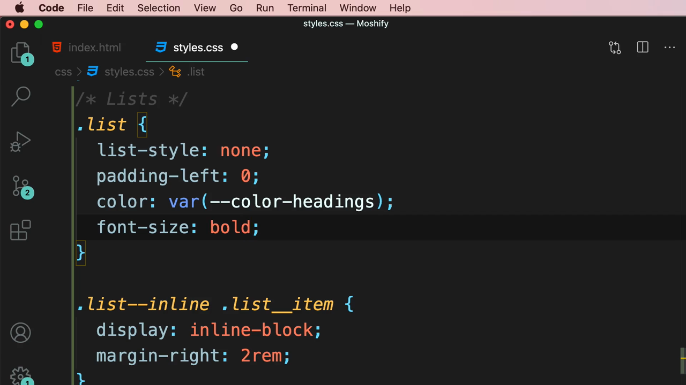

พิมพ์ path ไปยังไฟล์ SVG

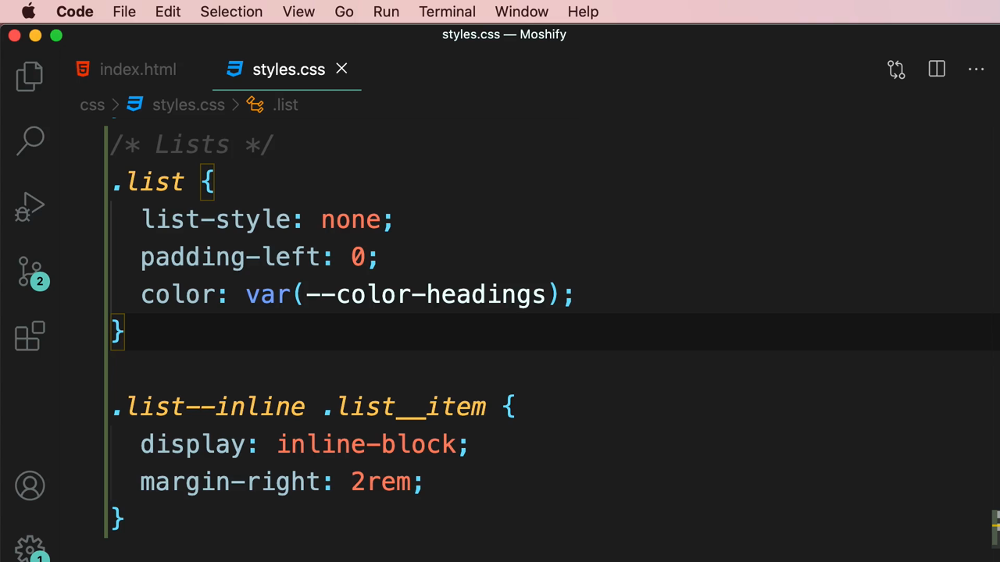

จนได้โค้ดสมบูรณ์:

```css
.list--tick {
  list-style-image: url(../images/tick.svg);
}
```

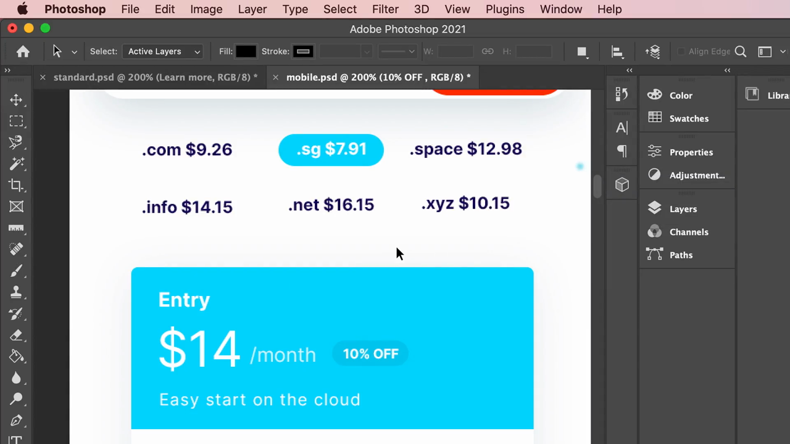

> **คำอธิบาย property `list-style-image`:**
> - property นี้ใช้แทนที่เครื่องหมาย bullet ปกติของ `<li>` ด้วยรูปภาพที่กำหนดเอง (แทนที่จะเป็นจุดกลมมาตรฐาน หรือค่า `none` ที่ตั้งไว้ใน `.list`)
> - ค่า `url(...)` คือฟังก์ชัน CSS มาตรฐานที่ใช้อ้างอิงไฟล์ภายนอก (รูปภาพ, ฟอนต์ ฯลฯ) ในที่นี้คือไฟล์ SVG
> - `../images/tick.svg` เป็น **relative path** (เส้นทางแบบสัมพัทธ์) โดย `../` หมายถึง "ถอยออกไปหนึ่งโฟลเดอร์" จากตำแหน่งไฟล์ `styles.css` (ซึ่งอยู่ในโฟลเดอร์ `css/`) แล้วเข้าไปที่โฟลเดอร์ `images/` ที่ระดับเดียวกับ `css/`
>
> **ข้อควรรู้เกี่ยวกับ `list-style-image` ใน CSS สมัยใหม่:** แม้ว่า property นี้จะใช้งานได้ แต่มีข้อจำกัดคือ **ไม่สามารถควบคุมขนาดของไอคอน (bullet) ได้โดยตรง** ผ่าน CSS (ต่างจากการใช้ `background-image` กับ pseudo-element ที่ยืดหยุ่นกว่า) ซึ่งเป็นเหตุผลว่าทำไมในโปรเจกต์จริงบางครั้งนักพัฒนาจึงเลือกใช้เทคนิคอื่น เช่น ใส่ icon ด้วย `::before` pseudo-element แทน แต่สำหรับคลิปนี้ Mosh เลือกสอน `list-style-image` เพราะเป็นวิธีที่ตรงไปตรงมาและง่ายต่อความเข้าใจสำหรับผู้เริ่มต้น

ทดสอบผลลัพธ์ในเบราว์เซอร์ — เครื่องหมายถูก (tick mark) สีเขียวปรากฏขึ้นแทนที่ bullet เดิม

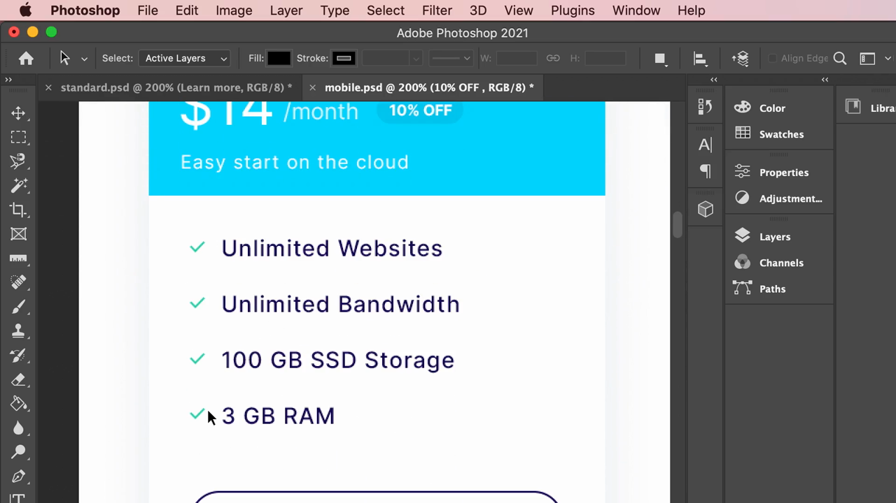

---

## 11. ปรับ `padding-left` ให้ `.list--tick`

เนื่องจากไอคอน tick.svg มีระยะห่างจากข้อความค่อนข้างน้อย Mosh จึงเพิ่ม `padding-left` ให้กับ `.list--tick` เพื่อขยับข้อความออกจากไอคอนเล็กน้อย

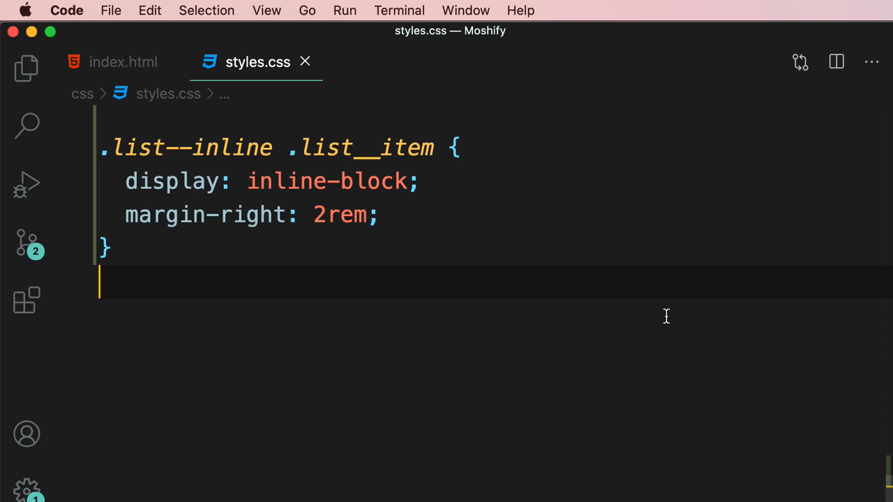

IntelliSense แสดงตัวเลือก `padding`, `padding-left`, `padding-top`, `padding-bottom`

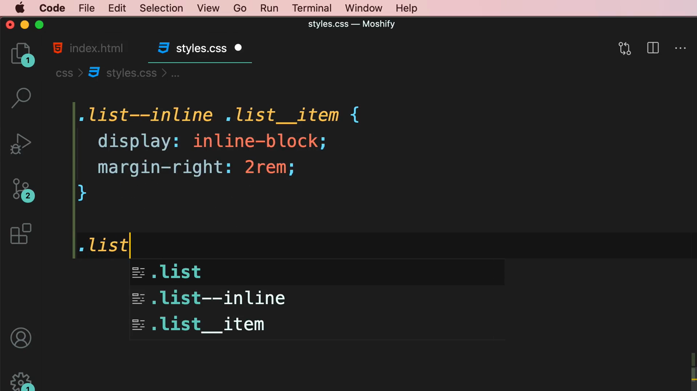

ตั้งค่าเป็น `3rem`

```css
.list--tick {
  list-style-image: url(../images/tick.svg);
  padding-left: 3rem;
}
```

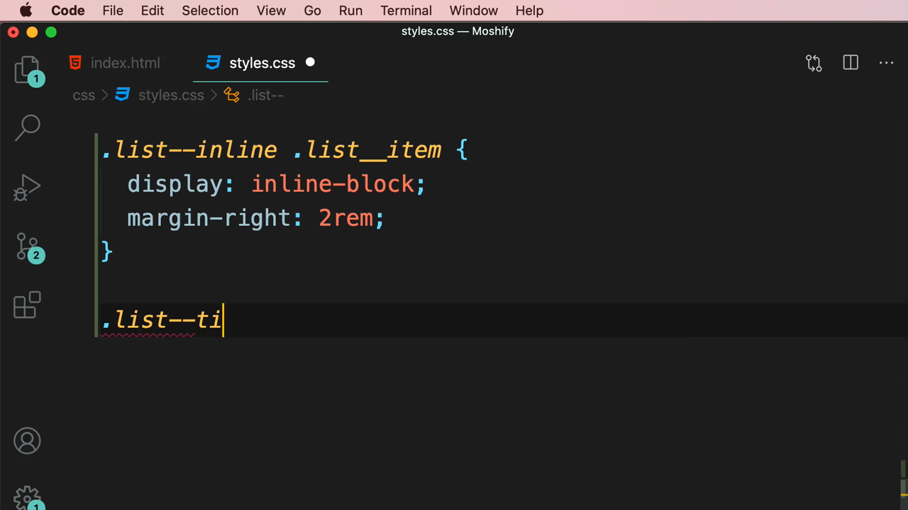

ทดสอบในเบราว์เซอร์ — ระยะห่างระหว่างไอคอนกับข้อความเพิ่มขึ้นตามที่ต้องการ

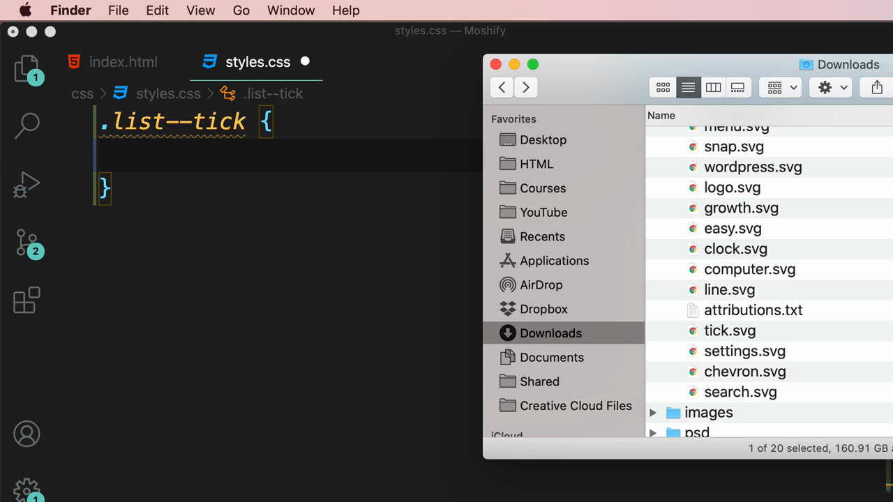

---

## 12. เพิ่มระยะห่างระหว่างไอเทมด้วย `.list--tick .list__item`

Mosh สร้าง selector ใหม่ที่ผสาน Modifier `.list--tick` เข้ากับ Element `.list__item` (รูปแบบเดียวกับที่ทำใน `.list--inline .list__item` ก่อนหน้านี้)


ภายในบล็อกนี้ตั้งค่า `padding-left: 0.5rem;`

```css
.list--tick .list__item {
  padding-left: 0.5rem;
}
```


จากนั้นเพิ่ม `margin-bottom` เข้าไปด้วย โดย IntelliSense แสดงตัวเลือกต่างๆ เช่น `margin-bottom`, `margin-block-end`, `margin-block-start`


ตั้งค่าเป็น `1rem`:

```css
.list--tick .list__item {
  padding-left: 0.5rem;
  margin-bottom: 1rem;
}
```

> **คำอธิบาย:**
> - `padding-left: 0.5rem;` — เว้นระยะห่างเล็กน้อยระหว่างไอคอนกับขอบซ้ายของกล่องข้อความในแต่ละไอเทม (ปรับแต่งเพิ่มเติมนอกเหนือจาก `padding-left: 3rem` ของ Block `.list--tick`)
> - `margin-bottom: 1rem;` — เว้นระยะห่างแนวตั้งระหว่างแต่ละไอเทมของ list (Item 1 กับ Item 2 กับ Item 3) เพื่อไม่ให้ข้อความชิดติดกันเกินไป อ่านง่ายขึ้น เข้ากับดีไซน์ pricing plan ที่มีช่องว่างระหว่างแต่ละบรรทัดฟีเจอร์

ทดสอบผลลัพธ์ในเบราว์เซอร์ — เครื่องหมายถูกสีเขียวปรากฏพร้อมระยะห่างที่เหมาะสมทั้งแนวนอนและแนวตั้ง


---

## 13. ทวนโค้ดและตรวจสอบผลลัพธ์อีกครั้ง

Mosh สลับกลับไปดูโค้ด `.list--tick` และ IntelliSense ของ property `list-style` อีกครั้งเพื่อทบทวน


และย้อนกลับไปดู markup ของ `.list--inline` ใน `index.html` อีกครั้งเพื่อเปรียบเทียบกับ `.list--tick` ที่กำลังทำอยู่


---

## 14. ผลลัพธ์สุดท้ายและการปรับแต่งเพิ่มเติมสำหรับ Responsive

จากนั้น Mosh ทดสอบผลลัพธ์ `.list--tick` ในเบราว์เซอร์อีกหลายครั้งเพื่อยืนยันความถูกต้อง


Mosh ย้อนกลับไปดูดีไซน์ Photoshop อีกครั้งเพื่อเปรียบเทียบผลลัพธ์ที่ทำได้กับดีไซน์ต้นแบบ — พบว่าตรงกันตามที่ต้องการ (Unlimited Websites, Unlimited Bandwidth, 100 GB SSD Storage, 3 GB RAM พร้อม tick สีเขียว)


ทบทวน selector `.list--tick .list__item` อีกครั้ง


ทดสอบผลลัพธ์อีกครั้งในเบราว์เซอร์


ปรับค่า `.list--tick .list__item` เป็น `padding-left: 0.5rem;`


และ `margin-bottom: 1rem;`


ทดสอบผลลัพธ์สุดท้ายในเบราว์เซอร์อีกครั้ง


Mosh เปิดดูดีไซน์เปรียบเทียบแผน Entry ($14/month) กับแผน Business ($24/month) ที่วาง pricing plan สองแบบเทียบกัน เพื่อดูว่า tick list ที่ทำเสร็จแล้วจะถูกนำไปใช้ในทั้งสองแผนอย่างไร


---

## 15. เพิ่ม Media Query สำหรับหน้าจอขนาดใหญ่ (Responsive)

Mosh เริ่มพิมพ์ `@media` เพื่อสร้าง media query ใหม่


โดย IntelliSense แสดงตัวเลือก property/keyword ที่เกี่ยวข้อง เช่น `main`, `menuitem` และ `@ms-viewport`


จนได้ media query แบบเดียวกับที่ใช้ตลอดทั้งซีรีส์ (ตามเทคนิค **Mobile First** — เขียน style สำหรับมือถือก่อน แล้วค่อยปรับสำหรับจอใหญ่ด้วย `min-width`):

```css
@media screen and (min-width: 1024px) {

}
```


ภายใน media query นี้ พิมพ์ selector `.list--tick .list__item` อีกครั้ง โดย IntelliSense แสดงตัวเลือก selector ที่มีอยู่แล้วในไฟล์ เช่น `.list`, `.list--inline`, `.list--tick`, `.list__item`


ภายในบล็อกนี้ พิมพ์ `padding-left` โดย IntelliSense แสดงตัวเลือก


ตั้งค่าเป็น `0` (ยกเลิก padding ที่ตั้งไว้สำหรับ mobile เพราะบนจอใหญ่ระยะห่างเริ่มต้นก็เพียงพอแล้ว):

```css
@media screen and (min-width: 1024px) {
  .list--tick .list__item {
    padding-left: 0;
  }
}
```


> **คำอธิบายเทคนิค Mobile First:**
> - โดยปกติ style หลักที่เขียนนอก media query จะถูกออกแบบมาสำหรับหน้าจอมือถือ (ขนาดเล็ก) เป็นค่าเริ่มต้น
> - เมื่อใช้ `@media screen and (min-width: 1024px)` หมายถึง "เมื่อความกว้างของหน้าจอตั้งแต่ 1024px ขึ้นไป (โดยทั่วไปคือหน้าจอ desktop/laptop) ให้ใช้ style ชุดนี้แทน/เพิ่มเติม"
> - การตั้งค่า `padding-left: 0;` ในกรณีนี้เป็นการ "ยกเลิก" ค่า `padding-left: 0.5rem` ที่ตั้งไว้สำหรับ mobile เพราะบนจอที่ใหญ่ขึ้น พื้นที่มีมากพอแล้ว ไม่จำเป็นต้องเพิ่ม padding อีก ทำให้ layout ดูสมส่วนในทุกขนาดหน้าจอ

ทดสอบผลลัพธ์สุดท้ายในเบราว์เซอร์ที่ความกว้างหน้าจอระดับ desktop


---

## 16. ทวน HTML สุดท้าย และสร้างไฟล์ Component Library

ทวนโค้ด HTML สุดท้ายทั้งหมดใน `index.html`

```html
<body>
  <ul class="list list--tick">
    <li class="list__item">Item 1</li>
    <li class="list__item">Item 2</li>
    <li class="list__item">Item 3</li>
  </ul>
</body>
```


ตามธรรมเนียมของซีรีส์นี้ (เหมือนที่ทำกับ `links.html` และ `badges.html` ในคลิปก่อนหน้า) Mosh สร้างไฟล์ Component Library แยกต่างหากสำหรับ Lists โดยคลิกที่โฟลเดอร์ `components` ใน Explorer


สร้างไฟล์ใหม่ชื่อ `lists.html`


จากนั้นวาง (paste) โค้ด `<ul>` ทั้งหมดที่เขียนไว้ใน `index.html` ลงในไฟล์ `lists.html` นี้ เพื่อให้เป็น "หน้าตัวอย่าง" (preview page) สำหรับดู component `list` แบบ `--tick` โดยเฉพาะ แยกออกจากหน้าเว็บหลัก

```html
<ul class="list list--tick">
  <li class="list__item">Item 1</li>
  <li class="list__item">Item 2</li>
  <li class="list__item">Item 3</li>
</ul>
```


> **อธิบายแนวคิด Component Library:**
> การแยกแต่ละ component (เช่น `links.html`, `badges.html`, `lists.html`) ออกมาเป็นไฟล์ต่างหากในโฟลเดอร์ `components/` ช่วยให้:
> 1. ดู/ทดสอบแต่ละ component แยกกันได้ โดยไม่ต้องรันหน้าเว็บทั้งหน้าซึ่งอาจมีองค์ประกอบอื่นๆ ปนอยู่
> 2. เมื่อพัฒนา design system หรือ style guide ในอนาคต จะมีตัวอย่างของทุก component พร้อมใช้อ้างอิงได้ทันที
> 3. ง่ายต่อการทดสอบการเปลี่ยนแปลง CSS โดยไม่กระทบหน้าเว็บจริง

---

## สรุปภาพรวมของคลิปนี้

| หัวข้อ | รายละเอียด |
|---|---|
| Block หลัก | `.list` — `list-style: none; padding-left: 0; color: var(--color-headings);` |
| Element | `.list__item` — เพิ่มด้วย multi-cursor editing |
| Modifier 1 | `.list--inline` — จัดเรียงไอเทมแนวนอนด้วย `display: inline-block; margin-right: 2rem;` (ผ่าน descendant selector `.list--inline .list__item`) |
| Modifier 2 | `.list--tick` — แสดงเครื่องหมายถูกสีเขียวด้วย `list-style-image: url(../images/tick.svg); padding-left: 3rem;` |
| Element ภายใต้ Modifier 2 | `.list--tick .list__item` — `padding-left: 0.5rem; margin-bottom: 1rem;` (ปรับเป็น `padding-left: 0` บนจอ desktop ด้วย media query) |
| ไฟล์ใหม่ที่เกี่ยวข้อง | โฟลเดอร์ `images/` (ใหม่), ไฟล์ `images/tick.svg`, ไฟล์ `components/lists.html` |
| ข้อผิดพลาดที่พบและแก้ไข | พิมพ์ `font-size: bold;` ผิดพลาด (ควรเป็น `font-weight: bold;`) แล้วลบออกทันที |

### แนวคิดสำคัญที่ได้จากคลิปนี้

1. **BEM แบบครบสูตร** — คลิปนี้เป็นครั้งแรกที่สอน Block, Element, และ Modifier ครบทั้ง 3 ส่วนพร้อมกัน ทำให้เข้าใจภาพรวมของระบบการตั้งชื่อ class ได้ชัดเจนขึ้นมาก
2. **CSS List Reset** — `list-style: none; padding-left: 0;` เป็น pattern มาตรฐานที่ใช้บ่อยมากเมื่อต้องการควบคุมหน้าตาของ `<ul>`/`<ol>` เอง แทนที่จะใช้ค่า default ของเบราว์เซอร์
3. **Emmet สำหรับสร้างรายการซ้ำ** — `ul.list>li{Item $}*3` ช่วยประหยัดเวลาในการเขียน markup ที่ซ้ำๆ กันได้มาก
4. **Multi-cursor editing** — เทคนิคของ VS Code ที่ช่วยแก้ไขหลายจุดพร้อมกัน มีประโยชน์มากเมื่อต้องเพิ่ม class หรือ attribute ให้กับ element ที่ซ้ำกันหลายตัว
5. **`list-style-image` กับไฟล์ SVG** — เทคนิคการแทนที่ bullet มาตรฐานด้วยไอคอนที่กำหนดเอง ด้วยการอ้างอิงไฟล์ผ่าน `url()` และ relative path
6. **โครงสร้างพื้นฐานของ SVG** — `<defs>`, `<style>` (กับ class ภายใน SVG เอง เช่น `.cls-1`), และ `<path>` พร้อมความเข้าใจเรื่อง `fill`, `stroke`, `stroke-width`
7. **Mobile First Media Query** — การปรับค่า padding ให้ต่างกันระหว่างมือถือกับจอใหญ่ ด้วย `@media screen and (min-width: 1024px)` เป็นรูปแบบที่ใช้สม่ำเสมอตลอดทั้งซีรีส์
8. **Component Library Pattern** — การแยกไฟล์ตัวอย่างของแต่ละ component (`lists.html`) ออกจากหน้าเว็บหลัก เพื่อให้ทดสอบและอ้างอิงได้ง่ายในอนาคต
9. **ข้อผิดพลาดที่พบบ่อย** — ความสับสนระหว่าง `font-size` กับ `font-weight` เป็นตัวอย่างที่ดีของความผิดพลาดเล็กๆ ที่เกิดขึ้นได้แม้กับผู้เชี่ยวชาญ และวิธีสังเกต/แก้ไขอย่างรวดเร็ว

---

*สรุปจากคลิปที่ 13 (Lists) ของคอร์ส "Building a Web Site" (โปรเจกต์ Moshify) สอนโดย Mosh Hamedani จาก codewithmosh.com*
