# HTML-CSS-3: 16 - Inputs

**ไฟล์ต้นทอง:** 16-Inputs.mp4

▶️ [ดูวิดีโอ](../../HTML-CSS-3/16-Inputs.mp4)

---

## ภาพรวมคลิปนี้

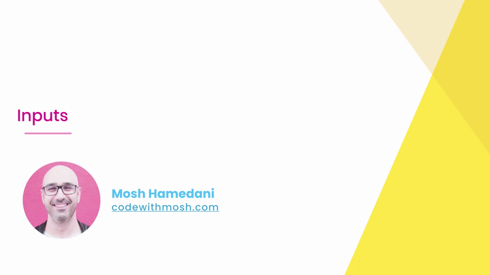
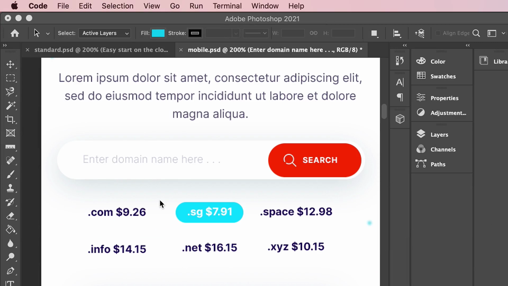

ในคลิปนี้ Mosh สอนการสร้างและจัดสไตล์ **input field** สำหรับช่องค้นหาโดเมน (domain search) ที่อยู่ในส่วน Pricing ของหน้าเว็บ Moshify โดยเนื้อหาครอบคลุมตั้งแต่การสร้าง `<input>` element พื้นฐาน การจัดสไตล์ให้เป็นทรงแคปซูล (pill shape) การจัดการ **placeholder text** ด้วย attribute `placeholder` และ pseudo-element `::placeholder` การลบ default focus outline ของเบราว์เซอร์ด้วย `outline: 0` และปิดท้ายด้วยการอธิบายเชิงลึกผ่าน Chrome DevTools ว่าเบราว์เซอร์ implement placeholder ไว้อย่างไรภายใต้ shadow DOM รวมถึงการปรับ `font-size` ให้ responsive ผ่าน media query

> 💡 **บริบท:** input นี้คือช่องที่ผู้ใช้พิมพ์ชื่อโดเมนที่ต้องการค้นหา ซึ่งจะอยู่คู่กับปุ่ม SEARCH สีแดง (ที่ยังไม่ได้สร้างในคลิปนี้ จะเป็นคลิปถัดไป "Input Groups") อยู่ในส่วนบนของหน้า Pricing section

---

## 1. ดูตัวอย่างดีไซน์ใน Photoshop

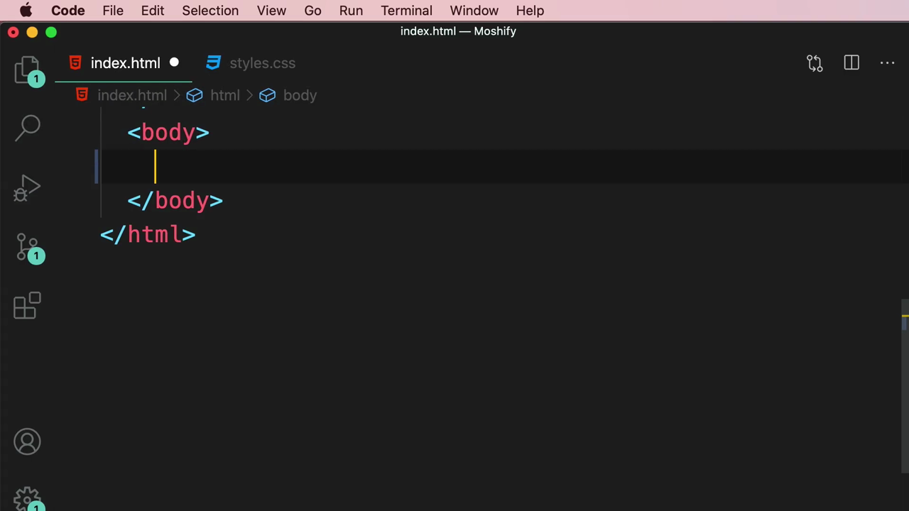
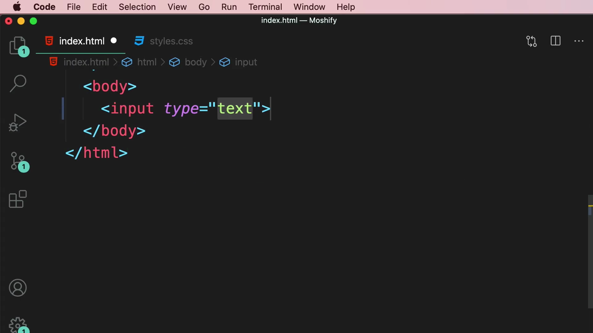
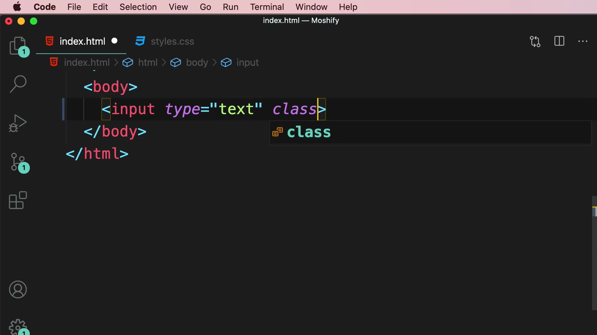

Mosh เปิดไฟล์ดีไซน์ `standard.psd` ใน Photoshop เพื่อดูรูปแบบของ input field ที่ต้องสร้าง:

- input เป็นทรงแคปซูล (pill-shaped) พื้นหลังสีขาว มีกรอบสีเทาบางๆ
- มีข้อความ placeholder สีเทาอ่อนว่า **"Enter domain name here..."**
- วางคู่กับปุ่มสีแดง **SEARCH** (จะสร้างในคลิปถัดไป)

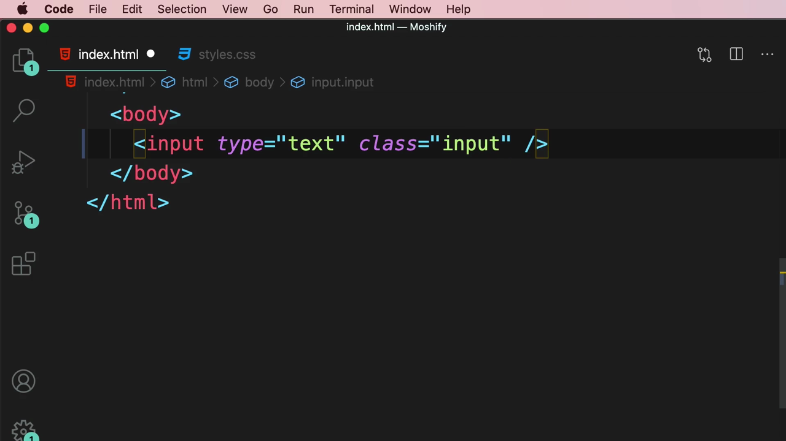
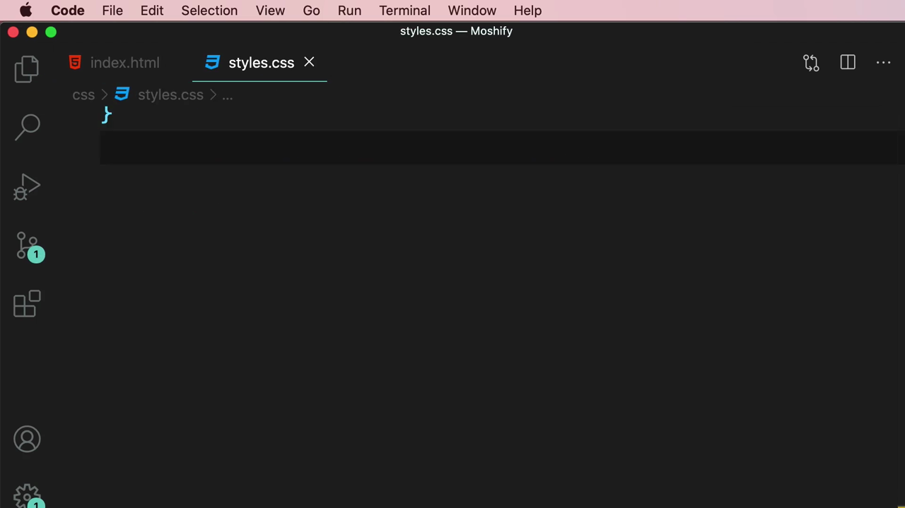

> Mosh ใช้ Photoshop เป็นเครื่องมืออ้างอิงหลักตลอดคอร์สนี้ เพื่อดูขนาด สี และระยะห่าง (spacing) ที่แม่นยำ ก่อนแปลงเป็นโค้ด CSS จริง

---

## 2. สร้าง `<input>` element ใน HTML

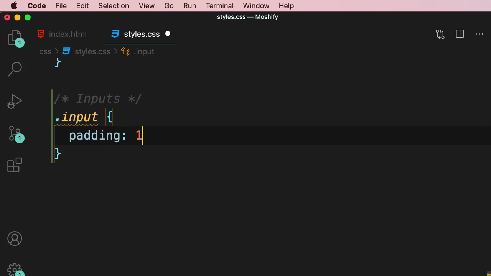

ใน `index.html` Mosh สร้าง input element พื้นฐาน:

```html
<input type="text" />
```

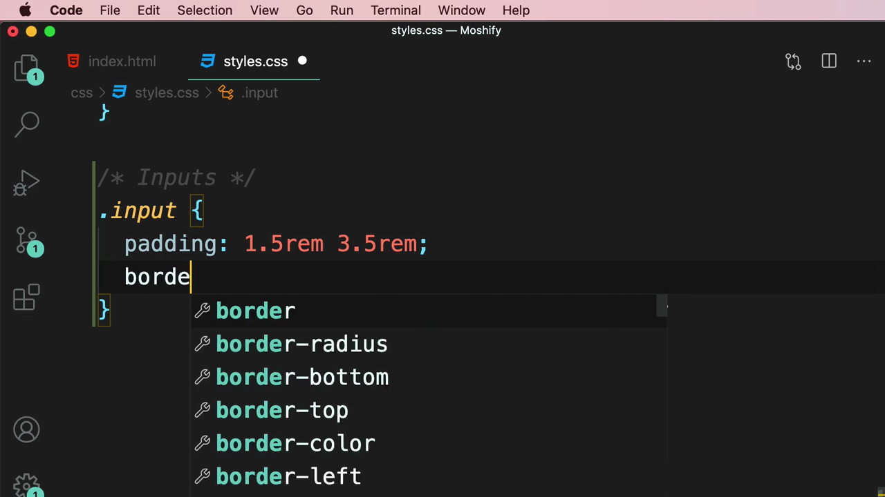
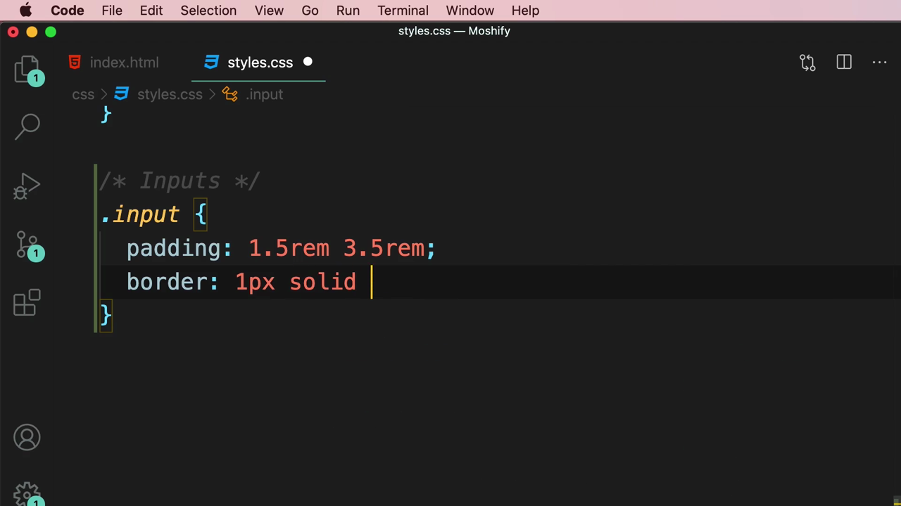

จากนั้นเพิ่ม class `input` เพื่อผูกกับ CSS ที่จะเขียนต่อไป:

```html
<input type="text" class="input" />
```

> 📌 **หมายเหตุ:** `type="text"` เป็นค่าเริ่มต้นของ `<input>` อยู่แล้ว แต่ Mosh ระบุไว้ชัดเจนเพื่อความอ่านง่ายของโค้ด (explicit is better than implicit)

---

## 3. จัดสไตล์พื้นฐานให้กับ `.input`

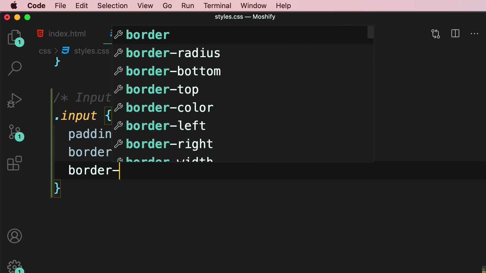

ใน `styles.css` Mosh เริ่มต้นด้วยการเพิ่ม comment แบ่ง section ตามธรรมเนียมที่ทำมาตลอดคอร์ส:

```css
/* Inputs */
```

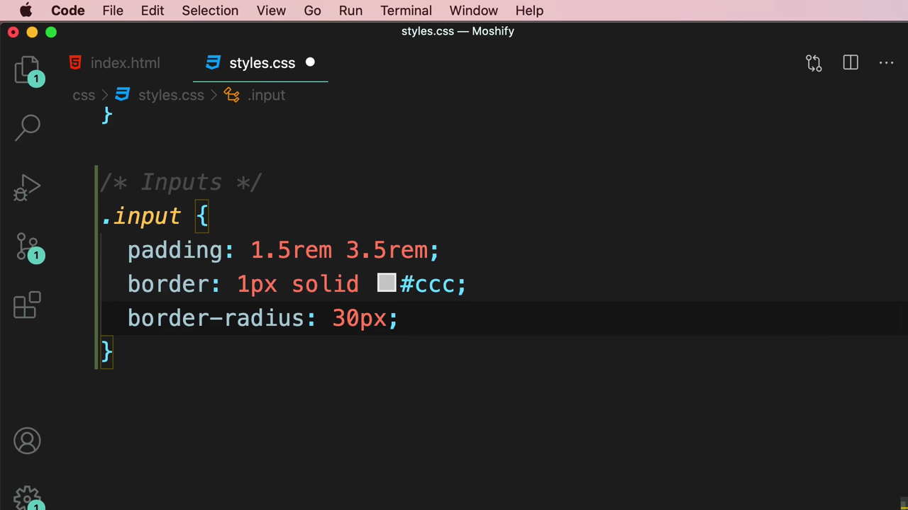

เริ่มเขียน selector `.input` และเพิ่ม `padding` เป็นค่าแรก โดยมี IntelliSense ช่วย autocomplete:

```css
.input {
  padding: 1.5rem 3.5rem;
}
```

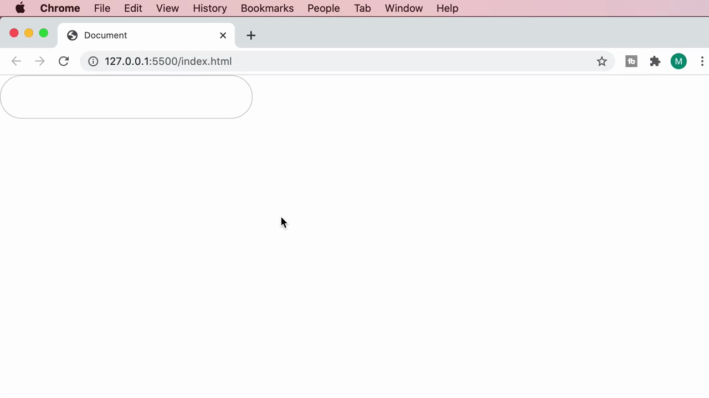

เพิ่ม `border` แบบ shorthand พร้อม IntelliSense แสดงตัวช่วยพิมพ์ property `border`:

```css
.input {
  padding: 1.5rem 3.5rem;
  border: 1px solid #ccc;
}
```

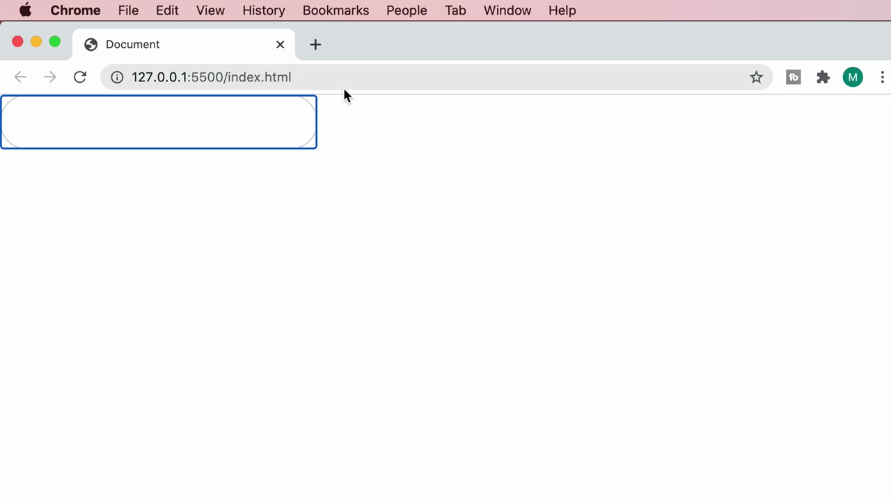

เพิ่ม `border-radius` ค่าสูงๆ (30px) เพื่อให้ขอบโค้งมนจนดูเป็นทรงแคปซูล/pill shape พร้อม IntelliSense แสดงตัวช่วยพิมพ์ property `border-radius`:

```css
.input {
  padding: 1.5rem 3.5rem;
  border: 1px solid #ccc;
  border-radius: 30px;
}
```

> 💡 **เทคนิค pill shape:** การตั้งค่า `border-radius` ให้มีค่ามากกว่าครึ่งหนึ่งของความสูง element (เช่น 30px เมื่อความสูงจริงประมาณ 50-60px) จะทำให้มุมทั้งสองข้างโค้งมนเป็นครึ่งวงกลมสมบูรณ์ กลายเป็นทรงแคปซูล/pill shape ซึ่งเป็นเทคนิคเดียวกับที่ใช้ทำปุ่ม `.btn` ในคลิปก่อนหน้า (clip 15)

### ทดสอบผลลัพธ์ในเบราว์เซอร์

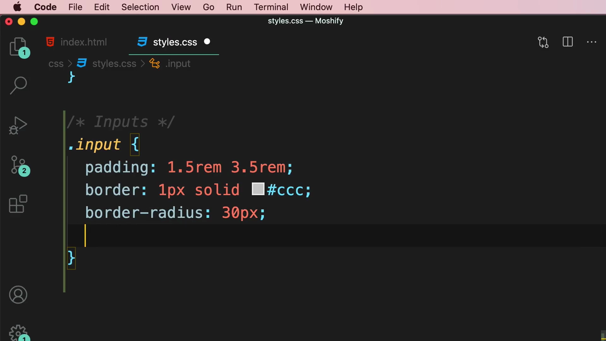
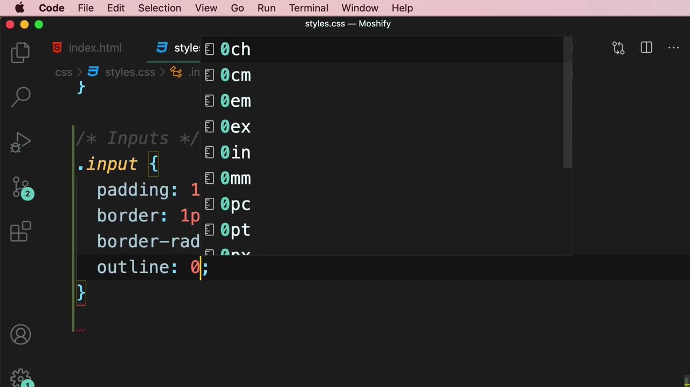
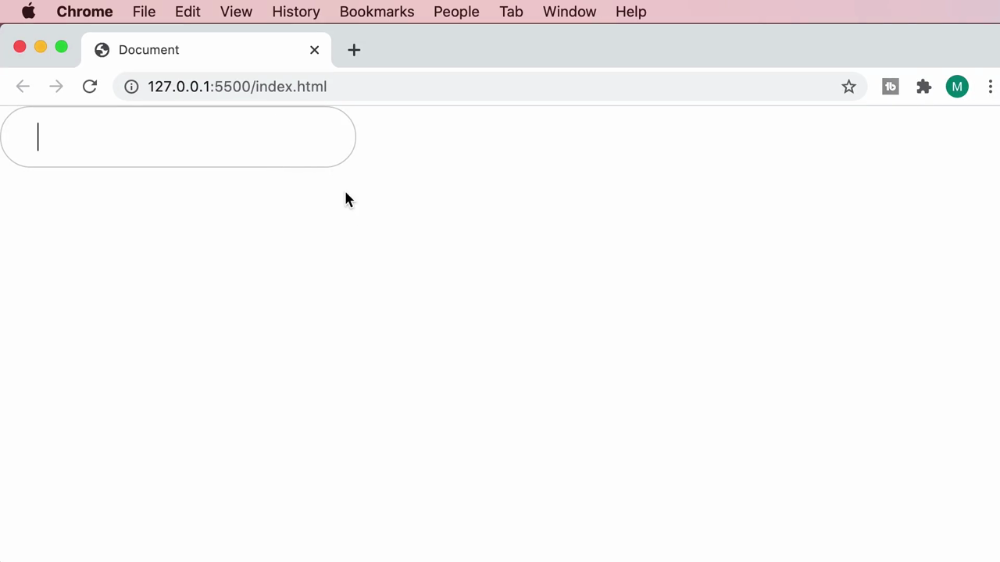

เปิดดูใน Chrome ผ่าน Live Server (`127.0.0.1:5500`) เห็น input เป็นกล่องสีขาวทรงแคปซูลพร้อมกรอบสีเทาบางๆ ตรงตามดีไซน์แล้ว

---

## 4. ลบ default focus outline ด้วย `outline: 0`

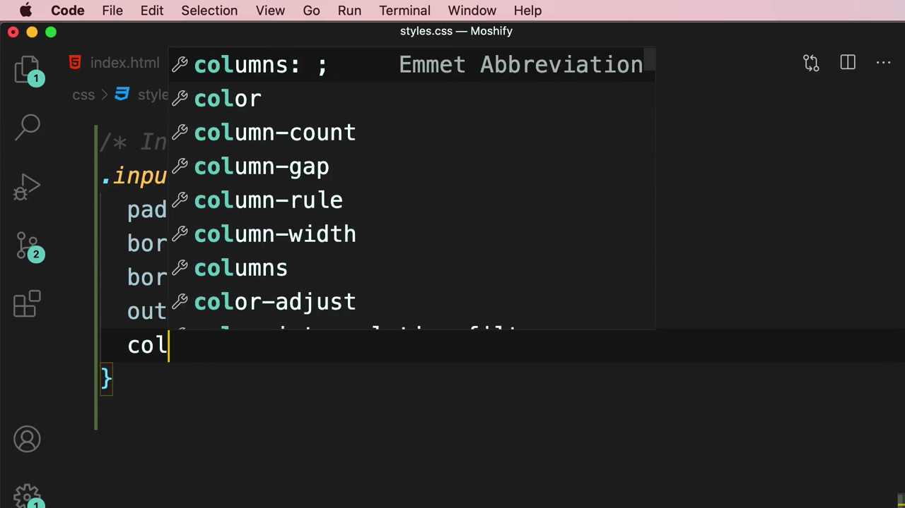

เมื่อคลิกเข้าไปใน input field เบราว์เซอร์ (Chrome) จะแสดง **outline สีฟ้า** รอบๆ input โดยอัตโนมัติ (default browser focus style) ซึ่งไม่ตรงกับดีไซน์

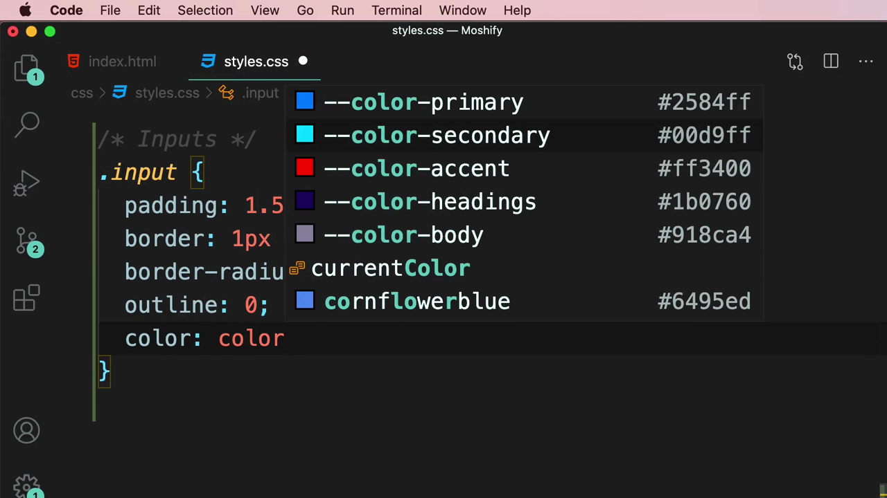

Mosh เพิ่ม property `outline` และพิมพ์ค่า `0` โดย IntelliSense แสดงตัวเลือกหน่วย (unit) ต่างๆ ให้เลือก เช่น `0ch`, `0cm`, `0em` เป็นต้น (เนื่องจาก `0` ไม่ต้องมีหน่วยกำกับก็ใช้งานได้ใน CSS)

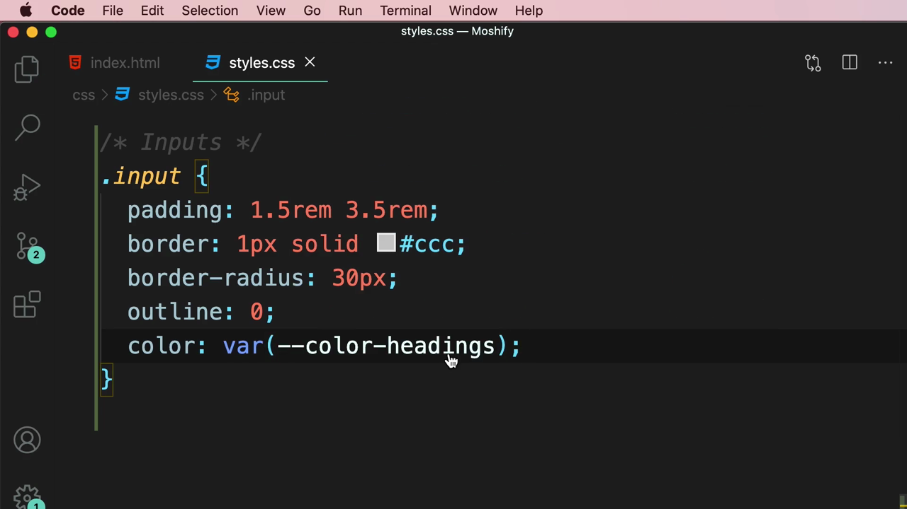

```css
.input {
  padding: 1.5rem 3.5rem;
  border: 1px solid #ccc;
  border-radius: 30px;
  outline: 0;
}
```

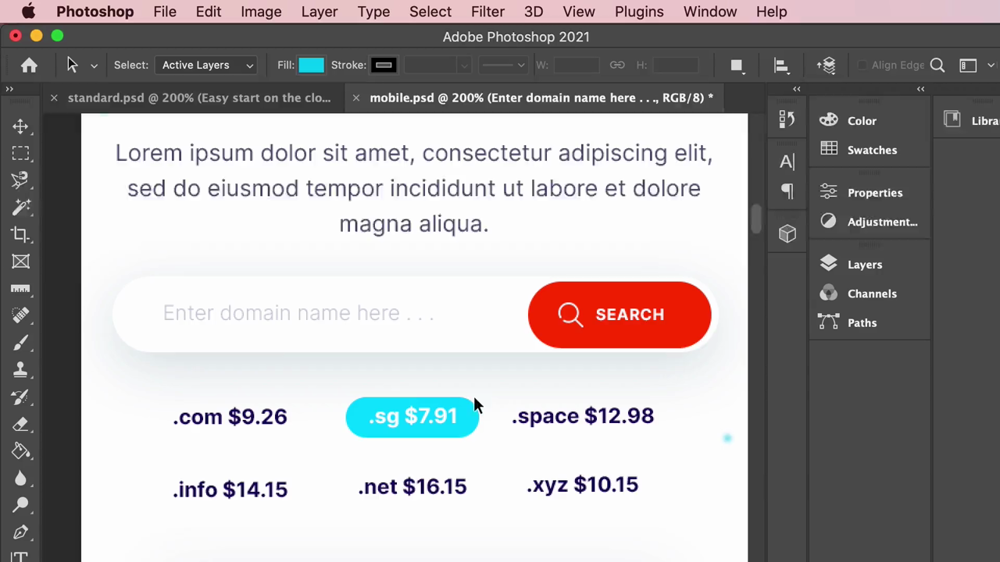

ทดสอบคลิกเข้า input อีกครั้ง — คราวนี้ไม่มี outline สีฟ้าแล้ว

> ⚠️ **ข้อควรระวังด้าน Accessibility:** การลบ `outline` ด้วย `outline: 0` เป็นเทคนิคที่ใช้กันทั่วไปเพื่อความสวยงาม แต่ในโปรเจกต์จริงควรพิจารณาใส่ style อื่นทดแทน (เช่น เปลี่ยนสีกรอบ หรือเพิ่ม `box-shadow`) เมื่อ input ถูก focus เพื่อให้ผู้ใช้ที่ควบคุมด้วยคีย์บอร์ด (keyboard navigation) ยังมองเห็นได้ว่ากำลังโฟกัสอยู่ที่ element ใด

---

## 5. เพิ่มสีตัวอักษรด้วย CSS Variable

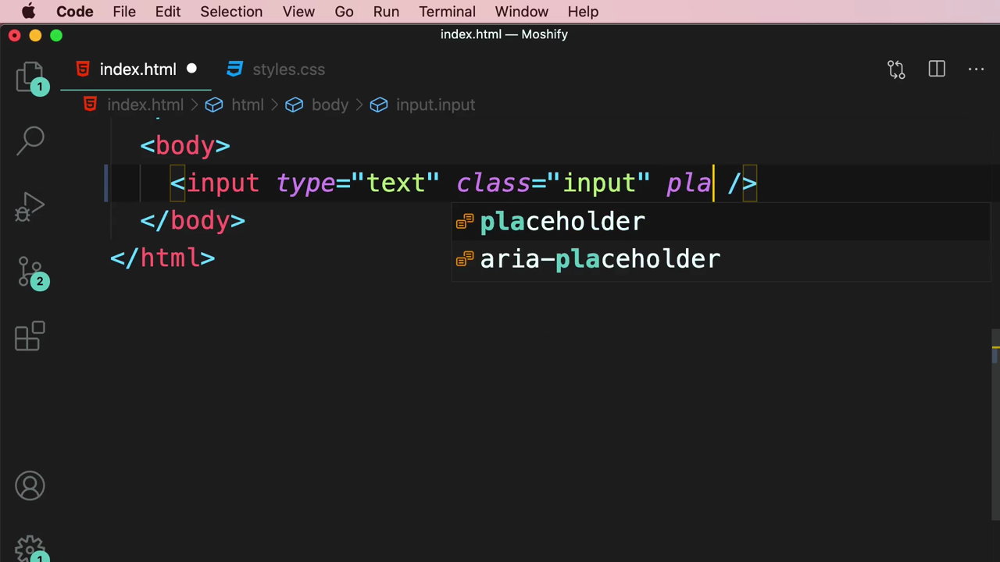

Mosh พิมพ์ `color: var(` แล้ว IntelliSense แสดงรายการ CSS custom properties ที่เคยประกาศไว้ใน `:root` ให้เลือก:

```
--color-primary: #2584ff
--color-secondary: #00d9ff
--color-accent: #ff3400
--color-headings: #1b0760
--color-body: #918ca4
```

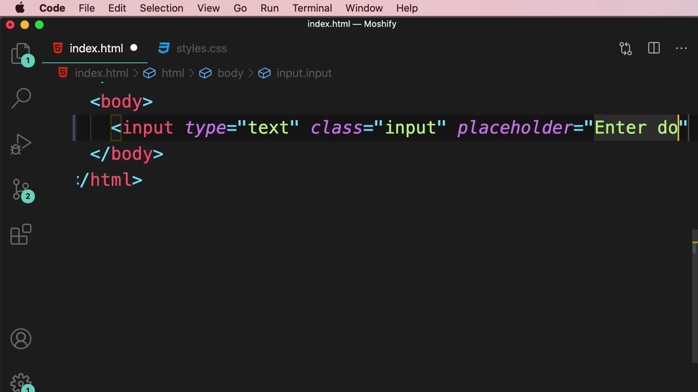
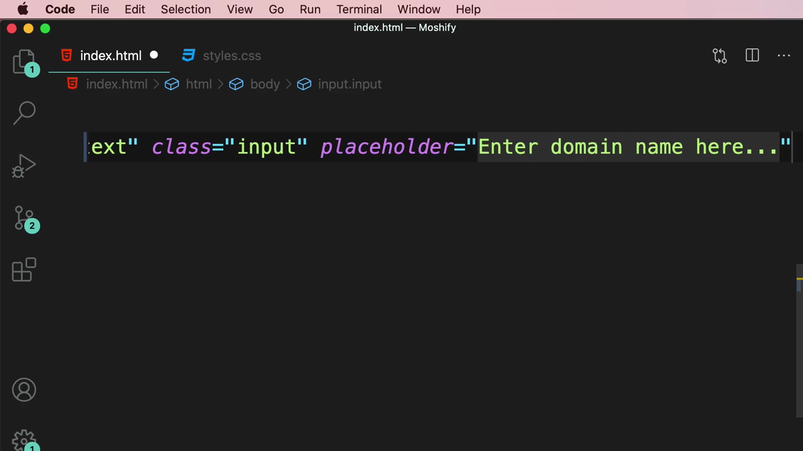

เลือกใช้ `--color-headings` เพื่อให้ตัวอักษรที่ผู้ใช้พิมพ์ในช่อง input เป็นสีเดียวกับสีหัวข้อหลักของเว็บไซต์:

```css
.input {
  padding: 1.5rem 3.5rem;
  border: 1px solid #ccc;
  border-radius: 30px;
  outline: 0;
  color: var(--color-headings);
}
```

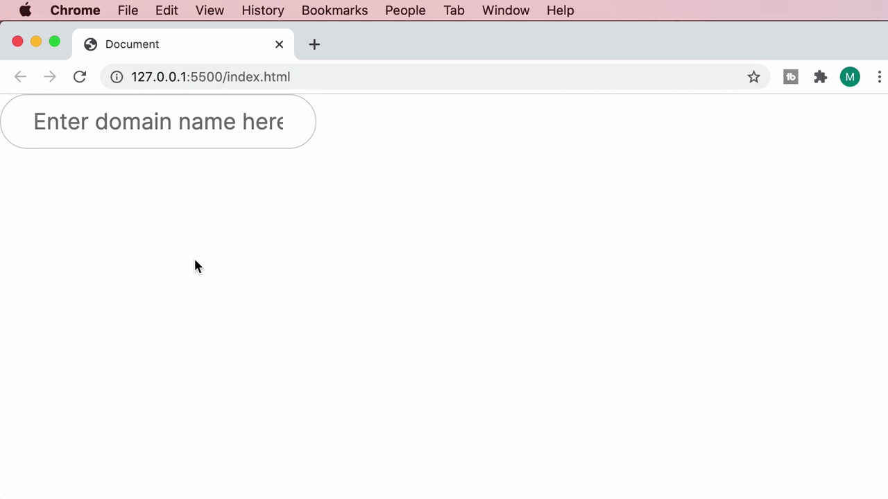

ทดสอบพิมพ์ในช่อง input ในเบราว์เซอร์ — ตัวอักษรที่พิมพ์แสดงเป็นสีม่วงเข้ม (`#1b0760`) ตามที่ตั้งค่าไว้

> การใช้ CSS Variable (`var(--color-headings)`) แทนการ hardcode ค่าสี ทำให้ถ้าต้องเปลี่ยนธีมสีของเว็บทั้งหมดในอนาคต สามารถแก้ไขที่จุดเดียวใน `:root` แล้วสีจะเปลี่ยนตามทุก element ที่อ้างอิงตัวแปรนี้

---

## 6. เพิ่ม Placeholder Text ด้วย attribute `placeholder`

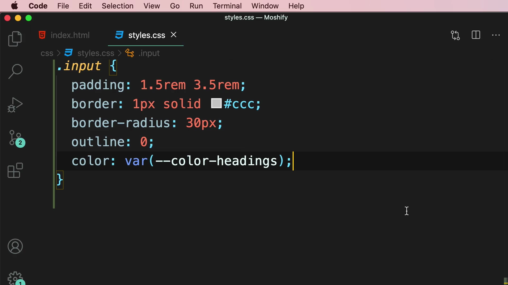

กลับไปที่ `index.html` แล้วพิมพ์ attribute ใหม่ในแท็ก `<input>` โดย IntelliSense แสดงตัวเลือกให้ เช่น `placeholder` และ `aria-placeholder`

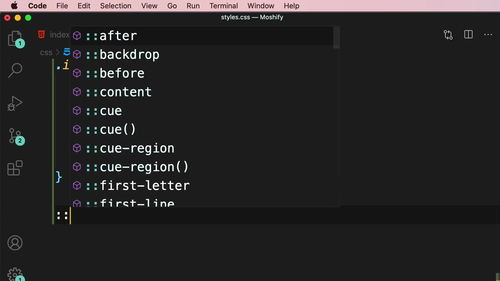

```html
<input
  type="text"
  class="input"
  placeholder="Enter domain name here..."
/>
```

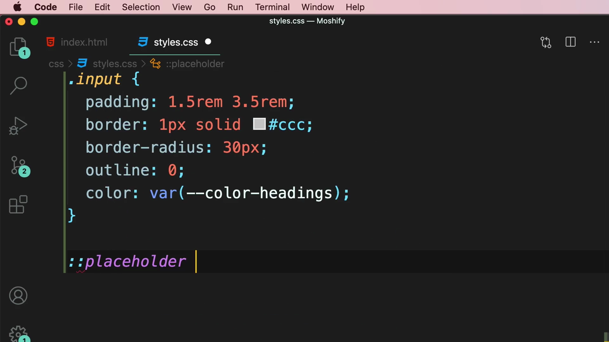

ทดสอบในเบราว์เซอร์ — ข้อความ placeholder **"Enter domain name here..."** ปรากฏเป็นสีเทาอ่อนภายในช่อง input (สีเทาเริ่มต้นเป็นค่า default ของเบราว์เซอร์)

> `placeholder` เป็น HTML attribute มาตรฐานที่ใช้แสดงข้อความคำแนะนำภายใน input เมื่อยังไม่มีข้อมูล และข้อความนี้จะหายไปทันทีที่ผู้ใช้เริ่มพิมพ์ (ไม่ใช่ label ถาวร)

---

## 7. จัดสไตล์ Placeholder ด้วย `::placeholder` pseudo-element

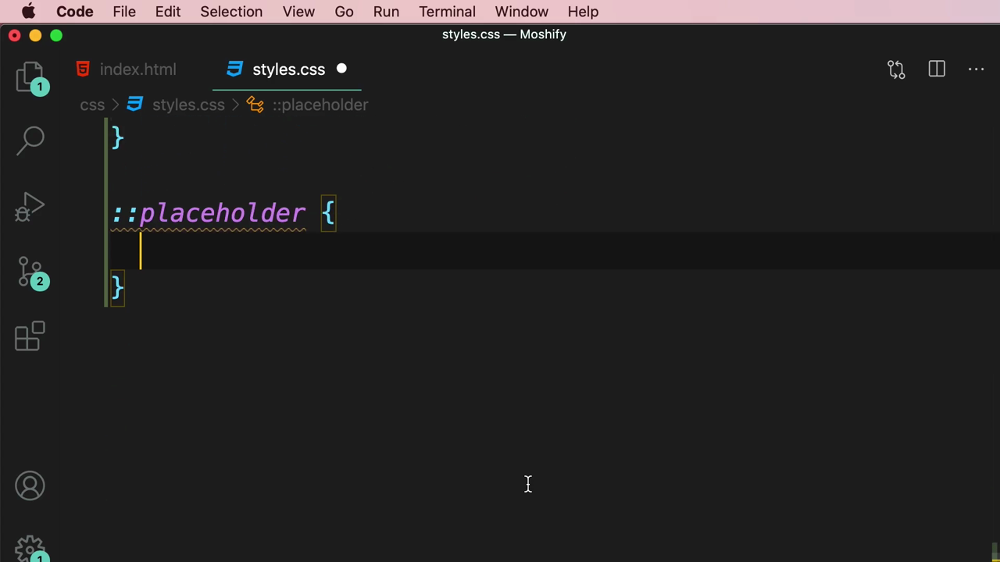

Mosh พิมพ์ `::` ใน `styles.css` และ IntelliSense แสดงรายการ pseudo-element ทั้งหมดที่มีในภาษา CSS เช่น `::after`, `::backdrop`, `::before`, `::content`, `::cue`, `::cue-region`, `::first-letter`, `::first-line` และ **`::placeholder`**

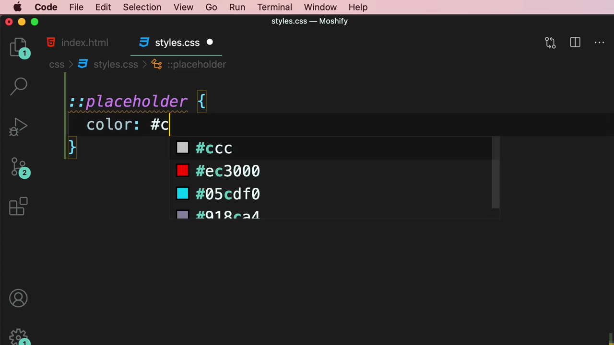

เลือก `::placeholder` มาสร้าง selector ใหม่:

```css
::placeholder {
}
```

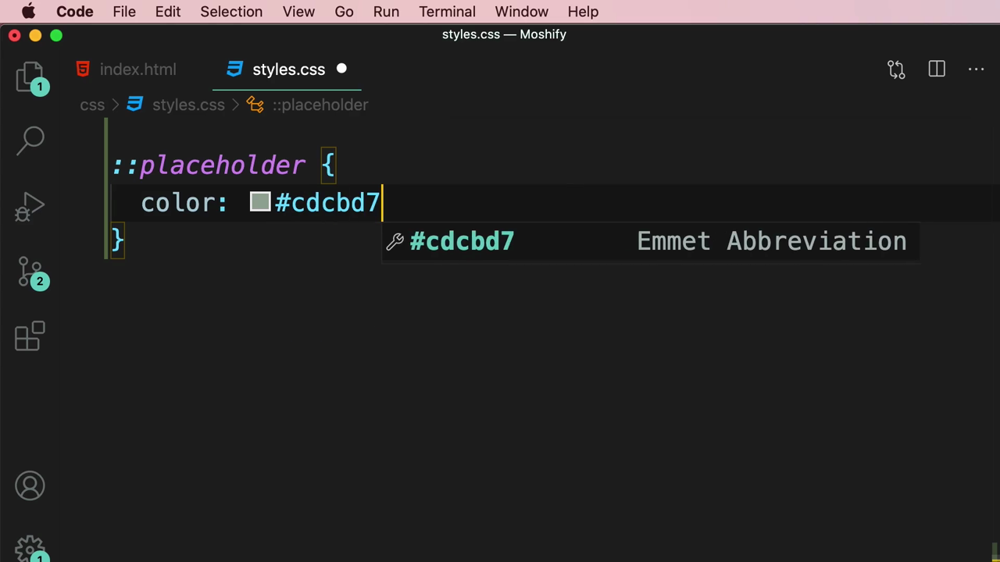

พิมพ์ `color: #` แล้ว IntelliSense แสดงรายการสี hex ที่เคยใช้ในไฟล์นี้มาก่อนให้เลือกอย่างรวดเร็ว เช่น `#ccc`, `#ec3000`, `#05cdf0`, `#918ca4`

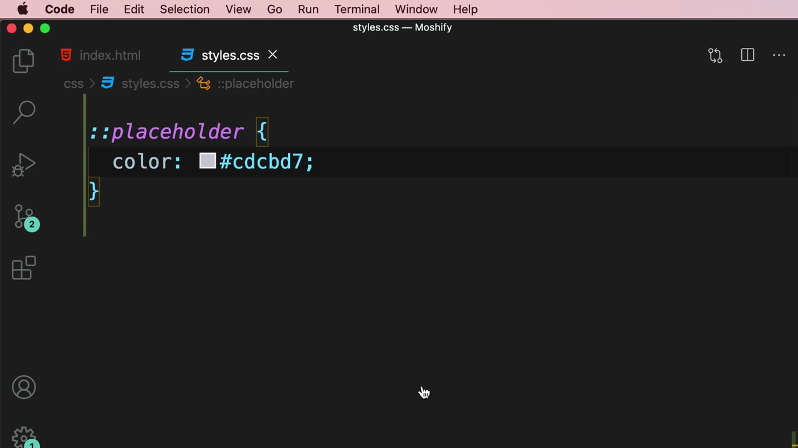

แต่ Mosh ตัดสินใจพิมพ์ hex code ใหม่ที่ยังไม่เคยใช้มาก่อนแทน เพื่อให้ตรงกับสีเทาอ่อนตามดีไซน์ Photoshop:

```css
::placeholder {
  color: #cdcbd7;
}
```

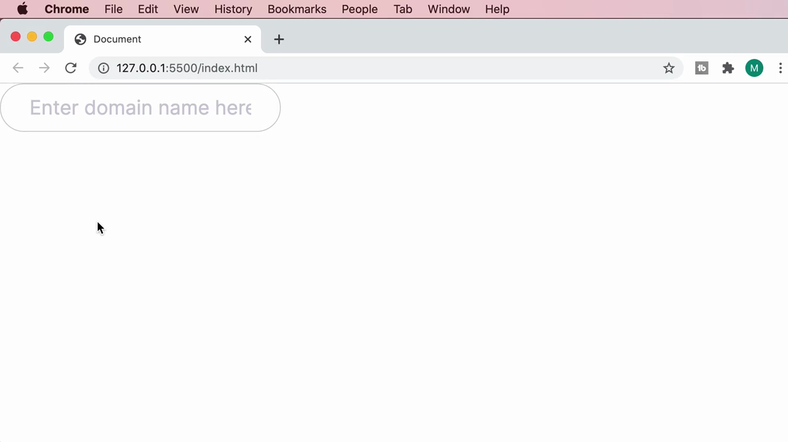

ทดสอบผลลัพธ์ในเบราว์เซอร์ — ข้อความ placeholder เปลี่ยนเป็นสีเทาอ่อนแบบกำหนดเอง (`#cdcbd7`) แล้ว ต่างจากสีเทา default ของเบราว์เซอร์ก่อนหน้านี้

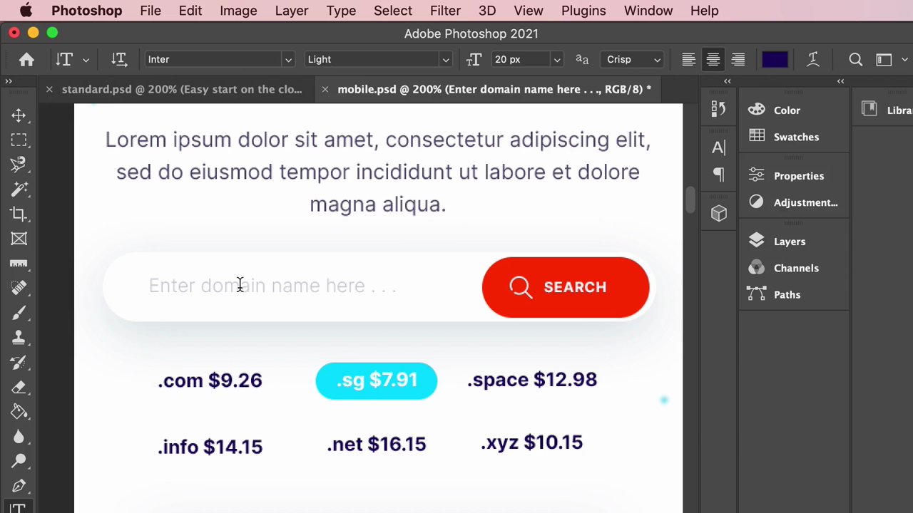

Mosh สลับกลับไปดู Photoshop อีกครั้งเพื่อเทียบสีของ placeholder ในเบราว์เซอร์กับดีไซน์ต้นฉบับให้ตรงกันมากที่สุด

> 🎨 **เทคนิคสำคัญ:** `::placeholder` เป็น pseudo-element เฉพาะที่ใช้กำหนดสไตล์ (โดยหลักคือ `color`, บาง browser รองรับ `font-size`, `opacity` ด้วย) ให้กับข้อความ placeholder ภายใน input โดยเฉพาะ แยกจากการกำหนดสไตล์ให้กับตัวอักษรจริงที่ผู้ใช้พิมพ์ (ซึ่งกำหนดผ่าน `.input { color: ... }` ตามปกติ)

---

## 8. เจาะลึกเบื้องหลัง: Chrome DevTools กับ Shadow DOM ของ Placeholder

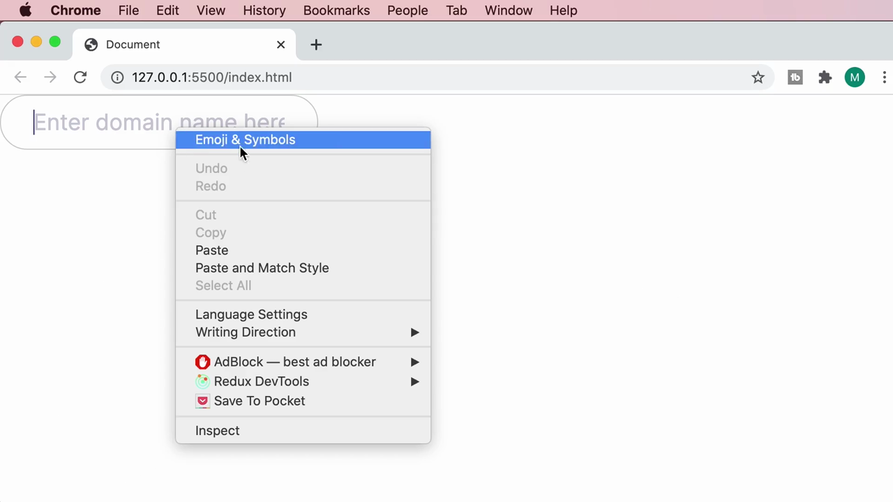

ระหว่างสาธิต Mosh คลิกขวาที่ input field โดยไม่ได้ตั้งใจ ทำให้เมนู context menu ของเบราว์เซอร์เด้งขึ้นมา (Emoji & Symbols, Undo/Redo, Cut/Copy/Paste ฯลฯ) และเลือก **"Inspect"** จากเมนูนี้เพื่อเปิด DevTools

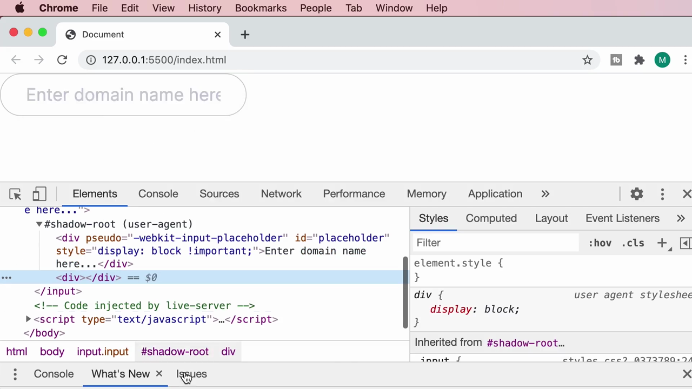

ใน Elements panel ของ Chrome DevTools Mosh ขยายดูโครงสร้างภายในของ `<input>` element และพบว่าเบราว์เซอร์สร้าง **`#shadow-root (user-agent)`** ขึ้นมาซ่อนอยู่ภายใน โดยมีโครงสร้างประมาณนี้:

```html
<input class="input" placeholder="Enter domain name here...">
  #shadow-root (user-agent)
    <div pseudo="-webkit-input-placeholder" id="placeholder"
         style="display: block !important;">
      Enter domain name here...
    </div>
    <div></div>
</input>
```

> 🔬 **แนวคิดสำคัญ (Shadow DOM):** เบราว์เซอร์แต่ละตัว (เช่น Chrome ที่ใช้ WebKit/Blink engine) จะสร้าง **internal DOM structure** ที่ซ่อนอยู่ภายใน element บางชนิด (เรียกว่า "user-agent shadow root") เพื่อ render UI ที่ซับซ้อนอย่าง `<input>`, `<video>`, `<audio>` โดยอัตโนมัติ โดยผู้ใช้ทั่วไปมองไม่เห็นโครงสร้างนี้ในหน้า view-source ปกติ ข้อความ placeholder ที่เราเห็นจริงๆ แล้วคือ `<div pseudo="-webkit-input-placeholder">` ที่ถูกซ่อนอยู่ในนี้ ซึ่งเป็นเหตุผลว่าทำไม CSS ปกติ (เช่น `.input div { color: red; }`) จึงไม่สามารถเข้าถึง element นี้ได้โดยตรง — ต้องใช้ pseudo-element พิเศษอย่าง `::placeholder` เท่านั้นที่เบราว์เซอร์ออกแบบมาให้ "เจาะทะลุ" เข้าไปจัดสไตล์ shadow DOM ส่วนนี้ได้

### สำรวจ Computed Panel เพื่อดู CSS Cascade ของ font-size

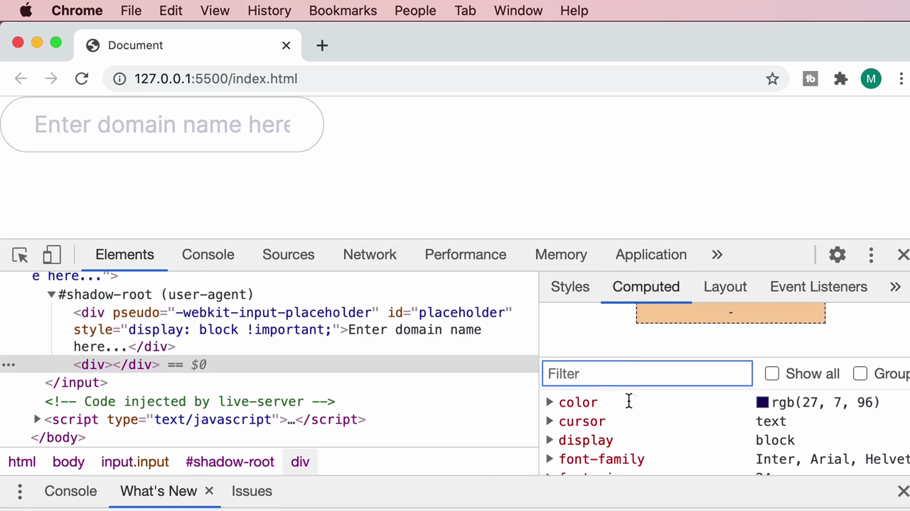
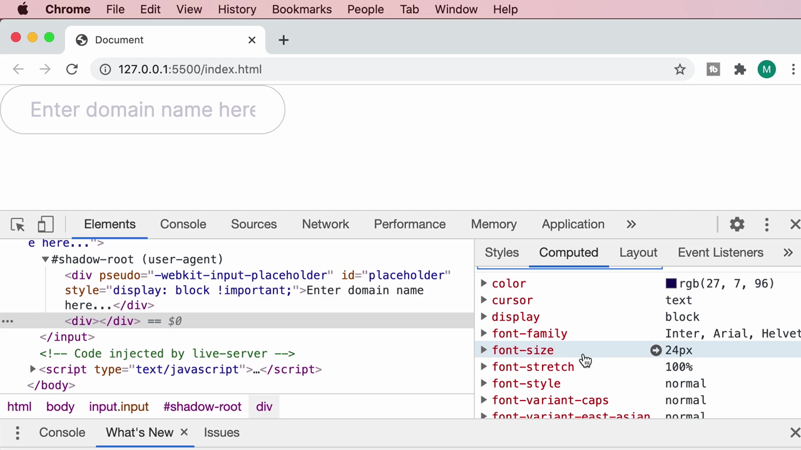

Mosh สลับไปที่แท็บ **Computed** ใน DevTools (แทน Styles) เพื่อดูค่า CSS ที่ browser คำนวณจริงๆ ของ placeholder div นี้ พบว่า `font-size` ที่ถูกคำนวณคือ `24px`

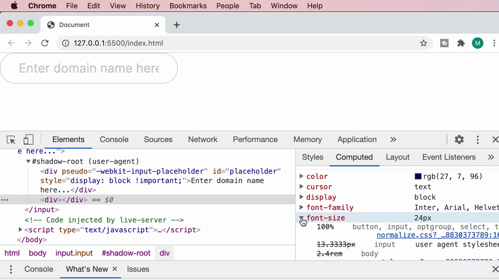

คลิกขยายดู `font-size` เพื่อดูว่าค่านี้มาจากที่ไหนบ้างในลำดับ cascade:

```
100%           → button, input, optgroup, select (จาก normalize.css)
13.3333px      → input (user agent stylesheet, ถูกขีดทับ/overridden)
2.4rem         → body (จาก styles.css)
62.5%          → html (จาก styles.css, เทคนิค 62.5% base)
```

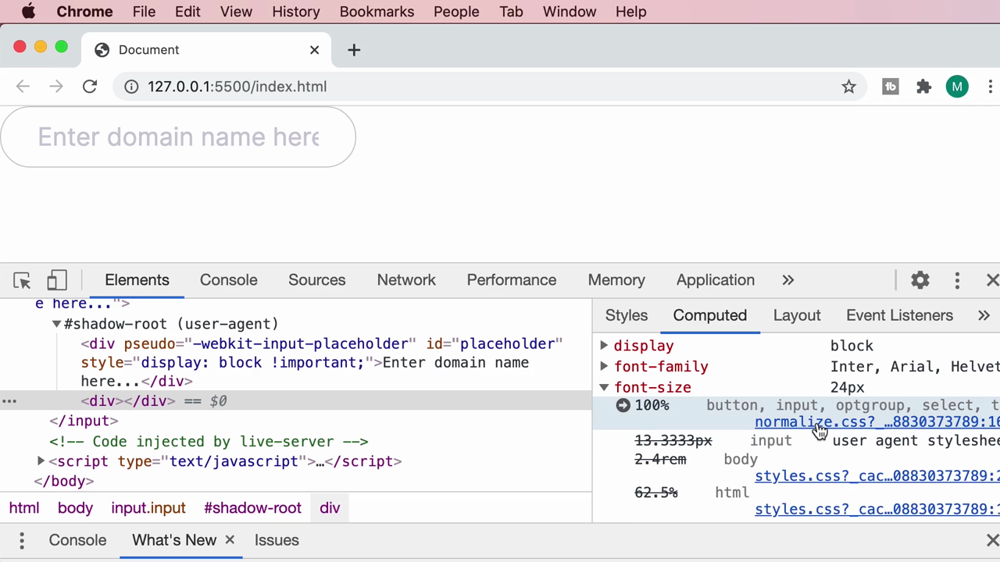
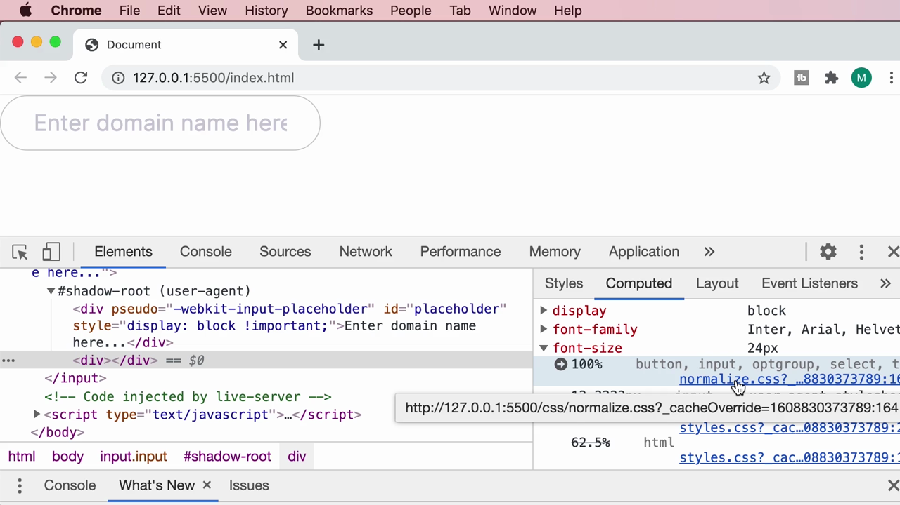

เมื่อ hover เมาส์ไปที่ลิงก์ `normalize.css` DevTools แสดง tooltip เป็น URL เต็มของไฟล์ที่มา (`http://127.0.0.1:5500/css/normalize.css?_cacheOverride=...`)

> 📖 **บทเรียนสำคัญ:** Computed panel ช่วยให้เห็น "ห่วงโซ่การสืบทอด" (inheritance chain) ของ CSS property แต่ละตัวว่าค่าสุดท้ายที่ browser ใช้จริงมาจากไฟล์ไหน กฎไหน และค่าที่ถูก override (ขีดฆ่า) มาจากที่ใดบ้าง เป็นเครื่องมือ debug ที่มีประโยชน์มากเมื่อ CSS ไม่แสดงผลตามที่คาดหวัง โดยเฉพาะกับ element ที่มี default style จากเบราว์เซอร์ซับซ้อนอย่าง `<input>`

---

## 9. เพิ่ม `font-size` ให้กับ `.input`

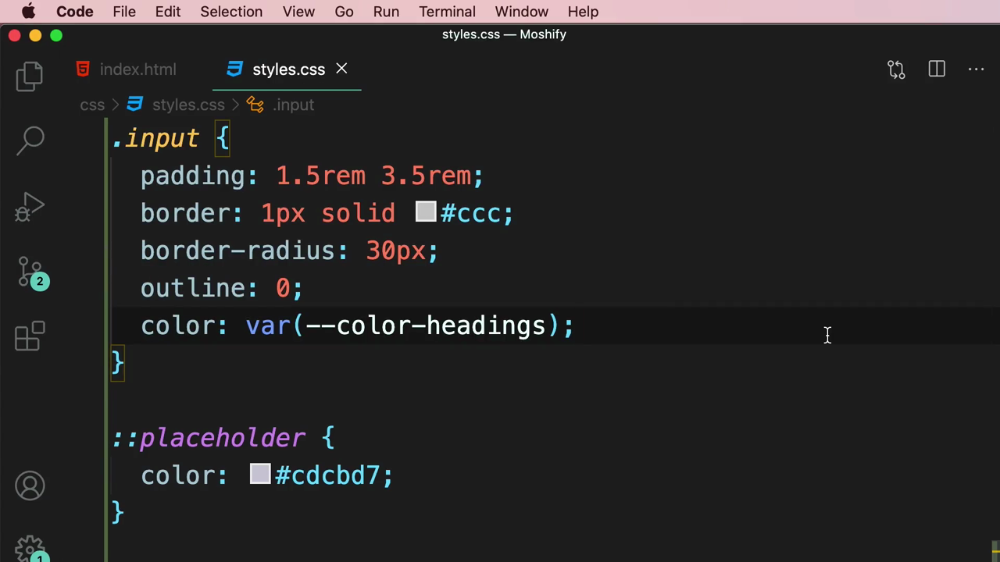

กลับมาที่ `.input` selector ใน `styles.css` Mosh เริ่มพิมพ์ property ใหม่

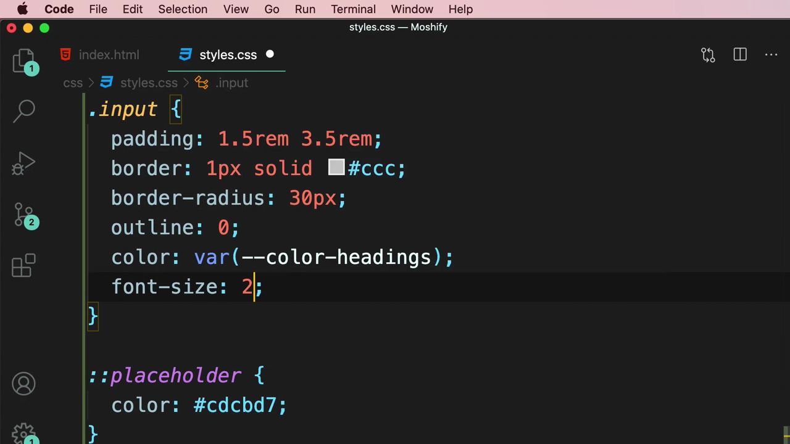
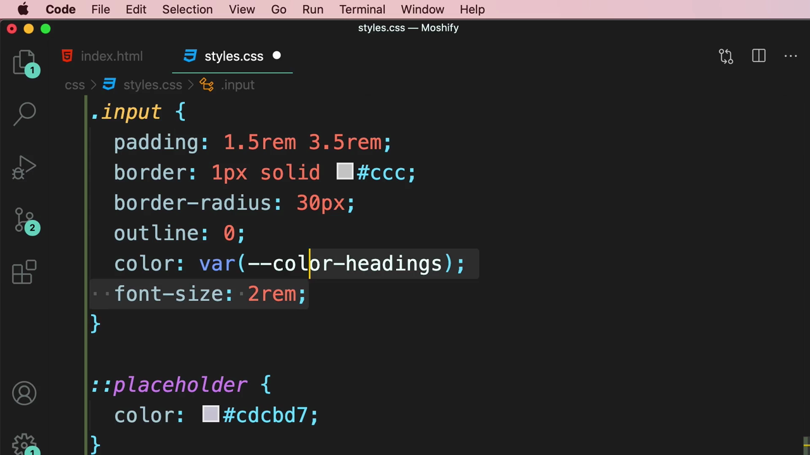

```css
.input {
  padding: 1.5rem 3.5rem;
  border: 1px solid #ccc;
  border-radius: 30px;
  outline: 0;
  color: var(--color-headings);
  font-size: 2rem;
}
```

### จัดเรียง properties ด้วย VS Code Command Palette

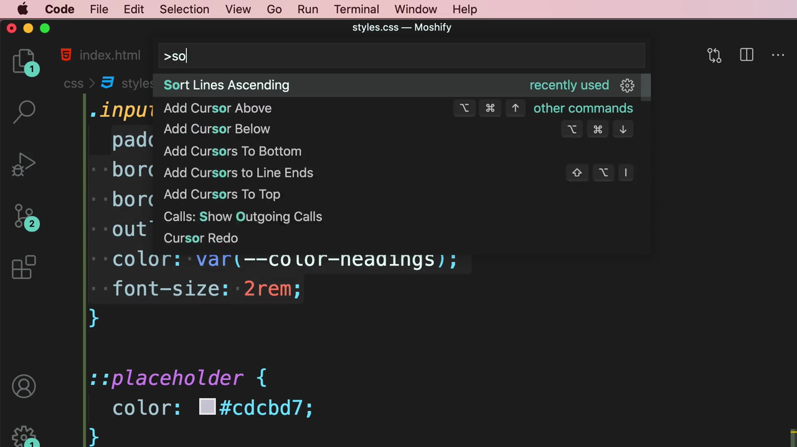

Mosh เลือกทุกบรรทัดของ property ภายใน `.input` แล้วเปิด Command Palette (`Cmd+Shift+P`) พิมพ์คำสั่ง **"Sort Lines Ascending"** เพื่อจัดเรียง property ตามลำดับตัวอักษร (a-z) โดยอัตโนมัติ

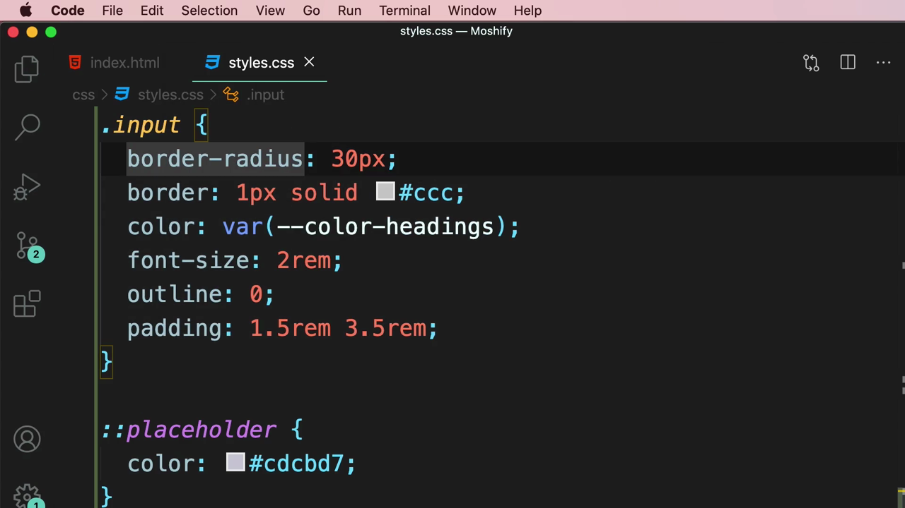

ผลลัพธ์หลังจัดเรียง:

```css
.input {
  border-radius: 30px;
  border: 1px solid #ccc;
  color: var(--color-headings);
  font-size: 2rem;
  outline: 0;
  padding: 1.5rem 3.5rem;
}
```

> ⌨️ **เทคนิค VS Code:** "Sort Lines Ascending" เป็นเทคนิคเดียวกับที่ Mosh ใช้ในคลิป 15 (Buttons) เพื่อจัดระเบียบโค้ด CSS ให้อ่านง่าย เป็นระเบียบ และช่วยให้หา property ที่ต้องการแก้ไขได้เร็วขึ้นเมื่อไฟล์มีขนาดใหญ่

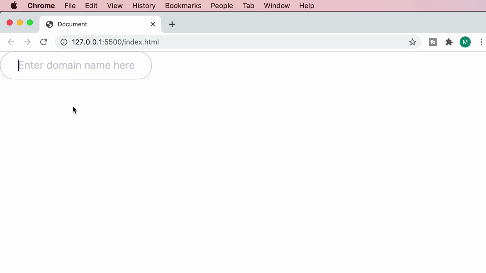

ทดสอบในเบราว์เซอร์ — ข้อความ placeholder มีขนาดใหญ่ขึ้นชัดเจนตามค่า `font-size: 2rem` ที่ตั้งไว้ (ค่านี้เป็นค่า default สำหรับหน้าจอมือถือ/ขนาดเล็ก ตามแนวคิด Mobile First)

---

## 10. ดูภาพรวมทั้งหน้าใน Photoshop ก่อนทำ Responsive

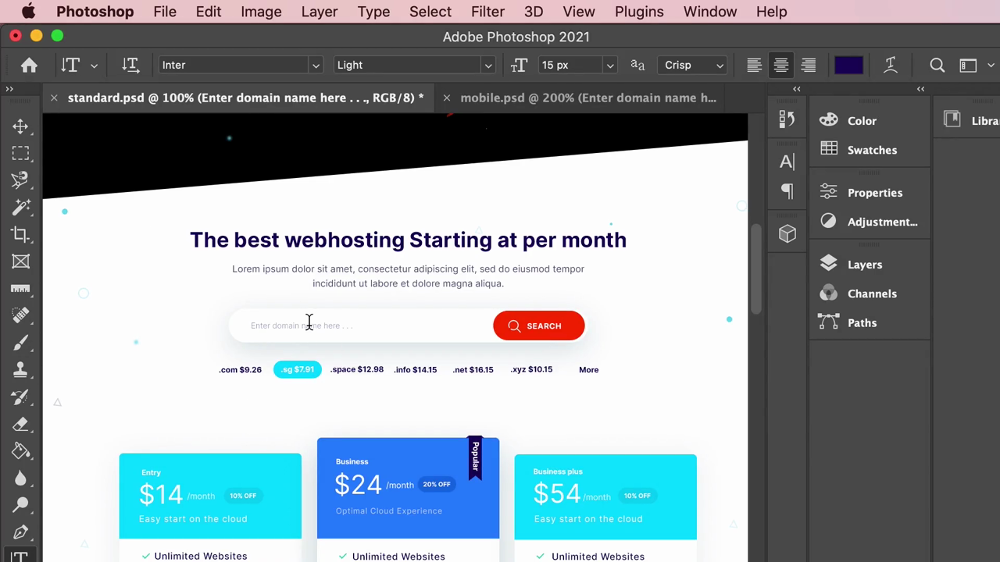

Mosh สลับกลับไปที่ Photoshop เพื่อดูภาพรวมทั้ง section (หัวข้อ "The best webhosting Starting at per month", input ค้นหาโดเมนคู่กับปุ่ม SEARCH สีแดง, รายการโดเมนราคา เช่น `.com $9.26`, `.sg $7.91` และการ์ดแพ็กเกจราคา Entry/Business/Business plus ด้านล่าง) เพื่อให้เห็นบริบทว่า input นี้อยู่ตรงไหนของหน้าเว็บทั้งหมด ก่อนที่จะปรับให้ responsive สำหรับหน้าจอขนาดใหญ่ต่อไป

---

## 11. ทำ Responsive ด้วย Media Query (Mobile First)

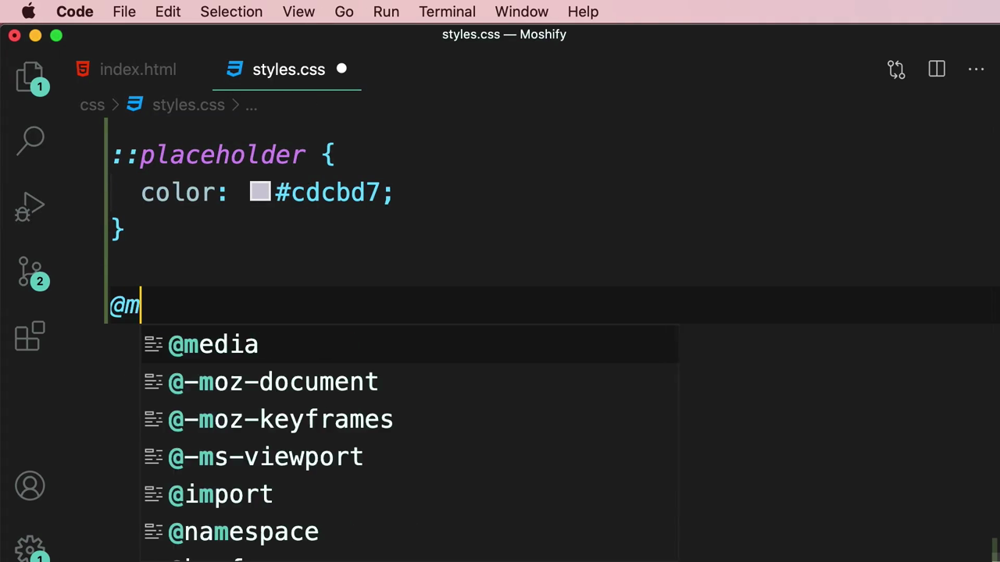

พิมพ์ `@m` แล้ว IntelliSense แสดงตัวเลือก at-rule ต่างๆ เช่น `@media`, `@-moz-document`, `@-moz-keyframes`, `@-ms-viewport`, `@import`, `@namespace`

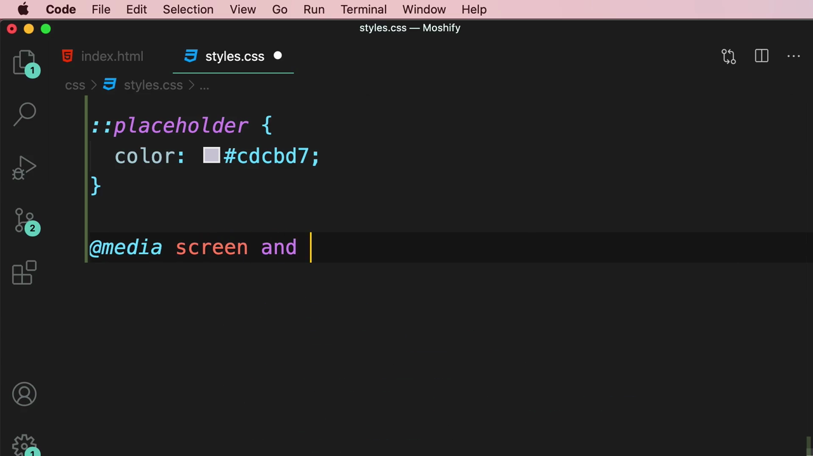

เลือก `@media` แล้วพิมพ์เงื่อนไขต่อ:

```css
@media screen and (min-width: 1024px) {
}
```


ภายใน media query พิมพ์ `.inp` แล้ว IntelliSense แสดง selector ที่มีอยู่แล้วในไฟล์ให้เลือก (`.input`, `.icon--primary`)


เลือก `.input` แล้วพิมพ์ property ใหม่ โดย IntelliSense แสดงตัวเลือก `font-size`, `font-weight`, `float`, `font-family`, `font-style`, `font` ฯลฯ


```css
@media screen and (min-width: 1024px) {
  .input {
    font-size: 1.5rem;
  }
}
```

> 📱💻 **หลักการ Mobile First:** ค่า `font-size: 2rem` ที่ตั้งไว้ในตัว `.input` หลักคือค่าเริ่มต้นสำหรับหน้าจอมือถือ (ขนาดเล็กก่อน) ส่วนภายใน media query ที่มีเงื่อนไข `min-width: 1024px` จะ**ลด**ขนาดตัวอักษรลงเหลือ `1.5rem` เมื่อหน้าจอกว้างขึ้น (เดสก์ท็อป) เนื่องจากบนจอใหญ่ ตัวอักษรไม่จำเป็นต้องใหญ่เท่าจอมือถือเพื่อให้อ่านง่าย — เป็น pattern เดียวกับที่เคยใช้กับ `.list--tick` (clip 13) และ `.btn` (clip 15) มาก่อน

### ทดสอบ Responsive ในเบราว์เซอร์


Mosh ปรับขยายหน้าต่างเบราว์เซอร์ให้กว้างขึ้น (จำลองหน้าจอเดสก์ท็อป) เพื่อทดสอบว่า media query ทำงานถูกต้อง


จากนั้นย่อหน้าต่างให้แคบลงอีกครั้งเพื่อเทียบขนาดตัวอักษรระหว่างมุมมองมือถือ (font-size ใหญ่กว่า) และเดสก์ท็อป (font-size เล็กกว่า) ยืนยันว่า responsive ทำงานตามที่ตั้งใจ

---

## สรุปภาพรวมของคลิปนี้

| หัวข้อ | รายละเอียด |
|---|---|
| Element หลัก | `<input type="text" class="input" placeholder="...">` |
| CSS Properties ใหม่ | `outline: 0`, `::placeholder` |
| BEM | ไม่มีการใช้ Element/Modifier ในคลิปนี้ (ใช้ class เดี่ยว `.input`) |
| Responsive | Mobile First — `font-size: 2rem` (มือถือ) → `font-size: 1.5rem` (เดสก์ท็อป `min-width: 1024px`) |
| เครื่องมือ | VS Code, Chrome DevTools (Elements + Computed panel), Photoshop (Eyedropper/เทียบสี), Live Server |

## แนวคิดสำคัญที่ได้จากคลิปนี้

1. `outline: 0` ใช้ลบเส้นขอบโฟกัส (focus ring) สีฟ้าที่เบราว์เซอร์ใส่ให้ `<input>` โดยอัตโนมัติ แต่ควรพิจารณาเรื่อง accessibility เมื่อใช้งานจริง
2. attribute `placeholder` ใช้กำหนดข้อความคำแนะนำใน input ที่จะหายไปเมื่อผู้ใช้เริ่มพิมพ์
3. pseudo-element `::placeholder` ใช้จัดสไตล์เฉพาะข้อความ placeholder แยกจากข้อความจริงที่ผู้ใช้พิมพ์
4. เบราว์เซอร์ implement `<input>` ด้วย **shadow DOM** (`#shadow-root (user-agent)`) ที่ซ่อนอยู่ภายใน ซึ่งเป็นเหตุผลที่ต้องใช้ pseudo-element พิเศษในการเข้าถึง แทนที่จะใช้ selector ธรรมดา
5. DevTools **Computed panel** ช่วยแกะรอย CSS cascade ว่าค่าสุดท้ายของ property มาจากกฎใดในไฟล์ไหนบ้าง เป็นเครื่องมือ debug ที่มีประโยชน์มาก
6. VS Code Command Palette คำสั่ง **"Sort Lines Ascending"** ช่วยจัดเรียง CSS properties ให้เป็นระเบียบตามตัวอักษร
7. หลักการ **Mobile First** ยังคงใช้ต่อเนื่อง: ตั้งค่า default สำหรับจอเล็กก่อน แล้วปรับแก้ใน media query `min-width` สำหรับจอใหญ่

---

*สรุปจากคลิปที่ 16 ของคอร์ส "Building a Web Site" (Moshify Project) สอนโดย Mosh Hamedani — codewithmosh.com*
