# HTML-CSS-3: 20 - Popular Badge

**ไฟล์ต้นฉบับ:** 20-Popular-Badge.mp4

▶️ [ดูวิดีโอ](../../HTML-CSS-3/20-Popular-Badge.mp4)

---

## ภาพรวมคลิปนี้

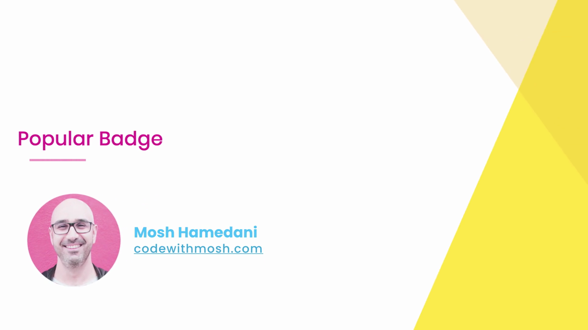

คลิปนี้เป็นคลิปที่ **สั้นและเจาะจง** (53 เฟรมสำคัญ) สอนเทคนิคการเพิ่ม **ริบบิ้น "Popular" (ป้ายยอดนิยม)** ที่มุมขวาบนของการ์ดแพลนราคา ซึ่งเป็นเทคนิคที่ใช้กันทั่วไปเพื่อดึงดูดความสนใจไปยังแพลนที่ผู้ขายต้องการให้ลูกค้าเลือกมากที่สุด (มักเป็นแพลนราคากลาง)

> 🎯 หัวข้อหลักที่สอนในคลิปนี้:
> 1. การใช้ SVG เป็นภาพกราฟิกตกแต่ง
> 2. การเปรียบเทียบวิธี `` ใน HTML กับวิธี `::before` pseudo-element ใน CSS
> 3. การใช้ `position: absolute` ร่วมกับ `position: relative` เพื่อจัดวางองค์ประกอบให้ลอยอยู่ที่มุมของ Container

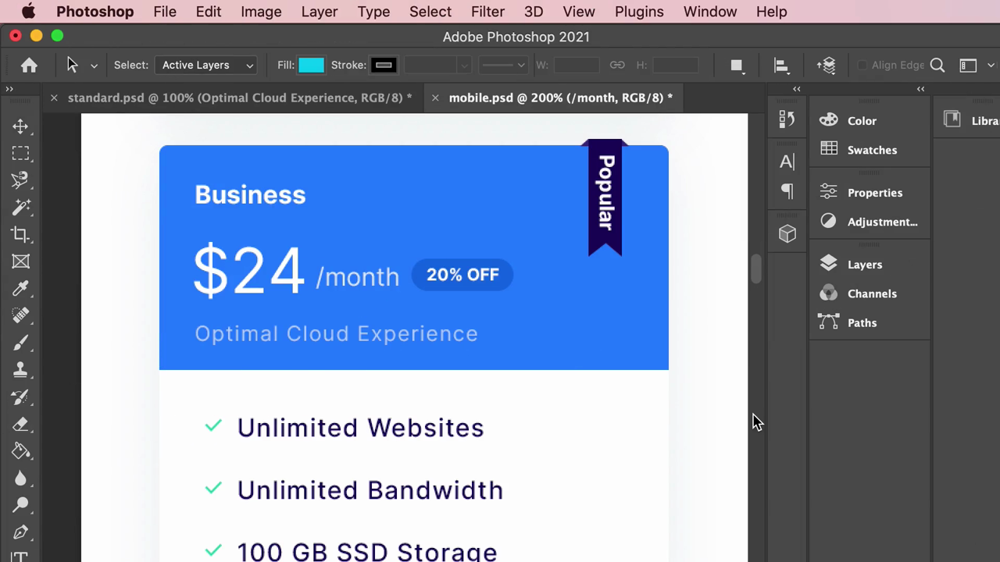

ภาพจาก Photoshop แสดงดีไซน์เป้าหมาย: การ์ด "Business" ($24/month, 20% OFF, "Optimal Cloud Experience") ที่มีริบบิ้นสีกรมท่าเข้มเขียนคำว่า "Popular" พาดอยู่ที่มุมขวาบนของการ์ด

---

## 1. สำรวจไฟล์ SVG ที่มีอยู่แล้วในโปรเจกต์

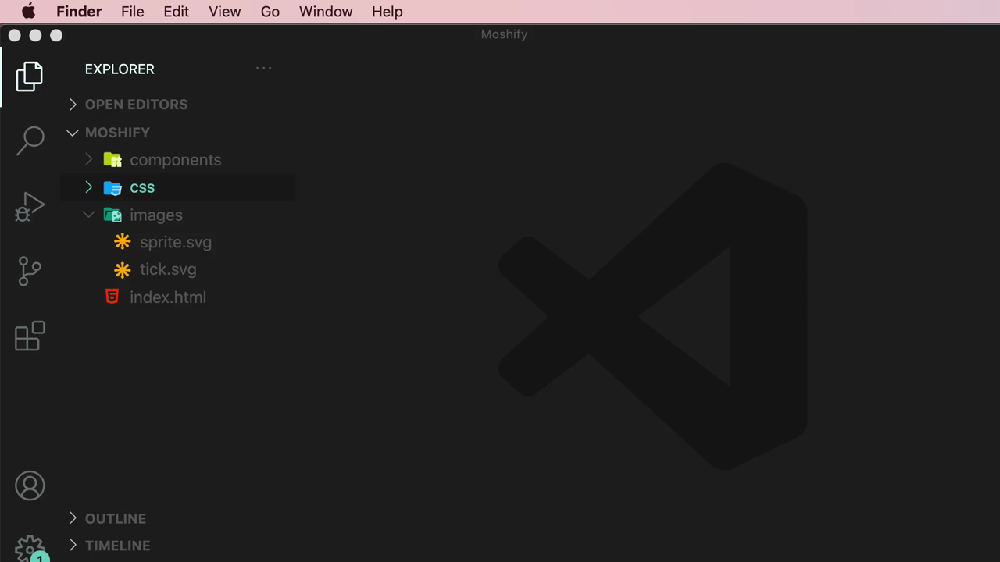

Mosh เปิด Explorer panel ของ VS Code แสดงโครงสร้างโปรเจกต์ Moshify: โฟลเดอร์ `components/`, `css/`, `images/` (มีไฟล์ `sprite.svg`, `tick.svg`) และ `index.html`

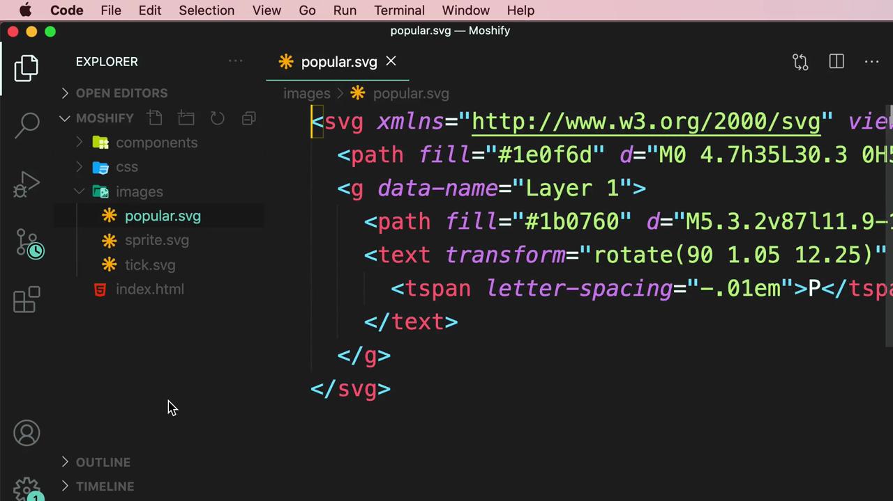

Mosh เปิดไฟล์ **`images/popular.svg`** ที่มีอยู่แล้วในโปรเจกต์ (เตรียมไว้ล่วงหน้าโดยผู้สอน) ซึ่งมีโค้ด SVG ของริบบิ้น:

```svg
<svg xmlns="http://www.w3.org/2000/svg" viewBox="...">
  <path fill="#1e0f6d" d="M0 4.7h35L30.3 0H5..." />
  <g data-name="Layer 1">
    <path fill="#1b0760" d="M5.3.2v87l11.9-1..." />
    <text transform="rotate(90 1.05 12.25)">
      <tspan letter-spacing="-.01em">Popular</tspan>
    </text>
  </g>
</svg>
```

> 📄 นี่คือไฟล์ Vector Graphic (SVG) ของริบบิ้นที่วาดไว้ล่วงหน้าแล้ว มีรูปทรงธงพร้อมข้อความ "Popular" หมุน 90 องศาให้อ่านจากล่างขึ้นบน (แนวตั้ง) ซึ่งเหมาะสำหรับใช้เป็นริบบิ้นที่พาดมุมการ์ด

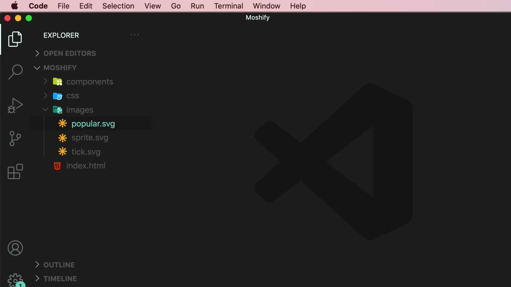

---

## 2. วิธีที่ 1: ลองใส่ด้วย `` Tag ก่อน (แล้วจะพบปัญหา)

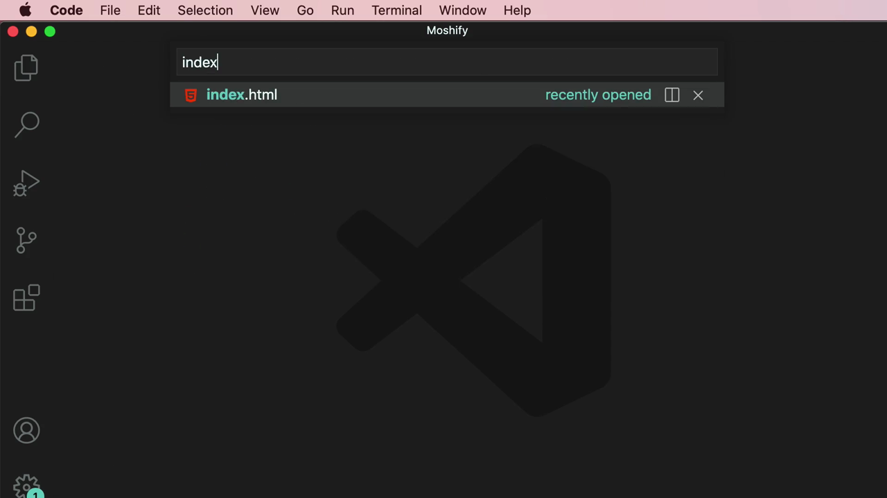

Mosh ใช้ Quick Open (Cmd+P) เพื่อกลับไปที่ไฟล์ `index.html`

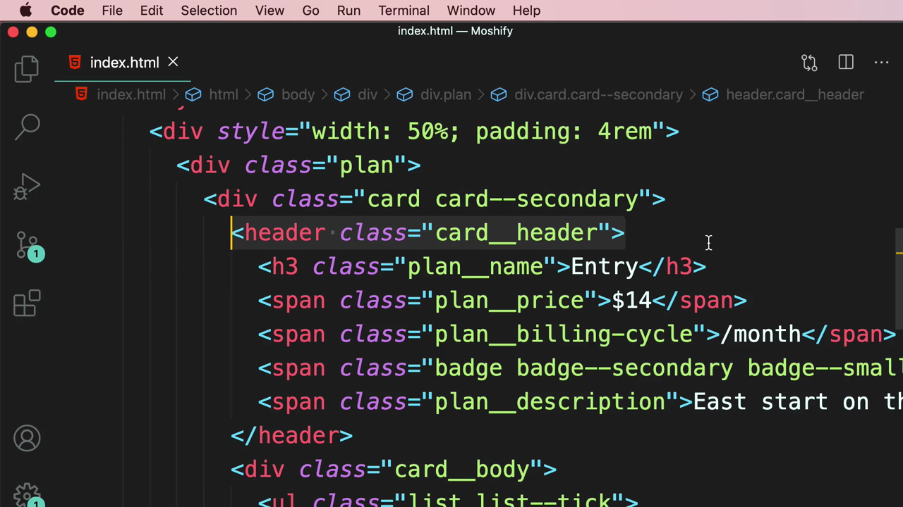

เริ่มต้นจากโครงสร้างการ์ดแพลน "Entry" ที่สร้างไว้ในคลิปก่อนหน้า (Plans)

### เพิ่ม `` เข้าไปในหัวการ์ด

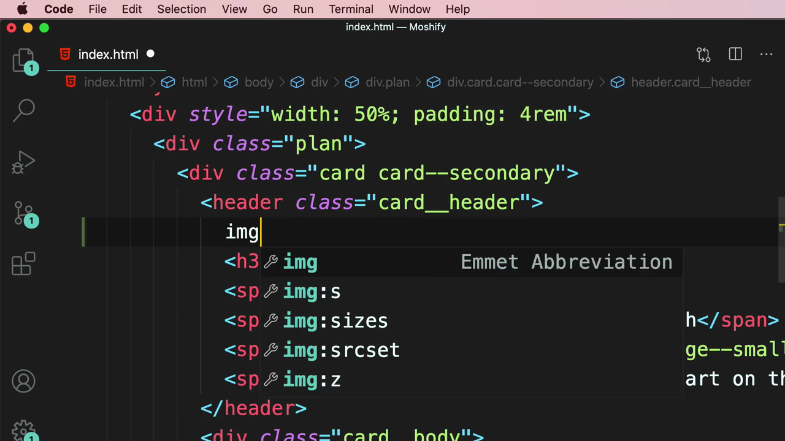

Mosh พิมพ์ `img` แล้ว Emmet แนะนำ Abbreviation

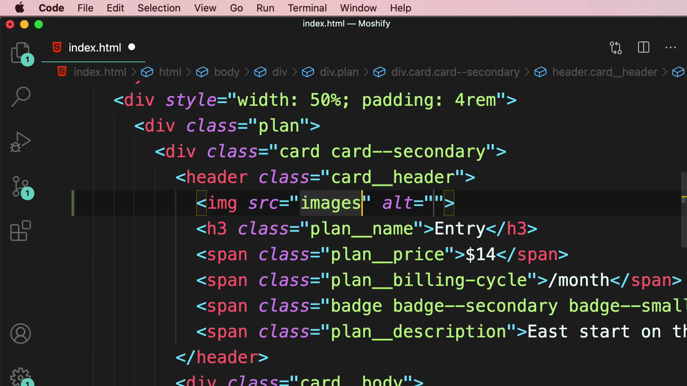

```html

```

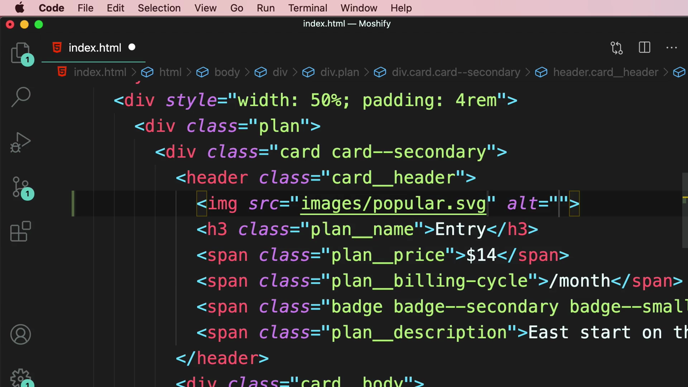

```html

```

ตำแหน่งของ `` ถูกวางไว้เป็นตัวแรกใน `card__header` ก่อนหน้า `<h3 class="plan__name">`:

```html
<header class="card__header">
  
  <h3 class="plan__name">Entry</h3>
  ...
</header>
```

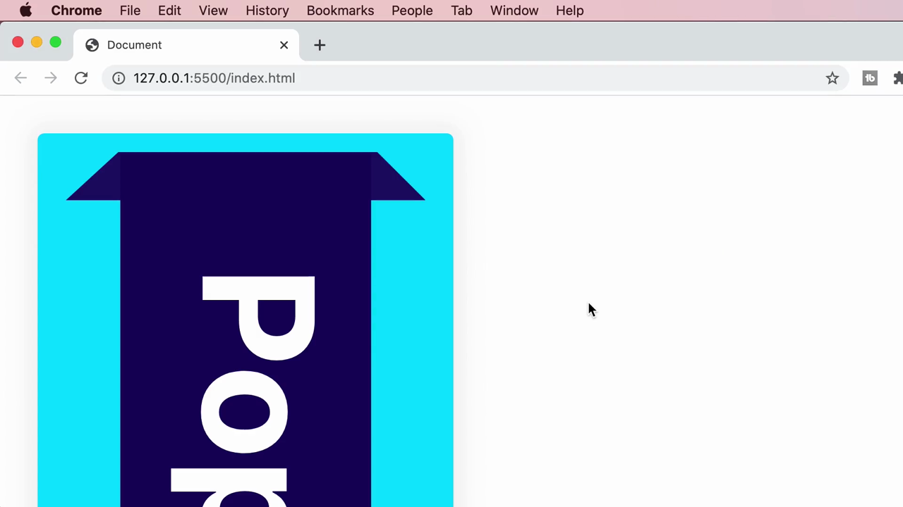

**🐛 ปัญหาที่พบ:** เมื่อดูผลลัพธ์ในบราวเซอร์ พบว่าภาพ SVG ริบบิ้น "Popular" แสดงผลใหญ่มากจนเต็มความกว้างของการ์ด และล้นเลยขอบเขตปกติของหัวการ์ดไปอย่างมาก (เพราะ SVG ไม่มีขนาดกำหนดไว้ ค่า default จะยึดตาม `viewBox` ซึ่งมีสัดส่วนที่ค่อนข้างใหญ่)

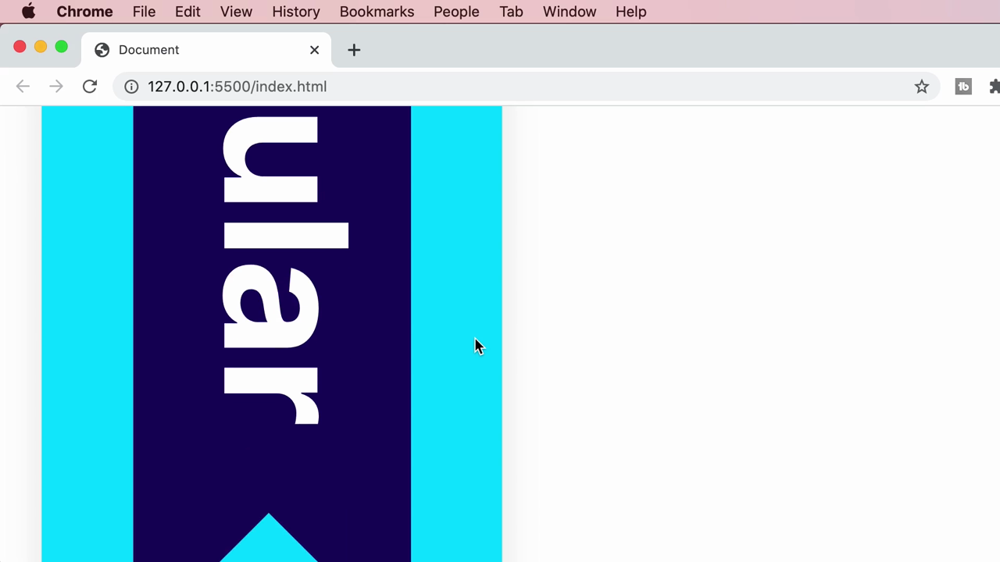

เมื่อเลื่อนดูเพิ่มเติมจะเห็นข้อความ "Popular" หมุนแนวตั้งเต็มพื้นที่ ซึ่งไม่ตรงกับดีไซน์ที่ต้องการ (ริบบิ้นเล็กๆ ที่มุมการ์ด)


### ลองเพิ่ม class ให้ img แต่ยังไม่แก้ปัญหาขนาด

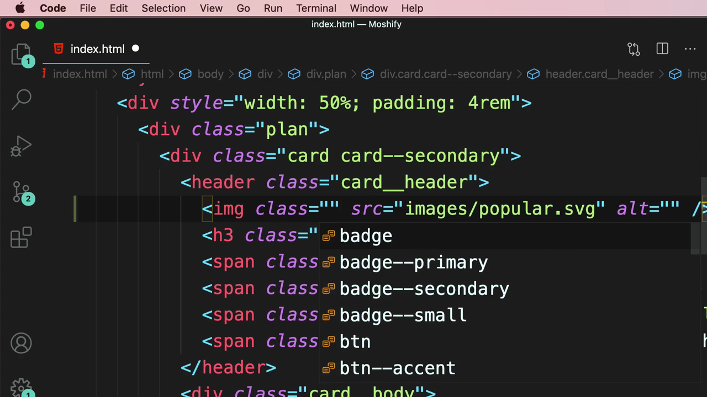

Mosh ลองพิมพ์ attribute `class` ใน `` แล้ว VS Code แสดง Autocomplete รายการ class ที่มีในโปรเจกต์: `badge`, `badge--primary`, `badge--secondary`, `badge--small`, `btn`, `btn--accent`

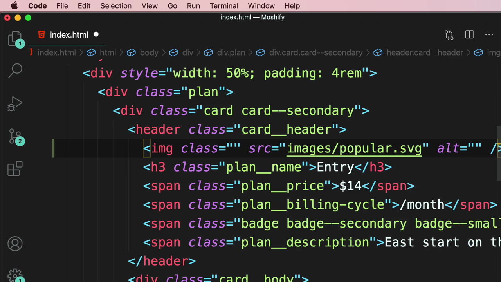
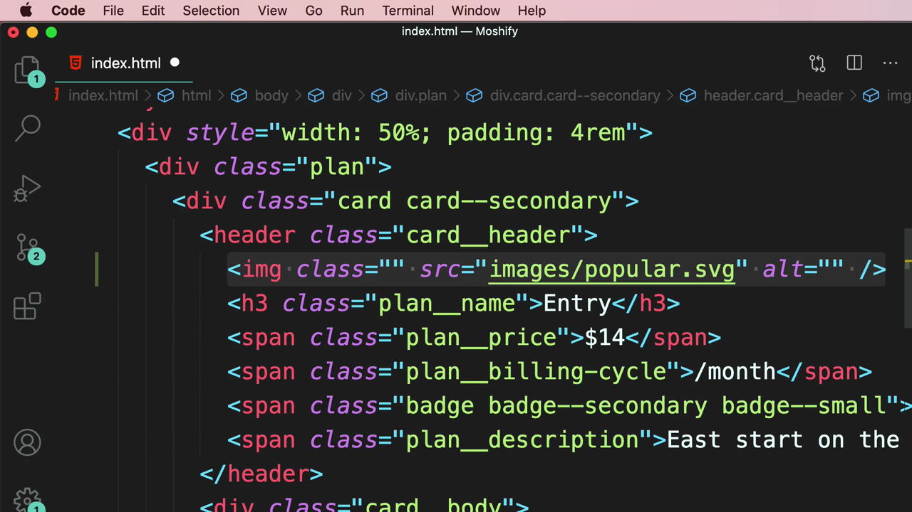

> ⚠️ **ทำไม Mosh เปลี่ยนใจไม่ใช้ ``:** หลังจากทดลองแล้วพบว่าการใช้ `` มีข้อเสีย 2 อย่างในกรณีนี้ - (1) ต้องเขียน CSS จำกัดขนาดเพิ่มเติมทุกครั้งที่ใช้ และ (2) ที่สำคัญกว่านั้นคือ **ริบบิ้น "Popular" ไม่ใช่เนื้อหา (Content) ที่มีความหมายทางความหมาย (Semantic)** แต่เป็นเพียง**องค์ประกอบตกแต่ง (Decorative)** ที่ไม่ควรอยู่ใน HTML - ดังนั้น Mosh จึงตัดสินใจลบ `` ออกทั้งหมด แล้วเปลี่ยนไปใช้เทคนิค CSS `::before` แทน

---

## 3. วิธีที่ 2 (วิธีที่ถูกต้อง): ใช้ CSS `::before` Pseudo-element

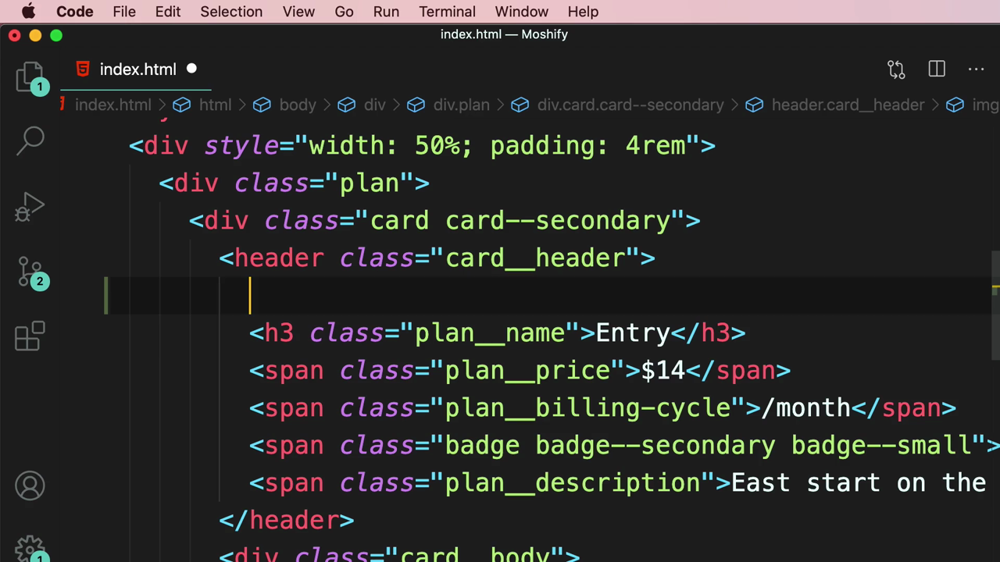

Mosh ลบ `` ออกจาก HTML ทั้งหมด แล้วกลับไปที่ `<div class="plan">` เพื่อเพิ่ม Modifier Class ใหม่

### เพิ่ม Modifier Class `.plan--popular`

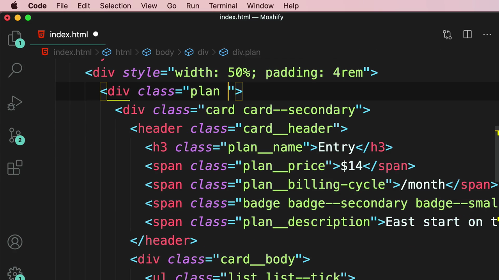

```html
<div class="plan plan">
```

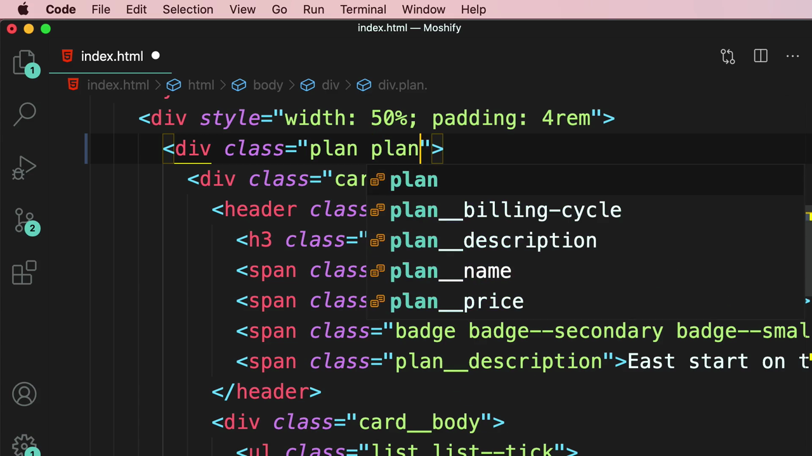

VS Code แสดง Autocomplete: `plan`, `plan__billing-cycle`, `plan__description`, `plan__name`, `plan__price`

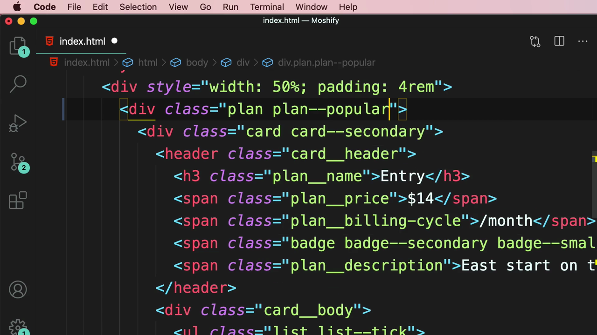

```html
<div class="plan plan--popular">
```

> 🧬 **แนวคิด BEM Modifier:** `.plan--popular` คือ Modifier ที่จะใช้ทำเครื่องหมายว่าแพลนไหนควรมีริบบิ้น "Popular" แสดงอยู่ - เมื่อไม่มี class นี้ ริบบิ้นจะไม่ปรากฏ ซึ่งเป็นวิธีที่ยืดหยุ่นกว่าการเขียน `` แยกในทุกการ์ด เพราะ Developer แค่เพิ่มหรือลบ class เดียวก็ควบคุมการแสดงผลได้

---

## 4. เขียน CSS Rule สำหรับริบบิ้น

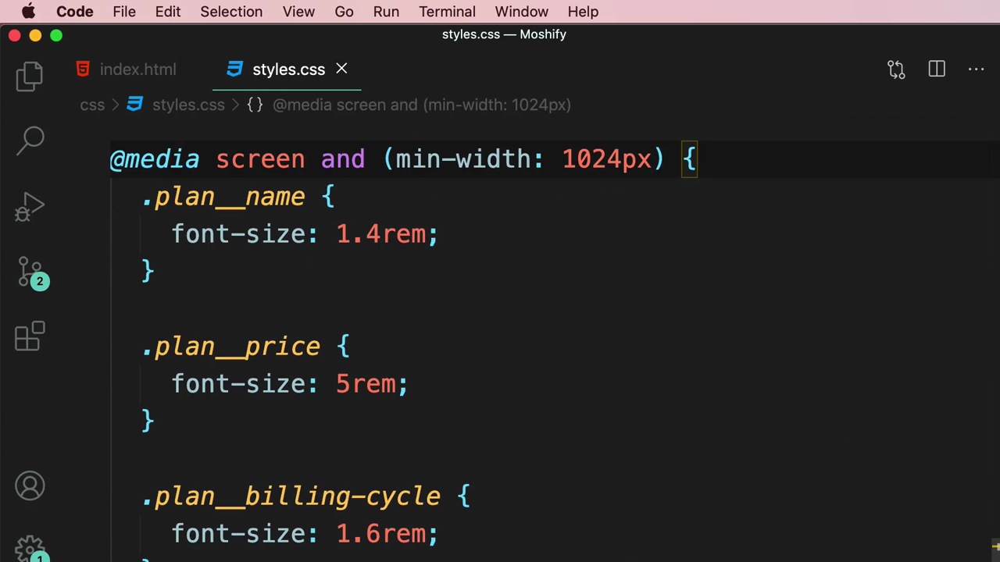

Mosh สลับไปที่ไฟล์ `styles.css` ทวนโค้ด Media Query ของ `.plan__name` และ `.plan__price` ที่เขียนไว้ในคลิปก่อน

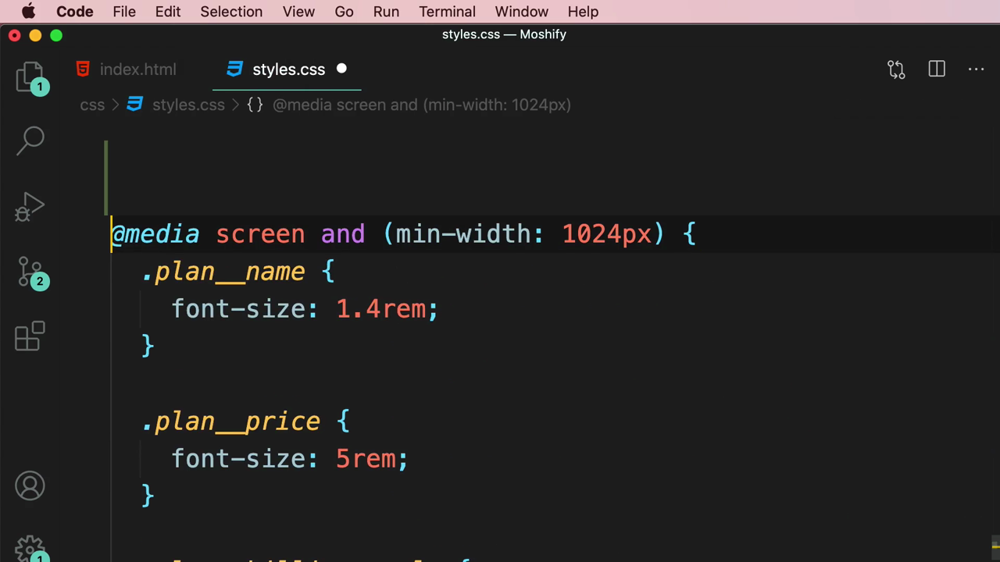

VS Code แสดง Autocomplete เมื่อพิมพ์ `.plan`

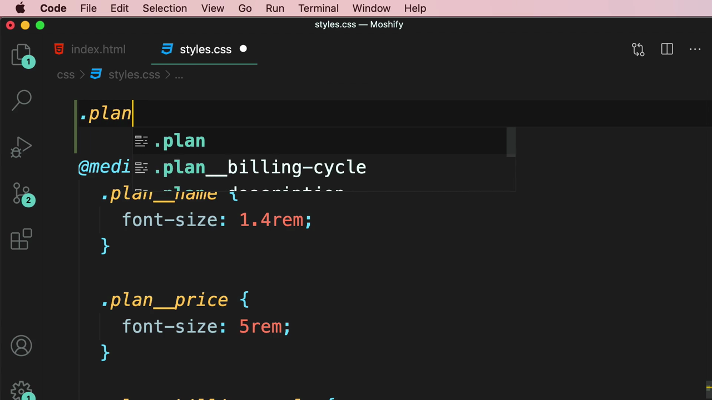

```css
.plan--popular {
}
```

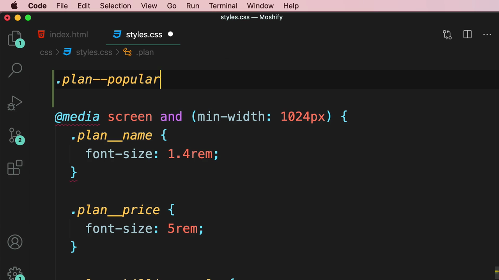

> 🤔 Mosh พิจารณาเลือก Selector ที่เหมาะสม สุดท้ายตัดสินใจว่าควรเขียนกฎที่เจาะจงเข้าไปถึง `card__header::before` แทนที่จะเขียนบน `.plan--popular` โดยตรง เพราะริบบิ้นควรจะแสดงอยู่ในตำแหน่งของหัวการ์ด

---

## 5. สร้าง Pseudo-element `::before` เพื่อแทรกไอคอนตกแต่ง

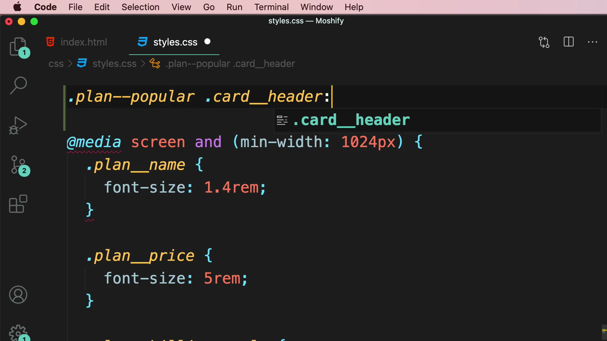

```css
.plan--popular .card__header:
```

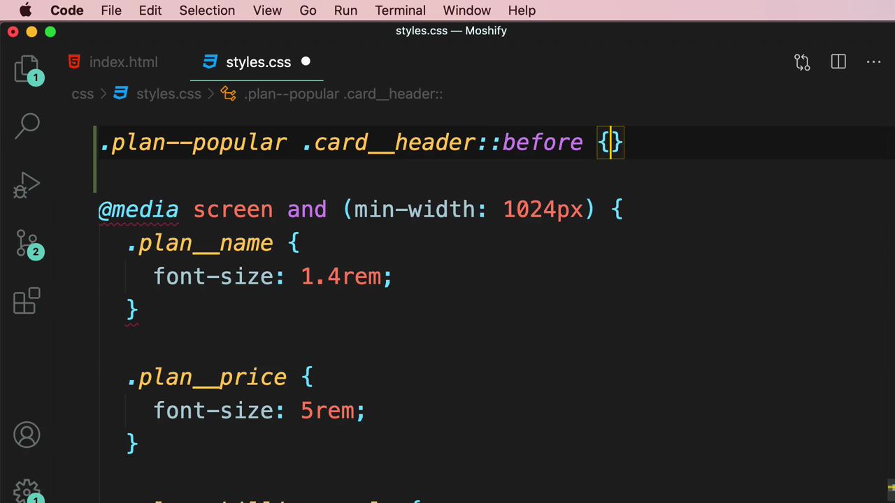

```css
.plan--popular .card__header::before {
}
```

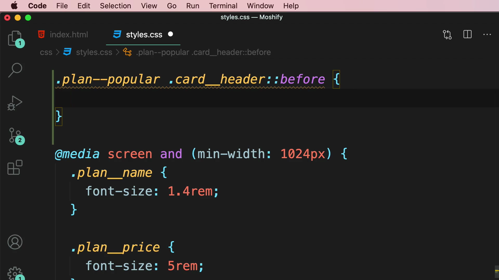

> ✨ **แนวคิดสำคัญ: `::before` Pseudo-element** คือองค์ประกอบเสมือนที่ CSS สร้างขึ้นมาแทรกไว้ **ก่อน** เนื้อหาจริงภายใน Element ที่เลือก (ในที่นี้คือก่อนเนื้อหาทั้งหมดใน `.card__header`) โดยไม่ต้องเพิ่ม Tag ใหม่ใน HTML เลย ข้อดีคือ:
> - ไม่ทำให้ HTML รกไปด้วย Element ที่ไม่มีความหมายเชิงเนื้อหา (Non-semantic)
> - ควบคุมการแสดงผลได้เต็มที่ผ่าน CSS เพียงจุดเดียว
> - เปิด/ปิดการแสดงผลได้ง่ายด้วยการเพิ่ม/ลบ Class (`plan--popular`) โดยไม่ต้องแก้ HTML

### เพิ่มเนื้อหาด้วย `content: url(...)`

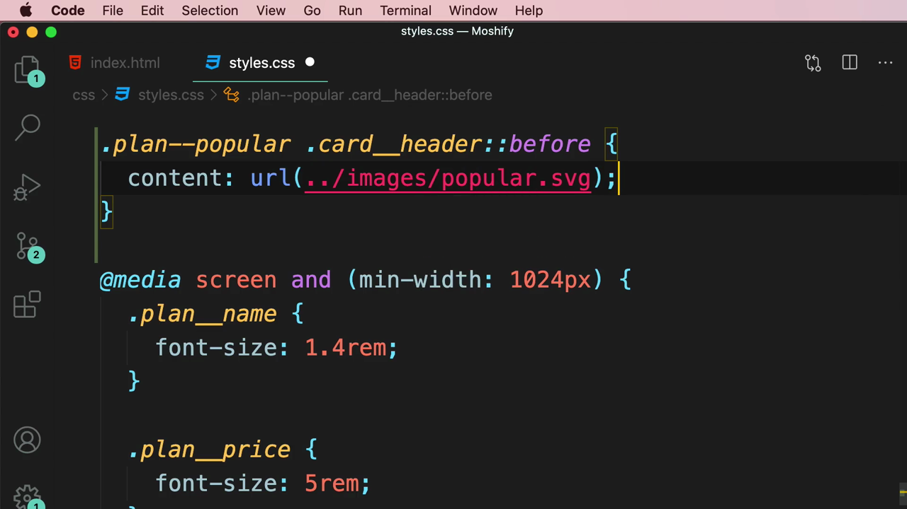

```css
.plan--popular .card__header::before {
  content: url(../images/popular.svg);
}
```

> 📌 **หมายเหตุเรื่อง Path:** สังเกตว่า Path ในไฟล์ CSS ใช้ `../images/popular.svg` (มี `../` นำหน้า) ต่างจาก Path ใน HTML ที่ใช้ `images/popular.svg` เพราะไฟล์ `styles.css` อยู่ในโฟลเดอร์ `css/` ซึ่งเป็นคนละระดับกับไฟล์ `index.html` ดังนั้น Path ที่อ้างอิงจากไฟล์ CSS จึงต้องถอยกลับ 1 ระดับ (`../`) ก่อนเข้าไปในโฟลเดอร์ `images/`
>
> 🔑 **`::before` ต้องมี `content` เสมอ:** Pseudo-element `::before` (และ `::after`) จะไม่แสดงผลอะไรเลยถ้าไม่มีการกำหนดค่า `content` แม้จะเป็นค่าว่าง (`content: "";`) ก็ตาม การกำหนด `content: url(...)` เป็นวิธีแทรกรูปภาพ (รวมถึง SVG) เข้าไปโดยไม่ต้องใช้ `` เลย

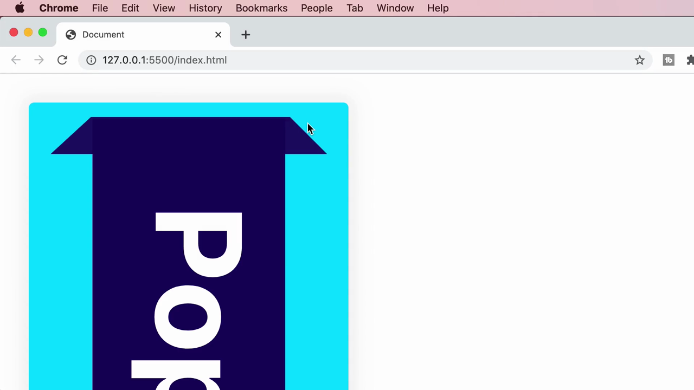

ผลลัพธ์เบื้องต้น: ริบบิ้นปรากฏแล้วแต่ยังคงมีขนาดใหญ่เกินไปเหมือนตอนใช้ `` (ปัญหาเดิมยังคงอยู่ เพราะ SVG ไม่มีขนาดกำหนด)

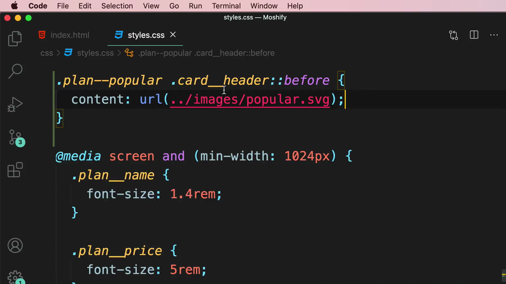

---

## 6. จำกัดขนาดและจัดวางริบบิ้น

### เพิ่ม width เพื่อจำกัดขนาด

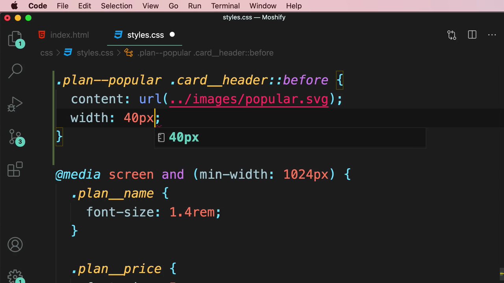

```css
.plan--popular .card__header::before {
  content: url(../images/popular.svg);
  width: 40px;
}
```

### เปลี่ยน display เป็น inline-block

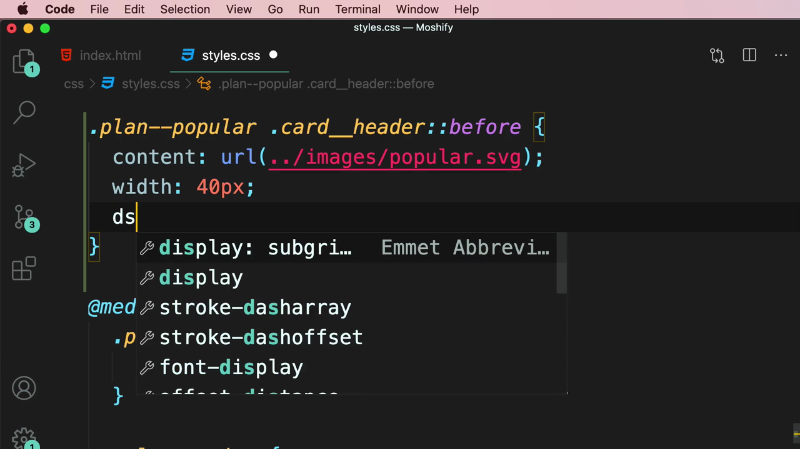

Mosh พิมพ์ `ds` แล้ว Emmet แนะนำ `display: subgrid;` และตัวเลือกอื่น

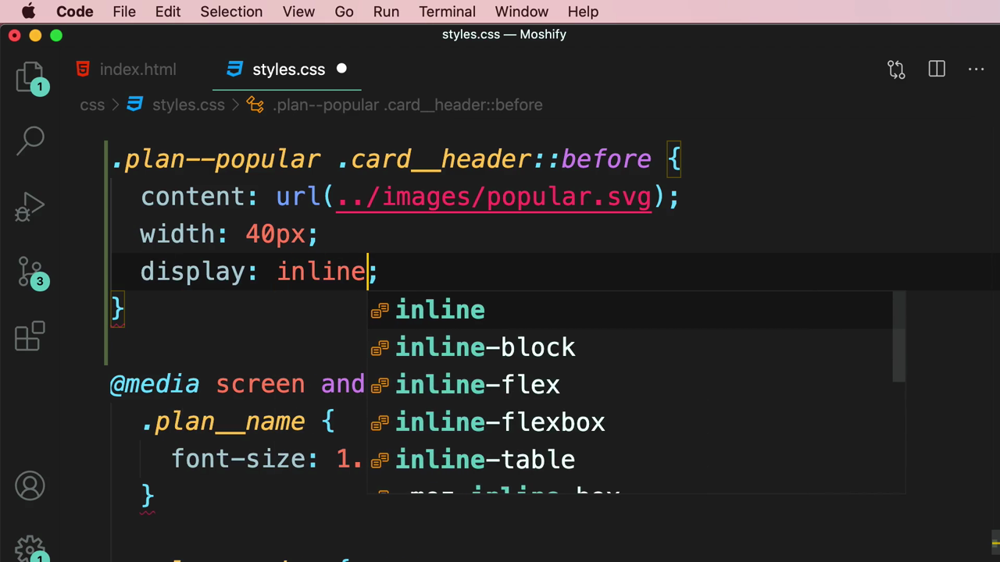

VS Code แสดงตัวเลือก: `inline`, `inline-block`, `inline-flex`, `inline-flexbox`, `inline-table`

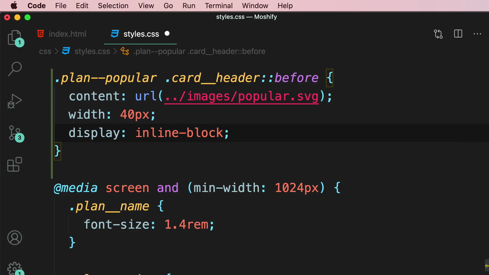

```css
.plan--popular .card__header::before {
  content: url(../images/popular.svg);
  width: 40px;
  display: inline-block;
}
```

> 🔧 **ทำไมต้องเป็น `inline-block` ไม่ใช่ `block`:** ค่า Default ของ Pseudo-element ที่มี `content` เป็นรูปภาพจะเป็น `inline` ซึ่งไม่รองรับการกำหนด `width` โดยตรง (คล้ายกับปัญหาที่เจอกับ `<span>` ในคลิปก่อนหน้า) การเปลี่ยนเป็น `inline-block` ทำให้สามารถกำหนดความกว้างได้ ในขณะที่ยังคงพฤติกรรมคล้าย Inline (ไม่ขึ้นบรรทัดใหม่)

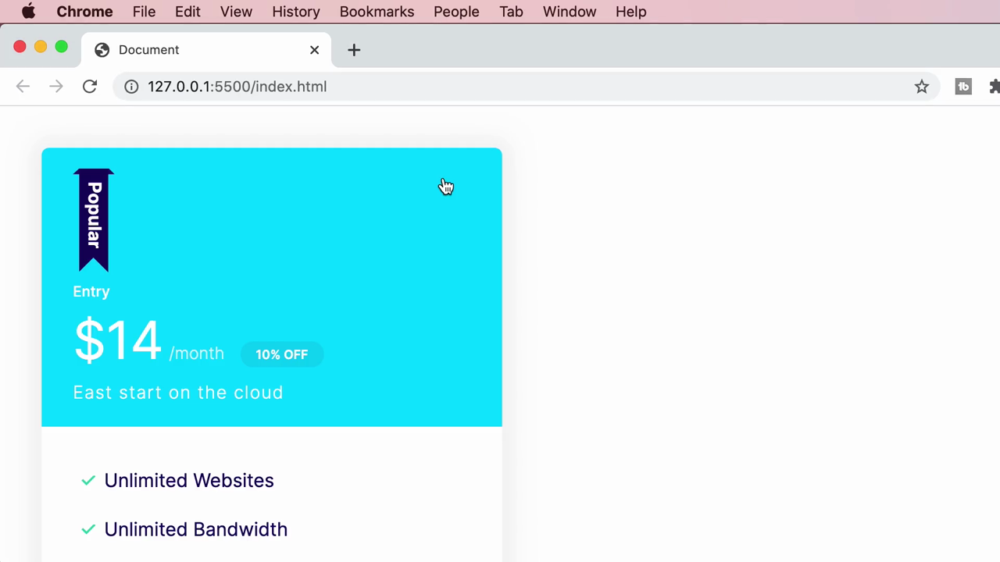

ผลลัพธ์: ริบบิ้นมีขนาดเล็กลงเหมาะสมแล้ว (40px) แต่ยังคงอยู่ที่ตำแหน่งซ้ายบนของหัวการ์ด (ตำแหน่งปกติของ Pseudo-element ในลำดับ Content) ยังไม่ได้ลอยไปที่มุมขวาบนตามดีไซน์

---

## 7. ใช้ Position Absolute ย้ายริบบิ้นไปมุมขวาบน

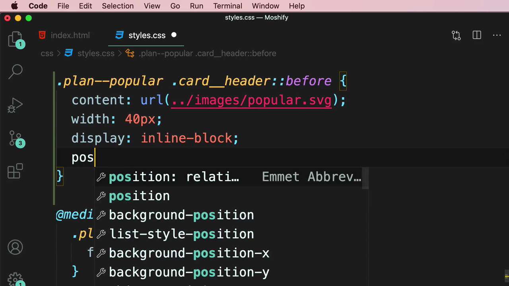

Mosh พิมพ์ `pos` แล้ว Emmet แนะนำ `position: relative;`

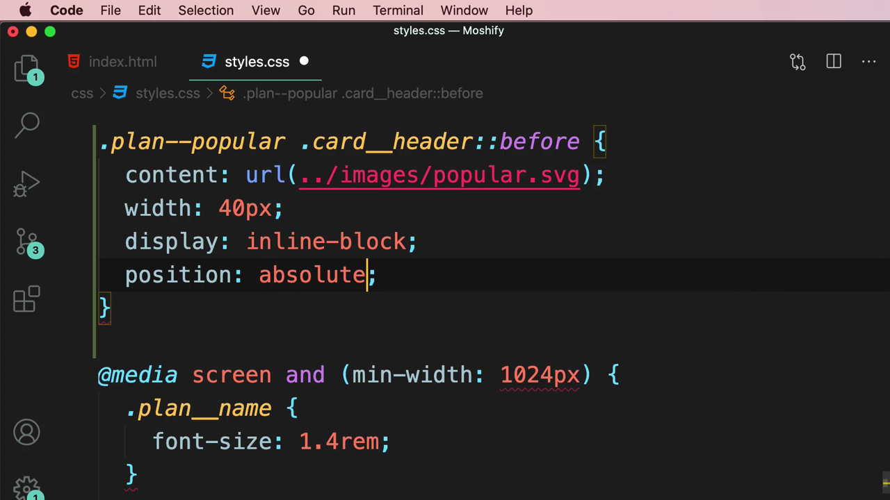

```css
.plan--popular .card__header::before {
  content: url(../images/popular.svg);
  width: 40px;
  display: inline-block;
  position: absolute;
}
```

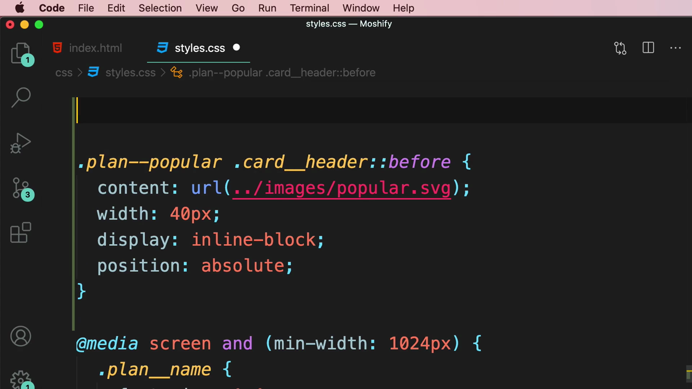

### สร้าง Positioning Context ด้วย `position: relative` บน Card Header

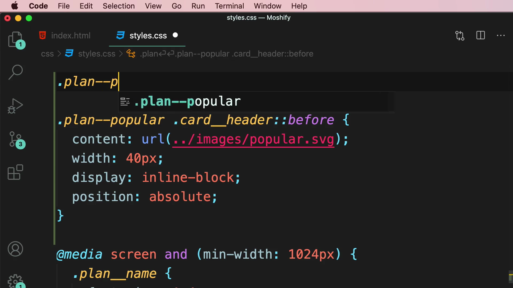

```css
.plan--popular .card
```

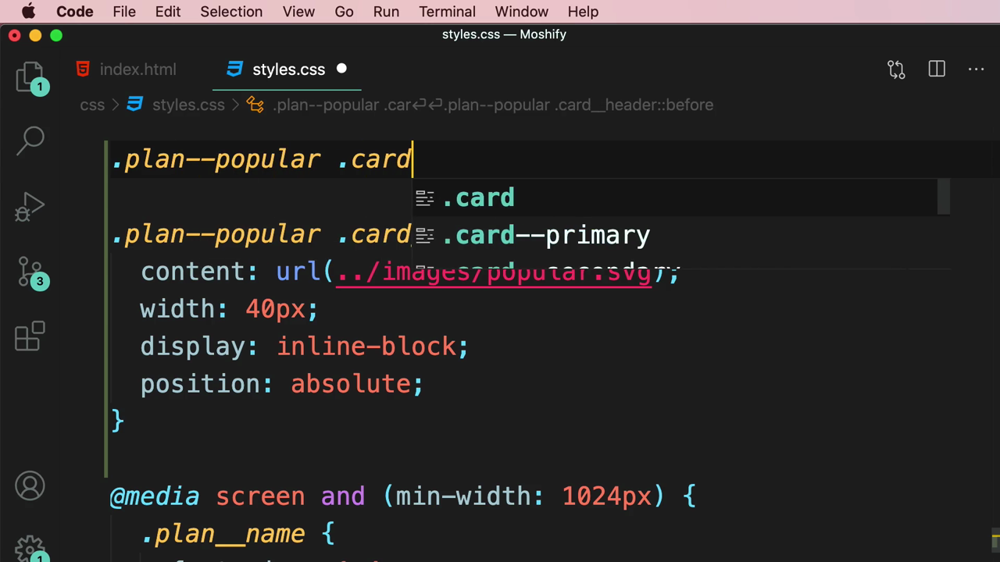

VS Code แสดง Autocomplete: `.card`, `.card--primary`

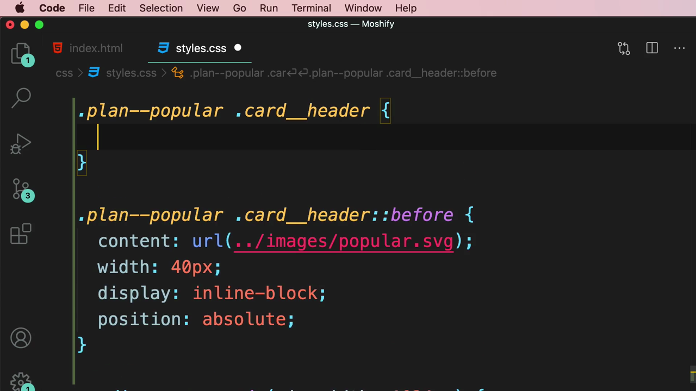

```css
.plan--popular .card__header {
}
```

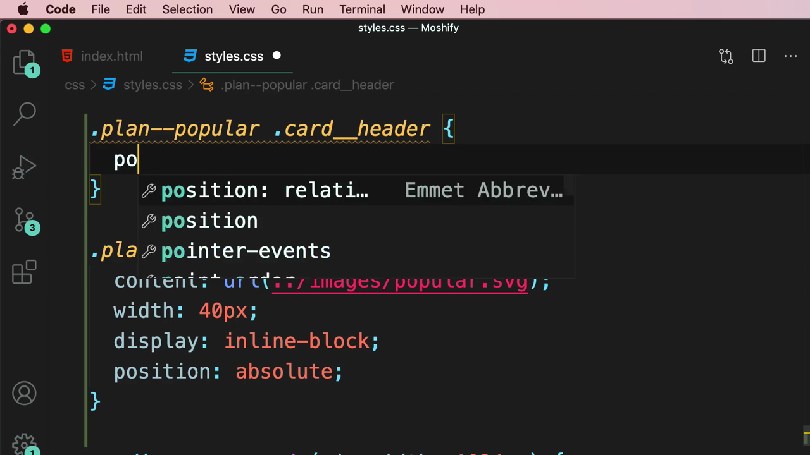

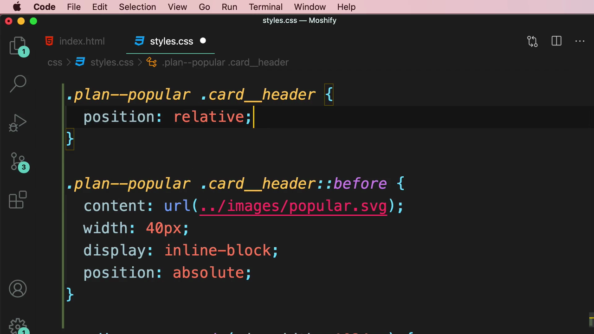

```css
.plan--popular .card__header {
  position: relative;
}
```

> 🧭 **แนวคิดสำคัญ: Positioning Context (`position: relative` + `position: absolute`)** นี่คือรูปแบบมาตรฐานที่ใช้บ่อยที่สุดใน CSS สำหรับการวางองค์ประกอบลอยอยู่ในตำแหน่งที่ต้องการภายใน Container หนึ่งๆ:
> - เมื่อ Parent Element (`.card__header`) มี `position: relative` จะทำให้มันกลายเป็น **"Containing Block"** (จุดอ้างอิงตำแหน่ง) สำหรับลูกหลานที่มี `position: absolute`
> - เมื่อ Child Element (`::before`) มี `position: absolute` มันจะหลุดออกจาก Flow ปกติของเอกสาร (Document Flow) และสามารถกำหนดตำแหน่งได้อย่างอิสระโดยอ้างอิงจาก Parent ที่ใกล้ที่สุดที่มี `position: relative` (หรือค่าอื่นที่ไม่ใช่ `static`)
> - หากไม่มี `position: relative` บน Parent เลย Browser จะอ้างอิงตำแหน่งจาก `<body>` หรือ Viewport ทั้งหน้าแทน ซึ่งจะทำให้ริบบิ้นหลุดไปอยู่ผิดที่ผิดทางอย่างมาก

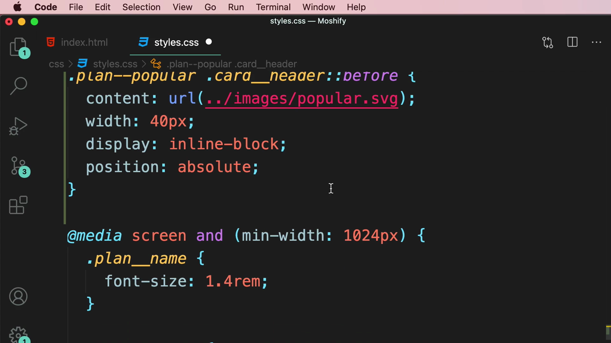

---

## 8. กำหนดพิกัดที่แน่นอน (top, right)

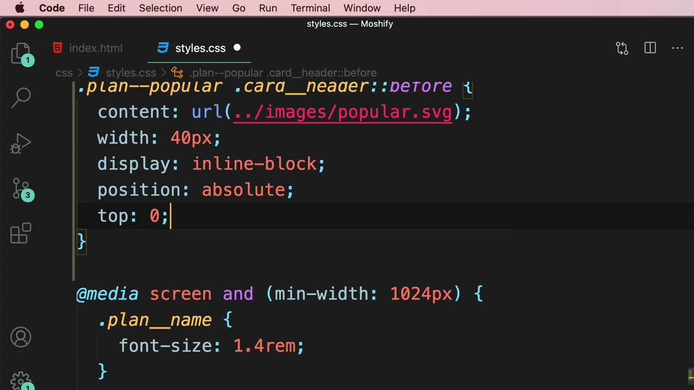

```css
.plan--popular .card__header::before {
  content: url(../images/popular.svg);
  width: 40px;
  display: inline-block;
  position: absolute;
  top: 0;
}
```

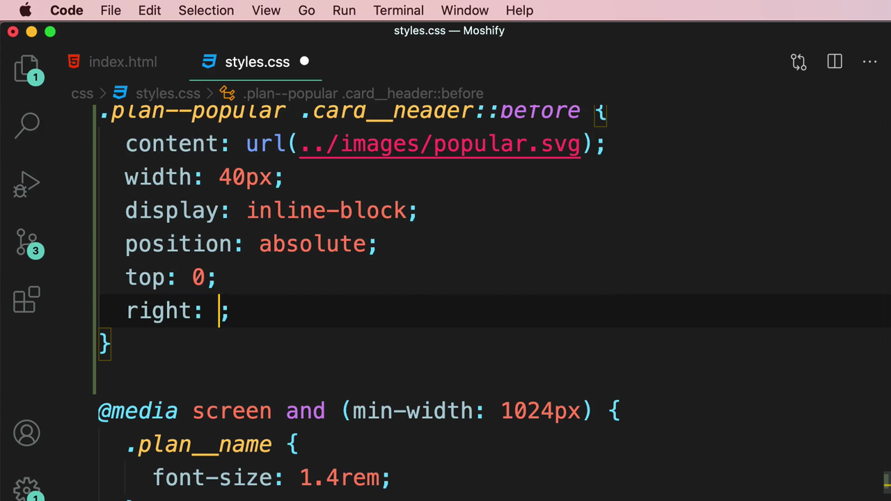

```css
  right: ;
```


ผลลัพธ์เบื้องต้น: ริบบิ้นเริ่มลอยไปที่มุมขวาบนของหัวการ์ดตามที่ต้องการแล้ว

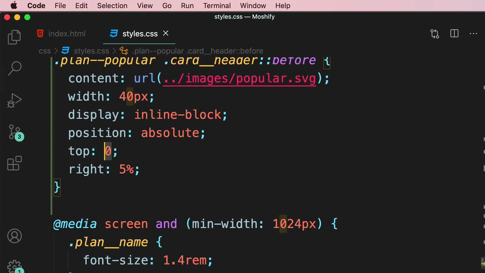

```css
.plan--popular .card__header::before {
  content: url(../images/popular.svg);
  width: 40px;
  display: inline-block;
  position: absolute;
  top: 0;
  right: 5%;
}
```

### ปรับ top ให้ริบบิ้นดูเหมือน "เสียบ" จากขอบบนสุดของการ์ด

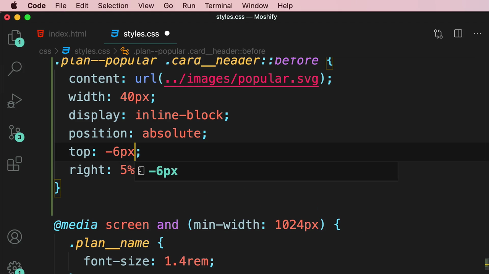

```css
.plan--popular .card__header::before {
  content: url(../images/popular.svg);
  width: 40px;
  display: inline-block;
  position: absolute;
  top: -6px;
  right: 5%;
}
```

> 🎯 **การใช้ค่าลบ (Negative Value) ใน top:** ค่า `top: -6px;` (แทนที่จะเป็น `top: 0;`) ทำให้ริบบิ้นเลื่อนขึ้นไปเหนือขอบบนของ `.card__header` เล็กน้อย (6 พิกเซล) เพื่อให้ดูเหมือนริบบิ้นถูกปักหรือเสียบทะลุออกมาจากขอบบนสุดของการ์ดจริงๆ (มองเห็นปลายแหลมด้านบนของริบบิ้นเต็มรูปแบบ ไม่ถูกตัดโดยขอบการ์ด) ซึ่งเป็นการปรับแต่งรายละเอียดเล็กน้อย (Fine-tuning) ให้ตรงกับดีไซน์ต้นฉบับมากที่สุด

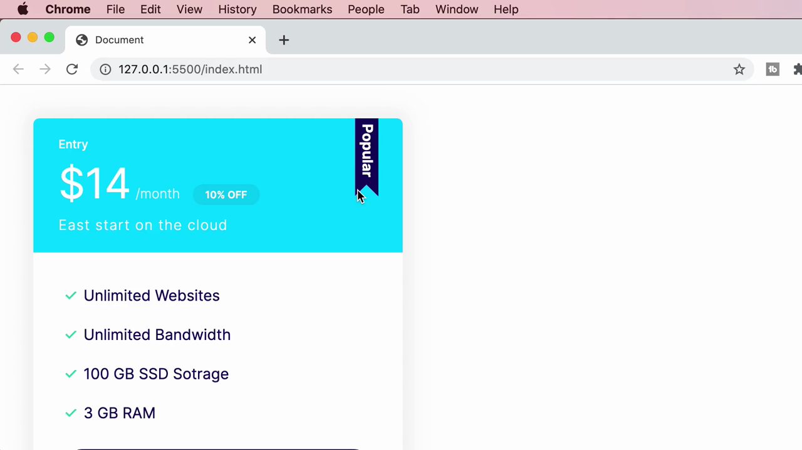

---

## 9. รีแคปผลลัพธ์สุดท้าย

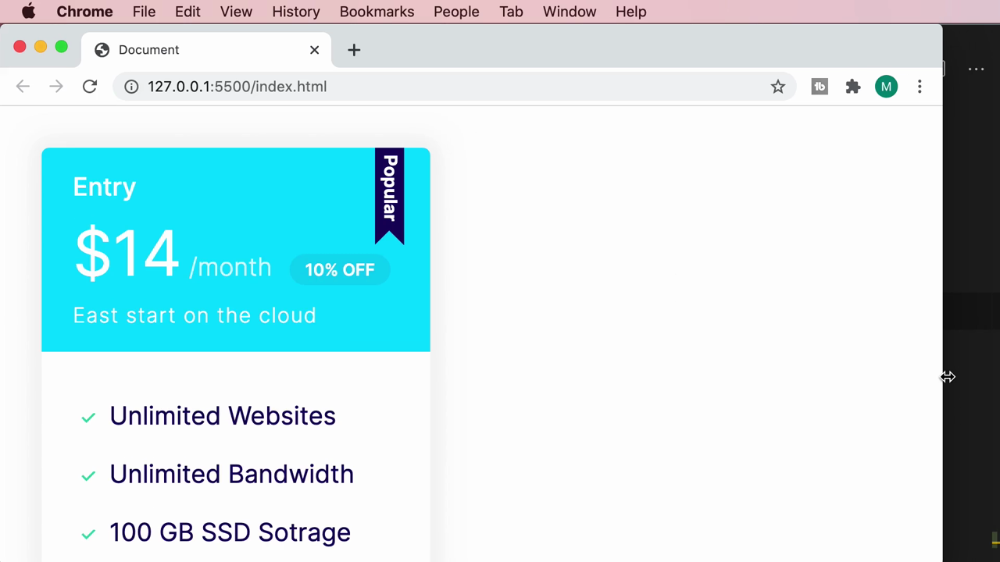

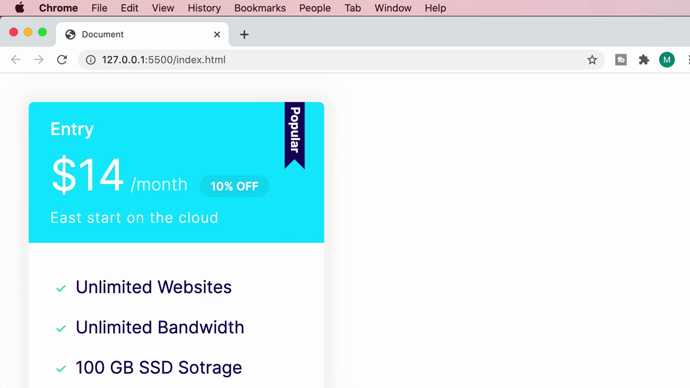


ริบบิ้น "Popular" เสร็จสมบูรณ์แล้ว: ขนาดเล็กพอดี (40px) ลอยอยู่ที่มุมขวาบนของหัวการ์ด และดูเหมือนปักทะลุออกมาจากขอบบนของการ์ดตามดีไซน์ต้นฉบับใน Photoshop ทุกประการ

---

## สรุปภาพรวมของคลิปนี้

**CSS ทั้งหมดที่เขียนในคลิปนี้:**

```css
.plan--popular .card__header {
  position: relative;
}

.plan--popular .card__header::before {
  content: url(../images/popular.svg);
  width: 40px;
  display: inline-block;
  position: absolute;
  top: -6px;
  right: 5%;
}
```

**HTML ที่เปลี่ยนแปลง (เพิ่ม Modifier Class เพียงตัวเดียว ไม่มี `` เพิ่ม):**

```html
<div class="plan plan--popular">
  <div class="card card--secondary">
    <header class="card__header">
      <h3 class="plan__name">Entry</h3>
      ...
```

| CSS Selector | คุณสมบัติ | ค่า |
|---|---|---|
| `.plan--popular .card__header` | positioning context | `position: relative;` |
| `.plan--popular .card__header::before` | เนื้อหาไอคอน | `content: url(../images/popular.svg);` |
| `.plan--popular .card__header::before` | ขนาดและการแสดงผล | `width: 40px; display: inline-block;` |
| `.plan--popular .card__header::before` | ตำแหน่งลอย | `position: absolute; top: -6px; right: 5%;` |

### แนวคิดสำคัญที่ได้จากคลิปนี้

1. **`` vs `::before` สำหรับองค์ประกอบตกแต่ง** - เมื่อกราฟิกไม่ใช่เนื้อหาที่มีความหมาย (Non-semantic/Decorative) ควรใส่ผ่าน CSS (`::before`/`content: url()`) แทนที่จะเพิ่ม `` ใน HTML เพราะช่วยแยก Presentation ออกจาก Content และควบคุมการเปิด/ปิดด้วย Class เดียวได้
2. **`::before` ต้องมี `content` เสมอ** ไม่งั้นจะไม่แสดงผลอะไรเลย และสามารถใช้ `content: url(...)` เพื่อแทรกรูปภาพ/SVG ได้โดยตรง
3. **Positioning Context Pattern** - `position: relative` บน Parent + `position: absolute` บน Child คือรูปแบบมาตรฐานสำหรับวางองค์ประกอบลอยในตำแหน่งที่ต้องการภายใน Container
4. **`display: inline-block`** จำเป็นเมื่อต้องการกำหนด `width`/`height` ให้กับ Element ที่มีค่า default เป็น `inline` (รวมถึง Pseudo-element ที่มี content เป็นรูปภาพ)
5. **ค่าลบ (Negative Value) ใน CSS Position** สามารถใช้เพื่อขยับองค์ประกอบให้ล้นออกไปนอกขอบเขตปกติของ Parent ได้ ซึ่งเป็นเทคนิคที่ใช้บ่อยสำหรับสร้างเอฟเฟกต์ "ป้าย" หรือ "ริบบิ้น" ที่ดูเหมือนติดอยู่บนขอบขององค์ประกอบอื่น
6. **BEM Modifier ควบคุมการแสดงผล** - `.plan--popular` เป็นตัวอย่างที่ดีของการใช้ Modifier Class เพื่อเปิด/ปิดฟีเจอร์การแสดงผล (แสดงหรือไม่แสดงริบบิ้น) โดยไม่ต้องแก้โครงสร้าง HTML

---

*สรุปจากคลิปที่ 20 (Popular Badge) คอร์ส HTML & CSS โดย Mosh Hamedani จาก codewithmosh.com*
