# HTML-CSS-3: 21 - Media Objects

**ไฟล์ต้นฉบับ:** 21- Media Objects.mp4

▶️ [ดูวิดีโอ](../../HTML-CSS-3/21-%20Media%20Objects.mp4)

---

## ภาพรวมคลิปนี้

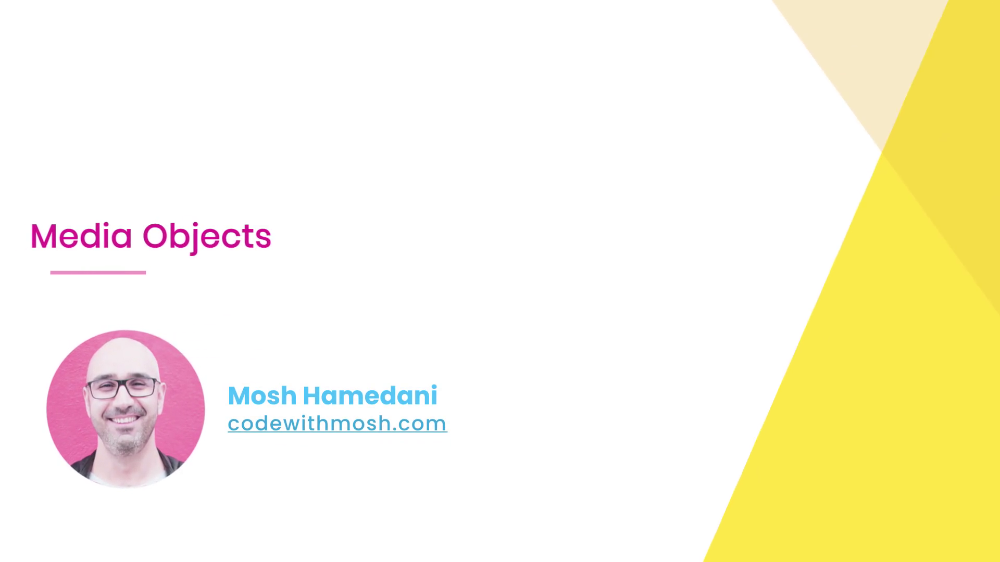

คลิปนี้ Mosh สอนการสร้าง **Media Object** ซึ่งเป็นแพทเทิร์น (pattern) ของ UI ที่พบได้บ่อยมากในเว็บไซต์จริง เช่น การ์ดข้อมูลที่มีไอคอนหรือรูปภาพอยู่ด้านซ้าย และมีหัวข้อ (title) กับข้อความอธิบาย (paragraph) อยู่ด้านขวา โดย Mosh จะนำไปใช้สร้างส่วน "Easy Start & Managed Updates" และ "Staging, Git & WP-CLI" ในหน้า Hosting ของเว็บไซต์ Moshify

> 💡 Media Object คือ Component สำคัญที่ใช้ repeated กันหลายจุดในเว็บ ดังนั้น Mosh จึงเน้นให้เขียนโครงสร้าง HTML/CSS ให้ **reusable (นำกลับมาใช้ซ้ำได้)** ตั้งแต่แรก

---

## 1. ทบทวนดีไซน์เป้าหมายใน Photoshop

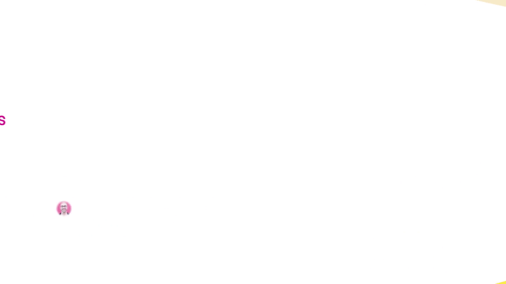

ก่อนเริ่มเขียนโค้ด Mosh เปิดไฟล์ `mobile.psd` ใน Photoshop เพื่อดูดีไซน์เป้าหมายอีกครั้ง จะเห็นบล็อกข้อความสองบล็อกที่มีโครงสร้างเหมือนกัน:

- บล็อกแรก: ไอคอนสีน้ำเงิน (placeholder) + หัวข้อ **"Easy Start & Managed Updates"** + ข้อความอธิบายด้านล่าง
- บล็อกที่สอง: ไอคอนสีน้ำเงิน (placeholder) + หัวข้อ **"Staging, Git & WP-CLI"** + ข้อความอธิบายด้านล่าง

> 📌 ทั้งสองบล็อกมีโครงสร้างเหมือนกันทุกประการ (ไอคอนซ้าย + ข้อความขวา) ต่างกันแค่เนื้อหา — นี่คือสัญญาณชัดเจนว่าควรสร้างเป็น Component ที่ reuse ได้ ซึ่งตรงกับหลักการ "Bottom Up" ที่ Mosh สอนมาตั้งแต่คลิปก่อนๆ (การสร้าง component ย่อยๆ แล้วประกอบเป็นหน้าเว็บ)

---

## 2. เริ่มต้นจาก body ว่าง

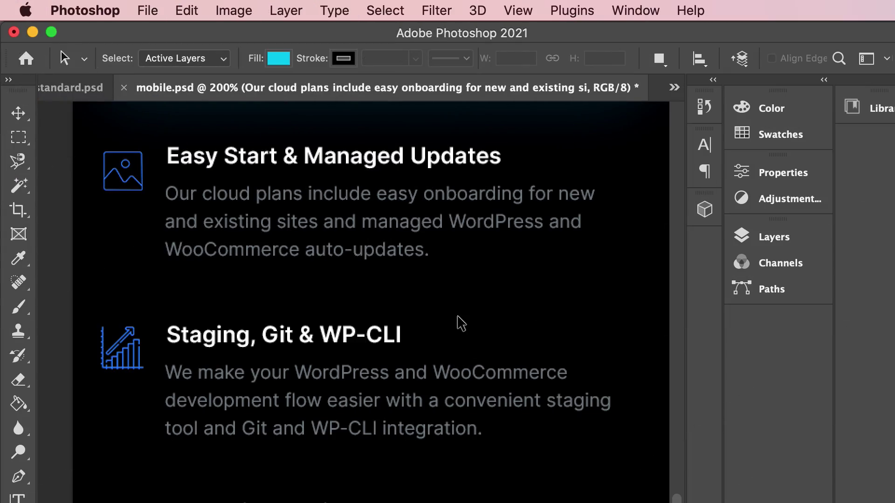

Mosh เปิดไฟล์ `index.html` ขึ้นมา และเริ่มต้นจาก `<body></body>` ที่ว่างเปล่า เพื่อทดลองสร้าง Media Object แยกออกมาก่อน (isolated) ก่อนจะนำไปประกอบกับส่วนอื่นของหน้าเว็บจริง

```html
<body>
</body>
```

---

## 3. สร้างโครงสร้าง HTML ด้วย Emmet

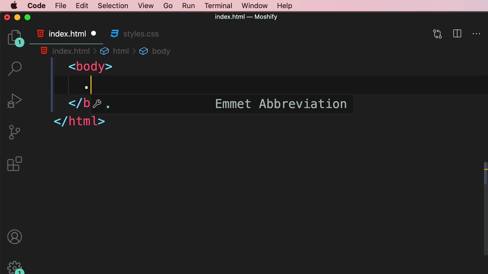

Mosh ใช้ Emmet abbreviation พิมพ์ `.media` แล้วกด Tab เพื่อสร้าง `<div class="media"></div>` อย่างรวดเร็ว

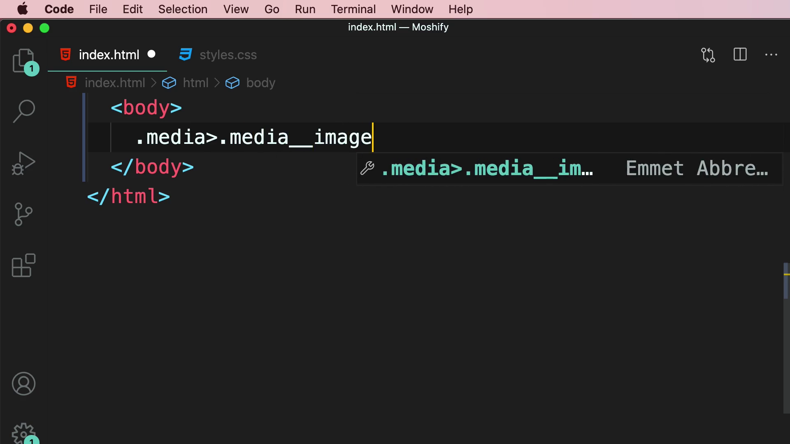

จากนั้นพิมพ์ Emmet ที่ซับซ้อนขึ้น:

```
.media>.media__image+.media__body
```

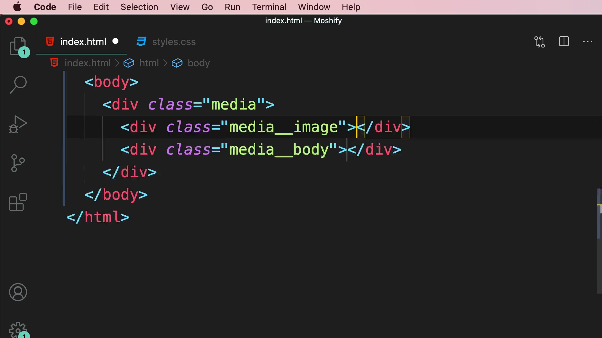

> 🔧 **อธิบาย Emmet syntax:**
> - `>` หมายถึง "ลูกของ" (child) — เช่น `.media>.media__image` คือสร้าง `.media__image` เป็นลูกของ `.media`
> - `+` หมายถึง "พี่น้องถัดไป" (sibling) — เช่น `.media__image+.media__body` คือสร้าง `.media__body` เป็นพี่น้องถัดจาก `.media__image` (อยู่ level เดียวกัน)

เมื่อกด Tab ผลลัพธ์ที่ได้คือโครงสร้าง HTML แบบเต็ม:

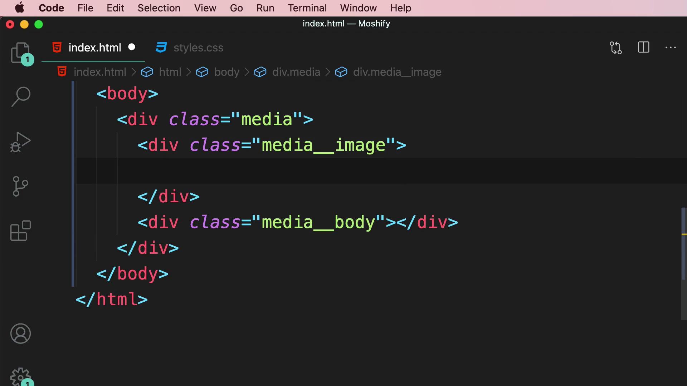

```html
<div class="media">
  <div class="media__image"></div>
  <div class="media__body"></div>
</div>
```

> 📝 **BEM Naming ที่ใช้ในคลิปนี้:**
> - `.media` = Block (ตัวบล็อกหลักของ Component)
> - `.media__image` = Element (ส่วนที่เก็บไอคอน/รูปภาพ)
> - `.media__body` = Element (ส่วนที่เก็บหัวข้อและข้อความ)
>
> การตั้งชื่อนี้สอดคล้องกับหลักการ BEM (Block Element Modifier) ที่ Mosh สอนมาตั้งแต่คลิปก่อนหน้า (เช่น `.input-group`, `.badge`)

---

## 4. นำไอคอน SVG กลับมาใช้ซ้ำจาก icons.html

Mosh ต้องการใส่ไอคอนลงใน `.media__image` แต่แทนที่จะเขียน SVG ใหม่ เขาเปิดไฟล์ `components/icons.html` ที่เคยสร้างไว้ก่อนหน้านี้ (ตามหลักการ "Bottom Up" — สร้าง component ของไอคอนแยกไว้ต่างหากแล้วนำมาใช้ซ้ำ)

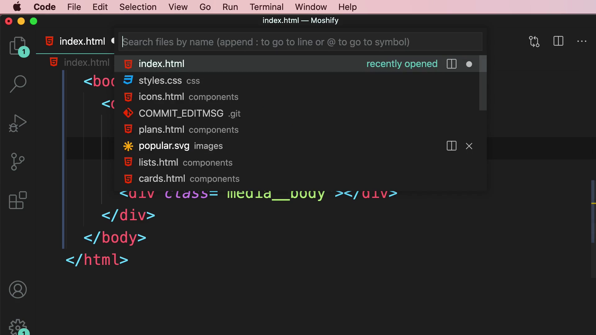

โดยใช้ **VS Code Quick Open** (คีย์ลัด `Cmd+P` บน Mac) แล้วพิมพ์ `icons` เพื่อค้นหาและเปิดไฟล์ `icons.html` อย่างรวดเร็ว โดยไม่ต้องไปคลิกหาใน File Explorer

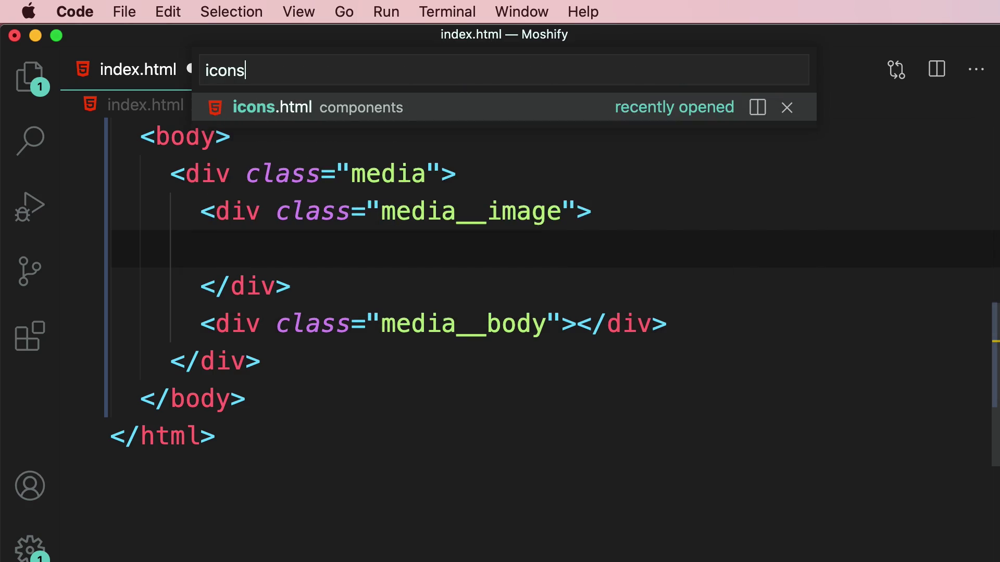

ในไฟล์ `icons.html` มี markup ของไอคอนที่เตรียมไว้แล้ว:

```html
<span class="icon-container">
  <svg class="icon icon--primary">
    <use xlink:href="images/sprite.svg#wordpress"></use>
  </svg>
</span>
```

> 💡 **เทคนิค SVG Icon Sprite:** แทนที่จะฝัง SVG path ทั้งหมดซ้ำๆ ในทุกที่ที่ใช้ไอคอน เทคนิคนี้ใช้ไฟล์ `images/sprite.svg` เป็น "คลัง" รวมไอคอนทั้งหมดไว้ที่เดียว แล้วอ้างอิงแต่ละไอคอนด้วย `<use xlink:href="images/sprite.svg#ชื่อไอคอน">` ทำให้ไฟล์ HTML เล็กลงและจัดการง่ายขึ้น

Mosh คัดลอก markup นี้ไปวางไว้ใน `.media__image`:

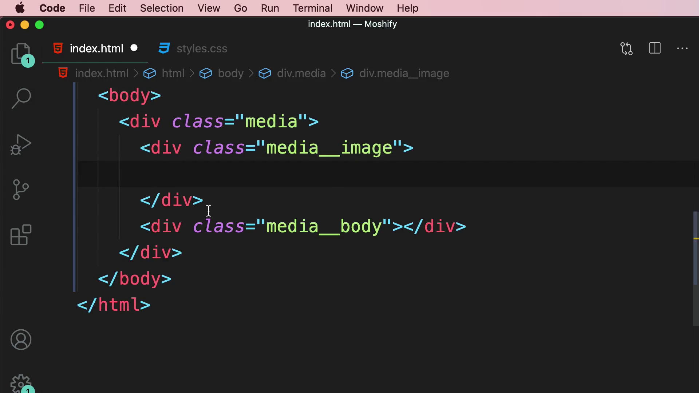

```html
<div class="media">
  <div class="media__image">
    <span class="icon-container">
      <svg class="icon icon--primary">
        <use xlink:href="images/sprite.svg#wordpress"></use>
      </svg>
    </span>
  </div>
  <div class="media__body"></div>
</div>
```

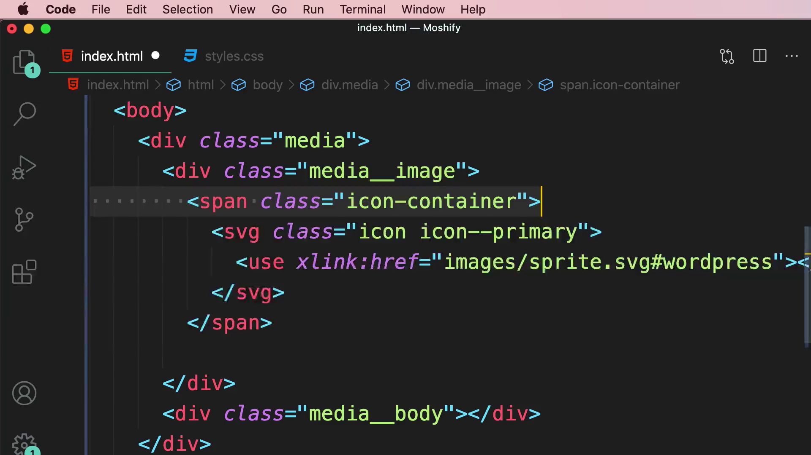

Mosh ตรวจสอบผ่าน breadcrumb ด้านบนของ VS Code (`html > body > div.media > div.media__image > span.icon-container`) เพื่อยืนยันว่าโครงสร้างซ้อนกันถูกต้อง

---

## 5. แก้ไขชื่อไอคอนให้ตรงกับดีไซน์

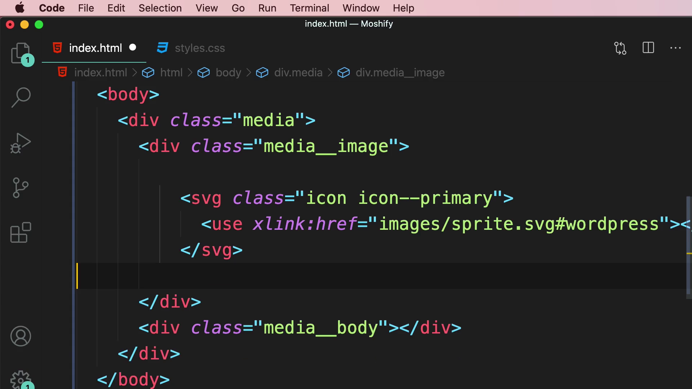

เนื่องจากไอคอนที่คัดลอกมาเป็น `#wordpress` (ตัวอย่างจาก icons.html) แต่ดีไซน์ต้องการไอคอนอื่น Mosh จึงแก้ไขค่า `xlink:href` ให้เปลี่ยนชื่อไอคอนให้ตรงกับที่ต้องการใช้งานจริงในบล็อกนี้ เพื่อให้ตรงกับภาพในดีไซน์ Photoshop

> ⚠️ จุดนี้สำคัญ เพราะไอคอนแต่ละอันในสไปรต์ (sprite) จะมี id ต่างกัน การ copy-paste component มาใช้ซ้ำต้องอย่าลืมเช็คว่าอ้างอิงไอคอนถูกตัวหรือไม่

---

## 6. เพิ่มหัวข้อ (h3) ใน media__body

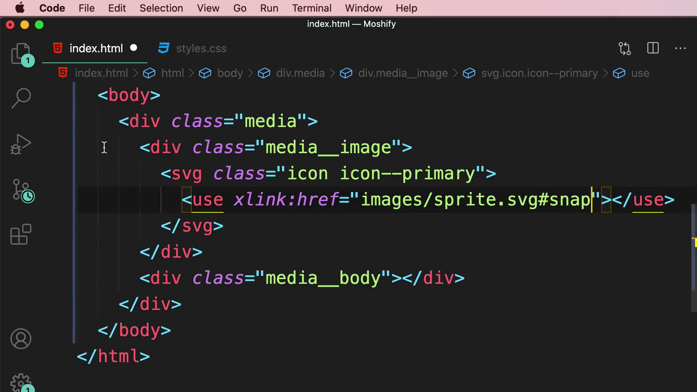

Mosh ย้าย cursor เข้าไปใน `.media__body` ที่ยังว่างอยู่ แล้วเริ่มพิมพ์แท็ก `<h3>`

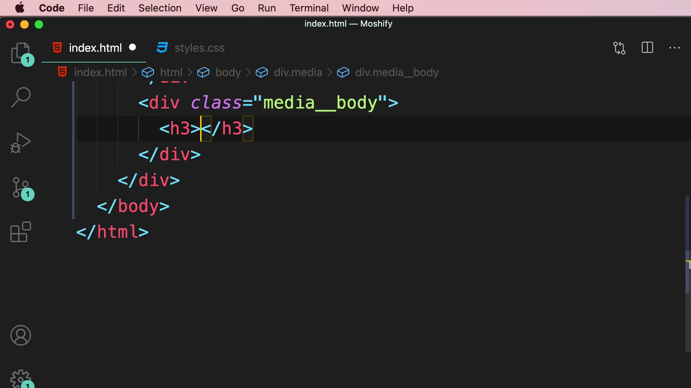

จากนั้นใส่ class `media__title` ให้กับ h3:

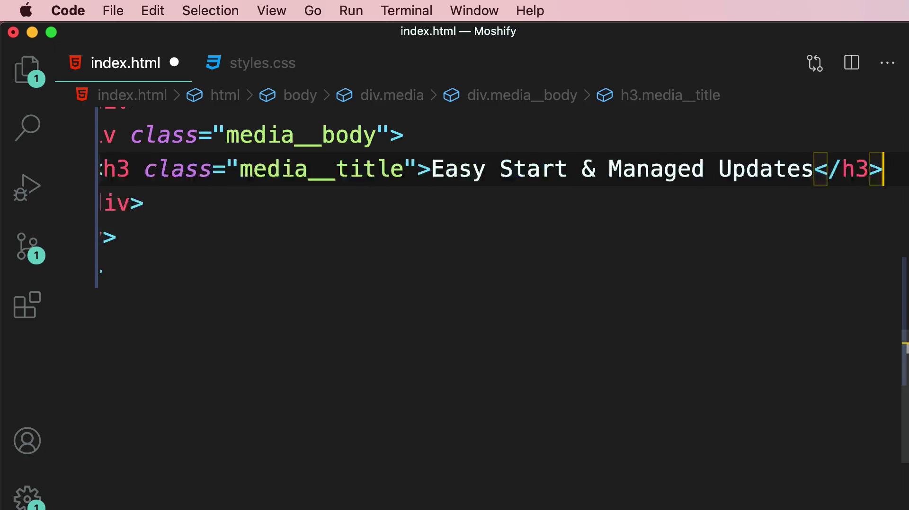

```html
<div class="media__body">
  <h3 class="media__title">Easy Start & Managed Updates</h3>
</div>
```

> 📝 ข้อความหัวข้อ `Easy Start & Managed Updates` พิมพ์ตรงตามที่เห็นในดีไซน์ Photoshop (ดูขั้นตอนที่ 1)

---

## 7. เพิ่มย่อหน้าข้อความด้วย Emmet Lorem Ipsum

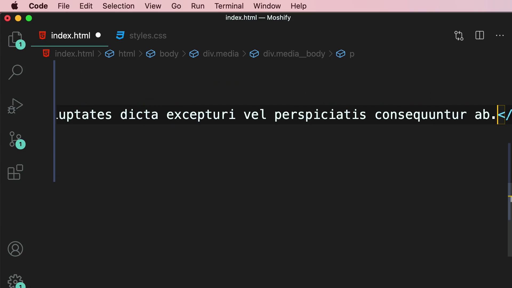

ต่อจาก `<h3>` Mosh พิมพ์ `<p>lorem` ซึ่ง VS Code แสดง Emmet Abbreviation แนะนำคำว่า **"lorem"** ขึ้นมาเป็น pop-up

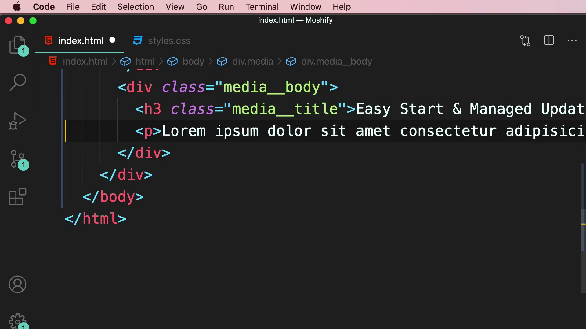

เมื่อกด Tab/Enter เลือก suggestion นี้ Emmet จะ generate ข้อความ placeholder แบบ Lorem Ipsum ให้อัตโนมัติ:

```html
<p>Lorem ipsum dolor sit amet consectetur adipisicing elit. Veniam quisquam, ex nostrum vero voluptates dicta excepturi vel perspiciatis consequuntur ab.</p>
```

> 💡 **Emmet Lorem Ipsum:** การพิมพ์ `lorem` ภายในแท็กแล้วเลือก Emmet Abbreviation เป็นวิธีลัดมาตรฐานสำหรับสร้างข้อความ placeholder ยาวๆ แบบสุ่ม เพื่อทดสอบเลย์เอาต์โดยไม่ต้องพิมพ์เนื้อหาจริงตอน dev

โครงสร้าง HTML เต็มของ Media Object ในจุดนี้:

```html
<div class="media">
  <div class="media__image">
    <span class="icon-container">
      <svg class="icon icon--primary">
        <use xlink:href="images/sprite.svg#..."></use>
      </svg>
    </span>
  </div>
  <div class="media__body">
    <h3 class="media__title">Easy Start & Managed Updates</h3>
    <p>Lorem ipsum dolor sit amet consectetur adipisicing elit. Veniam quisquam, ex nostrum vero voluptates dicta excepturi vel perspiciatis consequuntur ab.</p>
  </div>
</div>
```

---

## 8. ดูผลลัพธ์ใน Browser (ก่อนใส่ CSS)

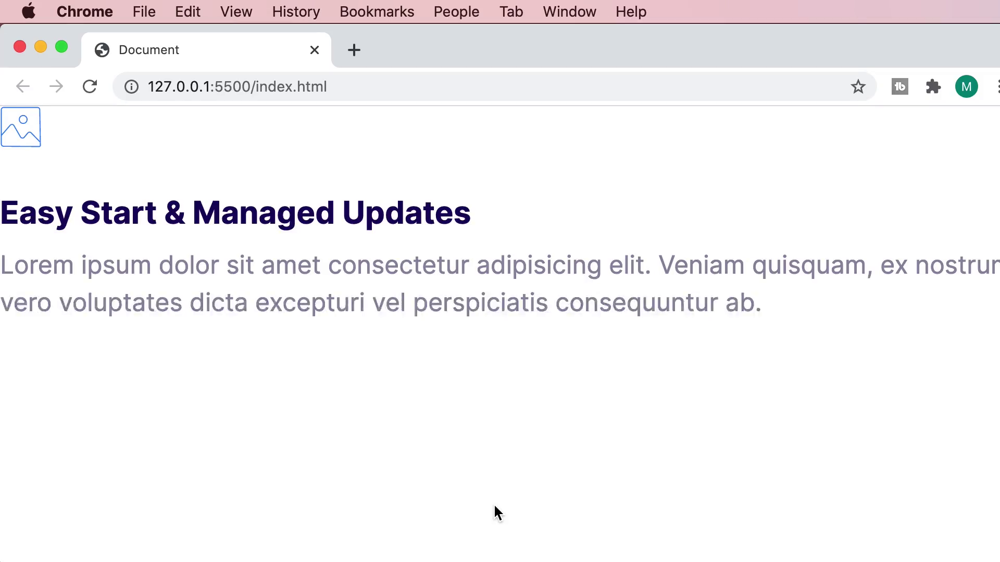

Mosh เปิดดูผลลัพธ์ผ่าน Live Server (`127.0.0.1:5500`) จะเห็นว่าตอนนี้ยังไม่มี CSS จัดวางเลย ทำให้ไอคอน (placeholder), หัวข้อ, และย่อหน้าเรียงต่อกันแนวตั้งตามค่า default ของ browser โดยไม่มีการจัดวางแบบ "ไอคอนซ้าย ข้อความขวา" ตามดีไซน์

---

## 9. เริ่มเขียน CSS: เปิด styles.css

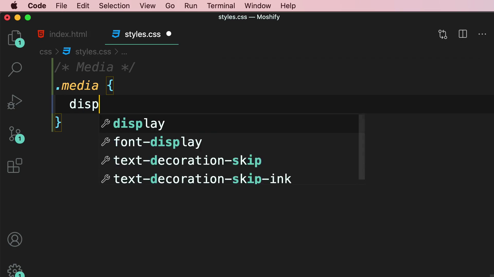

Mosh สลับไปที่แท็บ `styles.css` และสร้าง comment section ใหม่ชื่อ `/* Media */` (ตามรูปแบบการจัดหมวดหมู่ CSS ที่ใช้มาตลอดในคอร์สนี้ — แบ่งเป็น section ตามชื่อ component)

---

## 10. จัดวางด้วย Flexbox: `.media { display: flex; }`

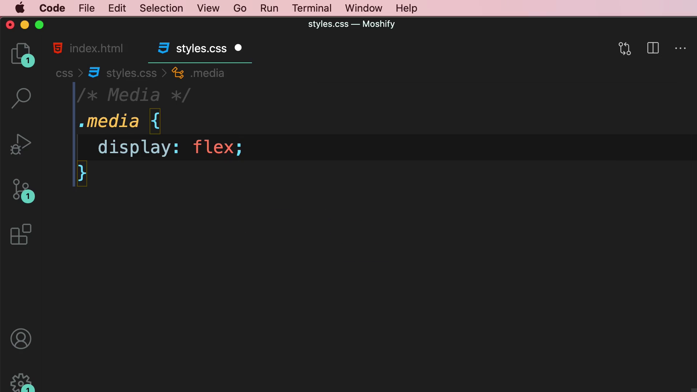

Mosh พิมพ์ selector `.media` แล้วเริ่มพิมพ์ property `display:` โดย VS Code แสดง autocomplete แนะนำค่าต่างๆ เช่น `block`, `contents`, `flex`, `flexbox`

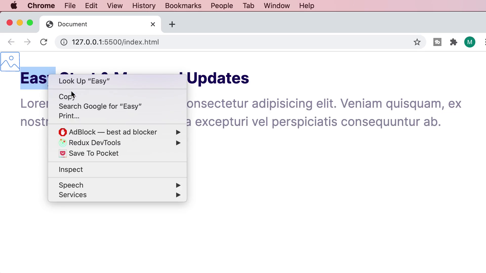

```css
.media {
  display: flex;
}
```

> 💡 **ทำไมต้องใช้ Flexbox ที่นี่:** การกำหนด `display: flex` ให้กับ `.media` (ซึ่งเป็น parent) จะทำให้ลูกโดยตรงสองตัว (`.media__image` และ `.media__body`) เรียงตัวกันในแนวนอนโดยอัตโนมัติ (ตาม main axis แนวนอนเป็นค่า default ของ flex) ทำให้ได้ผลลัพธ์ "ไอคอนซ้าย ข้อความขวา" ตามดีไซน์ทันที โดยไม่ต้องใช้ `float` หรือ `position: absolute` แบบเทคนิคเก่า

หลังจากเพิ่ม `display: flex` ผลลัพธ์ใน browser แสดงไอคอนและข้อความเรียงกันในแนวนอนเรียบร้อยแล้ว

---

## 11. ตรวจสอบสไตล์ h3 ด้วย DevTools

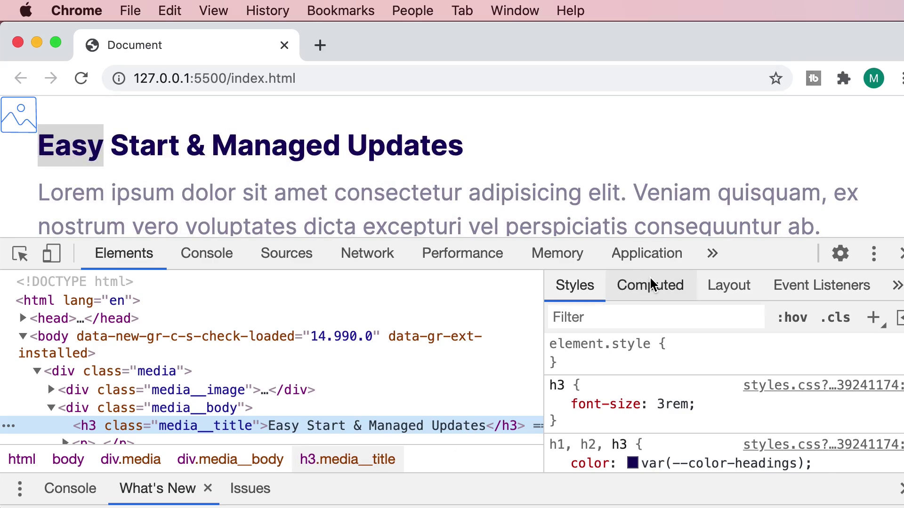

Mosh เปิด Chrome DevTools (คลิกขวา → Inspect) เพื่อตรวจสอบว่า h3 (`.media__title`) มีสไตล์ default อะไรมาจาก CSS อื่นที่เขียนไว้ก่อนหน้านี้บ้าง โดยดูที่แท็บ **Styles** พบว่า:

```css
h3 {
  font-size: 3rem;
}
h1, h2, h3 {
  color: var(--color-headings);
}
```

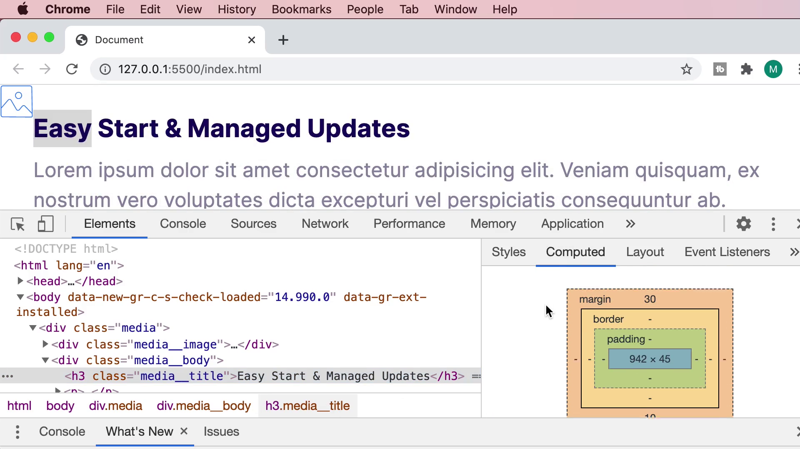

จากนั้นสลับไปดูแท็บ **Computed** ซึ่งแสดงค่าที่คำนวณจริง (คำนวณจากทุก CSS rule รวมกัน) เช่น:

```
box-sizing: border-box
color: rgb(27, 7, 96)
display: block
font-family: Inter, Arial, Helvetica...
```

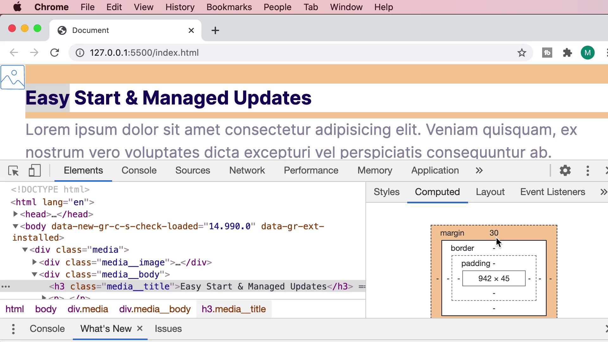

สลับไปแท็บ **Layout** เพื่อดู **Box Model** แบบภาพ (margin/border/padding/content) พบว่า h3 มี **margin ค่า default ของ browser** อยู่ที่ 30px (มาจาก user-agent stylesheet ของ Chrome เอง ไม่ใช่จาก styles.css ที่ Mosh เขียน) ทำให้ในดีไซน์จริงระยะห่างด้านบนของหัวข้อดูมากเกินไปเมื่อเทียบกับกรอบของ `.media`

> 🔍 **จุดประสงค์การเปิด DevTools ตรงนี้:** เพื่อสืบ (debug) หาที่มาของ margin ที่ไม่ต้องการ ก่อนจะเขียน CSS rule มา override ค่า default นี้ในขั้นตอนถัดไป

---

## 12. Override margin-top ของ `.media__title`

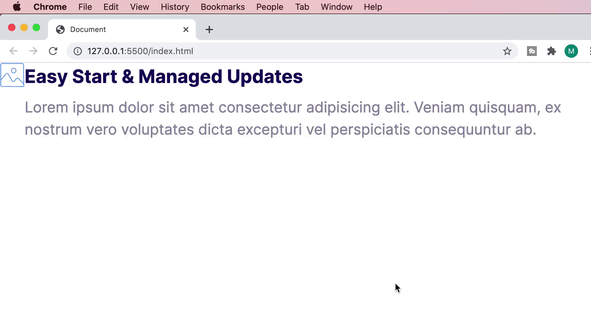

Mosh สร้าง selector ใหม่ `.media__title` แล้วพิมพ์ `margin-t` ซึ่ง VS Code แสดง suggestion เช่น `margin-top`, `margin-trim`, `margin-bottom` ฯลฯ

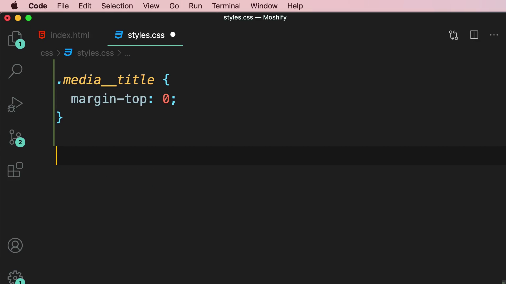

```css
.media__title {
  margin-top: 0;
}
```

> 💡 การตั้งค่า `margin-top: 0` เป็นการ "รีเซ็ต" ระยะห่างด้านบนที่ browser ใส่มาให้อัตโนมัติ (จากขั้นตอนที่ 11) เพื่อให้หัวข้อชิดกับขอบบนของ `.media__body` พอดี ทำให้จัดตำแหน่งกับไอคอนด้านซ้ายได้ตรงแนว (align) มากขึ้น

---

## 13. จัดระยะห่างของ `.media__body`

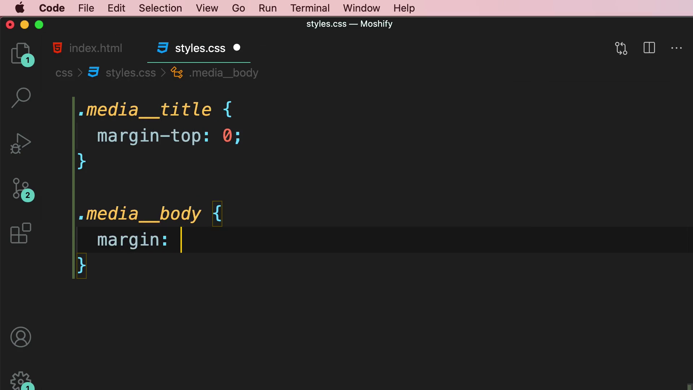

Mosh สร้าง selector ใหม่ `.media__body` แล้วพิมพ์ `margin` โดยมี autocomplete แนะนำ `margin-top`, `margin-bottom`, `margin-left`, `margin-right` ฯลฯ

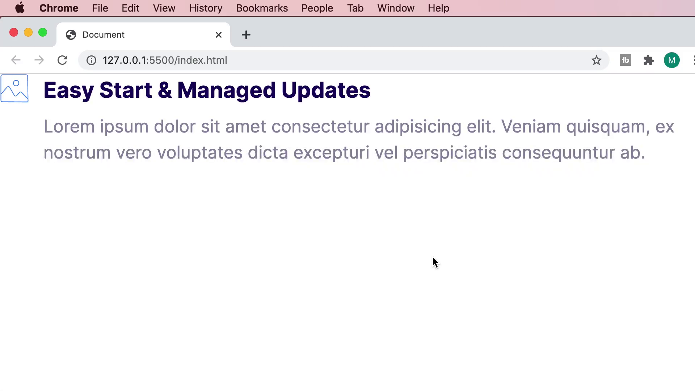

```css
.media__body {
  margin: 0 2rem;
}
```

> 📝 **อธิบายค่า shorthand `margin: 0 2rem`:** เมื่อกำหนดค่า margin แบบ 2 ค่า ค่าแรก (`0`) จะใช้กับ **บน-ล่าง (top & bottom)** และค่าที่สอง (`2rem`) จะใช้กับ **ซ้าย-ขวา (left & right)** ซึ่งในที่นี้ทำให้ `.media__body` มีระยะห่างด้านซ้าย-ขวา 2rem (เว้นระยะจากไอคอนด้านซ้าย) แต่ไม่มีระยะห่างบน-ล่างเพิ่มเติม

---

## 14. ทบทวนข้อความจริงจากดีไซน์ Photoshop

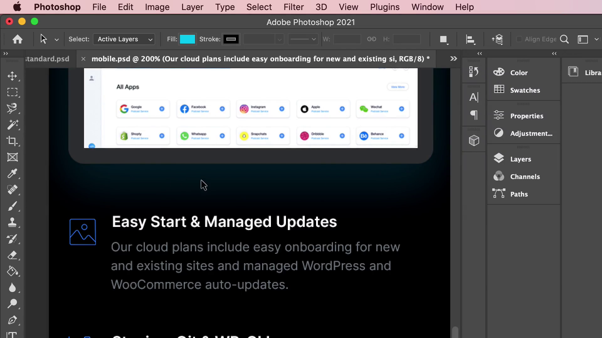

Mosh สลับกลับไปดู Photoshop อีกครั้งเพื่อดูข้อความจริงที่จะนำมาแทนที่ Lorem Ipsum ในภายหลัง ซึ่งคือ:

> "Our cloud plans include easy onboarding for new and existing sites and managed WordPress and WooCommerce auto-updates."

> 📌 หมายเหตุ: ในคลิปนี้ Mosh ยังคงใช้ Lorem Ipsum เป็น placeholder ในโค้ดต่อไปก่อน (เพื่อโฟกัสเรื่องโครงสร้างและ CSS) แต่ทบทวนให้ผู้เรียนเห็นว่าเนื้อหาจริงที่จะใส่ภายหลังคืออะไร

---

## 15. จัดตำแหน่งไอคอนด้วย `.media__image`

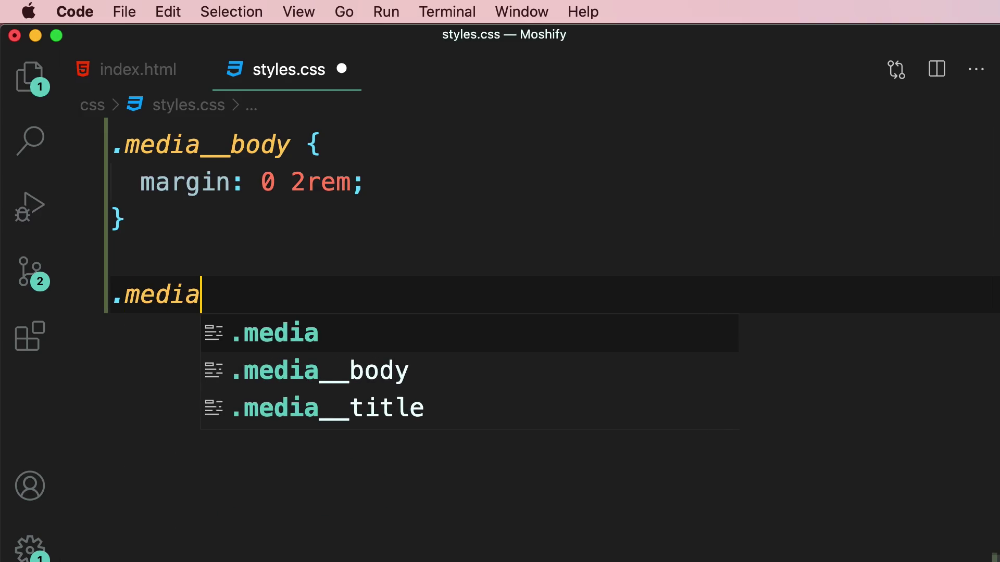

Mosh สร้าง selector ใหม่อีกตัว `.media__image` แล้วเริ่มพิมพ์ `margin-top`

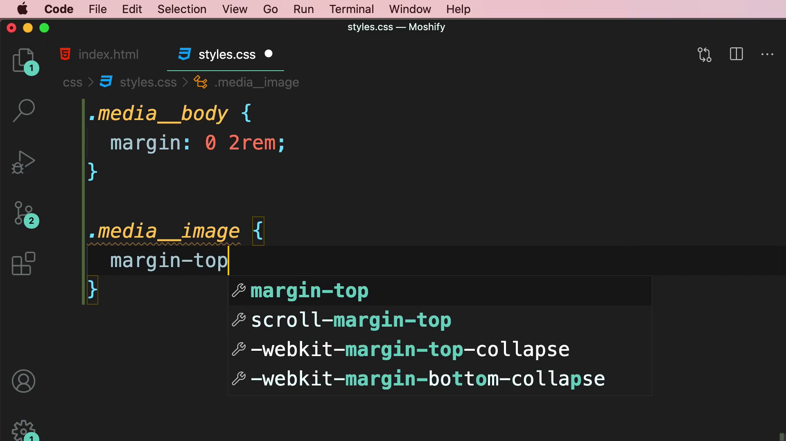

```css
.media__image {
  margin-top: ...;
}
```

> 💡 การเพิ่ม `margin-top` ให้กับ `.media__image` เป็นการปรับให้ไอคอนขยับลงมาเล็กน้อย เพื่อให้แนวกึ่งกลางของไอคอนตรงกับแนวกึ่งกลางของหัวข้อ (h3) พอดี (fine-tuning การจัดตำแหน่งในแนวตั้งระหว่างไอคอนกับข้อความ) ซึ่งเป็นเทคนิคการปรับละเอียด (pixel-level adjustment) ที่ Mosh ใช้บ่อยเพื่อให้ผลลัพธ์ตรงกับดีไซน์มากที่สุด

---

## 16. ทบทวนดีไซน์ส่วนถัดไปใน Photoshop

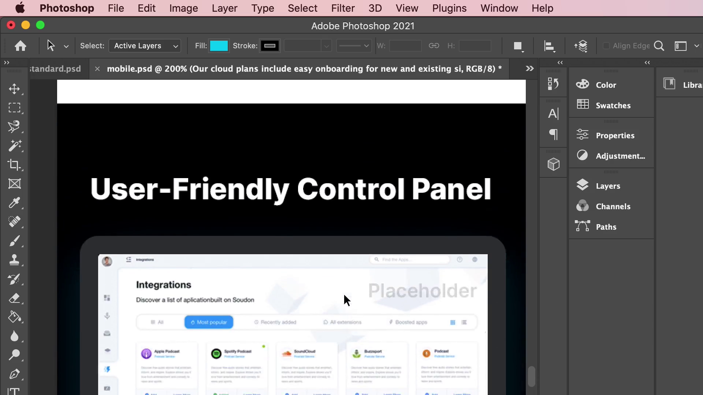

ก่อนจบคลิป Mosh เลื่อนดู Photoshop ต่อไปยังส่วนถัดไปของหน้าเว็บที่ชื่อ **"User-Friendly Control Panel"** ซึ่งมีภาพหน้าจอแอปพลิเคชันตัวอย่าง (mockup) แสดงให้เห็นว่า Media Object component ที่เพิ่งสร้างนี้จะถูกนำไปใช้ซ้ำในหลายๆ ส่วนของหน้าเว็บ Moshify

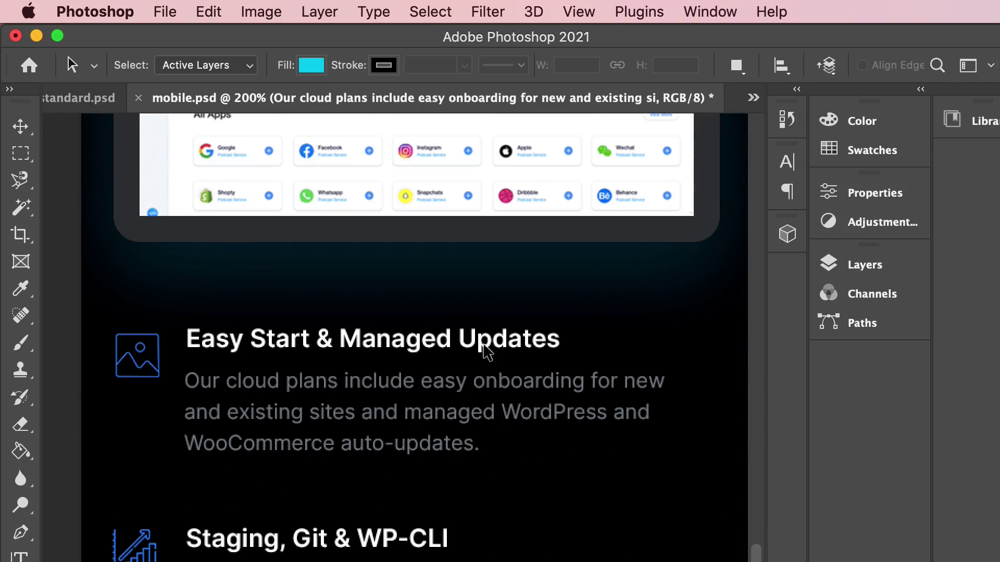

และปิดท้ายด้วยการดูภาพรวมของบล็อก "Easy Start & Managed Updates" ที่เสร็จสมบูรณ์เทียบกับส่วน "Staging, Git & WP-CLI" ที่จะสร้างต่อในลักษณะเดียวกันในคลิปถัดไป

---

## สรุปภาพรวมของคลิปนี้

| หัวข้อ | รายละเอียด |
|---|---|
| Component ที่สร้าง | Media Object (`.media`, `.media__image`, `.media__body`, `.media__title`) |
| เทคนิค HTML | Emmet abbreviation (`.media>.media__image+.media__body`), Emmet lorem ipsum, การนำ SVG icon component กลับมาใช้ซ้ำจาก `icons.html` |
| เทคนิค CSS | `display: flex` สำหรับจัดวางแนวนอน, `margin-top: 0` เพื่อรีเซ็ตค่า default ของ browser, `margin: 0 2rem` (shorthand แนวตั้ง/แนวนอน), `margin-top` เพื่อ fine-tune ตำแหน่งไอคอน |
| เครื่องมือที่ใช้ | VS Code (Quick Open, Emmet, CSS IntelliSense), Chrome DevTools (Styles, Computed, Layout tabs), Live Server, Adobe Photoshop (ดูดีไซน์ `mobile.psd`) |
| หลักการออกแบบ | BEM naming, Bottom-Up component reuse, Flexbox layout |

### แนวคิดสำคัญที่ได้จากคลิปนี้

1. **Media Object เป็นแพทเทิร์นที่พบบ่อย** — โครงสร้าง "ไอคอน/รูปซ้าย + ข้อความขวา" ใช้ซ้ำได้หลายจุดในเว็บไซต์จริง จึงควรออกแบบเป็น component แยกต่างหาก
2. **Emmet ช่วยเร่งการเขียน HTML** — การใช้ `>` (child) และ `+` (sibling) ร่วมกันสามารถสร้างโครงสร้างซ้อนกันหลายชั้นได้ในคำสั่งเดียว
3. **นำ component กลับมาใช้ซ้ำ (Bottom Up)** — การแยกไอคอน SVG ไว้ในไฟล์ `icons.html` ทำให้สามารถ copy-paste มาใช้ในหลายที่ได้ โดยต้องระวังแก้ไข reference (เช่น `xlink:href`) ให้ตรงกับไอคอนที่ต้องการ
4. **Flexbox คือเครื่องมือหลักในการจัดวางแนวนอน** — เพียงกำหนด `display: flex` ให้ parent ก็ทำให้ลูกเรียงตัวแนวนอนได้ทันที โดยไม่ต้องพึ่ง float หรือ position
5. **DevTools ช่วย debug ค่า default ของ browser** — การเปิดแท็บ Styles/Computed/Layout ช่วยให้เห็นว่า margin ที่ไม่ต้องการมาจากไหน (user-agent stylesheet) ก่อนจะเขียน CSS มา override
6. **การจัดวางละเอียด (fine-tuning)** — บางครั้งต้องปรับค่า margin เพียงเล็กน้อย (เช่นหลัก px) เพื่อให้องค์ประกอบสองส่วนที่ต่างขนาดกัน (ไอคอนกับข้อความ) ดูตรงแนวกันสวยงาม

---

*เอกสารสรุปนี้สร้างจากคลิปวิดีโอสอนของ Mosh Hamedani (Code with Mosh) หลักสูตร Building a Web Site — คลิปที่ 21: Media Objects*
