# HTML-CSS-3: 22 - Quotes

**ไฟล์ต้นฉบับ:** 22- Quotes.mp4

▶️ [ดูวิดีโอ](../../HTML-CSS-3/22-%20Quotes.mp4)

---

## ภาพรวมคลิปนี้

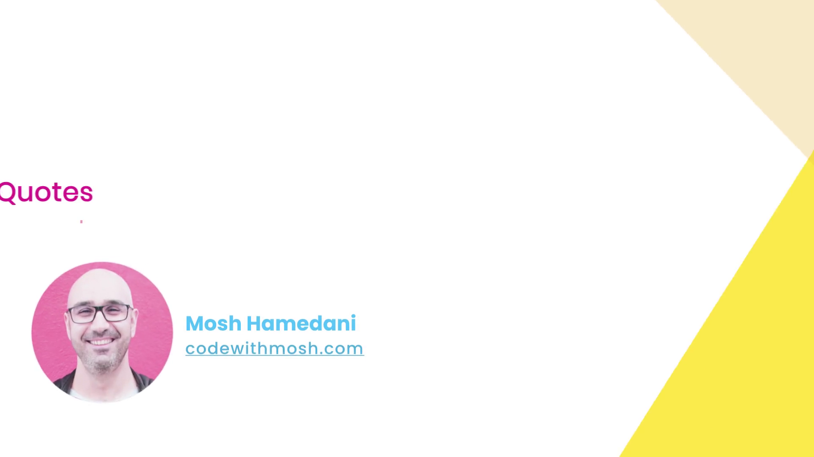

คลิปนี้ Mosh สอนการสร้าง **Quote Component** (บล็อกคำรับรอง/คำพูดอ้างอิง) ซึ่งประกอบด้วยข้อความคำพูด (quote text) ที่มีเครื่องหมายคำพูดสไตล์ตกแต่ง (decorative quotation marks) และส่วนผู้พูด (author) ที่ใช้ **Media Object component** จากคลิปก่อนหน้า (คลิป 21) มาใช้ซ้ำ พร้อมทั้งปรับ CSS ให้ responsive ผ่าน media query สำหรับหน้าจอขนาดใหญ่

> 💡 คลิปนี้แสดงให้เห็นถึงพลังของการสร้าง component แบบ Bottom-Up: component `.media` ที่สร้างไว้แล้วในคลิปก่อนหน้าถูกนำมาใช้ซ้ำทันทีเพื่อประกอบเป็นส่วนแสดงชื่อผู้พูด (author) ในคำรับรอง

---

## 1. ทบทวนดีไซน์เป้าหมาย


Mosh เปิด Photoshop ดูดีไซน์เป้าหมายของ Quote block ซึ่งประกอบด้วยข้อความคำรับรองขนาดใหญ่ (มีเครื่องหมายคำพูดตกแต่งอยู่ด้านหน้า) ตามด้วยเส้นคั่น (divider line) ชื่อผู้พูด และชื่อองค์กร

---

## 2. เริ่มต้นจาก body ว่าง

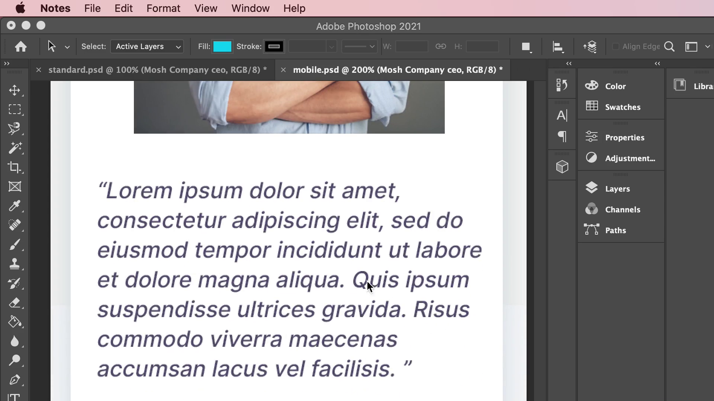

เช่นเดียวกับคลิปก่อนหน้า Mosh เริ่มต้นจาก `<body></body>` ที่ว่างเปล่าเพื่อสร้างและทดสอบ Quote component แยกต่างหากก่อน

---

## 3. สร้างโครงสร้าง HTML ด้วย Emmet: `blockquote`

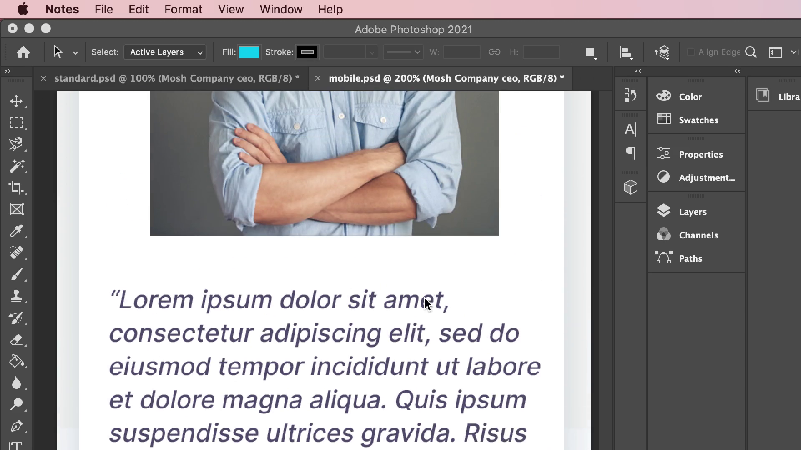

Mosh พิมพ์ Emmet abbreviation `blockquote.quote` เพื่อสร้างแท็ก `<blockquote>` พร้อม class `quote` ในคำสั่งเดียว

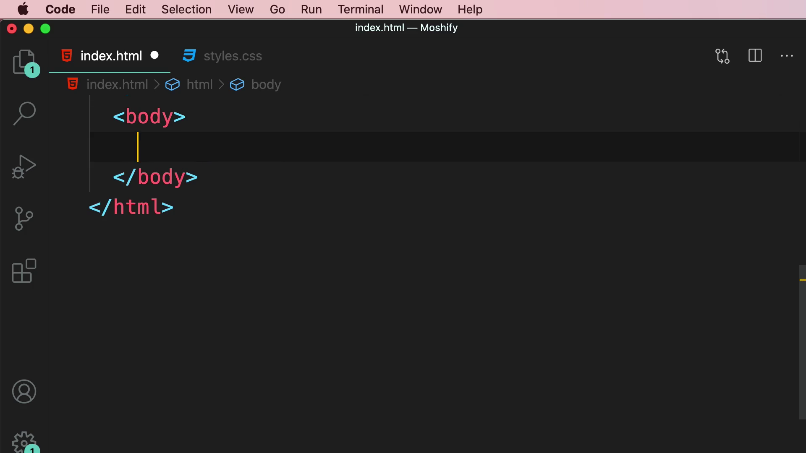

```html
<blockquote class="quote"></blockquote>
```

> 📝 **ทำไมใช้ `<blockquote>`:** เป็นแท็ก HTML เชิงความหมาย (semantic) ที่ถูกออกแบบมาสำหรับการอ้างอิงคำพูดหรือข้อความที่คัดลอกมาจากแหล่งอื่นโดยเฉพาะ ต่างจาก `<div>` ที่ไม่มีความหมายเชิงโครงสร้าง (non-semantic) การเลือกใช้แท็กที่ถูกต้องตามความหมายช่วยให้ HTML เข้าใจง่ายขึ้นและดีต่อ SEO/accessibility

จากนั้น Mosh เพิ่ม `<p>` เข้าไปข้างในสำหรับข้อความคำพูด:

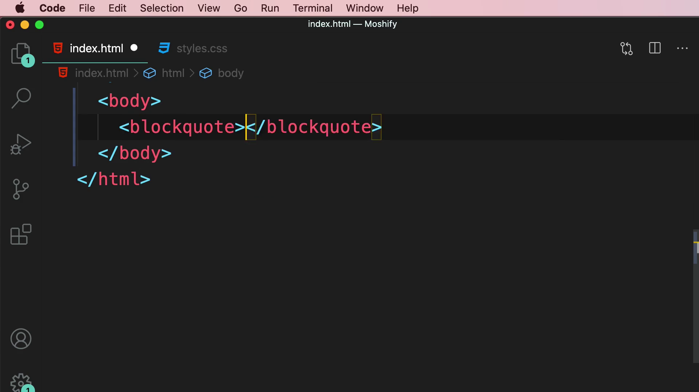

```html
<blockquote class="quote">
  <p></p>
</blockquote>
```

---

## 4. ใส่ข้อความ Placeholder ด้วย Emmet Lorem

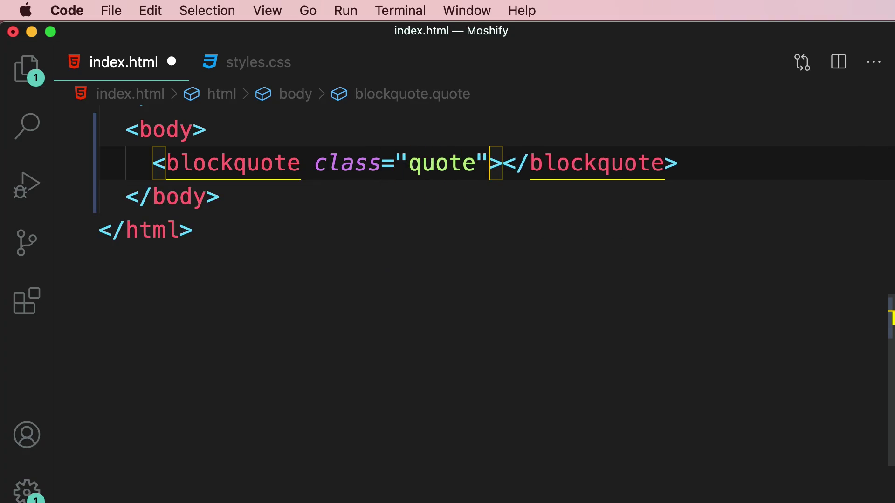

เช่นเดียวกับคลิปก่อนหน้า Mosh พิมพ์ `lorem` ใน Emmet เพื่อสร้างข้อความ placeholder ยาวๆ ให้กับ `<p>`

จากนั้นใส่ class `quote__text` ให้กับ `<p>` ตามหลัก BEM:

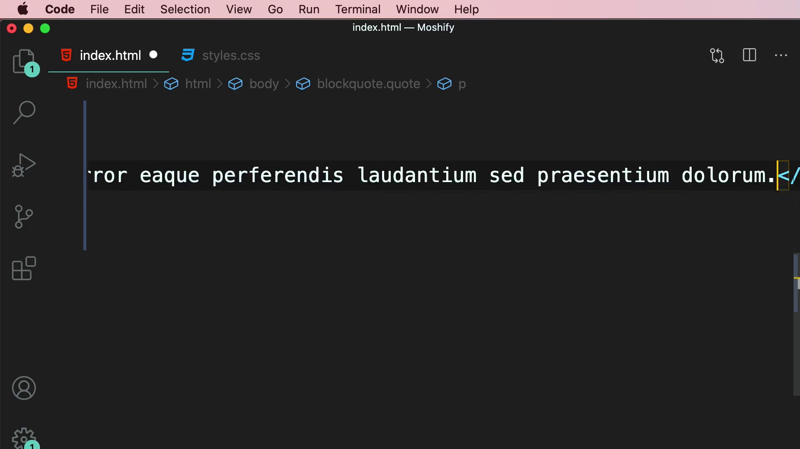

```html
<blockquote class="quote">
  <p class="quote__text">Lorem, ipsum dolor sit amet consectetur adipisicing elit. Incidunt optio officiis dolore earum error eaque perferendis laudantium sed praesentium dolorum.</p>
</blockquote>
```

---

## 5. ดูผลลัพธ์ก่อนใส่ CSS

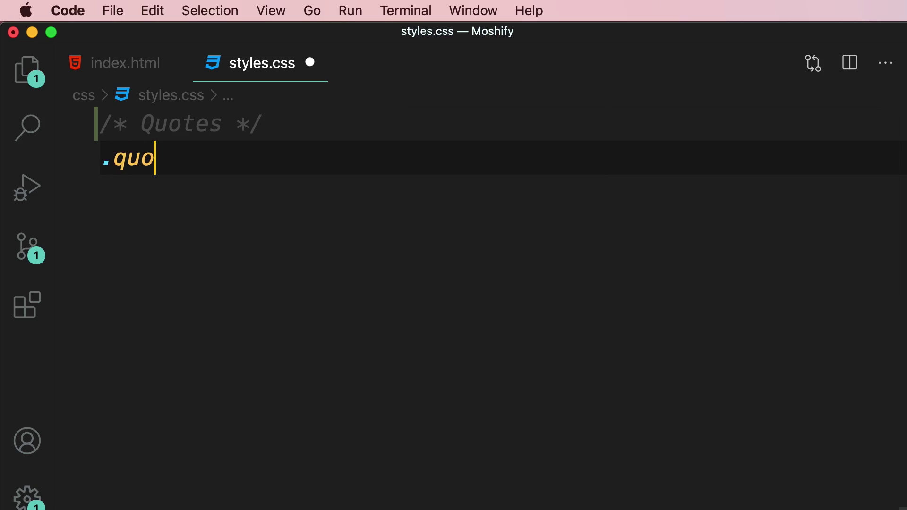

เปิดดูผ่าน Live Server พบว่าข้อความยังแสดงเป็นย่อหน้าธรรมดา ไม่มีการตกแต่งใดๆ

---

## 6. เริ่มเขียน CSS: สร้าง comment section ใหม่

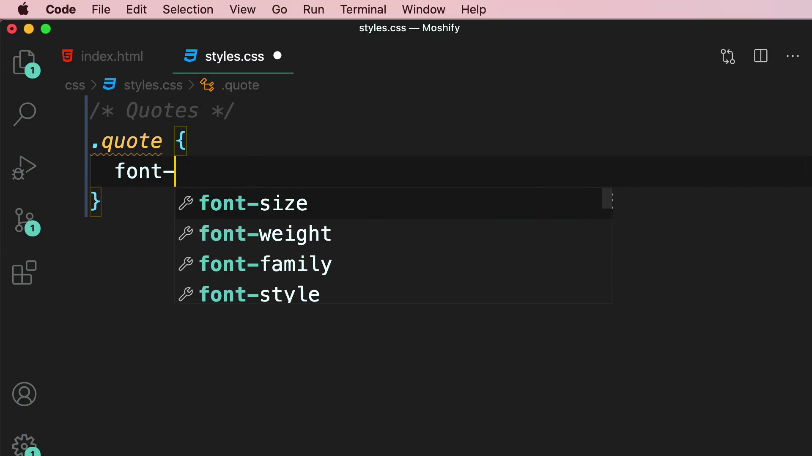

Mosh สลับไปที่ `styles.css` และสร้าง comment section ใหม่ `/* Quote */` ตามรูปแบบการจัดหมวดหมู่ CSS ที่ใช้มาตลอด

---

## 7. สไตล์ `.quote__text`

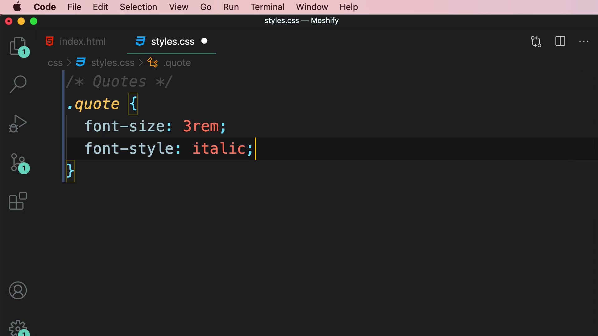

สร้าง selector `.quote__text` แล้วเริ่มเพิ่ม property ต่างๆ

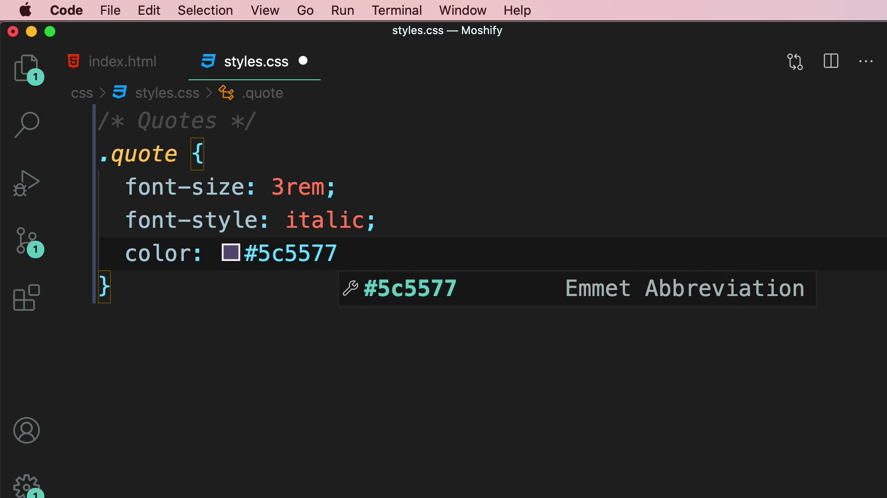

```css
.quote__text {
  font-style: italic;
}
```

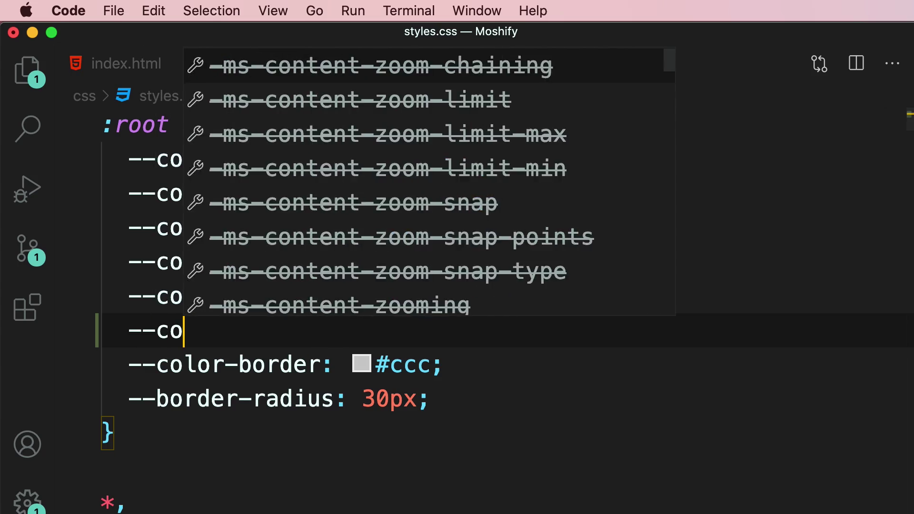

```css
.quote__text {
  font-style: italic;
  color: var(--color-body);
}
```

> 💡 การใช้ `italic` ทำให้ข้อความคำรับรองมีลักษณะเอียง (คล้ายลายมือ/การเน้นคำพูด) ซึ่งเป็นรูปแบบที่นิยมใช้กับข้อความ quote ทั่วไป ส่วน `color: var(--color-body)` คือการใช้ CSS Custom Property (ตัวแปรสี) ที่ประกาศไว้ใน `:root` ตั้งแต่คลิปก่อนๆ เพื่อให้สีข้อความสอดคล้องกับ design system ของทั้งเว็บไซต์

---

## 8. เพิ่มเครื่องหมายคำพูดตกแต่งด้วย Pseudo-element `::before`

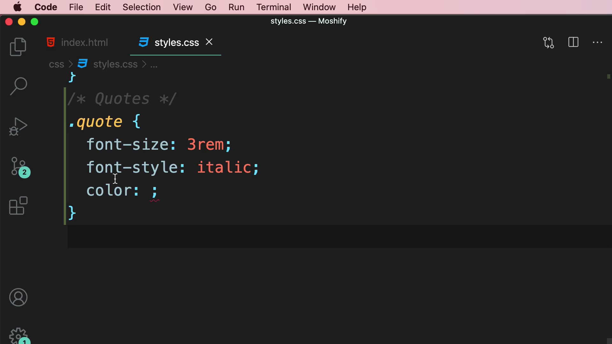

Mosh สร้าง selector ใหม่ `.quote__text::before` เพื่อแทรกเนื้อหาเพิ่มเติมก่อนข้อความจริงโดยไม่ต้องแก้ไข HTML

```css
.quote__text::before {
  content: open-quote;
}
```

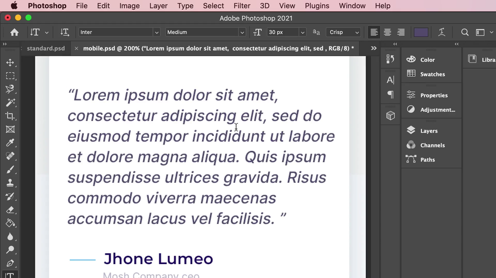

> 🔧 **อธิบาย Pseudo-element `::before`:** เป็นตัวเลือก CSS พิเศษที่สร้าง "องค์ประกอบเสมือน" ขึ้นมาก่อนเนื้อหาจริงขององค์ประกอบที่เลือกไว้ โดยต้องกำหนดค่า `content` เสมอ (ไม่เช่นนั้นจะไม่แสดงผล) ค่า `open-quote` เป็นคีย์เวิร์ดพิเศษที่ browser จะแสดงเครื่องหมายคำพูดเปิด (opening quotation mark) ตามภาษาของหน้าเว็บโดยอัตโนมัติ (เช่น `"` ในภาษาอังกฤษ)

จากนั้นสร้าง `.quote__text::after` สำหรับเครื่องหมายคำพูดปิด:

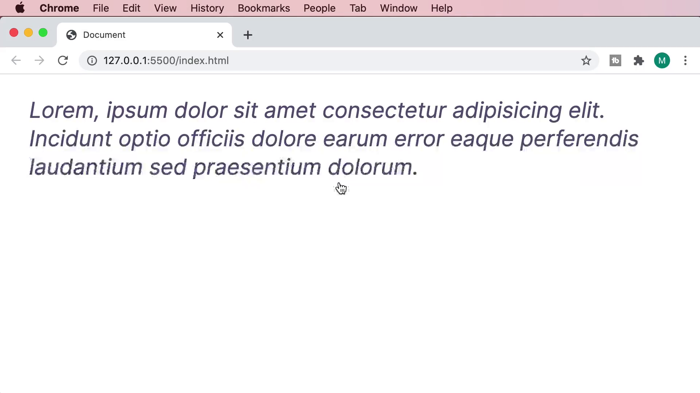

```css
.quote__text::after {
  content: close-quote;
}
```

---

## 9. ดูผลลัพธ์เครื่องหมายคำพูดใน Browser

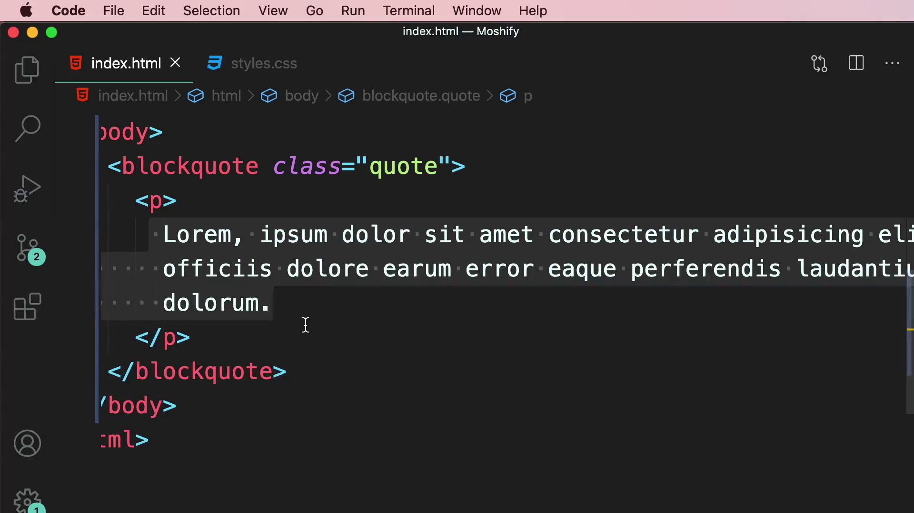

เปิด Live Server ดูผลลัพธ์ พบว่าตอนนี้มีเครื่องหมายคำพูด `"` ปรากฏที่จุดเริ่มต้นและจุดสิ้นสุดของข้อความแล้ว

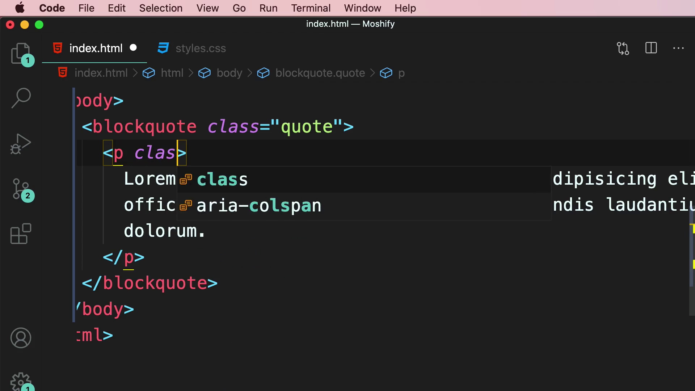

Mosh เปิด Chrome DevTools เพื่อตรวจสอบ pseudo-element ที่สร้างขึ้น จะเห็นว่า `::before` และ `::after` ปรากฏเป็น "ลูกพิเศษ" ของ `.quote__text` ใน DOM tree (แสดงด้วยไอคอนพิเศษ ไม่ใช่ HTML element จริง)

---

## 10. ตกแต่งเครื่องหมายคำพูดเพิ่มเติม

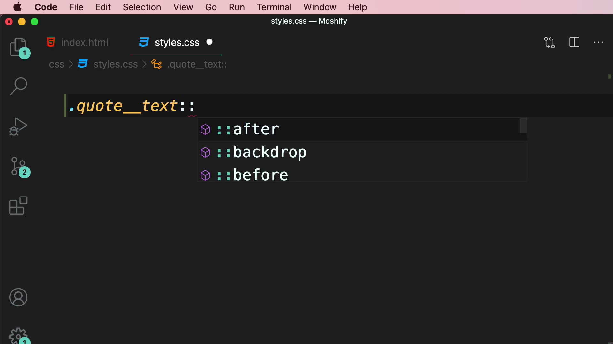

Mosh ปรับแต่ง `.quote__text::before` เพิ่มเติม เช่นกำหนด `font-size` ให้ใหญ่ขึ้นและ `color` ให้เด่นชัดขึ้น เพื่อให้เครื่องหมายคำพูดดูโดดเด่นเป็นจุดสนใจตามดีไซน์

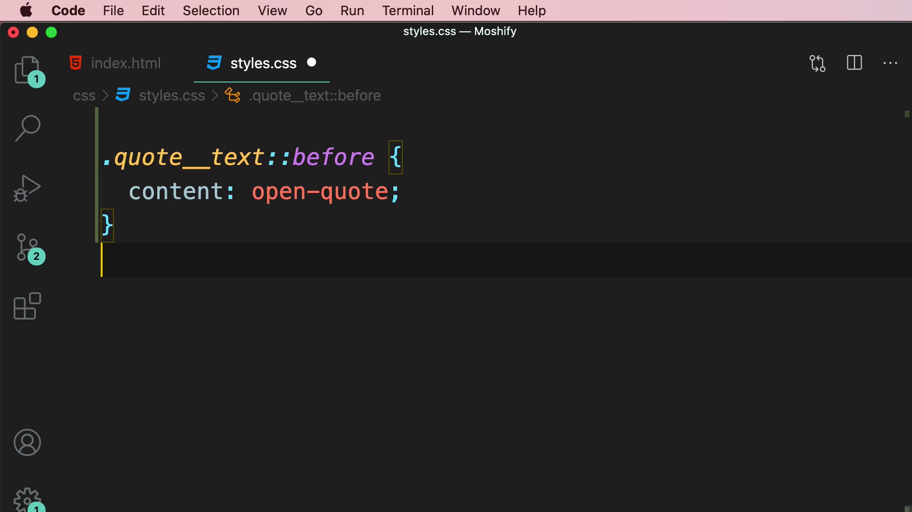

ผลลัพธ์ใน browser แสดงเครื่องหมายคำพูดที่ตกแต่งแล้วดูสวยงามและโดดเด่นขึ้นตามดีไซน์เป้าหมาย

---

## 11. สร้างส่วนผู้พูด (Author) ด้วย `<footer>`

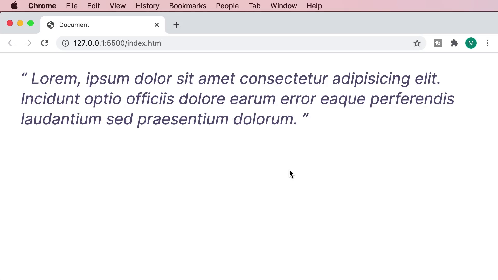

Mosh เพิ่มแท็ก `<footer>` เข้าไปใน `<blockquote>` ถัดจาก `<p class="quote__text">` สำหรับเก็บข้อมูลผู้พูด (ชื่อ, องค์กร)

```html
<blockquote class="quote">
  <p class="quote__text">...</p>
  <footer></footer>
</blockquote>
```

> 📝 **ทำไมใช้ `<footer>`:** ในบริบทของ `<blockquote>` แท็ก `<footer>` เป็นแท็กเชิงความหมายที่เหมาะสมสำหรับเก็บข้อมูล "แหล่งที่มา" ของคำพูด เช่น ชื่อผู้พูดหรือองค์กร ซึ่งตรงตามมาตรฐาน HTML5 semantic elements

---

## 12. นำ Media Object Component กลับมาใช้ซ้ำ

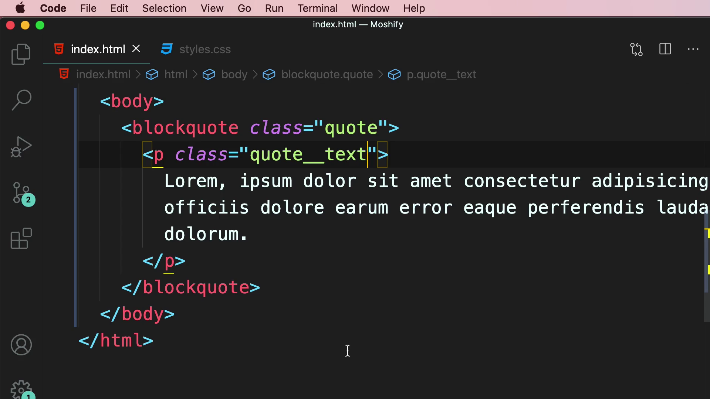

แทนที่จะเขียนโครงสร้างใหม่ Mosh คัดลอกโครงสร้าง `.media` ทั้งหมด (จากคลิป 21 Media Objects) มาวางไว้ใน `<footer>`:

```html
<footer>
  <div class="media">
    <div class="media__image">
      <span class="icon-container">
        <svg class="icon icon--primary">
          <use xlink:href="images/sprite.svg#..."></use>
        </svg>
      </span>
    </div>
    <div class="media__body">
      <h3 class="media__title">...</h3>
      <p>...</p>
    </div>
  </div>
</footer>
```

> 💡 นี่คือตัวอย่างที่ชัดเจนของหลักการ **Bottom-Up Component Design** — เพราะ `.media` ถูกออกแบบให้เป็น component อิสระตั้งแต่แรก (ไม่ผูกติดกับบริบทใดบริบทหนึ่ง) จึงสามารถนำมาใช้ซ้ำได้ทันทีในบริบทใหม่ (Quote author) โดยไม่ต้องเขียนโค้ดซ้ำหรือดัดแปลงโครงสร้างมาก

---

## 13. แก้ไขไอคอนให้เป็นเส้นคั่น (Line Divider)

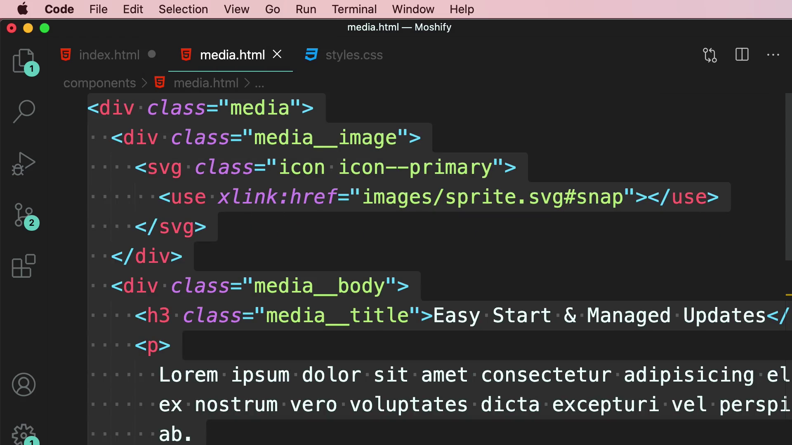

Mosh แก้ไขค่า `xlink:href` ของ SVG icon จากไอคอนเดิม (เช่น wordpress) ให้เป็น `images/sprite.svg#line` ซึ่งเป็นไอคอนเส้นสั้นๆ (แทนที่จะเป็นไอคอนรูปภาพ) เพื่อใช้เป็นเส้นคั่นด้านหน้าชื่อผู้พูดตามดีไซน์

```html
<use xlink:href="images/sprite.svg#line"></use>
```

---

## 14. ใส่ชื่อผู้พูดจริง

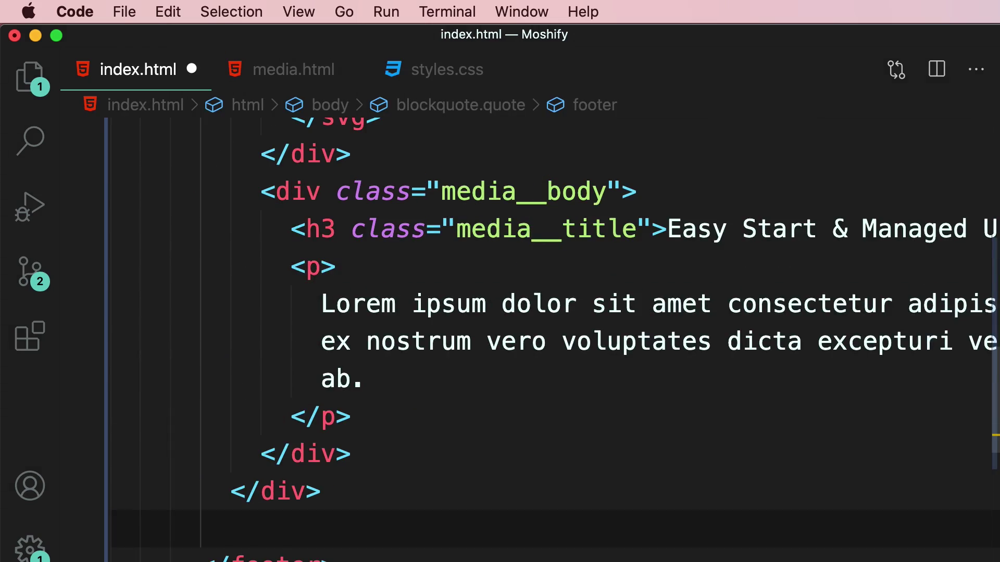

Mosh แก้ไขข้อความใน `<h3 class="media__title">` จาก placeholder เดิม ให้เป็นชื่อผู้พูดตัวอย่าง **"John Smith"**

```html
<h3 class="media__title">John Smith</h3>
```

---

## 15. ใส่ชื่อองค์กร

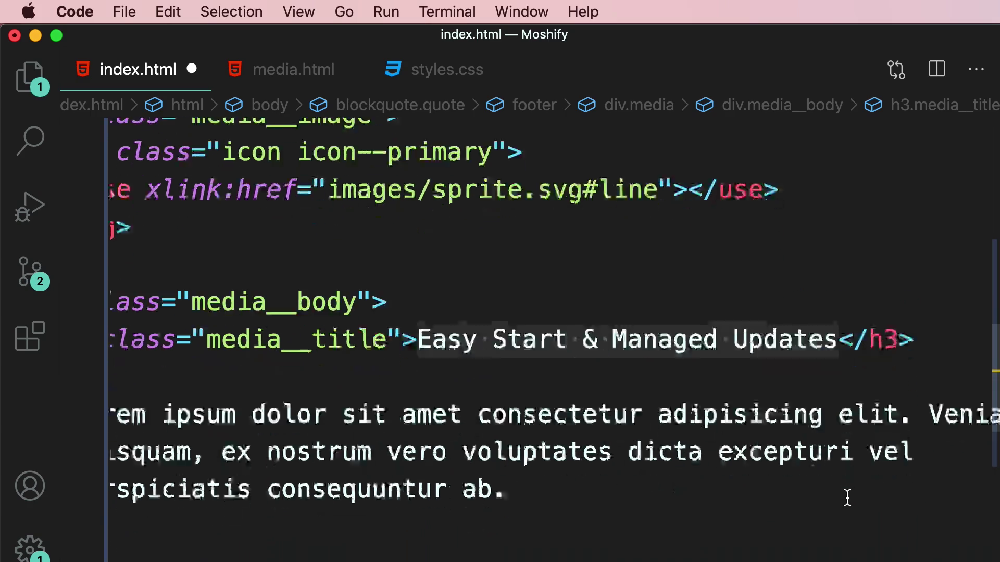

แก้ไขข้อความใน `<p>` ที่อยู่ถัดจาก h3 ให้เป็นชื่อองค์กรตัวอย่าง **"ABC Company"**

```html
<p>ABC Company</p>
```

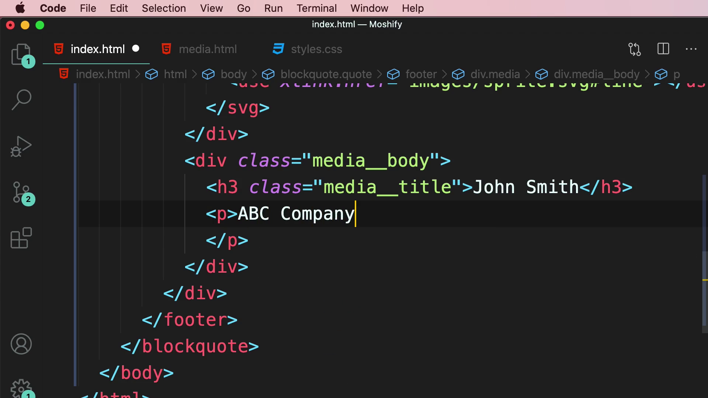

ผลลัพธ์ใน browser ตอนนี้แสดงข้อความคำรับรองพร้อมเครื่องหมายคำพูด ตามด้วยเส้นคั่น ชื่อ "John Smith" และองค์กร "ABC Company" ครบถ้วน

---

## 16. เปลี่ยนชื่อ class ให้เฉพาะเจาะจงกับ Quote

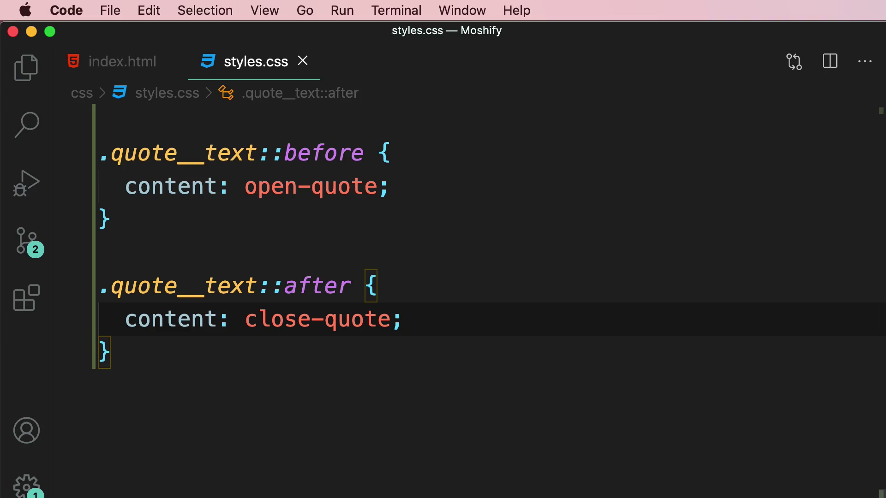

เนื่องจาก `.media__title` เดิมมีสไตล์ทั่วไปที่ไม่ตรงกับดีไซน์ผู้พูดในคำรับรองเป๊ะๆ Mosh จึงเพิ่ม class ที่สองเข้าไปในแท็กเดียวกัน (multi-class):

```html
<h3 class="media__title quote__author">John Smith</h3>
```

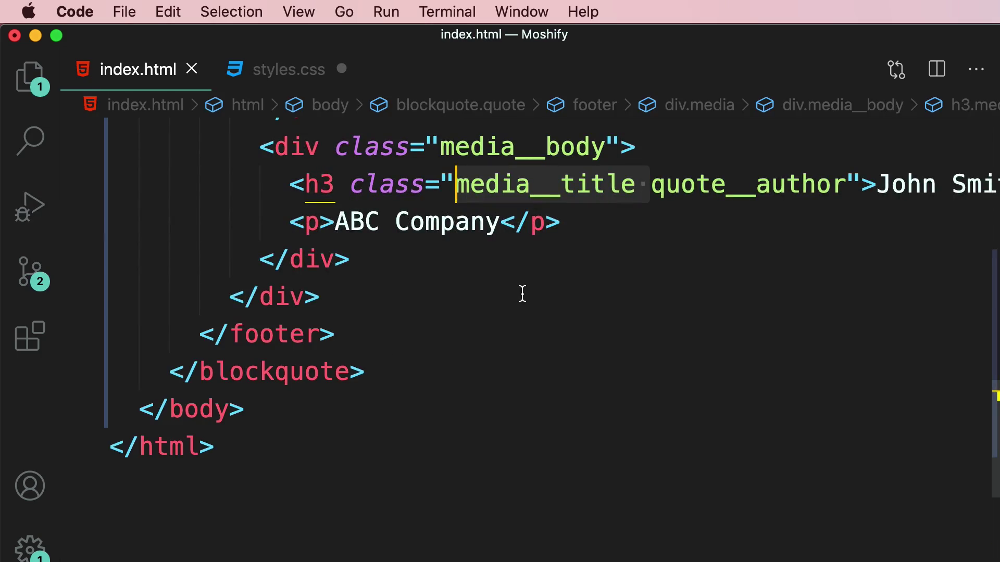

ในตอนแรก Mosh ทดลองเขียน descendant selector แบบ `.quote .media__title` ใน CSS เพื่อ override สไตล์เฉพาะเมื่ออยู่ภายใน `.quote` แต่ต่อมาตัดสินใจเปลี่ยนวิธี

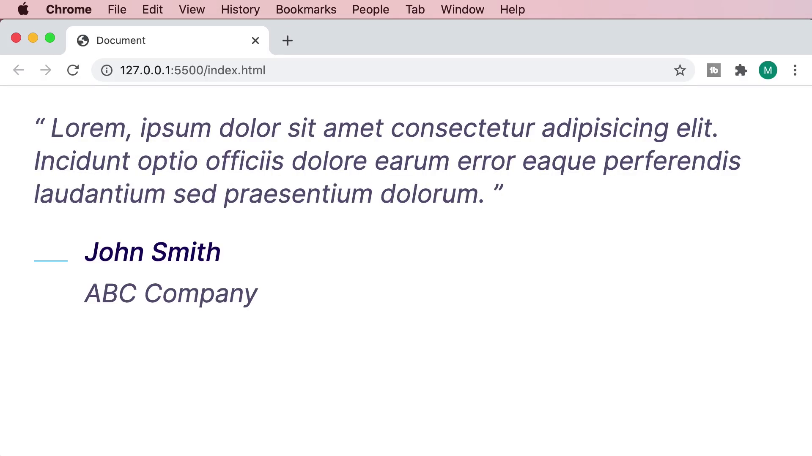

โดยลบ descendant selector ทิ้งแล้วเขียน CSS โดยใช้ class `.quote__author` ตรงๆ แทน (ตามที่เพิ่มไว้ใน HTML แล้ว):

```css
.quote__author {
  /* สไตล์เฉพาะสำหรับชื่อผู้พูดใน quote */
}
```

> 📝 **บทเรียนสำคัญ:** การใช้ multi-class (`media__title quote__author`) ทำให้สามารถ "รวม" สไตล์ทั่วไปจาก `.media__title` เข้ากับสไตล์เฉพาะจาก `.quote__author` ได้ในเวลาเดียวกัน โดยไม่ต้องเขียน descendant selector ที่ซับซ้อนและผูกติดกับโครงสร้าง HTML มากเกินไป (ลด specificity ที่ไม่จำเป็น)

---

## 17. ทบทวนชื่อผู้พูดจริงจากดีไซน์

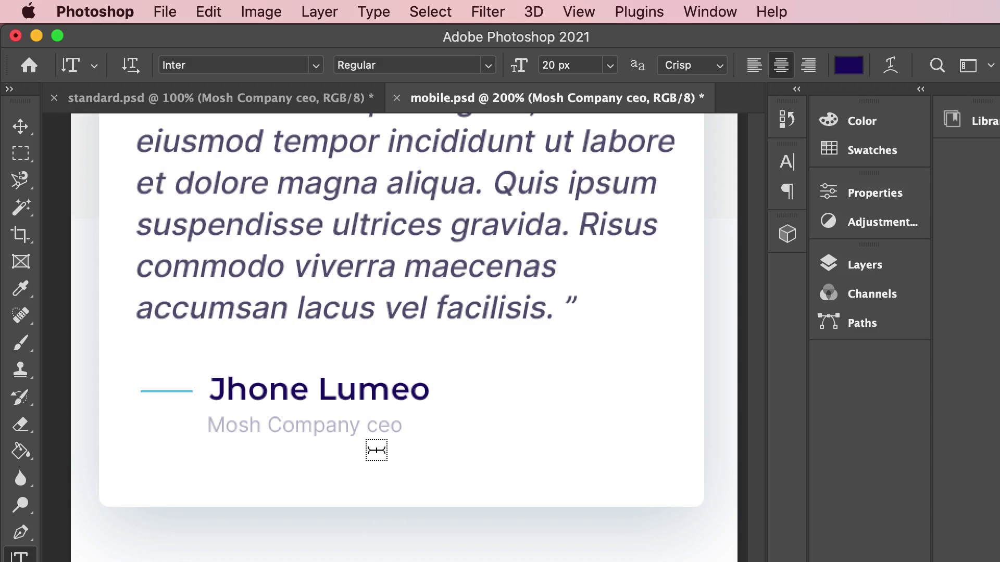

Mosh สลับไปดู Photoshop เพื่อดูชื่อผู้พูดจริงตามดีไซน์ ซึ่งคือ **"Jhone Lumeo"** ตำแหน่ง **"Mosh Company ceo"**

---

## 18. เพิ่ม class ให้กับองค์กร

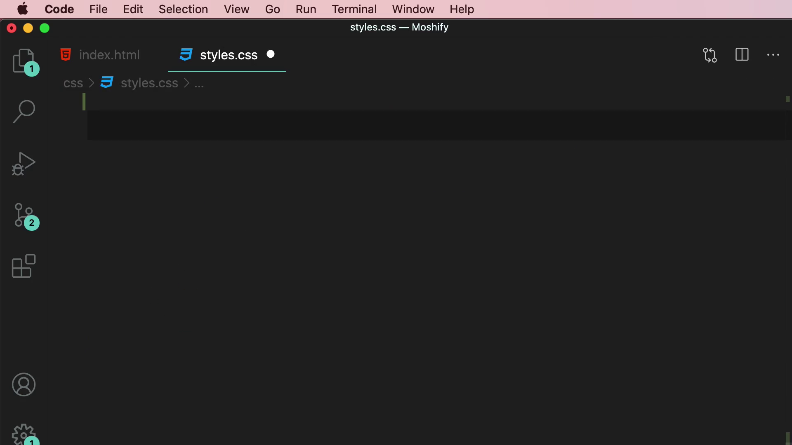

Mosh เพิ่ม class `quote__organization` ให้กับ `<p>` ที่เก็บชื่อองค์กร:

```html
<p class="quote__organization">ABC Company</p>
```

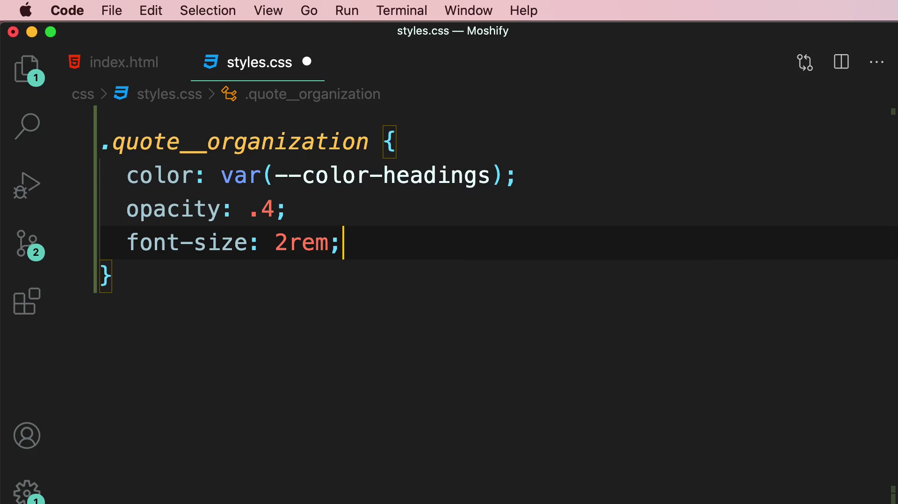

```css
.quote__organization {
  color: var(--color-headings);
  opacity: 0.4;
  font-size: 2rem;
  font-style: normal;
}
```

> 💡 การใช้ `opacity: 0.4` (ความทึบแสง 40%) เป็นเทคนิคที่ทำให้ข้อความดูจางลงโดยไม่ต้องคำนวณค่าสีใหม่ ทำให้ชื่อองค์กรดูเป็นข้อมูล "รอง" (secondary) เมื่อเทียบกับชื่อผู้พูดที่เป็นข้อมูล "หลัก" (primary)

---

## 19. สไตล์ `.quote__author` ให้สมบูรณ์

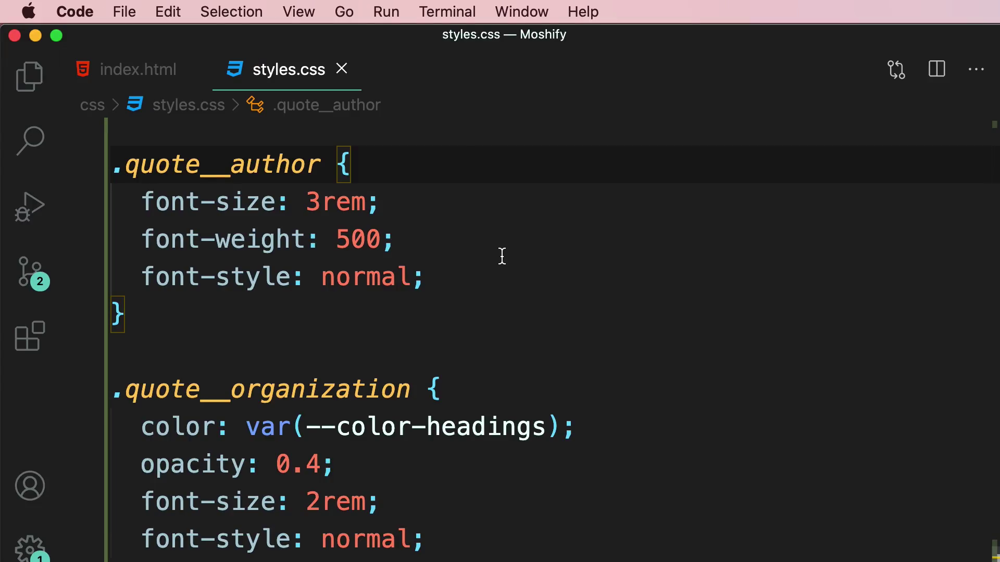

```css
.quote__author {
  font-size: 3rem;
  font-weight: 500;
  font-style: normal;
  margin-bottom: 0;
}
```

> 📝 **อธิบายแต่ละ property:**
> - `font-size: 3rem` — ขนาดตัวอักษรของชื่อผู้พูดให้ใหญ่กว่าองค์กร (สร้างลำดับชั้นทางสายตา / visual hierarchy)
> - `font-weight: 500` — น้ำหนักตัวอักษรปานกลาง-หนา (ไม่หนักเท่า bold เต็มที่)
> - `font-style: normal` — override ค่า italic ที่อาจสืบทอดมาจากที่อื่น ให้กลับมาเป็นปกติ
> - `margin-bottom: 0` — รีเซ็ตระยะห่างด้านล่างที่ browser ใส่มาให้อัตโนมัติ เพื่อให้ชื่อผู้พูดกับชื่อองค์กรอยู่ชิดกัน

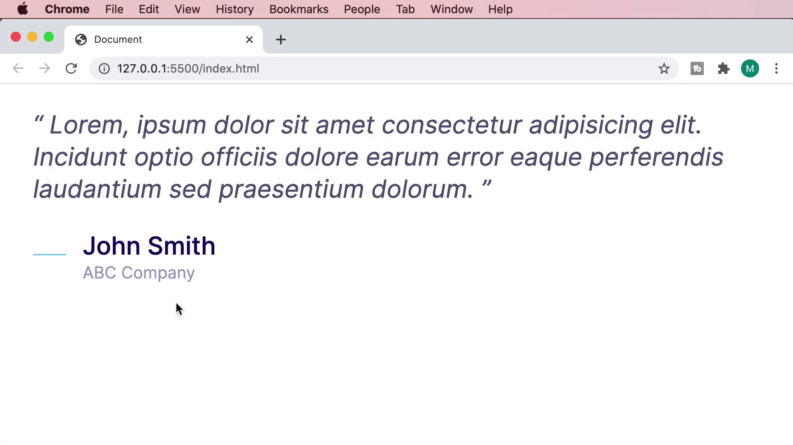

ผลลัพธ์ใน browser แสดงชื่อผู้พูดและองค์กรที่จัดวางและจัดสไตล์เรียบร้อยตามดีไซน์

---

## 20. ทบทวนดีไซน์เต็มรูปแบบใน Photoshop

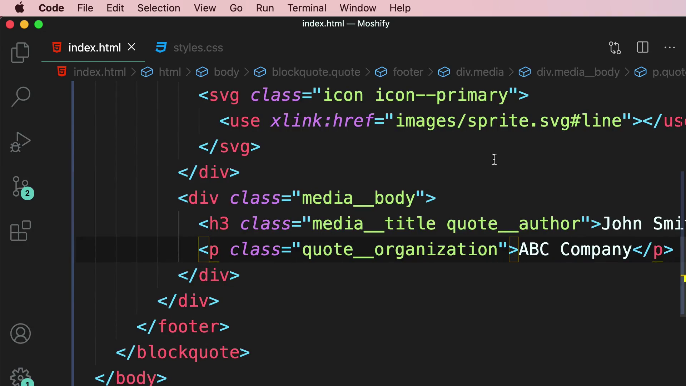

Mosh เปิด Photoshop อีกครั้งเพื่อเปรียบเทียบผลลัพธ์ที่ทำเสร็จกับดีไซน์ต้นฉบับที่มีข้อความจริง "Jhone Lumeo" และ "Mosh Company ceo"

---

## 21. ตรวจสอบโครงสร้าง HTML แบบเต็ม

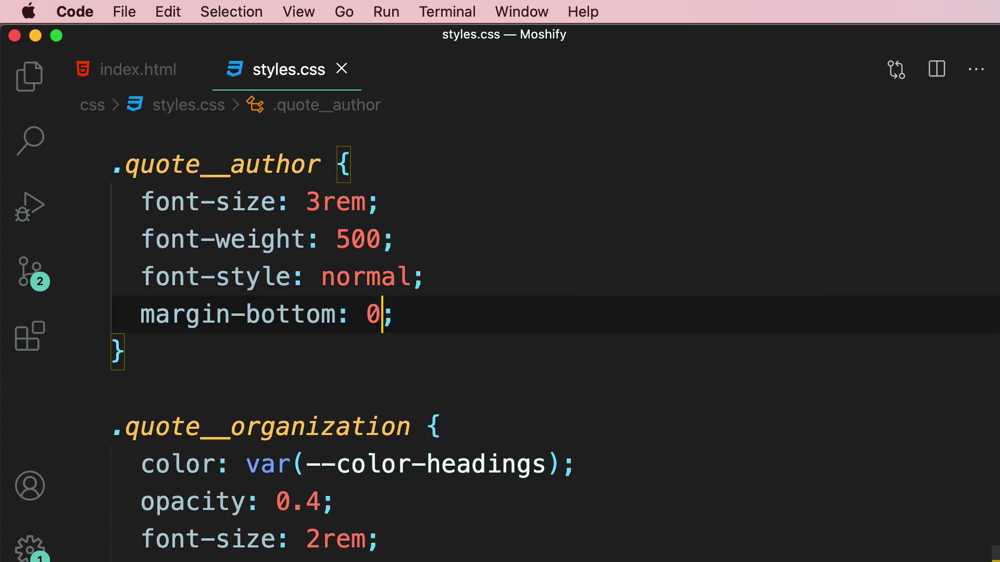

โครงสร้าง HTML แบบสมบูรณ์ของ Quote component ในจุดนี้:

```html
<blockquote class="quote">
  <p class="quote__text">Lorem, ipsum dolor sit amet consectetur adipisicing elit...</p>
  <footer>
    <div class="media">
      <div class="media__image">
        <svg class="icon icon--primary">
          <use xlink:href="images/sprite.svg#line"></use>
        </svg>
      </div>
      <div class="media__body">
        <h3 class="media__title quote__author">John Smith</h3>
        <p class="quote__organization">ABC Company</p>
      </div>
    </div>
  </footer>
</blockquote>
```

---

## 22. จัดตำแหน่งเส้นคั่นด้วย `.quote__line`

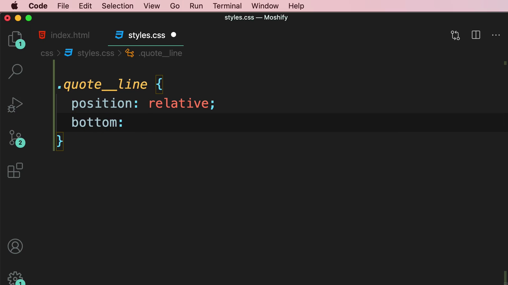

Mosh สร้าง selector ใหม่ `.quote__line` แล้วกำหนด:

```css
.quote__line {
  position: relative;
}
```

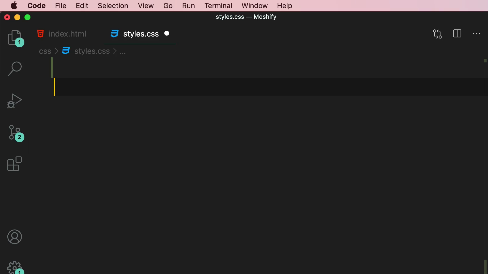

จากนั้นเพิ่ม property เช่น `bottom` เพื่อขยับตำแหน่งเส้นคั่นในแนวตั้งให้ตรงกับจุดที่ต้องการตามดีไซน์

> 🔧 **อธิบาย `position: relative` ร่วมกับ `bottom`:** การกำหนด `position: relative` ทำให้ element ยังคงอยู่ใน document flow ปกติ แต่สามารถขยับตำแหน่งได้โดยใช้ `top`/`bottom`/`left`/`right` โดยอ้างอิงจากตำแหน่งเดิมของมันเอง (ไม่กระทบ layout ของ element อื่น) เทคนิคนี้เหมาะสำหรับการปรับตำแหน่งเล็กน้อย (fine-tuning) แบบเดียวกับที่ใช้ปรับตำแหน่งไอคอนในคลิปก่อนหน้า

---

## 23. เพิ่ม Media Query สำหรับหน้าจอขนาดใหญ่ (Desktop/Tablet)

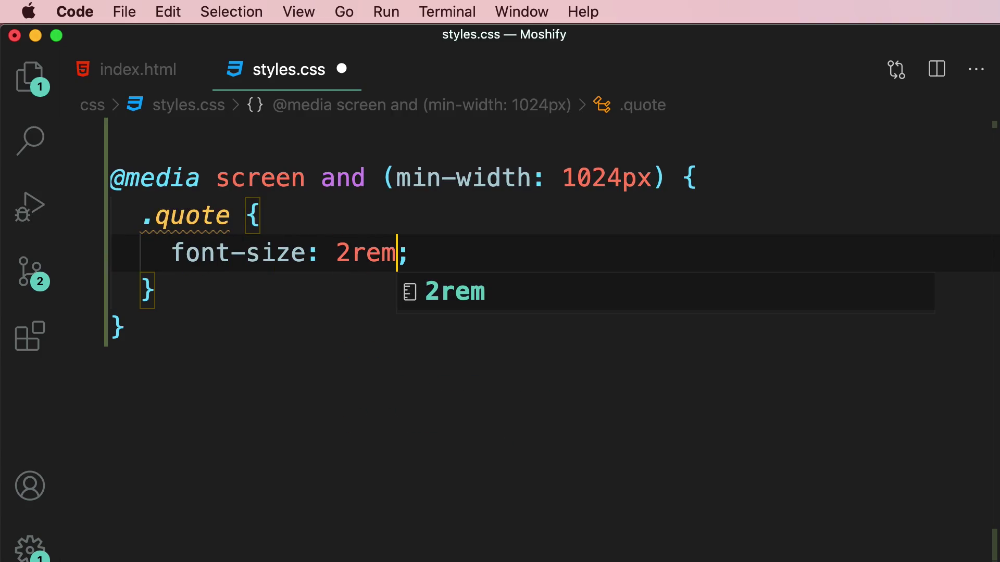

Mosh เริ่มพิมพ์ `@media` เพื่อสร้างกฎ CSS ที่จะทำงานเฉพาะเมื่อหน้าจอมีขนาดกว้างถึงระดับหนึ่ง

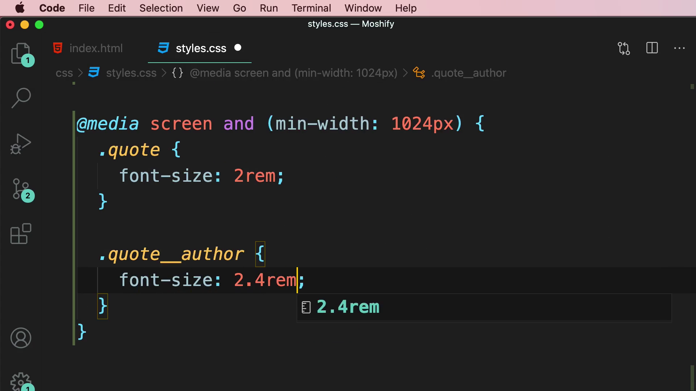

```css
@media screen and (min-width: 1024px) {
  .quote {
    font-size: 2rem;
  }

  .quote__author {
    font-size: 2.4rem;
  }

  .quote__organization {
    font-size: 1.6rem;
  }
}
```

> 💡 **อธิบาย Media Query:** `@media screen and (min-width: 1024px)` หมายถึง "ใช้กฎ CSS ข้างในนี้เฉพาะเมื่อหน้าจอเป็นประเภท screen และมีความกว้างอย่างน้อย 1024 พิกเซล" (เช่น จอคอมพิวเตอร์หรือแท็บเล็ตแนวนอน) นี่คือหัวใจของ **Responsive Web Design** — การเพิ่มขนาดตัวอักษรของ Quote component เมื่อพื้นที่หน้าจอมีมากขึ้น ทำให้ข้อความไม่ดูเล็กเกินไปบนจอใหญ่ ในขณะที่ยังคงอ่านง่ายบนมือถือ (เพราะค่า default นอก media query จะเล็กกว่า)

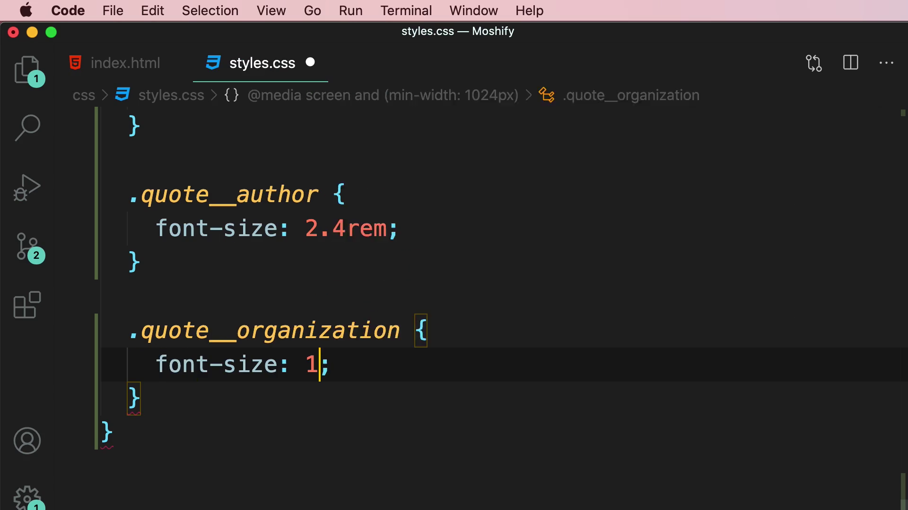

---

## 24. ทดสอบผลลัพธ์บนหน้าจอกว้าง

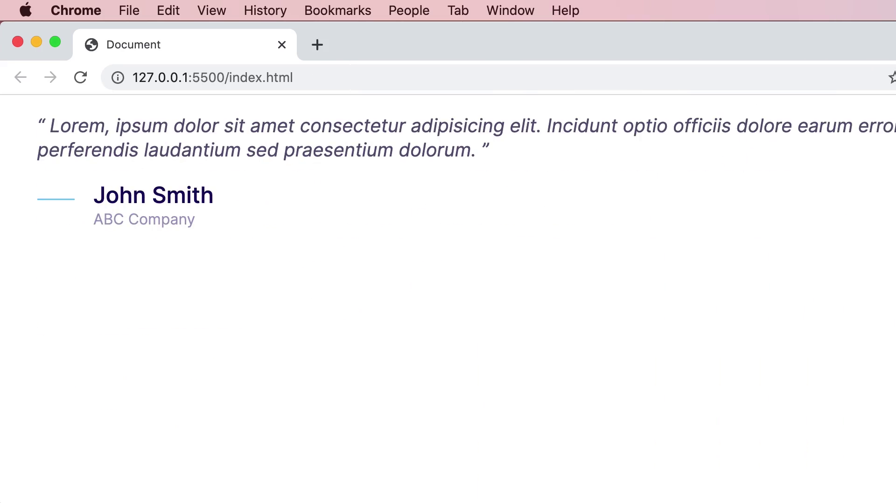

Mosh ปรับขนาดหน้าต่าง browser ให้กว้างขึ้น (จำลองหน้าจอ desktop) เพื่อทดสอบว่า media query ทำงานถูกต้อง โดยข้อความ quote จะมีขนาดใหญ่ขึ้นตามที่กำหนดไว้

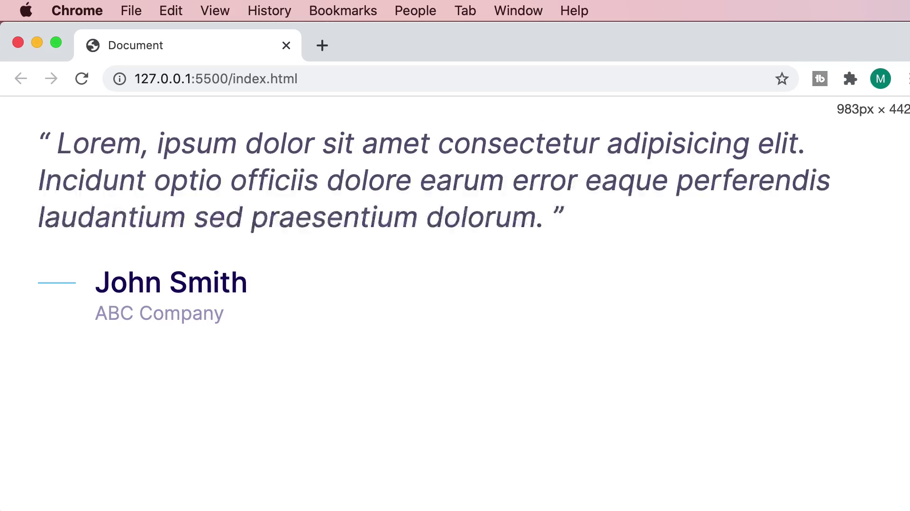

ผลลัพธ์สุดท้ายแสดงให้เห็นขนาดหน้าต่าง (เช่น 983px × 442px) พร้อมกับ Quote component ที่แสดงผลถูกต้องสวยงามครบทุกองค์ประกอบ ทั้งเครื่องหมายคำพูด ข้อความ เส้นคั่น ไอคอน ชื่อผู้พูด และองค์กร

---

## สรุปภาพรวมของคลิปนี้

| หัวข้อ | รายละเอียด |
|---|---|
| Component ที่สร้าง | Quote (`.quote`, `.quote__text`, `.quote__author`, `.quote__organization`, `.quote__line`) |
| เทคนิค HTML | Emmet abbreviation, semantic elements (`<blockquote>`, `<footer>`), การนำ Media Object component กลับมาใช้ซ้ำ, multi-class (`media__title quote__author`) |
| เทคนิค CSS | Pseudo-elements `::before`/`::after` กับ `content: open-quote`/`close-quote`, CSS custom properties (`var(--color-body)`, `var(--color-headings)`), `opacity` สำหรับข้อความรอง, `position: relative` สำหรับ fine-tuning, Media Query (`@media screen and (min-width: 1024px)`) สำหรับ responsive font sizing |
| เครื่องมือที่ใช้ | VS Code (Emmet, CSS IntelliSense), Chrome DevTools (ตรวจสอบ pseudo-elements ใน DOM tree), Live Server, Adobe Photoshop |
| หลักการออกแบบ | BEM naming, Bottom-Up component reuse, Semantic HTML, Responsive Web Design ผ่าน Media Query |

### แนวคิดสำคัญที่ได้จากคลิปนี้

1. **Semantic HTML สำคัญกว่าที่คิด** — การเลือกใช้ `<blockquote>` และ `<footer>` แทน `<div>` ทั่วไป ทำให้โครงสร้างเว็บมีความหมายชัดเจน ดีต่อ accessibility และ SEO
2. **การนำ component กลับมาใช้ซ้ำคือหัวใจของ Bottom-Up Design** — Media Object component จากคลิปก่อนถูกนำมาใช้ในบริบทใหม่ (Quote author) ได้ทันทีโดยแทบไม่ต้องแก้ไขโครงสร้าง
3. **Pseudo-elements `::before`/`::after` สร้างเนื้อหาตกแต่งได้โดยไม่ต้องแก้ HTML** — ค่า `content: open-quote`/`close-quote` เป็นวิธีมาตรฐานสำหรับเครื่องหมายคำพูดที่ปรับตามภาษาอัตโนมัติ
4. **Multi-class ช่วยรวมสไตล์ได้ยืดหยุ่นกว่า descendant selector** — การเขียน `class="media__title quote__author"` ลด specificity ที่ไม่จำเป็นเมื่อเทียบกับการเขียน `.quote .media__title`
5. **Media Query คือกลไกหลักของ Responsive Design** — `@media screen and (min-width: 1024px)` ทำให้ปรับขนาดตัวอักษรและองค์ประกอบต่างๆ ให้เหมาะกับหน้าจอขนาดใหญ่ขึ้นได้ โดยไม่กระทบการแสดงผลบนมือถือ
6. **`opacity` เป็นเทคนิคง่ายๆ สำหรับสร้างลำดับชั้นข้อมูล** — การลดความทึบแสงของข้อความรอง (เช่นชื่อองค์กร) ช่วยแยกแยะข้อมูลหลักกับข้อมูลรองโดยไม่ต้องคำนวณสีใหม่

---

*เอกสารสรุปนี้สร้างจากคลิปวิดีโอสอนของ Mosh Hamedani (Code with Mosh) หลักสูตร Building a Web Site — คลิปที่ 22: Quotes*
