# HTML-CSS-3: 23 - Grids

**ไฟล์ต้นฉบับ:** 23- Grids.mp4

▶️ [ดูวิดีโอ](../../HTML-CSS-3/23-%20Grids.mp4)

---

## ภาพรวมคลิปนี้

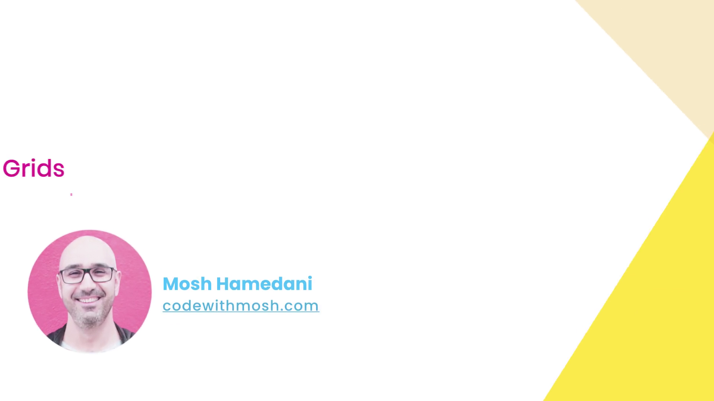

คลิปนี้ Mosh เริ่มต้นบทเรียนใหม่ในหัวข้อ **"Grids"** ซึ่งเป็นเทคนิคการจัดวางเลย์เอาต์ (Layout) แบบสองมิติของ CSS โดยก่อนจะเริ่มเขียนโค้ดจริง Mosh ได้พาย้อนกลับไปดูภาพรวมของหน้าเว็บ Moshify ในโปรแกรม Photoshop อีกครั้ง เพื่อทบทวนว่าส่วนต่างๆ ที่เคยทำไปแล้ว (24/7 Expert Support, Dynamic Caching, Testimonials, WordPress made easy) มีหน้าตาอย่างไร และดูตัวอย่างเว็บไซต์อื่นๆ เป็นแรงบันดาลใจ (inspiration) ก่อนที่จะเริ่มสร้างระบบ Grid ของตัวเองตั้งแต่ไฟล์ `index.html` และ `styles.css` แบบใหม่ทั้งหมด (fresh start)

> 💡 คลิปนี้ค่อนข้างสั้นและเน้นไปที่แนวคิดพื้นฐานของ CSS Grid ล้วนๆ โดยใช้กล่องสี่เหลี่ยมสีสัน (placeholder divs) แทนเนื้อหาจริง เพื่อให้เห็นภาพการทำงานของ Grid ได้ชัดเจนที่สุด

---

## 1. ทบทวนดีไซน์ใน Photoshop ก่อนเริ่มเขียนโค้ด

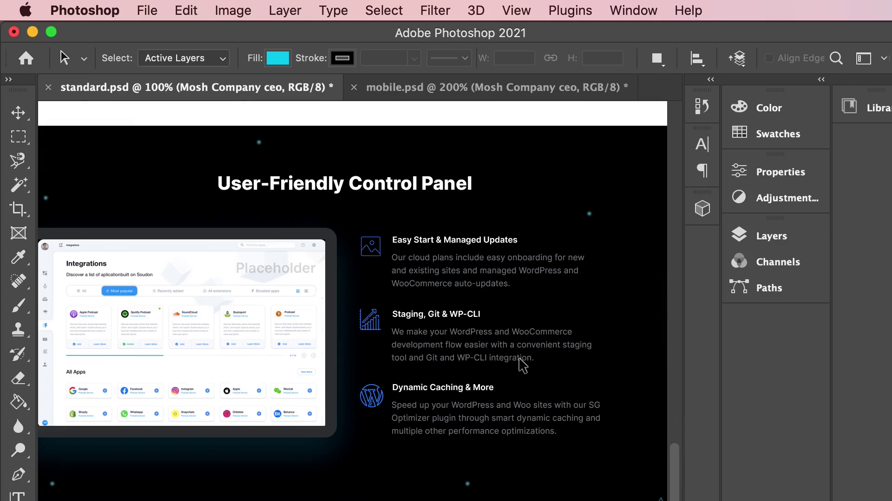

Mosh เปิดไฟล์ PSD ของ Moshify ขึ้นมาอีกครั้งเพื่อดูส่วน **"User-Friendly Control Panel"** และ **"24/7 Expert Support"** ซึ่งมีภาพหน้าจอแชท (Chat mockup) อยู่คู่กับข้อความอธิบาย

> 📌 ส่วนนี้เป็นตัวอย่างของเลย์เอาต์แบบ 2 คอลัมน์ (รูปภาพ + ข้อความ) ซึ่งเป็นโครงสร้างพื้นฐานที่ Grid สามารถนำมาสร้างได้ง่ายกว่าการใช้ Flexbox ในบางกรณี

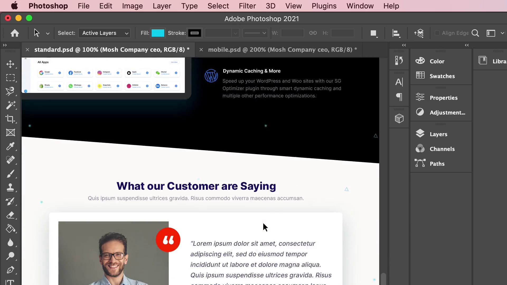

จากนั้นเลื่อนลงไปดูส่วน **"Dynamic Caching & More"** และส่วน **Testimonials** ("What our Customer are Saying") ที่มีคำรีวิวจากลูกค้าชื่อ "Jhone Lumeo" เป็นตัวอย่าง พร้อมทั้งดูส่วน **"WordPress made easy"** ต่อเนื่องกันไป

## 2. ดูตัวอย่างเว็บไซต์อื่นเป็นแรงบันดาลใจ (Design Inspiration)

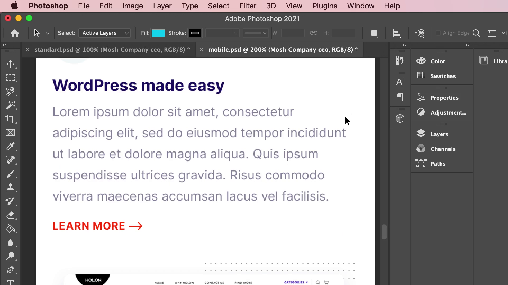

Mosh เปิดภาพตัวอย่างเว็บไซต์อีคอมเมิร์ซชื่อ **"Holon"** ให้ดูเป็นตัวอย่างอ้างอิง (reference) ของการจัดวางเลย์เอาต์แบบ Grid ในเว็บไซต์จริง

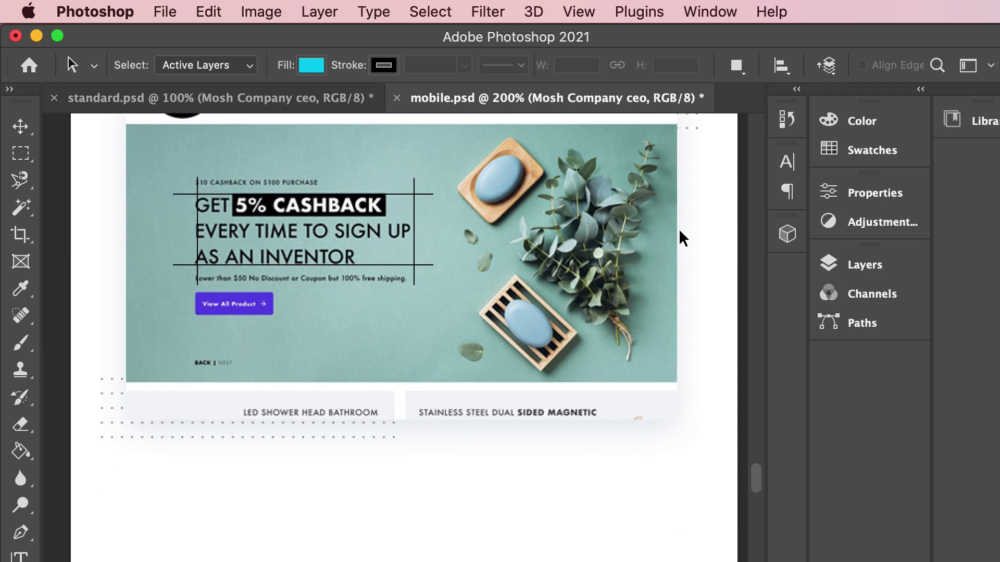

ตามด้วยภาพตัวอย่างแบนเนอร์โปรโมชั่น cashback และตัวอย่าง Grid สินค้า (product grid mockups) ซึ่งเป็นภาพตัวอย่างจากเว็บไซต์อื่นที่ไม่เกี่ยวข้องโดยตรงกับ Moshify แต่ Mosh นำมาให้ดูเพื่อแสดงว่า Grid ถูกใช้งานอย่างแพร่หลายในเว็บไซต์จริงแบบไหนบ้าง

> ⚠️ ภาพเหล่านี้เป็นเพียงการอ้างอิงเชิงแนวคิด (conceptual reference) เท่านั้น ไม่ได้เป็นส่วนหนึ่งของโค้ดที่กำลังจะเขียนในคลิปนี้โดยตรง

## 3. เริ่มต้นไฟล์ใหม่ใน VS Code

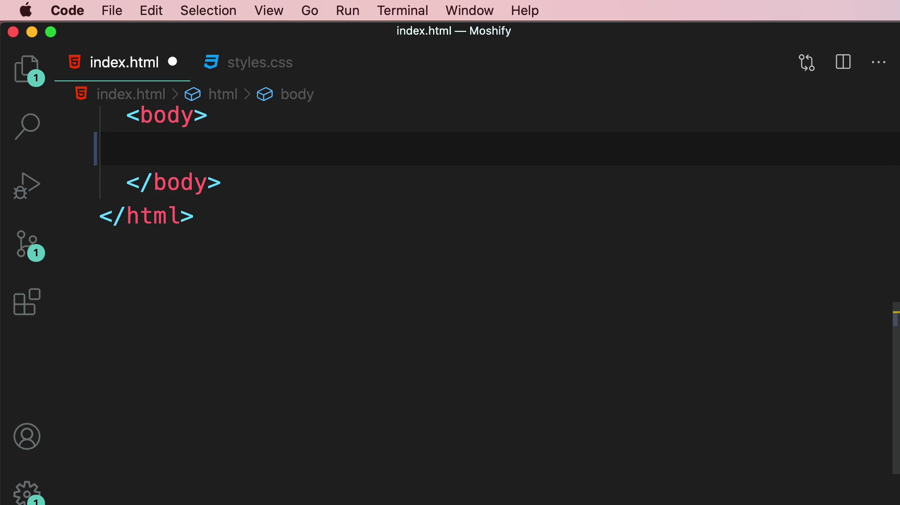

หลังจากทบทวนดีไซน์เสร็จ Mosh กลับมาที่ VS Code และเปิดไฟล์ `index.html` ที่มี `<body>` ว่างเปล่า เพื่อเริ่มทดลองเขียน Grid ใหม่ตั้งแต่ต้น โดยไม่ใช้โค้ดจากคลิปก่อนหน้า เพราะต้องการโฟกัสไปที่แนวคิดของ Grid ล้วนๆ

## 4. ใช้ Emmet สร้าง div.grid

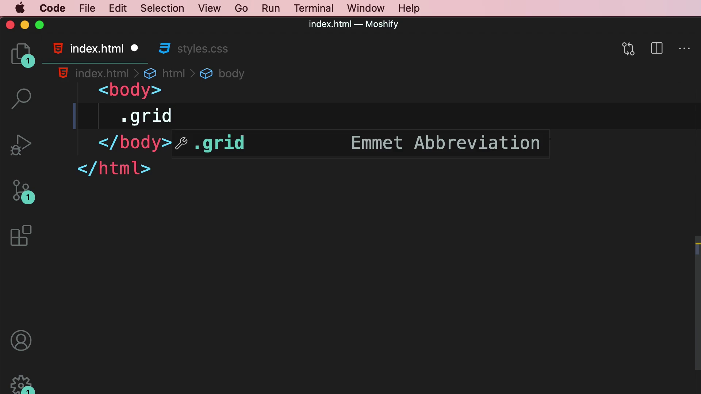

Mosh พิมพ์ `.grid` ด้วย Emmet Abbreviation แล้วกด Tab เพื่อสร้าง `<div class="grid"></div>` ขึ้นมา

```html
<div class="grid"></div>
```

## 5. ทดลองตั้งชื่อคลาสสำหรับ Grid Layout (คิดดัง ๆ หน้ากล้อง)

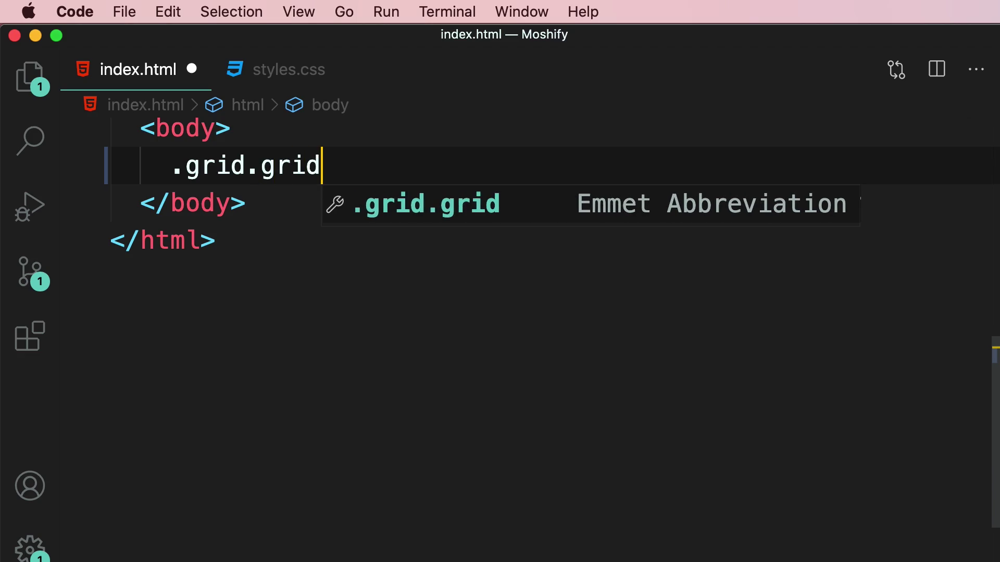

Mosh แสดงให้เห็นขั้นตอนการคิดชื่อคลาส (class naming) แบบสด ๆ โดยลองพิมพ์ `.grid.grid` ก่อน (เป็นการพิมพ์ผิดพลาด/สาธิตความคิด) จากนั้น

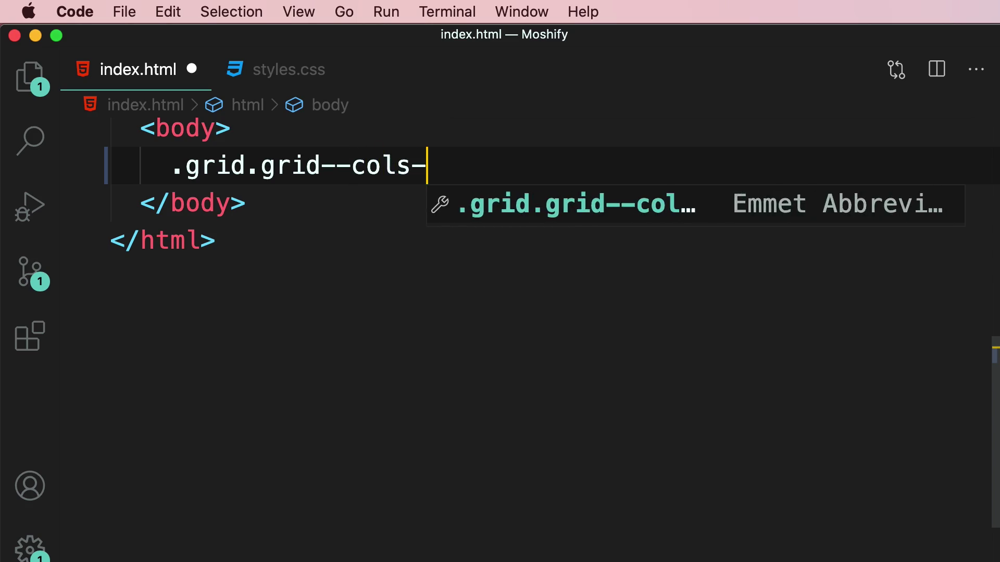

ลองพิมพ์ `.grid.grid--cols-` (ตั้งชื่อแบบ `grid--cols-...`) แต่ยังไม่พอใจกับชื่อนี้ จึงล้มเลิก (abandon) แนวทางนี้ไป

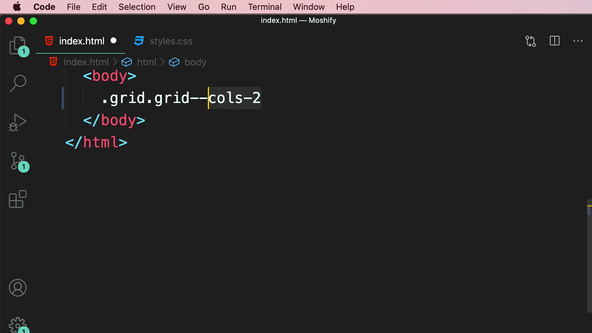

สุดท้ายตัดสินใจใช้ชื่อ `.grid.grid--1x2` แทน โดยแนวคิดของชื่อนี้คือ **"1 แถว คูณ 2 คอลัมน์"** (1 row x 2 columns) ซึ่งสื่อความหมายได้ชัดเจนกว่าว่า Grid นี้จะมีกี่คอลัมน์

> 💡 **BEM-like Naming Convention**: การตั้งชื่อ `grid--1x2` เป็นรูปแบบ Modifier (คั่นด้วย `--`) ตามแนวทาง BEM ที่ Mosh ใช้มาตลอดทั้งคอร์ส เพื่อให้ชื่อคลาสสื่อความหมายในตัวเองว่า Grid แบบนี้คือ Grid ที่มี 1 แถวและ 2 คอลัมน์

## 6. ขยาย Emmet เป็น div ที่สมบูรณ์

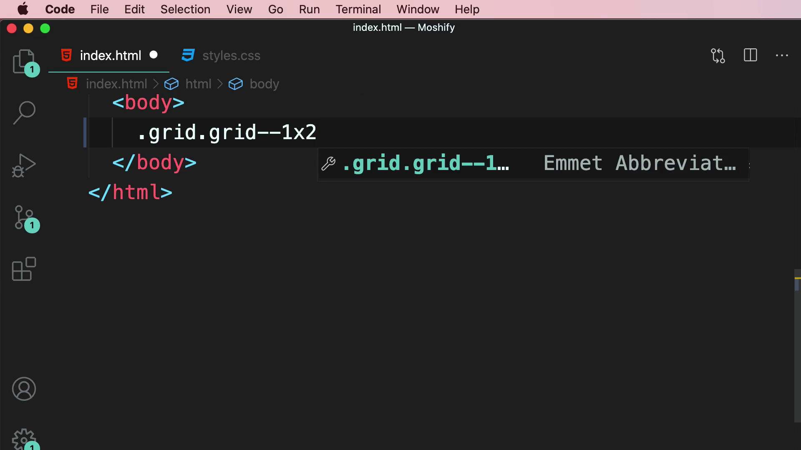

กด Tab เพื่อขยายเป็น:

```html
<div class="grid grid--1x2"></div>
```


Mosh วาง cursor ไว้ด้านในของ div นี้ เตรียมพร้อมสำหรับใส่เนื้อหาต่อไป

## 7. ทบทวนดีไซน์อีกครั้งเพื่อยืนยันโครงสร้าง 1x2

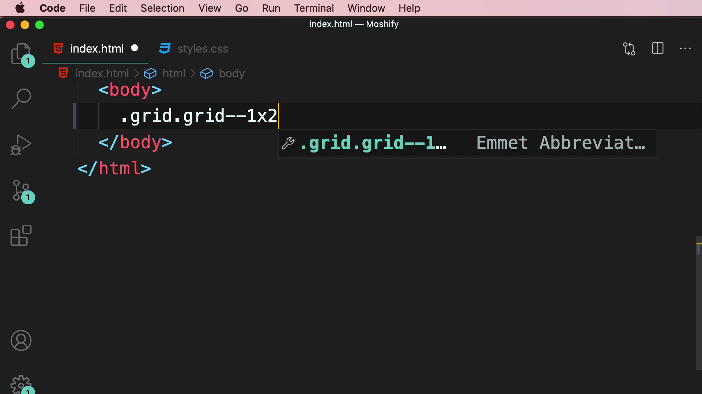

ก่อนใส่เนื้อหาจริง Mosh ย้อนกลับไปดู Photoshop อีกครั้งเพื่อยืนยันว่าส่วน "24/7 Expert Support" ที่มีรูปภาพ + ข้อความอยู่ 2 คอลัมน์ จะสามารถใช้โครงสร้าง `.grid--1x2` นี้ในการสร้างได้จริง

## 8. เตรียมพร้อมใส่เนื้อหาลงใน div

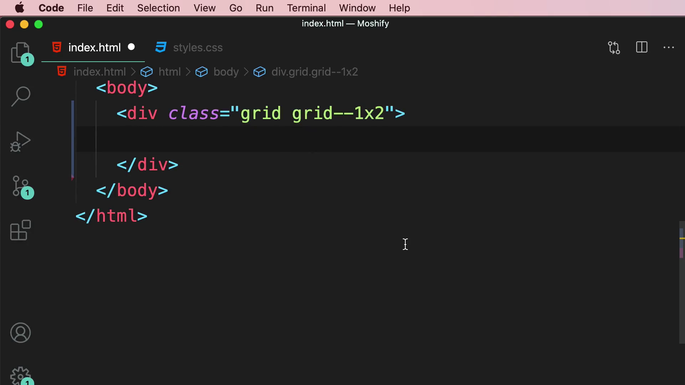

กลับมาที่ VS Code แสดงให้เห็นโครงสร้าง `<div class="grid grid--1x2">` ที่ยังว่างเปล่าอยู่ พร้อมแท็กปิด `</div>` ที่ชัดเจน เพื่อเตรียมใส่เนื้อหาต่อไป

## 9. สร้าง div ลูกตัวแรกด้วย Emmet

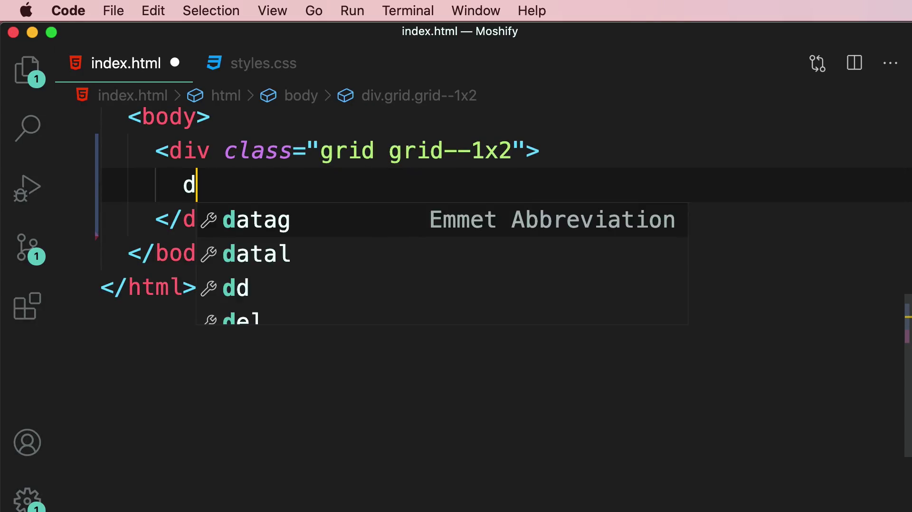

Mosh เริ่มพิมพ์ `d` เพื่อเรียก Emmet Abbreviation สำหรับสร้าง div ลูกตัวแรกเข้าไปในกล่อง `.grid--1x2`

## 10. สร้าง div ลูกสองตัวพร้อม inline style

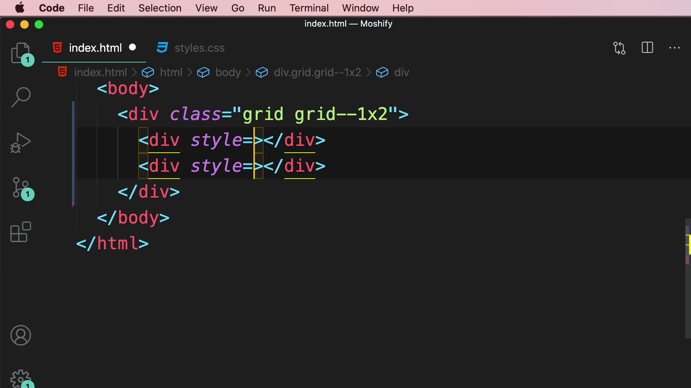

สร้าง div ลูกสองตัว โดยใช้ attribute `style=""` แบบ inline (ยังว่างอยู่) เพื่อสาธิตให้เห็นภาพ Grid ได้เร็วที่สุดโดยไม่ต้องไปเขียน CSS แยกไฟล์

```html
<div class="grid grid--1x2">
  <div style=""></div>
  <div style=""></div>
</div>
```

> 📝 การใช้ inline style ในขั้นตอนนี้เป็นเทคนิคการสาธิต (demo trick) ที่ Mosh ใช้บ่อยเพื่อทดสอบแนวคิดอย่างรวดเร็ว ก่อนจะย้ายไปเขียนใน `styles.css` อย่างเป็นทางการภายหลัง

## 11. ใส่ค่า height ให้ div ทั้งสอง

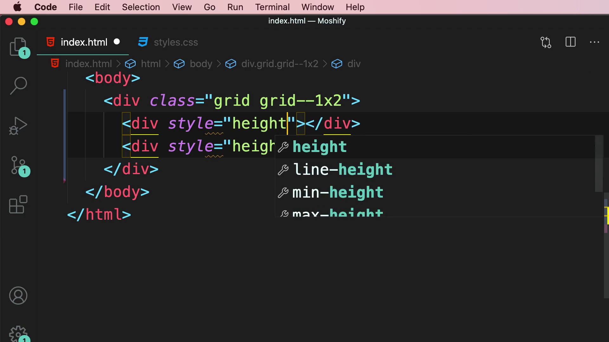

พิมพ์ `height` ภายใน attribute style ซึ่ง VS Code IntelliSense ขึ้น tooltip แนะนำ property ที่เกี่ยวข้อง เช่น `height`, `line-height`, `min-height`, `max-height` จากนั้นตั้งค่าเป็น

```css
height: 100px;
```

ให้กับ div ทั้งสองตัว

## 12. ใส่สีพื้นหลังด้วย background

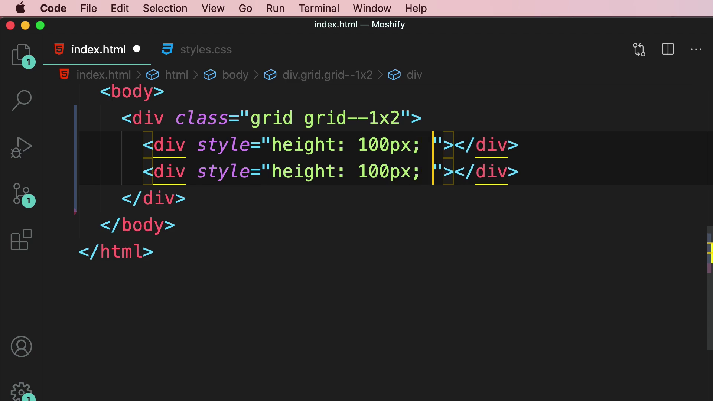

พิมพ์ `background` ต่อจาก `height: 100px;` โดย IntelliSense แสดง tooltip แนะนำ: **`background-color`, `background`, `background-image`, `background-position`**

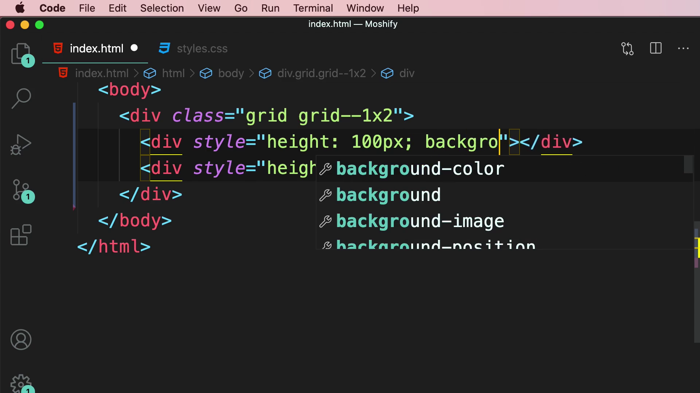

ทำแบบเดียวกันกับ div ตัวที่สอง

## 13. เลือกสีด้วย Color Picker ของ VS Code

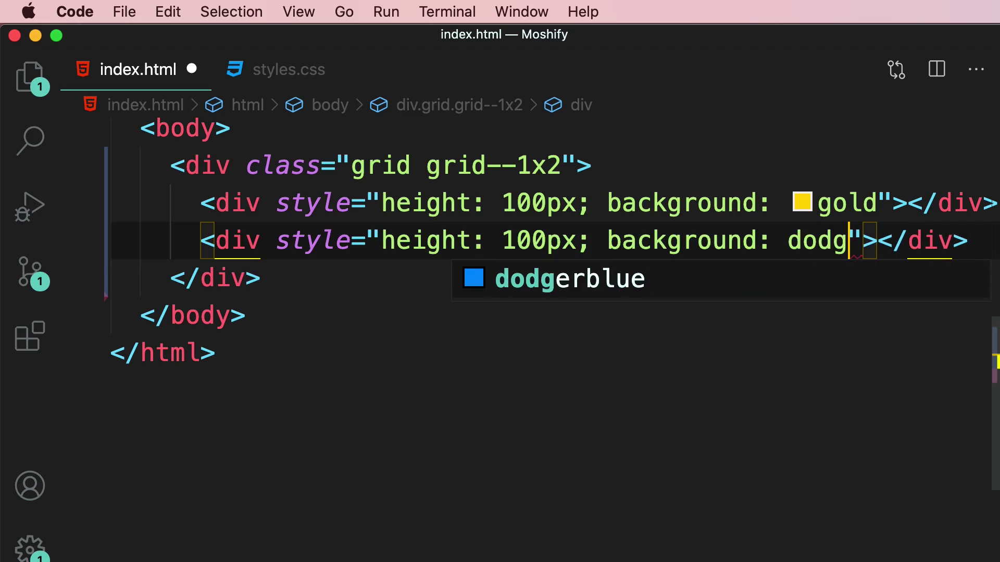

Mosh พิมพ์ชื่อสีที่ VS Code รู้จักโดยตรง เช่น `gold` สำหรับ div แรก (แสดงเป็นสี่เหลี่ยมสีเหลืองทองในตัวช่วยแนะนำ) และพิมพ์ `dodg` สำหรับ div ที่สอง ซึ่ง IntelliSense แนะนำ **`dodgerblue`** พร้อมแสดงสี่เหลี่ยมสีฟ้าประกอบ

```html
<div class="grid grid--1x2">
  <div style="height: 100px; background: gold"></div>
  <div style="height: 100px; background: dodgerblue"></div>
</div>
```

> 🔍 **จุดสังเกต**: VS Code สามารถแสดงตัวอย่างสี (color swatch) ของชื่อสี CSS มาตรฐาน (named colors) ได้โดยอัตโนมัติ ทำให้เลือกสีได้ง่ายโดยไม่ต้องจำรหัสสี hex

## 14. เปิดดูผลลัพธ์ใน Browser

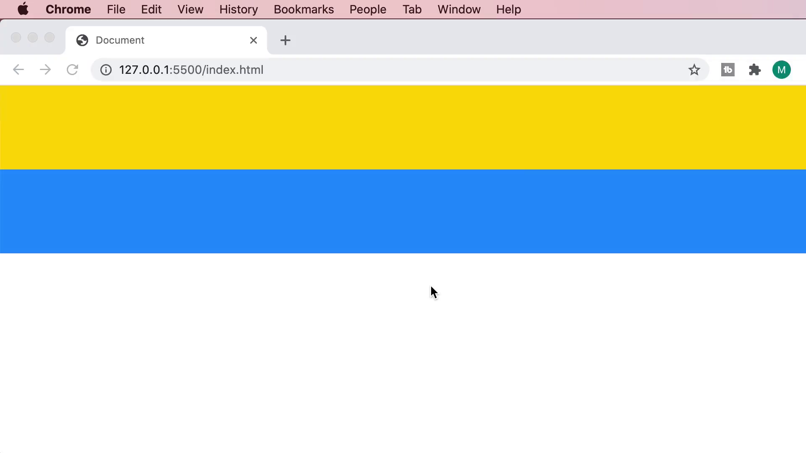

เปิด Live Server ใน Chrome (`127.0.0.1:5500/index.html`) จะเห็นแถบสีเหลือง (gold) วางซ้อนอยู่ด้านบนแถบสีฟ้า (dodgerblue) เต็มความกว้างหน้าจอ

> ⚠️ นี่คือพฤติกรรมเริ่มต้นของ `<div>` ปกติที่เป็น **block-level element** — ยังไม่มีการใช้ `display: grid` จึงยังเรียงต่อกันในแนวตั้งแบบปกติ (ไม่ได้เป็นแบบ Grid)

## 15. เปิดไฟล์ styles.css และสร้าง selector .grid

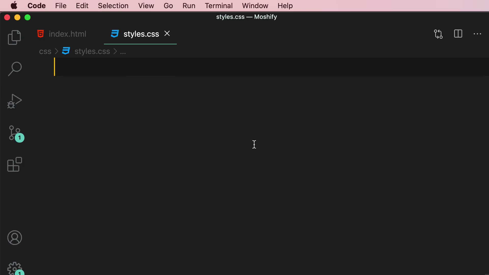

Mosh สลับไปที่ไฟล์ `styles.css` (breadcrumb แสดง `css > styles.css`) ซึ่งยังว่างเปล่าอยู่

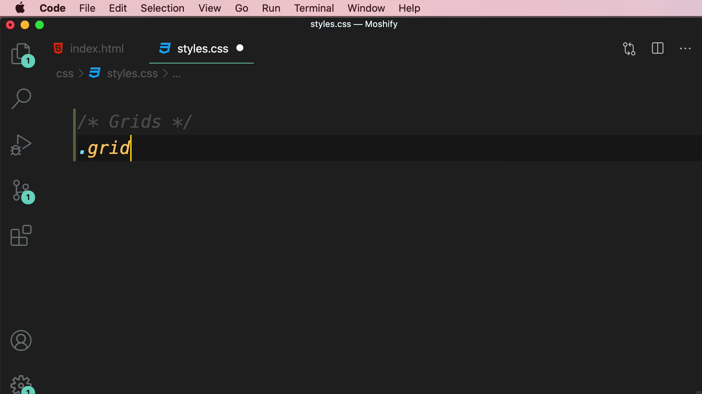

พิมพ์คอมเมนต์หัวข้อและ selector:

```css
/* Grids */
.grid {
}
```

## 16. เพิ่ม property display: grid

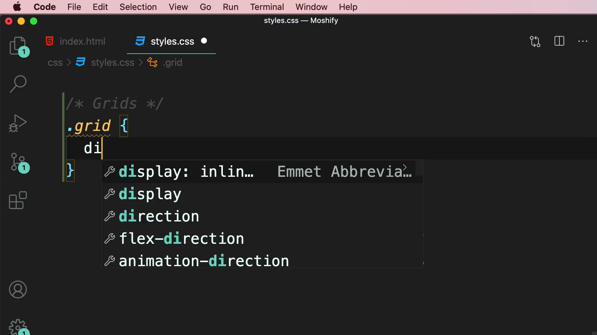

พิมพ์ `di` ภายใน `.grid { }` ซึ่ง Emmet Abbreviation แนะนำ **`display: inline...`** พร้อม property อื่นๆ ที่ขึ้นต้นด้วย `di` เช่น `display`, `direction`, `flex-direction`

จากนั้นพิมพ์ค่า `g` เพื่อหาค่า `grid` โดย IntelliSense แสดงตัวเลือก **`grid`** เป็นค่าของ property `display` (นอกเหนือจากตัวเลือกอื่นที่ไม่เกี่ยวข้อง เช่น `table-column-group`)

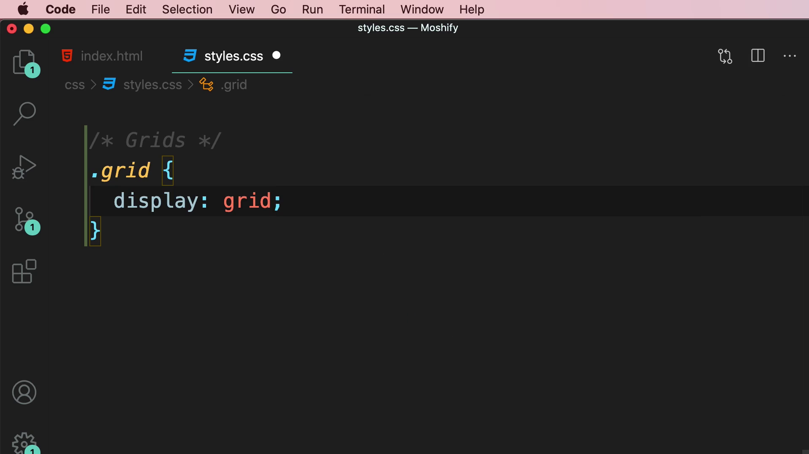

สุดท้ายได้ CSS rule ที่สมบูรณ์:

```css
.grid {
  display: grid;
}
```

> 🔧 **แนวคิดสำคัญ**: การใส่ `display: grid;` เพียงบรรทัดเดียวคือจุดเริ่มต้นของการเปลี่ยน element ให้กลายเป็น **Grid Container** ทำให้ลูกๆ (child elements) ภายในกลายเป็น **Grid Items** โดยอัตโนมัติ แม้ในตอนนี้ยังไม่เห็นการเปลี่ยนแปลงชัดเจนในหน้าเว็บ เพราะยังไม่ได้กำหนดจำนวนคอลัมน์

## 17. สร้าง Media Query สำหรับหน้าจอกว้าง

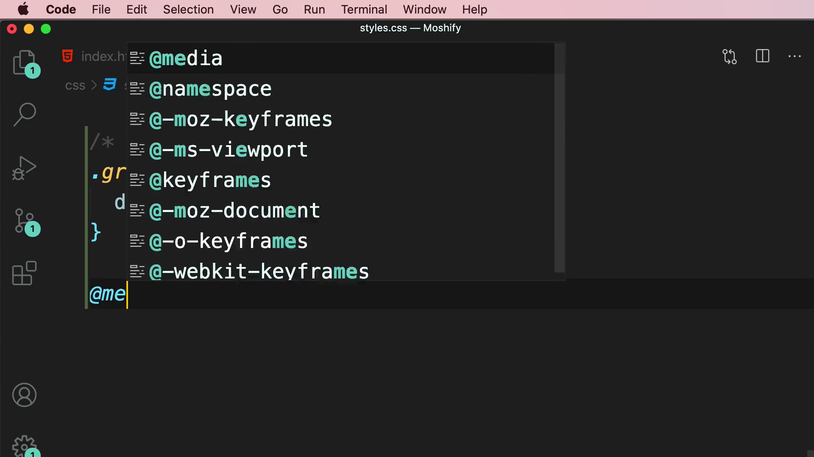

Mosh เริ่มพิมพ์ `@me` เพื่อเรียก Emmet Abbreviation ของ **`@media`** โดย tooltip แสดงตัวเลือกอื่นๆ ที่เกี่ยวข้อง เช่น `@namespace`, `@-moz-keyframes`, `@keyframes` เป็นต้น

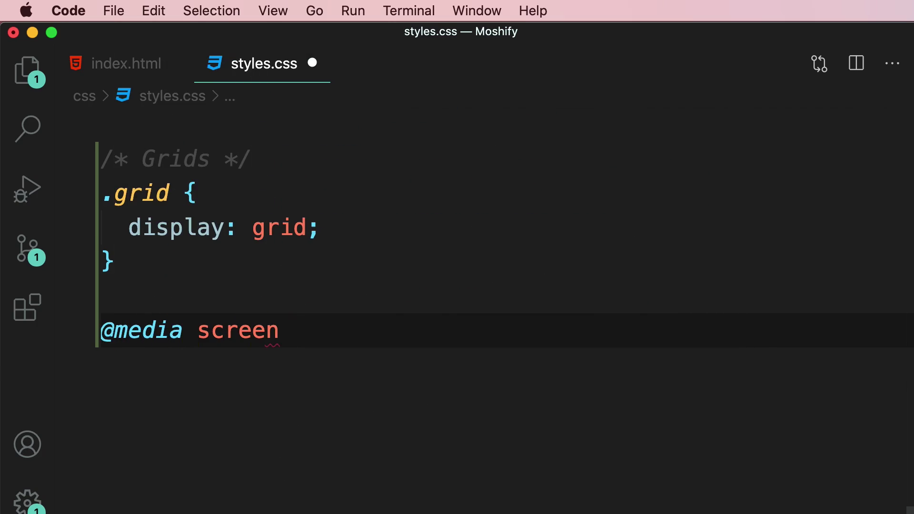

พิมพ์ต่อเป็น `@media screen and (min-width:` ซึ่ง IntelliSense แนะนำ property/selector ที่เกี่ยวข้อง

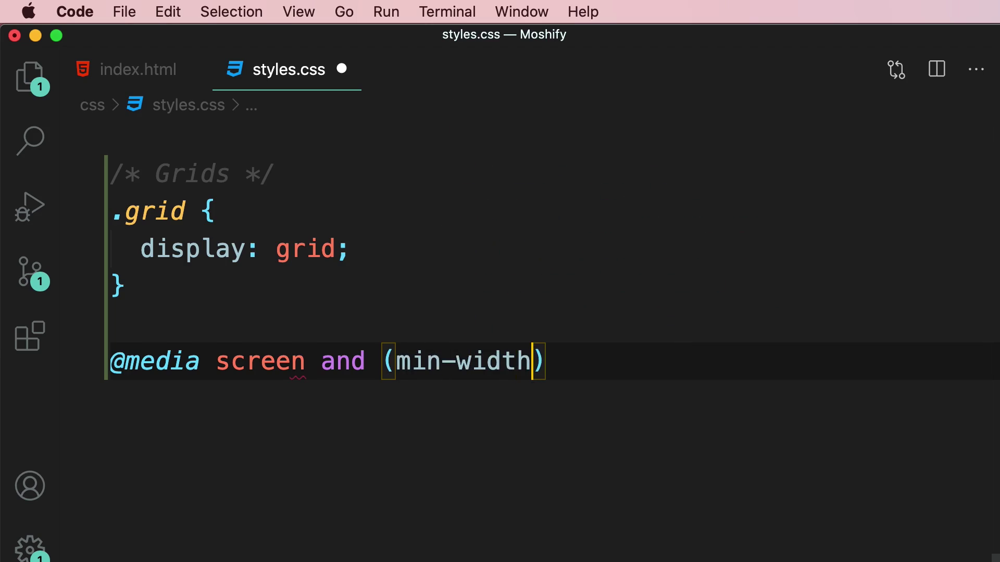

พิมพ์วงเล็บปิดจนได้โครงสร้างเริ่มต้น `@media screen and (min-width)`

## 18. กำหนดค่า breakpoint เป็น 768px

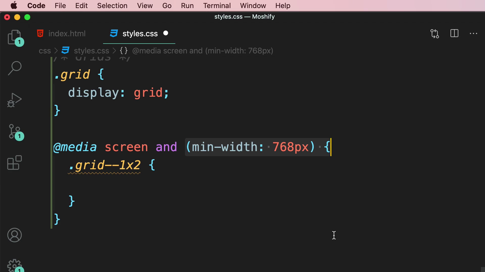

เติมค่าตัวเลขจนได้ Media Query ที่สมบูรณ์ และซ้อน selector `.grid--1x2` ไว้ด้านใน:

```css
@media screen and (min-width: 768px) {
  .grid--1x2 {

  }
}
```

> 📌 ค่า `768px` เป็นค่า breakpoint มาตรฐานที่ใช้บ่อยในการแบ่งแยกระหว่างหน้าจอมือถือ/แท็บเล็ต (mobile-first) กับหน้าจอเดสก์ท็อป — เมื่อความกว้างหน้าจอ **มากกว่าหรือเท่ากับ 768px** กฎ CSS ภายใน Media Query นี้จะถูกนำมาใช้

## 19. เพิ่ม grid-template-columns

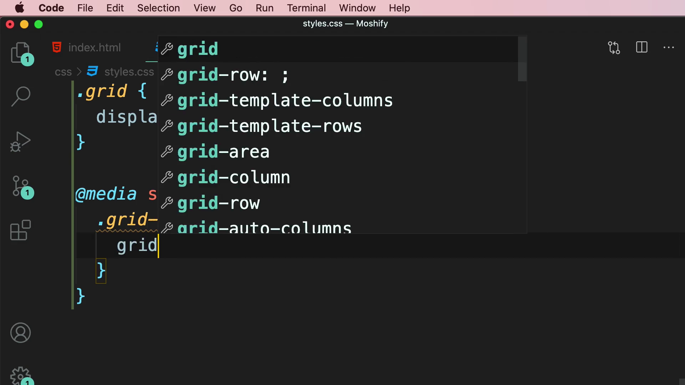

ภายใน `.grid--1x2 { }` พิมพ์ `grid-templ` ซึ่ง IntelliSense แนะนำ property ที่เกี่ยวข้องกับ Grid ทั้งหมด ได้แก่ **`grid`, `grid-row`, `grid-template-columns`, `grid-template-rows`, `grid-area`, `grid-column`, `grid-auto-columns`**

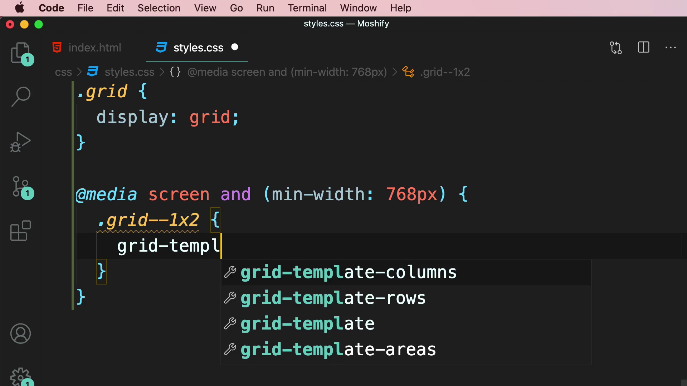

เริ่มพิมพ์ค่าทดลองเป็น `1` ก่อน (ยังไม่ใช่ค่าสุดท้าย)

## 20. ทดสอบผลลัพธ์ในเบราว์เซอร์ขณะปรับขนาดหน้าต่าง

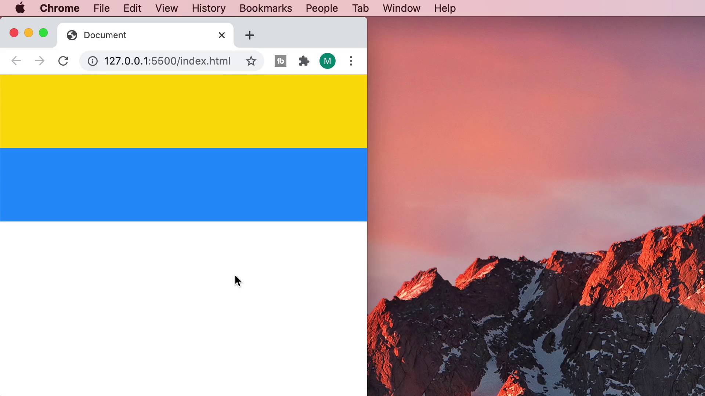

Mosh กลับไปที่ Chrome และลาก resize หน้าต่างเบราว์เซอร์ (แสดงขนาดหน้าจอ เช่น 823px x 442px) เพื่อทดสอบว่า Media Query ทำงานถูกต้องหรือไม่ — เมื่อกว้างเกิน 768px จะเห็นแถบสีเหลืองและสีฟ้าเรียงเป็น 2 คอลัมน์เท่าๆ กัน

## 21. กำหนดค่าสุดท้าย grid-template-columns: repeat(2, 1fr)

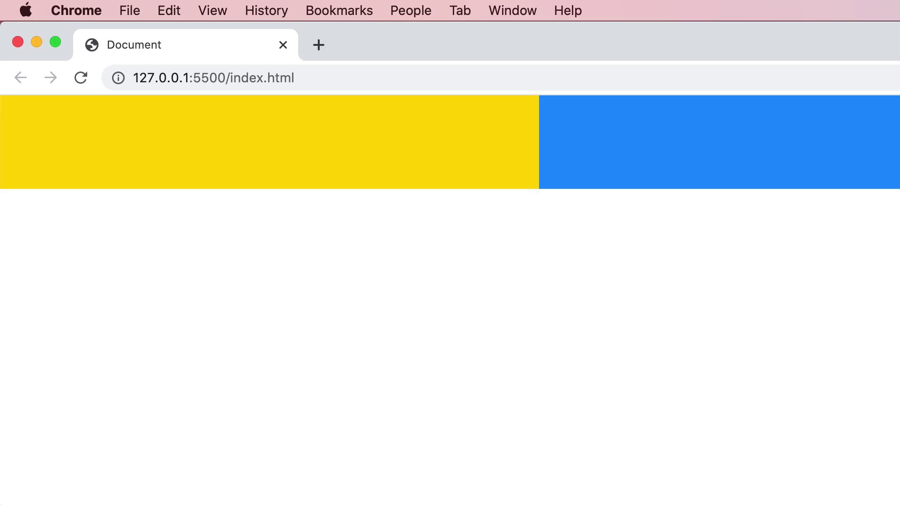

Mosh แก้ไขค่าเป็นค่าสุดท้ายที่ถูกต้อง:

```css
@media screen and (min-width: 768px) {
  .grid--1x2 {
    grid-template-columns: repeat(2, 1fr);
  }
}
```

> 🔧 **คำอธิบายฟังก์ชัน `repeat()`**: `repeat(2, 1fr)` หมายถึง "สร้างคอลัมน์ 2 คอลัมน์ โดยแต่ละคอลัมน์มีความกว้างเท่ากัน 1 ส่วน (1 fractional unit)" ซึ่งเทียบเท่ากับการเขียน `grid-template-columns: 1fr 1fr;` แต่กระชับกว่า และง่ายต่อการปรับจำนวนคอลัมน์ในอนาคต (เช่นเปลี่ยนเป็น `repeat(3, 1fr)` สำหรับ 3 คอลัมน์)

## 22. ยืนยันผลลัพธ์ 2 คอลัมน์เท่ากันในเบราว์เซอร์

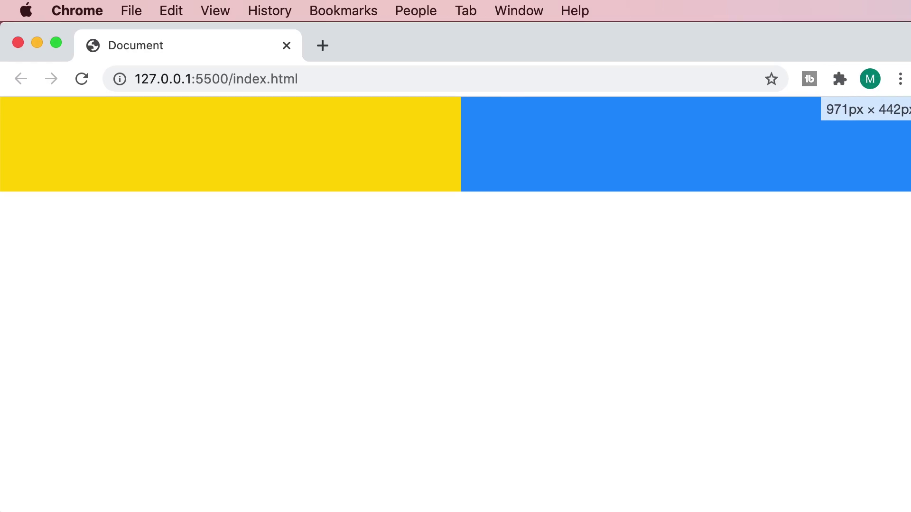

ทดสอบปรับขนาดหน้าต่างอีกครั้ง (753px x 442px) ยืนยันว่าแถบสีเหลืองและสีฟ้าถูกจัดวางเป็น 2 คอลัมน์ที่มีความกว้างเท่ากันพอดี เมื่อหน้าจอกว้างเกิน breakpoint 768px

## 23. สาธิตข้อผิดพลาด: การเขียน Media Query ซ้ำโดยไม่ตั้งใจ

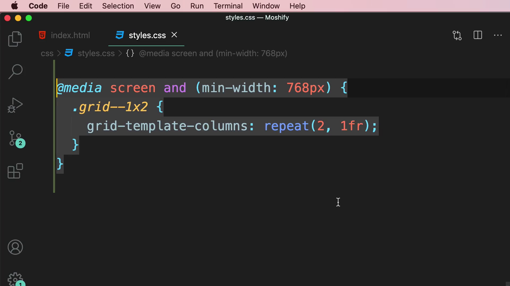

Mosh แสดงให้เห็นสถานการณ์ที่อาจเกิดขึ้นได้จริงเวลาเขียนโค้ด — เผลอคัดลอก (copy-paste) บล็อก `@media screen and (min-width: 768px) { ... }` ซ้ำเป็นสองชุดติดกันในไฟล์เดียว:

```css
@media screen and (min-width: 768px) {
  .grid--1x2 {
    grid-template-columns: repeat(2, 1fr);
  }
}

@media screen and (min-width: 768px) {
  .grid--1x2 {
    grid-template-columns: repeat(2, 1fr);
  }
}
```

> ⚠️ **ข้อควรระวัง**: การมี Media Query ที่มีเงื่อนไข (condition) เหมือนกันซ้ำกันหลายครั้งไม่ได้ทำให้เกิด error แต่เป็นการเขียนโค้ดที่ซ้ำซ้อนโดยไม่จำเป็น (code duplication) ซึ่งควรรวมเป็นบล็อกเดียวเพื่อให้ดูแลรักษาโค้ด (maintainability) ได้ง่ายขึ้น — Mosh ใช้จุดนี้เป็นตัวอย่างเตือนให้ผู้เรียนสังเกตโครงสร้างไฟล์ CSS ของตัวเองอยู่เสมอ

## 24. เพิ่มกล่องสีที่สาม (สีแดง) เพื่อสาธิตพฤติกรรม Auto-placement ของ Grid

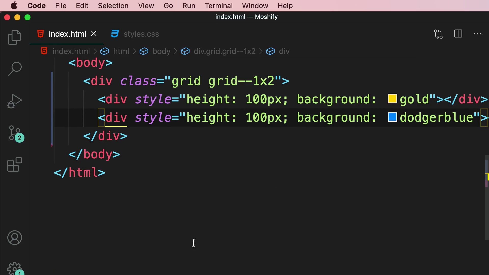

กลับมาที่ `index.html` ซึ่งยังคงมี div ลูกอยู่ 2 ตัว (สีทองและสีฟ้า) ตามโครงสร้างเดิม

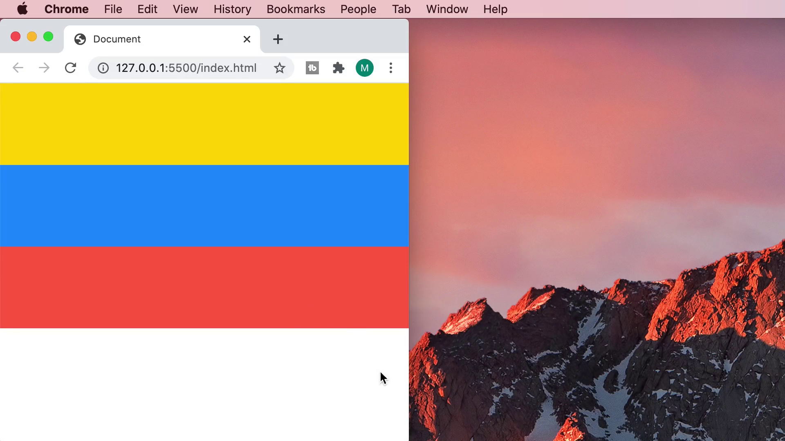

เมื่อทดสอบในเบราว์เซอร์อีกครั้งหลังเพิ่มกล่องที่สาม จะเห็นแถบสีแดงปรากฏขึ้นต่อจากแถบสีเหลืองและสีฟ้า โดยเรียงต่อกันเป็นแถวที่ 3 ในแนวตั้ง (เมื่อหน้าจอแคบกว่า breakpoint)

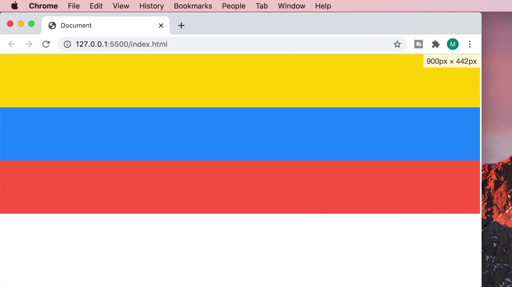

ในขนาดหน้าจอที่แคบ (ต่ำกว่า 768px) กล่องทั้งสามจะเรียงซ้อนกันเป็นแถวเดี่ยว (1 คอลัมน์) ตามค่าเริ่มต้นของ `.grid` ที่ยังไม่มี `grid-template-columns` กำหนดไว้

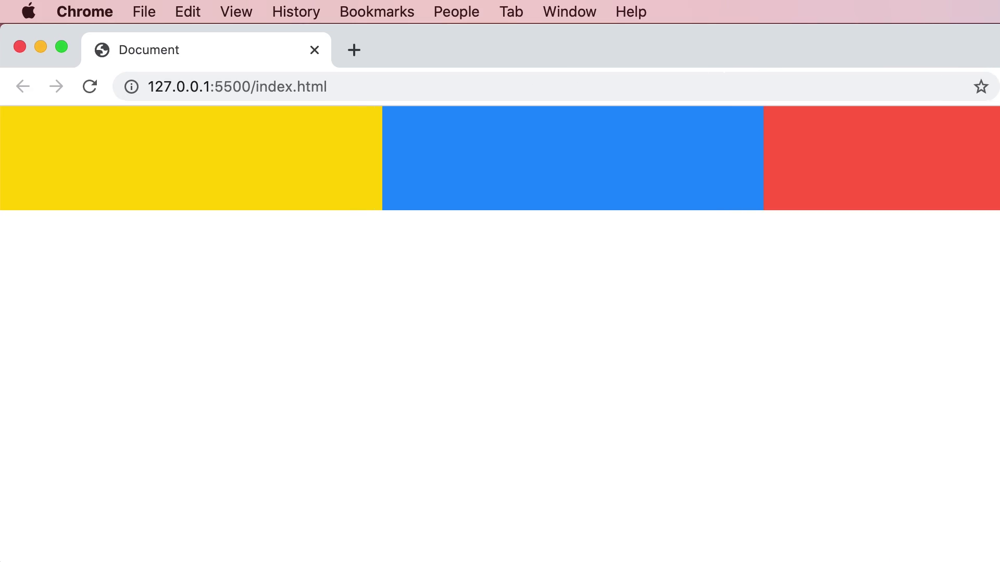

แต่เมื่อขยายหน้าจอให้กว้างเกิน 768px (เข้าเงื่อนไข Media Query ของ `.grid--1x2`) กล่องสีเหลืองและสีฟ้าจะถูกจัดเป็น 2 คอลัมน์ตามที่กำหนดไว้ ส่วนกล่องสีแดง (กล่องที่ 3) จะ **"หลุด" ไปเริ่มแถวใหม่โดยอัตโนมัติ** เนื่องจากมีเพียง 2 คอลัมน์ที่ถูกกำหนดไว้ใน `grid-template-columns: repeat(2, 1fr)`

> 🔍 **แนวคิดสำคัญเรื่อง Auto-placement**: นี่คือพฤติกรรมพื้นฐานที่สำคัญมากของ CSS Grid — เมื่อจำนวน Grid Items (ในที่นี้คือ 3 กล่อง) มีมากกว่าจำนวนคอลัมน์ที่กำหนดไว้ (2 คอลัมน์) เบราว์เซอร์จะ **จัดวางไอเทมที่เกินมาลงในแถวถัดไปโดยอัตโนมัติ** (implicit grid / auto-placement algorithm) โดยไม่ต้องเขียนโค้ดเพิ่มเติมใดๆ ซึ่งต่างจาก Flexbox ที่ไอเทมจะพยายามบีบอัดอยู่ในแถวเดียวกันแทน

---

## สรุปภาพรวมของคลิปนี้

| หัวข้อ | รายละเอียด |
|---|---|
| ชื่อคลาสหลัก | `.grid`, `.grid--1x2` |
| CSS หลัก | `display: grid;`, `grid-template-columns: repeat(2, 1fr);` |
| Media Query breakpoint | `@media screen and (min-width: 768px)` |
| เทคนิคที่ใช้ | Emmet Abbreviation, BEM-like naming, Mobile-first responsive design |
| เครื่องมือ | VS Code + Live Server, Chrome DevTools (resize) |
| พฤติกรรมสำคัญที่สาธิต | CSS Grid auto-placement เมื่อจำนวนไอเทมเกินจำนวนคอลัมน์ |

### แนวคิดสำคัญที่ได้จากคลิปนี้

1. **`display: grid`** คือจุดเริ่มต้นของการสร้าง Grid Container ทำให้ลูกๆ ภายในกลายเป็น Grid Items โดยอัตโนมัติ
2. **`grid-template-columns: repeat(2, 1fr)`** เป็นวิธีที่กระชับในการกำหนดจำนวนคอลัมน์และความกว้างของแต่ละคอลัมน์ให้เท่ากัน แทนการเขียน `1fr 1fr` ซ้ำๆ
3. การตั้งชื่อคลาสแบบ `grid--1x2` (บอกจำนวนแถว x คอลัมน์) ช่วยให้โค้ดสื่อความหมายในตัวเอง (self-documenting code) และง่ายต่อการเพิ่มรูปแบบ Grid อื่นๆ ในอนาคต เช่น `grid--1x3`, `grid--1x4`
4. **Mobile-first approach**: กำหนดให้ Grid เป็น 1 คอลัมน์ (ค่าเริ่มต้น) สำหรับหน้าจอเล็ก แล้วค่อยเพิ่ม `grid-template-columns` ผ่าน Media Query สำหรับหน้าจอที่กว้างขึ้น (`min-width: 768px`)
5. พฤติกรรม **Auto-placement** ของ CSS Grid: เมื่อมีไอเทมมากกว่าจำนวนคอลัมน์ที่กำหนดไว้ ไอเทมส่วนเกินจะถูกจัดวางในแถวใหม่โดยอัตโนมัติ โดยไม่ต้องเขียนโค้ดเพิ่มเติม
6. ควรระวังการเขียน Media Query ซ้ำซ้อนโดยไม่ตั้งใจ (เช่นจากการ copy-paste) เพราะแม้จะไม่ทำให้เกิด error แต่ทำให้โค้ดดูแลรักษายากขึ้น

---

*สรุปจากคลิปที่ 23 ของคอร์ส "Building a Website with HTML and CSS" โดย Mosh Hamedani (codewithmosh.com)*
