# HTML-CSS-3: 24 - Testimonials

**ไฟล์ต้นฉบับ:** 24- Testimonials.mp4

▶️ [ดูวิดีโอ](../../HTML-CSS-3/24-%20Testimonials.mp4)

---

## ภาพรวมคลิปนี้


ในคลิปนี้ Mosh สอนการสร้าง **Testimonials component** (กล่องคำรับรอง/รีวิวจากลูกค้า) โดยใช้ความรู้ที่เรียนมาแล้วทั้งหมด: CSS Grid (จากคลิป Grids), Icon Container แบบ position absolute (จากคลิป Media Objects), และโครงสร้าง Quote/Blockquote (จากคลิป Quotes) มาผสมกันเป็น component ใหม่ พร้อมทั้งสอนพฤติกรรมสำคัญของ CSS Grid ที่ยังไม่เคยพูดถึงมาก่อน คือ **`align-items: stretch`** ที่เป็นค่า default ของ grid item

> 💡 Mosh เปิด Photoshop เพื่อ recap ดีไซน์สุดท้ายของ testimonial card อีกครั้ง เพื่อให้เห็นภาพรวมก่อนเริ่มเขียนโค้ด — เป็นการ์ดสีขาว มีรูปลูกค้าทางซ้าย มีไอคอนเครื่องหมายคำพูด (quote icon) วงกลมสีแดงวางซ้อนที่มุมขวาบนของรูป และข้อความคำรับรองพร้อมชื่อ-ตำแหน่งทางขวา

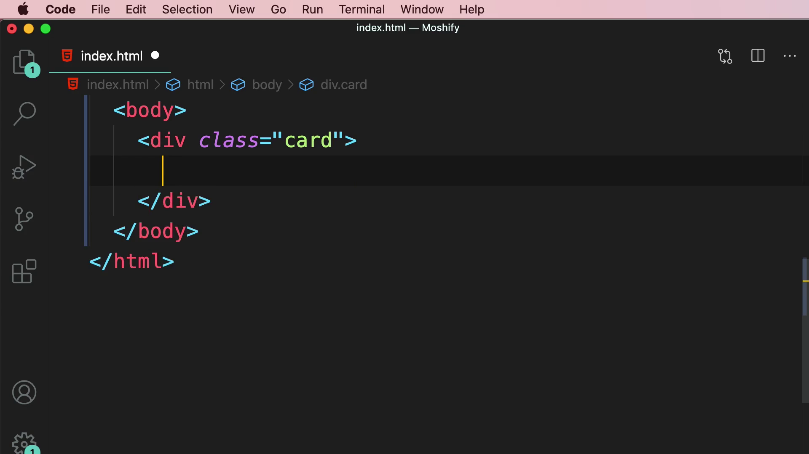

---

## 1. เริ่มต้นด้วย Grid 1x2 และรูปภาพลูกค้า

Mosh เปิด `index.html` ที่ว่างเปล่า (ลบโค้ดจากคลิปก่อนหน้าออกหมดแล้ว) แล้วสร้างโครงสร้างการ์ดใหม่ทั้งหมด โดยเริ่มจาก `<div class="card">` ครอบไว้ก่อน

```html
<div class="card">

</div>
```

จากนั้นใช้ Emmet พิมพ์ `div.grid.grid--1x2` เพื่อสร้าง grid สองคอลัมน์ (คลาสนี้เคยสร้างไว้แล้วในคลิป Grids)

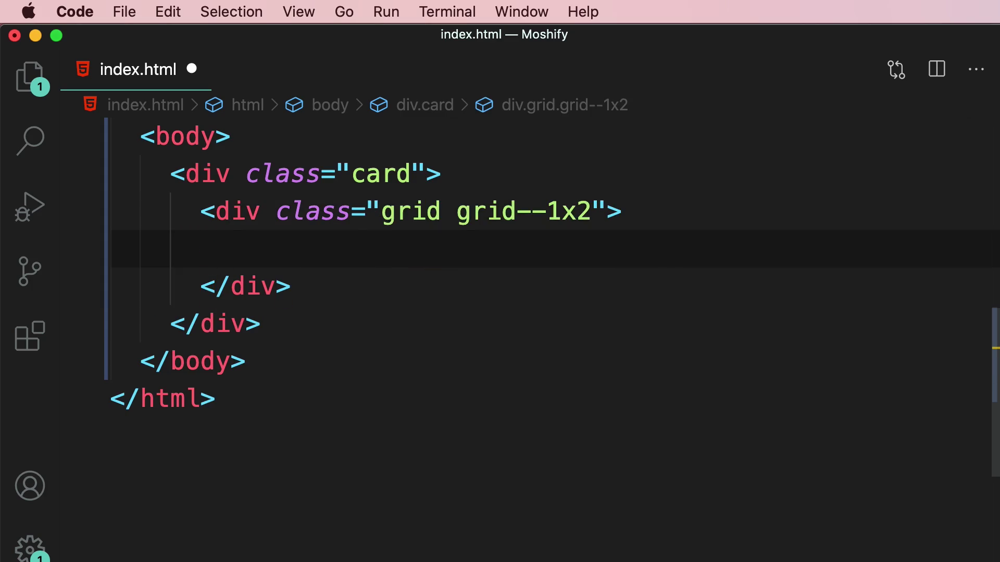

```html
<div class="card">
  <div class="grid grid--1x2">

  </div>
</div>
```

> 📝 สังเกตว่า Mosh ใช้ class ที่มีอยู่แล้วจาก component อื่น (`grid--1x2`) มาสร้าง layout ใหม่ทันที นี่คือประโยชน์ของการทำ CSS แบบ reusable/utility class — ไม่ต้องเขียน CSS ใหม่สำหรับทุก component

จากนั้น Mosh เปิด Finder ไปที่โฟลเดอร์ `Downloads/images` เพื่อดูรูปภาพที่จะใช้เป็นรูปลูกค้า พบไฟล์ `testimonial.jpg` (ผู้ชายใส่เสื้อเชิ้ตยีนส์ กอดอก ยิ้ม)

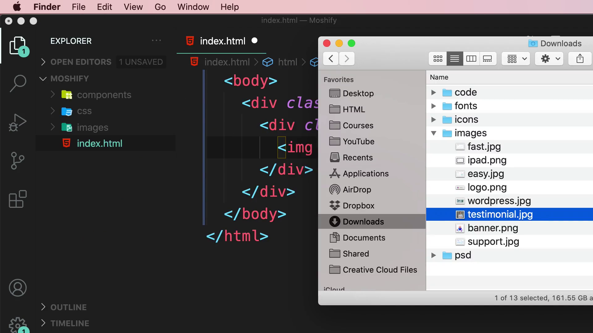

Mosh ดับเบิลคลิกเปิดดูตัวอย่างรูปใน VS Code เพื่อยืนยันว่าเป็นรูปที่ถูกต้องก่อนใช้งาน

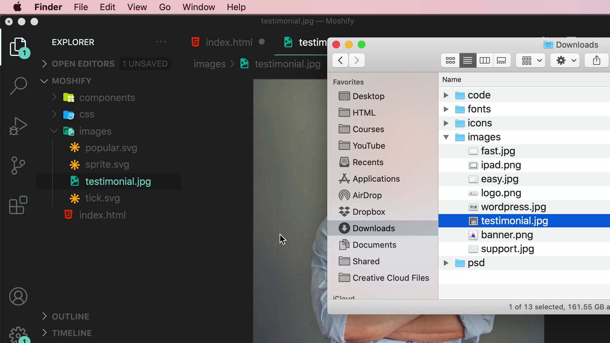

กลับมาที่ `index.html` แล้วพิมพ์ Emmet `img` ในบรรทัดว่างภายใน `.grid--1x2` เพื่อสร้างแท็ก `` ที่ยังว่างเปล่า

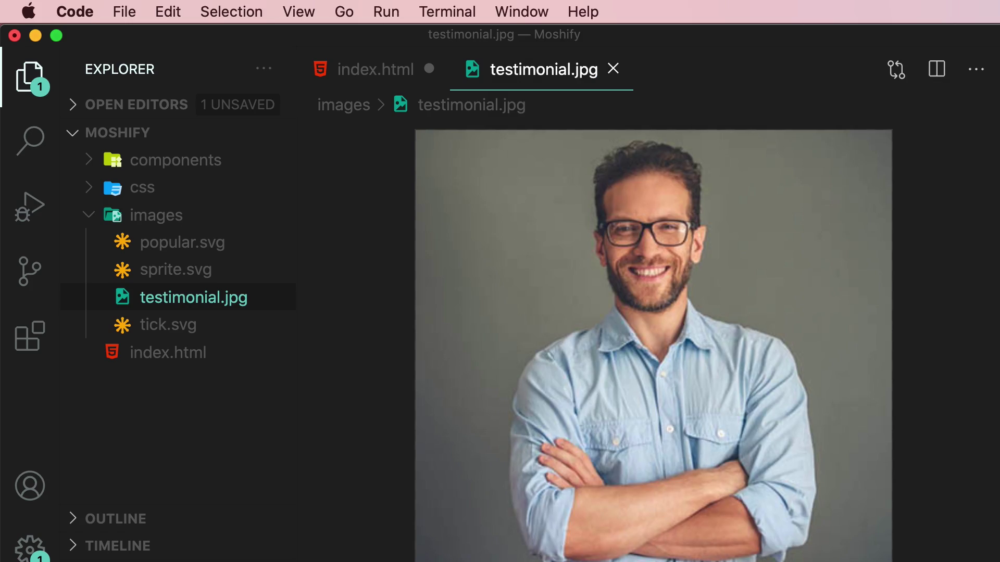

จากนั้นพิมพ์ `src="images/testimonial.jpg"` (VS Code แสดง path suggestion จากไฟล์ในโฟลเดอร์ images ให้อัตโนมัติ) และเริ่มพิมพ์ `alt="A happy, smiling custom...`

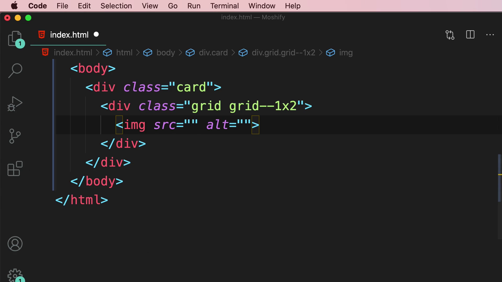

พิมพ์ alt text จนจบเป็น **"A happy, smiling customer"**

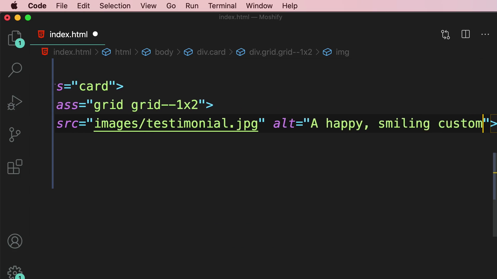

```html
<div class="card">
  <div class="grid grid--1x2">
    
  </div>
</div>
```

---

## 2. สาธิตพฤติกรรม CSS Grid: `align-items: stretch` (default)

ก่อนจะไปต่อ Mosh ต้องการสาธิตพฤติกรรมสำคัญของ CSS Grid ที่นักเรียนควรรู้ นั่นคือ grid item ที่ "ว่างเปล่า" (ไม่มีเนื้อหา) จะ **ยืดความสูงเท่ากับ sibling ที่สูงที่สุดโดยอัตโนมัติ** เพราะค่า default ของ `align-items` ใน CSS Grid คือ `stretch`

Mosh สร้าง `<div>` ที่สองต่อจาก `` โดยใช้ Emmet พิมพ์ `div` แล้วเติม `style` attribute

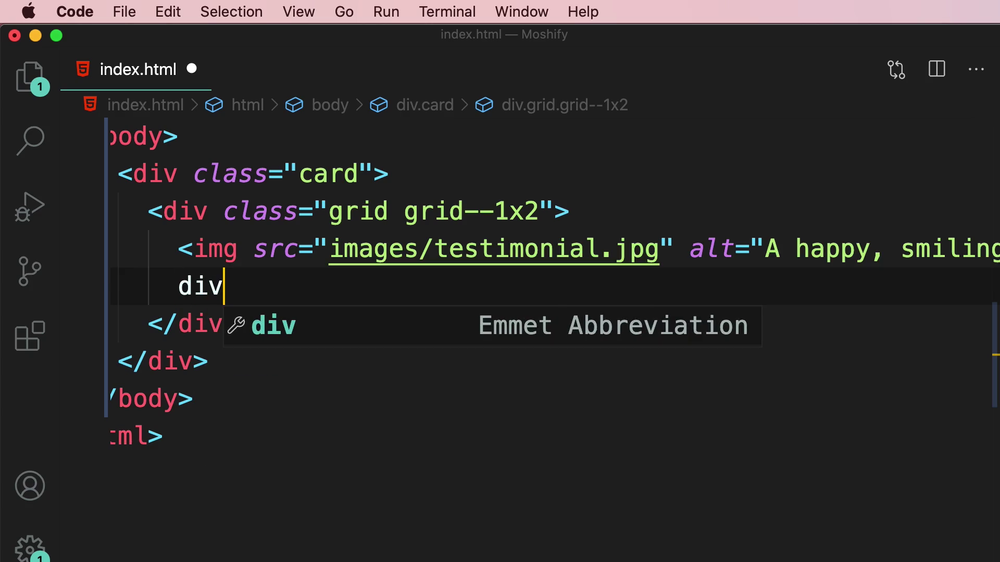

พิมพ์ inline style ทีละ property จนได้:

```html
<div style="height: 100px; background: gold"></div>
```

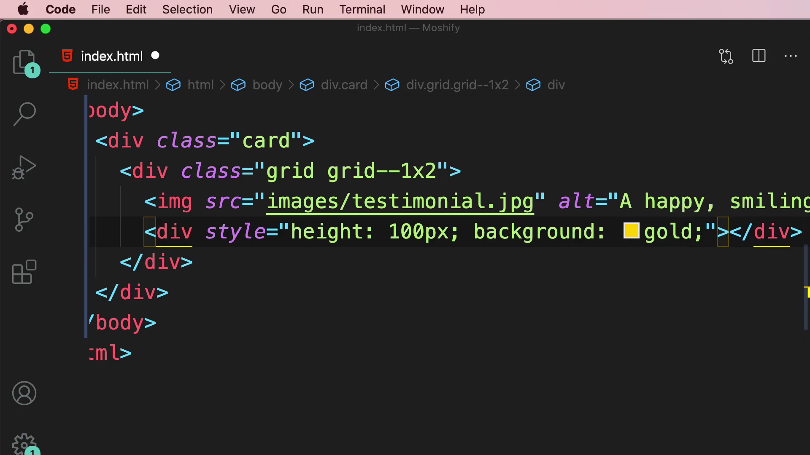

```html
<body style="padding: 5rem">
  <div class="card">
    <div class="grid grid--1x2">
      
      <div style="height: 100px; background: gold"></div>
    </div>
  </div>
</body>
```

เมื่อเปิดดูใน browser (localhost:5500 ผ่าน Live Server) จะเห็นว่ากล่องสีทอง (gold) แม้จะกำหนด `height: 100px` ไว้ แต่กลับ **ยืดความสูงเต็มเท่ากับความสูงของรูปภาพ** ทางซ้ายโดยอัตโนมัติ

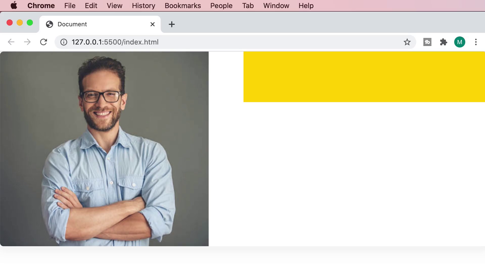

> 🔍 **หลักการสำคัญ:** ใน Flexbox และ Grid ค่า default ของ `align-items` คือ `stretch` เสมอ ต่างจาก block/inline layout ปกติที่แต่ละ element จะสูงเท่ากับเนื้อหาของตัวเองเท่านั้น นี่คือเหตุผลที่ Mosh มักใช้ Grid/Flexbox แม้กับ layout ง่าย ๆ เพราะพฤติกรรมการยืด (stretch) นี้ทำให้ design ดูสม่ำเสมอโดยไม่ต้องกำหนด height เอง
>
> ⚠️ กล่องสีทองนี้เป็นแค่ตัวอย่างสาธิต (placeholder) เท่านั้น ภายหลัง Mosh จะลบทิ้งแล้วแทนที่ด้วยเนื้อหาคำรับรองจริง

---

## 3. Refactor: ห่อรูปภาพด้วย wrapper div (testimonial__image)

หลังจากสาธิตพฤติกรรม stretch จบแล้ว Mosh กลับมาปรับโครงสร้าง โดยห่อ `` ด้วย `<div class="testimonial__image">` แทนที่จะใส่ class ลงบน `` ตรง ๆ

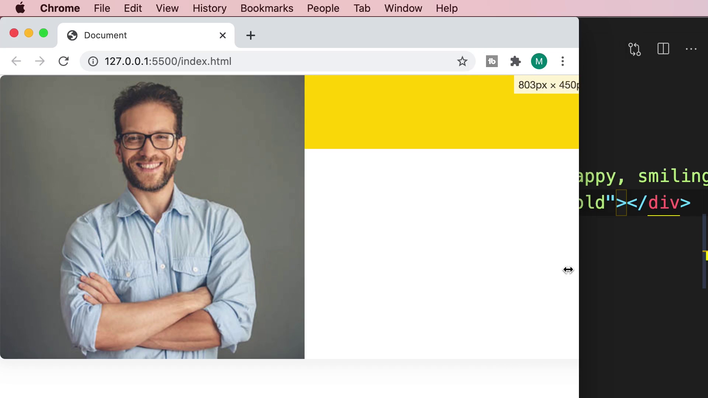

```html
<div class="testimonial__image">
  
</div>
```

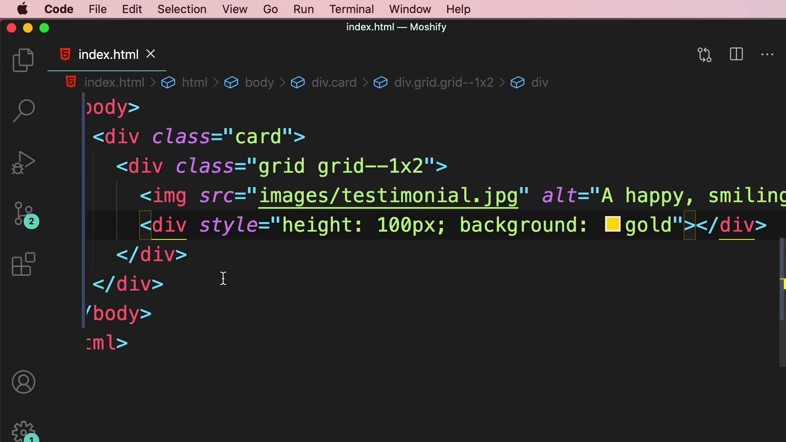

> 📌 **ทำไมต้องห่อด้วย div แทนที่จะใส่ class บน img ตรง ๆ?** เพราะภายหลัง Mosh จะต้องวางไอคอน quote (position: absolute) ซ้อนทับบนรูปภาพ ซึ่งต้องมี **positioning context** (`position: relative`) การมี wrapper div แยกต่างหากทำให้ควบคุม positioning ของทั้งรูปภาพและไอคอนได้ง่ายกว่า และยังใช้ BEM naming (`testimonial__image`) ตั้งชื่อ element ย่อยของ component `testimonial` ได้ชัดเจนตามหลักการที่เรียนมาในคลิปก่อน ๆ

จากนั้นไปที่ `styles.css` เพื่อเขียน selector แบบ **child combinator** (`>`) กำหนดให้เฉพาะ `` ที่อยู่ตรงภายใน `.testimonial__image` เท่านั้นที่ได้รับสไตล์นี้

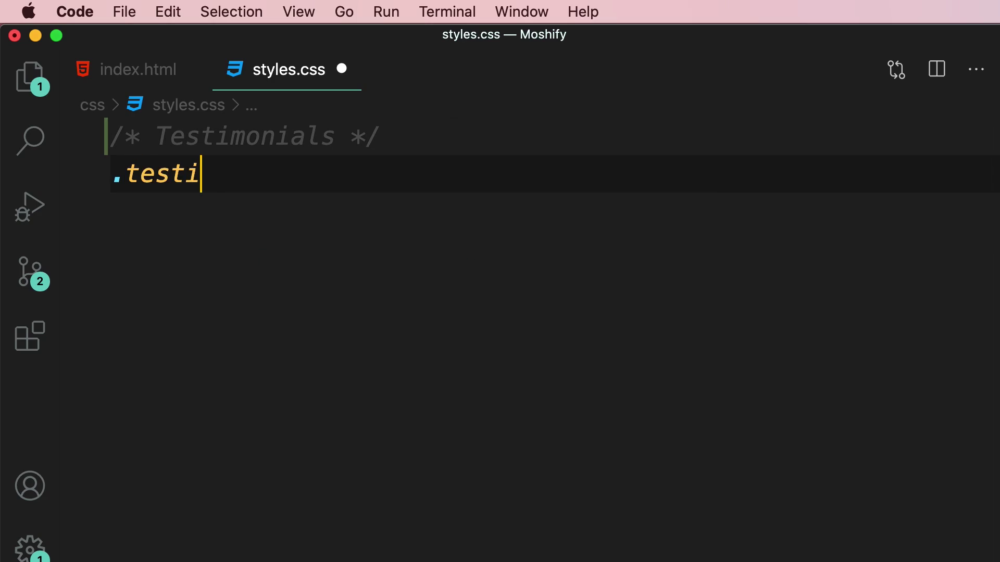

```css
.testimonial__image > img {
  width: 100%;
}
```

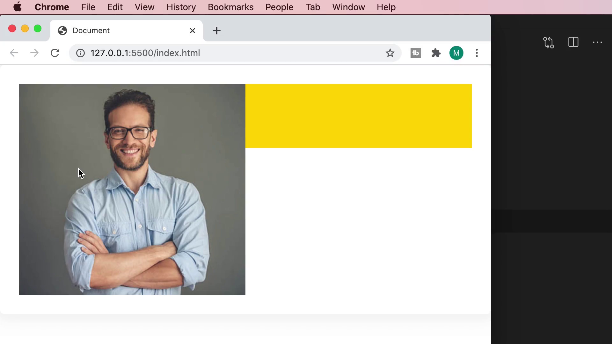

> 🔧 **Child combinator (`>`)** ต่างจาก descendant selector (space) ตรงที่จะเลือกเฉพาะ **ลูกโดยตรง** (direct child) เท่านั้น ไม่ใช่ลูกหลานทุกระดับ ในที่นี้ใช้เพื่อป้องกันไม่ให้กฎ `width: 100%` ไปกระทบ `` ตัวอื่นที่อาจซ้อนอยู่ลึกกว่านั้นในอนาคต — เป็น pattern เดียวกับที่เคยสอนไว้ในคลิป Media Objects

Mosh ทดสอบปรับขนาดหน้าต่าง browser หลายระดับความกว้างเพื่อยืนยันว่ารูปภาพ scale ตามคอลัมน์อย่างถูกต้อง:

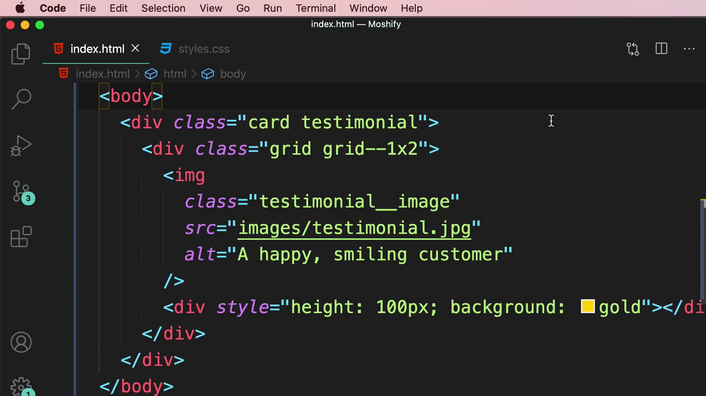

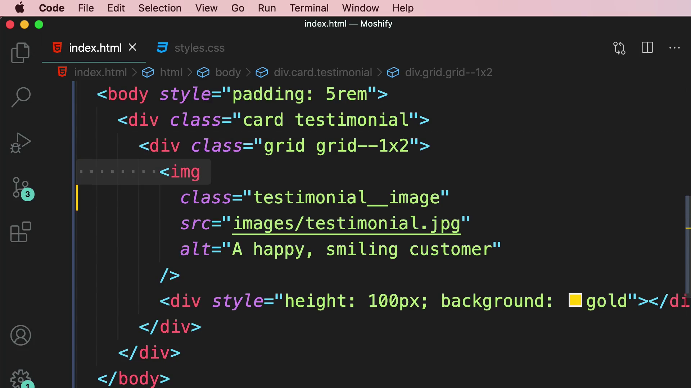

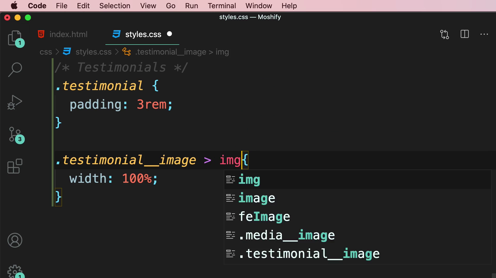

Mosh สลับไปดู `styles.css` เพื่อยืนยันกฎ CSS ที่เขียนไว้ทั้งหมด ณ จุดนี้

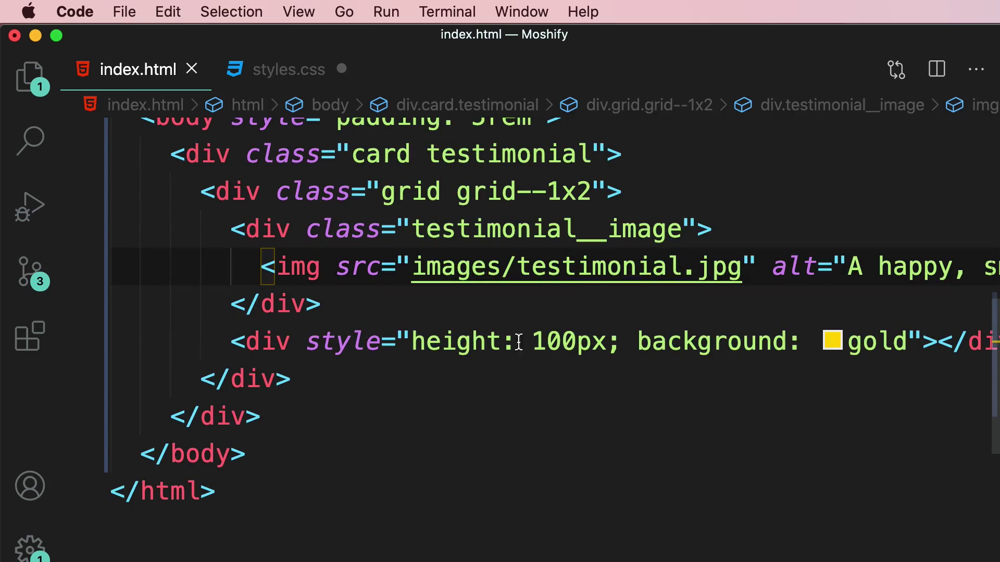

```css
.testimonial {
  padding: 3rem;
}
.testimonial__image > img {
  width: 100%;
}
```

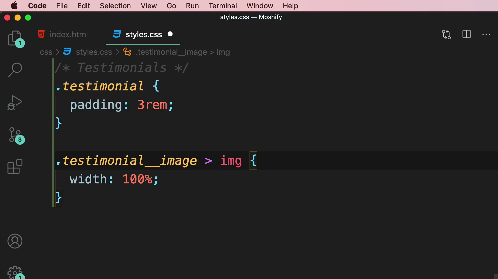

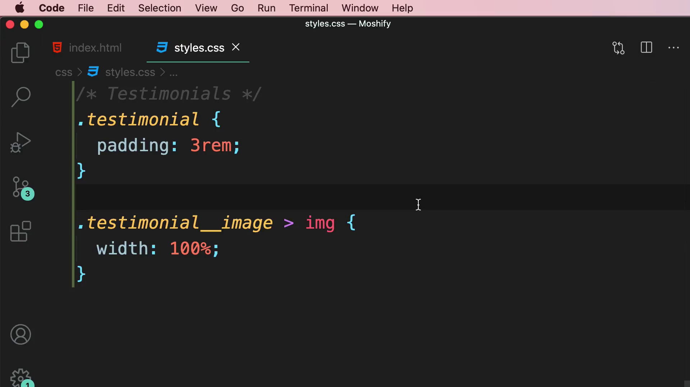

---

## 4. นำ Icon Container กลับมาใช้ซ้ำ (Reuse จาก Media Objects)

ขั้นตอนถัดไป Mosh ต้องการวางไอคอนเครื่องหมายคำพูด (quote icon) วงกลมซ้อนทับที่มุมขวาบนของรูปภาพ แทนที่จะเขียน HTML/CSS ใหม่ทั้งหมด เขาเปิด `icons.html` ในโฟลเดอร์ `components` ขึ้นมาดูเป็นตัวอย่างอ้างอิง (reference) เพราะมี pattern `<span class="icon-container">` พร้อม SVG `<use>` อยู่แล้วจากคลิปก่อน ๆ

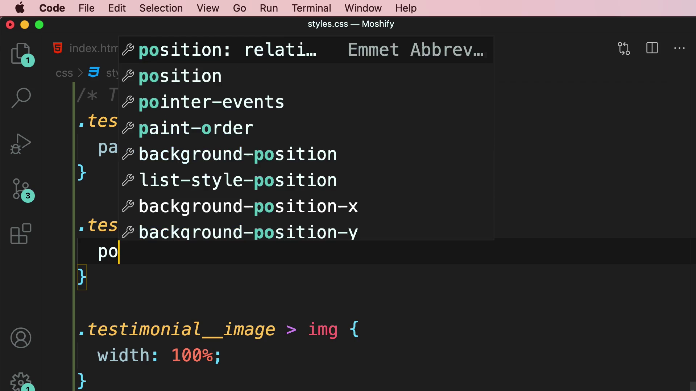

กลับมาที่ `styles.css` Mosh พิมพ์ `.testi` เพื่อดู Emmet/VS Code autocomplete แสดง selector ที่มีอยู่แล้วในไฟล์ (`.testimonial`, `.testimonial__image`)

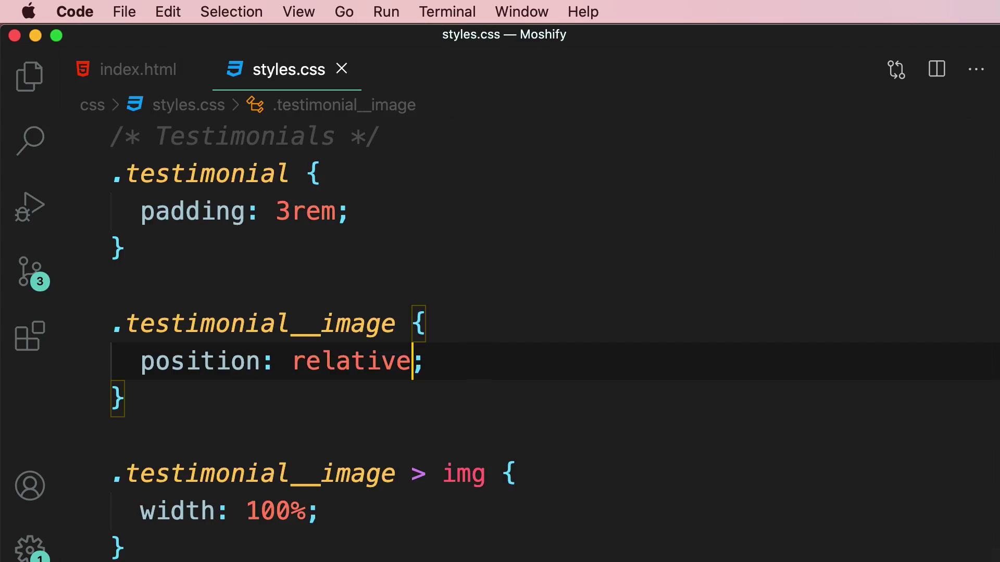

จากนั้นกลับไปที่ `index.html` แล้ว **copy** โครงสร้าง `<span class="icon-container">...</span>` จาก `icons.html` มา **paste** ไว้ข้างใน `<div class="testimonial__image">` ต่อจาก ``

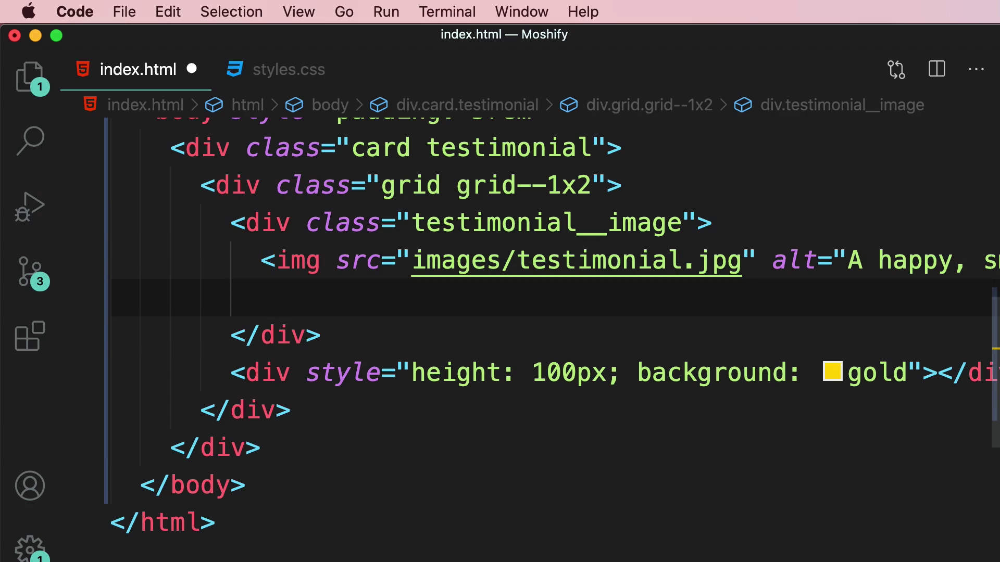

```html
<div class="testimonial__image">
  
  <span class="icon-container">
    <svg class="icon icon--primary">
      <use xlink:href="images/sprite.svg#wordpress"></use>
    </svg>
  </span>
</div>
```

> 💡 ตอนนี้ไอคอนที่ copy มายังเป็นไอคอน **WordPress** (ไอคอนตัวอย่างเดิมจาก `icons.html`) — Mosh จะเปลี่ยนเป็นไอคอน quote (เครื่องหมายคำพูด) ในขั้นตอนถัดไป นี่เป็นเทคนิคการทำงานจริงที่ Mosh ใช้บ่อย: copy โครงสร้างที่ใช้งานได้แล้วมาก่อน แล้วค่อยแก้ไขรายละเอียดทีหลัง แทนที่จะพิมพ์ใหม่ทั้งหมด

---

## 5. Position Absolute: วางไอคอนซ้อนทับมุมขวาบนของรูป

ไปที่ `styles.css` เขียน selector ใหม่ด้วย child combinator เช่นกัน

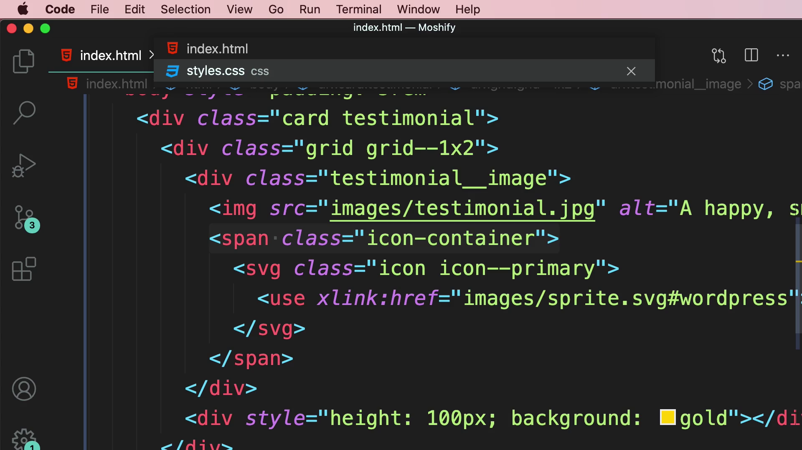

```css
.testimonial__image > .icon-container {
  position: absolute;
}
```

จากนั้นเติมค่า `top` และ `right` เพื่อกำหนดตำแหน่ง

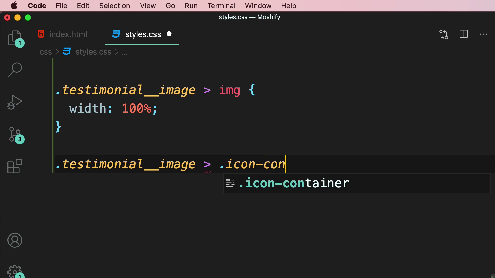

ค่าเริ่มต้นที่ลองคือ `top: 3rem; right: 0;` ทดสอบดูใน browser พบว่าไอคอน (ตอนนี้ยังเป็น WordPress icon) ลอยซ้อนทับขอบขวาบนของรูปพอดี

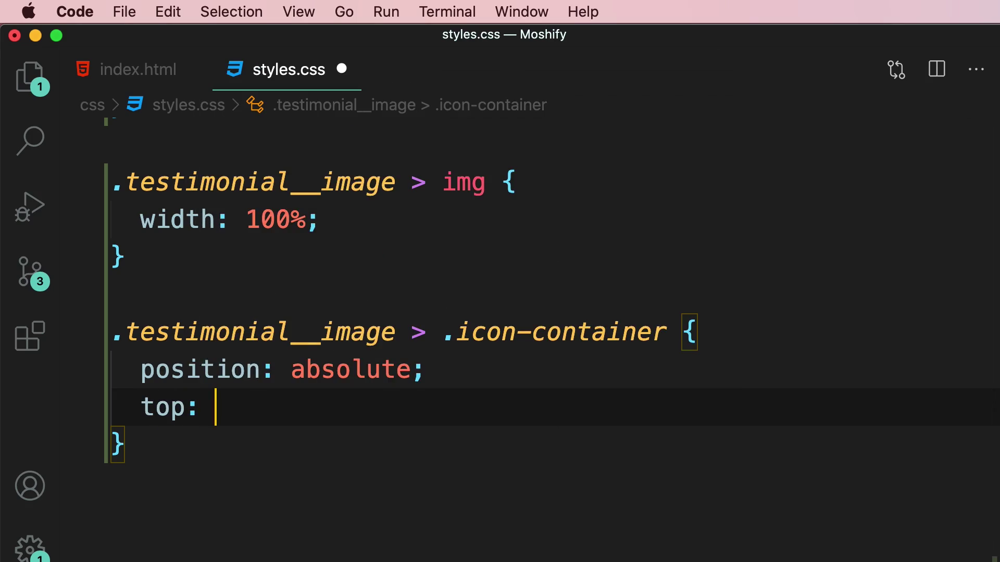

Mosh เปิด Photoshop มาเทียบกับดีไซน์ต้นแบบอีกครั้งเพื่อดูตำแหน่งไอคอน quote ที่ถูกต้อง (วงกลมสีแดงอยู่คร่อมขอบรูปภาพเล็กน้อย ไม่ใช่อยู่ในขอบเป๊ะ)

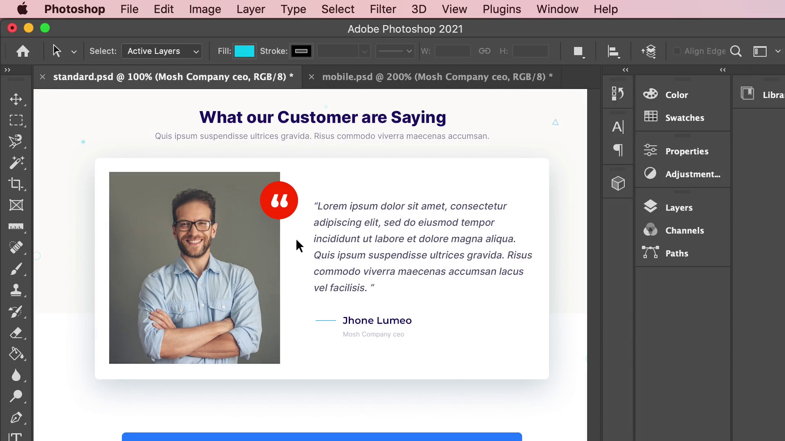

> 📌 เพื่อให้ตำแหน่งตรงกับดีไซน์ ไอคอนต้อง "ล้น" ออกไปนอกขอบรูปภาพทางขวาเล็กน้อย ซึ่งทำได้โดยกำหนดค่า `right` เป็น**ค่าลบ** — Mosh ปรับค่าจาก `right: 0` ไปเรื่อย ๆ

Mosh ปรับค่า `right` จาก `0` เป็นค่าอื่น ๆ เพื่อทดสอบตำแหน่ง

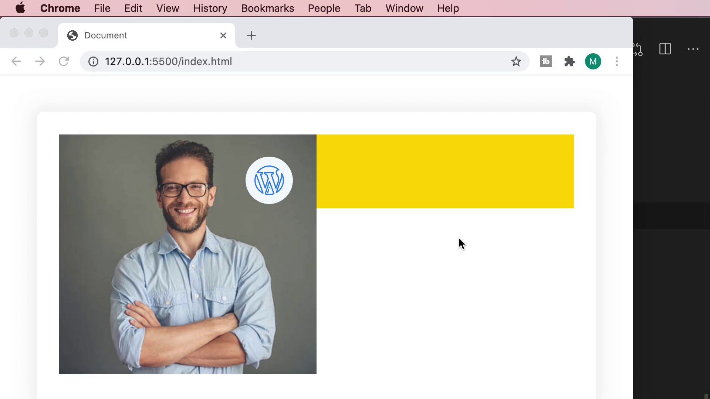

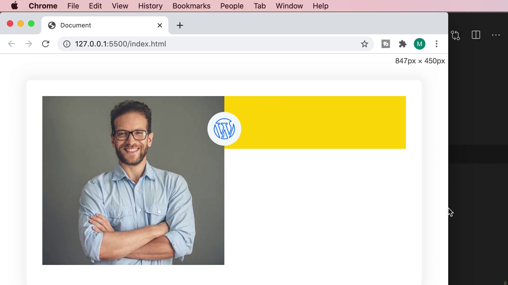

> ⚠️ **สำคัญ (แก้ไขจากที่เข้าใจผิดตอนดูรอบแรก):** ค่าสุดท้ายที่ Mosh ใช้จริง ๆ คือ **`right: -32px;`** (ค่าติดลบ) ไม่ใช่ค่าบวก — ค่าลบทำให้ไอคอนเลื่อนออกไป**นอก**ขอบขวาของ `.testimonial__image` ทำให้เกิดเอฟเฟกต์ไอคอนวงกลม "ลอยคร่อม" ขอบรูปภาพพอดีตามดีไซน์ต้นแบบ

```css
.testimonial__image > .icon-container {
  position: absolute;
  top: 3rem;
  right: -32px;
}
```

---

## 6. สี Accent และเปลี่ยนไอคอนเป็น Quote พร้อมปรับขนาดเล็กลง

Mosh สร้าง modifier class ใหม่ชื่อ `.icon-container--accent` (ว่างเปล่าก่อน)

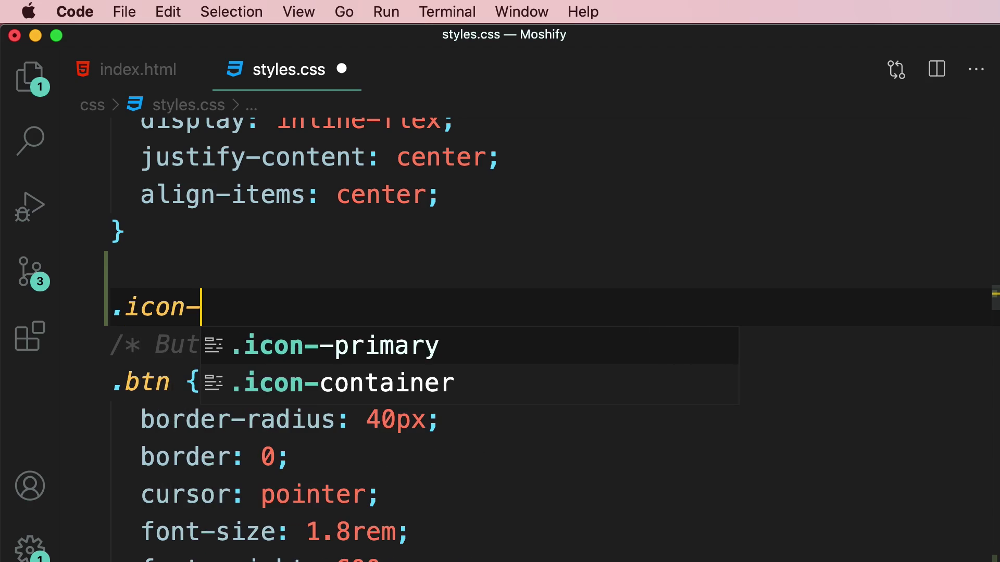

```css
.icon-container--accent {
}
```

แล้วเติมกฎเปลี่ยนสีพื้นหลังเป็นสี accent (แดง) โดยใช้ CSS variable ที่มีอยู่แล้ว

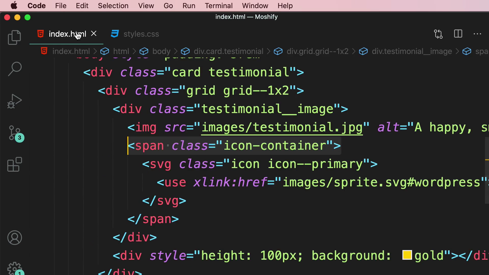

```css
.icon-container--accent {
  background: var(--color-accent);
}
```

นำ class ไปใส่เพิ่มบน `<span>` ใน HTML (`class="icon-container icon-container--accent"`) แล้วดูผลใน browser เห็นวงกลมพื้นหลังเปลี่ยนเป็นสีแดงตามดีไซน์

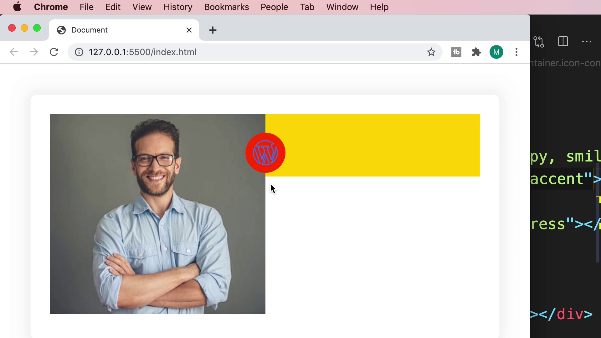

Mosh เปิดดูกฎ `.icon--primary` ที่มีอยู่แล้ว (ใช้ CSS variable สีน้ำเงิน primary) เป็นตัวอย่างอ้างอิงก่อนสร้าง modifier สีขาวใหม่

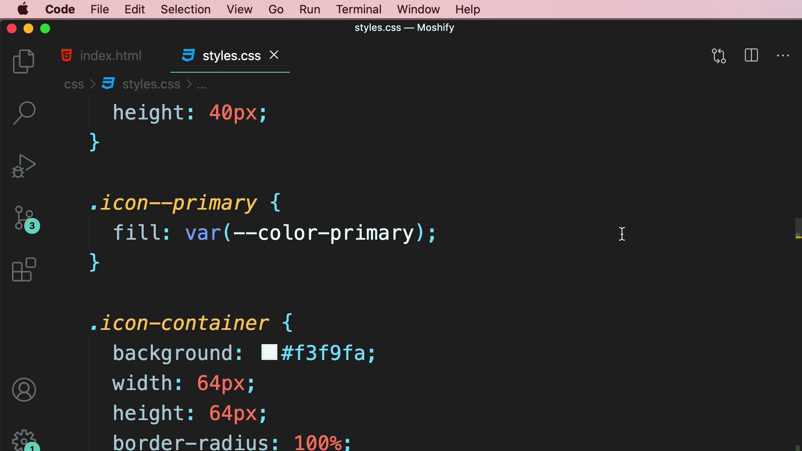

```css
.icon--primary {
  fill: var(--color-primary);
}
```

จากนั้นพิมพ์ selector ใหม่ `.icon--white` โดย VS Code แสดง autocomplete ของ class ที่มีอยู่แล้วทั้งหมด (`.icon--primary`, `.icon-container`, `.icon-container--accent`)

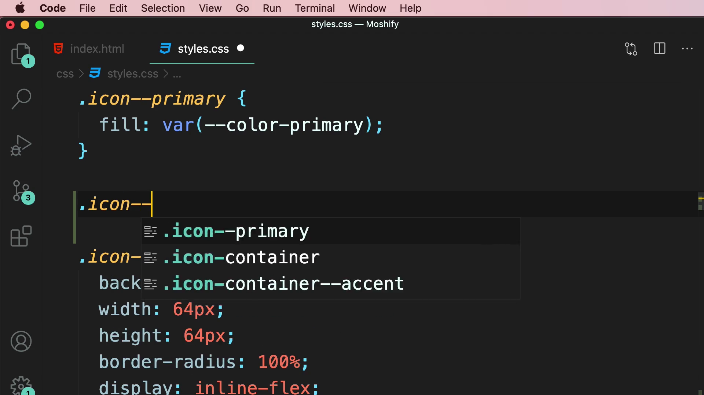

```css
.icon--white {
  fill: #fff;
}
```


กลับมาที่ HTML เปลี่ยน class บน `<svg>` จาก `icon icon--primary` เป็น `icon icon--white` และเปลี่ยน `xlink:href` จาก `#wordpress` เป็น **`#quotes`** เพื่อเปลี่ยนรูปไอคอนจาก WordPress logo เป็นเครื่องหมายคำพูดจริง

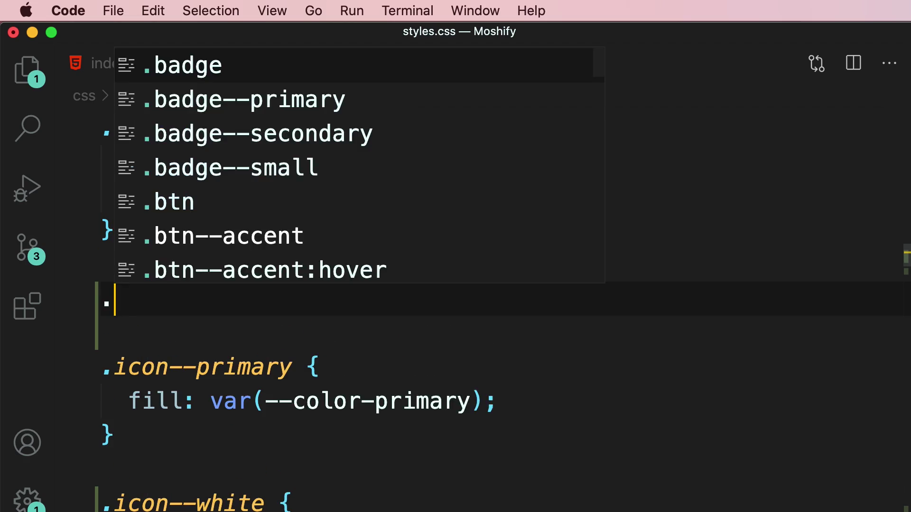

```html
<span class="icon-container icon-container--accent">
  <svg class="icon icon--white">
    <use xlink:href="images/sprite.svg#quotes"></use>
  </svg>
</span>
```

ดูผลใน browser: วงกลมแดง + ไอคอนเครื่องหมายคำพูดสีขาวซ้อนทับมุมขวาบนของรูปภาพลูกค้าพอดีตามดีไซน์

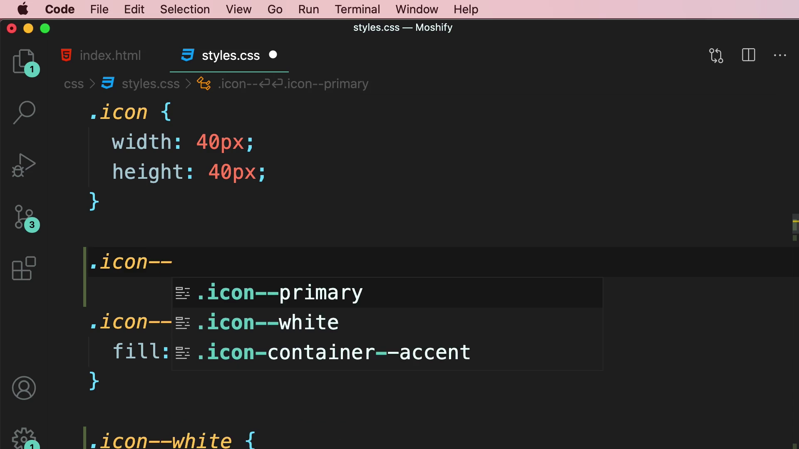

> ⚠️ ไอคอนตอนนี้ยังมีขนาด**ใหญ่เกินไป**เมื่อเทียบกับดีไซน์ต้นแบบ (ที่ใช้ขนาด default `.icon { width: 40px; height: 40px; }`) ขั้นตอนต่อไป Mosh จึงสร้าง modifier ลดขนาดไอคอนโดยเฉพาะ

---

## 7. Modifier ขนาดไอคอน: `.icon--small`

Mosh สร้าง selector ว่างชื่อ `.icon--small` (VS Code แสดงกฎ `.icon` เดิม `{ width: 40px; height: 40px; }` อยู่ด้านบนเป็นตัวอ้างอิง)

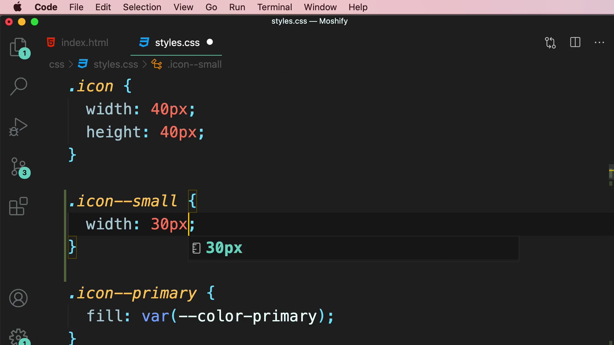

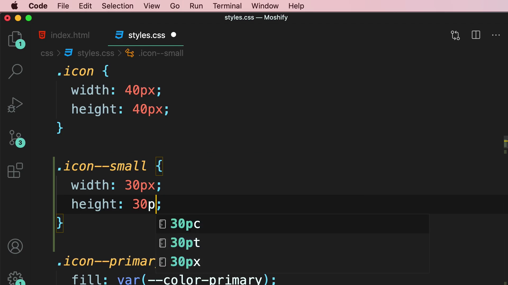

พิมพ์ `width: 30px;`

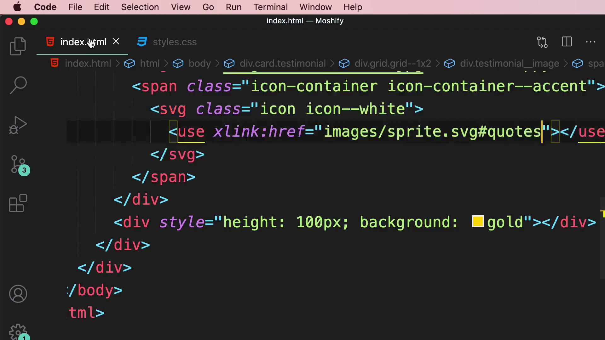

แล้วพิมพ์ `height: 30px;` ต่อ

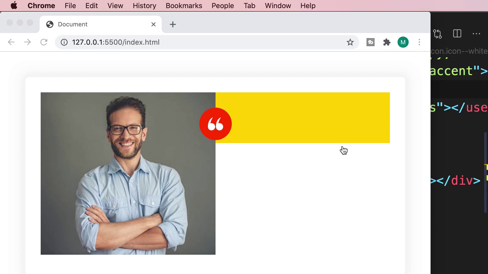

```css
.icon--small {
  width: 30px;
  height: 30px;
}
```

นำ class `icon--small` ไปเพิ่มบน `<svg>` ต่อจาก `icon icon--white` กลายเป็น `class="icon icon--white icon--small"`

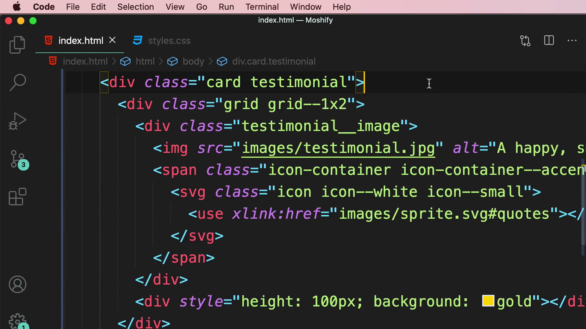

```html
<svg class="icon icon--white icon--small">
  <use xlink:href="images/sprite.svg#quotes"></use>
</svg>
```

ผลลัพธ์สุดท้ายใน browser: ไอคอน quote สีขาวขนาดเล็กลงพอดีกับวงกลมสีแดง ตรงตามดีไซน์ Photoshop ทุกประการ

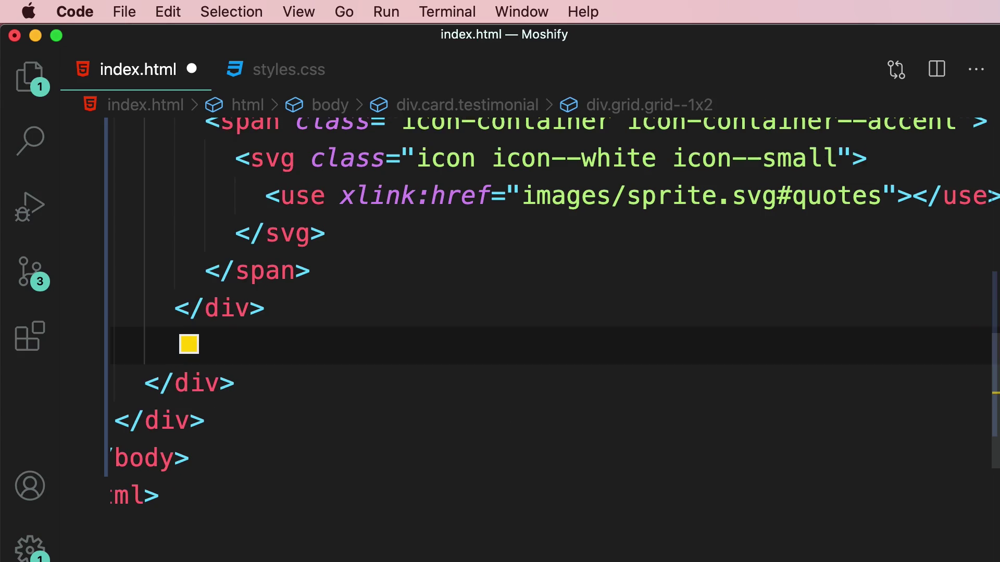

> 🔍 **BEM Modifier แบบผสมหลายคลาส:** จุดนี้แสดงให้เห็นพลังของ BEM — element เดียว (`<svg class="icon">`) สามารถผสม modifier ได้หลายตัวพร้อมกัน (`icon--white` ควบคุมสี, `icon--small` ควบคุมขนาด) โดยไม่ต้องสร้าง class ผสมแบบ `icon--white-small` ทำให้ CSS reusable และยืดหยุ่นมากขึ้น

---

## 8. แทนที่ Placeholder ด้วยคำรับรองจริง (Blockquote)

Mosh ลบ `<div style="height: 100px; background: gold"></div>` (placeholder เดิม) ออก เหลือเป็น div ว่างเปล่าชั่วคราว

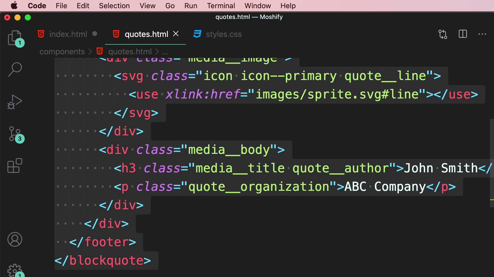

จากนั้นใช้ Quick Open (Cmd+P) พิมพ์ `quo` เพื่อค้นหาไฟล์ที่เกี่ยวกับ quote พบทั้ง `quotes.svg` และ `quotes.html`

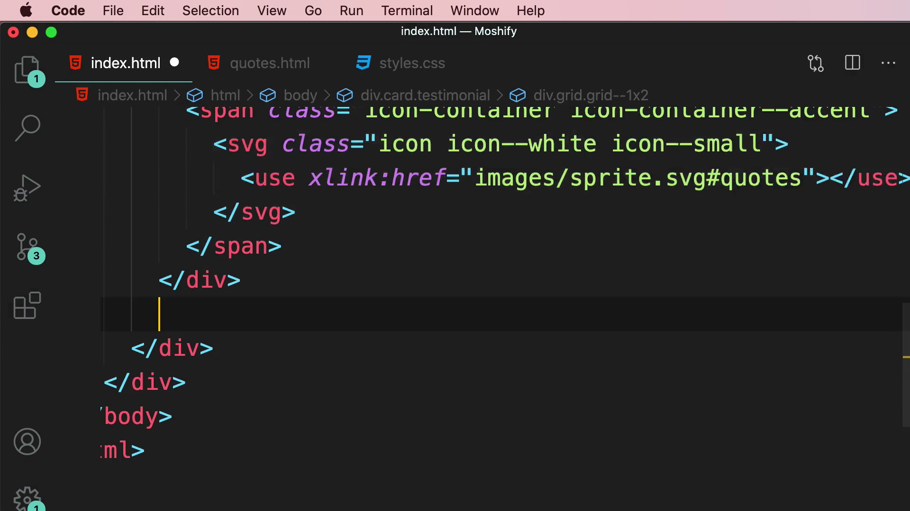

เปิด `quotes.html` (component จากคลิป Quotes ก่อนหน้า) ขึ้นมาดูโครงสร้าง `<blockquote>` เพื่อใช้เป็นตัวอย่างอ้างอิงสำหรับเขียนคำรับรอง

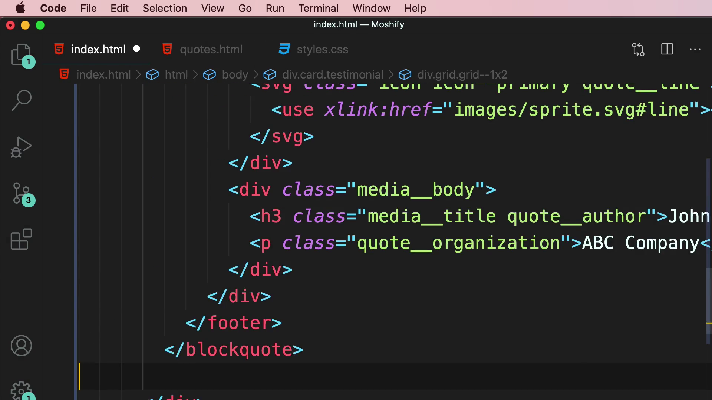

```html
<div class="media__image">
  <svg class="icon icon--primary quote__line">
    <use xlink:href="images/sprite.svg#line"></use>
  </svg>
</div>
<div class="media__body">
  <h3 class="media__title quote__author">John Smith</h3>
  <p class="quote__organization">ABC Company</p>
</div>
```

Mosh นำแนวคิดโครงสร้างนี้มาปรับใช้ ใส่เนื้อหาจริงแทนที่ placeholder เดิมในการ์ด testimonial ด้วยข้อความ Lorem Ipsum จำลองเป็นคำพูดลูกค้า พร้อมชื่อ **"John Smith"** และองค์กร **"ABC Company"**

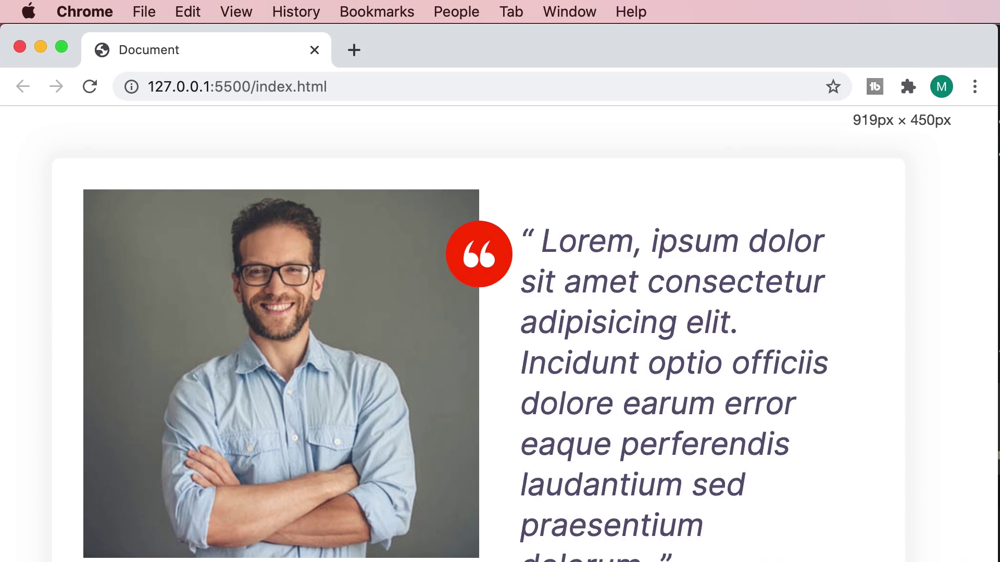

Mosh ทดสอบปรับขนาดหน้าต่าง browser หลายระดับเพื่อดูว่าข้อความคำรับรองตัดบรรทัด (wrap) อย่างเหมาะสมหรือไม่ เมื่อความกว้างเปลี่ยนไป

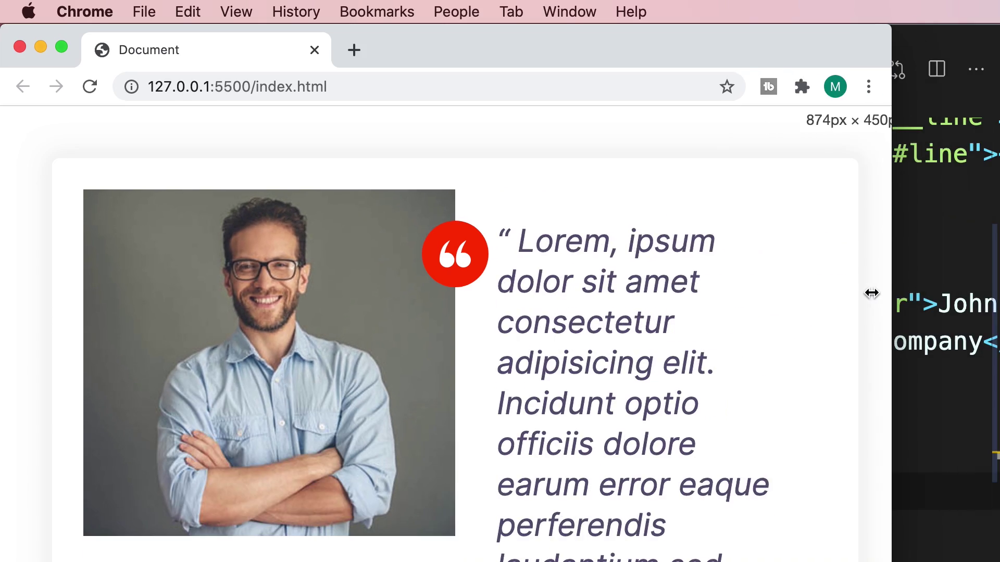

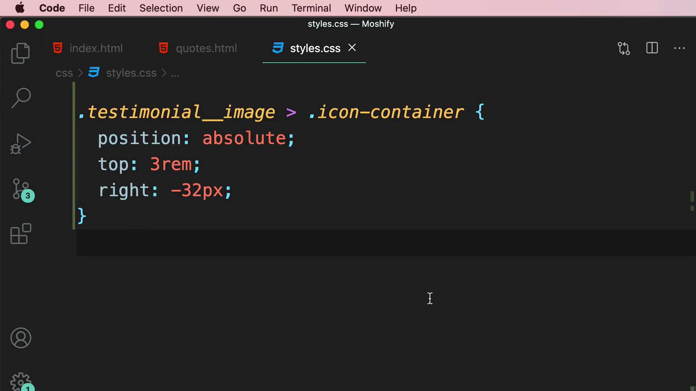

ผลลัพธ์สุดท้ายแสดงข้อความคำรับรองแบบเต็ม พร้อมเส้นคั่นสั้น ๆ (accent line) เหนือชื่อ "John Smith" และ "ABC Company" อยู่ใต้ลงมา ตรงกับ pattern ของ component `quote` เดิม

---

## 9. เริ่มต้น Responsive: `@media` สำหรับ Testimonials

Mosh ยืนยันกฎ CSS สุดท้ายของ `.testimonial__image > .icon-container` อีกครั้งก่อนเริ่มทำ responsive

```css
.testimonial__image > .icon-container {
  position: absolute;
  top: 3rem;
  right: -32px;
}
```

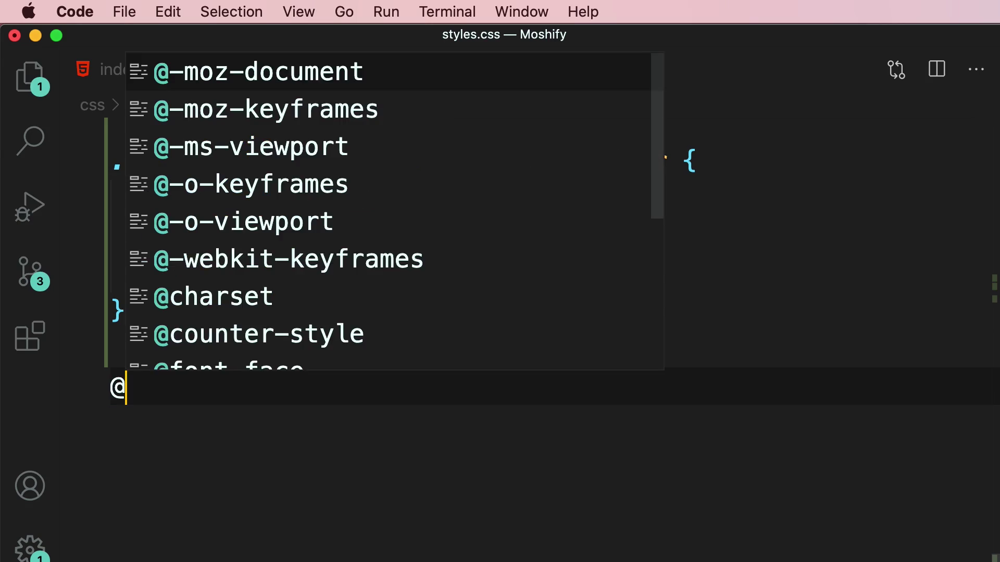

จากนั้นเริ่มพิมพ์ `@media` ด้านล่างไฟล์ styles.css โดย VS Code แสดง autocomplete รายการ at-rules ทั้งหมด (`@-moz-document`, `@-moz-keyframes`, `@charset` ฯลฯ) ก่อนเลือก `@media`

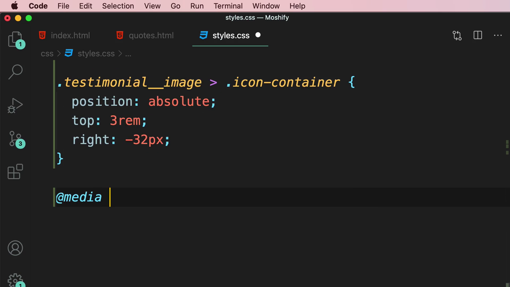

```css
@media
```

> 📌 คลิปจบลงตรงจุดเริ่มต้นของการเขียน media query สำหรับปรับ typography ของ testimonial ให้ตอบสนอง (responsive) ตามขนาดหน้าจอ ซึ่งเป็นแนวทางเดียวกับที่ Mosh ใช้มาตลอดทั้งคอร์ส คือ**เขียนแบบ mobile-first ก่อน แล้วค่อยเพิ่ม breakpoint สำหรับจอใหญ่ทีหลัง**

---

## สรุปภาพรวมของคลิปนี้

| หัวข้อ | รายละเอียดสำคัญ |
|---|---|
| CSS Grid stretch | `align-items: stretch` เป็นค่า default ทำให้ grid item ว่างเปล่ายืดสูงเท่า sibling อัตโนมัติ |
| Wrapper div pattern | ห่อ `` ด้วย `<div class="testimonial__image">` เพื่อเตรียม positioning context สำหรับไอคอนซ้อนทับ |
| Child combinator | ใช้ `.testimonial__image > img` และ `.testimonial__image > .icon-container` เพื่อเจาะจงเฉพาะลูกโดยตรง |
| Reuse component | Copy โครงสร้าง icon-container จาก `icons.html` และโครงสร้าง blockquote จาก `quotes.html` มาปรับใช้ซ้ำ |
| Position absolute | `top: 3rem; right: -32px;` ทำให้ไอคอนวงกลมลอยคร่อมขอบรูปภาพตามดีไซน์ |
| BEM modifier ผสม | `icon-container--accent` (สีพื้นหลัง) + `icon--white` (สีไอคอน) + `icon--small` (ขนาด) ใช้ร่วมกันได้ |
| Responsive | เริ่มต้น `@media` สำหรับปรับ typography ของ testimonial (ส่วนที่เหลือจะสอนต่อในคลิปถัดไป) |

### แนวคิดสำคัญที่ได้จากคลิปนี้

1. **CSS Grid/Flexbox มี `align-items: stretch` เป็นค่า default** — grid item ที่ไม่ได้กำหนดความสูงจะยืดเท่ากับ sibling ที่สูงที่สุดโดยอัตโนมัติ ต่างจาก block layout ปกติ
2. **Wrapper div ช่วยสร้าง positioning context** — เมื่อจะวาง element ซ้อนทับด้วย `position: absolute` ควรห่อ element เป้าหมายด้วย wrapper ที่มี `position: relative` แยกต่างหาก
3. **Reuse component เดิมเสมอ** — แทนที่จะเขียนใหม่ทุกครั้ง ให้ copy โครงสร้างที่ทำงานได้แล้ว (icon-container, blockquote) มาปรับแก้รายละเอียด (เปลี่ยน icon, เปลี่ยนสี, เปลี่ยนขนาด) ประหยัดเวลาและคงความสม่ำเสมอของโค้ด
4. **BEM modifier หลายตัวผสมกันได้ในคลาสเดียว** — เช่น `icon icon--white icon--small` แต่ละ modifier ควบคุมคุณสมบัติคนละด้าน (สี, ขนาด) ทำให้ CSS ยืดหยุ่นและ reusable สูง
5. **ค่าลบ (negative value) ใน positioning มีประโยชน์มาก** — `right: -32px` ทำให้ element "ล้น" ออกนอกกรอบของ parent ได้ตามต้องการ ซึ่งเป็นเทคนิคที่ใช้บ่อยมากในการทำ overlay icon/badge
6. **Child combinator (`>`) ป้องกัน CSS รั่วไหล (leak)** — เจาะจงเฉพาะลูกโดยตรงของ selector ทำให้กฎ CSS ไม่กระทบ element อื่นที่อาจซ้อนลึกกว่าโดยไม่ตั้งใจ

---

*สรุปจากคลิปที่ 24 ของคอร์ส "Building a Web Site" โดย Mosh Hamedani (codewithmosh.com)*
