# HTML-CSS-3: 25 - Callouts

**ไฟล์ต้นฉบับ:** 25- Callouts.mp4

▶️ [ดูวิดีโอ](../../HTML-CSS-3/25-%20Callouts.mp4)

---

## ภาพรวมคลิปนี้

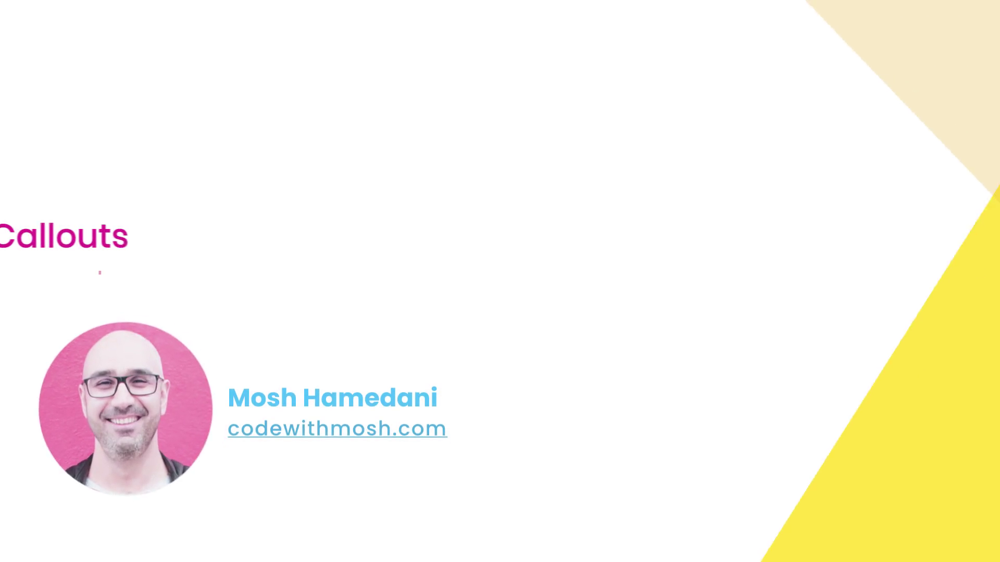

คลิปนี้ Mosh สอนการสร้าง **Callout component** ซึ่งเป็นกล่องสีพื้นเข้ม (accent box) ที่ใช้เชิญชวนให้ผู้ใช้ทำ action บางอย่าง เช่น "Ready to Get Started?" พร้อมปุ่ม Get Started โดยใช้ CSS Grid ในการจัดวาง (layout) และมีการสอนพฤติกรรม default ของ CSS Grid (`justify-items`, `align-items`) รวมถึง `justify-self`/`align-self` สำหรับ override รายการเดียวภายใน grid นอกจากนี้ยังมีการสร้าง modifier ปุ่มใหม่ `.btn--stretched` และปิดท้ายด้วยการทำ responsive design ผ่าน media query `@media screen and (min-width: 768px)`

> 💡 Callout เป็น component ที่ใช้ pattern เดิมที่เคยเรียนมาก่อนหน้านี้ (Grid 1x2, ปุ่ม btn, สี CSS variable) นำมาประกอบกันใหม่ — Mosh ย้ำหลักการ "reuse" อยู่เสมอ

ก่อนเริ่มเขียนโค้ด Mosh เปิดไฟล์ Photoshop mockup (`mobile-Recovered.psd` และ `standard-Recovered.psd`) เพื่อดูตัวอย่างดีไซน์ที่ต้องทำให้ตรงกัน

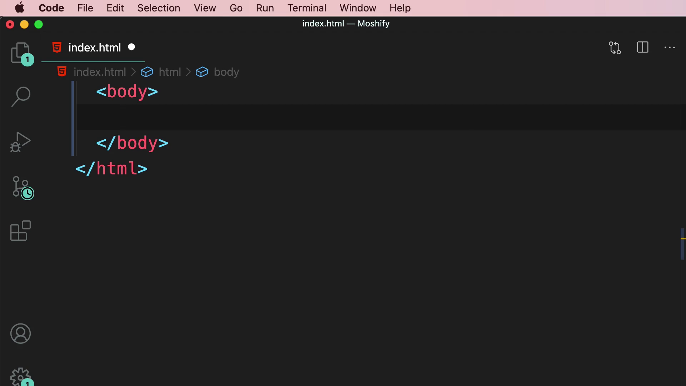

> 📌 จาก mockup จะเห็นว่าเวอร์ชันมือถือ (mobile) ข้อความและปุ่มเรียงกันแนวตั้งและอยู่ตรงกลาง (center) ส่วนเวอร์ชันเดสก์ท็อป (standard) ข้อความจะชิดซ้ายและปุ่มอยู่ด้านขวา — นี่คือเป้าหมายที่ต้องทำให้ได้ด้วย Grid + media query

---

## 1. เริ่มต้นเขียน HTML โครงสร้าง Callout

Mosh เปิดไฟล์ `index.html` ที่มี `<body>` ว่างเปล่า แล้วเริ่มเขียน element ใหม่

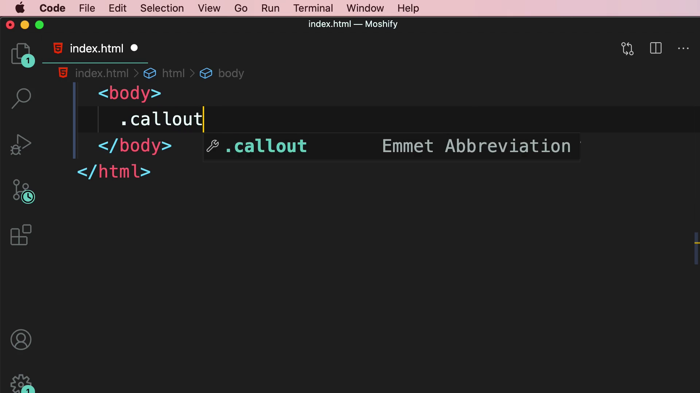

เขียน `<div class="callout callout--primary">` เป็นชั้นนอกสุด — ใช้ BEM pattern คือ base class `.callout` และ modifier `.callout--primary` สำหรับกำหนดสี

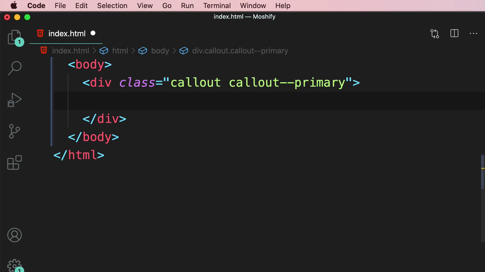

ภายในใช้ pattern grid ที่เคยสร้างไว้แล้วจากบทเรียนก่อนหน้า คือ `<div class="grid grid--1x2">` เพื่อแบ่งเป็น 2 คอลัมน์ (เนื้อหา กับ ปุ่ม)

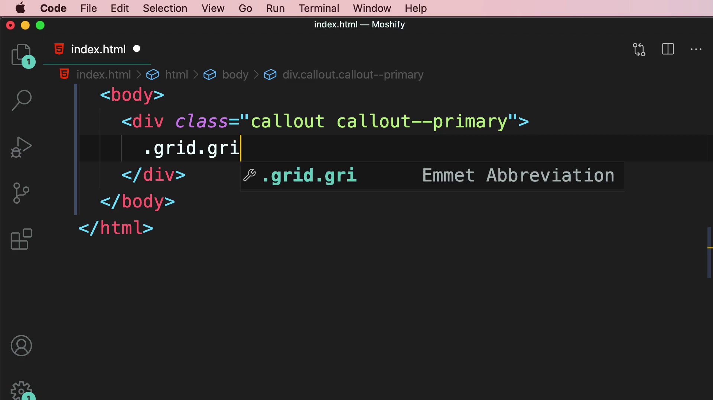

> 🔧 `.grid--1x2` คือ modifier ที่เคยสร้างไว้ในบทเรียน Grids (คลิป 23) สำหรับ layout แบบ 1 แถว 2 คอลัมน์ — นำมาใช้ซ้ำ (reuse) ได้ทันทีโดยไม่ต้องเขียน CSS ใหม่

จากนั้นสร้าง `<div class="callout__content">` เป็น element ลูกตัวแรกสำหรับครอบหัวข้อและพารากราฟ

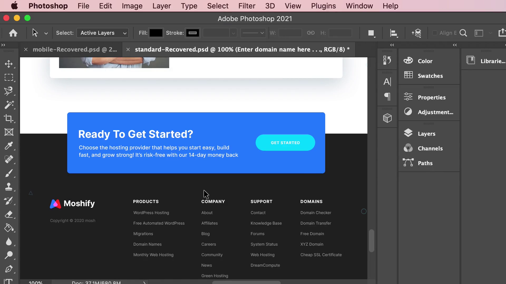

ภายใน `callout__content` ใส่ `<h2 class="callout__heading">`

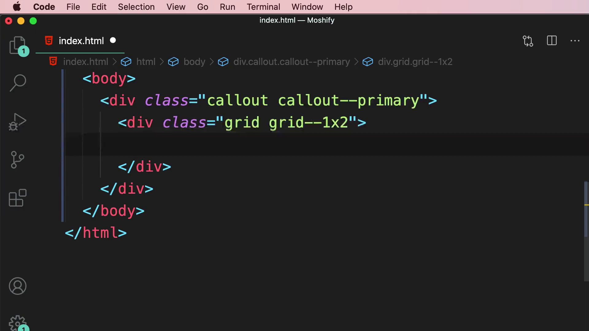

พิมพ์ข้อความหัวข้อ "Ready to Get Started?"

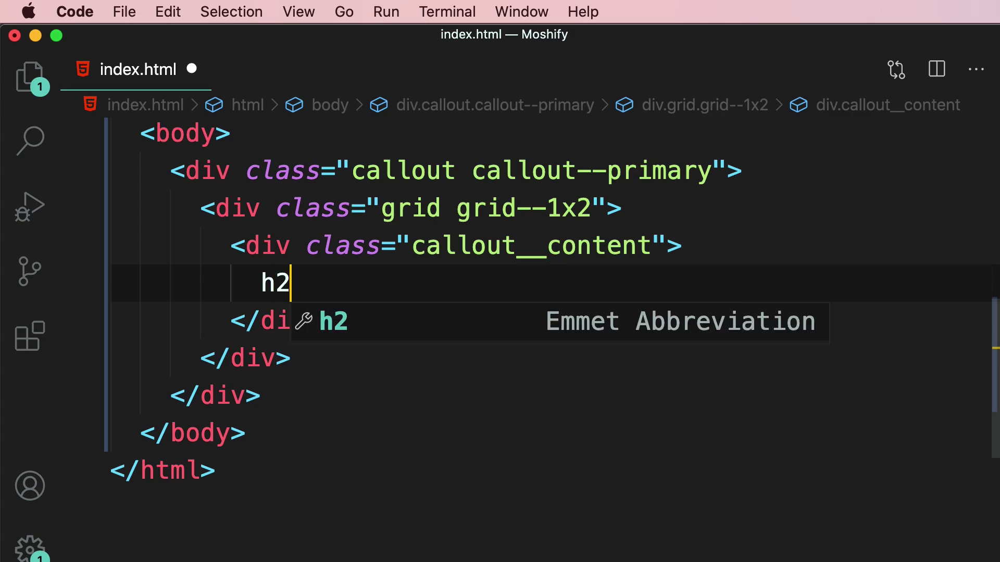

ตามด้วย `<p>` เนื้อหา Lorem Ipsum

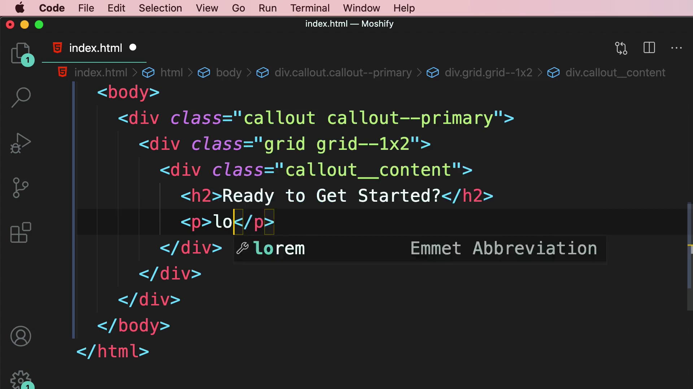

สุดท้ายนอก `callout__content` (เป็น sibling ของมัน แต่ยังอยู่ใน grid--1x2) ใส่ `<a href="#" class="btn btn--secondary">Get Started</a>` — reuse component ปุ่มเดิมที่เคยสร้าง

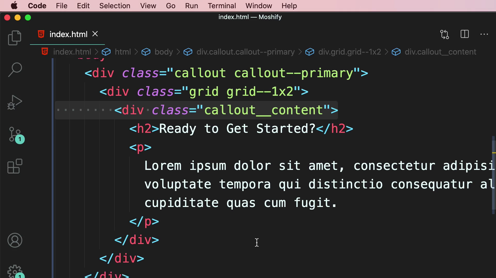

โค้ด HTML ทั้งหมดของ Callout:

```html
<div class="callout callout--primary">
  <div class="grid grid--1x2">
    <div class="callout__content">
      <h2 class="callout__heading">Ready to Get Started?</h2>
      <p>Lorem ipsum dolor sit amet, consectetur adipisicing elit. Eligendi voluptate tempora qui distinctio consequatur aliquid pariatur cupiditate quas cum fugit.</p>
    </div>
    <a href="#" class="btn btn--secondary">Get Started</a>
  </div>
</div>
```

ดูผลลัพธ์ใน browser (ยังไม่มี CSS เฉพาะของ callout เลย เห็นแค่ text ธรรมดาเรียงต่อกัน เพราะ `.grid` ยังไม่มี CSS สำหรับ `.callout`)

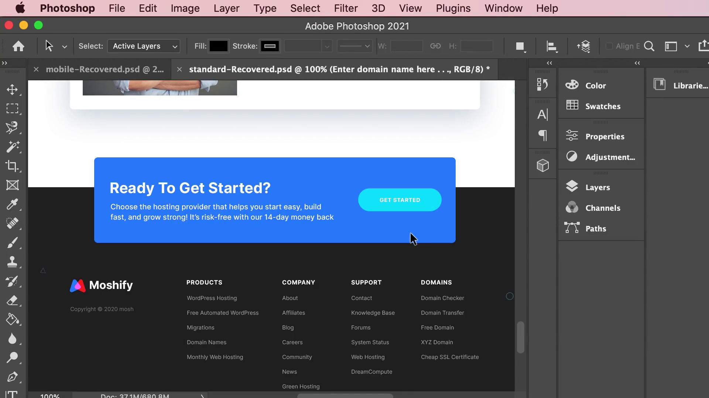

---

## 2. เขียน CSS พื้นฐานของ `.callout`

เปิด `styles.css` แล้วเริ่ม selector `.callout` ใหม่ (คอมเมนต์ `/* Callouts */` นำหน้า)

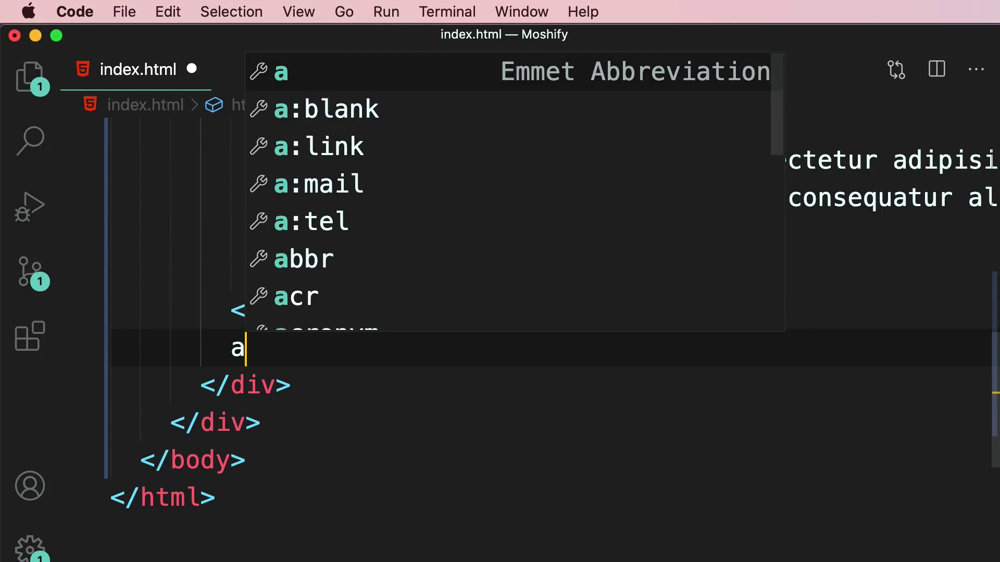

ใส่ `padding: 4rem;` เพื่อให้กล่องมีพื้นที่ว่างด้านในเยอะขึ้น

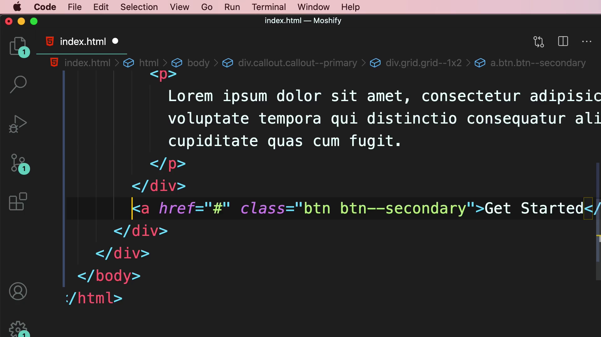

ตามด้วย `border-radius: 5px;` เพื่อให้มุมโค้งมนเล็กน้อย

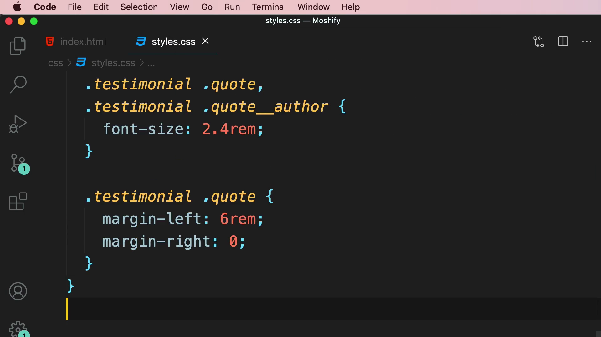

ผลลัพธ์ในเบราว์เซอร์: เห็น padding และมุมโค้งแล้ว แม้ยังไม่มีสีพื้นหลัง

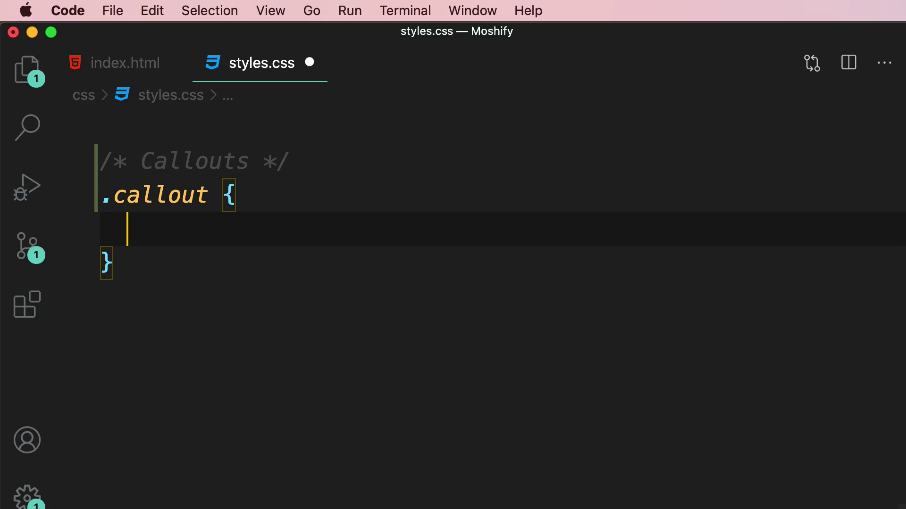

```css
/* Callouts */
.callout {
  padding: 4rem;
  border-radius: 5px;
}
```

---

## 3. สไตล์ modifier `.callout--primary`

เขียน selector ใหม่ `.callout--primary`

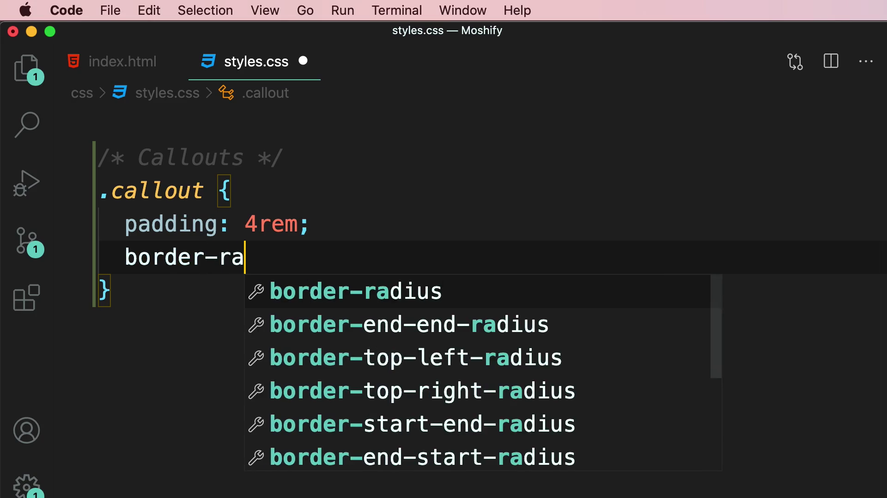

ใส่ `background: var(--color-primary);` ใช้ CSS custom property (ตัวแปร CSS) ที่ประกาศไว้ที่ `:root` อยู่แล้วจากบทเรียนก่อนๆ

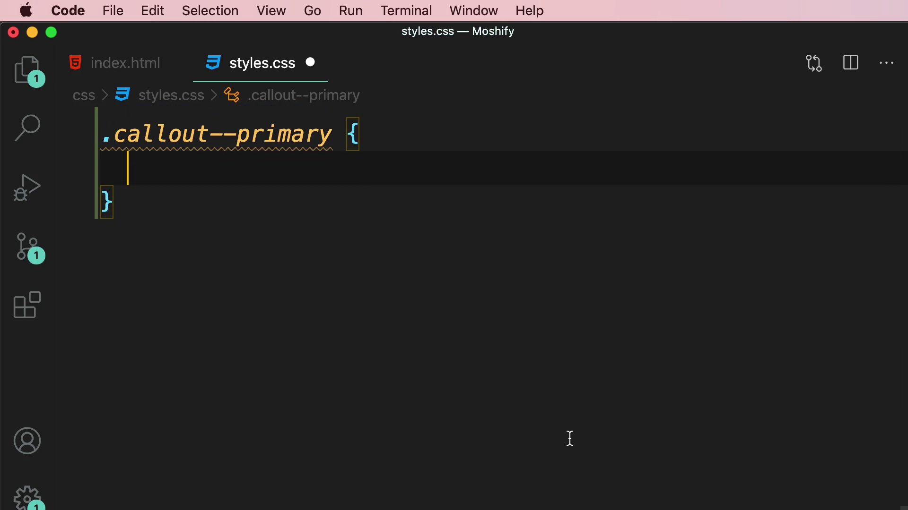

ผลลัพธ์: กล่อง callout กลายเป็นพื้นสีน้ำเงิน (primary color) ทันที

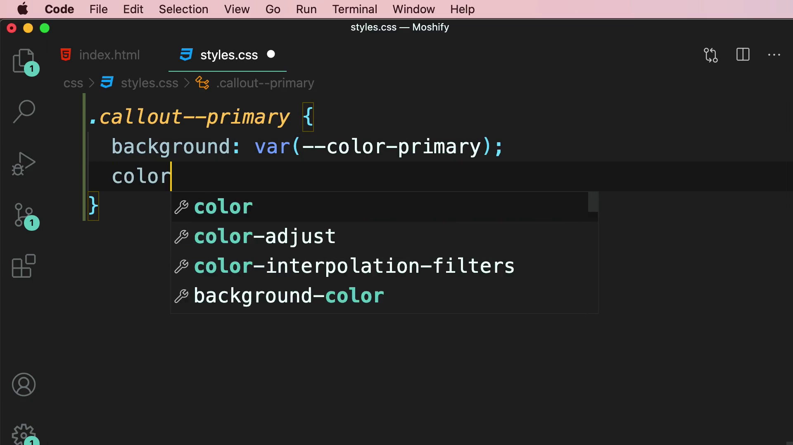

จากนั้นเพิ่ม `color: #fff;` เพื่อให้ตัวอักษรเป็นสีขาว อ่านง่ายบนพื้นน้ำเงิน

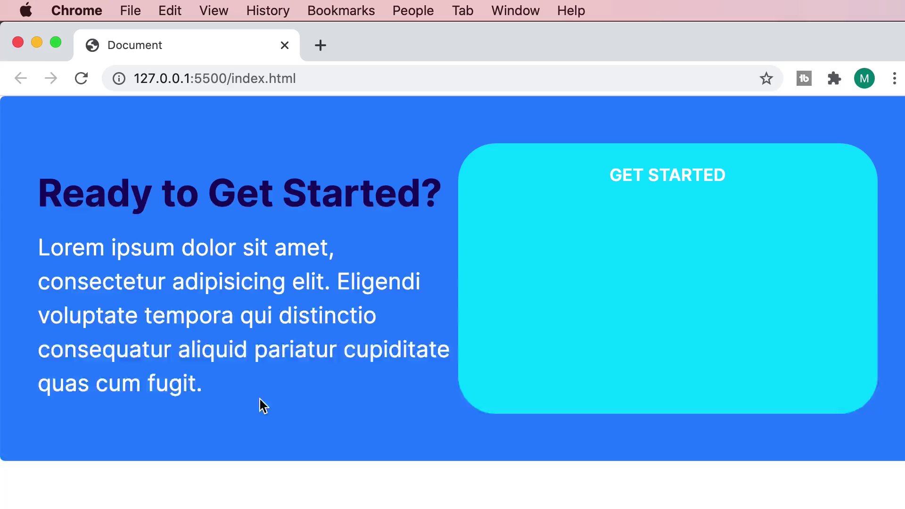

> ⚠️ สังเกตว่า `color: #fff` ที่ใส่บน `.callout--primary` จะถูก **inherit** ไปยัง `<p>` ข้างในโดยอัตโนมัติ (เพราะ `color` เป็น inherited property) แต่ `<h2>` (callout__heading) จะต้องกำหนด `color: #fff` แยกต่างหาก เพราะในบางเบราว์เซอร์/บาง base style h1-h6 อาจมี color เฉพาะของตัวเองที่ override การ inherit — Mosh จึงกำหนดสีให้ heading อีกครั้งในขั้นตอนถัดไป

```css
.callout--primary {
  background: var(--color-primary);
  color: #fff;
}
```

---

## 4. สไตล์ `.callout__heading`

เริ่ม selector `.callout__heading`

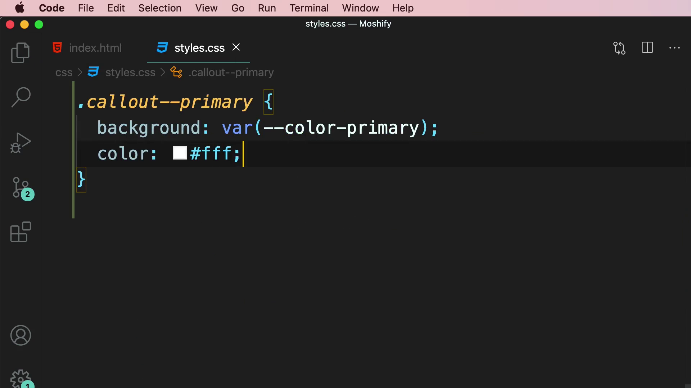

ใส่ `color: #fff;` เพื่อบังคับให้หัวข้อเป็นสีขาวแน่นอน (ไม่พึ่งพา inherit อย่างเดียว)

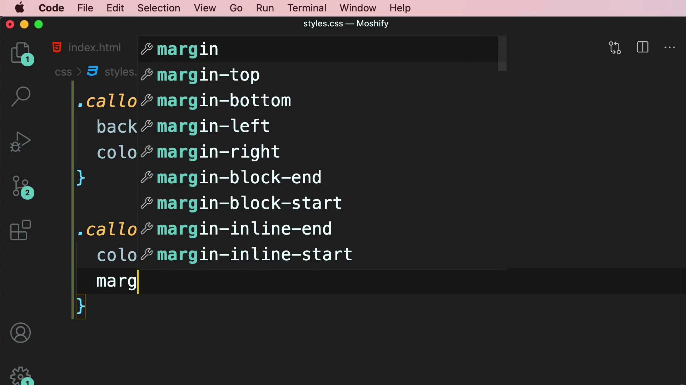

เพิ่ม `margin-top: 0;` เพื่อลบ margin บนของ h2 ที่ browser กำหนดมาโดย default ทำให้หัวข้อชิดขอบบนของกล่องพอดี

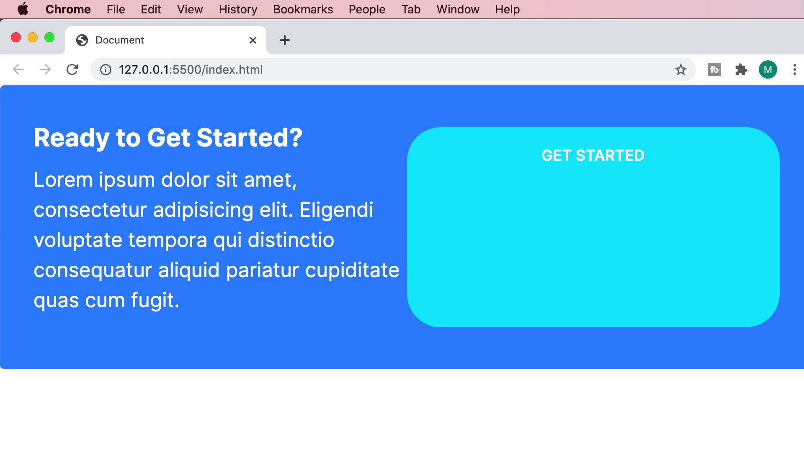

ตามด้วย `font-size: 3rem;` เพื่อขยายขนาดตัวอักษรหัวข้อให้ใหญ่และโดดเด่นขึ้น

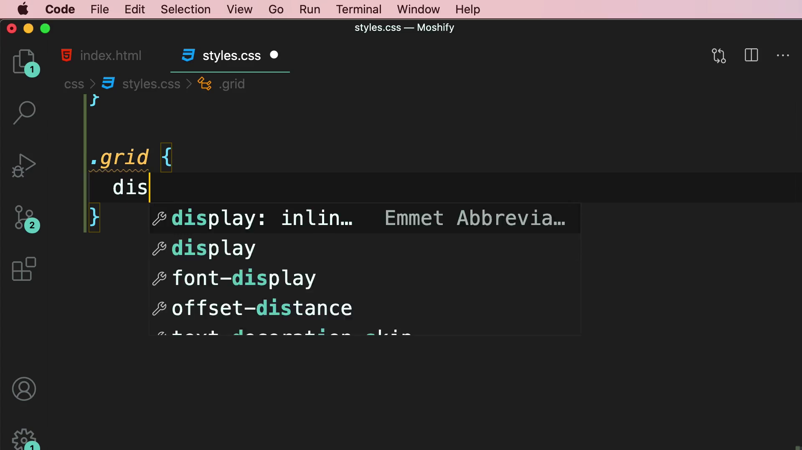

```css
.callout__heading {
  color: #fff;
  margin-top: 0;
  font-size: 3rem;
}
```

ผลลัพธ์ในเบราว์เซอร์: หัวข้อเป็นตัวหนาสีขาวขนาดใหญ่ ชิดขอบบนพอดี

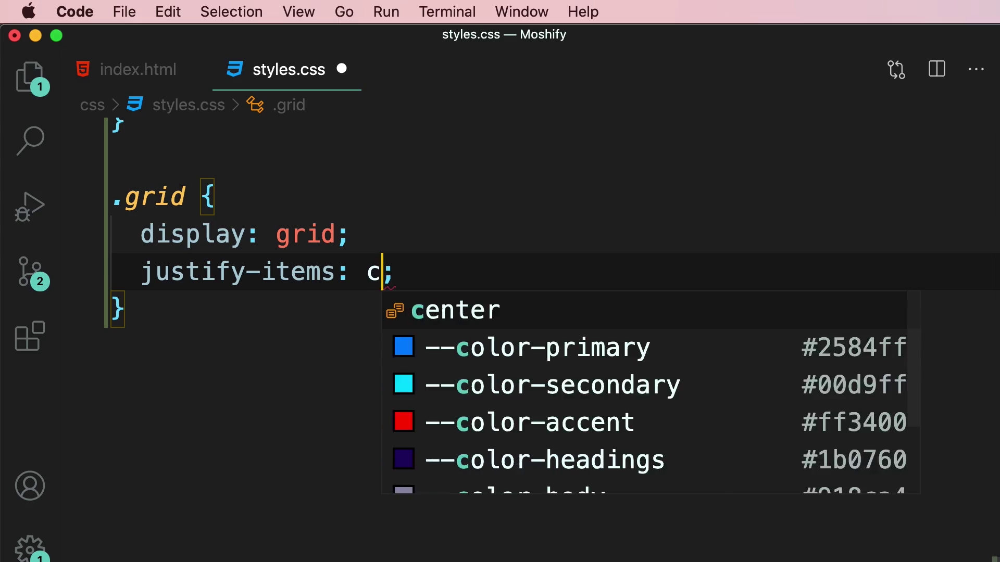

---

## 5. สำรวจพฤติกรรม default ของ CSS Grid (`justify-items` / `align-items`)

Mosh เปิด DevTools เพื่อ inspect element ของ grid และอธิบายว่าทำไมปุ่ม "Get Started" ถึงยืด (stretch) เต็มความสูงของแถว


จากนั้นกลับไปที่ `.grid` selector (ตัว base ของระบบ grid ที่สร้างไว้ก่อนหน้า) แล้วลองพิมพ์ `justify-items: center;` เพื่อทดสอบดูผลลัพธ์ก่อน

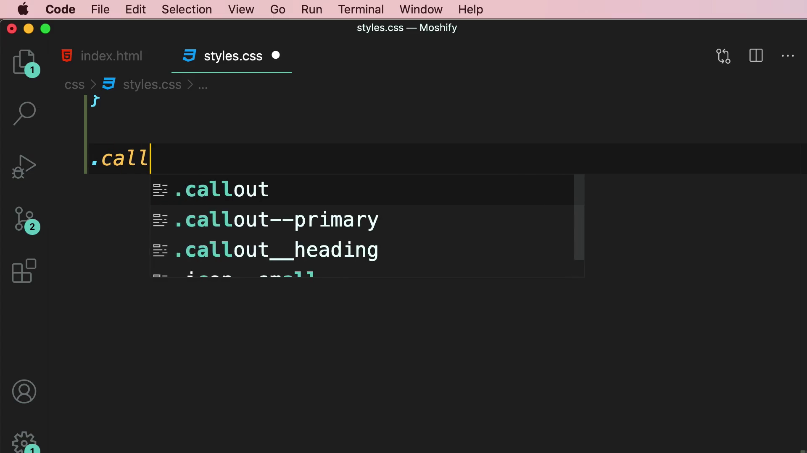

ผลลัพธ์ในเบราว์เซอร์เมื่อลอง `center`: หน้าเว็บยังไม่มีการเปลี่ยนแปลงชัดเจนในเฟรมนี้ (อาจเป็นเพราะหน้ายังไม่ได้ refresh หรือค่ายังไม่ถูก apply ชัดในตำแหน่งนี้)

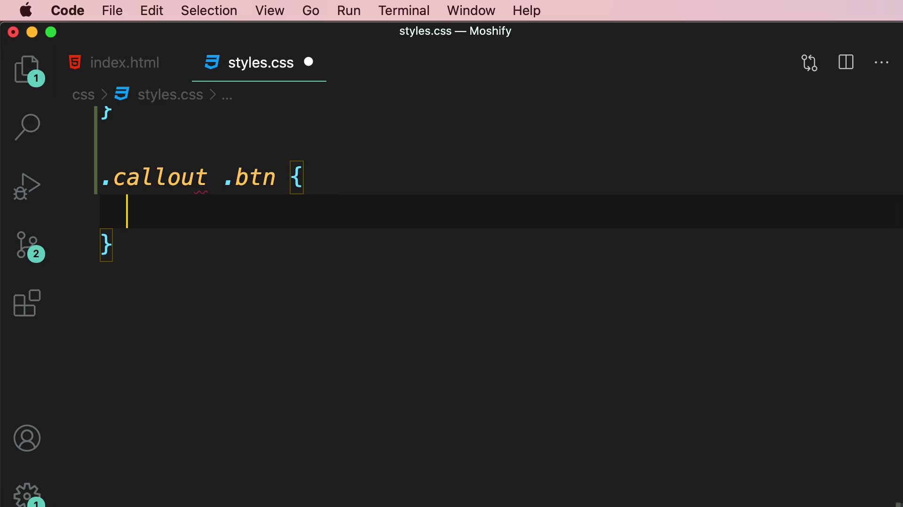

หลังจากทดลอง Mosh ตัดสินใจสอนโดยการเขียนค่า **default ของ Grid ออกมาให้เห็นชัดๆ** แทนที่จะปล่อยให้เป็นค่า default โดยไม่เขียน เพื่อสอนว่า Grid มีค่า default เป็นอะไร:

```css
.grid {
  display: grid;
  justify-items: stretch;
  align-items: stretch;
}
```

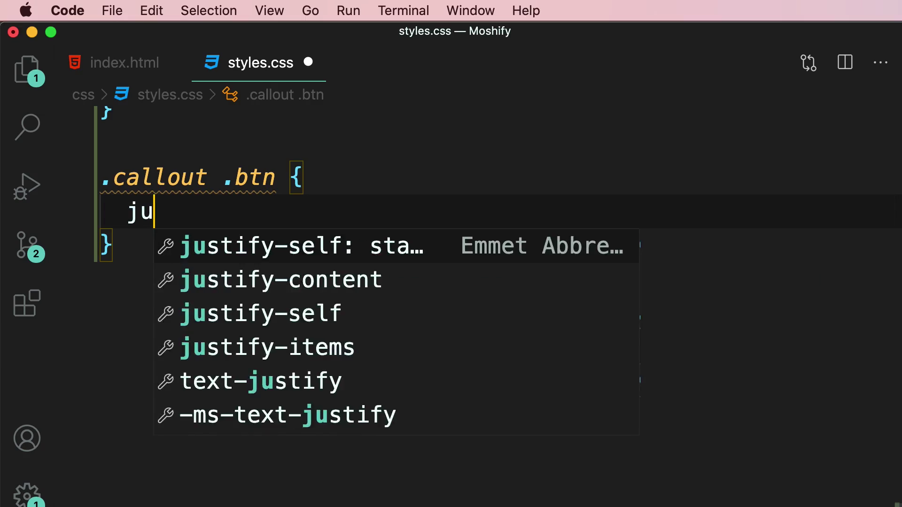

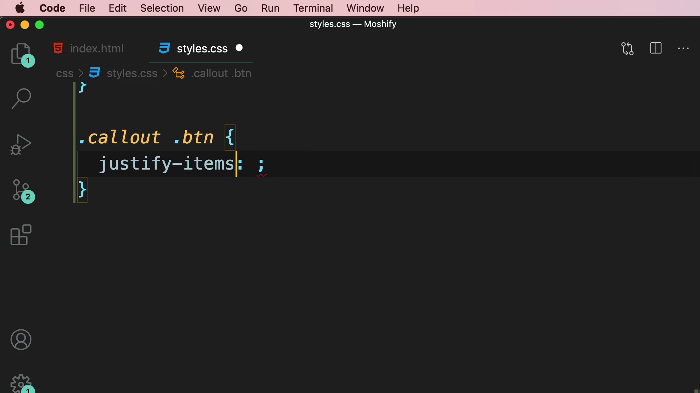

> 💡 **ความรู้สำคัญ:** ค่า default ของ `justify-items` และ `align-items` ใน CSS Grid คือ `stretch` เสมอ — หมายความว่าถ้า grid item (เช่น ปุ่ม `.btn`) ไม่มีขนาด (width/height) ที่กำหนดตายตัว มันจะ "ยืด" เต็มพื้นที่ของ grid cell ที่มันอยู่ นี่คือเหตุผลที่ปุ่ม Get Started ในตอนแรกมีความสูงเท่ากับทั้งแถว (เต็ม cell) โดยอัตโนมัติ โดยที่ยังไม่ได้เขียน CSS อะไรเพิ่มเลย

---

## 6. เริ่มปรับปุ่มด้วย `.callout .btn` (descendant selector) และ `justify-self`

Mosh เขียน selector ใหม่ที่เป็น **descendant combinator** (เว้นวรรค ไม่ใช่ `>`) คือ `.callout .btn` เพื่อเจาะจงปุ่มที่อยู่ *ภายใน* callout เท่านั้น โดยไม่กระทบปุ่มที่อื่นในหน้าเว็บ

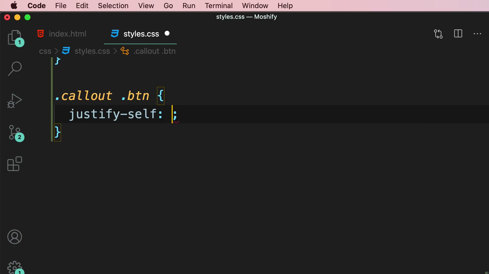

ภายใน selector นี้ Mosh ลองพิมพ์ autocomplete หลายตัวก่อนตัดสินใจ — เริ่มจาก `justify-items` (ก่อน) แล้วเปลี่ยนใจมาใช้ `justify-self` เพราะต้องการ override เฉพาะ "ตัวเอง" (ปุ่มตัวนี้ตัวเดียว) ไม่ใช่ทั้ง grid

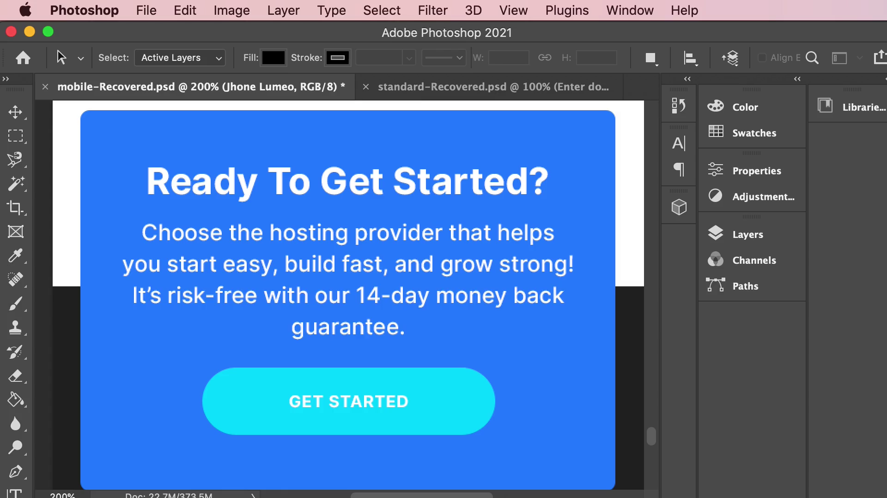

ทดลองใส่ `justify-self: center;` ก่อน แล้วดูผลลัพธ์ในเบราว์เซอร์ — ปุ่มเลื่อนไปอยู่กึ่งกลางของ grid cell ของมันเอง (แนวนอน) แต่ยังคงสูงเท่าเดิม (เพราะ `align-self` ยังไม่ถูกปรับ)

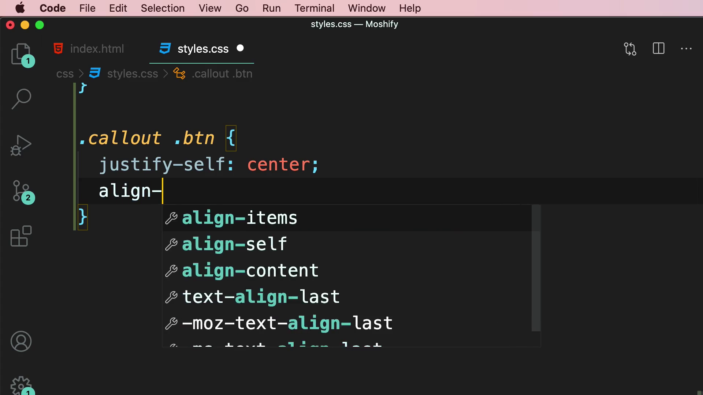

จากนั้นสำรวจต่อว่าต้องใช้ `align-self` เพื่อคุมแนวตั้งด้วยหรือไม่

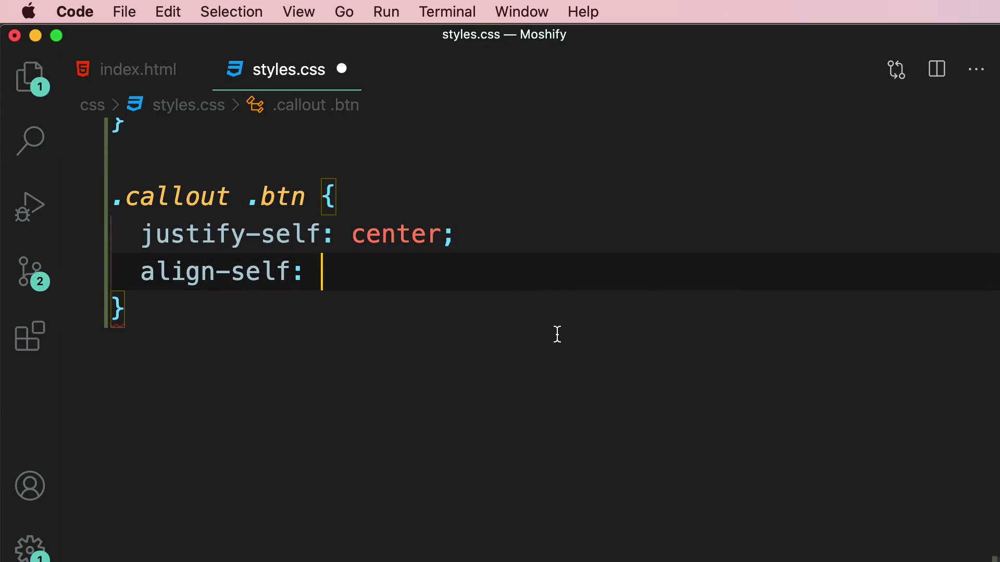

ใส่ `align-self: center;` เพื่อให้ปุ่มไม่ยืดเต็มความสูงอีกต่อไป แต่อยู่กึ่งกลางแนวตั้งพอดีตามขนาดธรรมชาติของปุ่ม (fit-content)

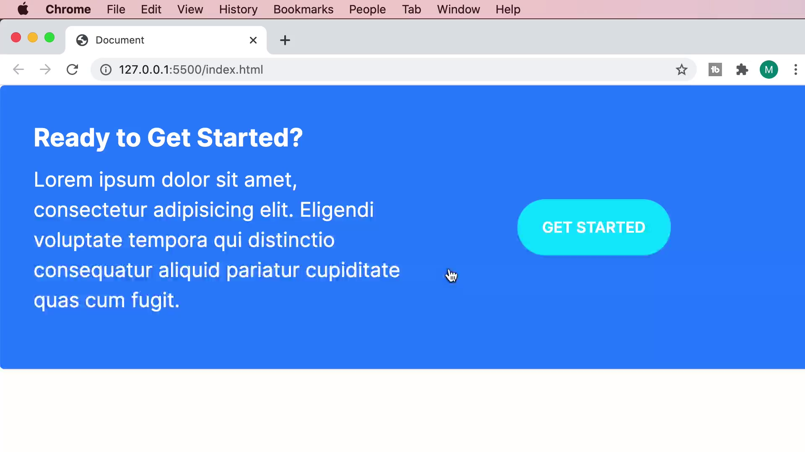

```css
.callout .btn {
  justify-self: center;
  align-self: center;
}
```

> 📝 **สรุปหลักการ `justify-self` / `align-self`:** สองพร็อพเพอร์ตี้นี้ใช้กับ **grid item ตัวเดียว** เพื่อ override ค่า `justify-items`/`align-items` ที่กำหนดไว้ที่ parent (`.grid`) — `justify-self` คุมแนวนอน (inline axis) ส่วน `align-self` คุมแนวตั้ง (block axis) ทำให้เราสามารถทำให้ grid item บางตัวมีพฤติกรรมต่างจากตัวอื่นในกริดเดียวกันได้ โดยไม่ต้องแก้ parent

---

## 7. ทดสอบ responsive ด้วยการลากปรับขนาดเบราว์เซอร์

Mosh ลองลากขอบหน้าต่างเบราว์เซอร์ให้แคบลง (จำลองมือถือ) เพื่อดูว่า layout ตอบสนองอย่างไรในสถานะปัจจุบัน

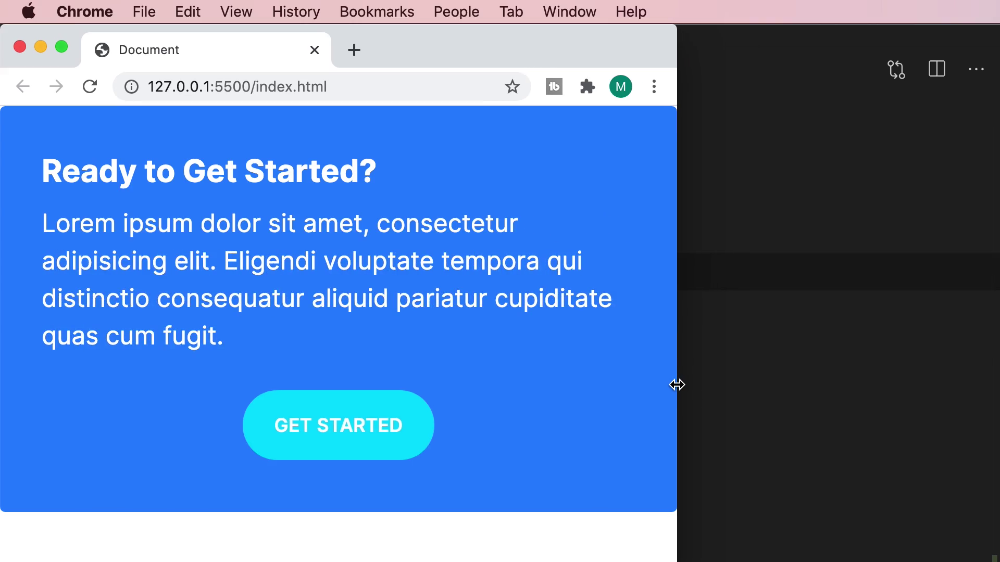

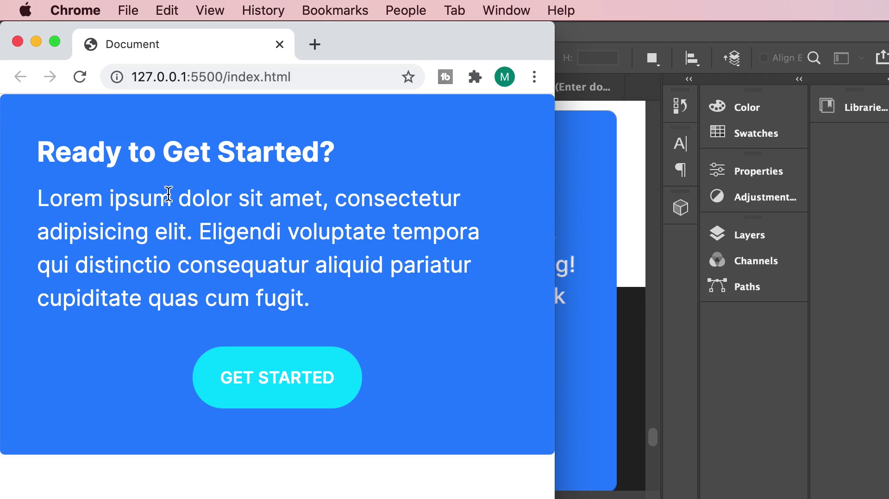

> 🔍 เนื่องจาก `.grid--1x2` (จากบทเรียนก่อน) มี media query ของตัวเองอยู่แล้วที่ทำให้ grid เปลี่ยนจาก 2 คอลัมน์เป็น 1 คอลัมน์เมื่อจอแคบ (`grid-template-columns: 1fr` แทน `1fr 1fr`) เมื่อจอแคบ เนื้อหาและปุ่มจึงเรียงต่อกันในแนวตั้งโดยอัตโนมัติแล้ว — สิ่งที่ยังขาดคือการจัดข้อความให้อยู่กึ่งกลางในโหมดมือถือ

---

## 8. จัดข้อความให้อยู่กึ่งกลางบนมือถือ — `.callout__content { text-align: center; }`

เขียน selector `.callout__content` ใหม่ ใส่ `text-align: center;`

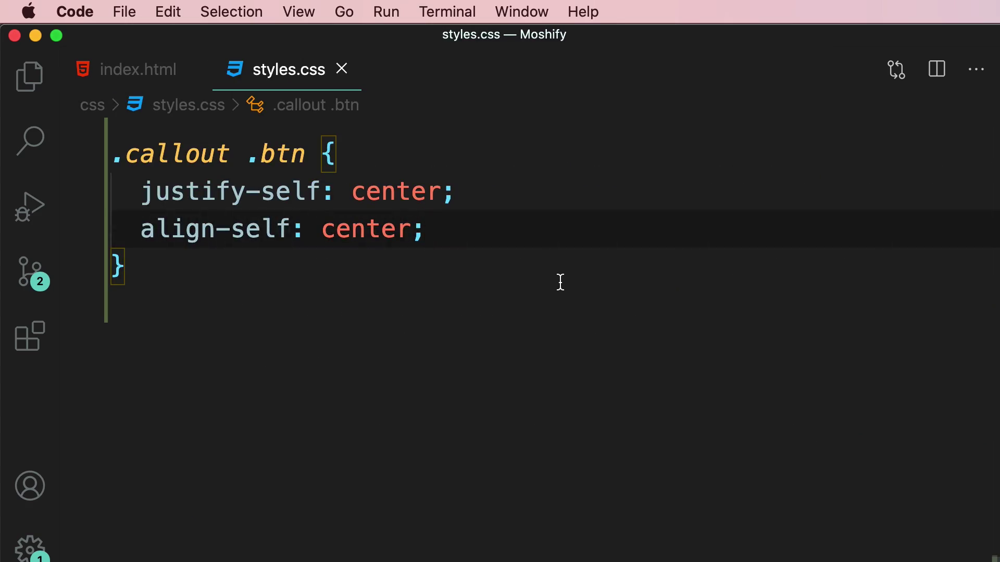

ผลลัพธ์ในเบราว์เซอร์: บนหน้าจอแคบ (mobile) หัวข้อและพารากราฟจะอยู่กึ่งกลางพอดี สอดคล้องกับ mockup มือถือที่ดูไว้ตอนต้นคลิป

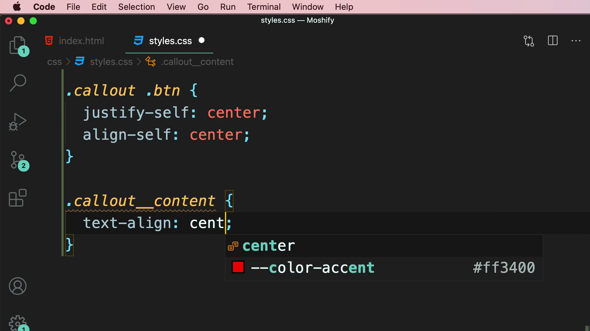

```css
.callout__content {
  text-align: center;
}
```

---

## 9. รีวิวคลาสปุ่ม และสร้าง modifier ใหม่ `.btn--stretched`

Mosh ใช้ Cmd+F ค้นหาใน `styles.css` เพื่อกลับไปดู class `.btn` เดิมที่เคยสร้างไว้ (ทบทวน padding เดิม)

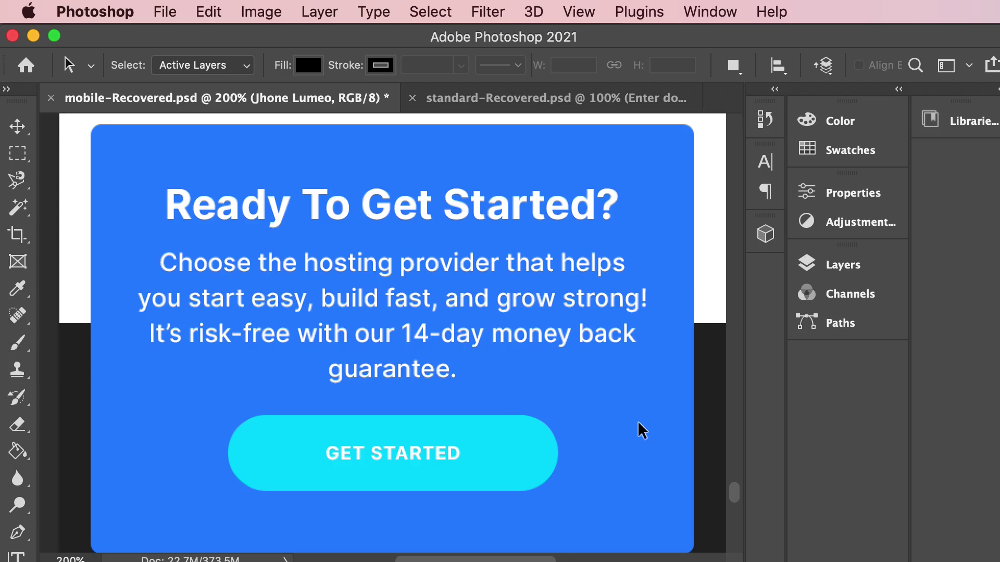

รีวิว padding เดิมของ `.btn` (ซ้าย-ขวาเริ่มต้น)

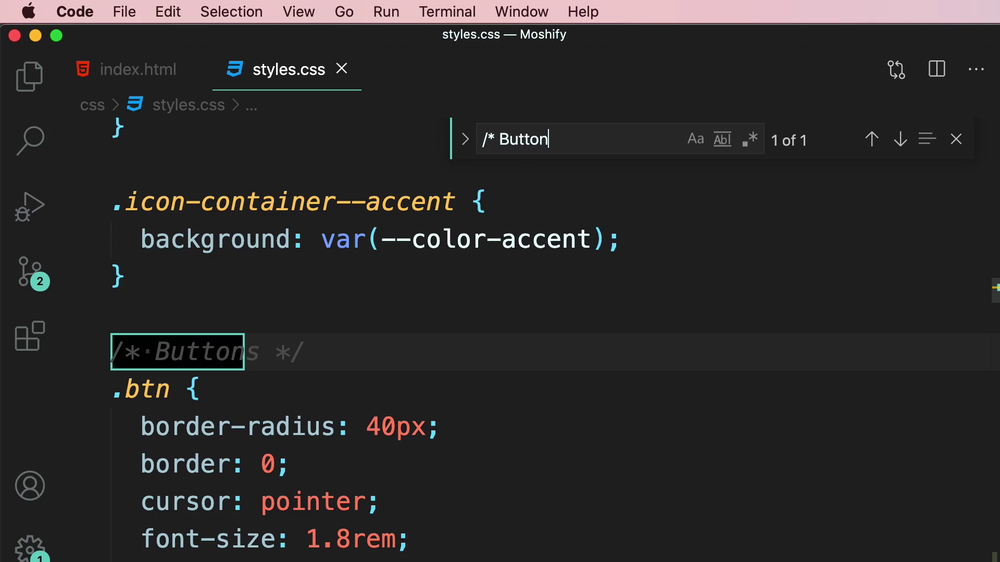

Mosh ตัดสินใจสร้าง **modifier ใหม่** สำหรับปุ่มในสถานการณ์ที่ต้องการให้ปุ่มมี padding ซ้าย-ขวากว้างขึ้น (ดูโดดเด่น เหมาะกับ callout) เริ่มตั้งชื่อว่า `.btn--long` ก่อน

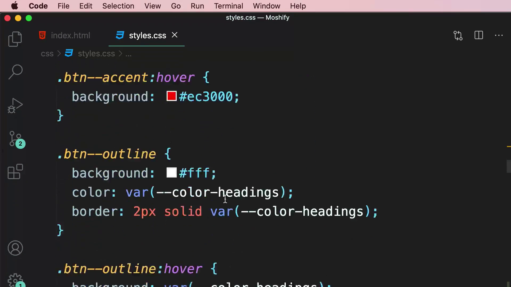

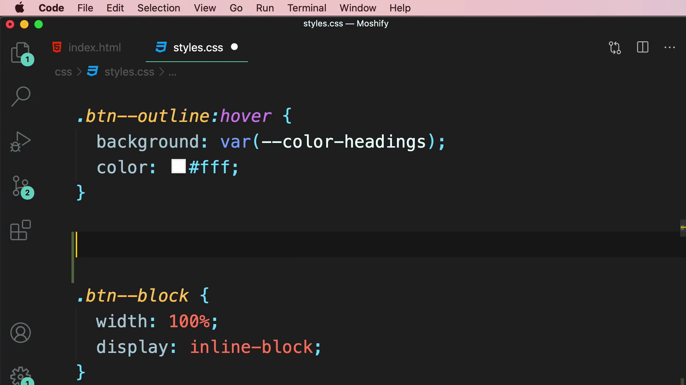

จากนั้น Mosh **เปลี่ยนชื่อ** จาก `.btn--long` เป็น `.btn--stretched` เพราะสื่อความหมายได้ดีกว่า (ปุ่มถูก "ยืด" ออกทางซ้าย-ขวา)

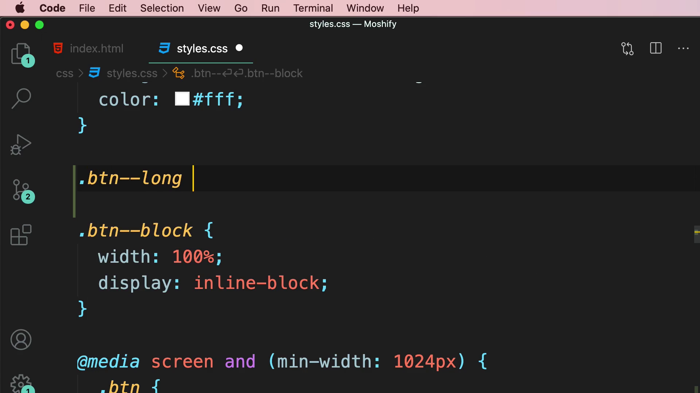

ใส่ `padding-left: 6rem;`

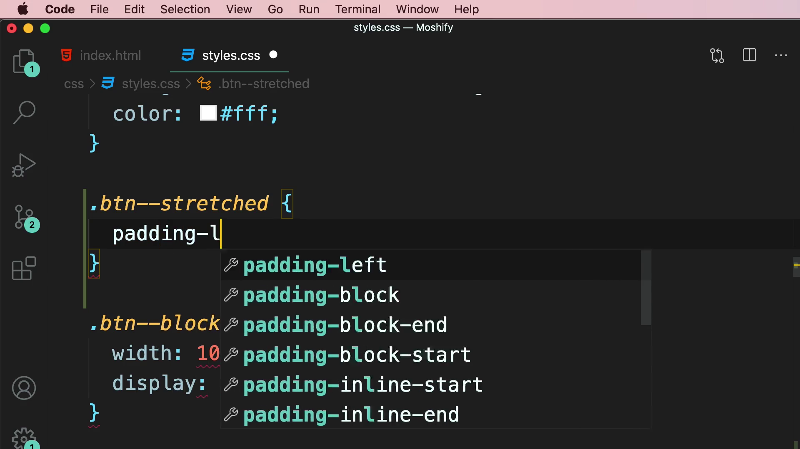

ตามด้วย `padding-right: 6rem;`

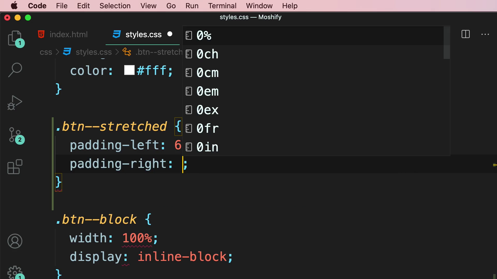

```css
.btn--stretched {
  padding-left: 6rem;
  padding-right: 6rem;
}
```

กลับไปที่ `index.html` แล้วเพิ่ม class `btn--stretched` ต่อท้ายใน element ปุ่ม (BEM modifier stacking — ปุ่มนี้มี 2 modifier พร้อมกันคือ `btn--secondary` และ `btn--stretched`)

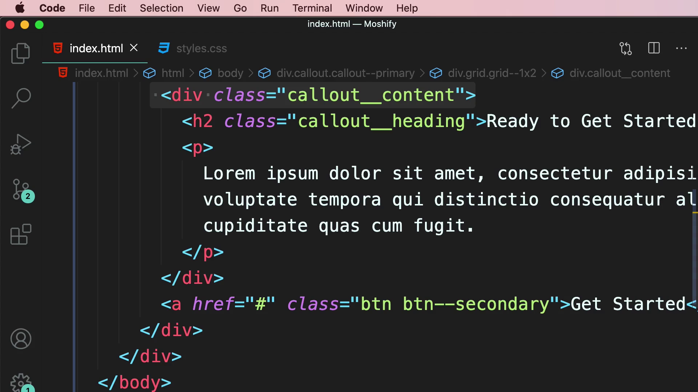

```html
<a href="#" class="btn btn--secondary btn--stretched">Get Started</a>
```

ผลลัพธ์ในเบราว์เซอร์: ปุ่ม Get Started กว้างขึ้นชัดเจน ดูโดดเด่นและสมส่วนกับกล่อง callout มากขึ้น

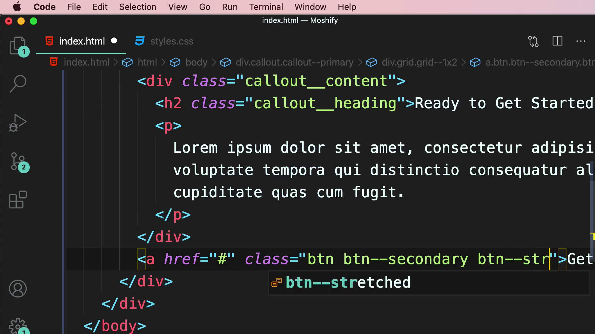

---

## 10. เริ่มเขียน Media Query สำหรับหน้าจอกว้าง (Desktop)

Mosh เลื่อนไปหา media query ที่เคยสร้างไว้ (หรือเริ่มเขียนใหม่) ด้วยการค้นหาในไฟล์

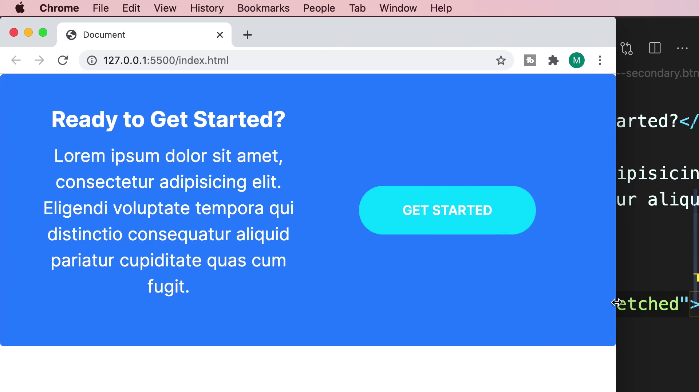

เขียน `@media screen and (min-width: 768px) { }` เป็นจุดเริ่มต้นของกฎที่จะทำงานเฉพาะเมื่อจอกว้างตั้งแต่ 768px ขึ้นไป (breakpoint เดียวกับที่ใช้ตลอดทั้งโปรเจกต์)

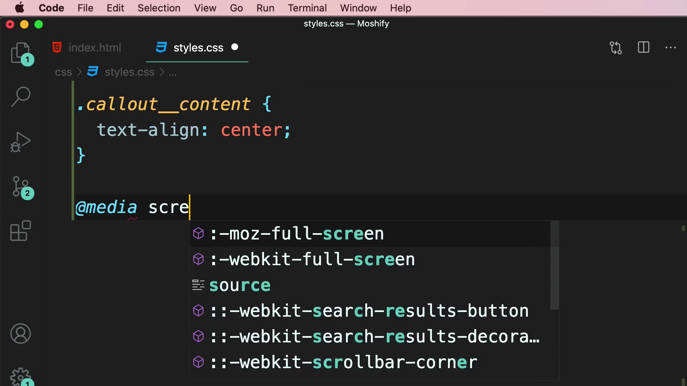

ภายใน media query นี้ เขียน `.callout__content { text-align: left; }` เพื่อ **override** ค่า `text-align: center` (ที่ใช้สำหรับมือถือ) กลับมาเป็นชิดซ้ายเมื่อจอกว้างพอ (ตรงกับ mockup เดสก์ท็อป)

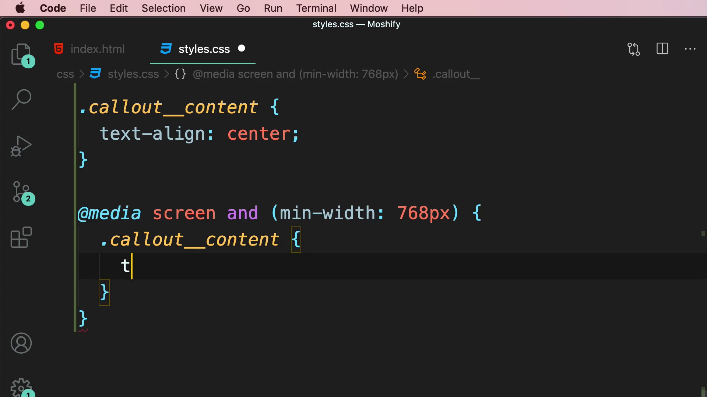

```css
@media screen and (min-width: 768px) {
  .callout__content {
    text-align: left;
  }
}
```

ผลลัพธ์ในเบราว์เซอร์ที่ความกว้างเดสก์ท็อป: ข้อความในกล่อง callout ชิดซ้ายแล้ว โครงสร้างเริ่มเข้าใกล้ mockup เดสก์ท็อป

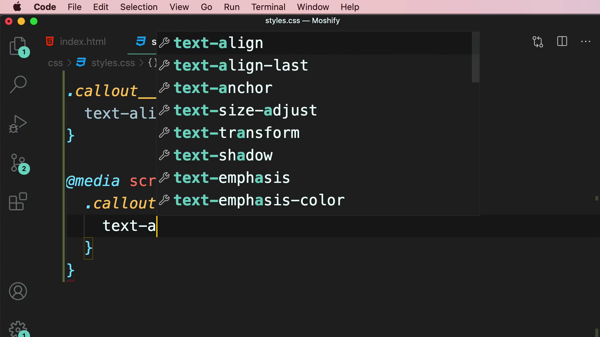


---

## 11. ปรับตำแหน่งปุ่มบนเดสก์ท็อปด้วย `.callout .grid--1x2` และ `.callout .btn`

ยังอยู่ภายใน media query เดิม Mosh เริ่มพิมพ์ selector ใหม่ `.callout .grid--1x2` (autocomplete แสดง class ที่มีอยู่แล้วให้เลือก) เพื่อเตรียมปรับ `grid-template-columns` เฉพาะของ callout ในโหมดเดสก์ท็อป


ก่อนหน้านั้น Mosh กลับมาเขียน selector `.callout .btn` อีกครั้งใน media query นี้ (คนละ scope กับ `.callout .btn` นอก media query ก่อนหน้า) เพื่อปรับตำแหน่งปุ่มเฉพาะบนจอกว้าง


พิมพ์ `justify-self` แล้วดู autocomplete แสดงค่าที่เป็นไปได้ (auto, baseline, center, end, first baseline, flex-end, flex-start, last baseline ฯลฯ)


เลือกใช้ `justify-self: start;` เพื่อให้ปุ่มชิดซ้ายของ grid cell (แทนที่จะ center เหมือนตอนมือถือ) เพราะบน desktop mockup ปุ่มอยู่ด้านขวาของคอลัมน์ที่สอง ไม่ได้อยู่กึ่งกลาง


```css
.callout .btn {
  justify-self: start;
}
```

ผลลัพธ์ในเบราว์เซอร์: ปุ่มขยับไปชิดซ้ายของ cell ตัวเอง แต่ตอนนี้แปะติดกับข้อความพอดี (ยังไม่มีระยะห่าง)


เพื่อแก้ปัญหานี้ Mosh เพิ่ม property `margin` และพิมพ์ค่าดู autocomplete ของ margin (margin-top, margin-bottom, margin-left, margin-right, margin-block-*, margin-inline-* ฯลฯ)


สุดท้ายกำหนดเป็น `margin: 0 2rem;` (shorthand สำหรับ top/bottom = 0, left/right = 2rem) เพื่อสร้างระยะห่างซ้าย-ขวารอบปุ่ม โดยไม่กระทบแนวตั้ง


```css
.callout .btn {
  justify-self: start;
  margin: 0 2rem;
}
```

ผลลัพธ์ในเบราว์เซอร์: ปุ่มมีระยะห่างจากข้อความและจากขอบกล่องพอดี ดูเป็นธรรมชาติมากขึ้น


---

## 12. ปรับสัดส่วนคอลัมน์ด้วย `.callout .grid--1x2`

เขียน selector `.callout .grid--1x2 { }` (ว่างเปล่าก่อน)


เริ่มพิมพ์ property ใหม่ — autocomplete แสดงตัวเลือก `grid`, `grid-row`, `grid-template-columns`, `grid-template-rows` ฯลฯ


> 🔧 ในขั้นตอนนี้ Mosh กำลังพิจารณาปรับ `grid-template-columns` ของ `.grid--1x2` เฉพาะเมื่ออยู่ภายใน `.callout` เพื่อให้สัดส่วนคอลัมน์เนื้อหา (กว้างกว่า) กับคอลัมน์ปุ่ม (แคบกว่า) เหมาะสมกับตัว callout มากขึ้น แทนที่จะใช้อัตราส่วน 1:1 แบบ grid--1x2 ทั่วไป — เป็นการ override ค่า grid-template-columns เฉพาะบริบท (context) นี้เท่านั้น โดยไม่กระทบ `.grid--1x2` ที่ใช้ในที่อื่นของเว็บไซต์

---

## 13. ทดสอบ Responsive ครั้งสุดท้าย — ลากปรับขนาดหน้าต่างเบราว์เซอร์

Mosh ปิดท้ายบทเรียนด้วยการลากขอบหน้าต่างเบราว์เซอร์ไปมาหลายระดับความกว้าง เพื่อตรวจสอบว่า Callout component ทำงานถูกต้องทั้งบนมือถือและเดสก์ท็อป รวมถึงจุดที่ breakpoint 768px เปลี่ยนพฤติกรรม


> ✅ ผลลัพธ์สุดท้าย: เมื่อจอกว้าง ≥ 768px — ข้อความชิดซ้าย ปุ่มอยู่ขวาพร้อม margin ห่างจากข้อความ ไม่ยืดเต็มความสูง (เพราะ `align-self` ไม่ได้ override ใน media query จึงยังคง `center` จากกฎก่อนหน้า) เมื่อจอแคบกว่า 768px — ข้อความและปุ่มเรียงตัวในแนวตั้ง ข้อความอยู่กึ่งกลาง ปุ่มมีขนาดกว้างขึ้นจาก `.btn--stretched`

---

## สรุปภาพรวมของคลิปนี้

| หัวข้อ | รายละเอียดสำคัญ |
|---|---|
| โครงสร้าง HTML | `.callout.callout--primary` > `.grid.grid--1x2` > (`.callout__content` [`.callout__heading` + `<p>`], `<a class="btn btn--secondary btn--stretched">`) |
| สีและพื้นหลัง | ใช้ `var(--color-primary)` และ `color: #fff` ตาม BEM modifier `.callout--primary` |
| CSS Grid default | `justify-items` และ `align-items` มีค่า default เป็น `stretch` เสมอ |
| Override รายตัว | `justify-self` / `align-self` ใช้กับ grid item เดียว เพื่อ override ค่าที่ parent grid กำหนด |
| Responsive มือถือ | `.callout__content { text-align: center; }` จัดข้อความกึ่งกลาง |
| Responsive เดสก์ท็อป | media query `min-width: 768px` เปลี่ยน `text-align` เป็น `left`, `justify-self: start`, เพิ่ม `margin: 0 2rem` ให้ปุ่ม |
| Modifier ใหม่ | `.btn--stretched` (padding-left/right: 6rem) — ตั้งชื่อผิดครั้งแรกว่า `.btn--long` แล้วเปลี่ยนเป็นชื่อที่สื่อความหมายกว่า |
| Selector pattern | Descendant selector (`.callout .btn`, `.callout .grid--1x2`) เพื่อเจาะจง element เฉพาะภายใน callout โดยไม่กระทบที่อื่น |

### แนวคิดสำคัญที่ได้จากคลิปนี้

1. **CSS Grid มีค่า default ของ `justify-items`/`align-items` เป็น `stretch`** — grid item ที่ไม่กำหนดขนาดจะยืดเต็ม cell โดยอัตโนมัติ นี่คือสาเหตุที่ปุ่มดูสูงเท่าทั้งแถวตอนแรก
2. **`justify-self`/`align-self` คือเครื่องมือ override รายตัว** — ใช้เมื่อต้องการให้ grid item หนึ่งตัวมีพฤติกรรมต่างจากที่ parent grid กำหนดไว้ (เช่น ปุ่มไม่ต้องการยืดเต็มความสูงเหมือน item อื่น)
3. **Descendant selector (เว้นวรรค) เหมาะสำหรับการเจาะจง component ที่ซ้อนกัน** — `.callout .btn` เลือกเฉพาะปุ่มที่อยู่ใน callout เท่านั้น ไม่กระทบปุ่มที่ใช้ที่อื่นในเว็บไซต์ที่มี class `.btn` เหมือนกัน
4. **การตั้งชื่อ class ที่ดีสำคัญ** — Mosh เริ่มตั้งชื่อ `.btn--long` แล้วเปลี่ยนเป็น `.btn--stretched` ทันทีที่รู้สึกว่าชื่อแรกสื่อความหมายไม่ชัดเจนพอ สะท้อนหลักการเขียนโค้ดที่ดี (ชื่อควรอธิบายพฤติกรรม ไม่ใช่แค่ลักษณะภายนอก)
5. **Responsive design ทำได้ด้วยการ override ค่าเดิมใน media query** — ไม่จำเป็นต้องเขียนกฎใหม่ทั้งหมด เพียงเขียนเฉพาะ property ที่ต้องเปลี่ยนแปลงเมื่อจอกว้างขึ้น (เช่น `text-align`, `justify-self`, `margin`)
6. **BEM modifier สามารถซ้อนกันได้หลายตัวในหนึ่ง element** — ปุ่มเดียวมีทั้ง `.btn`, `.btn--secondary`, และ `.btn--stretched` พร้อมกัน แต่ละ modifier รับผิดชอบคุณสมบัติคนละด้าน (สี vs. ขนาด)

---

*สรุปจากคลิปที่ 25 (Callouts) คอร์ส "Building a Website with HTML and CSS" โดย Mosh Hamedani (codewithmosh.com)*
