# HTML-CSS-3: 26 - Collapsibles

**ไฟล์ต้นฉบับ:** 26- Collapsibles.mp4

▶️ [ดูวิดีโอ](../../HTML-CSS-3/26-%20Collapsibles.mp4)

---

## ภาพรวมคลิปนี้

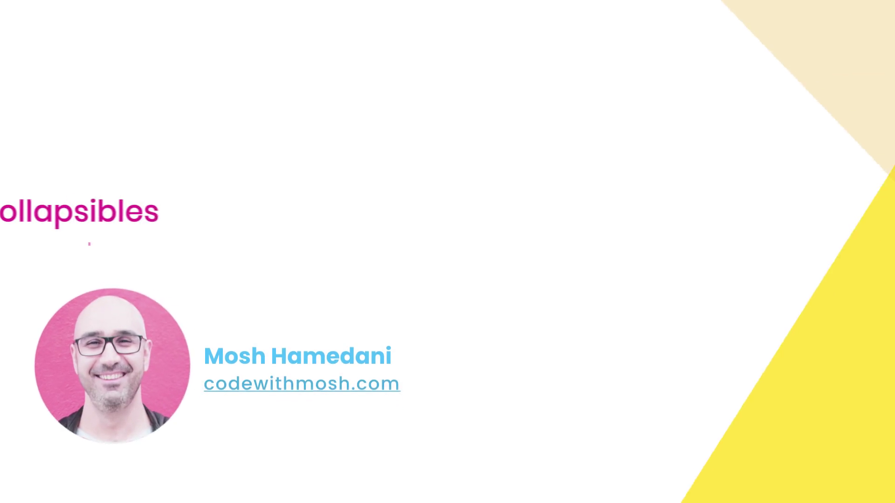

คลิปนี้ Mosh สอนการสร้าง **Collapsible component** (เรียกอีกชื่อว่า Accordion) ซึ่งเป็นกล่องที่คลิกที่หัวข้อแล้วสามารถ **ขยาย/ย่อ** เนื้อหาข้างในได้ — pattern นี้มักใช้ใน footer ของเว็บไซต์ (คอลัมน์ PRODUCTS, COMPANY, SUPPORT บนมือถือ) โดยคลิปนี้ครอบคลุมทั้ง CSS (โครงสร้าง, ไอคอนลูกศร, การซ่อน/แสดงเนื้อหา) และ **JavaScript พื้นฐาน** (การ toggle class ด้วย `classList.toggle`) รวมถึงเทคนิคการทำ **CSS transition แบบ smooth animation** สำหรับการขยาย/ย่อ ซึ่งเป็นเรื่องที่ซับซ้อนกว่าที่คิด เพราะ `display` และค่าความสูงแบบ `auto` ไม่สามารถ animate ได้ตรงๆ

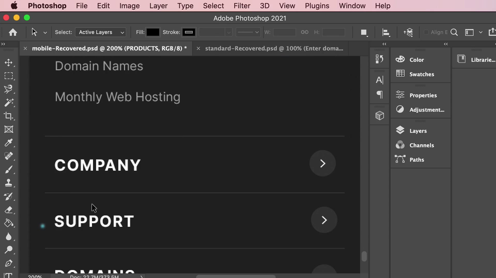

> 💡 Mosh อธิบายว่า pattern นี้พบได้ทั่วไปในเว็บไซต์จริง เช่น footer ของเว็บไซต์ที่มือถือจะยุบคอลัมน์เมนูเป็นแถบที่กดขยายได้ เพื่อประหยัดพื้นที่หน้าจอ

---

## 1. เขียนโครงสร้าง HTML ของ Collapsible

เริ่มต้นด้วย `<div class="collapsible">` เป็น container หลัก

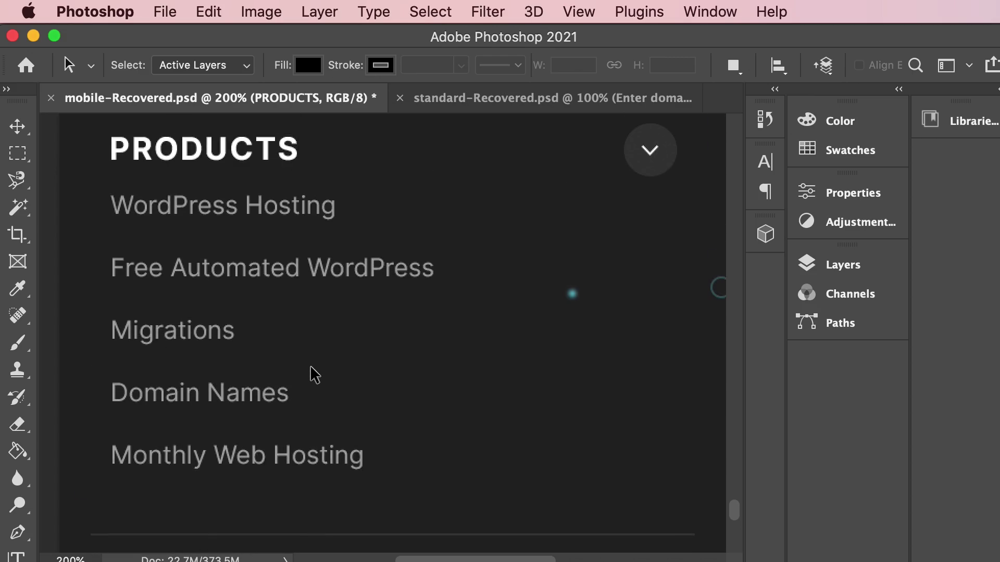

ภายในใส่ `<header class="collapsible__header">` สำหรับส่วนหัวที่คลิกได้

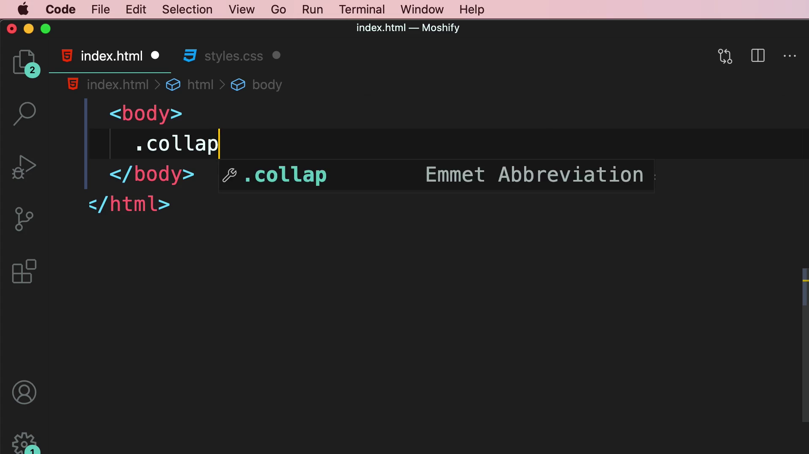

ภายใน header ใส่ `<h2 class="collapsible__heading">Item 1</h2>`

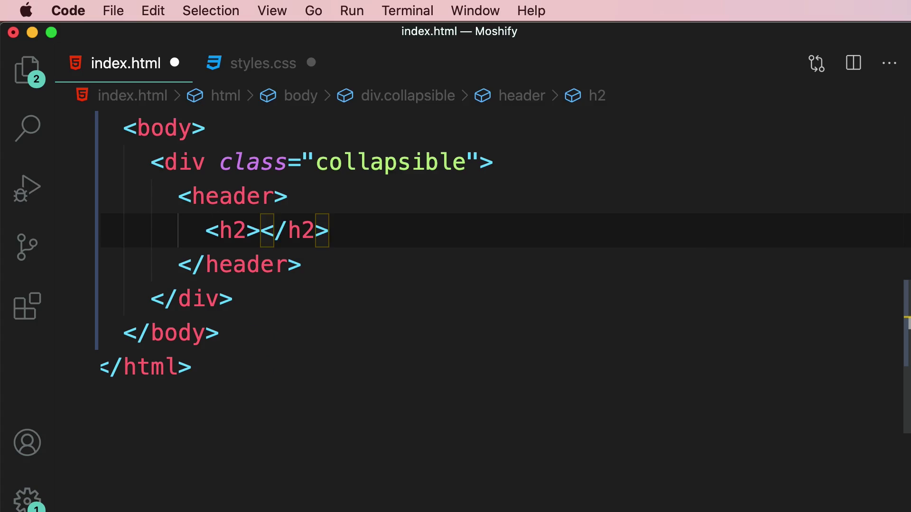

ตามด้วยไอคอนลูกศร (chevron) โดยใช้ `<svg class="icon">` แบบเดียวกับที่เคยใช้ในบทเรียนก่อนหน้า (Media Objects, Testimonials)

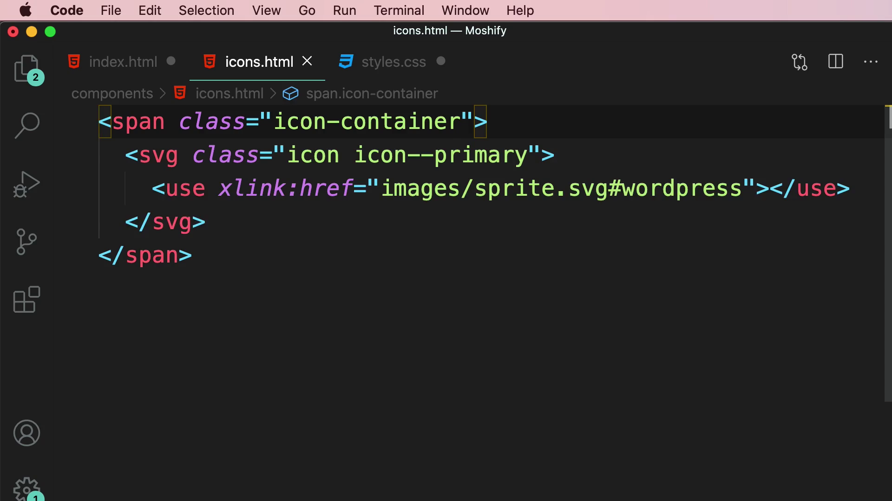

ภายใน svg ใส่ `<use xlink:href="images/sprite.svg#chevron"></use>` เพื่อดึงรูปลูกศรจาก sprite sheet ที่มีอยู่แล้วในโปรเจกต์

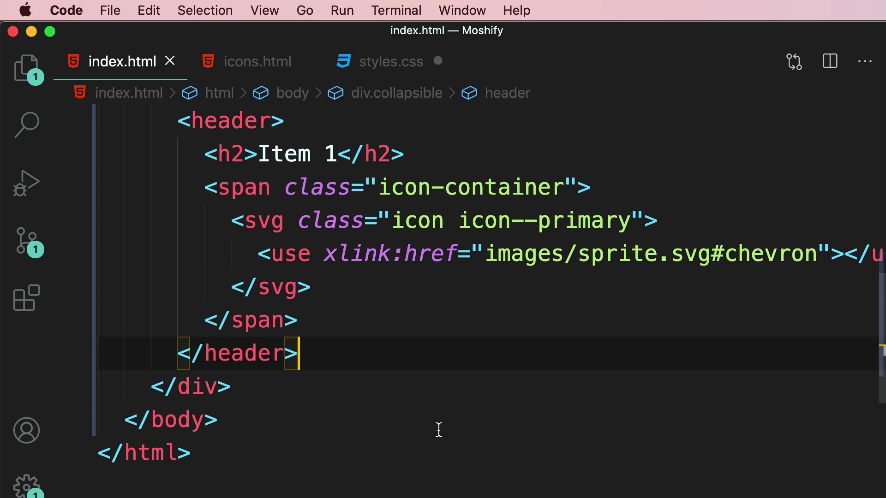

ปิด `</header>` แล้วตามด้วย `<div class="collapsible__content">` ที่มีพารากราฟ Lorem Ipsum อยู่ข้างใน (เนื้อหาที่จะถูกซ่อน/แสดง)

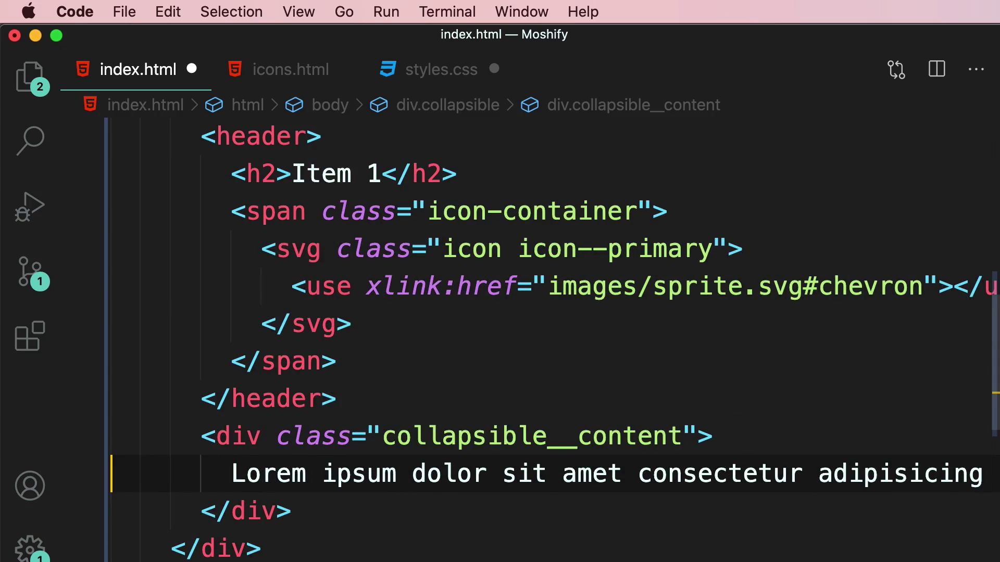

โค้ด HTML ทั้งหมด:

```html
<div class="collapsible">
  <header class="collapsible__header">
    <h2 class="collapsible__heading">Item 1</h2>
    <svg class="icon collapsible__chevron">
      <use xlink:href="images/sprite.svg#chevron"></use>
    </svg>
  </header>
  <div class="collapsible__content">
    Lorem ipsum dolor sit amet consectetur adipisicing elit. Dolorum, accusamus.
  </div>
</div>
```

ผลลัพธ์ในเบราว์เซอร์ก่อนใส่ CSS: เห็นหัวข้อ ไอคอน และเนื้อหาเรียงต่อกันแบบไม่มีสไตล์ใดๆ

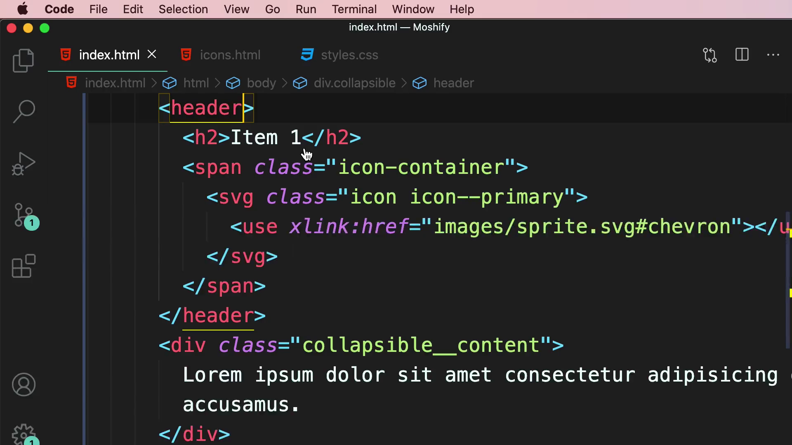

---

## 2. จัดวาง Header ด้วย Flexbox

เขียน selector `.collapsible__header`

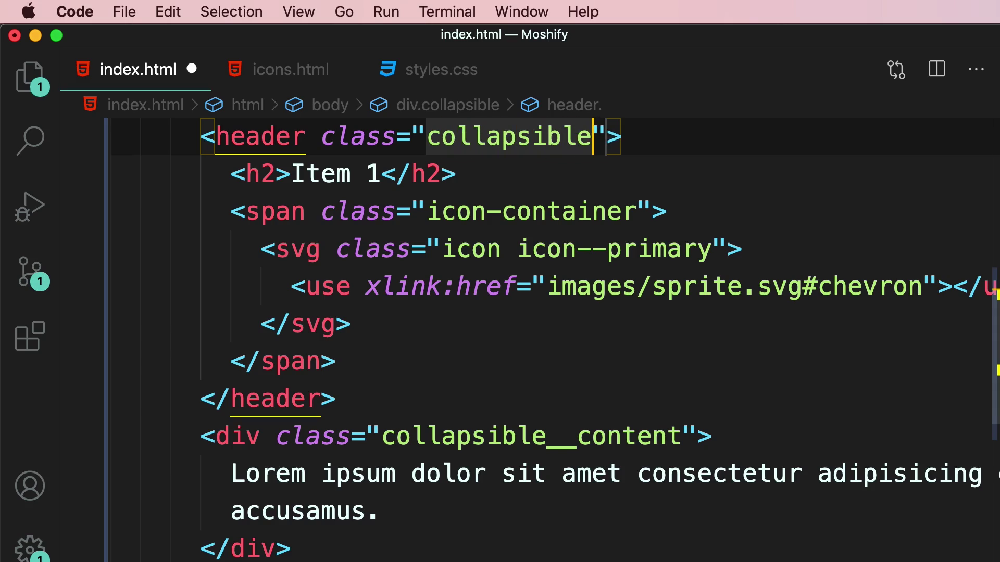

ใส่ `display: flex;` เพื่อให้หัวข้อกับไอคอนอยู่ในแนวเดียวกัน (แนวนอน)

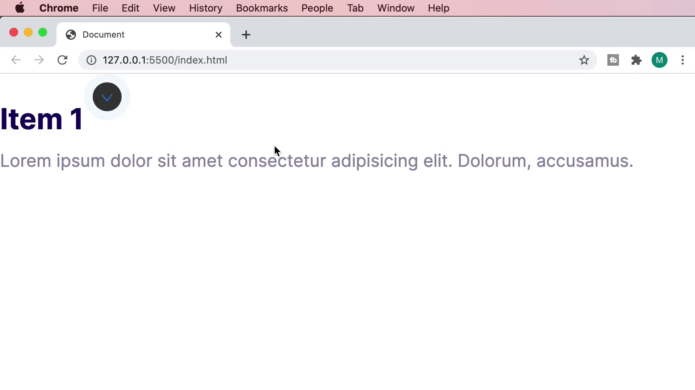

ตามด้วย `justify-content: space-between;` เพื่อดันไอคอนไปชิดขวาสุด ในขณะที่หัวข้อชิดซ้าย

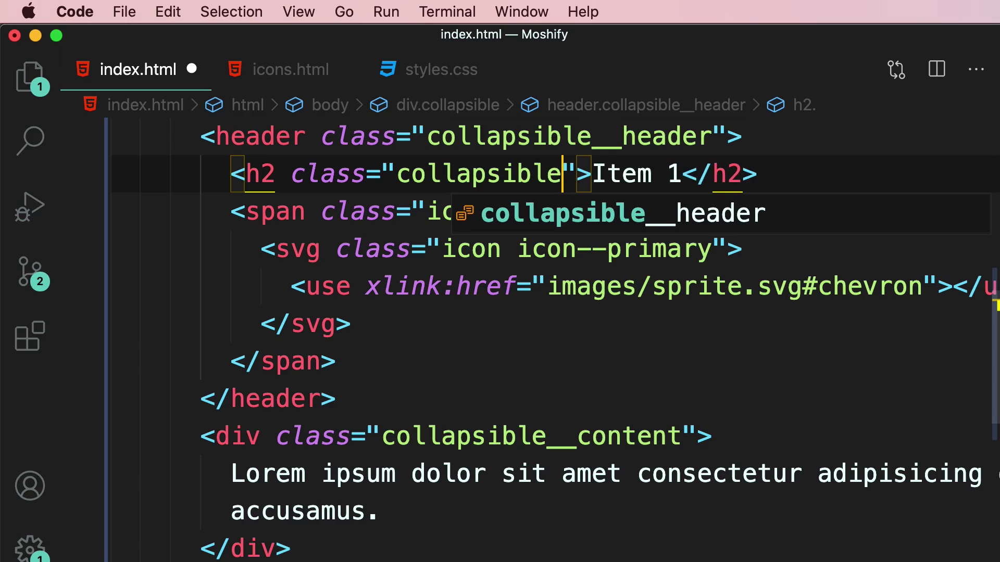

```css
.collapsible__header {
  display: flex;
  justify-content: space-between;
}
```

จากนั้นเขียน selector `.collapsible__heading` ใส่ `margin-top: 0;` เพื่อลบ margin บนของ h2 ให้ชิดขอบบน

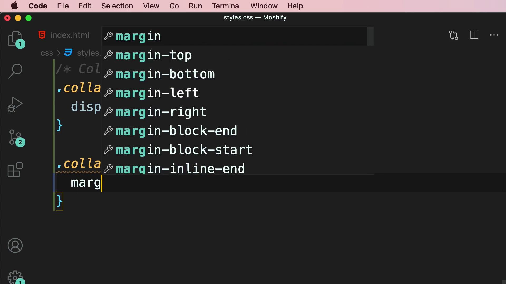

ผลลัพธ์ในเบราว์เซอร์: หัวข้อกับไอคอนอยู่คนละฝั่งของแถวแล้ว

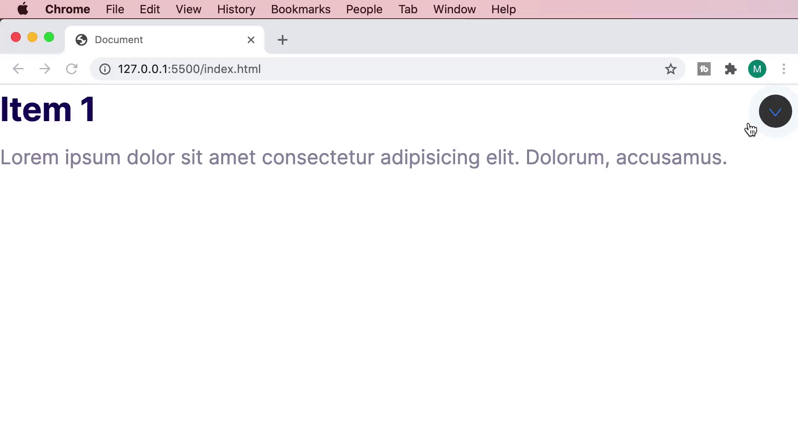

---

## 3. ขยายขนาดตัวอักษรหัวข้อ

เพิ่ม `font-size: 3rem;` ให้กับ `.collapsible__heading` เพื่อให้ดูโดดเด่นเหมือนหัวข้อจริง

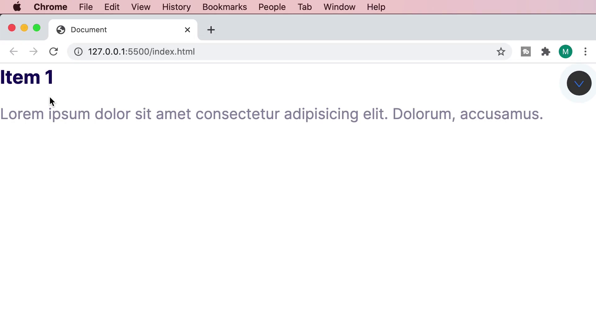

```css
.collapsible__heading {
  margin-top: 0;
  font-size: 3rem;
}
```

ผลลัพธ์ในเบราว์เซอร์: หัวข้อมีขนาดใหญ่ขึ้นชัดเจน

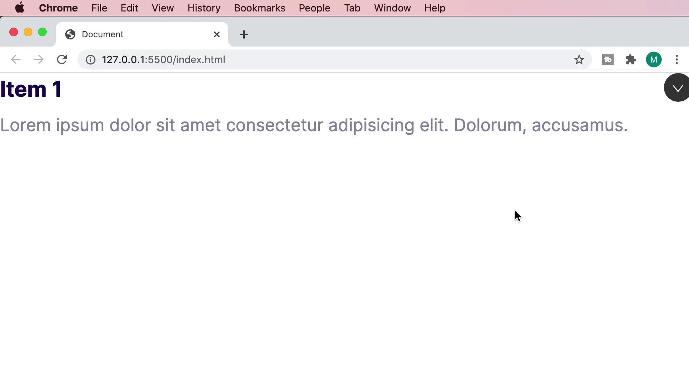

---

## 4. สไตล์ไอคอนลูกศร (Chevron)

กลับไปที่ HTML เพิ่ม class `icon--white` และ `collapsible__chevron` ให้กับ `<svg>` (BEM modifier ซ้อนกันหลายตัว)

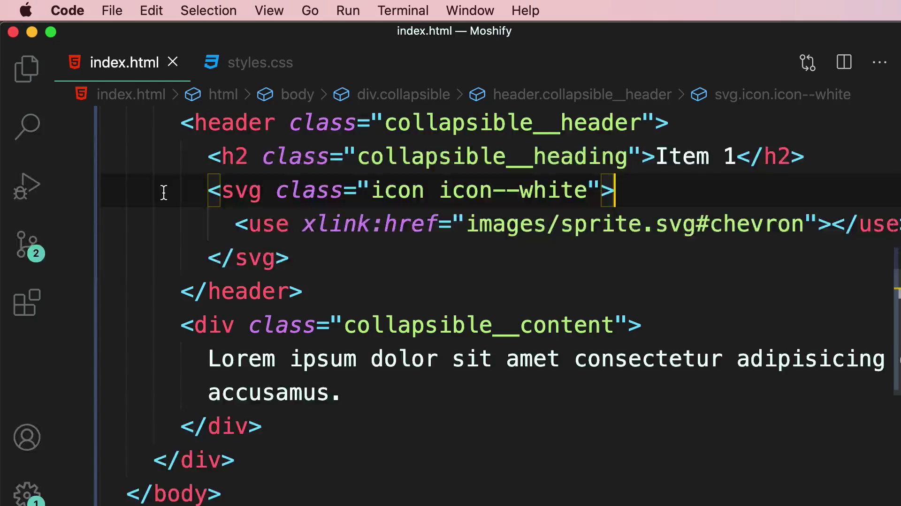

จากนั้นเขียน CSS `.collapsible__chevron { transform: rotate(-90deg); }` เพื่อหมุนไอคอนลูกศรให้ชี้ไปทางขวา (สถานะปิด/ย่อ) แทนที่จะชี้ลงเหมือนค่า default ของไอคอนในไฟล์ sprite

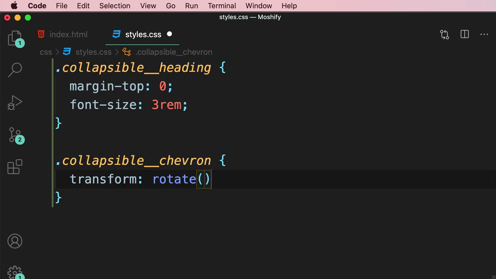

```css
.collapsible__chevron {
  transform: rotate(-90deg);
}
```

> 🔧 หลักการ: ไอคอน chevron ในไฟล์ sprite ถูกวาดมาให้ชี้ลงเป็นค่าเริ่มต้น การหมุน `-90deg` ทำให้ชี้ไปทางขวาแทน ซึ่งสื่อความหมายว่า "กดเพื่อขยาย" (คล้ายปุ่ม play หรือลูกศรบอกทิศทางที่จะเปิด)

---

## 5. ซ่อนเนื้อหาเริ่มต้นด้วย `display: none`

เขียน selector `.collapsible__content { display: none; }` เพื่อซ่อนเนื้อหาไว้ก่อนโดย default

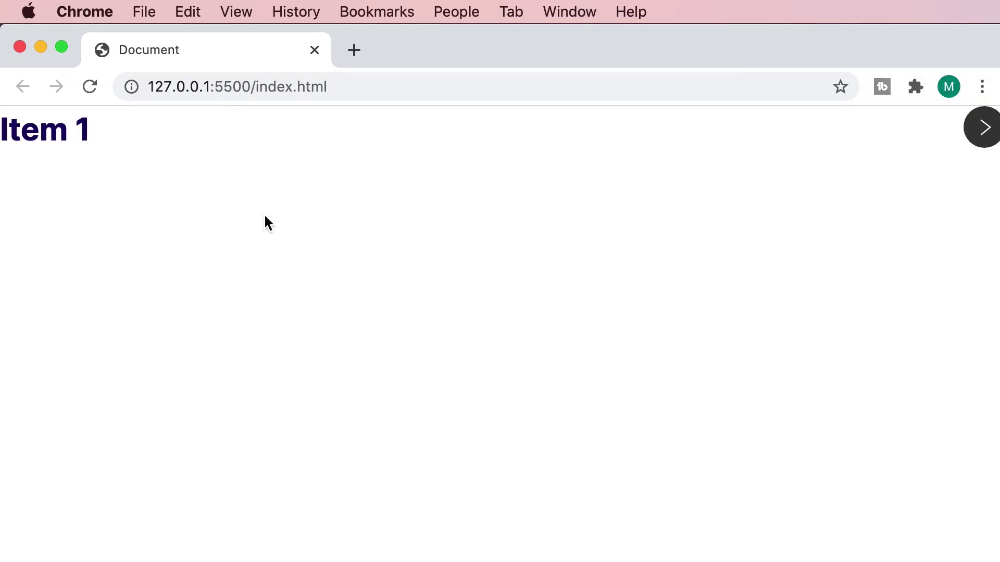

ผลลัพธ์ในเบราว์เซอร์: เนื้อหา Lorem Ipsum หายไป เหลือแค่ header กับไอคอน

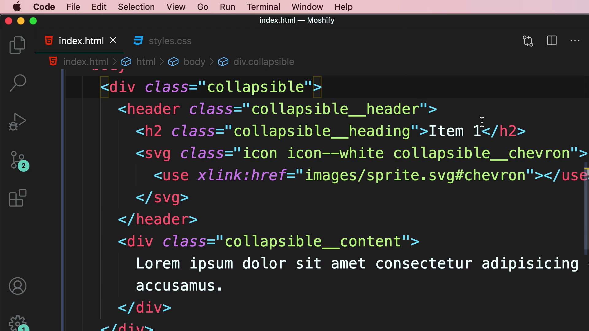

---

## 6. สร้าง Modifier `.collapsible--expanded` สำหรับสถานะ "ขยาย"

Mosh อธิบายว่าต้องมี modifier class เพื่อสลับสถานะระหว่าง "ปิด" (ค่า default) กับ "เปิด" (expanded) เขียน selector ใหม่ `.collapsible--expanded .collapsible__chevron`

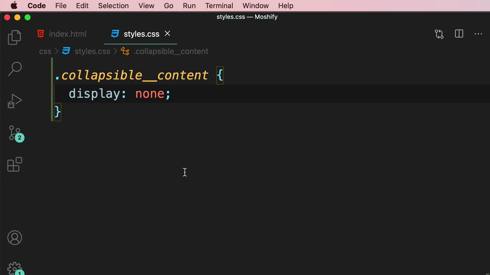

ใส่ `transform: rotate(0);` เพื่อให้ไอคอนกลับไปชี้ลง (สถานะขยายแล้ว) เมื่อ `.collapsible` มี class `--expanded`

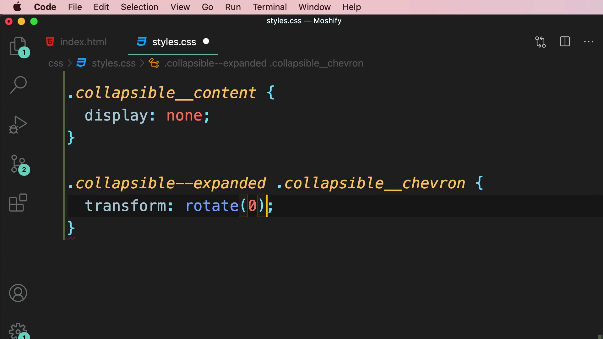

```css
.collapsible--expanded .collapsible__chevron {
  transform: rotate(0);
}
```

ตามด้วย selector `.collapsible--expanded .collapsible__content { display: block; }` เพื่อแสดงเนื้อหาเมื่ออยู่ในสถานะขยาย

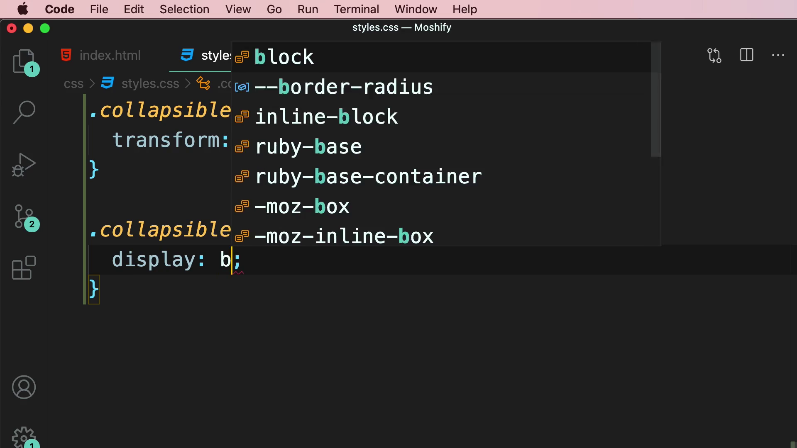

```css
.collapsible--expanded .collapsible__content {
  display: block;
}
```

Mosh ทดสอบโดยเข้า DevTools แล้วเพิ่ม class `collapsible--expanded` ให้กับ `<div class="collapsible">` ด้วยมือ (ผ่าน devtools) เพื่อยืนยันว่า CSS ทำงานถูกต้อง — เนื้อหาปรากฏขึ้นและไอคอนหมุนกลับมาชี้ลง

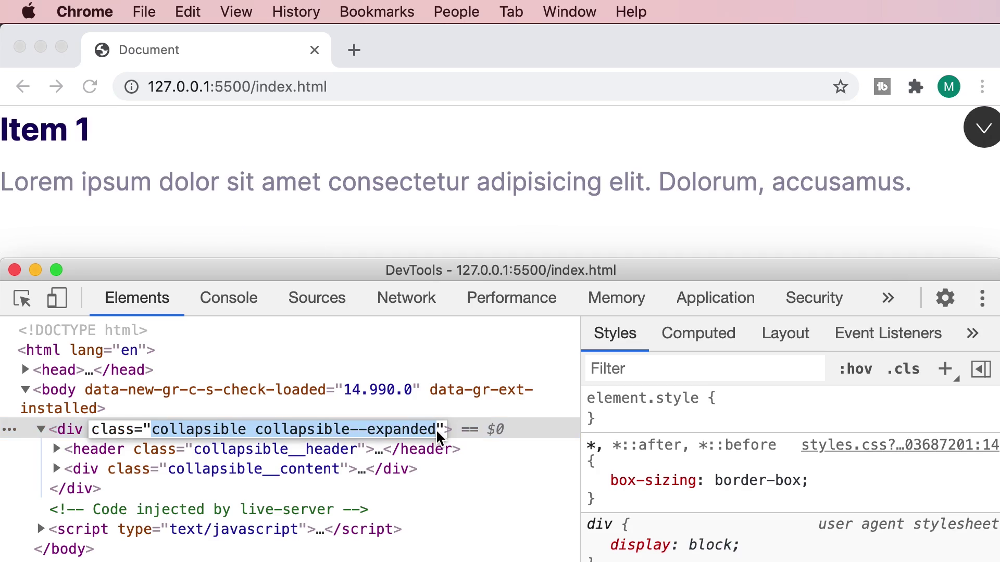

> 📌 หลักการ BEM modifier + JavaScript toggle: CSS เตรียมกฎไว้ล่วงหน้าสำหรับทั้งสองสถานะ (ปิด/เปิด) โดยอาศัยการมี-ไม่มี class `--expanded` เป็นตัวตัดสิน ส่วน JavaScript มีหน้าที่แค่ "เพิ่ม/ลบ" class นี้เท่านั้น ไม่ต้องไปยุ่งกับ style โดยตรง — เป็นแนวทางที่ maintainable กว่า

---

## 7. เพิ่มไฟล์ JavaScript

Mosh สลับไปที่ Finder แล้วสร้างโฟลเดอร์ `js/` พร้อมไฟล์ `main.js` (ลากไฟล์เข้ามาใน VS Code)

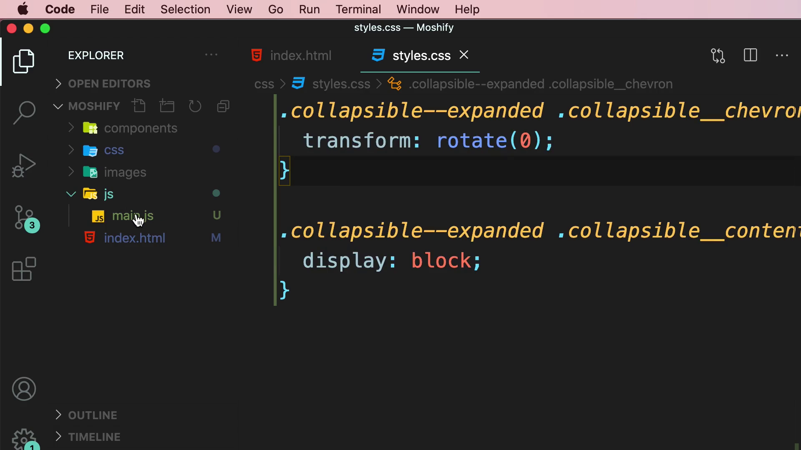

เขียนโค้ด JavaScript ใน `main.js`:

```js
const collapsibles = document.querySelectorAll(".collapsible");

collapsibles.forEach((item) =>
  item.addEventListener("click", function () {
    this.classList.toggle("collapsible--expanded");
  })
);
```

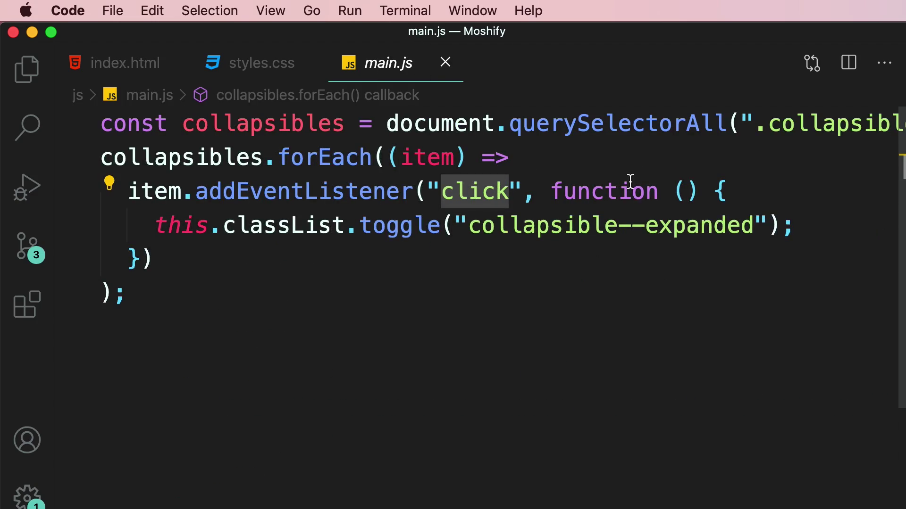

> 🔍 **อธิบายโค้ดทีละบรรทัด:**
> - `document.querySelectorAll(".collapsible")` — ดึง element ทั้งหมดที่มี class `collapsible` มาเป็น NodeList
> - `.forEach((item) => ...)` — วนลูปในแต่ละ collapsible element
> - `item.addEventListener("click", function () {...})` — ผูก event listener สำหรับ click event บน element นั้น (ใช้ `function` ธรรมดา ไม่ใช่ arrow function เพื่อให้ `this` อ้างอิงถึง element ที่ถูกคลิก)
> - `this.classList.toggle("collapsible--expanded")` — สลับ (toggle) class `collapsible--expanded` บน element ที่ถูกคลิก ถ้ามี class นี้อยู่แล้วจะลบออก ถ้ายังไม่มีจะเพิ่มเข้าไป

กลับไปที่ `index.html` เพิ่ม `<script src="js/main.js"></script>` ก่อนปิด `</body>` เพื่อให้ browser โหลดและรัน JavaScript

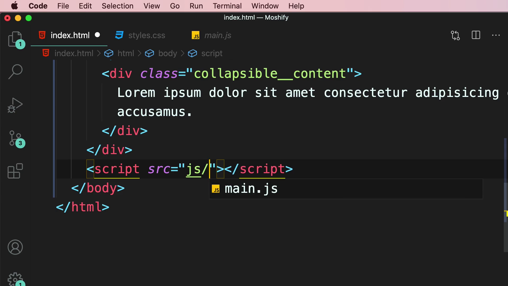

ทดสอบคลิกที่ header ในเบราว์เซอร์: เนื้อหาขยาย/ย่อได้ และไอคอนหมุนตามสถานะ (แม้ยังไม่มี animation แบบนุ่มนวล — สลับแบบทันที)

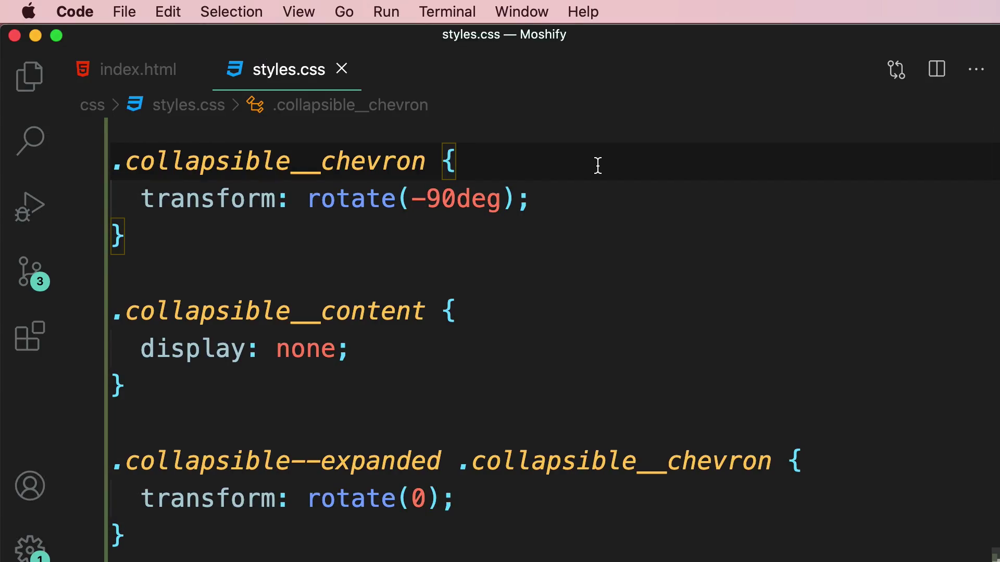

---

## 8. เพิ่ม Animation ให้ไอคอนหมุนแบบนุ่มนวล

กลับไปที่ CSS เพิ่ม `transition: transform 0.3s;` ให้กับ `.collapsible__chevron` เพื่อให้การหมุนไอคอนเปลี่ยนแปลงอย่างนุ่มนวลแทนที่จะกระตุกทันที

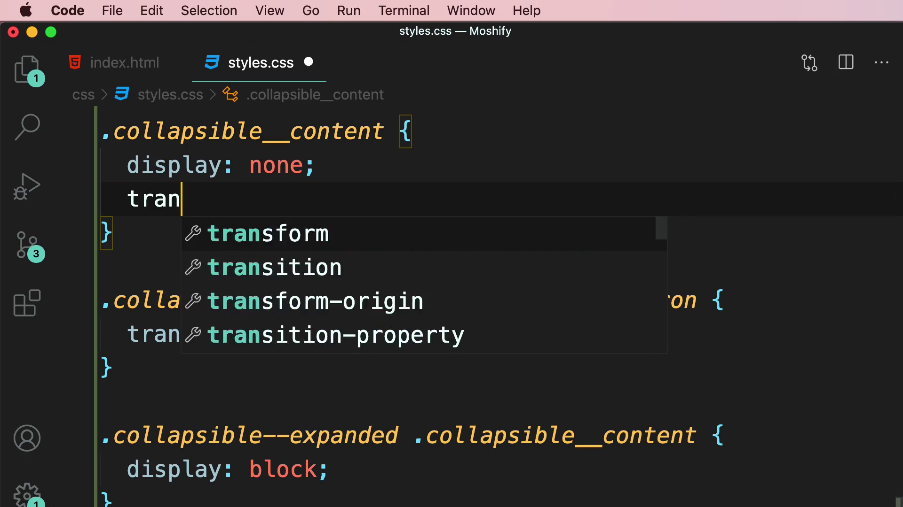

```css
.collapsible__chevron {
  transform: rotate(-90deg);
  transition: transform 0.3s;
}
```

ทดสอบผลลัพธ์: ไอคอนหมุนแบบนุ่มนวลเมื่อคลิก

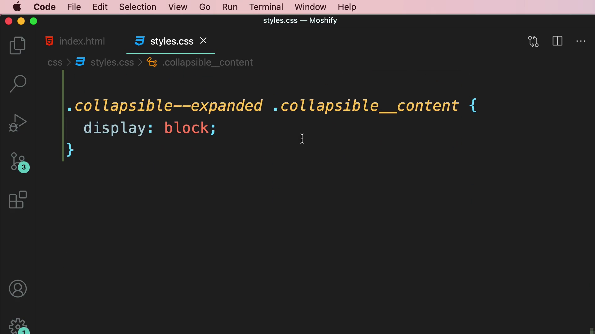

---

## 9. แก้ปัญหา: ทำไมเนื้อหาถึง Animate ไม่ได้ตรงๆ

Mosh อธิบายปัญหาสำคัญ: การ transition ระหว่าง `display: none` กับ `display: block` **ไม่สามารถ animate ได้** เพราะ `display` เป็น property แบบ "มี-หรือไม่มี" (discrete) ไม่มีค่ากลางระหว่างทางให้ interpolate จึงต้องเปลี่ยนวิธีคิดใหม่ทั้งหมด โดยใช้ `max-height` แทน `display`

เขียน CSS ใหม่สำหรับ `.collapsible__content`:

```css
.collapsible__content {
  max-height: 0;
  overflow: hidden;
}
```

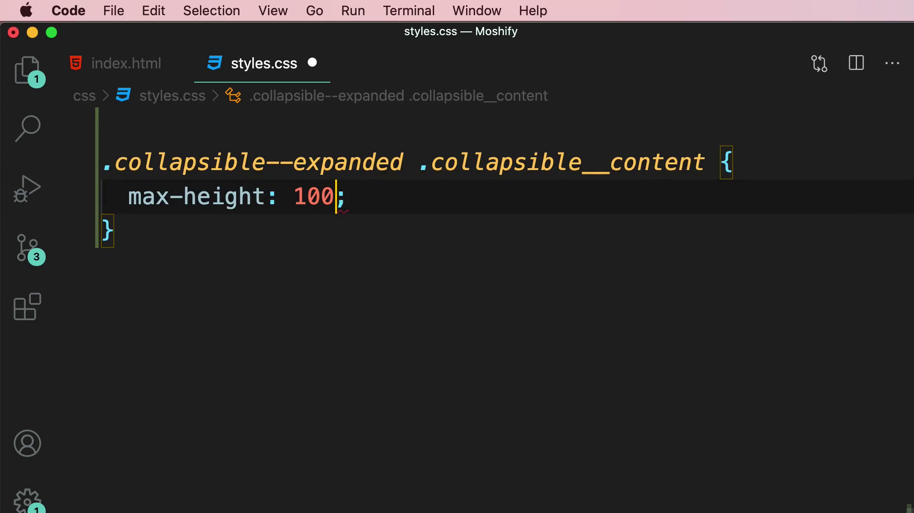

> ⚠️ **หลักการสำคัญ:** `max-height: 0` ทำให้เนื้อหาถูกบีบให้ดูเหมือนไม่มีความสูง ในขณะที่ `overflow: hidden` ทำให้เนื้อหาที่ "ล้น" ออกมาเกินขอบเขต `max-height` ถูกซ่อนไว้ไม่ให้แสดงผล การใช้สอง property คู่กันนี้จำลองพฤติกรรมเหมือน `display: none` แต่เป็นค่าตัวเลขที่ **animate ได้**

จากนั้นแก้ selector `.collapsible--expanded .collapsible__content` จาก `display: block;` เป็น `max-height: 100vh;` (ใช้หน่วย viewport height เพื่อให้ครอบคลุมความสูงเนื้อหาได้เกือบทุกกรณี)


```css
.collapsible--expanded .collapsible__content {
  max-height: 100vh;
}
```

เพิ่ม `transition: max-height 0.3s;` ให้กับ `.collapsible__content` เพื่อให้การเปลี่ยนค่า max-height เป็นแบบนุ่มนวล

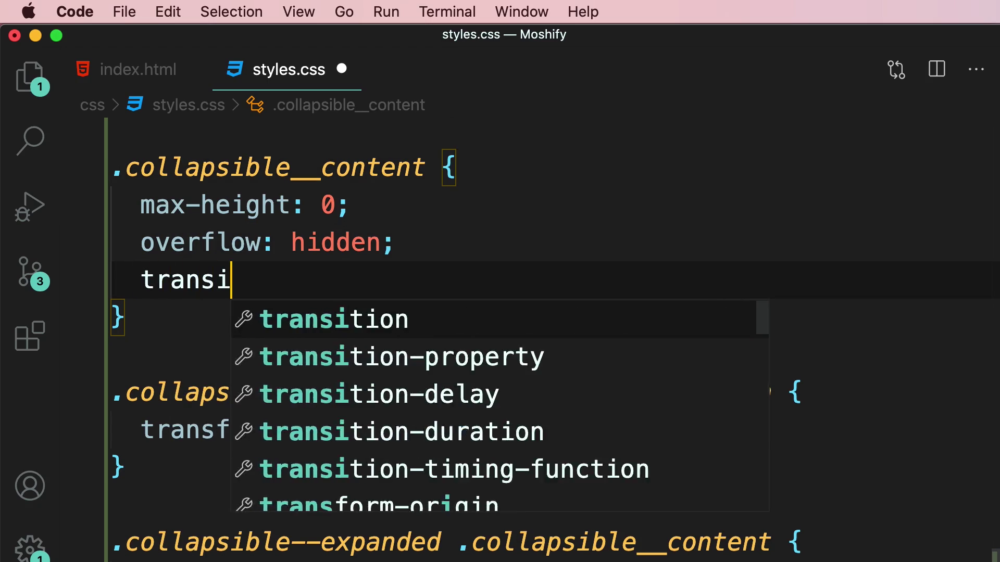

```css
.collapsible__content {
  max-height: 0;
  overflow: hidden;
  transition: max-height 0.3s;
}
```

---

## 10. เพิ่ม Fade-in ด้วย Opacity

เพื่อให้ animation ดูนุ่มนวลยิ่งขึ้น Mosh เพิ่ม `opacity: 0;` ให้กับ `.collapsible__content` เพื่อให้เนื้อหาจางหายไปตอนย่อ

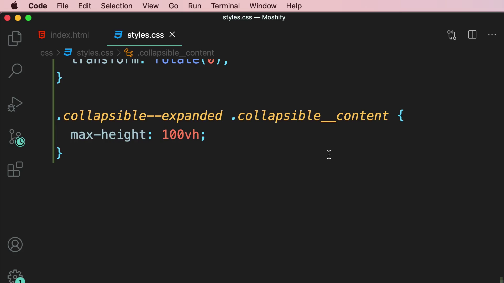

และเพิ่ม `opacity: 1;` ใน `.collapsible--expanded .collapsible__content` เพื่อให้เนื้อหาค่อยๆ ปรากฏขึ้นตอนขยาย

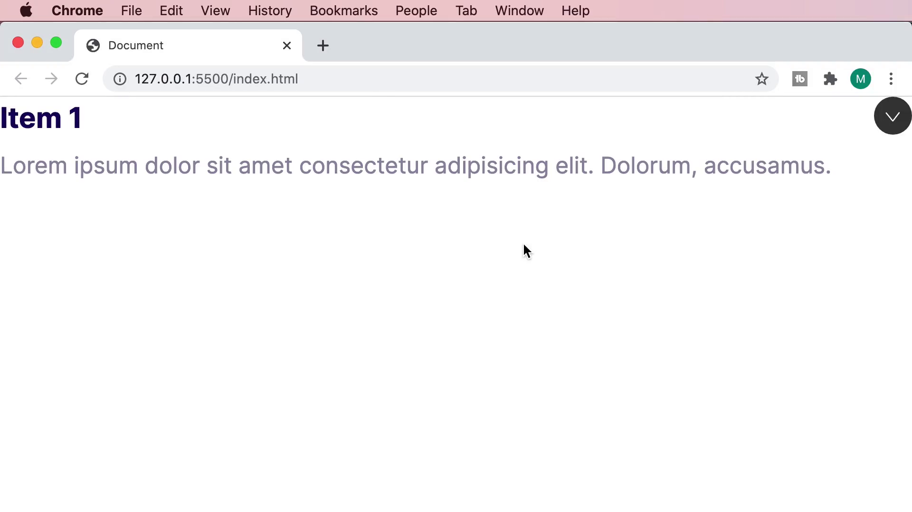

CSS สุดท้ายของ collapsible content:

```css
.collapsible__content {
  max-height: 0;
  overflow: hidden;
  opacity: 0;
  transition: max-height 0.3s;
}

.collapsible--expanded .collapsible__content {
  max-height: 100vh;
  opacity: 1;
}
```

ผลลัพธ์ในเบราว์เซอร์: การขยาย/ย่อเนื้อหาเป็นไปอย่างนุ่มนวลทั้งความสูงและความโปร่งใส พร้อมไอคอนที่หมุนไปพร้อมกัน


---

## 11. ทดสอบด้วย Collapsible หลายตัว

Mosh คัดลอกโครงสร้าง HTML ของ collapsible ตัวแรกไปวางเป็นตัวที่สอง (ทั้งสองมี class `collapsible` เหมือนกัน)

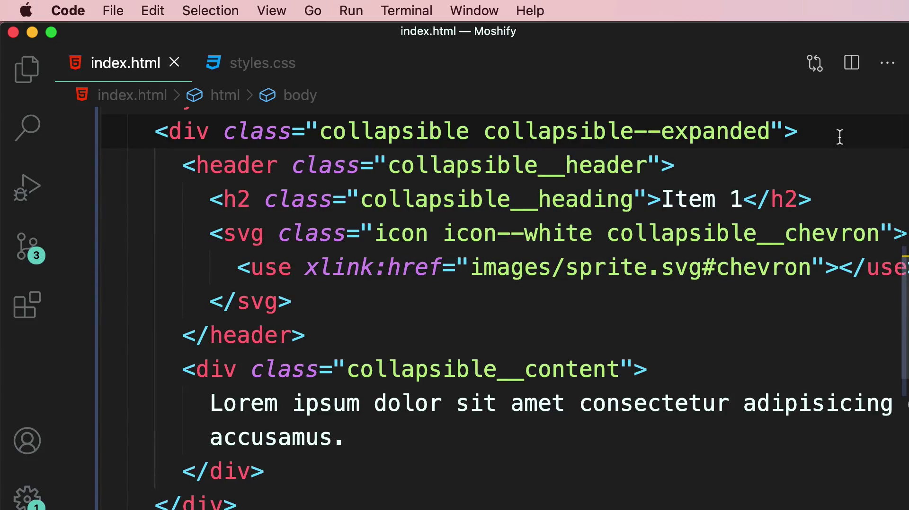

ทดสอบในเบราว์เซอร์: คลิกแต่ละ collapsible แยกกันได้อย่างอิสระ (independent toggle) เพราะ JavaScript ใช้ `forEach` ผูก event listener ให้กับ **ทุกตัว** ที่ match selector `.collapsible` แยกกัน

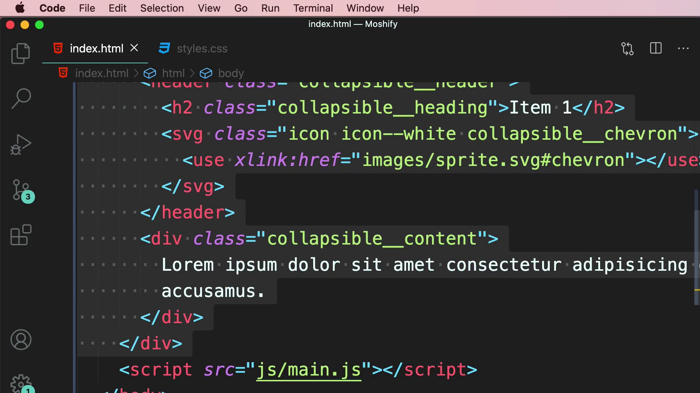

ปิดท้ายคลิปด้วยการเปิดดู mockup ใน Photoshop เพื่อดูตัวอย่างว่า Collapsible component นี้จะถูกนำไปใช้จริงในคอลัมน์ footer "PRODUCTS" ของเว็บไซต์ในบทเรียนถัดไป

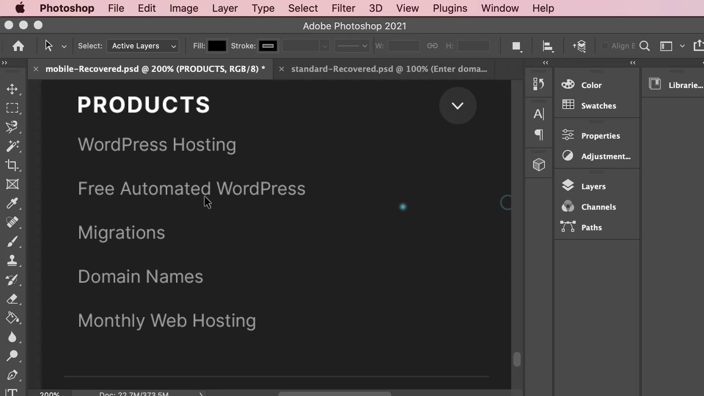

---

## สรุปภาพรวมของคลิปนี้

| หัวข้อ | รายละเอียดสำคัญ |
|---|---|
| โครงสร้าง HTML | `.collapsible` > (`.collapsible__header` [`.collapsible__heading`, svg `.icon.icon--white.collapsible__chevron`], `.collapsible__content`) |
| Flexbox | `.collapsible__header { display: flex; justify-content: space-between; }` จัดหัวข้อกับไอคอนคนละฝั่ง |
| ไอคอนเริ่มต้น | `transform: rotate(-90deg)` ให้ลูกศรชี้ขวา (ปิด) |
| Modifier สถานะเปิด | `.collapsible--expanded` — ใช้ descendant selector ปรับทั้งไอคอนและเนื้อหา |
| JavaScript | `querySelectorAll` + `forEach` + `addEventListener("click")` + `classList.toggle()` |
| ปัญหา `display` | `display: none/block` เปลี่ยนแบบทันที ไม่มีค่ากลาง จึง animate ไม่ได้ |
| ทางแก้ | ใช้ `max-height` + `overflow: hidden` + `opacity` แทน `display` เพื่อให้ transition ทำงานได้ |
| ผลลัพธ์สุดท้าย | ขยาย/ย่อแบบนุ่มนวล พร้อมไอคอนหมุนและเนื้อหา fade-in/out |

### แนวคิดสำคัญที่ได้จากคลิปนี้

1. **`display: none`/`block` ไม่สามารถ animate ได้** เพราะเป็นค่าที่ไม่มีสถานะกลาง (all-or-nothing) — ต้องใช้ property ที่มีค่าตัวเลขต่อเนื่อง เช่น `max-height`, `opacity`, หรือ `transform` แทน เพื่อให้ browser คำนวณค่ากลางระหว่าง transition ได้
2. **`max-height` + `overflow: hidden` คือเทคนิคคลาสสิกสำหรับ animate การขยาย/ย่อเนื้อหา** ที่ความสูงจริงไม่แน่นอน (เพราะ CSS ไม่รองรับการ animate ไปยัง `height: auto` โดยตรง)
3. **BEM modifier (`--expanded`) ทำงานร่วมกับ JavaScript ได้อย่างสะอาด** — CSS กำหนดล่วงหน้าว่าแต่ละสถานะหน้าตาเป็นอย่างไร ส่วน JS มีหน้าที่แค่สลับ class เท่านั้น ทำให้แยกความรับผิดชอบ (separation of concerns) ระหว่าง style กับ logic ได้ชัดเจน
4. **`classList.toggle()`** เป็นวิธีที่กระชับที่สุดในการสลับสถานะเปิด-ปิดของ class บน element โดยไม่ต้องเช็คเงื่อนไขเองว่าตอนนี้มี class อยู่หรือไม่
5. **`function` ธรรมดา (ไม่ใช่ arrow function) ใน event listener สำคัญ** เพราะ `this` ใน `function` แบบปกติจะอ้างอิงถึง element ที่ถูกคลิก ในขณะที่ arrow function จะไม่ bind `this` ใหม่ ทำให้โค้ดพัง
6. **`querySelectorAll` + `forEach`** ทำให้ event listener ถูกผูกกับทุก element ที่ตรงกับ selector โดยอัตโนมัติ รองรับ component หลายตัวในหน้าเดียวกันโดยไม่ต้องเขียนโค้ดซ้ำ

---

*สรุปจากคลิปที่ 26 (Collapsibles) คอร์ส "Building a Website with HTML and CSS" โดย Mosh Hamedani (codewithmosh.com)*
