# HTML-CSS-3: 27 - Blocks

**ไฟล์ต้นฉบับ:** 27- Blocks.mp4

▶️ [ดูวิดีโอ](../../HTML-CSS-3/27-%20Blocks.mp4)

---

## ภาพรวมคลิปนี้

ในคลิปนี้ Mosh สอนการสร้างคอมโพเนนต์ **Block** ซึ่งเป็น section เอนกประสงค์ (generic reusable component) ที่ใช้เป็น "หน่วยสร้าง" หลักของหน้า Landing Page ทั้งหน้า ตัวอย่างที่ใช้เป็นเป้าหมายคือส่วน "Host On The Cloud to Keep Growing" ของ mockup ที่ทำใน Photoshop

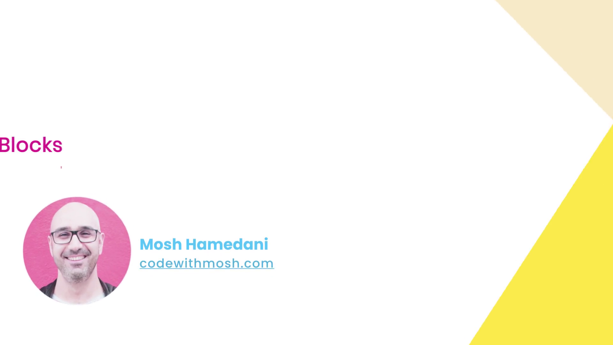

Block คือ section ที่มี heading, ข้อความ, และเนื้อหาข้างในที่เปลี่ยนแปลงได้ โดยแต่ละหน้าเว็บมักจะประกอบด้วย Block หลาย ๆ อันวางต่อกันในแนวตั้ง คลิปนี้ครอบคลุมตั้งแต่การสร้าง Block พื้นฐาน, การใส่ตัวแปรสี (dark modifier), การตัดขอบเฉียงด้วย `clip-path`, ไปจนถึงการสร้าง class ยูทิลิตี้ `.container` สำหรับจำกัดความกว้างเนื้อหา

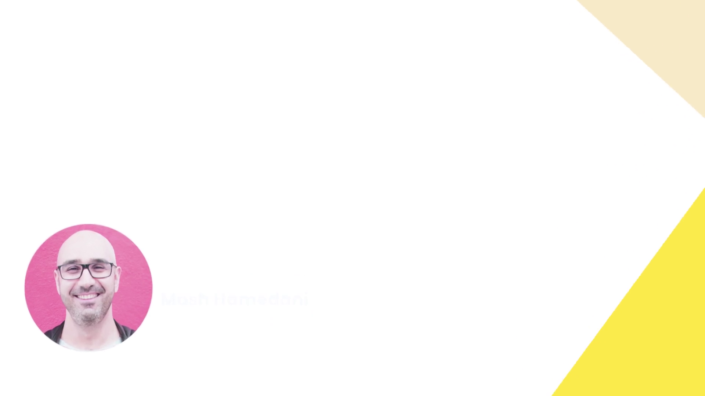

> 💡 แนวคิดสำคัญของคลิปนี้คือ **BEM (Block Element Modifier)** ที่ Mosh ใช้ตลอดคอร์ส: `.block` คือ Block, `.block__heading` คือ Element ภายใน Block, และ `.block--dark` / `.block--skewed-right` คือ Modifier ที่เปลี่ยนรูปลักษณ์ของ Block

---

## 1. สร้าง HTML และ CSS พื้นฐานของ Block

Mosh เริ่มจากการพิมพ์ Emmet abbreviation `section.block` ใน `index.html` เพื่อสร้าง section ใหม่

```html
<section class="block">
  <h2>Heading</h2>
  <p>Lorem ipsum dolor sit amet consectetur adipisicing elit. Nihil, laboriosam.</p>
</section>
```

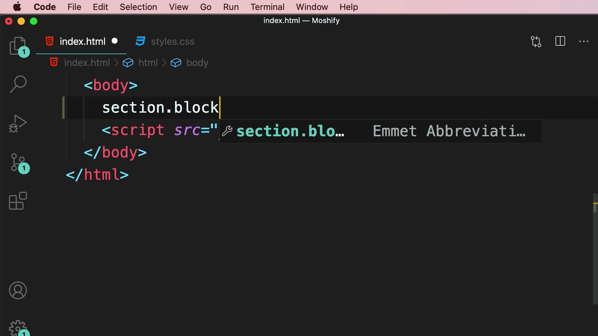

จากนั้นไปที่ `styles.css` เพิ่ม comment หัวข้อ `/* Blocks */` แล้วสร้าง class `.block` โดยใส่ `padding: 6rem 2rem;` (แนวตั้ง 6rem แนวนอน 2rem) และใส่ `border: 2px solid red;` เป็นเส้นขอบสีแดงชั่วคราวเพื่อให้มองเห็นขอบเขตของ Block ได้ชัดเจนตอนพัฒนา (จะลบออกทีหลัง)

```css
/* Blocks */
.block {
  padding: 6rem 2rem;
  border: 2px solid red; /* เส้นขอบชั่วคราวสำหรับ debug ระหว่างพัฒนา */
}
```

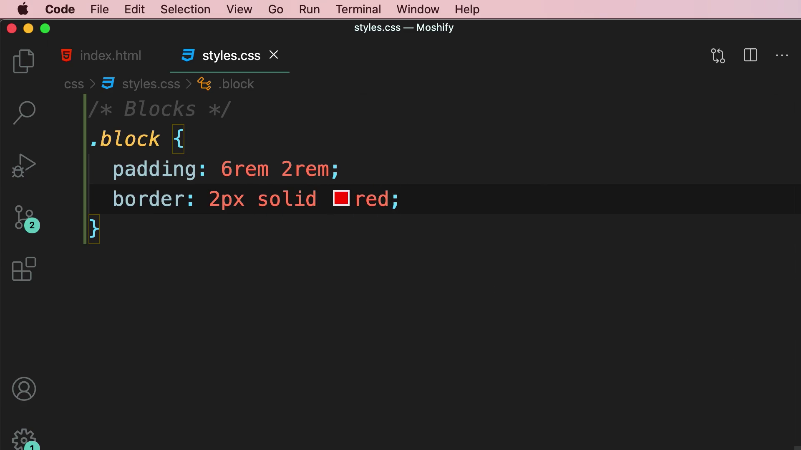

เมื่อดูผลลัพธ์ในเบราว์เซอร์ จะเห็น Heading และข้อความ Lorem ipsum อยู่ภายในกรอบสีแดง

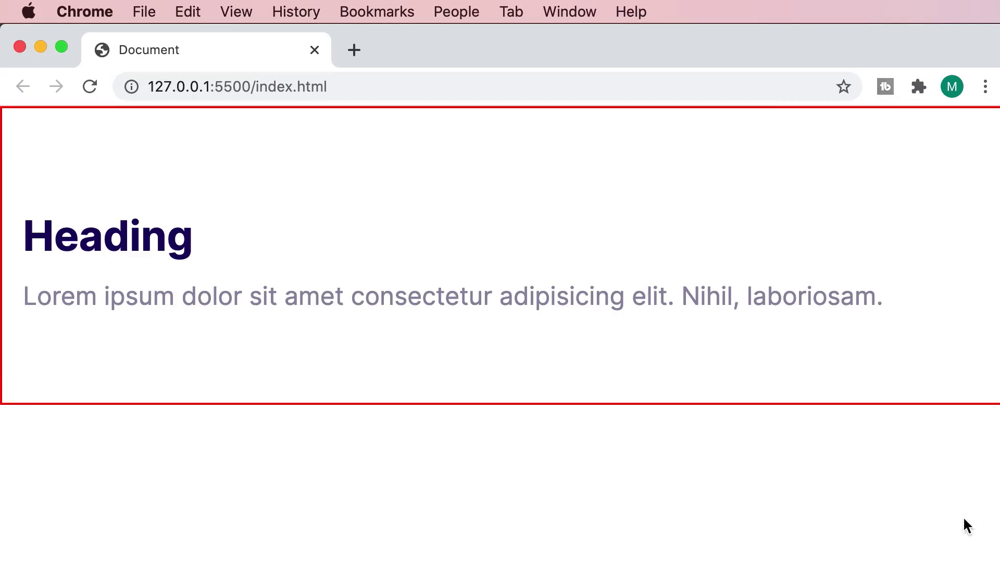

> 📌 เทคนิคการใส่ `border` สีแดง (หรือสีที่เด่นชัด) ชั่วคราวเป็นวิธีที่นักพัฒนาหน้าเว็บใช้บ่อยมากเพื่อดู "ขอบเขต" ของ element ขณะจัดวาง layout แล้วค่อยลบออกภายหลัง

---

## 2. อธิบาย Box Model ด้วย Chrome DevTools

Mosh เปิด DevTools (คลิกขวาที่ Heading เลือก Inspect) เพื่ออธิบาย **Box Model** ให้ผู้ชมเข้าใจว่าทำไม heading ถึงมีช่องว่างเหนือมันอยู่

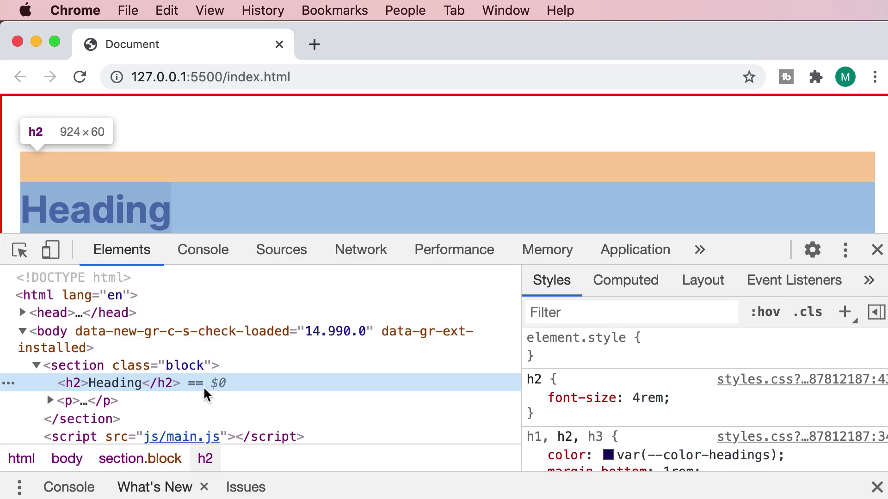

ไปที่แท็บ **Computed** ในพาเนลด้านขวาของ DevTools ซึ่งจะแสดงกล่องภาพ (diagram) ของ Box Model ประกอบด้วย 4 ชั้นจากในสุดไปนอกสุด: **content** (เนื้อหา) → **padding** (ช่องว่างภายใน) → **border** (เส้นขอบ) → **margin** (ช่องว่างภายนอก)

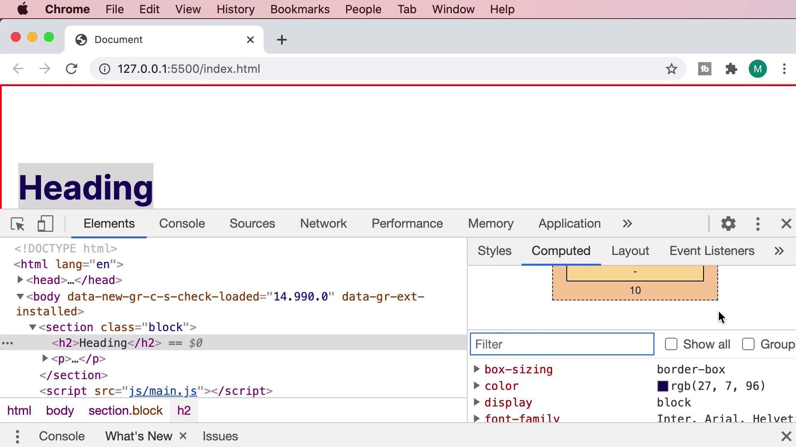

เมื่อเลื่อนดู diagram จะเห็นตัวเลข margin แสดงอยู่ (เช่น `33.200`) ซึ่งเป็นค่า margin เริ่มต้น (default margin) ที่เบราว์เซอร์กำหนดให้กับแท็ก `<h2>` โดยอัตโนมัติ (user agent stylesheet)

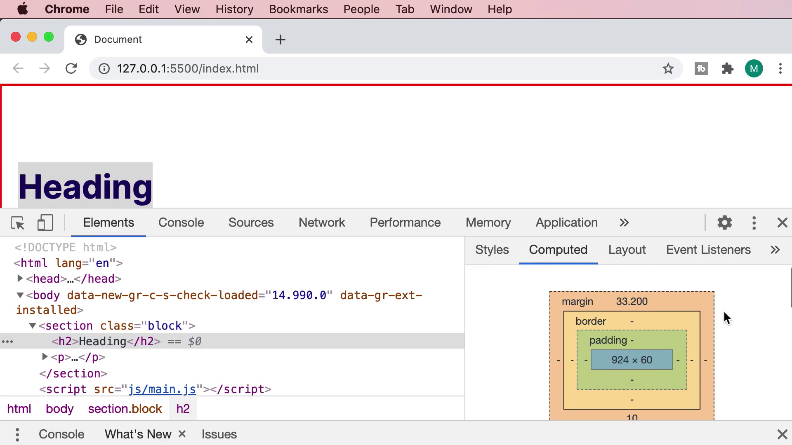

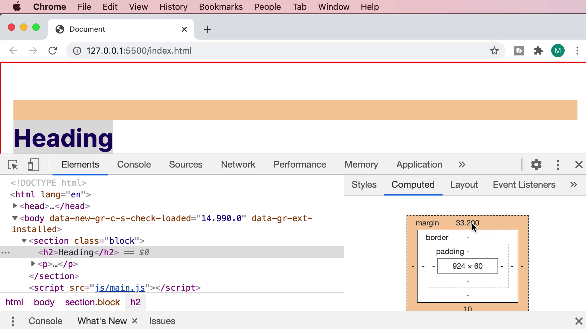

> 🔍 margin สีส้มที่เห็นด้านบน h2 นี้เองที่ทำให้ heading ไม่ "ชิดขอบบน" ของ Block ซึ่ง Mosh จะแก้ไขในขั้นตอนถัดไปด้วย BEM class

---

## 3. สร้าง Element `.block__heading` เพื่อลบ margin เริ่มต้น

กลับไปที่ `index.html` ใส่ `class="block__heading"` ให้กับ `<h2>` ตามหลักการตั้งชื่อแบบ BEM (Block\_\_Element)

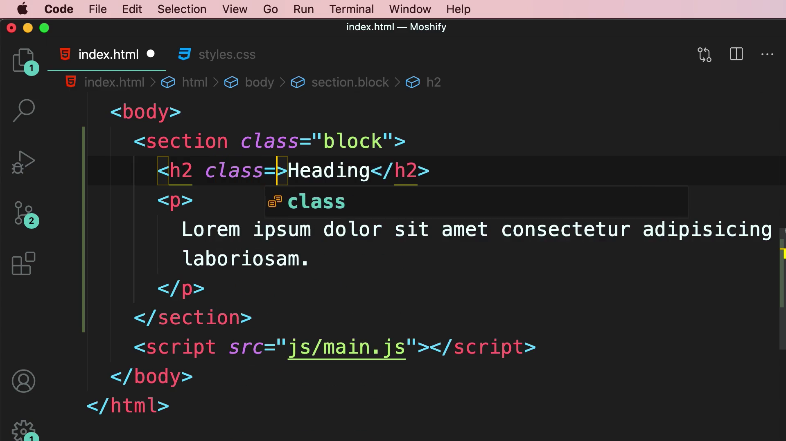

จากนั้นไปที่ `styles.css` สร้าง selector `.block__heading` แล้วพิมพ์ `margin-top` โดย VS Code IntelliSense แสดงตัวเลือก autocomplete ของหน่วยค่าต่าง ๆ เช่น `0%`, `0ch`, `0cm` ให้เลือก

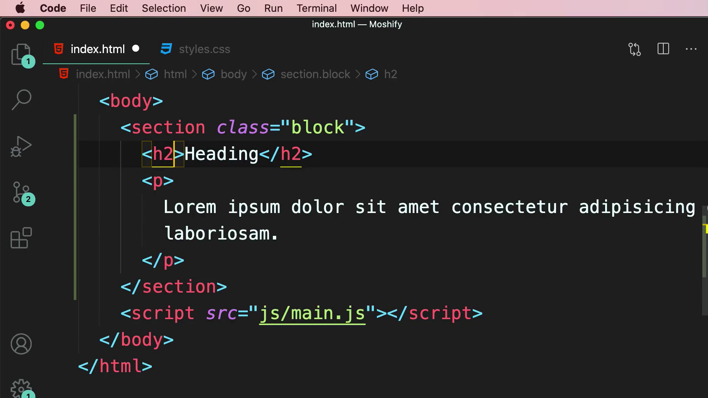

Mosh เลือกใส่ค่าเป็น `0` (ไม่มีหน่วย เพราะ 0 ไม่ต้องมีหน่วยกำกับ)

```css
.block__heading {
  margin-top: 0;
}
```

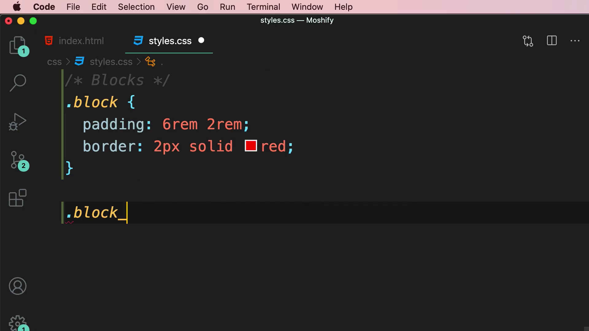

ผลลัพธ์ในเบราว์เซอร์: ข้อความ "Heading" เลื่อนขึ้นมาชิดขอบบนของกรอบสีแดงพอดี ไม่มีช่องว่างด้านบนอีกต่อไป

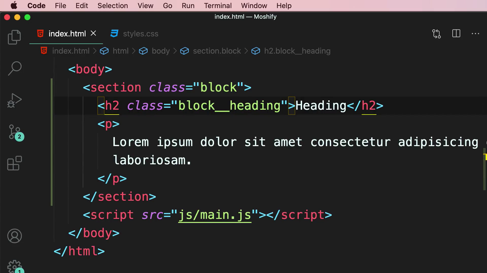

> ✅ นี่คือรูปแบบที่พบบ่อยมากในการเขียน CSS: ต้องคอย "รีเซ็ต" ค่า margin เริ่มต้นของ browser (โดยเฉพาะ heading tag อย่าง h1-h6) เพื่อควบคุม spacing เองทั้งหมด

---

## 4. สร้าง Modifier `.block--dark` (Block สีเข้ม)

Mosh คัดลอก (copy-paste) section `.block` เดิมมาสร้างเป็น Block ที่สอง แล้วเพิ่ม class `block--dark` ต่อท้าย `block` (BEM Modifier ใช้ `--` สองขีด)

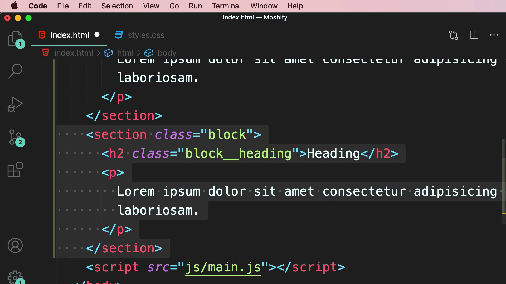

```html
<section class="block block--dark">
  <h2 class="block__heading">Heading</h2>
  <p>Lorem ipsum dolor sit amet consectetur adipisicing elit. Nihil, laboriosam.</p>
</section>
```

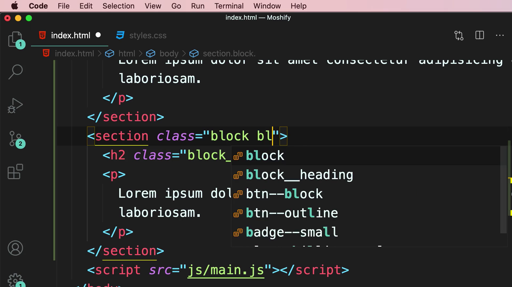

จากนั้นไปที่ `styles.css` สร้าง selector `.block--dark` แล้วกำหนด `background: #000;` (สีดำ)

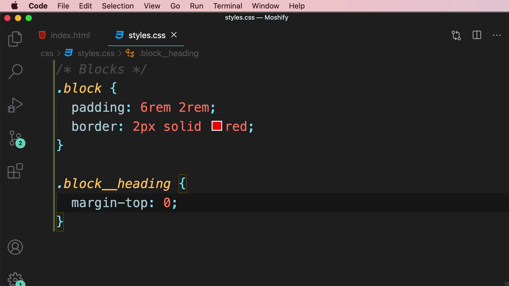

และกำหนดสีตัวอักษรของเนื้อหาปกติ (paragraph) เป็นสีเทาอ่อน `color: #7b858b;`

```css
.block--dark {
  background: #000;
  color: #7b858b;
}
```

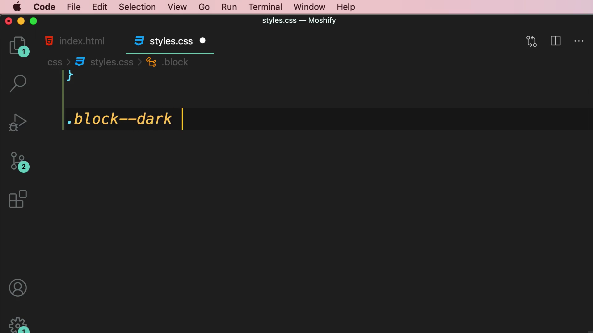

ดูผลลัพธ์ในเบราว์เซอร์ พบว่าพื้นหลังเป็นสีดำและตัวอักษรเป็นสีเทา แต่ Heading ยังคงเป็นสีน้ำเงินเข้ม (ตามค่า `--color-headings` เดิม) ซึ่งมองยากบนพื้นดำ

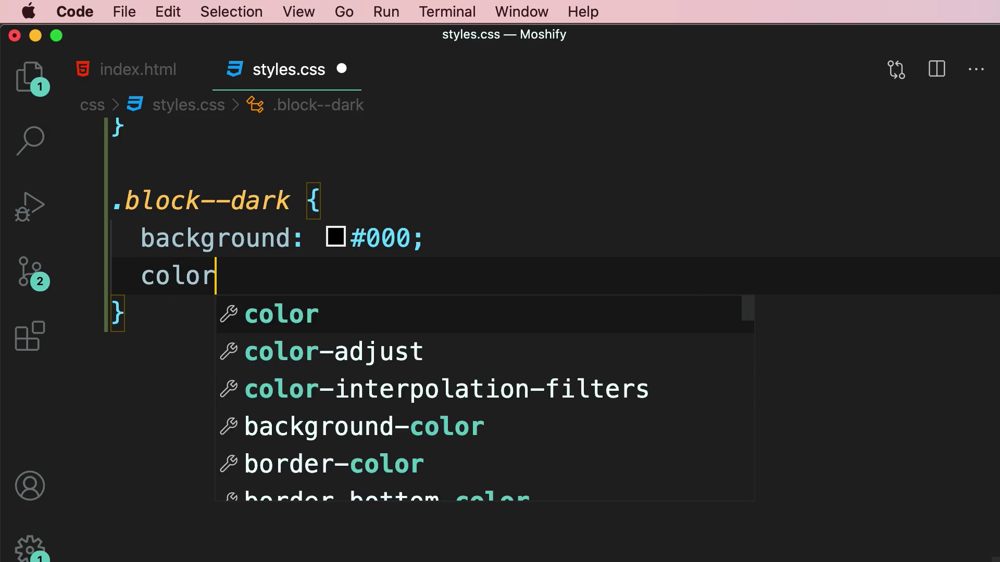

---

## 5. ใช้ Descendant Selector แก้สีของ Heading ใน Dark Block

เพื่อแก้ปัญหาสี Heading ที่มองไม่เห็นบนพื้นดำ Mosh สร้าง selector ใหม่แบบ **descendant selector** คือ `.block--dark .block__heading` (เว้นวรรคระหว่าง class หมายถึง "เลือก element ลูกที่มี class `block__heading` ซึ่งอยู่ภายใน element ที่มี class `block--dark`")

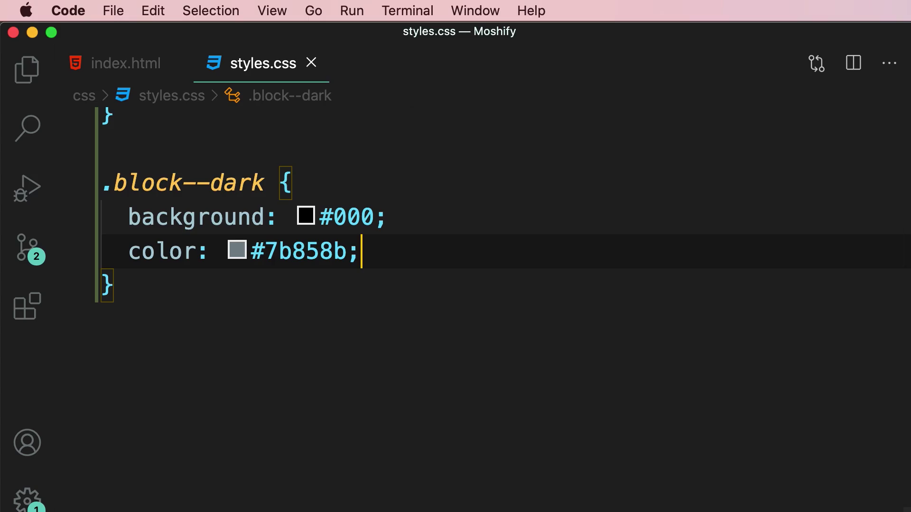

```css
.block--dark .block__heading {
  color: #fff;
}
```

กำหนดสีเป็น `#fff` (สีขาว)

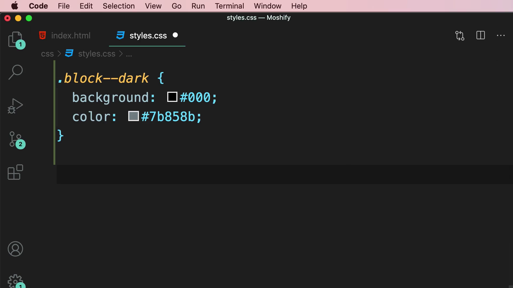

ผลลัพธ์: Heading ในบล็อกสีเข้มเปลี่ยนเป็นสีขาว ตัดกับพื้นหลังสีดำได้ชัดเจน ส่วนบล็อกแรก (สีขาว) ยังคงใช้สี Heading เดิมตามปกติ

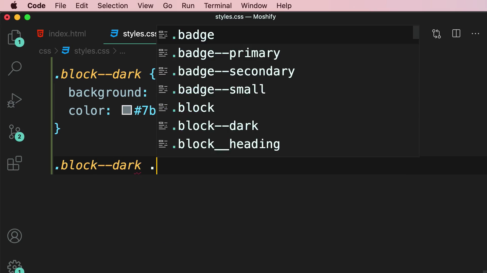

> 📝 Descendant selector (`.parent .child`) เป็นเทคนิคสำคัญของ BEM Modifier ในการปรับแต่ง Element ให้เปลี่ยนไปตาม Modifier ของ Block แม่ โดยไม่ต้องสร้าง class ใหม่ซ้อนกันหลายชั้น

---

## 6. สำรวจ `clip-path` ด้วยเว็บไซต์ Clippy

Mosh เปิดเว็บไซต์ **Clippy** (bennettfeely.com/clippy) ซึ่งเป็นเครื่องมือ generate ค่า CSS `clip-path` แบบ visual (ลากเมาส์ปรับรูปทรงแล้วได้โค้ด CSS ออกมาทันที)

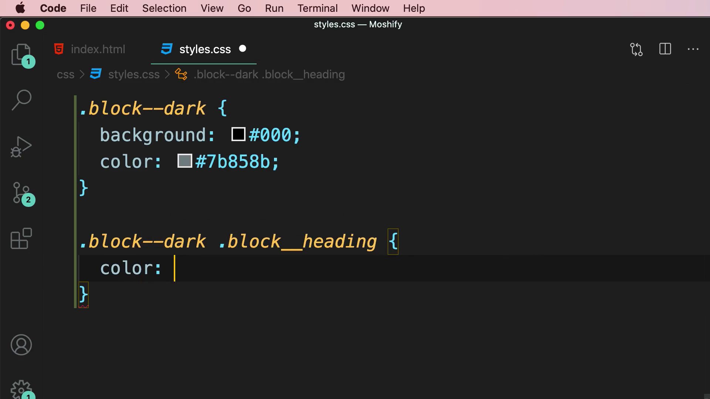

Clippy มีรูปทรง (shape) สำเร็จรูปให้เลือกมากมาย เช่น สามเหลี่ยม, วงกลม, ลูกศร, และรูปทรงเฉียง (skewed) ซึ่ง Mosh เลือกรูปทรงแบบเฉียงมุมล่าง (คล้ายธง) เพื่อใช้ตัดขอบล่างของ Block ให้เป็นเส้นทแยง

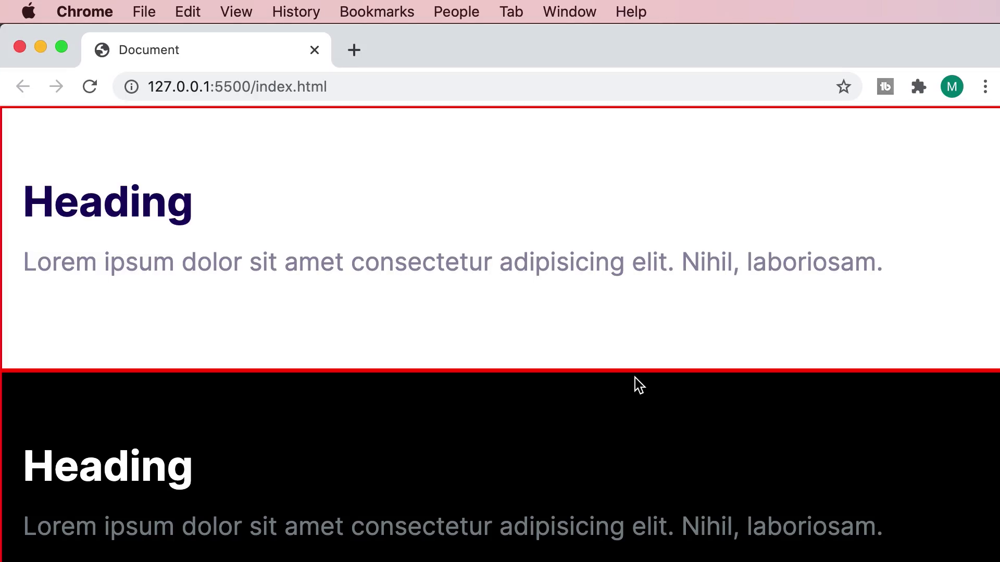

เมื่อเลือกรูปทรงที่ต้องการ Clippy จะแสดงจุด (handle) ให้ลากปรับตำแหน่งเพื่อควบคุมมุมของเส้นทแยง

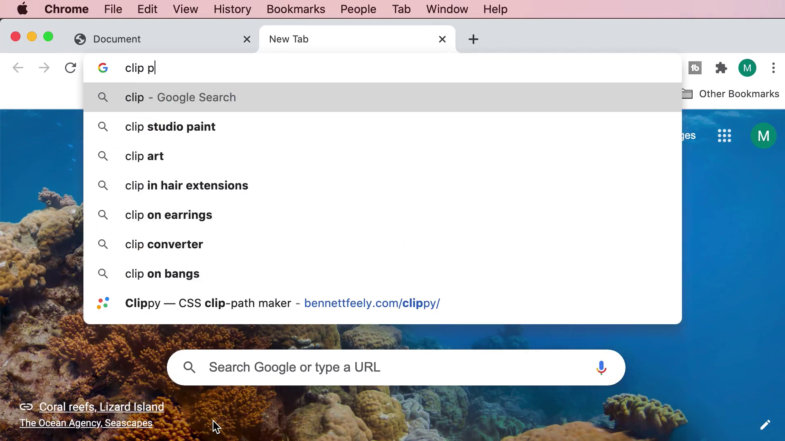

Clippy จะ generate โค้ด CSS `clip-path: polygon(...)` ให้โดยอัตโนมัติตามรูปทรงที่ปรับ

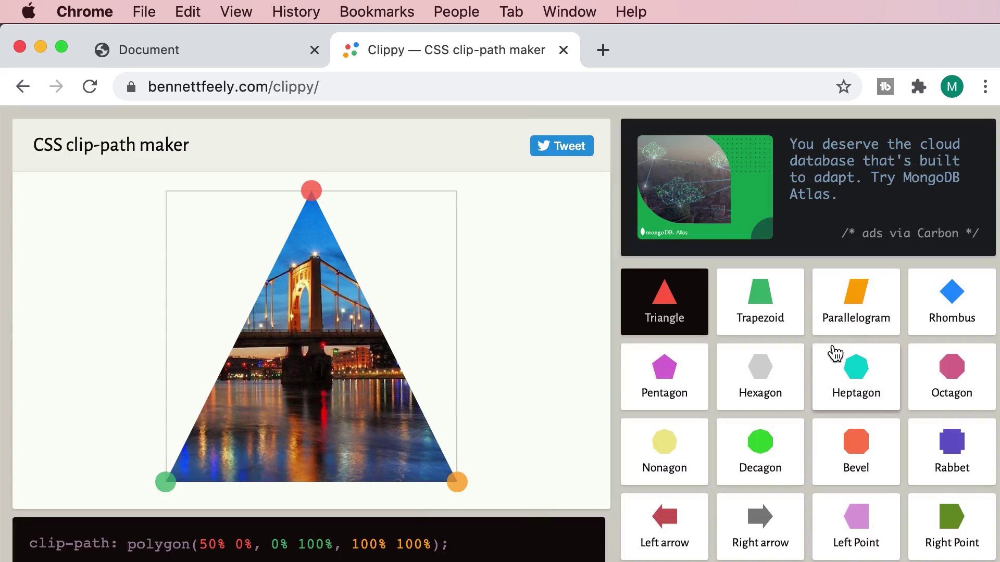

Mosh คัดลอกค่า polygon นี้ไปใช้ในโปรเจกต์

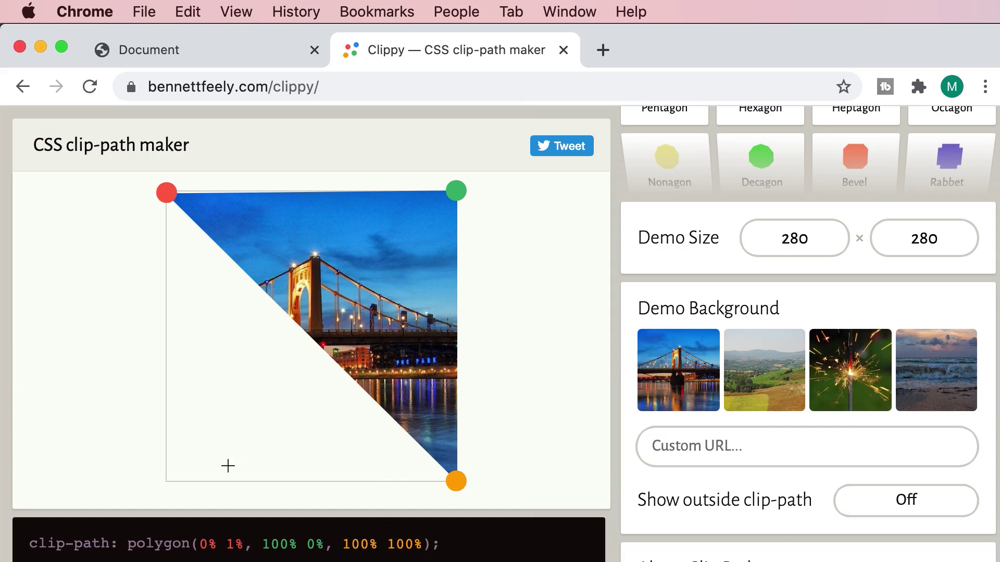

---

## 7. สร้าง Modifier `.block--skewed-right`

กลับไปที่ `index.html` เพิ่ม class `block--skewed-right` ให้กับ section (Block ที่สอง) ต่อจาก `block--dark`

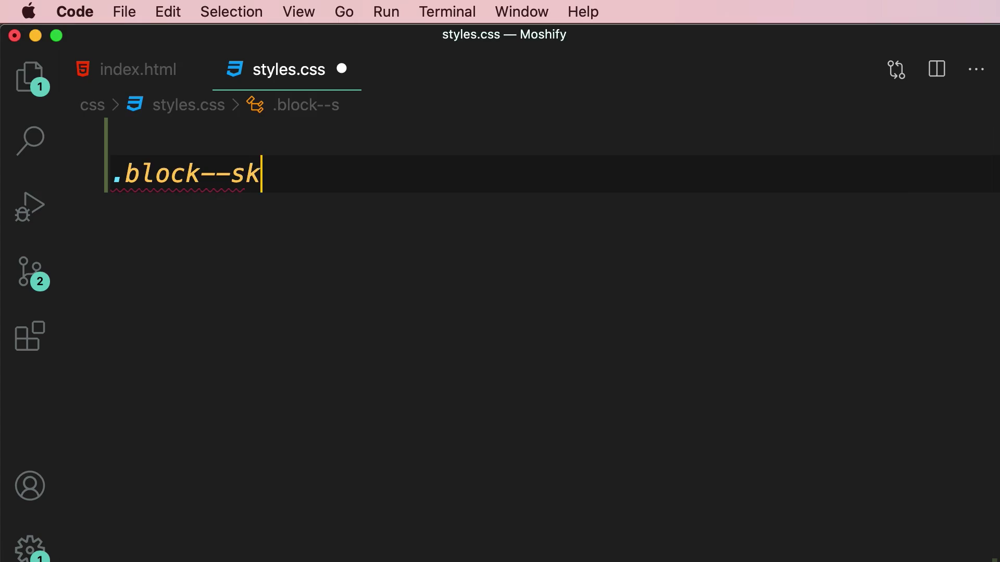

จากนั้นวางค่า `clip-path` ที่คัดลอกมาจาก Clippy ลงใน `styles.css` ภายใต้ selector `.block--skewed-right`

```css
.block--skewed-right {
  clip-path: polygon(0% 0%, 100% 0%, 100% 100%, 0% 86%);
}
```

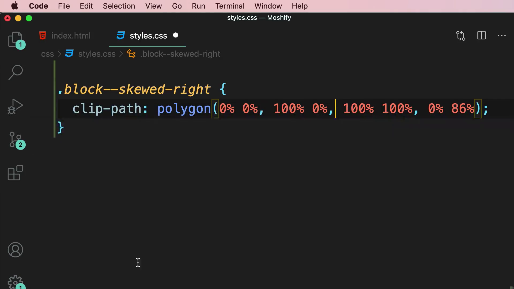

ดูผลลัพธ์ครั้งแรกในเบราว์เซอร์ พบว่าขอบล่างของ Block ถูกตัดเป็นเส้นทแยงมุมแล้ว แต่มุมยังไม่สวยพอดีตามที่ต้องการ

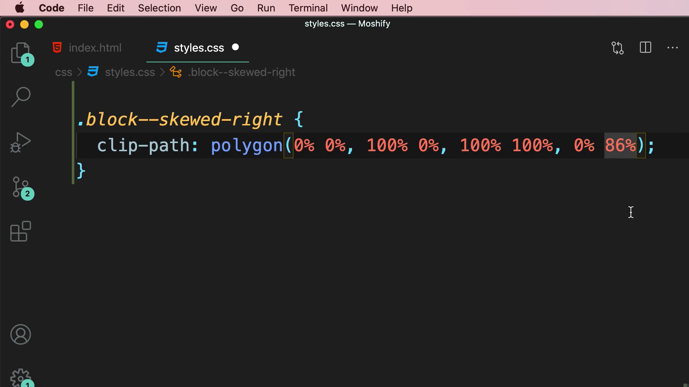

> ⚠️ ค่า `polygon()` ใน `clip-path` คือชุดของจุดพิกัด (x% y%) ที่เชื่อมกันเป็นรูปทรงหลายเหลี่ยม ส่วนของ element ที่อยู่นอกรูปทรงนี้จะถูก "ตัด" (clip) ออกไป ทำให้มองไม่เห็น

Mosh ปรับค่าตัวเลขเปอร์เซ็นต์ในจุดสุดท้ายของ polygon (มุมล่างซ้าย) เพื่อควบคุมความชันของเส้นทแยง

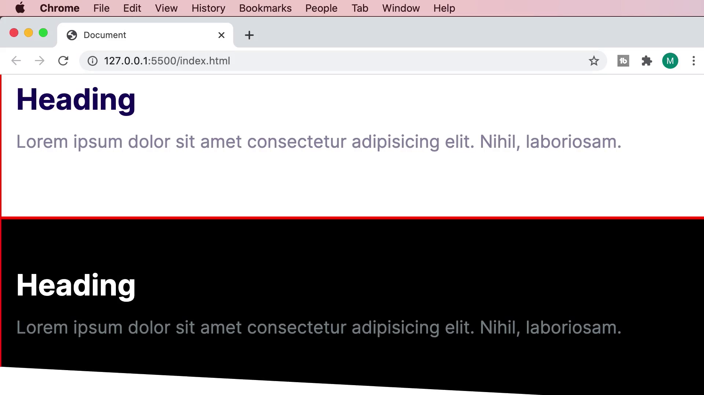

หลังปรับค่าเป็น `80%` ผลลัพธ์คือเส้นทแยงที่ชันขึ้นและดูเป็นธรรมชาติมากขึ้น

```css
.block--skewed-right {
  clip-path: polygon(0% 0%, 100% 0%, 100% 100%, 0% 80%);
}
```

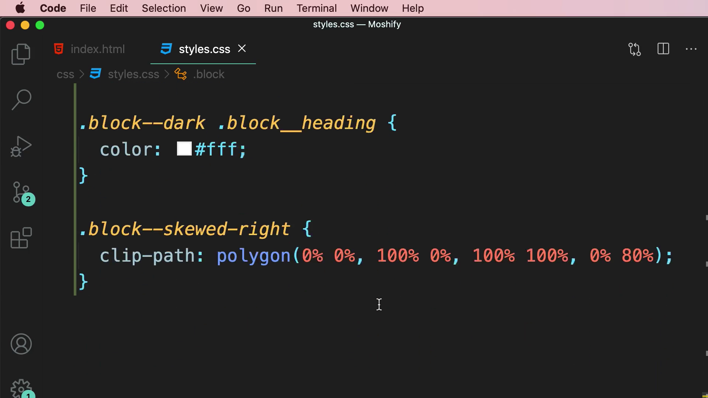

---

## 8. เพิ่ม `padding-bottom` ชดเชยพื้นที่ที่ถูกตัด

เนื่องจาก `clip-path` ตัดเนื้อหาส่วนล่างของ Block ออกไปบางส่วน ทำให้เนื้อหาจริง (เช่นข้อความ) อาจถูกตัดขาดไปด้วย Mosh จึงเพิ่ม `padding-bottom` ให้กับ `.block--skewed-right` เพื่อดันเนื้อหาขึ้นมาให้อยู่พ้นแนวตัด

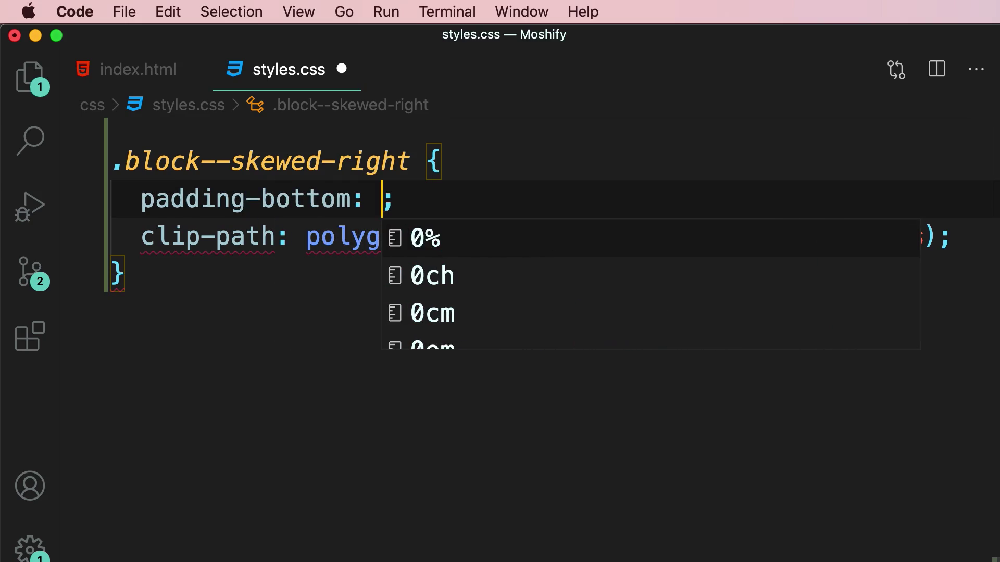

```css
.block--skewed-right {
  clip-path: polygon(0% 0%, 100% 0%, 100% 100%, 0% 80%);
  padding-bottom: 10rem;
}
```

ผลลัพธ์ในเบราว์เซอร์: เนื้อหาทั้งหมดของ Block อยู่เหนือแนวตัดเฉียง ไม่ถูกเส้นทแยงตัดผ่านอีกต่อไป

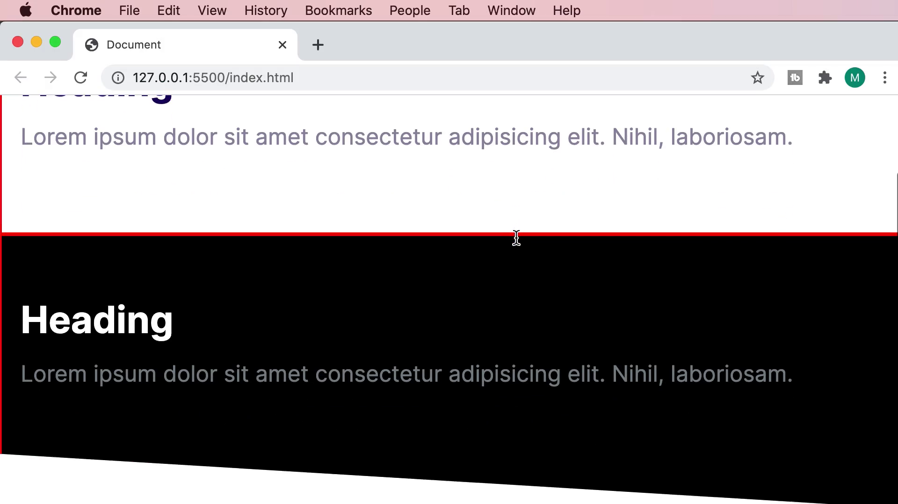

---

## 9. ทดลองใช้ CSS Custom Property (`--padding-vertical`)

Mosh สาธิตการใช้ **CSS Custom Property** (ตัวแปร CSS) เพื่อให้ค่า padding แนวตั้งของ `.block` สามารถนำไปใช้ซ้ำ (reuse) ได้ในที่อื่น โดยประกาศตัวแปรในรูปแบบ `--ชื่อตัวแปร: ค่า;` แล้วเรียกใช้ด้วยฟังก์ชัน `var(--ชื่อตัวแปร)`

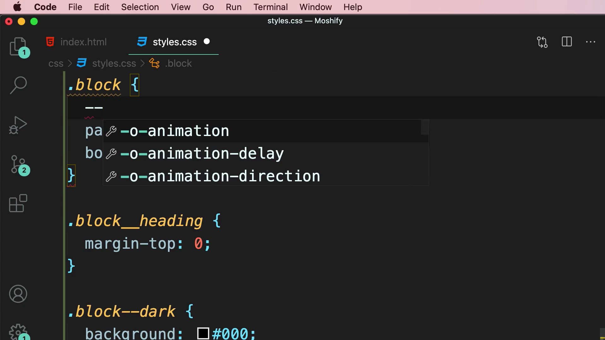

```css
.block {
  --padding-vertical: 6rem;
  padding: var(--padding-vertical) 2rem;
  border: 2px solid red;
}
```

ในขั้นแรก Mosh พิมพ์ทดลองแล้วลบออกชั่วคราวเพื่ออธิบายแนวคิดก่อน

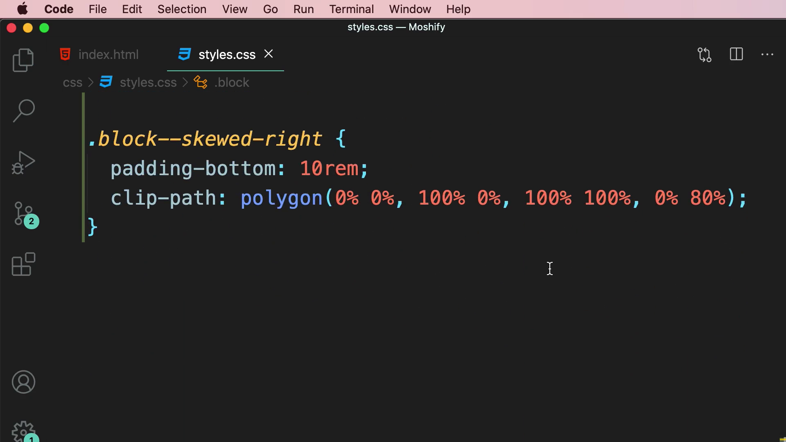

จากนั้นนำ `--padding-vertical` มาใช้ร่วมกับฟังก์ชัน `calc()` ใน `.block--skewed-right` เพื่อคำนวณค่า `padding-bottom` แบบ dynamic แทนที่จะ hardcode เป็น `10rem` ตรง ๆ

```css
.block--skewed-right {
  clip-path: polygon(0% 0%, 100% 0%, 100% 100%, 0% 80%);
  padding-bottom: calc(var(--padding-vertical) + 4rem);
}
```

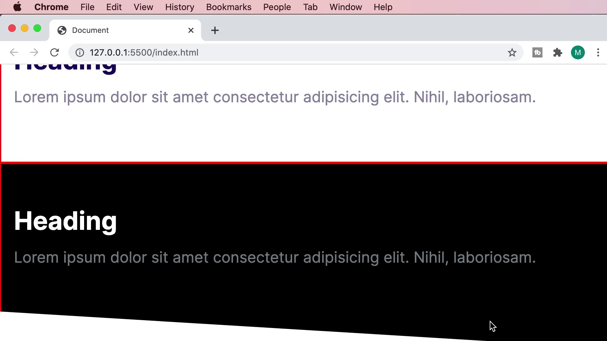

> 🔧 `calc()` คือฟังก์ชัน CSS ที่ใช้คำนวณค่าทางคณิตศาสตร์ได้โดยตรงใน stylesheet (บวก ลบ คูณ หาร) ประโยชน์คือทำให้ค่าต่าง ๆ เชื่อมโยงกัน (เช่น padding-bottom ของ skewed block จะปรับตามอัตโนมัติถ้า `--padding-vertical` เปลี่ยน) ลดการ hardcode ตัวเลขซ้ำซ้อน

---

## 10. สร้าง Block ที่สามด้วย `.block--skewed-left`

Mosh คัดลอก Block ที่สอง (dark + skewed-right) มาสร้างเป็น Block ที่สาม แล้วเปลี่ยนชื่อ modifier เป็น `block--skewed-left` เพื่อสร้างเส้นทแยงในทิศทางตรงข้าม (มุมกลับด้าน) เป็นรูปแบบที่ใช้สลับกันเมื่อวาง Block หลายอันต่อกันในหน้าเว็บจริง

```html
<section class="block block--dark block--skewed-left">
  <h2 class="block__heading">Heading</h2>
  <p>Lorem ipsum dolor sit amet consectetur adipisicing elit. Nihil, laboriosam.</p>
</section>
```

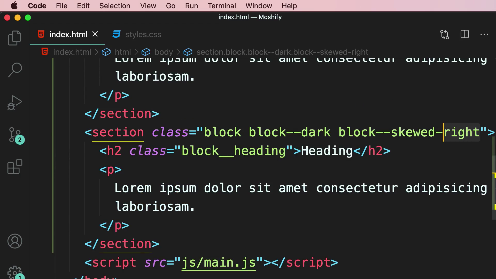

เปรียบเทียบผลลัพธ์ของ Block ทั้งสองแบบในเบราว์เซอร์ (สีขาว/ปกติ กับ สีดำ/เฉียง)

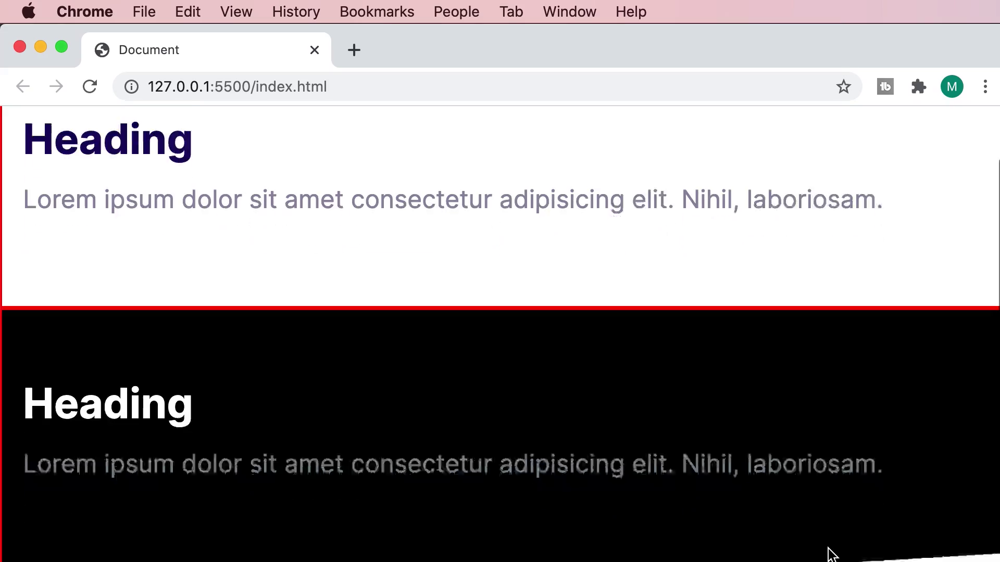

ยืนยันการประกาศ custom property `--padding-vertical` ใน `.block` แบบสมบูรณ์

```css
.block {
  --padding-vertical: 6rem;
  padding: var(--padding-vertical) 2rem;
  border: 2px solid red;
}
```

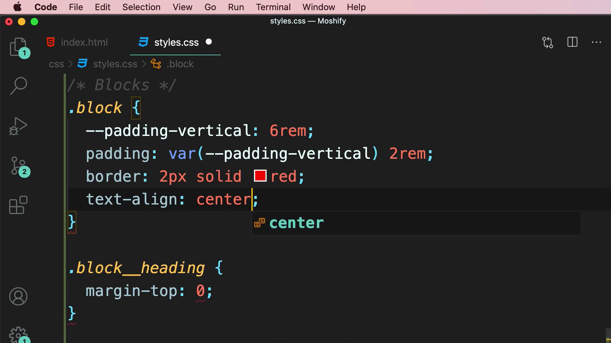

---

## 11. จัดกึ่งกลางข้อความด้วย `text-align: center`

Mosh เพิ่ม property `text-align` ให้กับ `.block` โดยพิมพ์และให้ VS Code IntelliSense แสดงตัวเลือก เช่น `text-emphasis`, `text-align`, `text-decoration`

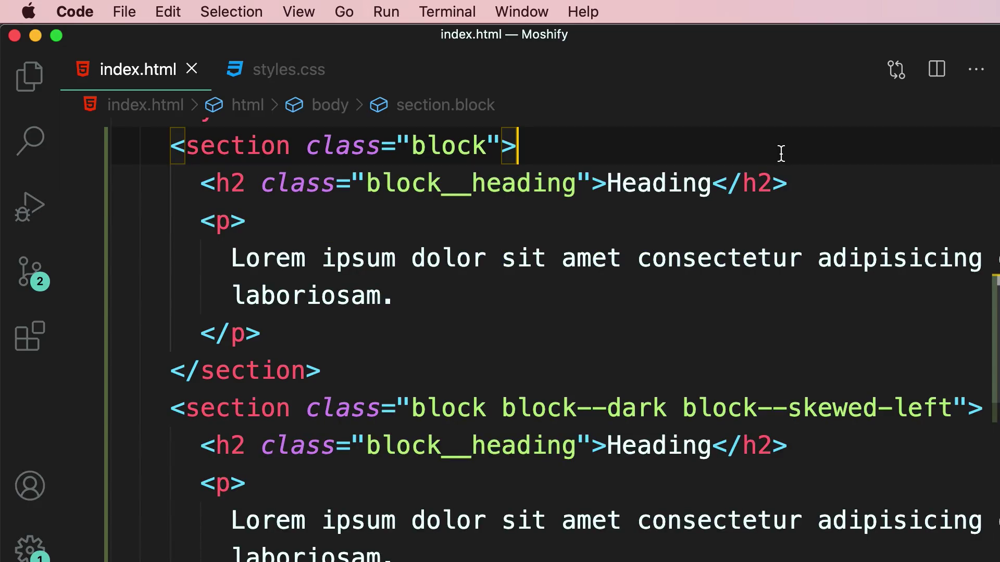

เลือกค่าเป็น `center` (จัดกึ่งกลาง)

```css
.block {
  text-align: center;
}
```

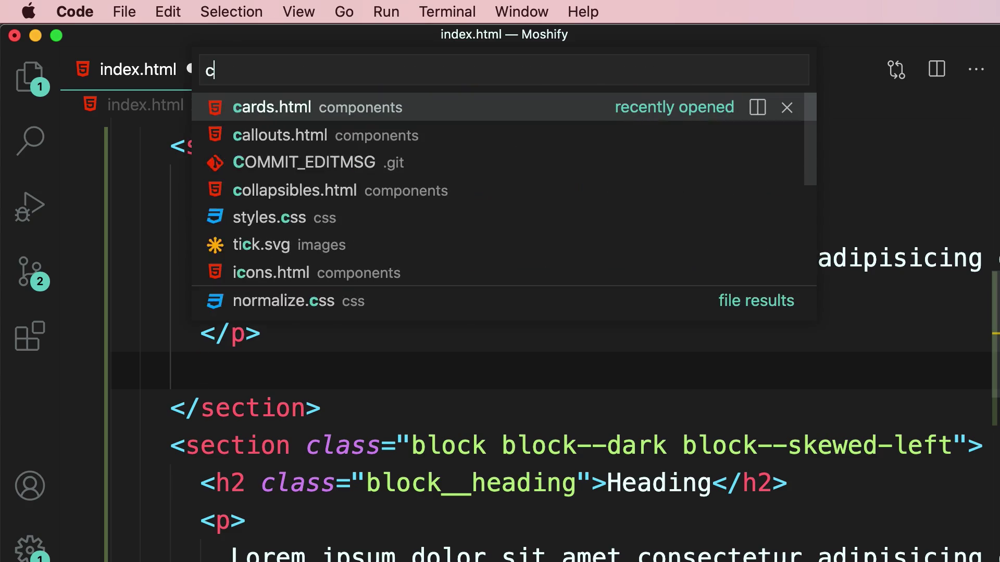

---

## 12. นำ Card Component มาวางใน Block เพื่อทดสอบ Layout จริง

เพื่อดูว่า Block ทำงานร่วมกับคอมโพเนนต์อื่น ๆ ที่เคยสร้างไว้ก่อนหน้า (เช่น Card จากคลิปก่อน ๆ) ได้อย่างไร Mosh คัดลอกโค้ด Card component (`card card--secondary`) มาวางไว้ใน Block แรก ห่อด้วย `<div style="width: 30%; padding: 4rem">` ชั่วคราวเพื่อทดสอบขนาด

```html
<section class="block">
  <h2 class="block__heading">Heading</h2>
  <p>Lorem ipsum dolor sit amet consectetur adipisicing elit. Nihil, laboriosam.</p>
  <div style="width: 30%; padding: 4rem">
    <div class="card card--secondary">
      <header class="card__header">Card Title</header>
      <div class="card__body">
        Lorem ipsum dolor sit amet consectetur, adipisicing elit. Eum, assumenda?
      </div>
    </div>
  </div>
</section>
```

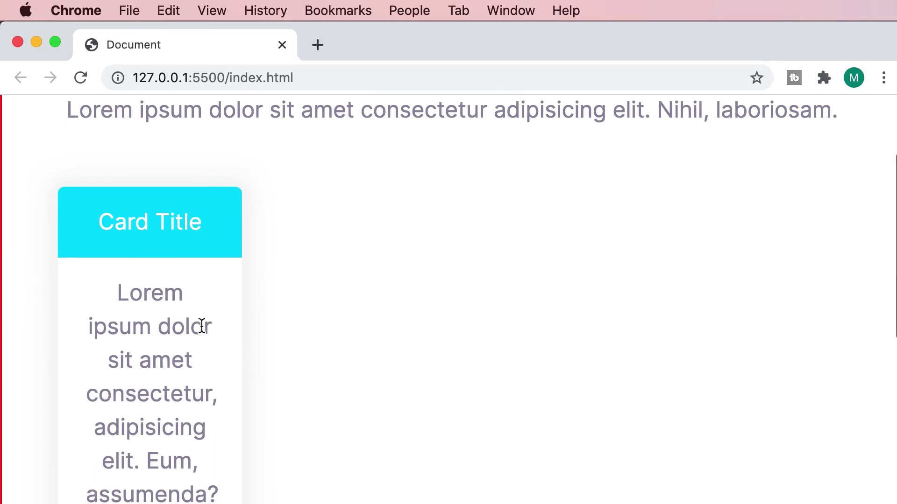

ผลลัพธ์ในเบราว์เซอร์: การ์ดสีฟ้า (Card Title) แสดงอยู่ใต้ Heading และข้อความของ Block ได้อย่างถูกต้อง

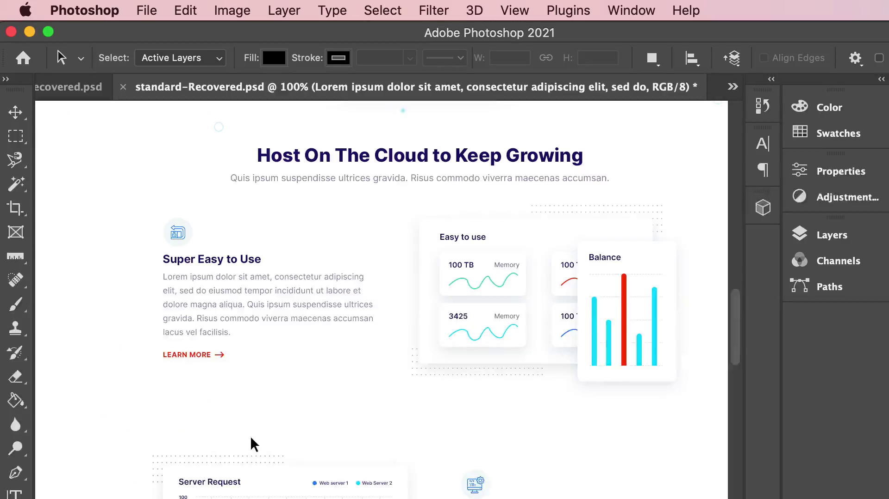

Mosh เปิด Photoshop เพื่อเปรียบเทียบผลลัพธ์กับ mockup ต้นแบบ "Host On The Cloud to Keep Growing" อีกครั้ง เพื่อยืนยันว่าโครงสร้าง Block + Card ที่สร้างขึ้นตรงกับดีไซน์

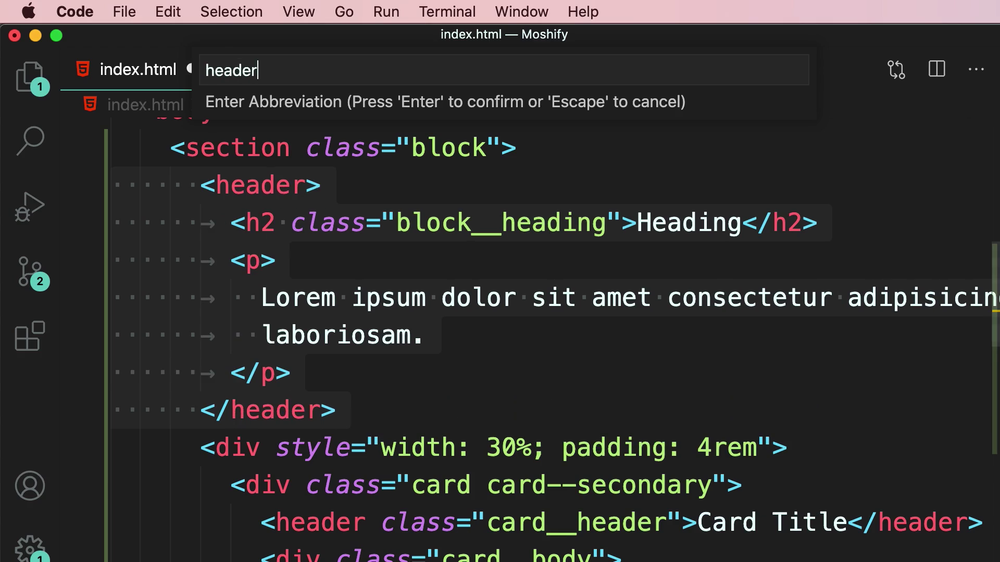

> 🔍 ขั้นตอนนี้แสดงให้เห็นแนวคิดสำคัญของการทำ Component-Based Design: เมื่อสร้าง Component ย่อย ๆ (Card, Block) แยกกันไว้แล้ว สามารถนำมาประกอบรวมกัน (compose) เป็นหน้าเว็บที่ซับซ้อนได้ง่ายขึ้นมาก

---

## 13. รีแฟคเตอร์ด้วย `<header>` และสร้าง `.block__header`

เพื่อจัดกลุ่ม Heading กับ Paragraph เข้าด้วยกันในเชิงความหมาย (semantic) Mosh ห่อ `<h2>` และ `<p>` ด้วยแท็ก `<header class="block__header">` แทนที่จะปล่อยลอยอยู่ใน section เฉย ๆ

```html
<section class="block">
  <header class="block__header">
    <h2 class="block__heading">Heading</h2>
    <p>Lorem ipsum dolor sit amet consectetur adipisicing elit. Nihil, laboriosam.</p>
  </header>
  ...
</section>
```

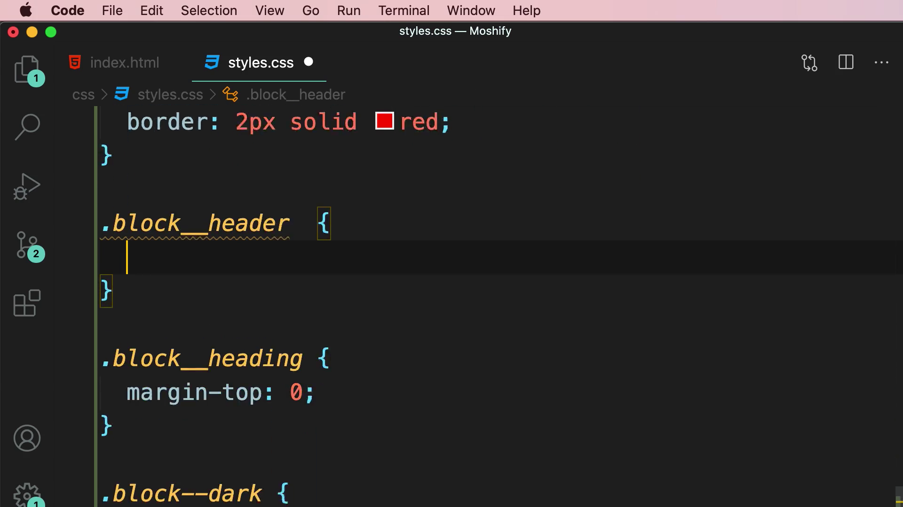

จากนั้นย้าย `text-align: center` จาก `.block` มาไว้ที่ `.block__header` แทน (เพื่อให้จัดกึ่งกลางเฉพาะส่วนหัว ไม่กระทบเนื้อหาอื่นที่อาจเพิ่มเข้ามาใน Block ภายหลัง เช่น การ์ดที่ไม่ต้องการ center)

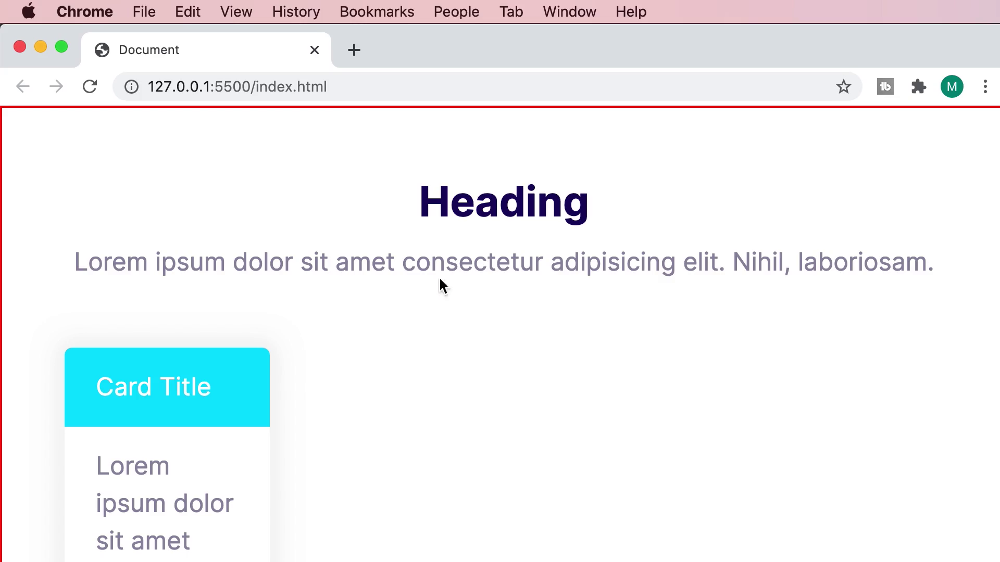

```css
.block__header {
  text-align: center;
}
```

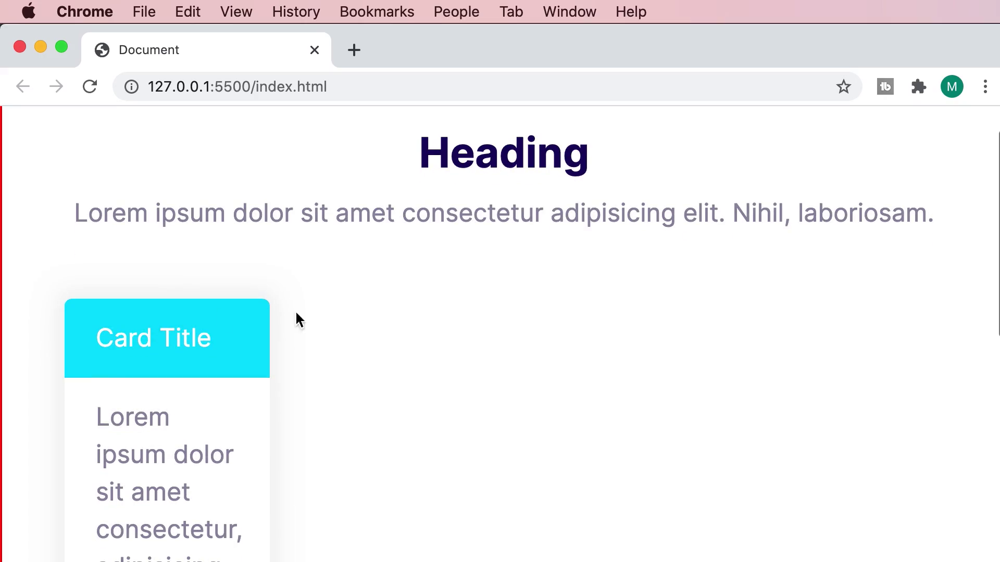

ผลลัพธ์ในเบราว์เซอร์: Heading และ paragraph อยู่กึ่งกลาง ส่วน Card ที่อยู่นอก `.block__header` ยังคงชิดซ้ายตามปกติ (ไม่ได้รับผลจาก text-align: center)

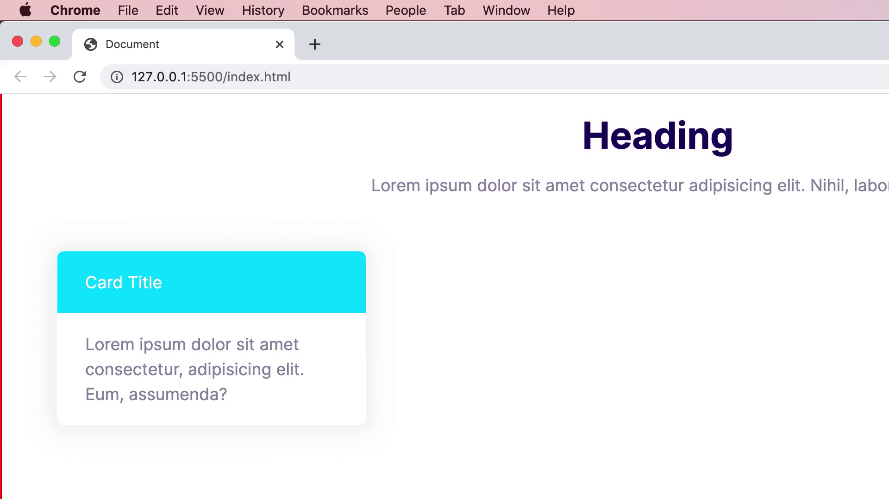

---

## 14. สร้าง Utility Class `.container`

ขั้นตอนสุดท้ายของคลิปนี้ Mosh สร้าง class ยูทิลิตี้ใหม่ชื่อ `.container` ซึ่งเป็น pattern ที่พบได้แทบทุกเว็บไซต์ ใช้สำหรับจำกัดความกว้างสูงสุดของเนื้อหาไม่ให้ขยายเต็มจอในหน้าจอกว้าง ๆ

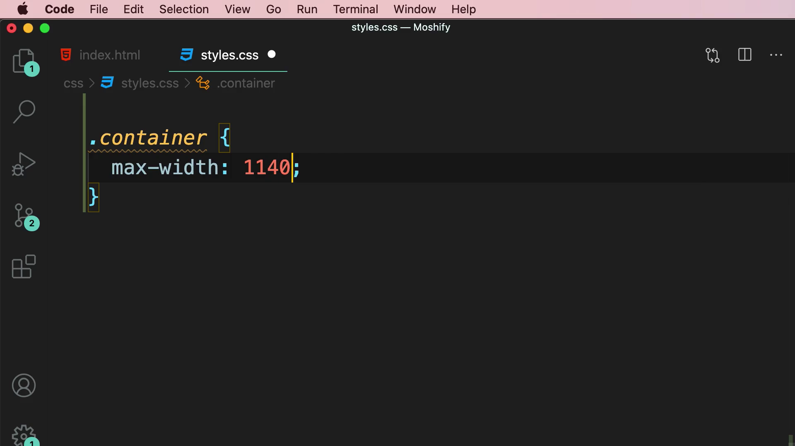

พิมพ์ property `max-width` โดย IntelliSense แสดงตัวเลือกเช่น `fit-content`, `max-content`, `min-content`, `none`

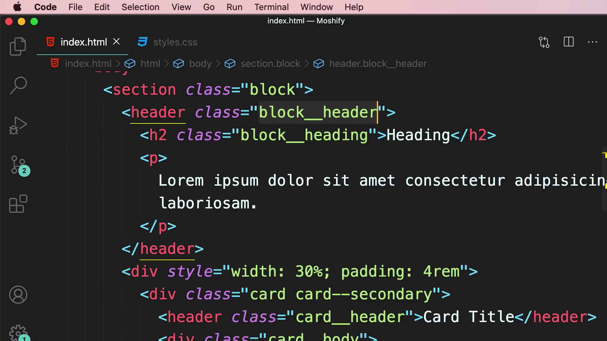

กำหนดค่าเป็น `1140px` (ค่าความกว้างสูงสุดที่นิยมใช้กันทั่วไปสำหรับ container บนเว็บ)

```css
.container {
  max-width: 1140px;
}
```


นำ class `container` ไปใส่ในแท็ก `<div class="card card--secondary">` ห่อด้วย `<div class="container">` (แทนที่ inline style เดิม) เพื่อทดสอบ


ทดลองใส่ `container` ในบล็อกที่สาม (skewed-left) แล้วพบว่าไม่จำเป็นเพราะเนื้อหาข้างในไม่ได้ล้นความกว้าง จึงลบออก


กลับไปที่ `.container` ยืนยันว่ายังมีเพียง `max-width: 1140px;`

```css
.container {
  max-width: 1140px;
}
```


จากนั้นพิมพ์ property `margin` ต่อ โดย IntelliSense แสดงตัวเลือก `margin-top`, `margin-bottom`, `margin-left`, `margin-right`


กำหนดค่าเป็น `0 auto` (บน-ล่างเป็น 0 ซ้าย-ขวาเป็น auto) ซึ่งเป็นเทคนิคคลาสสิกในการจัดให้กล่องที่มี `max-width` อยู่กึ่งกลางแนวนอนของหน้าจอ

```css
.container {
  max-width: 1140px;
  margin: 0 auto;
}
```


> 💡 เทคนิค `margin: 0 auto` ทำงานได้เพราะ browser จะคำนวณพื้นที่ว่างซ้าย-ขวาที่เหลือ (หลังจากหัก max-width ออกจากความกว้างทั้งหมด) แล้วแบ่งเท่า ๆ กันให้กับ margin ซ้ายและขวาโดยอัตโนมัติ เป็นวิธีจัดกึ่งกลางแนวนอนที่ใช้กันมากที่สุดใน CSS แบบดั้งเดิม (ก่อนยุค Flexbox/Grid)

ผลลัพธ์สุดท้ายในเบราว์เซอร์: มองเห็น Block ทั้งสามอันเรียงต่อกัน (ปกติ, ดำเฉียงขวา, ดำเฉียงซ้าย) โดย Card ถูกจำกัดความกว้างและจัดกึ่งกลางอย่างเหมาะสม


โค้ด CSS ของ `.block` และ `.block__heading` ฉบับสมบูรณ์เมื่อจบคลิป

```css
.block {
  --padding-vertical: 6rem;
  padding: var(--padding-vertical) 2rem;
  border: 2px solid red;
}

.block__header {
  text-align: center;
}

.block__heading {
  margin-top: 0;
}

.block--dark {
  background: #000;
  color: #7b858b;
}

.block--dark .block__heading {
  color: #fff;
}

.block--skewed-right {
  clip-path: polygon(0% 0%, 100% 0%, 100% 100%, 0% 80%);
  padding-bottom: calc(var(--padding-vertical) + 4rem);
}

.container {
  max-width: 1140px;
  margin: 0 auto;
}
```


---

## สรุปภาพรวมของคลิปนี้

| หัวข้อ | รายละเอียด |
|---|---|
| Component หลัก | `.block` — section เอนกประสงค์ใช้เป็นหน่วยสร้างของหน้า Landing Page |
| BEM Element | `.block__heading`, `.block__header` |
| BEM Modifier | `.block--dark`, `.block--skewed-right`, `.block--skewed-left` |
| เทคนิค CSS ใหม่ | `clip-path: polygon(...)`, CSS Custom Property (`--padding-vertical`), `calc()` |
| เครื่องมือภายนอก | Clippy (bennettfeely.com/clippy) สำหรับ generate `clip-path` แบบ visual |
| Utility class ใหม่ | `.container` (`max-width: 1140px; margin: 0 auto;`) |
| DevTools | ใช้แท็บ Computed ดู Box Model (margin/border/padding) |

### แนวคิดสำคัญที่ได้จากคลิปนี้

1. **Block คือ Component เอนกประสงค์** — ใช้ `padding`, semantic HTML (`<section>`, `<header>`) เป็นโครงสร้างพื้นฐานที่นำไปประกอบเป็น Layout ทั้งหน้าได้
2. **border สีแดงชั่วคราว** เป็นเทคนิคที่ช่วยมองเห็นขอบเขตของ element ระหว่างพัฒนา แล้วลบออกทีหลัง (debugging technique)
3. **Box Model** (`content → padding → border → margin`) อธิบายได้ชัดเจนที่สุดผ่านแท็บ Computed ใน Chrome DevTools ซึ่งช่วยหาสาเหตุของช่องว่างที่ไม่คาดคิด เช่น margin เริ่มต้นของ h2
4. **Descendant selector** (`.block--dark .block__heading`) เป็นเทคนิคสำคัญของ BEM ที่ทำให้ Element เปลี่ยนสไตล์ตาม Modifier ของ Block แม่ได้โดยไม่ต้องสร้าง class ใหม่ซ้ำซ้อน
5. **`clip-path: polygon()`** ใช้ตัดรูปทรงของ element ตามชุดจุดพิกัด และเครื่องมือ Clippy ช่วยสร้างค่าพิกัดแบบ visual ได้รวดเร็ว โดยต้องเพิ่ม `padding-bottom` ชดเชยเพื่อไม่ให้เนื้อหาถูกตัดขาด
6. **CSS Custom Property + `calc()`** (`var(--padding-vertical)`) ช่วยให้ค่าต่าง ๆ เชื่อมโยงกันแบบ dynamic ลดการ hardcode ตัวเลขซ้ำซ้อนในหลายที่
7. **`.container { max-width: 1140px; margin: 0 auto; }`** คือ pattern ยูทิลิตี้พื้นฐานที่สุดของเว็บสมัยใหม่สำหรับจำกัดความกว้างเนื้อหาและจัดกึ่งกลางแนวนอน

---

*สรุปจากคอร์ส "Building a Web Site" โดย Mosh Hamedani (codewithmosh.com) — คลิปที่ 27: Blocks*
