# HTML-CSS-3: 28 - Navigation Bars

**ไฟล์ต้นฉบับ:** 28- Navigation Bars.mp4

▶️ [ดูวิดีโอ](../../HTML-CSS-3/28-%20Navigation%20Bars.mp4)

---

## ภาพรวมคลิปนี้

คลิปนี้ Mosh เปลี่ยนบริบทจากไฟล์ทดลอง `test.html` แบบเดิม มาเป็นการทำงานในโปรเจกต์จริงที่ชื่อ **Moshify** (แถบชื่อ VS Code ขึ้นว่า `styles.css — Moshify` / `index.html — Moshify`) ซึ่งมีโครงสร้างโฟลเดอร์พร้อมอยู่แล้ว คือมีโฟลเดอร์ `css` ที่มี `styles.css`, มี `index.html`, และมี `<script src="js/main.js">` ถูกอ้างอิงไว้ใน HTML แล้ว

> 📌 **จุดสำคัญ:** ตั้งแต่คลิปนี้เป็นต้นไป งานทั้งหมดจะอยู่ในโปรเจกต์ Moshify จริง ไม่ใช่ไฟล์ทดลองแล้ว

หัวข้อหลักของคลิปคือการสร้าง **Navigation Bar** (แถบเมนูนำทาง) ตั้งแต่โครงสร้าง HTML พื้นฐาน ไปจนถึงการทำ BEM naming, เพิ่มโลโก้และไอคอนแฮมเบอร์เกอร์ (hamburger menu), ผูกกับ Collapsible component ที่เคยทำไว้ในคลิปก่อน เพื่อให้เมนูยุบ/ขยายได้บนมือถือ และสุดท้ายทำ Responsive ด้วย Media Query ให้เมนูแสดงแบบแนวนอนเต็มรูปแบบบนหน้าจอเดสก์ท็อป

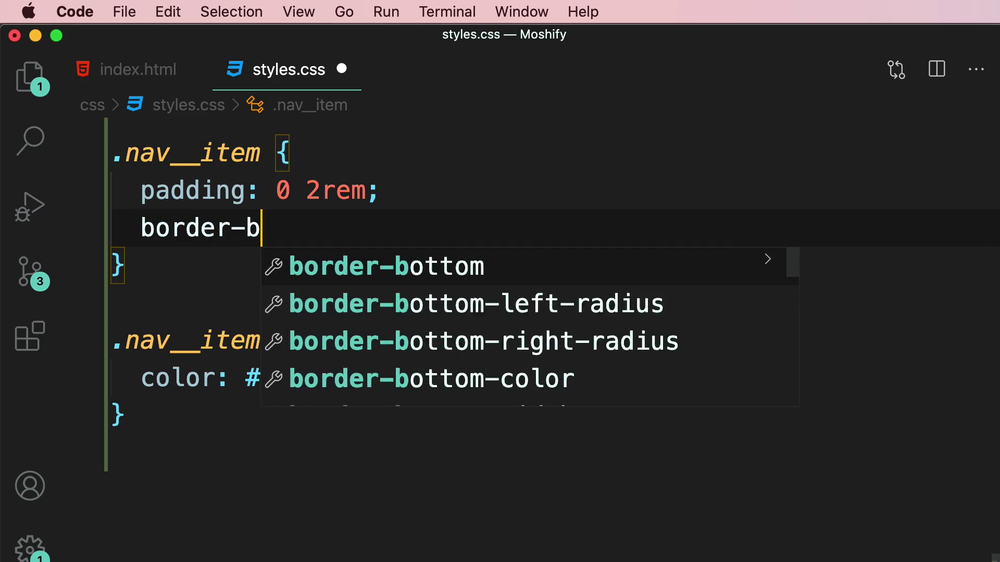

---

## 1. สร้างโครงสร้าง Nav ด้วย Emmet

Mosh สร้างแท็ก `<nav>` ด้วย Emmet abbreviation (พิมพ์ `nav` แล้วกด Tab) และใส่ class `nav`:

```html
<nav class="nav">
  <ul class="list">
    <li><a href="#">Hosting</a></li>
    <li><a href="#">VPS</a></li>
    <li><a href="#">Domain</a></li>
    <li><a href="#">Pricing</a></li>
  </ul>
</nav>
```

> 💡 ลิงก์เมนูทั้ง 4 รายการคือ Hosting, VPS, Domain, Pricing ซึ่งเป็นเมนูของเว็บโฮสติ้งสมมติ "Moshify"

จากนั้นใส่ CSS พื้นฐานให้กับ `.nav`:

```css
.nav {
  background: #000;
  display: flex;
  justify-content: space-between;
  flex-wrap: wrap;
}
```

> 📝 `display: flex` + `justify-content: space-between` ทำให้ยังไม่เห็นผลชัดเจนตอนนี้เพราะมี `<ul>` เพียงตัวเดียวอยู่ข้างใน (ยังไม่มีโลโก้) แต่เตรียมไว้สำหรับตอนที่เพิ่มโลโก้เข้ามาทีหลัง ส่วน `flex-wrap: wrap` เตรียมไว้รองรับตอนหน้าจอแคบ

---

## 2. เปลี่ยนชื่อ class ด้วย BEM: `.list` → `.nav__list`

Mosh อธิบายว่า `.list` เดิมเป็น utility class ทั่วไป (ใช้ได้กับ list หลายที่ในเว็บ) แต่ตอนนี้ต้องการ class เฉพาะสำหรับ nav เพื่อ styling เพิ่มเติม จึงเพิ่ม class ใหม่ควบคู่กันไปแบบ BEM (ไม่ลบ class เดิม):

```html
<ul class="list nav__list">
  ...
</ul>
```

> 🔧 **หลักการ BEM ที่ใช้ที่นี่:** ใส่ทั้ง utility class (`list`) และ BEM block__element class (`nav__list`) ไว้ด้วยกันในตัวเดียว เพื่อให้ได้ประโยชน์ทั้งสองแบบ — `list` ให้ style พื้นฐานร่วมกับ list อื่นๆ ในเว็บ ส่วน `nav__list` ใช้ปรับแต่งเฉพาะของ nav

CSS ของ `.nav__list`:

```css
.nav__list {
  width: 100%;
}
```

---

## 3. เพิ่ม class `.nav__item` ให้แต่ละ `<li>`

```html
<ul class="list nav__list">
  <li class="nav__item"><a href="#">Hosting</a></li>
  <li class="nav__item"><a href="#">VPS</a></li>
  <li class="nav__item"><a href="#">Domain</a></li>
  <li class="nav__item"><a href="#">Pricing</a></li>
</ul>
```

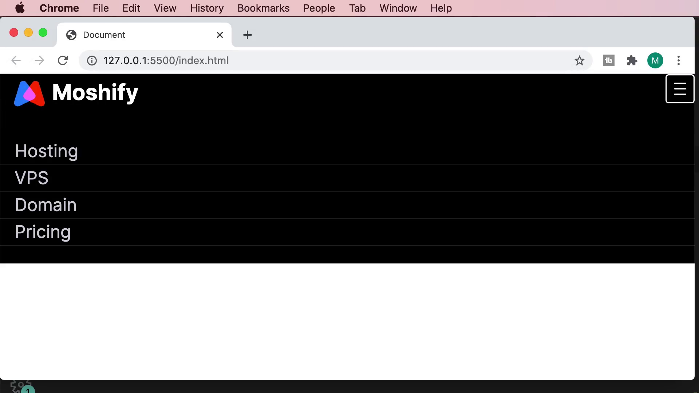

CSS:

```css
.nav__item {
  padding: 0 2rem;
  border-bottom: 1px solid saddlebrown;
}
```

> 🔍 ตอนพิมพ์สี border-bottom Mosh พิมพ์ตัวอักษร `s` แล้ว VS Code IntelliSense ขึ้นรายการสีที่ขึ้นต้นด้วย `s` ให้เลือกแบบ autocomplete เช่น:

```
saddlebrown
salmon
sandybrown
seagreen
```

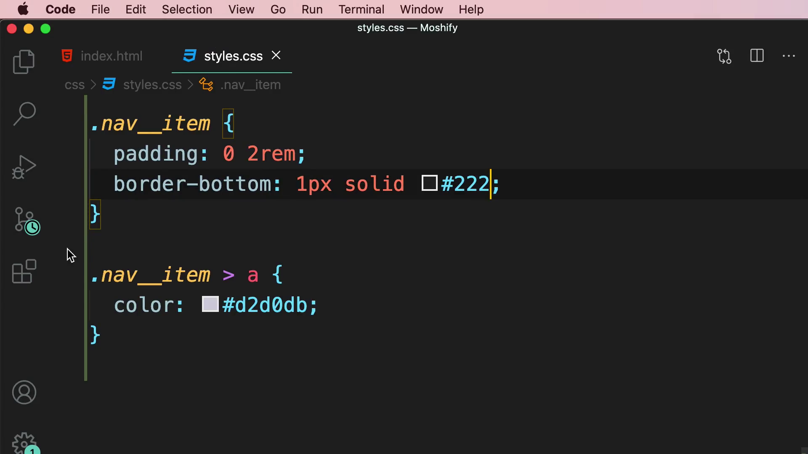

> 📝 Mosh พิมพ์สีต่างๆ เหล่านี้เล่นเพื่อโชว์ฟีเจอร์ autocomplete ของสี ก่อนตัดสินใจใช้สีเทาเข้มที่ดูกลมกลืนกับพื้นหลังดำมากกว่า

สุดท้าย Mosh ปรับ padding และเปลี่ยนสี border-bottom เป็นสีเทาเข้ม:

```css
.nav__item {
  padding: 0.5rem 2rem;
  border-bottom: 1px solid #222;
}
```

ผลลัพธ์ในเบราว์เซอร์: เห็นเส้นแบ่งบางๆ สีเทาเข้มคั่นระหว่างแต่ละเมนู (Hosting / VPS / Domain / Pricing) บนพื้นหลังสีดำ

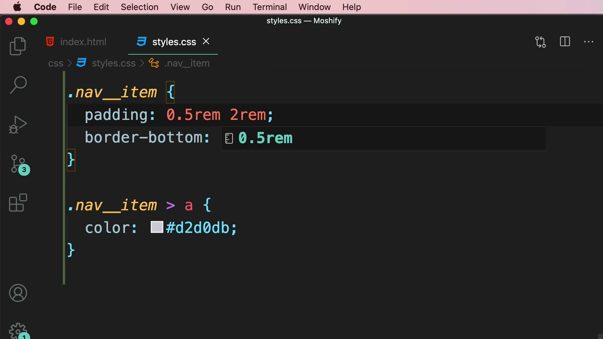

---

## 4. สีตัวอักษรลิงก์: ย้ายจาก `.nav__item` ไปที่ `.nav__item > a`

ตอนแรก Mosh ใส่สีตัวอักษรไว้ที่ `.nav__item` โดยตรง แต่อธิบายว่าในทางความหมาย (semantic) สีตัวอักษรควรอยู่ที่ตัวลิงก์ `<a>` มากกว่า เพราะ `<li>` เป็นแค่ container จึงย้ายไปใช้ **child combinator** (`>`) แทน:

```css
.nav__item > a {
  color: #d2d0db;
}
```

> 💡 `>` (child combinator) หมายถึงเลือกเฉพาะ `<a>` ที่เป็นลูกโดยตรงของ `.nav__item` เท่านั้น ไม่ลงลึกไปถึงลูกหลานอื่นๆ

---

## 5. เพิ่ม Hover State และ Transition

Mosh เพิ่ม selector `:hover` ให้ลิงก์:

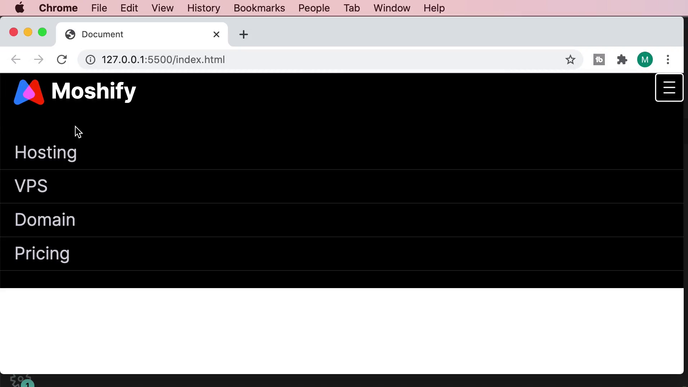

```css
.nav__item > a:hover {
  color: #fff;
}
```

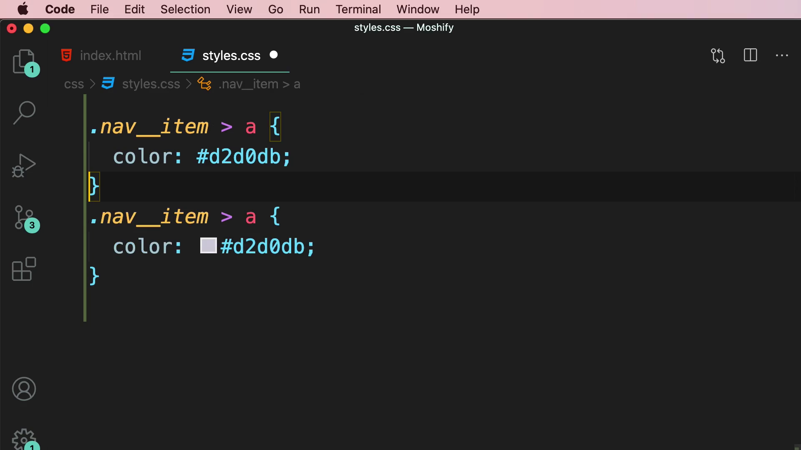

จากนั้นเพิ่ม `transition` ให้กับ `.nav__item > a` (ไม่ใช่ตัว hover) เพื่อให้การเปลี่ยนสีเวลา hover ดูนุ่มนวลขึ้น:

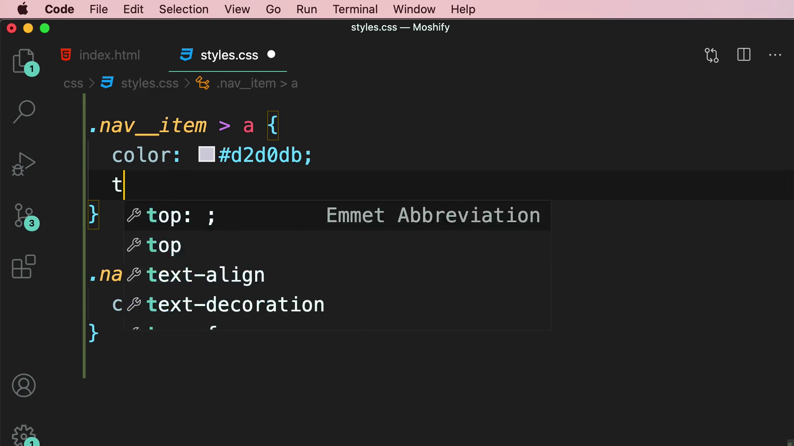

```css
.nav__item > a {
  color: #d2d0db;
  transition: color 0.3s;
}

.nav__item > a:hover {
  color: #fff;
}
```

> ⚠️ ข้อควรจำ: `transition` ต้องใส่ไว้ที่ selector ปกติ (state เริ่มต้น) ไม่ใช่ที่ `:hover` เพื่อให้ browser รู้ว่าต้อง animate การเปลี่ยนแปลงทั้งตอนเข้า (hover) และตอนออก (mouse leave)

---

## 6. เพิ่มโลโก้และไอคอนแฮมเบอร์เกอร์ (Hamburger Menu Icon)

Mosh เพิ่ม HTML สำหรับโลโก้ (เป็นลิงก์ที่มี ``) และไอคอนเมนูแบบ SVG sprite ที่อ้างอิงไฟล์ `images/sprite.svg` symbol ชื่อ `#menu`:

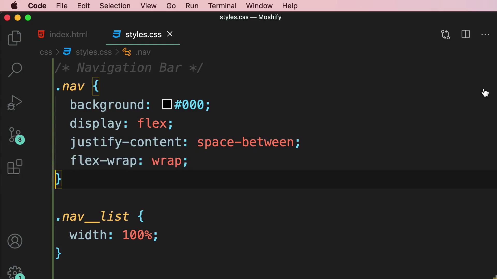

```html
<nav class="nav">
  <a href="/"></a>
  <svg class="icon icon--white nav__toggler">
    <use xlink:href="images/sprite.svg#menu"></use>
  </svg>
  <ul class="list nav__list">
    <li class="nav__item"><a href="#">Hosting</a></li>
    <li class="nav__item"><a href="#">VPS</a></li>
    <li class="nav__item"><a href="#">Domain</a></li>
    <li class="nav__item"><a href="#">Pricing</a></li>
  </ul>
</nav>
```

> 📌 ไอคอนแฮมเบอร์เกอร์ใช้ class เดิมที่เคยสร้างไว้แล้ว (`icon`, `icon--white`) ผสมกับ class ใหม่เฉพาะของ nav คือ `nav__toggler` — นี่คือปุ่มสำหรับกดเปิด/ปิดเมนูบนมือถือ

จากนั้นเพิ่ม padding ให้ `.nav`:

```css
.nav {
  background: #000;
  display: flex;
  justify-content: space-between;
  flex-wrap: wrap;
  padding: 1rem;
}
```

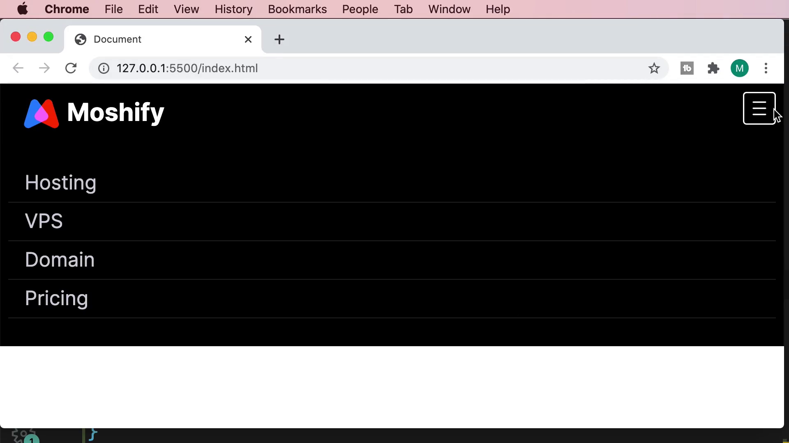

ผลลัพธ์: เห็นโลโก้ Moshify (ไอคอนสามเหลี่ยมสี + ข้อความ "Moshify") อยู่ซ้าย และไอคอนแฮมเบอร์เกอร์ (เส้น 3 เส้น) อยู่ขวาสุด เพราะ `justify-content: space-between`

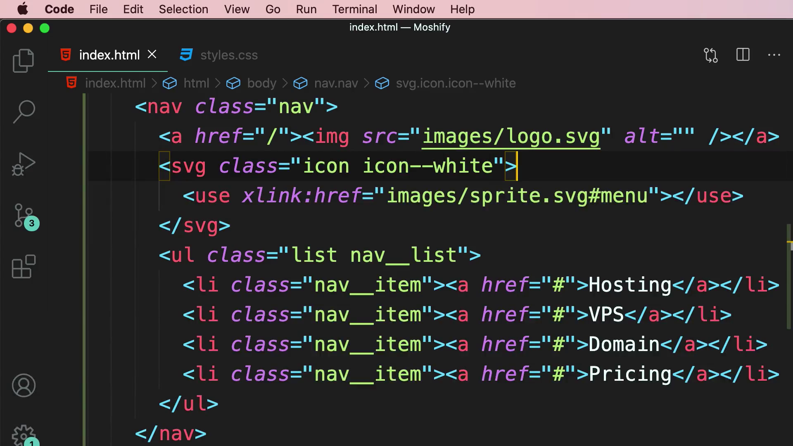

---

## 7. ปรับความโปร่งใสไอคอนแฮมเบอร์เกอร์

```css
.nav__toggler {
  opacity: 0.5;
}
```

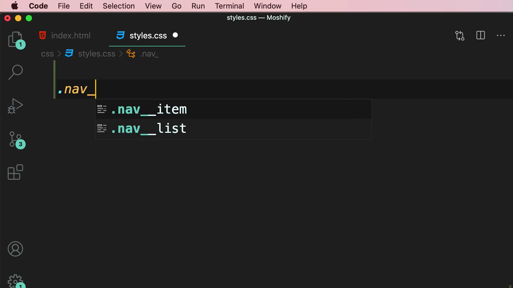

> 💡 การลดความทึบของไอคอนลงเหลือ 50% ทำให้ไอคอนดูนุ่มนวลกว่าสีขาวเต็มร้อย ไม่แย่งความสนใจจากโลโก้มากเกินไป

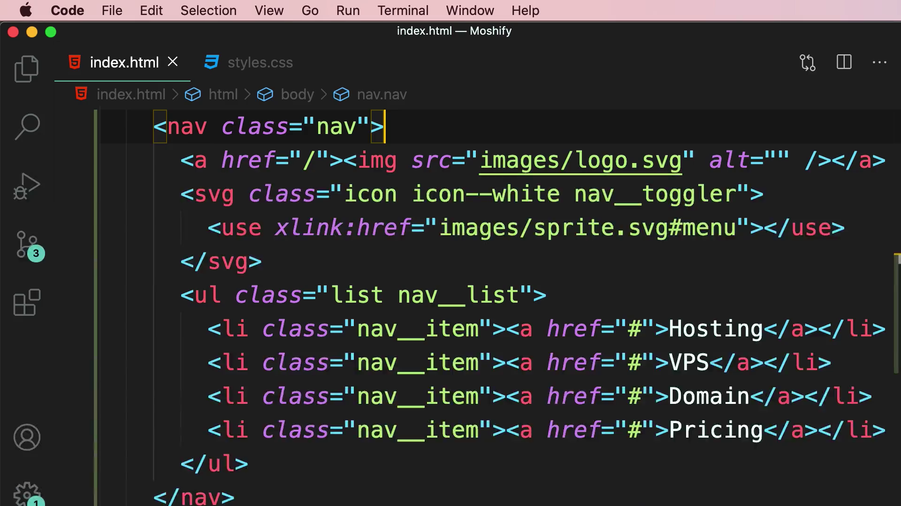

---

## 8. เชื่อม Nav เข้ากับ Collapsible Component

ในคลิปก่อนหน้า (Collapsibles) Mosh ได้สร้าง component "Collapsible" ที่ใช้ JavaScript สลับ class `collapsible--expanded` เพื่อยุบ/ขยายเนื้อหา คลิปนี้นำ pattern เดียวกันมาใช้กับ Nav โดยเพิ่ม class `collapsible` ให้ `<nav>` และ `collapsible__content` ให้ `<ul>`:

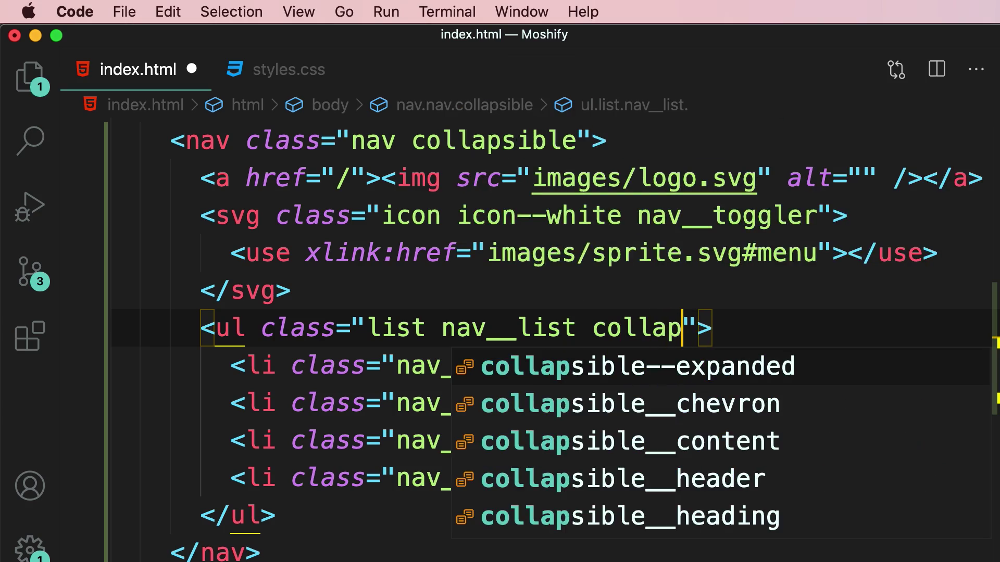

```html
<nav class="nav collapsible">
```

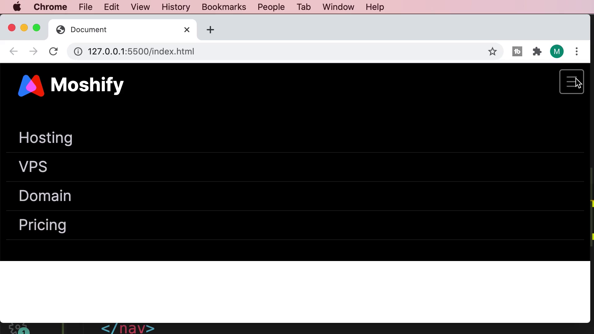

```html
<ul class="list nav__list collapsible__content">
```

> 🔧 การนำ Component (Collapsible) ที่เคยสร้างไว้มาผสมกับ Component ใหม่ (Nav) โดยใส่ class คู่กัน คือแนวคิดสำคัญของ BEM/Component-based CSS — Component หนึ่งสามารถ "ประกอบ" เข้ากับ Component อื่นได้โดยไม่ต้องเขียนโค้ดซ้ำ

---

## 9. ตรวจสอบด้วย DevTools: Collapsible ยุบเนื้อหาเหลือความสูง 0

Mosh เปิด Chrome DevTools เพื่อตรวจสอบ element `<ul class="list nav__list collapsible__content">` และ `.nav__toggler`:

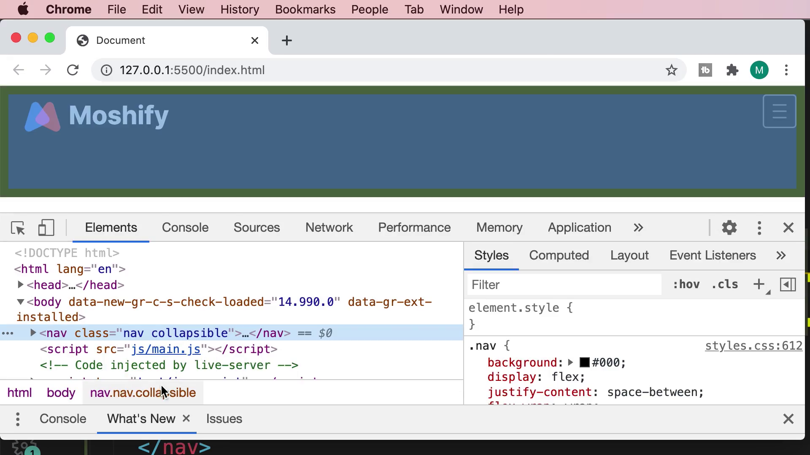

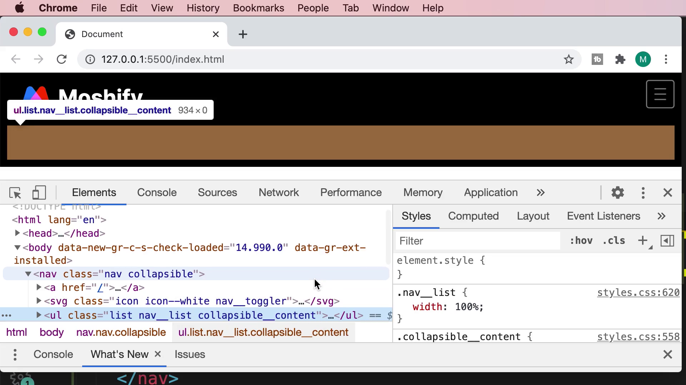

> 📝 เพราะ CSS ของ `.collapsible__content` (จากคลิปก่อนหน้า) กำหนด `max-height: 0; overflow: hidden;` เป็นค่าเริ่มต้น เมนู Hosting/VPS/Domain/Pricing จึงถูกซ่อนไปโดยอัตโนมัติเมื่อผูก class `collapsible` เข้ากับ nav — นี่คือพฤติกรรมที่ต้องการสำหรับเมนูมือถือ (ซ่อนไว้ก่อน กดปุ่มแฮมเบอร์เกอร์แล้วค่อยขยายออกมา)

---

## 10. แก้ไข margin ของ `.nav__list`

เนื่องจาก `<ul>` มี margin เริ่มต้นจาก browser (user-agent stylesheet) Mosh จึงรีเซ็ตด้วย:

```css
.nav__list {
  width: 100%;
  margin: 0;
}
```

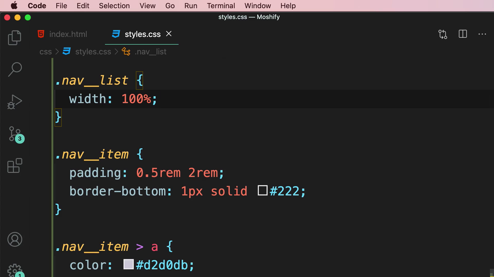

---

## 11. ปรับ padding ของ `.nav` เป็น `0 1rem`

```css
.nav {
  background: #000;
  display: flex;
  justify-content: space-between;
  flex-wrap: wrap;
  padding: 0 1rem;
}
```

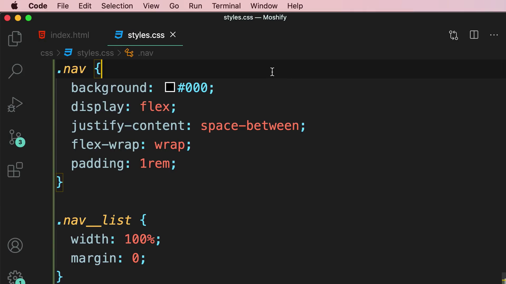

> 💡 เปลี่ยนจาก padding รอบด้านเท่ากัน (`1rem`) เป็น padding แนวตั้งเป็น 0 แนวนอนคงไว้ที่ `1rem` เพื่อให้ปุ่มแฮมเบอร์เกอร์และโลโก้ชิดขอบบน-ล่างมากขึ้น เตรียมจัดแนวให้สวยงามในขั้นถัดไป

---

## 12. จัดแนวกึ่งกลางแนวตั้งด้วย `align-items: center`

```css
.nav {
  background: #000;
  display: flex;
  justify-content: space-between;
  flex-wrap: wrap;
  align-items: center;
  padding: 0 1rem;
}
```

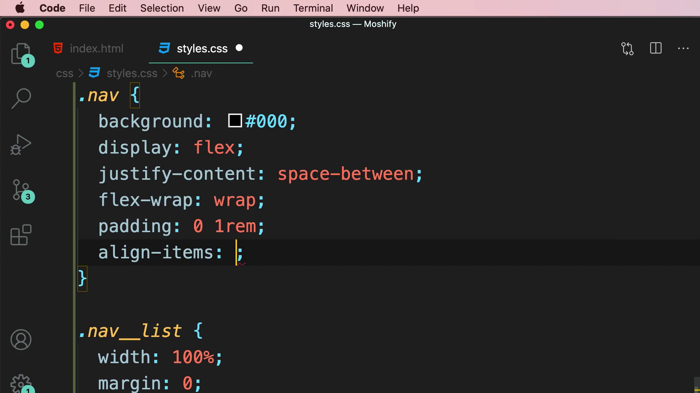

> 📝 `align-items: center` จัดโลโก้และไอคอนแฮมเบอร์เกอร์ให้อยู่กึ่งกลางแนวตั้งของแถบ nav แม้ทั้งสองจะมีความสูงไม่เท่ากัน

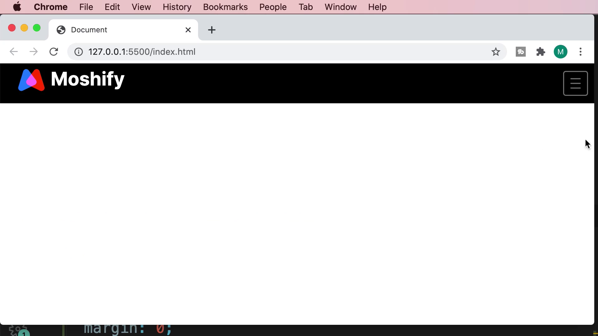

---

## 13. Highlight ไอคอนแฮมเบอร์เกอร์เมื่อเมนูถูกขยาย (Focus Indicator)

Mosh เพิ่ม selector ใหม่โดยใช้ class คู่ `.nav.collapsible--expanded` (เจาะจงว่าต้องเป็น nav ที่กำลังขยายอยู่เท่านั้น ไม่ใช่ collapsible อื่นในหน้าเว็บ) ตามด้วย descendant selector ไปยัง `.nav__toggler`:

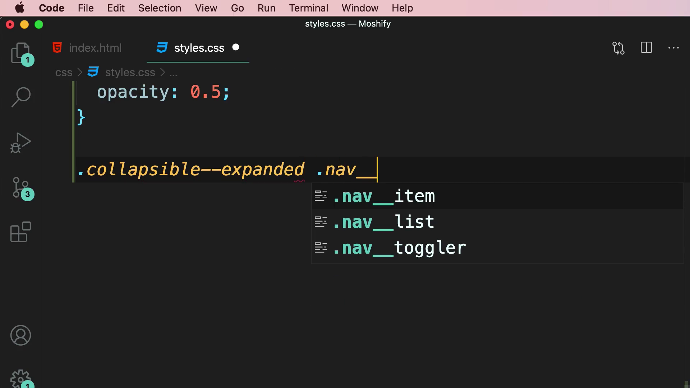

```css
.nav.collapsible--expanded .nav__toggler {
  opacity: 1;
  box-shadow: 0 0 0 3px #666;
  border-radius: 5px;
}
```

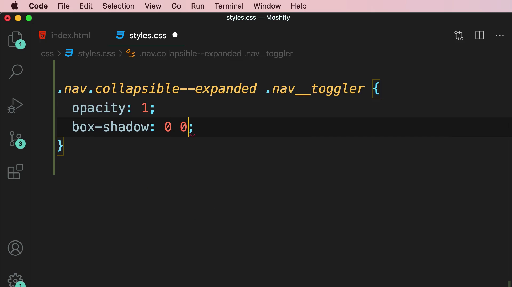

> 🔧 `box-shadow: 0 0 0 3px #666` คือเทคนิคการสร้างกรอบ (ring) รอบไอคอนโดยไม่ใช้ `border` จริง — ค่า 2 ตัวแรก (offset-x, offset-y) เป็น 0, ค่าที่ 3 (blur) เป็น 0 เช่นกัน แต่ค่าที่ 4 (spread) เป็น `3px` ทำให้เกิดเป็นเส้นกรอบหนา 3px รอบตัว element พอดี

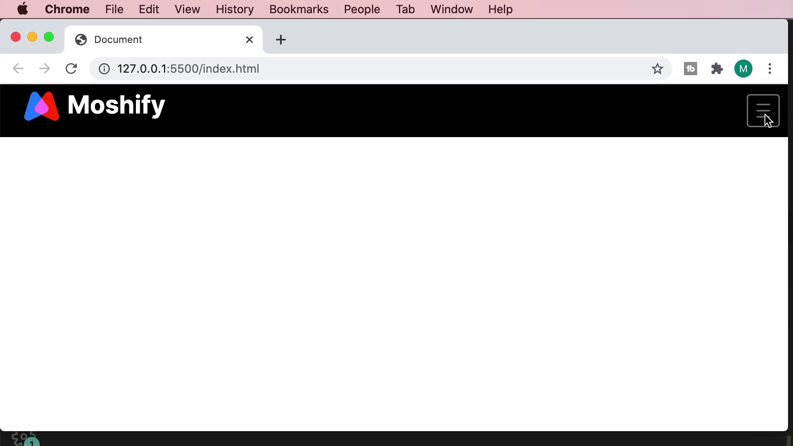

> 💡 `.nav.collapsible--expanded .nav__toggler` (ไม่ใช่ `.collapsible--expanded .nav__toggler` เฉยๆ) เจาะจงว่าต้องเป็น element ที่มีทั้ง class `nav` และ `collapsible--expanded` พร้อมกัน เพื่อป้องกันไม่ให้ style นี้ไปกระทบ Collapsible component อื่นที่ไม่ใช่ nav ในหน้าเว็บเดียวกัน

---

## 14. เพิ่ม `cursor: pointer` ให้ไอคอนแฮมเบอร์เกอร์

```css
.nav__toggler {
  opacity: 0.5;
  transition: box-shadow 0.15s;
  cursor: pointer;
}
```

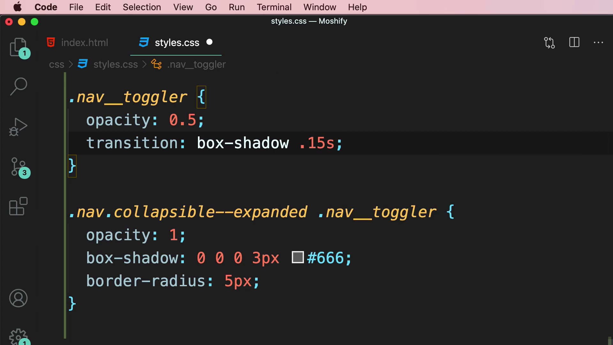

> 📌 เพิ่ม `transition: box-shadow 0.15s;` ควบคู่กันด้วย เพื่อให้กรอบ (box-shadow) ที่ปรากฏตอนขยายเมนูค่อยๆ แสดงผลอย่างนุ่มนวลแทนที่จะกระตุกทันที ส่วน `cursor: pointer` ทำให้เมาส์เปลี่ยนเป็นรูปมือเมื่อชี้ไปที่ไอคอน บอกผู้ใช้ว่าคลิกได้

---

## 15. ทำ Responsive ด้วย Media Query สำหรับหน้าจอเดสก์ท็อป

Mosh สร้าง media query ใหม่:

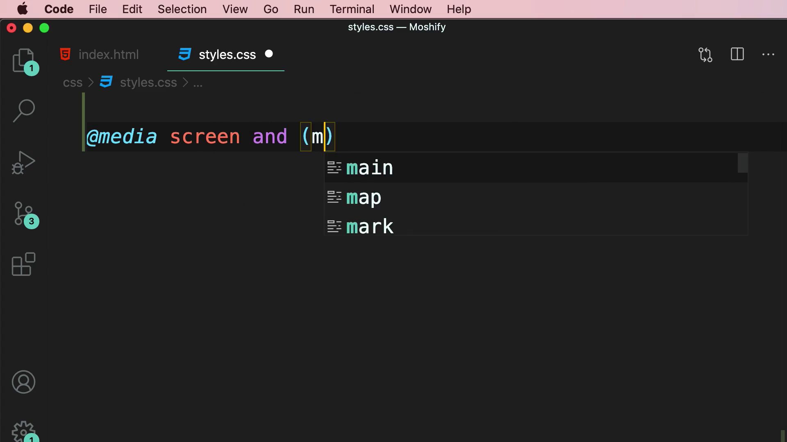

```css
@media screen and (min-width: 768px) {
  .nav__toggler {
    display: none;
  }

  .nav__list {
    width: auto;
    display: flex;
    font-size: 1.6rem;
    max-height: 100%;
    opacity: 1;
  }

  .nav__item {
    border: 0;
  }
}
```

### 15.1 ซ่อนไอคอนแฮมเบอร์เกอร์บนจอใหญ่

```css
.nav__toggler {
  display: none;
}
```

> 💡 บนหน้าจอเดสก์ท็อป (กว้างตั้งแต่ 768px ขึ้นไป) ไม่จำเป็นต้องมีปุ่มแฮมเบอร์เกอร์ เพราะจะแสดงเมนูทั้งหมดตลอดเวลาอยู่แล้ว

### 15.2 แสดง `.nav__list` เป็นแถวแนวนอนเต็มรูปแบบ

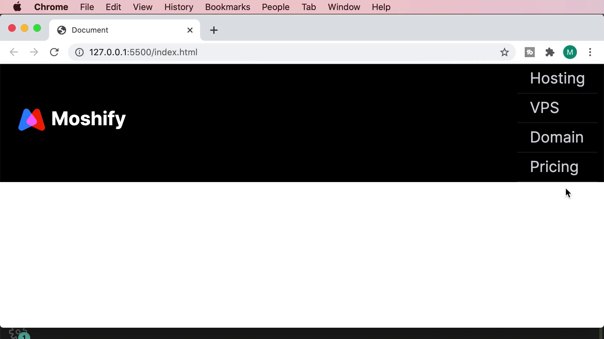

```css
.nav__list {
  width: auto;
  display: flex;
}
```

ผลลัพธ์: เมนู Hosting, VPS, Domain, Pricing เรียงแนวนอนข้างกันแล้วบนหน้าจอกว้าง

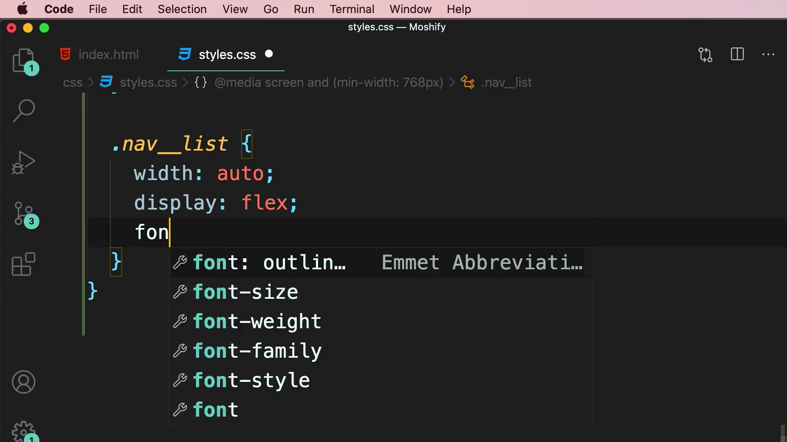

### 15.3 ปรับขนาดตัวอักษรเมนู

```css
.nav__list {
  width: auto;
  display: flex;
  font-size: 1.6rem;
}
```

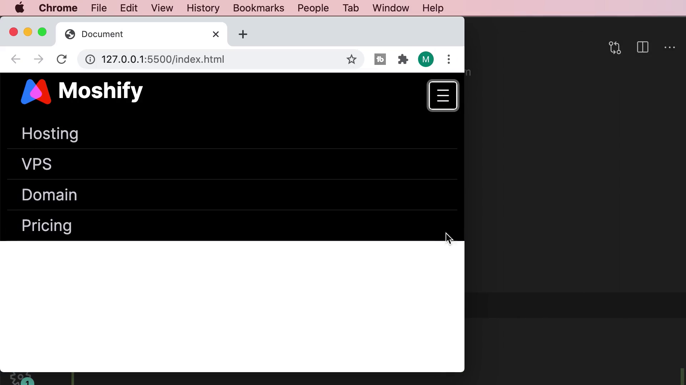

### 15.4 เอาเส้นขอบล่างออกจากแต่ละ item

```css
.nav__item {
  border: 0;
}
```

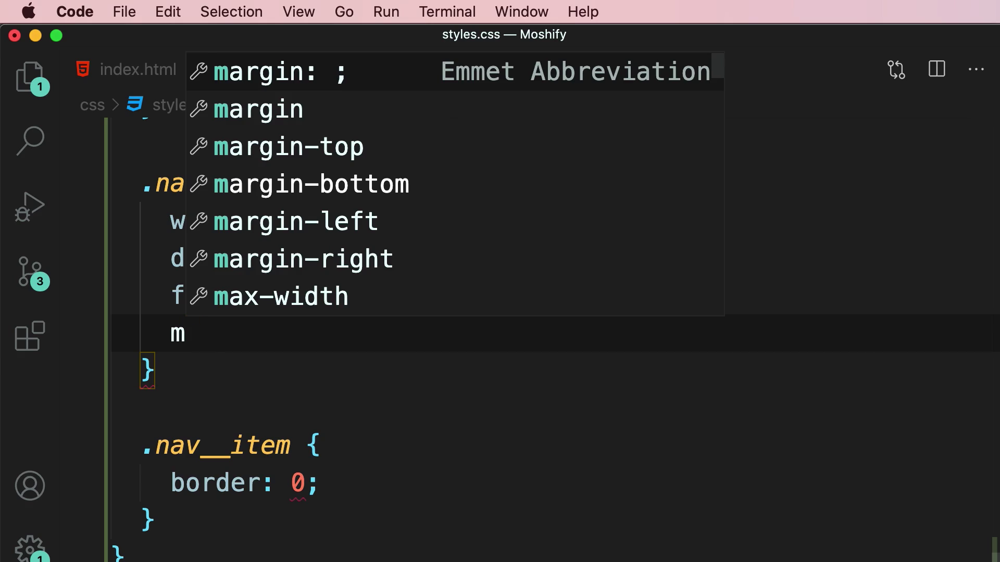

> 📝 เส้น `border-bottom` ที่ใส่ไว้ตอนต้น (สำหรับคั่นเมนูแนวตั้งบนมือถือ) ไม่จำเป็นอีกต่อไปเมื่อเมนูเรียงแนวนอนบนจอใหญ่ จึงต้องรีเซ็ตด้วย `border: 0` ใน media query

### 15.5 เพิ่ม `max-height` และ `opacity` ให้ `.nav__list` เพื่อแก้ปัญหาจาก Collapsible

```css
.nav__list {
  width: auto;
  display: flex;
  font-size: 1.6rem;
  max-height: 100%;
  opacity: 1;
}
```

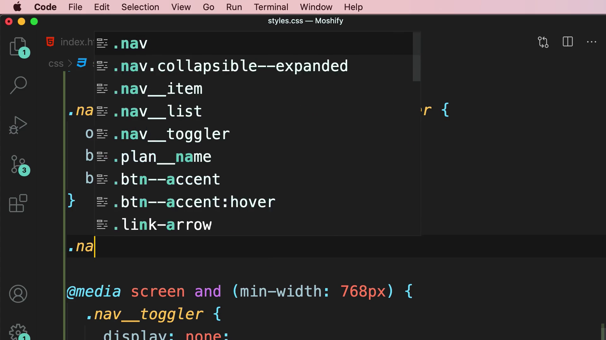

> ⚠️ **จุดสำคัญ:** เพราะ `<nav>` ยังคง class `collapsible` และ `<ul>` ยังคง class `collapsible__content` ติดอยู่แม้บนหน้าจอเดสก์ท็อป (ไม่ได้ลบออก) เมนูจึงยังถูกจำกัดด้วย `max-height: 0` และ `opacity` จาก Collapsible component ที่ควบคุมสถานะยุบ/ขยายผ่าน JavaScript อยู่ — ถ้าไม่ Override ค่าเหล่านี้ใน media query เมนูจะไม่แสดงผลบนจอใหญ่เลยแม้จะตั้ง `display: flex` แล้วก็ตาม การเพิ่ม `max-height: 100%; opacity: 1;` จึงเป็นการบังคับให้เมนูแสดงผลเสมอบนหน้าจอเดสก์ท็อป โดยไม่สนใจสถานะ collapsible--expanded

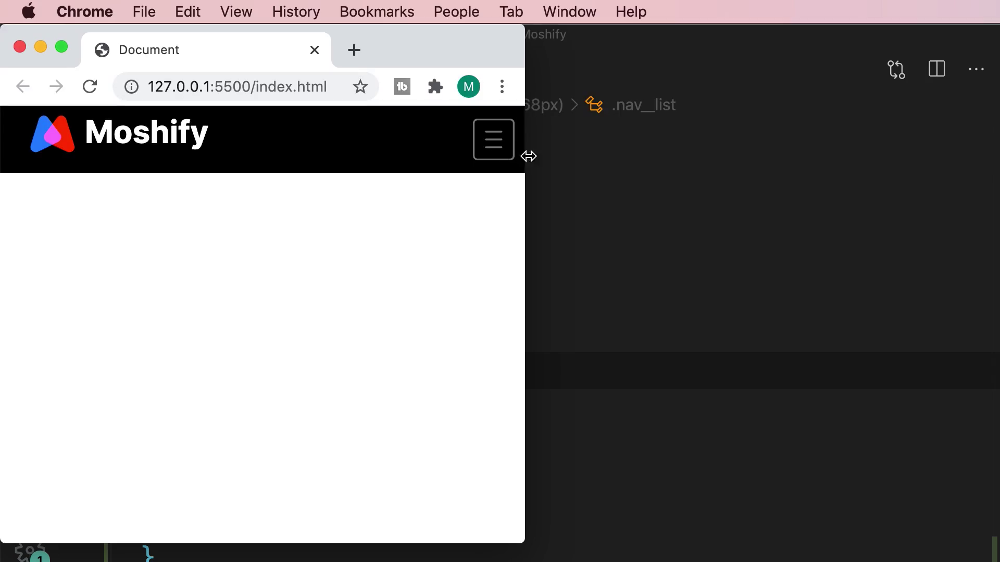

---

## 16. เพิ่ม class `.nav__brand` ให้โลโก้

Mosh กลับไปที่ HTML และเพิ่ม class เฉพาะให้ลิงก์โลโก้:

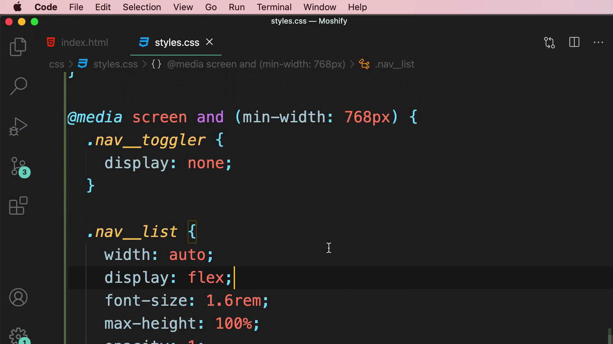

```html
<a class="nav__brand" href="/"></a>
```

---

## 17. จัดตำแหน่งโลโก้ด้วย `transform: translateY()`

```css
.nav__brand {
  transform: translateY(3px);
}
```

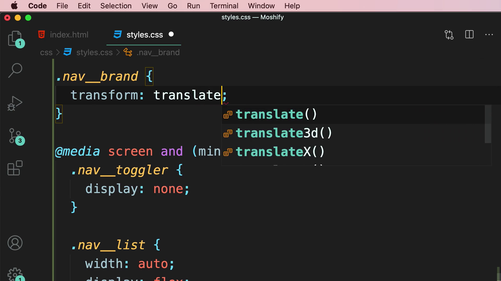

> 🔍 Mosh สังเกตว่าโลโก้ดูสูงกว่าเมนูเล็กน้อยเมื่อเทียบกับข้อความเมนู (baseline ไม่ตรงกันพอดี) จึงใช้ `transform: translateY(3px)` เลื่อนโลโก้ลงมา 3 พิกเซลตามแนวแกน Y เพื่อให้ดูจัดวางสมดุลมากขึ้น โดยไม่กระทบ layout ของ element อื่นๆ เลย (เพราะ `transform` ไม่ส่งผลต่อ document flow)

ผลลัพธ์สุดท้าย: Navigation Bar ที่สมบูรณ์ ทั้งบนมือถือ (แบบยุบ/ขยายด้วยไอคอนแฮมเบอร์เกอร์) และบนเดสก์ท็อป (แบบแนวนอนเต็มรูปแบบ พร้อมโลโก้จัดวางสวยงาม)

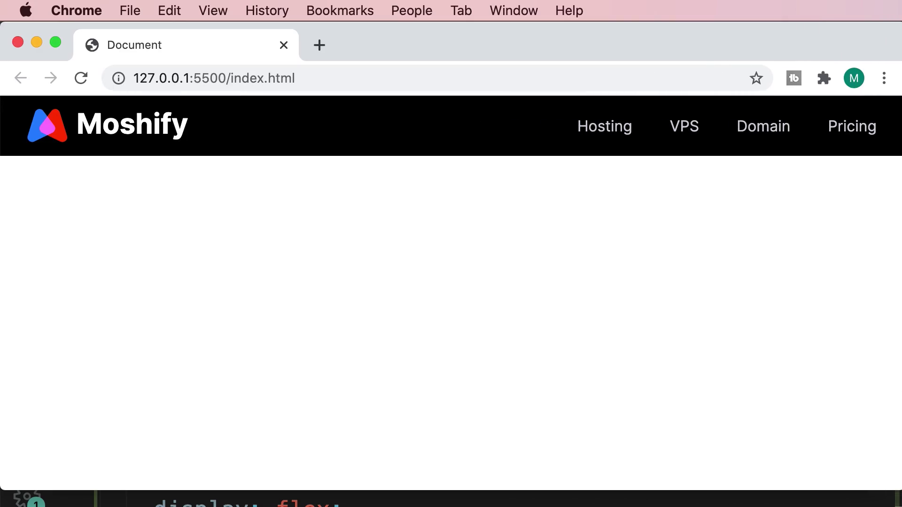

---

## สรุปภาพรวมของคลิปนี้

| หัวข้อ | รายละเอียด |
|---|---|
| บริบทโปรเจกต์ | เปลี่ยนจาก test.html มาเป็นโปรเจกต์จริง "Moshify" |
| HTML หลัก | `<nav class="nav collapsible">` ครอบ โลโก้ + ไอคอน SVG แฮมเบอร์เกอร์ + `<ul class="list nav__list collapsible__content">` |
| BEM naming | `.nav`, `.nav__list`, `.nav__item`, `.nav__toggler`, `.nav__brand` |
| Flexbox ของ nav | `display: flex; justify-content: space-between; align-items: center; flex-wrap: wrap;` |
| ผูกกับ Collapsible | ใช้ class `collapsible` / `collapsible--expanded` / `collapsible__content` ที่เคยสร้างไว้ ควบคุมยุบ/ขยายเมนูมือถือ |
| Responsive | `@media screen and (min-width: 768px)` ซ่อนไอคอนแฮมเบอร์เกอร์ แสดงเมนูแนวนอนเต็มรูปแบบ พร้อม override `max-height`/`opacity` จาก Collapsible |
| จัดตำแหน่งโลโก้ | `transform: translateY(3px)` เพื่อแก้ baseline ให้ตรงกับเมนู |

### แนวคิดสำคัญที่ได้จากคลิปนี้

1. **BEM ใช้ควบคู่กับ Utility class ได้** — ใส่ทั้ง `.list` (utility) และ `.nav__list` (BEM) ในตัวเดียวกัน เพื่อได้ทั้ง style พื้นฐานร่วมและ style เฉพาะจุด
2. **Child combinator (`>`)** ใช้เจาะจงเลือกเฉพาะลูกโดยตรง เช่น `.nav__item > a` เพื่อวาง style ไว้บน element ที่มีความหมายตรงที่สุด (สีตัวอักษรควรอยู่ที่ `<a>` ไม่ใช่ `<li>`)
3. **`transition` ต้องอยู่ที่ state ปกติ ไม่ใช่ที่ `:hover`** เพื่อให้ animate ได้ทั้งตอนเข้าและตอนออกจาก hover
4. **การประกอบ Component เข้าด้วยกัน (Composition)** — นำ Collapsible component ที่เคยสร้างไว้มาผูกกับ Nav component ใหม่ โดยใส่ class คู่กัน ไม่ต้องเขียน JavaScript หรือ CSS ใหม่ทั้งหมด
5. **ระวัง side-effect จาก Component ที่ผูกกัน** — เมื่อ Nav มี class `collapsible` ติดอยู่ตลอดเวลา ต้อง Override ค่า `max-height`/`opacity` ใน media query ของจอใหญ่ ไม่เช่นนั้นเมนูจะไม่แสดงผลเพราะโดน Collapsible ควบคุมไว้
6. **`transform: translateY()`** เป็นเครื่องมือเล็กๆ ที่มีประโยชน์มากสำหรับการจัดตำแหน่ง element แบบละเอียด (fine-tuning) โดยไม่กระทบ layout โดยรวม

---

*สรุปจากคลิปการสอนของ Mosh Hamedani (Code with Mosh) — คอร์ส Building a Web Site with HTML & CSS, คลิปที่ 28: Navigation Bars*
